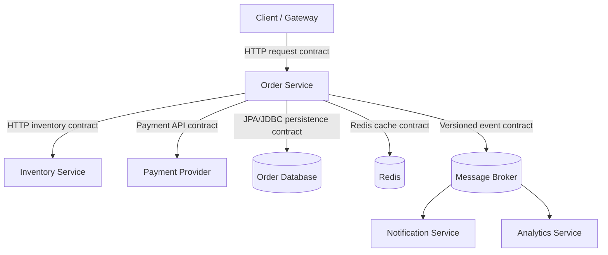
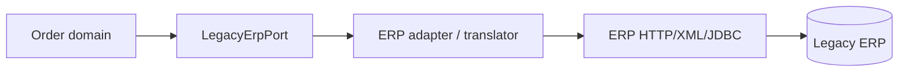
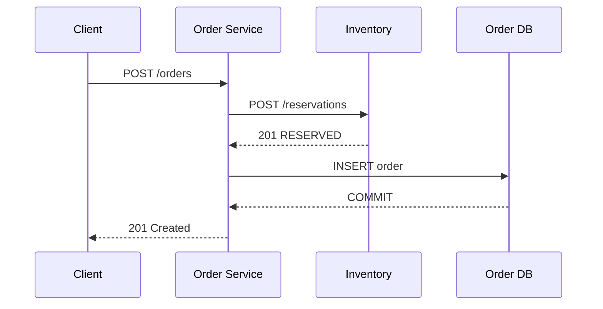
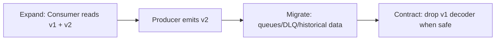
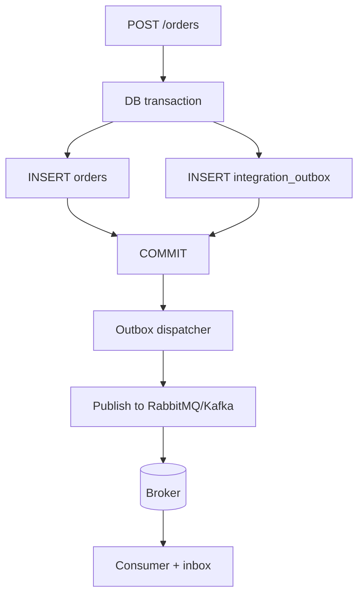
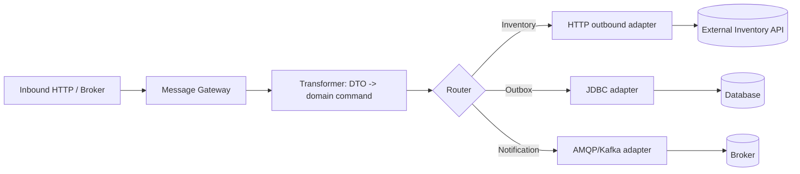
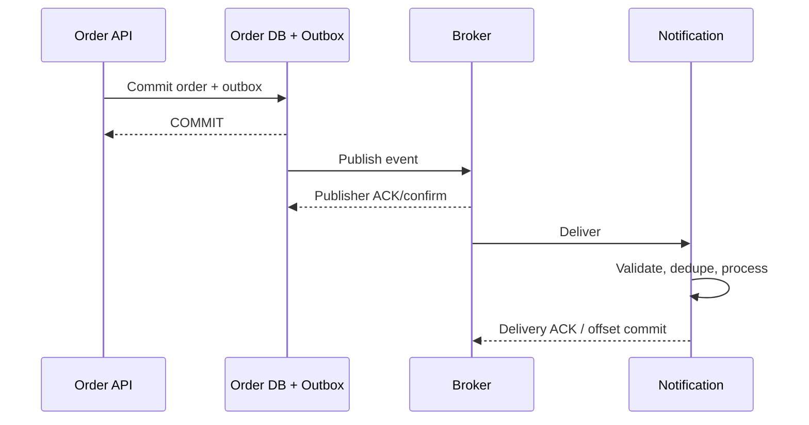
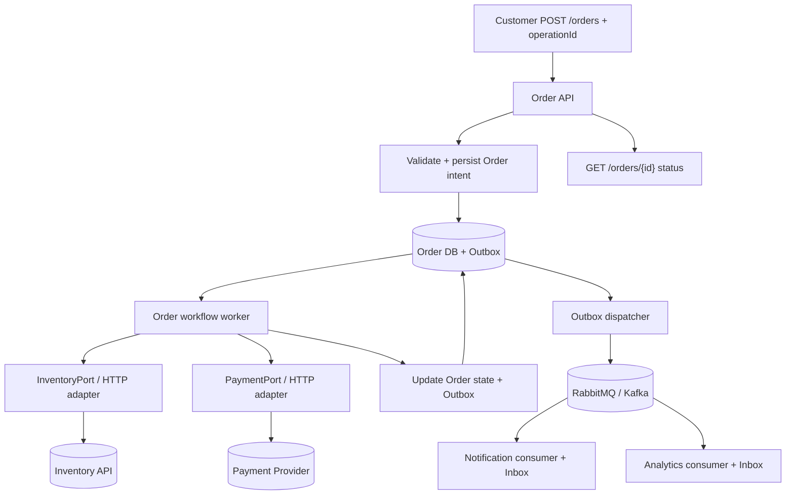

# Application Boundaries, External Systems, and Data Exchange Contracts

## 1. An Integrated System Starts with Boundaries, Not Libraries

In the **SPRING_BOOT_INTEGRATION** module, Spring Boot is used to organize integration via **HTTP clients, databases, caches, message brokers**, and **Spring Integration adapters**. These tools transport data, yet they do not automatically answer architectural questions: *who owns the data, which systems are trusted, what data is allowed to cross, and what counts as success when two systems cannot commit together?*

Consider an order creation request:

```text
Client ──HTTP──> Order Service
                   │
                   ├──HTTP──> Inventory Service
                   ├──HTTP──> Payment Provider
                   ├──JDBC/JPA──> Order Database
                   ├──Redis──> Order Read Cache
                   └──AMQP/Kafka──> Notification / Analytics
```

Failures are not limited to `RestClient` timing out or RabbitMQ returning a NACK. The system may be suffering from deeper problems:

- Order Service treats Inventory's stock data as a table it is allowed to update directly.
- Client sends JSON v2 while an older consumer only understands v1.
- Payment has been captured, yet Order Service lost the HTTP response and resent the POST.
- Database committed while the message was never published; Notification has no idea a new order exists.
- Redis holds a stale snapshot; the API treats the cache as the primary source of truth.
- Kafka consumer committed its offset while the transaction writing the result failed.
- A header carrying a token or customer details was forwarded to a partner not authorized to see it.

To design an integration flow properly, you must define **application boundaries**, **data ownership boundaries**, **trust boundaries**, **transaction boundaries**, and **data exchange contracts**.



**Lesson goal:** accurately identify those boundaries, create testable and evolvable contracts, select appropriate synchronous/asynchronous mechanisms, control failures/duplicates, and prove business outcomes without assuming every system is always available.

Examples in this lesson target **Java 17+, Spring Boot 3.x**. APIs such as `RestClient` are available starting in Spring Framework 6.1/Spring Boot 3.2; on other stacks, select the corresponding adapter. The lesson describes architectural patterns without assuming a specific application already has clusters, brokers, or production infrastructure.

## 2. Distinguishing Application, Process, Domain, Data, and Trust Boundaries

Boundaries often do not align one-to-one.

| Boundary | Question to Answer | Example |
| --- | --- | --- |
| **Process/deployment** | Which components run and deploy independently? | Order and Inventory are two separate services |
| **Domain/bounded context** | Who defines the meaning of a piece of data or action? | Inventory defines "available stock" |
| **Data ownership** | Which system writes and publishes the source of truth? | Order writes orders, never directly updating stock |
| **API/protocol** | How do the two sides communicate and in what format? | JSON/HTTP, AMQP, Kafka, JDBC |
| **Trust/security** | Which callers can read/write which data? | A gateway token is not automatically usable at Payment |
| **Transaction** | Which changes commit/roll back together? | Order DB transaction differs from Payment HTTP request |
| **Failure** | Whose failure directly impacts whom? | Inventory timeout, broker unavailable |
| **Team/ownership** | Who maintains the contract and decides changes? | Inventory team owns the stock API |

**A process boundary does not equal a domain boundary:** a monolith can contain multiple bounded contexts sharing one process; conversely, one domain can span multiple deployments. Identifying bounded contexts is a business-modeling choice, not determined by Kubernetes or Spring annotations.

**A database boundary is not merely a network endpoint:** two services reading the same SQL schema may be implicitly coupled to each other's table structures, transactions, and deployment cycles. A "microservice" with its own database that still lets another service run `UPDATE orders` directly lacks a clear data-ownership boundary.

### 2.1. Rule: Do Not Cross Data Ownership Arbitrarily

Suppose Inventory Service owns inventory stock. Order Service should not write:

```sql
-- NOT a good integration pattern:
UPDATE inventory.stock
SET available_quantity = available_quantity - 2
WHERE sku = 'sku-123';
```

This bypasses Inventory's invariants, authorization, locking, and versioning. Instead, Order Service sends a **reservation request** via the Inventory API contract or a command/event designed for that purpose.

In legacy systems, direct read-only database integration is sometimes a practical constraint. In that case, publish it explicitly as a **read-only integration contract** with views/CDC/schema versions/permissions and a decoupling plan; never treat internal tables as an unversioned public API.

### 2.2. Four Questions Before Adding a New Client

1. Who owns the **business invariant**? For instance, only Inventory decides whether stock is available.
2. Who is responsible when an operation fails after a timeout? For instance, Payment needs idempotency and reconciliation.
3. Must the data be **consistent at response time**, or is eventual consistency acceptable?
4. Can results be tested and observed through a public contract without touching the partner's private tables?

If you cannot answer these, choosing `WebClient` over `RestClient` will not solve the design problem.

## 3. An External System Is Any Dependency Outside Direct Control

An "external system" does not have to be an outside company. For a Spring Boot service, it can be:

- Another service maintained by an internal team, with its own deployment/DB.
- A third-party payment gateway or shipping carrier.
- PostgreSQL/MySQL/MongoDB outside the JVM.
- Redis or a distributed cache.
- Kafka/RabbitMQ/ActiveMQ, even if the broker runs in the same cluster.
- LDAP/Active Directory, SOAP endpoints, SFTP, or batch imports.
- A Spring Integration channel leading to an adapter connected to infrastructure.
- Object storage, an email gateway, or a scheduler persistence store.

Common thread: **you cannot assume operations on the dependency and the business DB commit atomically**; latency, availability, schemas, security, and operational ownership may also differ.

| Dependency | Boundary Contract | Common Failure Modes |
| --- | --- | --- |
| HTTP/REST | Method, URI, status, headers, JSON schema | Timeouts, 429, 5xx, partial side effects |
| SOAP/XML | WSDL, XSD, operations, faults | Schema validation, namespace/version mismatches |
| SQL | Schemas/views/queries, isolation, constraints | Locks, deadlocks, migration conflicts |
| MongoDB | Collections/BSON schemas, ID types, indexes | Mapping drift, duplicate keys |
| Redis | Key namespaces, value serializers, TTLs, invalidation | Stale data, cache stampedes |
| RabbitMQ/AMQP | Exchanges, routing keys, queues, JSON/message properties | Unroutable publishes, redeliveries |
| Kafka | Topics, keys/partitions, schemas, offsets | Lag, replays, consumer group rebalances |
| LDAP | Base DNs, scopes, attributes, filters, pagination | Partial searches, ACLs, referrals |
| SFTP/files | Filenames, encodings, checksums, atomic handoffs | Partial files, duplicate imports |

### 3.1. Internal Systems Are Still Not Unconditionally Reliable

"Untrusted" or "unreliable" in integration engineering does not necessarily mean malicious. It means **you must never assume** the other side will always:

- Send valid, properly typed, properly versioned data.
- Respond on time.
- Preserve event order across retries or partitions.
- Deliver exactly once.
- Keep connections alive mid-flight.
- Grant access to every attribute in a directory.
- Run the exact same contract version during rolling deployments.

Every boundary therefore needs validation, timeouts, error classification, protection, and appropriate observability.

## 4. What Is a Data Exchange Contract?

A **data exchange contract** is the set of rules both producer/provider and consumer/caller rely on to interpret a message or operation. It is broader than a Java interface or a sample JSON snippet.

A practical contract should describe:

1. **Identity and purpose:** what is the operation/event named, who owns it, and which callers may use it?
2. **Transport:** HTTP, AMQP, Kafka, SQL view, SFTP, SOAP, etc.
3. **Addressing/routing:** URL paths, methods, topics, exchanges/routing keys, queues, or dataset names.
4. **Payload schema:** field names, types, nullability/omission rules, constraints, enum values.
5. **Business semantics:** when is a status considered RESERVED/PAID/COMPLETED?
6. **Identity/correlation:** resource IDs, operation IDs, event IDs, correlation IDs; uniqueness and lifecycles.
7. **Time:** UTC timestamps or business dates, timezones, precision, expiration.
8. **Versioning and compatibility:** v1/v2; can older consumers still read new data?
9. **Outcomes/errors:** status/fault codes, retryability, duplicate behavior, partial success.
10. **Delivery guarantees:** timeouts, ACKs, at-least-once, ordering, replays, retention.
11. **Security/privacy:** authentication, authorization, data classification, redaction.
12. **SLO/ownership:** latency, availability, escalation, deprecation windows, contract tests.

A contract does not need all items in one file. It can combine **OpenAPI**, **AsyncAPI**, JSON Schema/Avro/Protobuf schemas, database migrations, interface code, ADRs, and runbooks. What matters is that the specification is **verifiable**.

### 4.1. Technical Contract vs. Business Contract

```json
{
  "orderId": "ord-1024",
  "status": "PAID"
}
```

Valid JSON syntax does not guarantee `PAID` means the same thing on every side:

- Payment Provider: has the charge been captured, or only authorized?
- Order Service: was payment recorded as final, or is it awaiting a callback?
- Analytics: is revenue counted at authorization or at capture?

A `status` field needs a **semantic contract**, not just a String enum. If two teams interpret it differently, integration breaks even with flawless serialization and HTTP 200.

### 4.2. Required vs. Optional Fields

| Characteristic | Rule to Publish |
| --- | --- |
| Required | Should missing fields be rejected or defaulted? |
| Nullable | Is `null` distinct from missing or equivalent? |
| Numbers | 32/64-bit integer, decimal precision and scale? |
| Strings | Encoding, max length, allowed patterns? |
| Enums | How do consumers handle unknown values? |
| Collections | Empty vs. missing; ordering and uniqueness? |
| Timestamps | ISO-8601/epoch, UTC, millisecond precision? |
| Identifiers | Opaque String, UUID, ObjectId, or long; mutable or immutable? |
| Currency | Amount and ISO currency code, rounding policy? |
| Repeated delivery | Does the event ID stay the same or change across retries? |

**Never assume from a Java DTO that remote consumers will interpret it identically.** For example, Java `BigDecimal` serialized as a JSON number can lose precision in JavaScript clients for certain ranges; a BSON `ObjectId` is not automatically a UUID string.

## 5. Draw Ownership Maps Before Drawing Call Diagrams

Example commerce system:

| Data/Action | Owner / Source of Truth | Who May Reference It? | Contract Channel |
| --- | --- | --- | --- |
| Order state | Order Service + Order DB | Customer API, Analytics | HTTP queries + order events |
| Available stock | Inventory Service | Order, Catalog | HTTP availability/reservation API |
| Payment authorization/capture | Payment Provider / Payment Service | Order | Payment API, webhooks/callbacks |
| Customer profile | Customer Service | Order, Notification | HTTP projections + events |
| Notification delivery | Notification Service | Order, Support | Internal status API/events |
| Order view cache | Order Service | API read handlers | Redis key/value contract |
| Directory identities | LDAP/IdP | Internal account sync | LDAP attribute/query contract |

**Source of truth does not mean single copy:** many consumers keep local read models to reduce coupling, provided they explicitly document staleness, retries, TTLs, conflict policies, and drift repair.

### 5.1. Assign Ownership of Each Field

A `customerEmail` field in an OrderDocument may be a **snapshot at checkout time** owned by Order Service, not the "current address" owned by Customer Service. If an `OrderCreated` event carries an email snapshot, consumers must understand its timestamp and snapshot semantics instead of assuming it stays up to date.

Without clear provenance, an argument over "which DB has the real value?" is usually a symptom of unclear boundaries and contracts.

### 5.2. Anti-Corruption Layer for Legacy Systems

A Legacy ERP might name statuses `S`, `W`, `C`, whereas the Order domain uses `PENDING`, `CONFIRMED`, `CANCELLED`. Do not leak legacy status codes throughout the codebase. Place an **adapter/translator** at the boundary, convert into the internal semantic model, and keep the mapping under test.



The adapter handles protocol/format details; the application service handles invariants and transactions; the domain remains unaware of `RestClient` or `SOAPFault`.

## 6. Code Layering: Ports, Adapters, DTOs, and Domain

A maintainable Spring Boot package layout:

```text
example.orders
├── api/
│   ├── OrderController.java
│   ├── CreateOrderRequest.java
│   └── OrderResponse.java
├── application/
│   ├── PlaceOrderService.java
│   └── port/
│       ├── InventoryPort.java
│       └── PaymentPort.java
├── domain/
│   ├── Order.java
│   └── Money.java
├── persistence/
│   ├── OrderEntity.java
│   ├── OrderRepository.java
│   └── OutboxEntity.java
└── integration/
    ├── inventory/
    │   ├── InventoryHttpClient.java
    │   ├── InventoryAdapter.java
    │   └── InventoryContracts.java
    ├── payment/
    └── messaging/
        └── OrderEventPublisher.java
```

This is an illustrative layout, not a mandatory package structure. Roles:

- **API DTOs:** inbound HTTP or partner contracts.
- **Domain:** business rules independent of wire protocols.
- **Ports:** business needs expressed in the service's own language.
- **Adapters:** translate ports to RestClient/JPA/RabbitTemplate/RedisTemplate.
- **Persistence models:** internal database schemas.
- **Event DTOs:** independent consumer-facing contracts that evolve alongside event types.

### 6.1. Ports Speak Business Language Rather Than HTTP Details

```java
package example.orders.application.port;

public interface InventoryPort {
    ReservationOutcome reserve(
        String orderId,
        String sku,
        int quantity
    );
}

public record ReservationOutcome(
    String reservationId,
    boolean reserved
) {}
```

The application service depends on `InventoryPort`; an HTTP adapter implements it. If the Inventory API later moves from REST to messaging, application service policies do not have to change because of `@PostExchange`.

### 6.2. Do Not Pass JPA Entities Straight Through Adapters

Wrong:

```java
// Wrong: persistence entity is used as an HTTP contract.
restClient.post()
    .uri("/orders")
    .body(orderEntity)
    .retrieve();
```

JPA entities carry lazy fields, internal IDs, circular references, optimistic versions, or private columns. They can serialize into unintended JSON. Similarly, a MongoDB `@Document` is not an automatic DTO for every consumer.

**Better:** a mapper translates domain objects/aggregates to partner-specific DTOs and validates schemas. That mapper is an essential target for contract tests.

## 7. Example of an Explicit HTTP Boundary Using Spring HTTP Interfaces

Consider an Inventory API that accepts stock reservations:

```http
POST /v1/reservations HTTP/1.1
Host: inventory.internal.example
Content-Type: application/json
Accept: application/json
Idempotency-Key: reserve:ord-1024:sku-123
X-Request-Id: req-8021

{
  "orderId": "ord-1024",
  "sku": "sku-123",
  "quantity": 2
}
```

Defined response:

```http
HTTP/1.1 201 Created
Content-Type: application/json

{
  "reservationId": "rsv-6701",
  "state": "RESERVED"
}
```

Java client DTOs:

```java
package example.orders.integration.inventory;

public record ReserveStockRequest(
    String orderId,
    String sku,
    int quantity
) {}

public record ReserveStockResponse(
    String reservationId,
    String state
) {}
```

Declarative HTTP interface (Spring Framework 6.1+):

```java
package example.orders.integration.inventory;

import org.springframework.web.bind.annotation.RequestBody;
import org.springframework.web.bind.annotation.RequestHeader;
import org.springframework.web.service.annotation.HttpExchange;
import org.springframework.web.service.annotation.PostExchange;

@HttpExchange(
    url = "/v1",
    accept = "application/json",
    contentType = "application/json"
)
public interface InventoryHttpClient {

    @PostExchange("/reservations")
    ReserveStockResponse reserve(
        @RequestHeader("Idempotency-Key") String operationKey,
        @RequestHeader("X-Request-Id") String requestId,
        @RequestBody ReserveStockRequest body
    );
}
```

Proxy configuration from Boot-managed `RestClient.Builder`:

```java
package example.orders.integration.inventory;

import org.springframework.beans.factory.annotation.Value;
import org.springframework.context.annotation.Bean;
import org.springframework.context.annotation.Configuration;
import org.springframework.web.client.RestClient;
import org.springframework.web.client.support.RestClientAdapter;
import org.springframework.web.service.invoker.HttpServiceProxyFactory;

@Configuration
class InventoryClientConfiguration {

    @Bean
    InventoryHttpClient inventoryHttpClient(
            RestClient.Builder builder,
            @Value("${inventory.api.base-url}") String baseUrl) {

        RestClient restClient = builder
            .baseUrl(baseUrl)
            .build();

        HttpServiceProxyFactory factory =
            HttpServiceProxyFactory
                .builderFor(RestClientAdapter.create(restClient))
                .build();

        return factory.createClient(
            InventoryHttpClient.class
        );
    }
}
```

Runtime config:

```yaml
inventory:
  api:
    base-url: ${INVENTORY_API_BASE_URL:https://inventory.example.test}
```

**Warning about the example:** this shows the client contract structure and omits timeouts, TLS, authentication, and status-to-domain-error mapping. Those must be added to the adapter and tested before production. `@HttpExchange` does not automatically guarantee the provider honors the idempotency key or avoids duplicate reservations.

### 7.1. Adapter Isolates HTTP Semantics

```java
package example.orders.integration.inventory;

import example.orders.application.port.InventoryPort;
import example.orders.application.port.ReservationOutcome;
import org.springframework.stereotype.Component;

@Component
public class InventoryAdapter implements InventoryPort {

    private final InventoryHttpClient client;

    public InventoryAdapter(InventoryHttpClient client) {
        this.client = client;
    }

    @Override
    public ReservationOutcome reserve(
            String orderId, String sku, int quantity) {

        ReserveStockResponse result = client.reserve(
            "reserve:" + orderId + ":" + sku,
            "order-flow-" + orderId,
            new ReserveStockRequest(orderId, sku, quantity)
        );

        if (result == null || result.reservationId() == null) {
            throw new IllegalStateException(
                "Inventory response missing reservation ID"
            );
        }

        return new ReservationOutcome(
            result.reservationId(),
            "RESERVED".equals(result.state())
        );
    }
}
```

The adapter needs a real error policy: if HTTP 409 means stock was already reserved under an earlier key, reconcile; 422 means invalid input; a timeout after server commit leaves an **uncertain outcome**. Never collapse every exception into `reserved=false`.

### 7.2. Avoid Leaking Protocol Errors into the Domain

`RestClientResponseException` or raw HTTP status codes are adapter details. The application can define typed outcomes such as `RESERVED`, `OUT_OF_STOCK`, `UNKNOWN_RETRYABLE`, and `PERMANENTLY_REJECTED` per contract; the adapter maps statuses, bodies, and transport exceptions without guessing that a 500 means no reservation was created.

## 8. Four Contract Layers in One HTTP Call

| Contract Type | What It Governs | Common Failures |
| --- | --- | --- |
| **Transport** | HTTPS, method, URI, headers, timeouts | Wrong host/route, broken TLS, connection refused |
| **Data** | JSON field names, types, nullability, encoding | Jackson DTO mismatch |
| **Business** | Action semantics, idempotency | Confusing authorized with captured |
| **Failure** | Status codes, retries, partial/unknown outcomes | Retries creating duplicate side effects |

### 8.1. Request Headers Are Not Decorative Metadata

An API may rely on:

- `Authorization`: authenticates the caller to the **intended audience**.
- `Idempotency-Key`: binds the request to a logical operation if supported by the provider.
- `If-Match`/ETag: prevents lost updates.
- `X-Correlation-Id`: aids diagnostics.
- `Traceparent`: trace context per instrumentation.
- `Accept` and `Content-Type`: content negotiation and serialization.

**Never blindly forward all inbound HTTP headers to another service.** They may include cookies, user tokens, untrusted tenant headers, and hop-by-hop headers. Adapters must allowlist/transform headers according to security policy.

### 8.2. HTTP Status and Business Status Are Different

`HTTP 200 OK` can carry:

```json
{
  "paymentStatus": "PENDING_REVIEW"
}
```

If the application relies solely on 2xx to mark an order `PAID`, the contract is misused. Conversely, HTTP 202 usually states the request was accepted for asynchronous processing rather than completed. Read both the **HTTP outcome and the response business state**.

### 8.3. URI Encoding Is Part of the Contract

URIs like `/orders/{orderId}` must encode path variables according to URI rules. An `orderId` containing `/` or `%` can alter the path after proxy decoding. Never concatenate URLs from user input; use URI templates/builders and test reserved characters. Base URLs must come from trusted configuration to prevent SSRF, never supplied arbitrarily by callers.

## 9. Synchronous vs. Asynchronous: Choose by When the Outcome Is Needed

A service has multiple options:

| Mechanism | What Does the Caller Know Immediately? | Best Fit | What Must Be Handled |
| --- | --- | --- | --- |
| Synchronous HTTP | Response/status before returning to caller | Queries, decisions needed immediately | Deadlines, connections, retries, fallbacks |
| HTTP 202 + job status | Request accepted per contract | Long-running tasks | Durable job state, polling/callbacks |
| Broker command | Producer publish/ack; processed later | Async workflow needing a single owner | Correlation, retries, DLQ, deduplication |
| Broker event | A fact that occurred is broadcast | Fan-out, eventual consistency | Versioning, consumer ordering, replays |
| DB view/CDC | Data changed in source | Legacy/read projections | Snapshots, DDL, ordering, change capture |
| Scheduled batch/files | Periodic data exchange | Legacy, bulk integration | Checksums, atomic handoffs, reconciliation |

### 9.1. Synchronous Is Not Cross-Service Atomicity



What happens if Inventory succeeds in reserving stock yet Order DB's insert fails? You need a release/compensation flow, reconciliation, or a `RESERVATION_PENDING/CONFIRMED` workflow state; no `@Transactional` inside Order Service automatically rolls back an HTTP operation already committed by Inventory.

### 9.2. Events vs. Commands

- **Command:** asks an owner to execute an action, e.g., `ReserveStock`. It can be rejected; it needs a response/status policy and typically has an intended consumer.
- **Event:** announces a fact that already happened, e.g., `OrderCreated`. Multiple independent consumers may react to it.

Never name an event `DoSendEmail` and expect it to simultaneously act as a business fact and a command. Contracts must define clear producer/consumer responsibilities, routing, and semantics.

### 9.3. Eventual Consistency Must Be Documented

When an order is created and the outbox publishes 500 ms later, Notification or Analytics observes the state slightly behind. APIs should not promise "all systems updated" when the business contract only guarantees Order DB commit. Provide workflow statuses, completion callbacks, or tracking APIs if callers need to know when downstream side effects actually complete.

---

## 10. Event Contracts: JSON Bodies, Envelopes, and Transport Metadata

An `OrderCreated` event is typically sent via RabbitMQ/Kafka, yet its contract should stay reasonably decoupled from Java class and package names.

Example **business event envelope**:

```json
{
  "eventId": "evt-6e0f",
  "eventType": "OrderCreated",
  "schemaVersion": 1,
  "occurredAt": "2026-11-21T04:00:00Z",
  "producer": "order-service",
  "aggregateId": "ord-1024",
  "data": {
    "orderId": "ord-1024",
    "tenantId": "tenant-17",
    "total": {
      "amount": "49.90",
      "currency": "USD"
    }
  }
}
```

`eventId` is the ID of the **logical event**, not the Nth publish attempt. `occurredAt` is when the business event happened, not necessarily when the message reached the broker. `schemaVersion` expresses the event's structure/semantics version and must not increment on retries.

A committed event that needs re-emission should keep the **same eventId and payload/version** as long as it represents the same event. If business state genuinely changes, emit a new event with a new event ID.

### 10.1. Separating Business Metadata from Transport Metadata

| Metadata | Where to Place It | Notes |
| --- | --- | --- |
| `eventId` | Body envelope, sometimes mirrored in header | Source of truth must be unambiguous |
| `eventType` | Body and routing key/topic convention | Do not let the two values conflict |
| `schemaVersion` | Body or schema registry ID | Consumers need to read older versions |
| `correlationId` | Header/trace metadata | For observability, not deduplication |
| `traceparent` | Transport header if supported | Not a business ID |
| `contentType` | AMQP properties/HTTP header | JSON converter must genuinely encode JSON |
| `partitionKey` | Kafka record key | Controls ordering/partitioning; not required to be eventId |
| `routingKey` | RabbitMQ publish metadata | Controls binding; does not define payload schema |

**Never treat Spring AMQP's `__TypeId__` containing Java class names as a long-term polyglot event contract.** Use listener type inference, logical type mappings, or envelopes, while restricting trusted classes. When serializing DTOs, verify the actual body bytes and `contentType=application/json`, rather than assuming from calling `convertAndSend(...)`.

### 10.2. Ordering Is Scoped

- Kafka guarantees record ordering within **a single partition** per topic/producer semantics, not across all partitions of a topic.
- RabbitMQ queues preserve enqueue order under certain delivery conditions, yet multiple consumers, redeliveries, and requeues can alter **business processing completion** order.
- Concurrent HTTP calls have no server-side ordering unless the API defines versions or sequences.

If consumers depend on update order for a given order, use `aggregateId` as the partition key when appropriate, include `aggregateVersion`/sequence numbers, and reject or reconcile stale events. **Physical ordering alone does not deduplicate or guarantee transactional exactly-once side effects outside the broker.**

## 11. Designing Schema Evolution and Compatibility

A contract outlives a single deployment. Producers and consumers rarely upgrade simultaneously; queues/DLQs still contain older messages while new code rolls out.

### 11.1. Types of Changes

| Change | Typical Assessment | Safer Approach |
| --- | --- | --- |
| Add optional field with clear default | Potentially compatible | Older consumers tolerate unknown fields |
| Add required field without default | Easily breaking | New version or transition period |
| Rename `orderId` to `id` | Breaking for many consumers | Dual-read/dual-write or version mapping |
| Change `amount` from String to Number | Breaking in type/precision | Explicit version, contract tests |
| Add enum value | Can break exhaustive switches | Define unknown-value policy |
| Change `weight` unit from kg to g | Semantically breaking even with valid JSON | New field/unit/version |
| Remove rarely used field | Breaking if any old consumer relies on it | Inventory consumers + deprecation window |
| Redefine `COMPLETED` meaning | Severely breaking | New contract and migration plan |
| Change HTTP path | Breaking client contract | Versioned routes/compatibility window |
| Rename Kafka topic | Breaking routing/deployment | Dual publish/consume transition if needed |

**Backward/forward compatibility depends on specific serialization models and consumer behavior**; you cannot conclude compatibility merely because a JSON parser succeeds.

### 11.2. Unknown Fields Should Not Crash Every Consumer

Suppose consumer v1 only needs `orderId` and `total`, and producer v2 adds `salesChannel`. When v1 receives the new field, its decoder can ignore unknown fields **if that policy is published**. However, a consumer using strict JSON Schema or Jackson `FAIL_ON_UNKNOWN_PROPERTIES` can still fail. Test against real applications.

Conversely, ignoring unknown fields indiscriminately can mask typos in important fields. Contracts should designate extension areas while validating core fields strictly.

### 11.3. Expand–Migrate–Contract Across Rolling Deployments



Deployment order must follow the **producer/consumer dependency graph**:

1. Inventory all active consumers, including batch jobs, analytics, DLQ replayers, and partners.
2. Deploy consumers able to read the new format while still supporting the old one.
3. Switch producers/writers to the new schema.
4. Monitor conversion errors, lag, rejected messages, and contract conformance.
5. Backfill/migrate older data if needed.
6. Remove the legacy path only after retention/replay/deprecation windows close.

For databases, renaming or changing columns/fields follows the same principle. Updating a JPA entity/`@Field` **does not automatically migrate** historical rows in Postgres or documents in Mongo.

### 11.4. Contract Version Does Not Equal Application Version

An application can deploy `order-service:2.8.7` and continue emitting `OrderCreated schemaVersion=1`. Schema versions change only when the contract changes—not on every code release. Similarly, a v1 event may still be replayed from an outbox after the application binary advances to v3.

## 12. Identifiers, Correlation, Time, and Money Across Boundaries

Each identifier should have its own dedicated responsibility:

| ID | Created By | Used For? | Changes on Retry? |
| --- | --- | --- | --- |
| `orderId` | Order owner | Identifies aggregate/order | No |
| `operationId` / idempotency key | Caller/owner per contract | Prevents repeating one business command | No |
| `reservationId` | Inventory owner | Identifies reservation outcome | No when querying same reservation |
| `eventId` | Event owner/outbox | Deduplicate/replay event | No |
| `correlationId` | Gateway/workflow | Correlates logs across steps | Usually preserved across logical workflow |
| `traceId` | Tracing instrumentation | Links spans | May differ across async retries/replays |
| Kafka offset | Broker partition | Record position in log | Each publish gets its own offset |

### 12.1. Never Overload One ID for Every Responsibility

`traceId` is not a unique key for a business event. One request can produce multiple events; the same event can be replayed under a new trace. Kafka offsets are also unstable if events are republished to another topic or partition. Inboxes should deduplicate on `consumerName + eventId` or an appropriate **business idempotency key**.

### 12.2. Time Contracts Must Specify Timezone and Precision

Prefer ISO-8601 with offset/UTC for event timestamps:

```json
{
  "occurredAt": "2026-11-21T04:00:00Z",
  "businessDate": "2026-11-21",
  "businessTimeZone": "Asia/Ho_Chi_Minh"
}
```

`occurredAt` is an instant; `businessDate` is a calendar date in a timezone. Never substitute them carelessly. When persisting MongoDB BSON Date, common resolution is milliseconds; when persisting SQL `timestamp with time zone`, semantics depend on the database and driver. Test round-trip precision and timezones.

### 12.3. Money Is Not a Double

Example:

```java
public record Money(
    java.math.BigDecimal amount,
    java.util.Currency currency
) {
    public Money {
        if (amount == null || currency == null) {
            throw new IllegalArgumentException("Money incomplete");
        }
    }
}
```

Wire contracts may choose `amount` as a decimal String and `currency` as an ISO code, then validate scale, range, and rounding. Never use Java `double` for money or compare amounts without checking currency.

### 12.4. Choosing IDs for Heterogeneous Systems

If MongoDB stores `ObjectId` yet REST APIs and Kafka events must interoperate across Java, Python, and Go, normalize IDs at the boundary—usually as a domain **opaque String**. Do not force consumers to parse raw BSON wrappers like `{"$oid":"..."}` unless explicitly part of a published contract.

## 13. Transaction Boundaries: One Commit Does Not Span Other Systems

This is a foundational principle of integration:

**Spring's `@Transactional` does not automatically create a single transaction across PostgreSQL, Redis, RabbitMQ/Kafka, and HTTP.**

Suppose:

```java
@Transactional
public void placeOrder(CreateOrderCommand command) {
    orderRepository.save(order);
    rabbitTemplate.convertAndSend(
        "orders.events",
        "order.created",
        event
    );
}
```

Two failure windows appear:

1. Broker receives the event yet the database rolls back → consumers learn of an order that never existed.
2. Database commits yet publishing fails or the process crashes → consumers never receive the event.

Placing the publish call inside a `@Transactional` Java method does not create atomicity across distinct resource managers.

### 13.1. Transactional Outbox

The standard solution writes business state and an **outbox record in the same source database transaction**.



Illustrative SQL schema:

```sql
CREATE TABLE integration_outbox (
    event_id VARCHAR(64) PRIMARY KEY,
    aggregate_id VARCHAR(64) NOT NULL,
    event_type VARCHAR(80) NOT NULL,
    schema_version INTEGER NOT NULL,
    payload_json TEXT NOT NULL,
    status VARCHAR(24) NOT NULL,
    attempts INTEGER NOT NULL DEFAULT 0,
    created_at TIMESTAMP WITH TIME ZONE NOT NULL,
    next_attempt_at TIMESTAMP WITH TIME ZONE
);
```

Publisher worker:

1. Claim PENDING events via leasing or locking suited for multiple workers.
2. Read the **persisted payload**—never regenerate event IDs or timestamps on retries.
3. Publish to the broker with transport correlation/publisher confirms.
4. Mark SENT only according to published broker confirmation/return rules.
5. Retry on uncertain outcomes using the same event ID.
6. Move events to FAILED/parked state once retry budgets expire, with alerts and reprocessing.

For Kafka, producer acknowledgment semantics depend on `acks`, idempotence, and transaction settings; RabbitMQ confirm ACK likewise does not guarantee consumers processed the message. **Outbox shrinks the event-loss window between source DB and publish; it does not create system-wide exactly-once side effects.**

### 13.2. Consumer Inbox

When a consumer commits its business DB and crashes before sending the broker ACK, the event can be redelivered. An inbox table:

```sql
CREATE TABLE integration_inbox (
    consumer_name VARCHAR(80) NOT NULL,
    event_id VARCHAR(64) NOT NULL,
    processed_at TIMESTAMP WITH TIME ZONE NOT NULL,
    PRIMARY KEY (consumer_name, event_id)
);
```

Pseudo-flow:

```text
On event(evt-6e0f):
  BEGIN business database transaction
    INSERT inbox(consumer_name, event_id) if absent
    IF duplicate:
      do not repeat business effect
    ELSE:
      perform durable business update
  COMMIT
  ACK message / commit offset under listener policy
```

Handle unique-constraint races and rollbacks properly: **the inbox marker and business DB change must commit together** when both live in one database transaction. For email/payment actions outside the DB, you still need provider idempotency, durable job state, or reconciliation.

### 13.3. Sagas, Compensation, and Unknown States

Order Service cannot atomically "charge payment + reserve stock + write order" with a single local transaction. A workflow can use a state machine and compensation:

```text
NEW
  -> RESERVATION_PENDING
  -> RESERVED
  -> PAYMENT_PENDING
  -> CONFIRMED
  -> FULFILLMENT_PENDING

On failure:
  RESERVED + payment rejected -> RELEASE_RESERVATION_PENDING
  payment timeout -> PAYMENT_UNKNOWN (reconcile)
```

Compensation **is not turning back time**. Releasing a reservation can fail; refunds have business implications; state must be tracked and backed by operator runbooks for cases that do not self-heal.

## 14. Delivery Semantics and the Limits of Exactly-Once Promises

| Mechanism | What It Can Guarantee | What It Does Not Automatically Guarantee |
| --- | --- | --- |
| RabbitMQ publisher confirm | Broker confirmed receipt per config | Consumer processed it, or no duplicates |
| RabbitMQ consumer ACK | Broker knows delivery was acknowledged | External side effects executed only once |
| Kafka producer idempotence | Reduces duplicates from retries within matching producer/session scope | Exactly-once business commands/consumer side effects |
| Kafka committed offset | Consumer group recorded consumed position | External DB/HTTP transactions completed |
| JDBC unique constraint | No two rows share the scoped key | External payment was idempotent |
| Redis SETNX/lease | Conditional claim/coordination helper | Permanent exactly-once, distributed transactions |
| Transactional outbox | Business state and publish intent commit together | Broker consumers process immediately or once |
| Consumer inbox | Guards against repeating durable DB business side effects | External email provider is idempotent |

**"At-least-once" means duplicate deliveries must be expected.** If a producer does not know whether the broker received a publish, retries can duplicate transport messages. Meanwhile, "exactly-once" claims are only valid within explicitly scoped resources, offset/transaction semantics, and side effects—never use it to describe an entire HTTP–DB–broker workflow.

### 14.1. Retries Can Amplify Load

Suppose Order Service makes 3 attempts, the HTTP gateway retries 3 times, and the client SDK retries 3 times: one logical command can trigger up to **27** downstream calls in certain configurations. The fix is assigning **one retry owner layer**, an overall deadline, exponential backoff/jitter, and explicit non-retryable errors.

### 14.2. Retries for Side-Effecting Operations

On a payment-creation POST, an HTTP timeout can happen **after the provider committed**. Never retry blindly by default. If the provider supports idempotency keys, reuse a stable key; otherwise query/reconcile by business reference and support manual recovery when outcomes remain uncertain.

## 15. Error Contracts: Classify Instead of Swallowing Exceptions

A boundary should return **actionable errors**, not just a generic Throwable.

| Error Category | Example | Usually Suitable Policy |
| --- | --- | --- |
| Invalid input/contract | JSON missing required field, unsupported enum | Reject, do not retry |
| Authentication/authorization | HTTP 401/403, LDAP ACL | Do not hot-retry; fix permissions/credentials |
| Resource not found | 404, missing remote ID | Per business contract, often permanent |
| Conflict | 409/412 optimistic version | Reload/resolve, never blind overwrite |
| Throttling | 429 / Retry-After | Bounded retry, rate limit |
| Transient dependency | 503, connection reset | Retry with backoff/deadline if safe |
| Timeout/unknown outcome | POST sent but response lost | Idempotency/reconcile |
| Poison message | JSON conversion fails before listener | Quarantine/DLQ, contract alert |
| Resource contention | DB deadlock/lock timeout | Bounded retry and transaction policy |
| Unroutable broker message | Routing key has no binding | Fix topology, publisher returns |
| Partial batch | LDAP size limit / SFTP partial file | Do not mark completed; reconcile |

### 15.1. Consistent Error Response at the HTTP Boundary

Example following Problem Details (RFC 9457), illustrative:

```json
{
  "type": "https://errors.example.test/inventory-unavailable",
  "title": "Inventory service unavailable",
  "status": 503,
  "detail": "Please retry using the same operationId",
  "instance": "/api/orders/requests/req-8021",
  "code": "INVENTORY_TEMPORARILY_UNAVAILABLE",
  "correlationId": "req-8021"
}
```

Never put tokens, full stack traces, raw SQL, raw Kafka/RabbitMQ headers, or payment details into `detail`. `code`/`type` must form a stable vocabulary so callers can decide retries per published policy; HTTP status alone does not convey the full business outcome.

### 15.2. Dead-Letter Queues Do Not Automatically Fix Bad Data

A DLQ preserves messages for investigation when broker/consumer settings are right. It does not automatically provide:

- Schema migrations for old events.
- Access-controlled reprocessing mechanisms.
- Protection against duplicate side effects on replay.
- Alerts and retention.
- Separation between transient and permanent errors.

You need a playbook: triage, fix contract/code, reprocess with the same event ID (when representing the same event), and verify completion.

### 15.3. Never Turn a Dependency Outage into "No Data Found"

Wrong:

```java
try {
    return inventoryPort.findStock(sku);
} catch (Exception ex) {
    return Optional.empty();
}
```

If LDAP, Inventory, or Redis times out, returning empty as if it were valid data can drive wrong decisions. Separate `NOT_FOUND` from `UNAVAILABLE`, `UNKNOWN`, and `PARTIAL`. Fallbacks are valid only when the business has approved staleness and the system explicitly surfaces confidence/freshness.

## 16. Security Contracts and Trust Boundaries

An integration boundary must evaluate **who is calling**, **where they are calling**, **which identity is used**, and **what data is allowed to pass**.

### 16.1. Minimum Controls

1. **TLS/mTLS:** protect channels, verify certificates/hostnames, manage CAs and secret rotation.
2. **Authentication:** outbound clients use service identities or tokens with matching audience/scopes.
3. **Authorization:** domain-owning services verify action/resource/tenant permissions.
4. **Least privilege:** SQL users, Mongo roles, Redis ACLs, RabbitMQ vhost/topic permissions, and LDAP bind accounts scoped to exact needs.
5. **Data classification:** identify PII, payment data, credentials, and retention per event/DTO.
6. **Input validation:** schemas, size limits, escaping, allowlists, and trusted host URLs.
7. **Auditing:** record business actions/outcomes with permitted IDs, avoiding raw sensitive payloads.
8. **Secret hygiene:** never commit credentials; never log `Authorization` headers or cookies.

### 16.2. Do Not Trust tenantId Just Because It Is in a Header

`X-Tenant-Id: tenant-17` can be a routing parameter, not proof that the caller has access to that tenant. The receiving service must verify token/identity/authorization. Even if Order Service forwards a tenant header to Inventory, Inventory must still verify the relationship between the caller and the tenant per its trust contract.

### 16.3. Boundary Injection Vectors

- SQL: use parameterized queries; never concatenate input into SQL.
- LDAP: use query builders/escaped filter values (RFC 4515) and DN builders; never concatenate filters/DNs.
- HTTP: use URI templates/builders; never let input control arbitrary hosts (SSRF).
- Mongo: never accept arbitrary query operators or unvalidated field maps.
- Messaging: never trust type headers to deserialize arbitrary Java classes.
- Files/SFTP: check path traversal, filenames, checksums, and atomic handoffs.

Never assume "internal" means skipping validation. Bugs in contracts, misconfigurations, or compromised services can cause the same damage as external input.

## 17. Redis Cache and Read Models Are Data Contracts, Not Default Sources of Truth

Caching reduces HTTP/DB latency yet introduces **a copy of state**. Document clearly:

| Item | Example |
| --- | --- |
| Key namespace | `orders:view:v2:tenant-17:ord-1024` |
| Value schema | Versioned JSON DTO |
| TTL | 60 seconds per freshness requirement |
| Invalidation | After order commit or on event receipt |
| Owner | Order Service |
| Fallback | DB on cache miss/unavailability |
| Security scope | Tenant-scoped keys, no leaked PII |
| Serialization | Agreed Jackson/Redis serializer |

Common bugs:

- Cache write succeeds while DB transaction rolls back → cache holds uncommitted state.
- DB commits while invalidation fails → cache stays stale.
- JSON cache schema changes while old keys have not expired → deserialization errors.
- Two tenants share an `orderId` key without a tenant namespace → data-leak risk.
- Redis outage is treated as "order does not exist" instead of a cache miss/proper fallback.

**Make source-of-truth explicit:** for Orders, the owning DB is usually the source of truth; Redis is a copy with TTL/invalidation. For cache-as-source-of-truth use cases, explicitly publish durability/consistency policies rather than treating Redis as "just a cache".

### 17.1. Cache Invalidation and Event Ordering

If a consumer receives `OrderUpdated(version=8)` before `OrderUpdated(version=7)` and overwrites with the older snapshot, the cache regresses. Use `aggregateVersion` or reliable timestamps/sequences, and only apply updates when the version advances.

Redis does not understand business versions automatically; implement compare-and-set/Lua/transactions/DB projections as needed and test race conditions.

## 18. Spring Integration Channels and Adapters Do Not Erase External Boundaries

Spring Integration models message flows with channels, transformers, filters, routers, service activators, gateways, and inbound/outbound adapters.



A Spring Integration `Message<?>` has a payload and headers. It is **not the same** as `org.springframework.amqp.core.Message` or a Kafka `ConsumerRecord`; adapters translate between abstractions.

### 18.1. Sync/Async Channels Change Where Errors Surface

| Channel/Flow | Execution | Error Consequence |
| --- | --- | --- |
| `DirectChannel` | Handler runs synchronously on caller thread | Exceptions can propagate back to caller |
| `ExecutorChannel` | Dispatched to executor | `send()` succeeding does not mean handler finished |
| `QueueChannel` | Pollable, in-memory by default without a store | Queue state does not survive restarts automatically |
| `PublishSubscribeChannel` | Fan-out to subscribers | Multiple handlers/side effects for the same message |
| AMQP/Kafka adapter | Through broker/client | Delivery/ack/retry follow transport semantics |

**Error channels and transaction boundaries** must match the execution mode. An exception on a worker thread cannot jump back to an HTTP request that already returned 202. To report outcomes, use a job DB, status API, or callback. Adapters do not inject outbox/inbox or idempotency into business flows automatically.

### 18.2. Headers Must Be Allowlist-Mapped

Never copy all internal `MessageHeaders` into AMQP/HTTP headers. Some headers hold channel references, security contexts, or transport-specific metadata that are non-serializable or unsafe to send out of process. Publish an explicit allowlist of headers: `eventType`, `schemaVersion`, `correlationId`/trace context, and controlled business attributes.

---
## 19. Documenting Contracts: OpenAPI, AsyncAPI, Schemas, and Operational Decisions

A Java interface helps at implementation time, yet should not be the **sole specification** when consumers use other languages or deploy independently.

| Contract Artifact | What It Should Contain | Purpose |
| --- | --- | --- |
| OpenAPI | HTTP paths, methods, parameters, schemas, status codes, auth | Provider/client HTTP conformance |
| AsyncAPI / event catalog | Channels/topics, message names, payloads, headers, delivery semantics | Consumer integration |
| JSON Schema/Avro/Protobuf schema | Field types, requiredness, versions, compatibility rules | Validate serialized data |
| WSDL/XSD | SOAP operation/XML contracts | Legacy contract validation |
| DB view/schema migration | Readable data structures, indexes, retention | Reduce coupling in legacy read integrations |
| ADR | Sync/async choices, IDs, errors, ownership, consistency | Preserve decision context |
| Runbook/SLO | Thresholds, incident response, retry/DLQ/reconciliation | Operations and ownership |

### 19.1. Example OpenAPI Fragment Defining Request and Response Clearly

```yaml
openapi: 3.0.3
info:
  title: Inventory Reservation API
  version: 1.0.0
paths:
  /v1/reservations:
    post:
      operationId: reserveStock
      parameters:
        - in: header
          name: Idempotency-Key
          required: true
          schema:
            type: string
            maxLength: 128
      requestBody:
        required: true
        content:
          application/json:
            schema:
              $ref: "#/components/schemas/ReserveStockRequest"
      responses:
        "201":
          description: Stock reserved
          content:
            application/json:
              schema:
                $ref: "#/components/schemas/ReserveStockResponse"
        "409":
          description: Reservation conflict
        "422":
          description: Invalid reservation request
        "503":
          description: Service temporarily unavailable
components:
  schemas:
    ReserveStockRequest:
      type: object
      required: [orderId, sku, quantity]
      additionalProperties: false
      properties:
        orderId:
          type: string
          minLength: 1
        sku:
          type: string
          minLength: 1
        quantity:
          type: integer
          minimum: 1
    ReserveStockResponse:
      type: object
      required: [reservationId, state]
      properties:
        reservationId:
          type: string
        state:
          type: string
          enum: [RESERVED, REJECTED]
```

This is an illustrative API contract fragment—it omits security schemes, `servers`, and full idempotency-key replay semantics. In a real system, also define: what happens if the body changes under the same key, key retention duration, stale state/expiry, and reservation release rules.

**Contract linting/generation does not replace ownership:** a syntactically valid OpenAPI file can still misrepresent actual server behavior. Provider CI tests and wire-level consumer tests remain necessary.

### 19.2. Event Contracts Must Define Semantics

An AsyncAPI/event catalog entry for `OrderCreated` should state:

- Producer: Order Service, emitted after the order transaction commits.
- Channel: `orders.events` (Kafka topic or RabbitMQ exchange/routing per deployment).
- Body: eventId, aggregateId, occurredAt, schemaVersion, data.
- Delivery: consumers may receive duplicates and replays; ordering policy per order key.
- Retention/DLQ: broker-specific rules.
- Consumer behavior: apply only if eventId has not been processed; new optional fields supported per compatibility policy.
- Privacy: never include payment card data or tokens in events.

Without defining **when an event is considered to have occurred**, consumers can misbehave even when parsing JSON accurately.

## 20. Testing Strategy at the Boundaries

A service unit test mocking `InventoryPort` is useful, yet **does not prove real HTTP requests are right**. An HTTP mock server test does not prove production brokers, database transactions, or consumer duplicate handling. Match test layers to each boundary:

| Test Layer | Goal | Example |
| --- | --- | --- |
| Unit/domain | Invariants and state transitions | Reject order creation when quantity is negative |
| Mapper/serializer | Java ↔ JSON/BSON/XML conversion | Money precision, required fields |
| HTTP client contract | Method/path/headers/body/error mapping | MockRestServiceServer/WireMock |
| Provider contract | Endpoint behavior matches schema | OpenAPI validation, schema fixtures |
| Broker integration | Publish, routing, consume, ACK/offsets | Testcontainers RabbitMQ/Kafka |
| DB integration | Constraints, transactions, migrations | Testcontainers PostgreSQL/Mongo |
| Outbox/inbox failure | Crash windows/retries/deduplication | Kill worker after commit before ACK |
| End-to-end workflow | Business outcome across components | Order → reservation → notification |
| Compatibility | v1/v2 during rolling deployments | Old consumer reads new optional field |
| Security | Auth, tenant isolation, PII redaction | Wrong audience, forged tenant header |
| Resilience | Timeouts, 429, 503, network partitions | Bounded retry/backoff/reconcile |
| Observability | Traces, metric tags, alert signals | Event ID in logs, not in tags |

### 20.1. Testing HTTP Interface Calls at the Actual Request Level

Example using JUnit 5, Spring Test, and AssertJ with `InventoryHttpClient` from Section 7:

```java
package example.orders.integration.inventory;

import static org.assertj.core.api.Assertions.assertThat;
import static org.springframework.test.web.client.match.MockRestRequestMatchers.*;
import static org.springframework.test.web.client.response.MockRestResponseCreators.withSuccess;

import org.junit.jupiter.api.Test;
import org.springframework.http.HttpMethod;
import org.springframework.http.MediaType;
import org.springframework.test.web.client.MockRestServiceServer;
import org.springframework.web.client.RestClient;
import org.springframework.web.client.support.RestClientAdapter;
import org.springframework.web.service.invoker.HttpServiceProxyFactory;

class InventoryHttpClientContractTest {

    @Test
    void sendsCorrectMethodHeadersAndJsonBody() {
        RestClient.Builder builder = RestClient.builder()
            .baseUrl("https://inventory.example.test");

        MockRestServiceServer server =
            MockRestServiceServer.bindTo(builder).build();

        InventoryHttpClient client = HttpServiceProxyFactory
            .builderFor(
                RestClientAdapter.create(builder.build())
            )
            .build()
            .createClient(InventoryHttpClient.class);

        server.expect(requestTo(
                "https://inventory.example.test/v1/reservations"
            ))
            .andExpect(method(HttpMethod.POST))
            .andExpect(header(
                "Idempotency-Key", "reserve:ord-1024:sku-123"
            ))
            .andExpect(content().contentTypeCompatibleWith(
                MediaType.APPLICATION_JSON
            ))
            .andExpect(jsonPath("$.orderId").value("ord-1024"))
            .andExpect(jsonPath("$.quantity").value(2))
            .andRespond(withSuccess(
                """
                {"reservationId":"rsv-6701","state":"RESERVED"}
                """,
                MediaType.APPLICATION_JSON
            ));

        ReserveStockResponse response = client.reserve(
            "reserve:ord-1024:sku-123",
            "req-8021",
            new ReserveStockRequest("ord-1024", "sku-123", 2)
        );

        assertThat(response.state()).isEqualTo("RESERVED");
        server.verify();
    }
}
```

This test verifies method, URL, headers, JSON structure, and response decoding. It does not verify TLS, real Inventory behavior, post-commit timeouts, or third-party callbacks. If multiple order lines share the same SKU, the operation key must be built from a sufficiently unique **business command/line identity**; the illustrative `orderId:sku` string may not be unique in every domain.

### 20.2. Testing Commit Boundaries and Post-Commit Failures

Several cases **must be actively simulated** beyond happy paths:

```text
Case A: Order DB commits, broker unavailable
  expected: outbox PENDING, dispatcher retries, no lost logical event

Case B: Broker accepts publish, publisher loses confirm
  expected: retry with same eventId, downstream deduplicates

Case C: Consumer DB commits, broker ACK lost
  expected: redelivery, inbox prevents repeating business side effect

Case D: Inventory reserve succeeds, HTTP response times out
  expected: query/reconcile or retry with same idempotency key

Case E: Consumer v1 receives event v2 adding an optional field
  expected: contract compatibility per policy

Case F: Malformed event JSON
  expected: classify non-retryable, DLQ/quarantine, no bad DB write

Case G: Redis cache stale after DB update
  expected: TTL/invalidation/fallback per contract
```

Testing with a real broker and real DB verifies semantics absent from unit-tested mappers—especially acks, rebalances, and unique constraints.

### 20.3. Do Not Generate Fixtures Only from Current Producer Code

If contract tests always serialize DTOs from **the latest producer code** and have consumers read those same DTOs, breaking changes can slip through CI because both sides change together. Keep **golden fixtures** for v1/v2 payloads and still-supported consumer versions. When using a schema registry or provider-driven contract tests, ensure compatibility modes match your real deployment topology.

## 21. Observability: Measure Business Outcomes, Not Just Successful Call Counts

A request can cross multiple services, retries, queues, and states. For end-to-end traceability, combine three layers:

- **Metrics:** throughput, latency, error rates, backlogs, age, retries/duplicates, business completion.
- **Traces:** correlate spans across HTTP/messaging/async threads.
- **Logs/audit:** key events with correlation IDs, event IDs, and states, with proper masking/retention.

### 21.1. Milestones to Measure



Measure independently:

| SLI/Metric | Meaning | What It Does Not Prove |
| --- | --- | --- |
| HTTP client duration | Duration of one downstream call | Full workflow completion |
| Outbox oldest pending age | Oldest event waiting in DB to be published | Consumer received it |
| Publisher confirms/returns | Broker ACK/NACK and unroutable events | Business side effect |
| Kafka consumer-group lag | Offset gap reported by exporter | Domain completeness |
| RabbitMQ ready/unacked | Queued vs. delivered-not-ACKed | Consumer commit |
| Consumer handler duration | Execution time of handler method | Time spent waiting in queue |
| Inbox duplicate count | Detected duplicate deliveries | Number of new logical events |
| Business completion latency | From accepted/created to done | Measuring only completed jobs can hide stuck jobs |

**Kafka lag = 0 does not mean the business flow succeeded.** If the producer/outbox is stuck, the topic may receive no events while offsets stay "caught up". **RabbitMQ ready = 0 is not safe either** if unacked counts are high and handlers are stuck.

### 21.2. Do Not Turn IDs into Metric Labels

Wrong:

```text
integration.request.duration{orderId="ord-1024"}
integration.request.duration{orderId="ord-1025"}
...
```

Cardinality explodes continuously. Use bounded tags like `operation=create_order`, `dependency=inventory`, `outcome=timeout`; keep `orderId`/`eventId` in access-controlled logs and traces.

### 21.3. Tie SLOs to Customer Promises

Examples:

- 99% of orders are accepted and reach a clear final state within 2 minutes.
- No outbox event remains `PENDING` longer than 5 minutes under normal operation.
- 99.9% of `GET /orders/{id}` requests respond within 300 ms with policy-compliant data consistency.
- Zero confirmed payments remain unreconciled with orders past the deadline.

Actual thresholds must reflect your product and workload. **Never use HTTP 200 rate alone as the SLO for an asynchronous workflow.**

## 22. Operating Contracts Across Deployments, Ownership, and Infrastructure Changes

A contract can be "well designed" and still break when teams deploy independently or change infrastructure.

### 22.1. Contract Change Protocol

Before changing a schema:

1. List producers/providers, consumers, runtime versions, and owners.
2. Check clients outside the same repo (mobile apps, partners, batch exports).
3. Build v1/v2 fixtures and measure compatibility impact.
4. Update OpenAPI/AsyncAPI/schema registry and error policies.
5. Enable consumer dual-read/compatibility before new writers when needed.
6. Roll out producers via canary/feature flags, watching conversion errors.
7. Monitor queues/DLQ/outbox or legacy database rows.
8. Deprecate after the committed window with a rollback strategy.

### 22.2. Operational Ownership Is More Than "Who Wrote the Code"

| Issue | Primary Owner to Assign |
| --- | --- |
| Inventory API 503 | Inventory provider + Order caller runbook |
| Outbox pending rising | Order publisher/dispatcher |
| RabbitMQ unroutable | Producer routing contract + broker topology owner |
| Consumer poison JSON | Producer schema owner and consumer handler owner |
| DB migration breaks readers | Data owner + consumer contract owners |
| Prolonged stale cache | Cache owner/read-model policy |
| Partner token expired | Integration credential owner |
| PII in logs | Service/security/privacy owners |

When relying on partner SLAs, record contacts/escalation paths, maintenance windows, rate limits, change-notification processes, security reviews, and test sandboxes. Never assume one team owns an entire external dependency.

### 22.3. Contracts Can Break Without Any Schema Change

For example, a provider keeps the exact same JSON yet:

- Increases p99 latency from 200 ms to 6 s.
- Throttles rate limits to 20 requests/s.
- Changes token audience or TLS CA.
- Alters event ordering or topic retention.
- Shifts consistency from immediate to eventual.
- Lowers LDAP size limits or changes indexed attributes.

Those are **non-functional contract changes**. Documentation and SLOs must track reliability, rates/quotas, timeouts, ordering, retention, and security beyond data types.

## 23. Complete Case Study: Create Order Across Inventory, Payment, and Broker

A realistic flow combining multiple boundaries:



### 23.1. Inbound Contract

`POST /orders` carries a stable business command ID, customer identity/tenant, and line items. Order Service validates quantities, product references, and authorization. Example response:

```http
HTTP/1.1 202 Accepted
Content-Type: application/json
Location: /api/order-requests/req-8021

{
  "requestId": "req-8021",
  "orderId": "ord-1024",
  "status": "PENDING"
}
```

`202` means **the request was accepted per contract with durable intent**, not that payment or fulfillment finished. If the API merely queues an in-memory task and returns 202, it risks losing work on a JVM crash; durability promises must match backing storage.

### 23.2. Inventory Contract

- Owner: Inventory.
- Operation: reserve stock for an order line/command.
- Request: orderId, SKU, quantity; idempotency key bound to the logical command.
- Response: reservation ID, state, expiration/version.
- Errors: out-of-stock is a business rejection; timeout after commit is unknown.
- Recovery: query reservation by idempotency/business reference, or release via compensation.

### 23.3. Payment Contract

- Owner: Payment Provider.
- Operation: authorize/capture/refund per chosen flow.
- Amount and currency: explicit scale/rounding; no floating point.
- Idempotency key: same logical charge operation across retries.
- Webhooks/callbacks: validate signatures/replay protection/ordering; never trust caller-asserted status alone.
- Reconciliation: query payment transactions when responses or callbacks go missing.

**Never mark Order `PAID` merely because `POST /payments` returned HTTP 200** if the response business state is `AUTHORIZED` or `PENDING`.

### 23.4. Persistence and Outbox Contract

Order DB maintains the state machine and outbox in the same local transaction. When the workflow completes a step, persist the state transition + event intent together. Never publish events from an uncommitted transaction. When the DB commits while the broker is down, the dispatcher retries later.

Illustrative state table:

| Current State | Event/Command Result | Next State |
| --- | --- | --- |
| PENDING | Reservation accepted | RESERVED |
| PENDING | Out of stock | REJECTED |
| RESERVED | Payment captured | CONFIRMED |
| RESERVED | Payment rejected | RELEASE_PENDING |
| RESERVED | Payment unknown | PAYMENT_RECONCILING |
| CONFIRMED | Notification event published | Still CONFIRMED; notification tracks its own state |
| RELEASE_PENDING | Inventory release confirmed | CANCELLED |

A state machine must prevent **invalid transitions** using optimistic locking or transactional compare-and-set. Never let two workers process the same state via unversioned read-modify-save.

### 23.5. Broker Events and Consumers

Order Service emits an `OrderConfirmed` event with `eventId`/`schemaVersion`/`occurredAt`, orderId, tenantId, and minimal fields.

- Notification has its own queue/subscription and deduplicates on `consumerName + eventId`.
- Analytics has its own subscription, managing its own schema mapping and replays.
- A failing consumer must not force Order Service to roll back a committed order confirmation.
- DLQ holds failed events with permitted context, reprocessed after fixing the consumer.
- Metrics track business completion and outbox/backlogs, not just publish method calls.

### 23.6. Failure Windows and Reconciliation

| Failure Point | Possible State | Recovery Mechanism |
| --- | --- | --- |
| After writing Order intent, before reserve | PENDING | Worker retries/claims idempotently |
| After Inventory reserve, before saving state | Inventory reserved stock, Order doesn't know | Reconcile by operation key |
| After Payment capture, before Order update | Payment captured, Order still RESERVED | Query payment status, update or refund per policy |
| After Order commit, before outbox publish | CONFIRMED, outbox PENDING | Dispatcher republishes |
| After publish ACK, before outbox SENT | Event reached broker, outbox still PENDING | Republish same eventId, consumer deduplicates |
| After consumer DB commit, before ACK | Business change persisted, broker redelivers | Inbox duplicate detection |
| Cache invalidation fails | DB updated, Redis stale | TTL/version-aware refresh |

The design goal is not **"never have intermediate states"**—it is **"every intermediate state is detectable and recoverable without data loss or duplicated side effects"**.

## 24. Anti-Patterns to Avoid

| Anti-Pattern | Why It Is Dangerous | Alternative |
| --- | --- | --- |
| Service A writes directly to Service B's internal tables | Bypasses ownership and invariants | APIs, CDC, read-only projections |
| Sending JPA/Mongo entities directly as events | Schema coupling, lazy proxies, leaked columns | Versioned event DTOs |
| Allowing callers to pass raw host URLs | SSRF and trust-boundary breach | Trusted endpoint allowlist |
| Retrying every exception | Duplicate side effects, retry storms | Error classification, idempotency, and budgets |
| Treating HTTP 200 = business success | Could be PENDING/partial result | Parse business outcome |
| Treating publisher confirm = consumer done | Two distinct stages | Consumer outcome/job status |
| Treating Kafka lag 0 = workflow complete | Outbox/side effects can be stuck | End-to-end business SLOs |
| Using cache accidentally as source of truth | Stale/missing data | Explicit ownership and freshness policies |
| Trying to synchronize everything in one DB transaction | No atomicity across REST/brokers | Outbox/saga/reconciliation |
| Assuming consumers always process once | Redeliveries/replays happen | Inbox/idempotent side effects |
| Changing fields without keeping old decoders | Rolling deploys and DLQs break | Expand–migrate–contract |
| Logging raw headers/payloads | Leaks PII/tokens/secrets | Allowlists/redaction |
| Using `eventId` as a metric tag | Unbounded cardinality | Logs/traces and bounded tags |
| Only mocking clients without wire tests | Uncaught JSON/status/routing bugs | Contract + integration tests |
| Catching Exception and returning empty data | Blurs outages with empty results | Typed errors/outcomes |
| Having no owner or deprecation policy | Consumers break silently | Contract catalog + version governance |

### 24.1. Review Checklist for a New Integration

- [ ] Are providers/consumers and the **data owner/source of truth** identified?
- [ ] Are process, trust, and transaction boundaries clearly drawn?
- [ ] Are transport/data/business/error contracts documented with owners?
- [ ] Are API/event DTOs separated from persistence entities and schema-versioned?
- [ ] Are identifier fields, timestamps, nullability, money/enums/units specified?
- [ ] Are HTTP URIs/statuses/headers/bodies, AMQP/Kafka routing, or DB views wire-tested?
- [ ] Are constraints/unique keys in place for retries and duplicate operations?
- [ ] Are timeouts/deadlines/retry budgets and unknown-outcome policies defined?
- [ ] Is there no assumption that `@Transactional` commits HTTP, caches, and brokers?
- [ ] Are outbox/inbox/sagas or recovery mechanisms matched to failure windows?
- [ ] Is there a backward-compatibility/rolling-deployment/deprecation plan?
- [ ] Are authentication, authorization, tenant isolation, and PII/secrets verified at boundaries?
- [ ] Does Redis caching have TTL/invalidation/freshness and source-of-truth rules?
- [ ] Do consumers have bounded retries, DLQ/quarantine, and reprocessing playbooks?
- [ ] Are metrics/traces/logs, correlation, reconciliation, and **business completion SLOs** in place?
- [ ] Are fault injection/cancellation/post-commit timeouts tested, not just happy paths?
- [ ] Is operational ownership assigned for incidents, schema changes, and backlogs?

## 25. Conclusion: Design Contracts First, Pick Adapters Second

**Application boundaries** define who owns actions and data; **external system boundaries** define where network latency, failures, trust, and heterogeneous transactions arise; **data exchange contracts** define how both sides interpret requests, responses, events, and outcome commitments.

In Spring Boot Integration, `RestClient`/`WebClient`, JDBC/JPA, MongoDB, Redis, Kafka/RabbitMQ, and Spring Integration adapters are simply implementations of designed boundaries. They do not automatically solve **business semantics, schema compatibility, authorization, idempotency, or cross-system atomicity**.

A reliable integration flow has clear owners and sources of truth; versioned DTOs/schemas; stable identifier and time semantics; classified errors; bounded timeouts and retries; outbox/inbox or reconciliation guarding crash windows; freshness contracts for caches; and business outcomes that can be tested, traced, and operated independently of HTTP call counts or broker ACKs.

**Rule of practice:** *Instead of first asking "which library should I use to send data?", ask "across this boundary, who promises what, based on what data and success signals, and what do both sides do when that promise cannot complete immediately?"* Once those answers are clear, choosing HTTP clients, database adapters, caches, and message brokers becomes a verifiable engineering decision.
