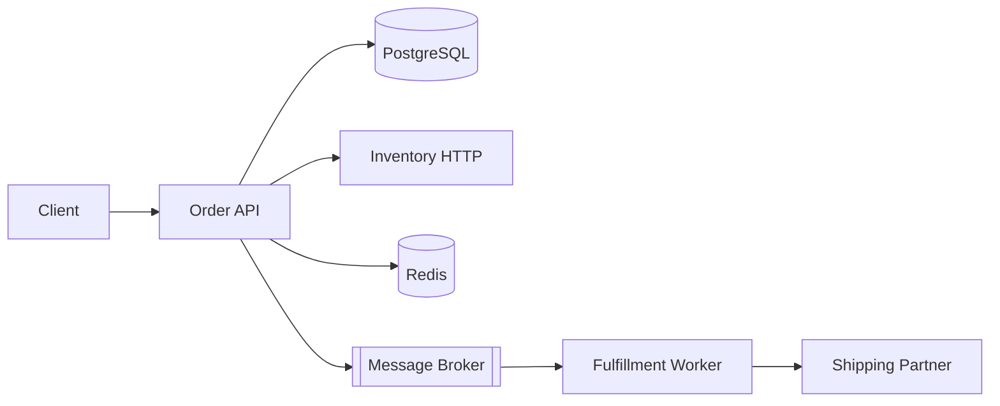
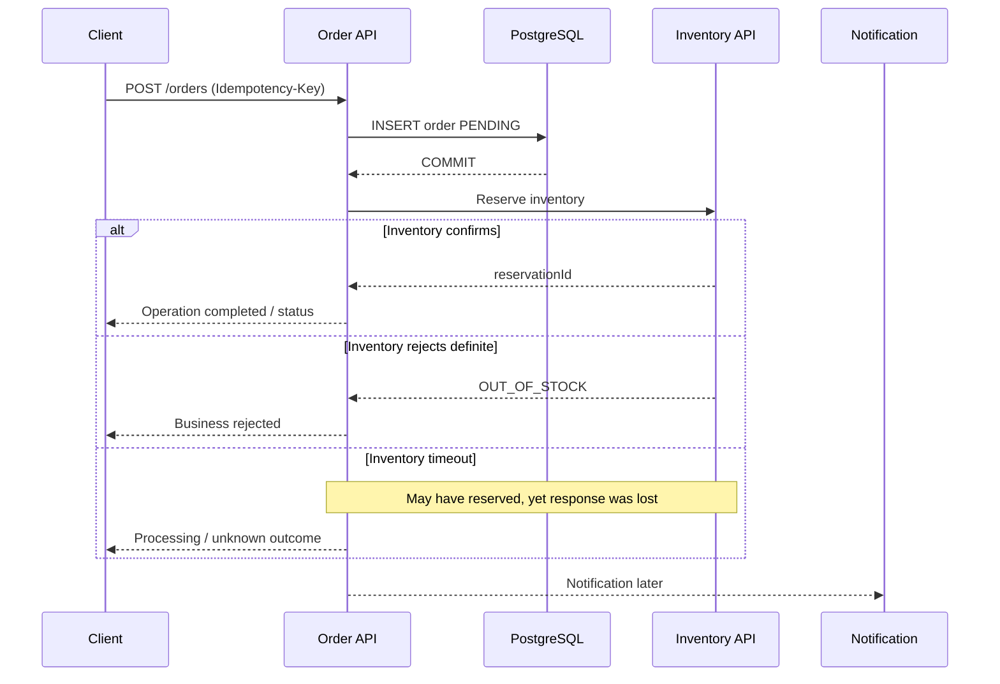
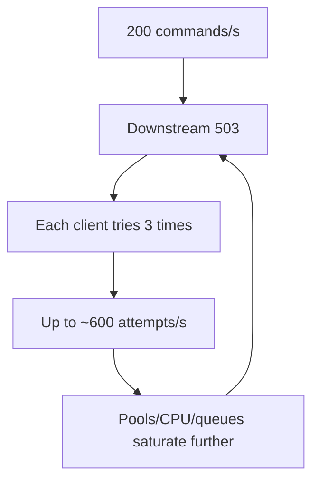
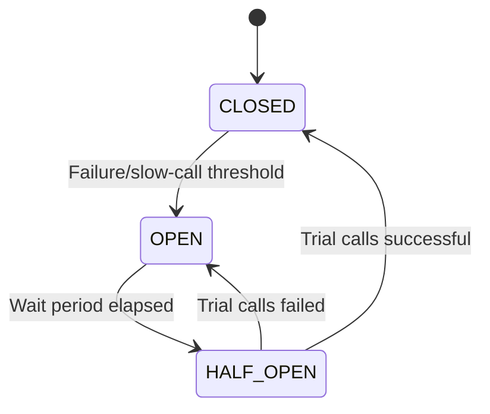
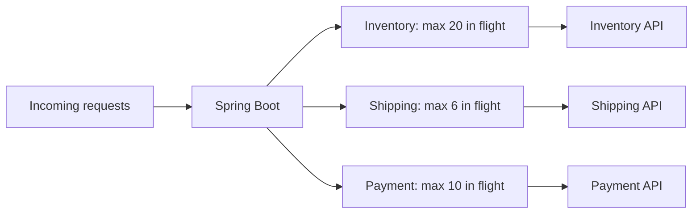
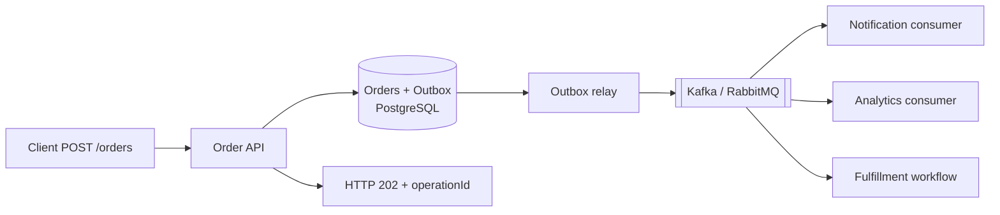
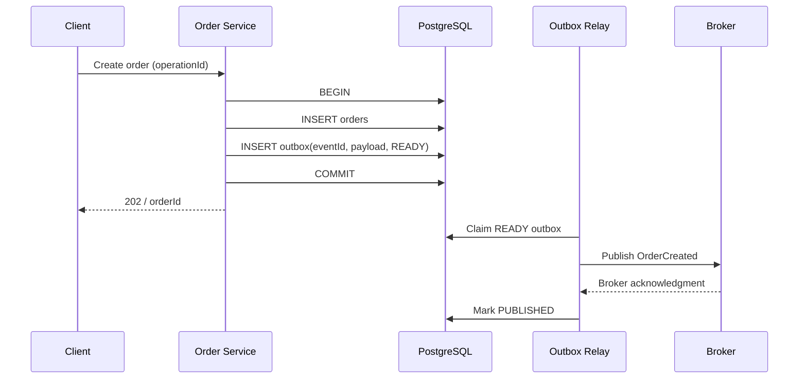
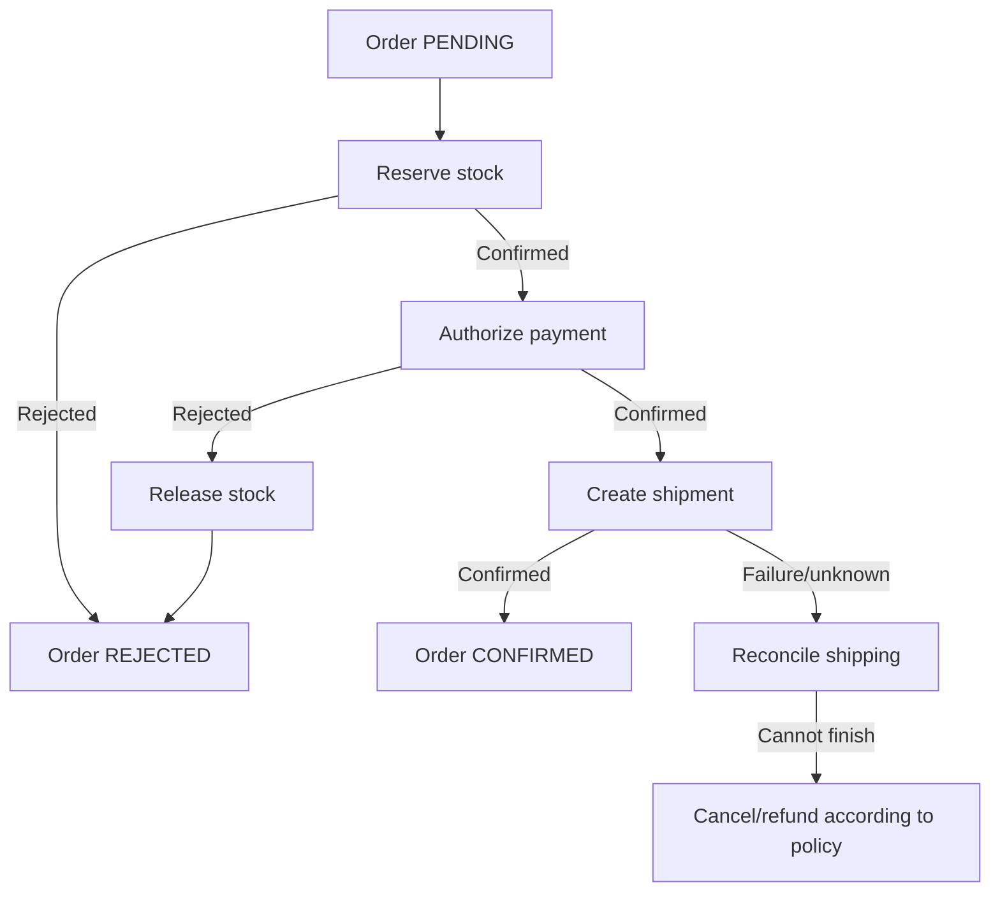
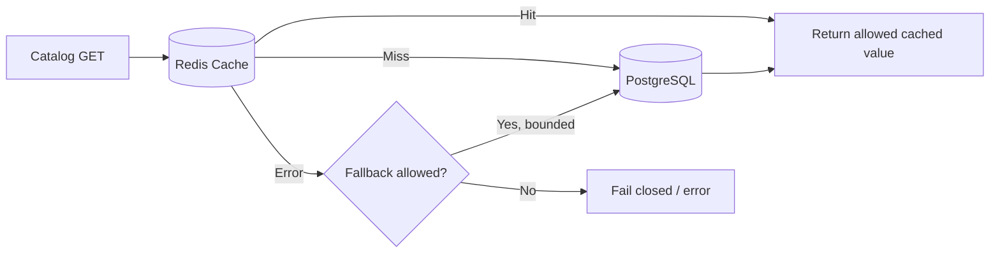
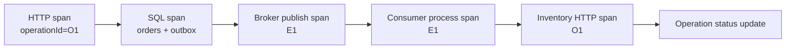

# Partial Failure, Latency, and Independence Across Systems

A Spring Boot application creating an order might need to call an inventory service over HTTP, read configuration from Redis, write to PostgreSQL, and publish an event to Kafka. When every system is healthy, the flow looks simple: receive a request, process it, and return a result. Yet distributed systems do not only have two states—*all succeeded* or *all failed*: **PostgreSQL may have committed while the HTTP response was lost; Kafka accepted the message while the producer timed out; a Redis replica is alive yet returning stale data; the inventory service took 12 seconds to return 200**.

That is **partial failure**. One component is unavailable, slow, or only partially completes its work while other components keep running. If every request is forced to wait for all dependencies, a small glitch can cascade into **exhausted threads, depleted connection pools, unbounded queues, timeouts, and retry storms**. Conversely, if systems are decoupled aggressively without data contracts and recovery mechanisms, the system suffers **lost events, duplicate processing, inconsistent temporary states, and ambiguous outcomes**.

This lesson belongs to the **Integration Overview** chapter of the **SPRING_BOOT_INTEGRATION** module. The module covers organizing system integration in Spring Boot via **HTTP clients, databases, caches, message brokers, and Spring Integration adapters**, emphasizing **configuration, data contracts, transactions, errors, duplicate handling, testing, and observability**. This lesson builds a mental model for choosing **synchronous/asynchronous boundaries**, allocating **latency budgets**, isolating failures, and preserving **business correctness** when one link fails.

> **Example versions:** Java 17+, Spring Boot 3.x (e.g., 3.5), and Spring Framework 6.x; snippets are illustrative and use PostgreSQL, Redis, and Kafka/RabbitMQ as common components. Some Spring Boot 4.x/Spring Framework 7.x APIs may differ; check the dependency BOM and documentation for your deployment version. Do not treat the timeouts or retry counts in this lesson as default production configuration.

## 1. Learning Objectives

After studying this lesson, you will be able to:

1. Explain how **partial failure** differs from complete failure, business rejection, and data contract failure.
2. Identify forms of coupling: temporal, state, resource, data contract, and deployment coupling.
3. Analyze **latency**, **timeouts**, **deadlines**, **tail latency**, and the risks of fanning out to multiple dependencies.
4. Build a layered latency budget instead of giving every HTTP client an independent timeout.
5. Know when **retries** help and when they cause duplicates or overload.
6. Distinguish **circuit breakers**, **bulkheads**, **rate limiters**, **backpressure**, and **load shedding**.
7. Choose synchronous request/response or asynchronous messaging based on the business contract.
8. Handle the SQL commit → HTTP/broker send failure window with **outbox**, and at-least-once delivery with **inbox/idempotency**.
9. Distinguish eventual consistency, sagas, and compensation from distributed atomic transactions.
10. Define API statuses that accurately reflect **request accepted**, **processing**, and **completed**.
11. Observe failures via tracing, metrics, structured logs, and fault-injection tests.
12. Propose a Spring Boot design that prevents one dependency's failure from bringing down the whole system.

## 2. What Is Partial Failure?

Inside a single simple process, an exception typically halts a method and a local transaction can roll back. In distributed systems, a request crosses multiple processes, network links, and resources; **each boundary can fail independently**.



Entirely plausible outcomes include:

| Scenario | What Is Certain | What Is Uncertain |
| --- | --- | --- |
| DB `INSERT` returns success before commit | Database executed the statement | Whether the transaction commits or rolls back |
| DB commit succeeds, app dies before response | Order is durably saved | Whether the client knows the order succeeded |
| HTTP POST to partner times out | Caller did not receive response in time | Whether the partner created the reservation |
| Broker producer times out | Client did not receive ack within deadline | Whether the broker persisted the record |
| Consumer finishes SQL then crashes before ack | SQL side effect may have committed | Whether the broker will redeliver the record (usually yes) |
| Redis cache miss | Cache entry not found | Whether PostgreSQL has the data |
| Redis GET network error | Cache provider did not respond | Whether the entry exists or expired |
| One partner node returns 500 | This node/request failed | Whether the entire partner cluster has an outage |

A useful state model consists of **success**, **definite failure**, and **unknown outcome**. `Unknown` matters for side-effecting operations: never default to treating a timeout as "not executed".

### 2.1. Partial Failure vs. Business Rejection

`HTTP 409` because an order already exists or `422` because input is invalid does not mean "infrastructure is broken". It can be an **expected business outcome**. Retrying the exact same request usually will not help.

Conversely, `HTTP 503`/`429`, TCP connection resets, or SQL deadlocks may be transient failures. Even so, whether to retry depends on **idempotency, remaining deadline, and current load**.

### 2.2. Failure Is Not Just Exceptions

A service returning HTTP 200 with a body missing `operationId`, stale data, wrong currency, or a SKU mapped to the wrong tenant is still an **integration failure**. Transport success does not guarantee **correct data contracts and business semantics**.

Failures can occur in:

- **Availability:** unreachable, service unavailable.
- **Latency:** service is alive yet responds too slowly.
- **Correctness:** wrong data/side effects, response violates contract.
- **Durability:** "accepted" work disappears on process crash.
- **Consistency:** different systems observe conflicting states.
- **Security:** broken authentication/authorization or data leaked via cache/events.
- **Capacity:** queues, thread pools, database pools, or broker lag exceed limits.

## 3. Independence Across Systems Has Multiple Dimensions

Splitting services into separate deployments does not automatically make them independent. They can still be tightly coupled in time, resources, or schemas.

| Coupling Type | Example | Consequence |
| --- | --- | --- |
| **Temporal coupling** | Order API returns only after Inventory API and Shipping API both return 200 | One slow dependency slows down everything |
| **Availability coupling** | No cache fallback when Redis is down | Redis outage causes catalog API outage |
| **Resource coupling** | Every integration shares a single 16-thread pool | Slow shipping starves payment workers |
| **Data/schema coupling** | Consumer requires a new field as soon as producer deploys | Rolling deployments break contracts |
| **Transactional coupling** | SQL transaction holds locks while waiting on external HTTP | Lock contention, deadlocks, rising latency |
| **Operational coupling** | Shared secrets, Redis namespaces, release windows | Changing one service impacts many |
| **Failure coupling** | Infinite retries overload the receiver | Small outage escalates into a system-wide outage |
| **Identity/security coupling** | Cache keys omit tenant or background jobs reuse request tokens | Cross-tenant leaks, jobs fail after token expiry |

Increasing independence does not mean "everything must be asynchronous". It means **each boundary has an explicit contract for data, deadlines, errors, acknowledgments, and recovery responsibility**.

### 3.1. Necessary Coupling vs. Removable Coupling

Checkout needs to know the **price shown to the customer** and **confirmed payment** before announcing "order completed"; that can be legitimate business coupling.

By contrast, sending a welcome email or updating an analytics dashboard rarely needs to hold the HTTP checkout request open. Moving them to a durable event flow reduces temporal coupling when users accept eventual consistency.

**Design question:** If this dependency does not respond within 2 seconds, what safe action can we take *right now* without violating business invariants?

## 4. Order API Example: Three Output Categories to Distinguish

Suppose `POST /orders` creates an order in SQL, requests stock reservation, and then sends a notification.



Three state groups:

1. **Definite success:** Required transactions completed per contract with proper confirmation.
2. **Definite rejection:** Clear business outcome (out of stock, invalid input); no blind retries needed.
3. **Processing / unknown:** Cannot conclude yet; must retain `operationId` and run a status/reconciliation workflow.

If the partner times out, returning `200 OK` claiming "stock reserved" is wrong. Yet returning `500` and letting the client retry with a **new ID** can create duplicate reservations.

### 4.1. One Way to Model Operation States

```text
RECEIVED
   |
   v
PENDING_RESERVATION
   |             |
   |             +-- timeout --> UNKNOWN --> RECONCILING
   |
   +-- confirmed --> RESERVED --> COMPLETED
   |
   +-- rejected  --> REJECTED

PENDING/UNKNOWN can transition to RETRY_SCHEDULED/FAILED_REVIEW
after applying business rules and checking external state.
```

This is a **business state machine**, not built-in Spring Boot states. Persist it durably in PostgreSQL or an appropriate workflow engine when work carries an obligation to complete.

## 5. Latency: Look Beyond Averages

Latency is the time from starting an operation to receiving its result. Common metrics:

- **p50 (median):** 50% of operations have latency at or below this level.
- **p95:** 95% of operations have latency at or below this level.
- **p99:** 99% of operations have latency at or below this level.
- **Maximum/timeout count:** long tail or abandoned waiting requests.
- **Queue wait:** time a task waits in a queue before execution begins.
- **End-to-end latency:** time actually perceived by the user, distinct from a single downstream call's latency.

Consider two inventory service versions that both have an **average of 80 ms**:

| Service | p50 | p95 | p99 | Situation |
| --- | ---: | ---: | ---: | --- |
| A | 60 ms | 130 ms | 250 ms | Stable tail latency |
| B | 30 ms | 120 ms | 2,500 ms | Most calls fast, yet 1% very slow |

A and B have similar averages yet affect checkout very differently. Important SLOs should therefore measure **tail latency** and timeout rates.

### 5.1. Sequential Latency Accumulates

If one request waits sequentially:

```text
SQL lookup          50 ms
Inventory HTTP     350 ms
Promotion HTTP     250 ms
Shipping HTTP      200 ms
Serialization       30 ms
-------------------------
Total approx.      880 ms
```

On a sequential path, total elapsed time roughly equals the sum of step durations plus overhead. If one service has a 3-second timeout, it can single-handedly blow a 1-second SLA.

### 5.2. Parallel Fan-Out Suffers Tail Amplification

If Inventory, Promotion, and Shipping are called **in parallel**, the critical path can approach `max(latency_i)` rather than the sum, **when dependencies are independent and have sufficient capacity**. Still, the whole request waits for the **slowest branch** if business logic requires all three results.

Suppose each dependency has a 99% probability of meeting its deadline, independently. With 5 mandatory dependencies all required on time:

\[
P(\text{all on time}) = 0.99^5 \approx 95.1\%.
\]

This is an **illustrative model assuming independence**, not a universal rule: dependencies often experience correlated failures due to sharing a cloud region, DNS, shared database, or network. Fan-out cuts waiting time when healthy, yet **increases the probability that at least one branch is slow or failing**.

### 5.3. Queueing Delay and Propagation Effects

As request arrival rate approaches service capacity, queue wait grows rapidly. By Little's Law in steady state:

\[
L = \lambda W
\]

where `L` is the number of requests in the system, `λ` is average throughput, and `W` is average time in the system. If latency rises while throughput stays constant, concurrent requests holding resources also rise.

For example, an API receives 200 requests/second and processing time increases from 0.2 s to 2 s:

```text
200 req/s * 0.2s = ~40 requests in flight
200 req/s * 2.0s = ~400 requests in flight
```

If every request holds a Java worker thread and a database connection, a minor downstream latency spike can exhaust pools for unrelated endpoints. Distinguish **client-facing concurrency** from **downstream concurrency**; not every async HTTP request holds a thread the entire time.

## 6. Latency Budgets and Cross-Layer Deadlines

A service has an SLO to return checkout within **1,500 ms**. You should not configure every external dependency with `readTimeout=10s` and expect to meet the SLO.

Example budget for a synchronous path:

| Component | Illustrative Budget |
| --- | ---: |
| Ingress/auth/validation | 100 ms |
| SQL transaction | 250 ms |
| Inventory call | 450 ms |
| Promotion call | 300 ms |
| Serialization/network overhead | 100 ms |
| Buffer / max retry | 300 ms |
| **Total** | **1,500 ms** |

This is an overall allocation, not a guarantee each call takes its exact slice. When running in parallel, evaluate budgets along the **critical path** and resources while maintaining a final hard deadline.

### 6.1. Timeouts vs. Deadlines

- **Connect timeout:** time limit to establish a connection.
- **Connection acquisition timeout:** time limit waiting for a connection from a pool.
- **Read/response timeout:** client-side time limit waiting for data from the partner.
- **Request/operation deadline:** final timestamp after which the entire operation is no longer useful.
- **Retry budget:** total time across all attempts + backoff.
- **Queue wait timeout:** maximum time a task may wait in a worker queue.
- **Business TTL:** after this point, a reservation or job is no longer valid.

If a caller only has 400 ms of deadline left, starting a downstream call with a 2-second read timeout wastes resources after the user has already abandoned the request.

### 6.2. Propagating Remaining Deadline Instead of Resetting Timeouts at Every Layer

```text
Client deadline: T+1500 ms

API receives request at T+100 ms
  remaining = 1400 ms

Service A uses 300 ms
  remaining = 1100 ms

Service B may only use the remaining budget,
never creating a fresh 1500 ms deadline.
```

You can pass trace baggage/timeout headers or internal contract metadata, while preventing clients from arbitrarily raising server limits—always enforce server-side maximum budgets.

### 6.3. Timeouts Do Not Stop Already-Started Side Effects

`CompletableFuture.orTimeout(500, MILLISECONDS)` can make a future throw `TimeoutException`, yet does not automatically cancel an in-flight HTTP POST. With `RestClient`, HTTP driver timeouts must be configured at the request factory/client layer. With Kafka/RabbitMQ, a producer timeout does not prove the message was not persisted.

**Operational takeaway:** After a timeout on a *side-effecting command*, the status should usually be **UNKNOWN**, followed by querying by `operationId` or reconciling, rather than labeling it `FAILED_NOT_EXECUTED`.

## 7. Failure Matrix: Classify Before Choosing a Mitigation

| Failure | Automatic Retry? | Safe Fallback? | Notes |
| --- | --- | --- | --- |
| HTTP 400/422 due to bad payload | Usually no | Never turn into success | Fix contract/request |
| HTTP 401/403 | Do not retry repeatedly | Usually fail-closed | Fix auth/config |
| HTTP 404 read-only lookup | Depends on contract | Short negative cache possible | Do not confuse absence with outage |
| HTTP 409 duplicate operation | Per idempotency contract | Query operation status | Do not generate a new ID |
| HTTP 429 | Conditional | Can degrade | Honor Retry-After/quotas |
| HTTP 503 | Conditional | Depends on business logic | Backoff/jitter, bounded |
| HTTP read timeout after POST | No blind retry | Unknown outcome | Use stable idempotency key |
| PostgreSQL deadlock | Can retry transaction | No if transaction had non-SQL side effects | Retry entire local transaction |
| PostgreSQL unique violation | Classify per business logic | Verify duplicate/conflict | Never treat all duplicates as success |
| Redis cache GET timeout | Can fail-open on reads | Only if SQL fallback is safe | Protect DB capacity |
| Redis cache EVICT fails after commit | Durable retry/reconcile | Do not just log and drop | Risk of stale reads |
| Kafka producer ack timeout | Can resend with same eventId | Do not assume message lost | Downstream inbox handles duplicates |
| Consumer processes then crashes before ack | Broker may redeliver | Idempotent handler | Inbox/SQL uniqueness |
| Poison JSON event | Never retry same payload forever | Quarantine/DLT | Contract version/triage |
| Worker thread pool full | Backpressure/load shedding | Never fake acceptance | 429/503 or durable queue |

Every failure needs an **owner, policy, and observable signal**. Never let one blanket `catch (Exception) { retry(); }` handle everything.

## 8. Synchronous HTTP: When Should You Use It?

HTTP request/response fits when the caller **needs an immediate result** to decide the next step and the result can be served within the SLA:

- Checking pricing/promotions that must be confirmed before payment.
- Fetching read-only data with short timeouts.
- Querying the status of an in-progress operation.
- Business actions requiring explicit confirmation from another system before committing the next step.

Advantages: direct protocol, easy to return errors to the caller, straightforward request-path reasoning. Trade-offs:

- **Temporal coupling:** caller needs receiver healthy at call time.
- **Latency propagation:** caller waits up to the deadline.
- **Capacity coupling:** thread/connection pools can be held when downstream slows down.
- **Retry complexity:** timeouts after side effects risk duplicates.
- **Cascading failure:** many callers retrying together saturate a struggling downstream.

### 8.1. HTTP GET vs. HTTP POST Semantics

`GET` is generally designed to be read-only and safe to retry under HTTP semantics, though real backends can still misbehave or incur quota/rate-limit costs. `POST` is a side-effecting command; retrying is only safe with a **stable idempotency key** honored by the receiver or with status-check/reconciliation mechanisms.

`PUT` can be idempotent with respect to **final state** under HTTP semantics when applying the same representation, yet a downstream implementation might still emit side effects like events or emails on every call; never infer system-wide exactly-once from an HTTP verb.

## 9. Spring Boot RestClient Example: Intentional Timeouts

With Spring Framework 6.1+/Spring Boot 3.2+, `RestClient` is a **synchronous** HTTP client. It is convenient, yet **not non-blocking by itself**.

An illustrative configuration using the JDK HTTP client:

```java
package com.example.integration.partner;

import java.net.http.HttpClient;
import java.time.Duration;

import org.springframework.beans.factory.annotation.Value;
import org.springframework.context.annotation.Bean;
import org.springframework.context.annotation.Configuration;
import org.springframework.http.client.JdkClientHttpRequestFactory;
import org.springframework.web.client.RestClient;

@Configuration(proxyBeanMethods = false)
public class PartnerHttpConfiguration {

    @Bean
    RestClient inventoryRestClient(
            RestClient.Builder builder,
            @Value("${integration.inventory.base-url}")
            String baseUrl) {

        HttpClient httpClient = HttpClient.newBuilder()
                .connectTimeout(Duration.ofMillis(400))
                .build();

        JdkClientHttpRequestFactory requestFactory =
                new JdkClientHttpRequestFactory(httpClient);
        requestFactory.setReadTimeout(Duration.ofSeconds(2));

        return builder.baseUrl(baseUrl)
                .requestFactory(requestFactory)
                .build();
    }
}
```

Corresponding config:

```yaml
integration:
  inventory:
    base-url: ${INVENTORY_URL:http://localhost:8082}
```

These are **sample** lab timeouts. Production must set deadlines across the whole request, TLS/auth, connection pool behavior, and observability. If using Apache HttpComponents 5 or Reactor Netty, timeout properties and connection pool setup **differ**. Spring Boot's auto-configured `RestClient.Builder` is injected when web/client infrastructure is present.

**Warning:** JDK client connect and read timeouts do not enforce an **overall operation deadline across retries**. If a controller waits through three sequential attempts, elapsed time can exceed multiple times the per-attempt timeout.

### 9.1. Translating Error Statuses into Business Classifications

An illustrative service wrapper:

```java
package com.example.integration.partner;

import org.springframework.web.client.RestClient;
import org.springframework.web.client.RestClientResponseException;
import org.springframework.web.client.ResourceAccessException;
import org.springframework.stereotype.Service;

@Service
public class InventoryGateway {

    private final RestClient inventoryRestClient;

    public InventoryGateway(RestClient inventoryRestClient) {
        this.inventoryRestClient = inventoryRestClient;
    }

    public InventoryReply reserve(ReserveCommand command) {
        try {
            InventoryReply reply = inventoryRestClient.post()
                    .uri("/reservations")
                    .header("Idempotency-Key", command.operationId())
                    .body(command)
                    .retrieve()
                    .body(InventoryReply.class);

            if (reply == null || reply.reservationId() == null) {
                throw new InvalidPartnerResponseException(
                        "Missing reservationId");
            }
            return reply;

        } catch (RestClientResponseException ex) {
            if (ex.getStatusCode().value() == 409) {
                throw new ReservationConflictException(ex);
            }
            if (ex.getStatusCode().is5xxServerError()
                    || ex.getStatusCode().value() == 429) {
                throw new TransientPartnerException(ex);
            }
            throw new PermanentPartnerException(ex);

        } catch (ResourceAccessException ex) {
            // Could be connect/read timeout or network I/O.
            // For POST, the outcome is uncertain.
            throw new UnknownPartnerOutcomeException(ex);
        }
    }
}
```

`InventoryReply`, `ReserveCommand`, and the exception types are **application-defined domain contracts**, not Spring classes; the example focuses on error classification. In production, parse bodies/statuses and semantics per **partner documentation** rather than assuming 409 always means conflict across every API.

### 9.2. Illustrative DTO Contract

```java
public record ReserveCommand(
        String operationId,
        String orderId,
        String sku,
        int quantity
) {}

public record InventoryReply(
        String reservationId,
        String status
) {}
```

`operationId` must stay stable from initial command receipt through all retries, including HTTP gateway retries, job queues, and post-restart recovery. Never generate a fresh `UUID.randomUUID()` on every transport retry if it is still the **same business operation**.

## 10. Retries: Right-Sized Medicine or Cause of Cascading Failure?

When a request receives `503`, retrying once can recover from a blip. When every caller retries three times, downstream traffic can roughly triple precisely when it is weakest.



`600` illustrates the upper bound when every command executes all three attempts; actual traffic depends on early successes, cancellations, rate limiters, and backoff. Unchecked retries can spark a **retry storm**.

### 10.1. Retries Require Six Conditions

1. **Recoverable error:** 429, 503, or lock contention with transient signals.
2. **Safe-to-retry operation:** read-only or backed by idempotency/reconciliation.
3. **Bounded attempts:** no infinite loops.
4. **Bounded elapsed time:** stays within the deadline budget.
5. **Backoff + jitter:** clients do not retry simultaneously in lockstep.
6. **Controlled load:** rate limiting, circuit breakers, bulkheads, and overload responses.

Example policy:

```text
max attempts: 3 (1 initial + 2 retries)
backoff:      150ms, then ~300ms + jitter
deadline:     1200ms end-to-end
retry on:     HTTP 503/429 per contract
no retry:     HTTP 400/401/403/validation
unknown POST: status lookup or stable idempotency key
```

**Do not** treat this config as a universal default for every partner. If each HTTP attempt has a 2-second read timeout, three attempts cannot fit inside a 1.2-second deadline; per-attempt timeouts must **shrink to fit the remaining budget**.

### 10.2. Exponential Backoff and Jitter

A reference formula:

\[
d_n = \min(d_{\max}, d_0 \times 2^{n-1}) + J_n
\]

where `J_n` is bounded random jitter per policy. Variants like **full jitter**, **equal jitter**, or decorrelated jitter distribute delays differently; the goal is preventing synchronized client retries.

When a partner returns `Retry-After`, honor it if it fits within your overall deadline/quota policy. If waiting per `Retry-After` is impossible because the request needs an immediate answer, return a processing or rate-limited status instead of holding threads indefinitely.

### 10.3. At Which Layer Should Retries Happen?

| Layer | What Can It Retry? | Pitfall |
| --- | --- | --- |
| HTTP client | Connections/response waits per policy | Unknown POST effects |
| API gateway | Request to backend | Can multiply retries with the application |
| Spring service | Business operation | Can repeat both SQL and external side effects |
| JDBC transaction | Deadlocks/serialization errors | Must retry **whole transaction**, not rollback-only statements |
| Kafka/Rabbit producer | Send/ack | Broker may already have persisted |
| Broker consumer | Message processing | Redelivery duplicates |
| Outbox relay | Publishing durable intent | Resending same eventId |
| DLT/replay | Recovery after investigation | Poison-message loop |

Assign **one policy owner** per retry type or a shared budget; never sprinkle `@Retryable` across every layer assuming each operates independently.

## 11. Circuit Breakers: Preventing Error Amplification

A circuit breaker tracks failure/slow-call rates for a dependency and temporarily rejects calls once thresholds are crossed:



- **CLOSED:** calls pass through and are measured.
- **OPEN:** most calls fail fast, avoiding holding connections/threads waiting on an unhealthy dependency.
- **HALF_OPEN:** allows a few probe calls to test recovery.

**Do not misunderstand:** A circuit breaker **does not execute the missing business operation** and does not turn an unknown outcome into a definite failure. When a breaker opens for a command requiring durable processing, the system can persist `PENDING` to a job/outbox for later execution instead of returning "completed".

### 11.1. Fallbacks Must Preserve Semantics

Examples:

- Product description: may return stale cached data (within an approved stale window).
- Recommendation list: may return an empty/default list.
- Shipping ETA: may show "estimate unavailable" rather than fabricating a value.
- Payment charge: **must never** return fake success just because the circuit breaker is open.
- Authorization: usually must fail-closed or query the source of truth.

A semantically wrong fallback can be worse than an explicit HTTP 503.

### 11.2. Resilience4j and Spring Boot

Resilience4j is a popular library for circuit breakers, retries, bulkheads, and time limiters; it **does not appear automatically** just from using `RestClient`. If a project adopts Resilience4j, ensure the dependency/starter **strictly matches** your Spring Boot version, configure properties, and write tests confirming the aspect/proxy actually applies.

In particular, `TimeLimiter` on an async stage limits how long you wait for a result without **automatically cancelling an already-sent side effect**. Never copy breaker thresholds or backoff settings blindly from one app to every downstream service.

## 12. Bulkheads: Isolating Resources Between Integrations

On a ship, bulkheads compartmentalize flooding so one breached compartment does not sink the vessel. In a Spring Boot service, isolate **connection pools, executors, semaphores, and concurrency budgets** by workload:



If Shipping takes 20 seconds, only Shipping's budget fills up; Payment still has capacity to serve requests.

### 12.1. Illustrative Semaphore Bulkhead

A synchronous wrapper with bounded capacity:

```java
package com.example.integration.partner;

import java.util.concurrent.Semaphore;
import java.util.concurrent.TimeUnit;

public final class ShippingBulkhead {

    private final Semaphore permits =
            new Semaphore(6);

    public <T> T execute(CheckedSupplier<T> work)
            throws Exception {

        if (!permits.tryAcquire(
                50, TimeUnit.MILLISECONDS)) {
            throw new ShippingOverloadedException();
        }

        try {
            return work.get();
        } finally {
            permits.release();
        }
    }

    @FunctionalInterface
    public interface CheckedSupplier<T> {
        T get() throws Exception;
    }
}
```

`ShippingOverloadedException` is an application domain exception. This example limits to 6 concurrent requests **per JVM**; across 10 replicas, the total approaches 60. To enforce cluster-wide quotas, use centralized rate limiting/semaphores/distributed capacity accounting or divide the budget across replicas.

In controllers/web services, map overload to HTTP 429/503 or a durable accepted status per contract—**never** silently drop requests.

### 12.2. Dedicated Thread Pools Do Not Replace Queue Limits

A `ThreadPoolTaskExecutor` with an oversized queue can hold thousands of waiting tasks, driving latency up endlessly. A small pool per integration + **bounded queue + explicit rejection policy** surfaces overload early.

Guidelines:

- Size concurrency to downstream quotas/connection pools.
- Bound queue depth and queue wait time.
- When the queue is full, reject explicitly or write a durable job instead of faking acceptance.
- Monitor active workers, queue length, and rejected tasks.
- Avoid `CallerRunsPolicy` if it unexpectedly stalls an HTTP request thread or alters broker ack timing.

## 13. Rate Limiting, Backpressure, and Load Shedding

Three related mechanisms with distinct goals:

- **Rate limiting:** caps request rate over a time window, e.g., 100 requests/second to a partner.
- **Backpressure:** slows down upstream production/submission to match downstream consumption capacity.
- **Load shedding:** rejects or deprioritizes part of the workload under overload to protect critical requests.

```text
Producer faster than consumer:
  incoming 1000 events/s
  processing  300 events/s
  backlog grows 700 events/s

Without control:
  memory/queue/lag increase until failure.

With control:
  bounded queue + broker retention/quota
  pause/scale consumers or reduce producer rate
  reject low-priority workload when necessary.
```

A broker typically **persists backlogs according to configuration** rather than speeding up consumers. If backlogs grow longer than retention or SLAs, you still risk missing processing windows and must scale consumers or throttle sources.

### 13.1. Choosing HTTP Responses Under Overload

- `429 Too Many Requests`: receiver rate-limits the caller; may include `Retry-After`.
- `503 Service Unavailable`: server is temporarily overloaded or under maintenance.
- `202 Accepted`: only when the server **has assumed processing responsibility per contract**, e.g., intent is durably persisted.
- `200/201`: only when the result/resource was successfully created per HTTP/API semantics.

**Never return 202 simply because you called `@Async` and discarded the future**: an in-JVM task can be rejected or lost on process crash.

## 14. When Should You Decouple via a Message Broker?

Not every step must finish inside the synchronous HTTP path. For **notifications, analytics, search indexing, downstream projections, deferrable fulfillment**, or long-running workflows, a producer can persist processing intent to a **durable queue/topic** and return an acknowledgment of receipt.



Advantages:

- Producer does not need the Notification service running right now.
- Broker holds backlogs within configured retention/queue durability limits.
- Consumers scale independently within partition/queue constraints.
- Downstream failures can retry/DLT without holding HTTP requests open.
- Consumers deploy/update more independently when schema contracts remain compatible.

Trade-offs:

- **Eventual consistency:** one service sees the new order before another.
- **Message duplication:** can arise, especially after crashes/retries.
- **Ordering:** must be configured per key/partition/queue, never global by default.
- **Schema evolution:** becomes critical across multiple consumers.
- **Backlogs, retention, DLQs, and replays:** require operational tooling.
- **No atomic transaction** between SQL and broker unless explicitly designed.

### 14.1. Asynchronous Is Not Durable

A method:

```java
@Async("integrationExecutor")
public void notifyCustomer(OrderCreated event) {
    emailClient.send(event);
}
```

runs on a JVM executor, yet lacks persistence or checkpoints across process crashes. If a request returns 202 before the task is durably saved, it can vanish with nowhere to replay from.

Conversely, sending to Kafka/RabbitMQ under a producer confirm/acks contract makes the broker responsible for persisting the record per its durability policy, **yet** the SQL commit → broker publish gap still remains. Evaluate the full end-to-end chain rather than picking technologies based on the buzzword "async".

### 14.2. Separating Commands and Events

- **Command:** asks a component to perform a task, e.g., `ReserveStock`; the sender needs to know if the task was accepted, rejected, or pending.
- **Event:** states a fact that happened, e.g., `OrderCreated`; multiple subscribers can react.
- **Query:** retrieves data without mutating business state.

Never rename a "please reserve stock" command into a "stock reserved" event before Inventory actually confirms it. Mislabeling message semantics creates **phantom business state**.

## 15. HTTP Requests and Brokers Process at Different Times

| Aspect | Synchronous HTTP | Asynchronous Broker |
| --- | --- | --- |
| Needs receiver online immediately? | Usually yes | Not necessarily, within broker backlog/retention limits |
| Client response time | Includes downstream latency | Can reflect only durable acceptance |
| Where do partner errors surface? | HTTP error/timeout to caller | Consumer retries/DLT/operation status |
| Duplicates | Client/gateway request retries | Producer retries + redelivery + replays |
| Contract | HTTP method/status/body | Event schema/key/topic/headers |
| Ordering | Within a single request chain | Per partition/queue/consumer config |
| Guarantees business completion | Not by default | Not by default |
| Observability | Request tracing | Correlation spans + consumer lag + DLT |
| Backpressure | 429/503/connection pools | Broker quotas, lag, consumer pause/scale, DLT |

A sound architecture often combines both: **HTTP for accepting commands and querying status**, and a broker for deferred steps.

### 15.1. Do Not Turn Everything Event-Driven

If an outcome must be confirmed before showing "order placed successfully" to the user, switching to event-driven without operation states merely **hides latency** without solving the business requirement. A good UI can show `PENDING_PAYMENT`/`WAITING_FOR_STOCK` instead of faking `COMPLETED`.

### 15.2. Avoid Overly Long Request Chains

```text
API Gateway → Order → Inventory → Pricing → Promotion → Shipping → Fraud
```

Every hop adds availability and latency coupling. Consider:

- Consolidating reads computable within the same service boundary.
- Parallelizing independent queries (while managing fan-out and partial outcomes).
- Using materialized views/projections for data suited to eventual consistency.
- Caching read-only contracts with TTLs and invalidation.
- Moving notifications/reporting off the critical path.
- Avoiding adding a broker merely to disguise missing latency SLAs.

## 16. At-Least-Once Delivery: Messages Can Arrive Multiple Times

A simple Kafka/RabbitMQ flow:

```mermaid
sequenceDiagram
    participant B as Broker
    participant C as Consumer
    participant DB as SQL
    B-->>C: Deliver E1
    C->>DB: BEGIN; UPDATE; COMMIT
    DB-->>C: COMMIT OK
    Note over C: Process crashes before ack/offset commit
    B-->>C: Redeliver E1
    C->>DB: Execute E1 again?
```

If the consumer blindly executes `UPDATE balance = balance + amount` without checking event identity, duplicate delivery doubles the business effect.

**Sensible policy:** Treat transport as **at-least-once** across failure windows that can trigger replays; design **business idempotency** inside every consumer.

### 16.1. Ordering Is Not Globally Guaranteed

In Kafka, records sharing a key (such as `orderId`) are consistently routed by producers to one partition when properly configured; log order is preserved **within that partition**, yet retry topics, concurrent processing, partition-count changes, or producer ordering settings can alter the order observed by the app.

In RabbitMQ, queues preserve enqueue order, yet multiple consumers, requeues, priorities, or retries can cause **business processing order** to diverge from publish order. Never rely solely on "the broker preserves order" when business logic requires monotonic state transitions; use `aggregateVersion`/optimistic locking or per-aggregate sequencing.

### 16.2. Exactly-Once Has Scope Limits

Kafka provides idempotent producers/transactions and read-process-write exactly-once semantics **within properly configured Kafka boundaries**. They do not automatically wrap PostgreSQL, Redis, email, or HTTP POSTs in the same transaction.

**Practical target:** Design *effectively-once business effects* using stable event IDs + consumer inbox/unique constraints + atomic local updates—accepting duplicate deliveries without duplicating side effects.

## 17. The SQL Commit → Broker Publish Window: Dual-Write Problem

Suppose Order Service does:

```java
@Transactional
public void create(OrderCommand command) {
    orderRepository.insert(command);
    kafkaTemplate.send("orders.events", toEvent(command));
}
```

This is a **dual write** across SQL and Kafka. `@Transactional` for JDBC does not put the Kafka publish inside the same local SQL transaction.

Both orderings carry risk:

| Ordering | Failure Window | Consequence |
| --- | --- | --- |
| SQL commit then publish | Process crash/broker down between steps | Order exists, event never sent |
| Publish then SQL commit | SQL rolls back after broker ack | Consumer receives event for nonexistent order |
| SQL write inside TX then send before commit | Consumer runs before SQL commits | Consumer may fail to read the order |
| Broker ack then status update fails | Relay resends | Duplicate event |

Do not treat `@TransactionalEventListener(AFTER_COMMIT)` as a complete durability fix: it avoids sending before commit, yet **the process can still crash between commit and the callback/publish**.

## 18. Transactional Outbox: Persisting Publish Intent in the Same SQL Transaction

A standard way to eliminate the **lost-intent gap** between SQL and the broker is inserting an outbox row **in the same transaction** as the business update.



If SQL rolls back, **order and outbox roll back together**. If it commits, publish intent survives in SQL even if the app crashes. The relay recovers and sends it later.

### 18.1. SQL Schema

```sql
CREATE TABLE orders (
    order_id UUID PRIMARY KEY,
    operation_id UUID NOT NULL UNIQUE,
    tenant_id VARCHAR(64) NOT NULL,
    state VARCHAR(40) NOT NULL,
    created_at TIMESTAMPTZ NOT NULL DEFAULT now()
);

CREATE TABLE order_outbox (
    event_id UUID PRIMARY KEY,
    aggregate_id UUID NOT NULL,
    event_type VARCHAR(80) NOT NULL,
    payload_json JSONB NOT NULL,
    status VARCHAR(24) NOT NULL DEFAULT 'READY',
    attempt_count INTEGER NOT NULL DEFAULT 0,
    next_attempt_at TIMESTAMPTZ,
    created_at TIMESTAMPTZ NOT NULL DEFAULT now(),
    published_at TIMESTAMPTZ
);

CREATE INDEX idx_order_outbox_ready
    ON order_outbox (status, next_attempt_at, created_at);
```

This is an **illustrative PostgreSQL schema**; production needs retention, lease/lock ownership, optimistic updates, poison-event handling, and team-managed migrations.

### 18.2. Spring Boot Transactional Service

```java
package com.example.integration.order;

import java.util.UUID;

import org.springframework.jdbc.core.JdbcTemplate;
import org.springframework.stereotype.Service;
import org.springframework.transaction.annotation.Transactional;

@Service
public class OrderCommandService {

    private final JdbcTemplate jdbc;
    private final EventJsonEncoder encoder;

    public OrderCommandService(
            JdbcTemplate jdbc, EventJsonEncoder encoder) {
        this.jdbc = jdbc;
        this.encoder = encoder;
    }

    @Transactional
    public UUID accept(CreateOrder command) {
        UUID orderId = command.orderId();
        UUID eventId = command.eventId();

        jdbc.update("""
                INSERT INTO orders (
                    order_id, operation_id, tenant_id, state
                )
                VALUES (?, ?, ?, 'PENDING')
                """,
                orderId, command.operationId(),
                command.tenantId());

        String json = encoder.toJson(
                new OrderCreated(
                    eventId, orderId, command.tenantId()));

        jdbc.update("""
                INSERT INTO order_outbox (
                    event_id, aggregate_id, event_type,
                    payload_json, status
                )
                VALUES (?, ?, 'OrderCreated',
                        CAST(? AS jsonb), 'READY')
                """,
                eventId, orderId, json);

        return orderId;
    }
}
```

`CreateOrder`, `OrderCreated`, and `EventJsonEncoder` are application-defined DTOs/ports. `operationId` must be set stably by the client/application and deduplicated in SQL; the example throws a unique violation on repeat operations, whereas production should **look up the prior result** and only accept replays if payloads match the contract. Generating a new `eventId` on every client retry defeats outbox/inbox deduplication.

**Note:** Place `@Transactional` on a Spring-managed service and call it through a proxy. Never call `accept` via `this.accept(...)` expecting the proxy to activate. Use a single `DataSource` and matching transaction manager for both tables to ensure local atomicity.

### 18.3. Relay Must Claim and Retry Properly

A worker reads `READY` rows, claims them via lease or `SELECT ... FOR UPDATE SKIP LOCKED` within an appropriate SQL transaction, publishes to the broker, and marks `PUBLISHED` upon ack. Avoid holding **SQL row locks across long HTTP/broker calls** where possible; use claim/lease and state transitions.

Scenarios:

- Relay crashes before publish: row stays READY or lease expires → retried.
- Publish fails: increment attempt count and set `next_attempt_at`.
- Publish succeeds yet relay crashes before marking PUBLISHED: **will resend** the same eventId.
- Malformed event data: quarantine/manual remediation; do not retry forever.
- Relay backlog grows: alert on oldest READY age, not just count.

Outbox solves "not losing **publish intent** after SQL commit"—it **does not automatically create exactly-once broker delivery**.

## 19. Consumer Inbox: Preventing Duplicated Side Effects

A consumer receiving `OrderCreated` must check **whether the event has already been applied** before mutating business tables.

```sql
CREATE TABLE consumer_inbox (
    consumer_name VARCHAR(100) NOT NULL,
    event_id UUID NOT NULL,
    payload_sha256 CHAR(64) NOT NULL,
    processed_at TIMESTAMPTZ NOT NULL DEFAULT now(),
    PRIMARY KEY (consumer_name, event_id)
);

CREATE TABLE order_projection (
    order_id UUID PRIMARY KEY,
    tenant_id VARCHAR(64) NOT NULL,
    state VARCHAR(40) NOT NULL
);
```

Inside **one local SQL transaction**:

```text
BEGIN
  INSERT consumer_inbox(consumerName, eventId, payloadHash)
    ON CONFLICT DO NOTHING

  if inserted:
      INSERT/UPDATE order_projection according to contract
  else:
      verify hash/semantic identity
      no-op if same event
      error/quarantine if same eventId but different data
COMMIT

only after commit:
  ack broker / let container commit offset
```

Because the inbox insert and business effect share one transaction, if the business update fails, the inbox insert rolls back. If SQL commits and the consumer crashes before acking, the redelivered record becomes a no-op.

### 19.1. Atomic SQL Pattern

```sql
INSERT INTO consumer_inbox (
    consumer_name, event_id, payload_sha256
)
VALUES ('order-projection', :event_id, :payload_hash)
ON CONFLICT (consumer_name, event_id)
DO NOTHING;
```

Inspect the update count; execute the SQL projection only if it equals 1. If it equals 0, read the existing hash to distinguish an identical duplicate from **same ID, different payload**. Never do `SELECT EXISTS` outside a transaction followed by `INSERT` without a unique constraint; concurrent consumers can race.

### 19.2. Ack Timing in Spring Kafka/Rabbit/JMS

- **Kafka record listener:** With `enable-auto-commit=false` and a matching container ack mode, let exceptions propagate to the error handler; commit offsets per policy only after successful processing or handoff.
- **RabbitMQ:** ACK delivery once a durable handoff completes; NACK/requeue/dead-letter per bounded policy.
- **JMS:** Session transaction/ack semantics differ; verify configuration and transaction managers.
- **Spring Integration:** When handing off to an `ExecutorChannel` or an async adapter, error flows and acknowledgment responsibilities change; never assume a message was processed merely because the handler submitted a `CompletableFuture`.

If a listener simply invokes an `@Async void` method and returns, the broker container may treat the message as handled and commit/ack **before the async work finishes**.

## 20. Idempotency Does Not Mean "Called Once"

A command like `POST /reservations` can be sent twice by the client, retry policies, gateways, or relays. You cannot control every network path to guarantee **only one HTTP request is ever sent** across all failure windows.

Idempotency means **the same business operation applies its protected side effects at most once**, regardless of how many attempts occur. Mechanisms:

- Stable `operationId`/`eventId`.
- SQL unique constraints and payload hash/version checks.
- Partner APIs supporting real `Idempotency-Key` semantics with clear retention and scope.
- State machines rejecting invalid transitions when stale events arrive late.
- Queries/reconciliation on timeouts with unknown outcomes.
- Consumer inboxes deduplicating broker redeliveries.

### 20.1. Idempotency Keys Need Scope

```text
tenantId + operationType + operationId
```

Keys may need tenant and operation type to prevent ID collisions across customers or workflows. Ledger/key retention must outlive replay/retry windows; if a partner expires idempotency keys after 24 hours while your local job retries after 7 days, **a new side effect can occur**.

### 20.2. Do Not Rely Solely on Redis Cache as an Idempotency Ledger

Redis has TTLs, eviction, failover, and potential key loss; it suits optimization or short-lived coordination locks with explicit policies, whereas critical transactions need durable SQL/state with unique constraints or storage offering equivalent guarantees.

A `SETNX` with a 30-second TTL does not prevent a command from running a second time an hour later; a lock lease expiring mid-flight during a long-running operation can allow concurrent execution. Critical writes need fencing/versioning or DB constraints.

### 20.3. Distinguishing At-Most-Once, At-Least-Once, and Effectively-Once

| Goal | Description | Trade-Off |
| --- | --- | --- |
| At-most-once delivery | May drop messages; tries to avoid resending | Unsuitable for tasks that must never be lost |
| At-least-once delivery | May redeliver until completed per policy | Consumers must be idempotent |
| Exactly-once transport | Only within the narrow scope supported by a platform | Does not cover arbitrary external side effects |
| Effectively-once business effect | Deliveries may repeat while SQL/business updates never double | Requires unique keys, state guards, and reconciliation |

Never claim system-wide "exactly once" merely because you enabled Kafka transactions or Spring `@Transactional`.

## 21. Eventual Consistency and Business Invariants

When Order Service commits `PENDING` and emits `OrderCreated` for Inventory to process, for a few seconds the system may look like:

```text
Order DB:       PENDING_RESERVATION
Inventory DB:   no reservation visible yet
Search index:   new order not present yet
Notification:   email not sent yet
Client GET:     PENDING_RESERVATION
```

That is **eventual consistency** per contract, not necessarily a bug. It becomes a bug if the API/UI claims "stock reserved" before Inventory confirms, or if the system never converges after an outage.

### 21.1. Distinguishing Consistency from Availability

Some data can tolerate staleness:

- Search indexes.
- Analytics dashboards.
- Recommendation lists.
- Email notification state.

Some invariants must be verified with the owner/source of truth:

- Never charge a payment twice.
- Never grant access before authorization succeeds.
- Never create two reservations for the same operation.
- Never finalize an order while payment remains unconfirmed.
- Never decrement inventory below permitted thresholds.

**Classify by the cost of business error**, rather than flipping eventual consistency on as a global switch for every service.

### 21.2. Read-Your-Writes

If a client posts an order and immediately runs a GET against a lagging read model, the UI may see 404 or stale state. Mitigations:

- Query operation state from the **source-of-truth service** while processing.
- Return `operationId` and dedicated status without promising projections are updated.
- Use version tokens/offsets or `minimumVersion` to tell whether a projection has caught up.
- Display meaningful business states such as `PROCESSING`/`SYNCING`.
- Avoid caching a 404 for long when the record will appear seconds later.

## 22. Sagas and Compensation: When There Is No Single Shared Transaction

A checkout flow can involve:

```text
Create Order → Reserve Inventory → Authorize Payment → Arrange Shipping
```

Each step runs on different databases/APIs. You cannot assume a `@Transactional` in Order Service rolls back all of them.

A *saga* is a sequence of business steps with **durable state**, where failures are handled via appropriate **compensating actions**.



### 22.1. Compensation Is Not a Technical Rollback

If a payment was already charged, compensation may be a **refund**. A refund is a brand-new business operation—it can fail, incur fees, and require auditing. It is not a bit-for-bit undo like a SQL rollback.

If the shipping partner cannot cancel after a parcel has already shipped, the saga cannot "undo" like a transaction. You need an exception/manual-review workflow.

### 22.2. Orchestration vs. Choreography

- **Orchestration:** one workflow owner holds state, issues the next command, and handles timeouts/retries/compensation. Easier to trace centrally.
- **Choreography:** services emit events and react independently. Reduces coupling to a coordinator yet gets harder to observe across many indirect flows.

Choose based on complexity, business deadlines, and audit requirements. Either approach requires stable IDs, event schemas, and dead-letter/reconciliation workflows.

### 22.3. Never Retry Compensation Infinitely by Default

A failing compensation needs a retry budget, idempotency, and `COMPENSATION_PENDING`/`MANUAL_REVIEW` states. Never simply log an exception and declare the saga rolled back.

## 23. Caching Is an Optimization Layer, Not a Source of Truth by Default

Redis lowers read latency for cacheable data, while introducing new failure modes. In Spring Boot, `@Cacheable` and `RedisCacheManager` share read results across replicas, and `@CacheEvict` helps invalidate by key, yet these annotations **do not automatically keep the cache consistent with SQL transactions or broker events**.

Failure modes to distinguish:

- **Cache miss:** entry does not exist or TTL expired.
- **Cache GET timeout:** provider did not respond.
- **Stale value:** entry exists while SQL/source changed.
- **Serialization mismatch:** newer replica cannot decode payload written by an older replica.
- **Eviction:** Redis drops keys before TTL due to memory policy.
- **Cache stampede:** many concurrent misses overload SQL.



### 23.1. Fail-Open Only When Safe

Product descriptions can fall back to SQL. Authorization caches or payment states need source-of-truth reads or fail-closed behavior. During a Redis outage, sending every request straight to SQL can trigger a **thundering herd**; enforce rate limits, bulkheads, and connection budgets even when caching is optional.

### 23.2. Invalidation Has Failure Windows Too

Suppose SQL commits a new price and then Redis `EVICT` fails. If the application returns "updated" without durable retries, stale cache entries linger until TTL expiration. For price-sensitive paths, use:

- Invalidate after commit.
- SQL outbox/durable invalidation intent when misses cannot be tolerated.
- Versioned cache keys or version guards against stale refills.
- Bounded TTLs capping the staleness window.
- Metrics for oldest pending invalidation and consistency tests.

`RedisCacheManager.transactionAware()` can defer certain cache operations until after commit, yet **does not turn Redis and SQL into one distributed transaction**.

## 24. Cross-System Contracts Must Evolve Independently

To deploy services independently, producers and consumers need **compatible data contracts** when multiple versions coexist.

Example `OrderCreated`:

```json
{
  "eventId": "632e4c27-792e-4594-8857-e14d0c5e2295",
  "orderId": "a6507402-e214-49b2-9f7e-5603d392a610",
  "tenantId": "tenant-a",
  "eventVersion": 1,
  "amountMinor": 125500,
  "currency": "VND",
  "occurredAt": "2026-11-21T02:00:00Z"
}
```

- `eventId`: identity for deduplication.
- `orderId`: aggregate identity, typically the Kafka key.
- `tenantId`: requires authorization/source validation.
- `eventVersion`: contract version, **not aggregateVersion**.
- `amountMinor` and `currency`: units must never shift implicitly.
- `occurredAt`: source event time, not necessarily processing time.

### 24.1. Schema Evolution

| Change | Compatibility Impact |
| --- | --- |
| Adding an optional field with a default | Usually easier, though older consumers must be tested |
| Renaming `amountMinor` to `price` | Potentially breaking |
| Changing type number → string | Potentially breaking |
| Changing money from minor units → major units without renaming | **Semantically breaking even when JSON parses** |
| Removing a required field | Breaking for dependent consumers |
| Adding an enum value | Older consumers may reject unknown values |
| Changing timezone/time precision | Can cause business bugs even when deserialization succeeds |

With Kafka/Pulsar, Avro/Protobuf/JSON Schema Registries enforce structural compatibility, yet **schema compatibility does not prove semantic compatibility**. HTTP DTOs likewise need contract tests when clients and servers deploy out of lockstep.

### 24.2. Expand-and-Contract

A safe rollout looks like:

1. New consumers accept both old and new fields.
2. Producers start emitting the new field while keeping the old field during the compatibility window.
3. Monitor consumer versions and unprocessed backlogs.
4. Upgrade all consumers.
5. Only then remove the old field per contract release policy.

Never force every service to deploy in the same minute just to change one JSON field. That is **operational coupling** that contract versioning is meant to reduce.

## 25. API Contracts Reflecting Partial Completion

When a system accepts commands for asynchronous processing, the API should expose a way to **track operations**.

Example:

```http
POST /orders
Idempotency-Key: op-3197
Content-Type: application/json

{"sku":"SKU-1","quantity":2}
```

Once the intent is durably persisted and processing:

```http
HTTP/1.1 202 Accepted
Location: /operations/op-3197
Retry-After: 2
Content-Type: application/json

{
  "operationId": "op-3197",
  "status": "PENDING_RESERVATION"
}
```

The client polls:

```http
GET /operations/op-3197
```

Result:

```json
{
  "operationId": "op-3197",
  "status": "COMPLETED",
  "orderId": "a6507402-e214-49b2-9f7e-5603d392a610",
  "updatedAt": "2026-11-21T02:01:00Z"
}
```

Or:

```json
{
  "operationId": "op-3197",
  "status": "UNKNOWN",
  "reason": "INVENTORY_TIMEOUT",
  "retryableByServer": true,
  "updatedAt": "2026-11-21T02:01:00Z"
}
```

**Precondition for returning 202:** processing responsibility has been accepted per contract, ideally durably persisted. An in-memory `CompletableFuture` or a "queued" log line is insufficient for work that must not be lost.

### 25.1. Polling, Webhooks, and Event Notifications

Clients can choose:

- Polling `GET /operations/{id}` with backoff/`Retry-After`.
- Signed webhooks with authentication, idempotency, and client-side retries.
- Server-Sent Events/WebSockets for connected status updates.
- Broker events for backend systems.

Whichever mechanism is used, **the source of truth for operation status** must be persisted; notifications can be delayed or lost, and clients must still be able to query status.

### 25.2. Prevent Client Retries from Creating Duplicate Orders

The same `Idempotency-Key` with the same payload must return the prior operation's result within the retention window. The same key with a different payload must report a conflict; never silently apply "first wins" without validating payload equivalence.

Define scope explicitly: tenant, endpoint, payload fingerprint, and idempotency record retention period.

## 26. Isolation Extends Beyond Runtime: Data, Permissions, and Operations

An independent service also needs clear boundaries in:

- **Database ownership:** Prevent other services from updating business tables directly when contracts mandate APIs/events.
- **Secrets/credentials:** Each adapter uses dedicated secrets and scopes; rotation must not require redeploying the entire system.
- **Broker ACLs:** Producers only write permitted topics; consumers only read relevant groups/topics.
- **Cache namespaces:** Never share key prefixes across dev/prod or across tenants.
- **Deployment:** Allow rolling back a service while maintaining compatibility for data written by the newer version.
- **Observability:** Each integration has an owner, runbook, and alerts—not one global dashboard tracking only HTTP 200.
- **Capacity:** Isolate thread pools and DB connection budgets for critical services.
- **Failure domains:** Avoid placing all components in one shared failure domain while calling the system "HA".

Increased isolation has a cost: extra storage, networking, configuration, eventual consistency, and operational overhead. Choose independence proportional to the **cost of failure** and business needs, rather than taking microservices to extremes.

## 27. SLOs, Error Budgets, and Accountability Boundaries

An operational target might be:

> **99.9%** of catalog read requests receive a valid response within **500 ms** over a 30-day window.

That is a **Service Level Objective (SLO)**. Related terms:

- **SLI:** measured indicator, e.g., request success rate and p99 latency.
- **SLO:** target threshold for an SLI over a time window.
- **SLA:** external commitment potentially carrying contractual penalties, distinct from internal SLOs.
- **Error budget:** the fraction of time/requests permitted to miss the SLO within the measurement period.

For example, a 99.9% availability target across 1,000,000 requests corresponds to a budget of roughly 1,000 failed requests per SLI definition—**not** a budget to burn recklessly without response. For latency SLOs, define successes/errors, request paths, and populations unambiguously.

### 27.1. End-to-End SLO Differs from Dependency SLOs

Order API may have a 99.9% SLO, Inventory API 99.5%, Payment 99.9%. If Order API **synchronously requires** Inventory and Payment for every request, end-to-end availability can fall below any single component. You cannot compute exact availability simply as **min(dependency SLOs)**: correlated failures, fallbacks, caches, and circuit breakers all affect the outcome.

### 27.2. Measure Business Success, Not Just HTTP 2xx

A system returning 202 in 50 ms every time can look "blazingly fast" in HTTP metrics while jobs pile up for 3 days. Measure:

- Rate of operations transitioning from PENDING → COMPLETED within business deadlines.
- Business REJECTED rate.
- Age of operations stuck in UNKNOWN.
- Outbox oldest READY age and broker consumer lag.
- Unresolved DLT/quarantine counts.
- Duplicate business attempts and idempotency conflicts.
- Drift between data owners and read projections.

**True independence measures both intake latency and completion latency**, rather than trading one latency for another and claiming an improvement.

## 28. Distributed Tracing and Correlation Across HTTP/Brokers

When a request traverses Order API, Kafka, Worker, and Inventory API, the initial HTTP trace may end **before** the worker even starts. Design how spans and operations link together.



### 28.1. Different IDs Serve Distinct Purposes

| ID | Responsibility |
| --- | --- |
| `traceId` | Links technical spans across an execution/correlation chain |
| `requestId` | Identifies one HTTP request attempt |
| `operationId` | Identifies one business command across retries and request attempts |
| `eventId` | Identifies one business event across broker redeliveries/replays |
| `aggregateId` | Order/invoice/product identity |
| `jobExecutionId` | One attempt of a Spring Batch Job |
| `broker offset/deliveryTag` | Transport log position/ack token, not business identity |

**Never use `traceId` as an idempotency key**: one business operation can span multiple traces across retries over time. Conversely, `eventId` must not be a metric label due to high cardinality; keep it in logs/traces with appropriate retention.

### 28.2. Propagation and Security

Micrometer Observation/Tracing and OpenTelemetry support W3C trace context propagation across HTTP, messaging, and supported libraries. Never assume every custom broker adapter or `CompletableFuture.thenApplyAsync` propagates context automatically.

When forwarding trace/correlation IDs in headers:

- Verify whether the source is trusted.
- Never copy authorization tokens indiscriminately into broker headers.
- Never leak PII inside trace baggage.
- Never treat `traceId` as proof an event was processed.
- For long-running async workflows, use **span links** or business operation IDs instead of keeping a single parent span open indefinitely.

### 28.3. Structured Logging

```text
service=order-api
operation=reserve-stock
operationId=op-3197
eventId=evt-7084
dependency=inventory-api
phase=HTTP_POST
attempt=2
outcome=UNKNOWN
errorCategory=RESPONSE_TIMEOUT
latencyMs=1800
remainingDeadlineMs=250
traceId=8b3c...
```

Fields such as `operationId` and `eventId` in logs/traces must be access-controlled; **never** use them as high-cardinality metric dimensions. Avoid logging raw bearer tokens, payment instruments, or full sensitive response bodies.

## 29. Metrics Needed to Spot Cascading Failures

| Metric | What It Detects |
| --- | --- |
| HTTP inbound RPS, error rate, and p95/p99 latency | Is the API meeting its SLO? |
| Downstream latency per dependency/operation | Which dependency drives the critical path? |
| Downstream timeouts, 429, 503, connection errors | Real faults or quota limits? |
| Connection pool active/pending/timeouts | Is connection waiting growing? |
| Worker queue depth/oldest waiting age | Are tasks backing up? |
| Executor rejection count | Is the pool rejecting work? |
| Circuit breaker state/open count | Prolonged dependency outage? |
| Retry attempts/operation and retry success rate | Are retries recovering requests or amplifying load? |
| Rate limiter denied count | Whom is shedding impacting? |
| Redis hit/miss and fallback SQL QPS | Is a cache outage overloading the DB? |
| DB transaction duration/deadlocks | Lock contention and long transactions |
| Broker producer errors/acks/latency | Is the broker accepting events? |
| Consumer lag, retry/DLT age | Is downstream converging? |
| Outbox oldest pending event age | SQL committed while publish is stalled |
| Inbox duplicate/semantic conflict count | Redeliveries or contract violations |
| UNKNOWN operation age/count | Unreconciled external side effects |
| Compensation failed/pending age | Does a saga need intervention? |

Spring Boot Actuator and Micrometer provide part of these metrics when beans are instrumented properly; never assume **every custom HTTP client/worker/queue** is measured simply by adding the Actuator starter.

### 29.1. Keep Metric Labels Low-Cardinality

Good:

```text
dependency=inventory
operation=reserve
outcome=timeout
region=ap-southeast-1
```

Bad:

```text
eventId=70a5...
orderId=1c89...
tenantEmail=alice@example.com
rawUrl=/orders/1c89...
```

High-cardinality dimensions cause memory and cost explosions in metrics backends. Keep business IDs in logs/traces and bounded aggregate labels in metrics.

### 29.2. Alert on Backlog Age

Counting "3 messages in the DLT" can miss a single record stuck for three days. Alert on **oldest unresolved age** and the percentage of operations completing within deadlines; those directly reveal when independence fails business SLAs.

## 30. Health Checks: Liveness vs. Readiness

In Kubernetes and Spring Boot Actuator, distinguish:

- **Liveness:** Is the process healthy enough to keep running, or does it need a restart?
- **Readiness:** Is this instance ready to receive new traffic?
- **Dependency health:** Are Redis, SQL, brokers, and specific HTTP partners healthy?

**Never blindly wire every external dependency into liveness**. During an Inventory API outage, repeatedly restarting Order API rarely fixes Inventory and discards connection caches while adding restart load. Readiness can shed traffic away from an instance unable to serve its core role, though consider whether **other** endpoints can still function.

### 30.1. Intentional Degraded Mode

Some applications can continue operating partially:

- GET catalog from SQL during a Redis outage (with rate limiting).
- Accept durable order intents during an Inventory API outage, returning `PENDING`.
- Serve GET operation status while the broker is temporarily down.
- Reject new payment captures when transaction status cannot be determined.
- Pause a consumer adapter causing backlog/outages while keeping query APIs online.

**A green health check does not prove business flows are completing.** Conversely, a red optional dependency does not automatically mean the entire service must reject all traffic.

## 31. Spring Boot Integration Adapter Boundaries

A testable separation of concerns:

```text
Controller / KafkaListener / ScheduledJob
              |
              v
Application use case
              |
              v
Domain policy / state machine
              |
              v
Ports:
  InventoryPort
  OrderRepository
  OutboxPort
  CachePort
              |
              v
Adapters:
  RestClientInventoryAdapter
  JdbcOrderRepository
  JdbcOutboxAdapter
  RedisCacheAdapter
```

Benefits:

- Domain policy is decoupled from HTTP status codes and raw Kafka headers.
- Each adapter translates transport errors into domain error categories.
- Deadlines, retries, and reconciliation can be tested cleanly at the boundary.
- Swapping HTTP clients or brokers does not force rewriting the business state machine.
- Faulty adapters can be injected to test partial outcomes.

### 31.1. Port Example for an External Command

```java
package com.example.integration.inventory;

public interface InventoryPort {
    ReservationResult reserve(ReservationCommand command);
}

public sealed interface ReservationResult
        permits Reserved, Rejected, OutcomeUnknown {}

public record Reserved(String reservationId)
        implements ReservationResult {}

public record Rejected(String reason)
        implements ReservationResult {}

public record OutcomeUnknown(String operationId)
        implements ReservationResult {}

public record ReservationCommand(
        String operationId,
        String orderId,
        String sku,
        int quantity
) {}
```

**Java note:** In real projects, each `public` top-level type must live in its own identically named file, or adjust visibility/nesting accordingly. This is a contract example, not a single Java file to copy verbatim.

The business use case must handle all three outcomes rather than catching `RuntimeException` and treating everything as a failed reservation. With Java 17, use `instanceof` pattern matching (no preview features needed):

### 31.2. Java 17 Implementation Without Preview Features

```java
ReservationResult result = inventoryPort.reserve(command);

if (result instanceof Reserved reserved) {
    markReserved(
            command.orderId(), reserved.reservationId());

} else if (result instanceof Rejected rejected) {
    markRejected(
            command.orderId(), rejected.reason());

} else if (result instanceof OutcomeUnknown unknown) {
    scheduleReconciliation(unknown.operationId());

} else {
    throw new IllegalStateException(
            "Unknown reservation result type");
}
```

`markReserved`, `markRejected`, and `scheduleReconciliation` are project-implemented application services/state transitions. With Spring `@Transactional`, ensure transitions are invoked through the proper bean and outcomes are durably saved before acking commands/events.

## 32. Unit Tests: Error Classification and State Transitions

You do not need a live inventory service to verify business policy. You can stub `InventoryPort`:

```java
import static org.junit.jupiter.api.Assertions.*;

import org.junit.jupiter.api.Test;

class InventoryOutcomePolicyTest {

    @Test
    void unknownOutcomeIsNotReportedAsReserved() {
        InventoryPort port = command ->
                new OutcomeUnknown(command.operationId());

        ReservationCommand command =
                new ReservationCommand(
                    "op-3197", "order-1", "SKU-1", 2);

        ReservationResult result = port.reserve(command);

        assertInstanceOf(OutcomeUnknown.class, result);
        assertFalse(result instanceof Reserved);
    }
}
```

This test only proves **type classification**, not real state machine commits or reconciliation. When building the application, add tests verifying that `UNKNOWN` persists, a retry job exists, and the API does not return `COMPLETED`.

### 32.1. Rules Worth Testing Individually

- 400/422 → permanent/rejected, no retry.
- 429/503 → transient per contract, within retry budget.
- Read timeout after POST → UNKNOWN, never assumed failed.
- Same operation ID + same payload → idempotent response.
- Same operation ID + different payload → conflict.
- Unknown timeout → status lookup before resending.
- Outbox persist failure → SQL order in the same transaction rolls back.
- Retry budget exhausted → operation enters durable waiting/manual review.
- Circuit breaker OPEN → no external request sent and no false success returned.
- Bulkhead full → explicit overload status/handoff.

## 33. Integration Tests: SQL Outbox and Kafka Redelivery

A reliable test suite runs real PostgreSQL and a real broker via Testcontainers in CI:

```text
PostgreSQL Testcontainer
    ├─ orders
    ├─ order_outbox
    ├─ consumer_inbox
    └─ order_projection

Kafka Testcontainer
    ├─ orders.events
    └─ orders.events.DLT

Spring Boot context
    ├─ OrderCommandService
    ├─ OutboxRelay
    └─ OrderEventListener
```

### 33.1. Testing Local Atomicity

1. Send `CreateOrder` with a stable `operationId`.
2. Inject an error during outbox INSERT.
3. Assert **no order row exists** because the transaction rolled back.
4. Retry with the same input once the fault clears.
5. Assert exactly one order row and one outbox row exist.

### 33.2. Testing Crash After Commit, Before Publish

1. Commit order + outbox.
2. Keep the relay stopped or simulate a process crash right after commit.
3. Restart the relay.
4. Assert the event is published and processed by the consumer per `eventId`.

### 33.3. Testing Ack Then Crash Before Marking Published

1. Relay publishes to Kafka successfully.
2. Inject a crash before updating outbox status.
3. Restart the relay.
4. Assert **two Kafka records** with the same `eventId` may exist.
5. Assert the consumer inbox/projection produces only **one business effect**.

### 33.4. Testing Consumer SQL Commit, Then Offset Not Committed

1. Consumer writes SQL + inbox and commits.
2. Stop the consumer before Kafka offset commit.
3. Restart consumer; record is redelivered.
4. Assert duplicate is detected and business state is not applied twice.

### 33.5. Testing Unknown HTTP Outcome

Using a mock HTTP server:

- Receive POST with `operationId`.
- Record the operation as succeeded.
- Deliberately stall/close the response until the caller times out.
- Caller receives `UNKNOWN`.
- Workflow queries status using **the same `operationId`**.
- Assert no second external reservation is created.

**Do not merely mock a method throwing `TimeoutException`** and claim all unknown-outcome paths are tested; write a test where the partner **actually applied the side effect yet the response was lost**.

### 33.6. Testing Partial Outage Isolation Across Services

- Inventory adapter times out for 10 seconds (bounded fault injection).
- Shipping queue/worker continues operating within its own independent budget.
- Payment adapter keeps serving valid requests.
- Circuit breaker opens once the failure threshold is reached.
- Bulkhead rejects/queues within configured limits.
- API never holds requests past SLA.
- When Inventory recovers, circuit breaker transitions half-open then closed per policy.
- PENDING business operations reconcile safely.

This tests **cascading failure containment**, not just HTTP 503 mapping.

## 34. Fault Injection: Practical Failure Matrix

| Injection Point | How to Simulate in Test/Lab | Invariant to Preserve |
| --- | --- | --- |
| DNS/connect failure | Mock resolver/unreachable endpoint | Bounded timeout; never hangs forever |
| Slow HTTP partner response | Mock server delay | Clear deadline and cancellation semantics |
| HTTP POST accepted, response lost | Server persists operation then closes connection | No duplicated side effects |
| HTTP 429/503 | Mock HTTP statuses | Bounded retry/backoff, no storm |
| SQL deadlock/lock timeout | PostgreSQL Testcontainers transaction locks | Whole transaction retries cleanly, no duplicates |
| SQL commit then process crash | Fault injection after commit | Outbox/intent is not lost |
| Kafka ack then relay crash | Test hook before marking published | Consumer inbox deduplicates |
| Consumer SQL commit then crash before ack | Stop container/consumer at hook | Redelivery is a no-op |
| Redis down | Stop Redis Testcontainer | Fallback per policy, DB protected from overload |
| Redis stale value | Update SQL without evicting | No business violation past SLA |
| Worker queue full | Small bounded executor + latches | Explicit rejection/backpressure |
| Incompatible schema change | Publish incompatible JSON/Avro | Quarantine, no endless retries |
| Broker unavailable | Stop broker test container | Producer intent remains durable |
| DLT publish failure | Deny ACL/stop broker in lab | Do not ack source as recovered |
| Full app restart | Stop/start container | Durable jobs/outbox resume processing |
| Single dependency outage | Fault only inventory | Unrelated endpoints still serve within budget |

**Run fault injection only in isolated test environments**; never randomly stop production databases or brokers just to "prove resilience".

### 34.1. Deadline-Based Tests Instead of Fixed Sleeps

Instead of:

```java
Thread.sleep(5000);
assertEquals("COMPLETED", getStatus());
```

use Awaitility or bounded polling checking durable business state:

```java
await().atMost(Duration.ofSeconds(20))
        .untilAsserted(() ->
                assertThat(operationRepository
                        .getStatus("op-3197"))
                        .isEqualTo("COMPLETED"));
```

Imports: `org.awaitility.Awaitility.await`, `java.time.Duration`, and AssertJ `assertThat`. `operationRepository` is a project-implemented test fixture/service; this snippet illustrates conditional waiting rather than a complete class.

## 35. Partial Failure Incident Runbooks

### 35.1. When an HTTP Partner Suffers Widespread Timeouts

1. Inspect p95/p99 latency, timeouts vs. 429/503 counts, and circuit breaker state.
2. Check for retry storms or fan-out attempt amplification.
3. Reduce retries and apply rate limits/bulkheads/load shedding as needed.
4. Never reset random operation IDs or immediately replay all POSTs.
5. Hold incoming operations in a durable PENDING queue when the contract allows.
6. Upon partner recovery, reconcile UNKNOWN operations before resending.
7. Monitor backlog depth and oldest pending operation age.
8. Reconcile actual side-effect counts between both systems.

### 35.2. When the Broker or Outbox Relay Stalls

1. Check producer errors, ACL/TLS, topic availability, and broker lag.
2. Inspect oldest READY outbox row, lease owner, and `attempt_count`.
3. Check for poison events or serialization failures.
4. Fix contracts/config; never delete outbox rows just to "clear errors".
5. Resume the relay within its concurrency budget.
6. Deduplicate all replays via `eventId` and inbox.
7. Ensure DLT/quarantine has an assigned owner and resolution SLA.
8. Reconcile business rows against published and consumed event counts.

### 35.3. When a Redis Outage Overloads SQL

1. Confirm cache GET timeouts vs. cache misses.
2. Monitor SQL QPS, active connections, and latency.
3. Enable/tune bounded fallback, rate limiting, and bulkheads.
4. Do not let unbounded requests hit the DB if the DB is nearing saturation.
5. Restore Redis topology/credentials.
6. Warm the cache in a controlled manner to avoid simultaneous cache misses.
7. Watch stale version/invalidation backlogs.
8. Audit data correctness on paths where stale reads are unacceptable.

## 36. Anti-Patterns That Destroy System Independence

1. **Setting every downstream timeout = 30 seconds** when the API deadline is 1 second.
2. **Measuring only average latency**, ignoring p99 and queue wait times.
3. **Synchronous fan-out to every service** including email/analytics that do not need immediate answers.
4. **Using `@Async void` and returning 202** for work that must never be lost.
5. **Retrying every `Exception`**, including 400/401/schema failures.
6. **Retrying timed-out POSTs with a new `operationId`**, causing duplicates.
7. **Unbounded concurrency/queues** until out-of-memory errors hit.
8. **Sharing one executor for Payment and Shipping**, letting slow Shipping starve Payment threads.
9. **Returning fake payment "SUCCESS"** when the circuit breaker is open.
10. **Falling back to stale data for authorization/payment** without source-of-truth verification.
11. **Placing Redis cache in front of SQL without an invalidation contract.**
12. **Assuming Redis shared cache is strongly consistent** with PostgreSQL.
13. **Enabling Kafka producer idempotence and claiming SQL+Kafka exactly once.**
14. **Publishing to the broker inside a SQL transaction** assuming rollback removes the message.
15. **Relying solely on `@TransactionalEventListener(AFTER_COMMIT)` for guaranteed publishing**, ignoring crash windows.
16. **Acking the broker before SQL commits** or right after submitting async work.
17. **Running consumers without an inbox/unique constraint** when the broker can redeliver.
18. **Using broker offsets as business event IDs.**
19. **Treating same `eventId` with different payload as a valid duplicate.**
20. **Automatically replaying DLT back to main endlessly** without fixing poison events.
21. **Breaking consumer schema compatibility** during rolling deployments.
22. **Binding every dependency to liveness probes**, causing restart loops on partner outages.
23. **Watching only HTTP 200/202**, ignoring operation completion age.
24. **Using `traceId` as an idempotency key**, conflating technical attempts with business intent.
25. **Putting PII/`orderId` in metric labels**, causing high cardinality and data leaks.
26. **Overusing `@Transactional(REQUIRES_NEW)`** to "save part of the work" without a business state machine.
27. **Letting multiple services write directly to shared business tables**, bypassing ownership.
28. **Holding SQL transactions open while waiting on slow partner HTTP calls**, causing lock contention.
29. **Sharing one Redis/cache namespace across tenants** without authorization checks.
30. **Skipping tests for timeouts after side effects**, testing only "server always returns 500".

## 37. Integration Design Checklist Against Cascading Failures

- [ ] Assign a business owner/source of truth for every dataset and command.
- [ ] Identify which operations need synchronous confirmation and which can be PENDING.
- [ ] Define end-to-end deadlines and latency budgets along the critical path.
- [ ] Configure bounded connect, read, and pool-acquisition timeouts.
- [ ] Retry only transient errors backed by idempotency/reconciliation.
- [ ] Bound total attempts, elapsed time, and backoff with jitter.
- [ ] Add circuit breakers for dependencies prone to prolonged outages.
- [ ] Enforce bulkheads/rate limiters matching downstream capacity, without unbounded queues.
- [ ] Under overload, return 429/503 or durable acceptance per contract.
- [ ] Never fake success in fallbacks for sensitive commands.
- [ ] Reuse stable `operationId` and `eventId` across retries and restarts.
- [ ] Return `UNKNOWN` when external side-effect outcomes cannot be determined.
- [ ] Provide an operation-status lookup endpoint or reconciliation workflow.
- [ ] When a SQL commit must trigger a broker publish, use outbox/durable intent.
- [ ] When a broker can redeliver, consumers use inbox/unique constraints.
- [ ] Inbox inserts and business updates share the same SQL transaction.
- [ ] Never ack the broker before durable processing/handoff completes.
- [ ] Maintain DLQ/quarantine, triage ownership, retention, and replay policies.
- [ ] Configure cache TTLs, tenant namespaces, and invalidation per staleness impact.
- [ ] Guard schema evolution with compatibility windows and contract tests.
- [ ] Isolate deployments, credentials, and resource pools along failure boundaries.
- [ ] Measure HTTP p95/p99, downstream latency, and timeout counts.
- [ ] Measure queue age, consumer lag, outbox oldest age, and UNKNOWN operation age.
- [ ] Include `traceId` + business `operationId` in logs/traces without leaking secrets.
- [ ] Test partial failures, unknown POST outcomes, crashes, and duplicate deliveries.
- [ ] Document rollback/reconciliation runbooks; never delete metadata just to silence alerts.
- [ ] Include business completion in SLOs, not just HTTP acceptance.
- [ ] Assign clear ownership for resolving operations stuck past their deadlines.

## 38. Self-Check Questions

1. How does partial failure differ from an exception inside a single JVM?
2. Does an HTTP POST timeout prove the partner never executed the command?
3. Why can a service returning 200 still cause an integration failure?
4. How does temporal coupling differ from data/schema coupling?
5. In what scenarios is synchronization a required business contract?
6. Why does p99 matter more than average latency during fan-out?
7. With 5 independent dependencies, each 99% on time, what is the probability all finish on time?
8. How does Little's Law relate throughput, in-flight requests, and latency?
9. How do connect timeout, read timeout, and operation deadline differ?
10. Why does a `CompletableFuture` timeout not necessarily cancel an HTTP POST?
11. How can retrying 503 errors spark a retry storm?
12. What conditions are required to retry a POST safely?
13. Does a circuit breaker automatically complete PENDING operations?
14. How do bulkheads differ from rate limiters and backpressure?
15. Why is a huge in-JVM queue not a sound resilience design?
16. When should you use synchronous RestClient vs. a broker?
17. Does `@Async` ensure tasks survive process crashes?
18. Does a broker producer ack make SQL + broker publish atomic?
19. Which failure window does Transactional Outbox eliminate?
20. Why can an outbox relay still publish duplicate events?
21. How does a Consumer Inbox help on crashes after SQL commit before broker ack?
22. Why must `eventId` never be replaced by a Kafka offset?
23. Do Kafka transactions automatically make PostgreSQL commits exactly-once?
24. When is eventual consistency acceptable, and when does it break business correctness?
25. How does saga compensation differ from a SQL rollback?
26. If a payment timed out yet charged the customer, what must happen before retrying?
27. How can a fail-open cache bring down SQL?
28. Does a Redis transaction-aware cache turn PostgreSQL and Redis into one transaction?
29. Why is schema registry compatibility insufficient to prove semantic compatibility?
30. What status should an API return when an operation is durably persisted yet unfinished?
31. Why does HTTP 202 latency alone hide job backlogs?
32. Which distinct purposes do `traceId` and `operationId` serve?
33. Should every dependency be wired into liveness probes?
34. Which fault injection proves unknown external outcomes are handled properly?
35. If 1 record has been stuck in the DLT for 2 days, which metrics should surface it?
36. When is a service genuinely independent for operational deployments?
37. How do you detect a business action executed twice even when transport logs only one request?
38. When should you use a read model/projection instead of synchronous fan-out queries?
39. Why is strict ordering across multiple retry topics/consumers not guaranteed by default?
40. In an application combining HTTP, SQL, Redis, and a broker, which component is the source of truth for a business operation?

### Practice Exercises

**Exercise A — Draw a failure map:** Pick the Create Order → Inventory → Payment → Notification flow. Map every boundary, recording expected timeouts, error categories, side effects, retry owners, idempotency keys, and rollback/compensation policies.

**Exercise B — Measure latency:** Simulate three HTTP dependencies with differing p95 and p99 latencies; compare sequential, parallel, and partial-result policies. Set a 1.5-second deadline instead of chaining 3 × 2-second timeouts.

**Exercise C — Retry storm:** Use a mock server returning 503 continuously and measure QPS to the partner when 100 clients retry simultaneously. Add bounded retries, jitter, rate limiting, and a circuit breaker; compare load.

**Exercise D — Unknown outcome:** Have a mock server receive a POST, persist the reservation, and close without responding. Verify the API keeps `UNKNOWN` and queries status by `operationId`. Reusing the same operation ID must not create a second reservation.

**Exercise E — SQL outbox:** Write order and outbox in the same transaction; inject a failure after order INSERT before outbox INSERT. Verify both roll back. Then commit and kill the relay before publishing; restart and verify the event is not lost.

**Exercise F — Inbox:** When the relay sends the same `eventId` twice, the consumer applies the SQL projection only once; when the same ID arrives with a different payload, it reports a conflict.

**Exercise G — Resilience isolation:** Use two separate executors/bulkheads for Inventory and Payment. Slow down Inventory and verify Payment traffic retains its concurrency budget and is not starved by Shipping threads.

**Exercise H — Cache outage:** Stop the Redis Testcontainer, measure SQL fallback QPS and API error policy. For an authorization endpoint, verify it does not fail-open and grant wrong permissions.

**Exercise I — Schema evolution:** Deploy producer v2 adding an optional field; test v1/v2 consumers against both old and new backlogs, and verify currency/amount semantic rules.

**Exercise J — Observability/runbook:** Build a dashboard showing HTTP p99, downstream timeouts, retry counts, circuit breaker state, Kafka lag, oldest outbox/UNKNOWN age, and unresolved DLT counts; write a runbook for a 30-minute Inventory outage leaving reservations in unknown states.

**Passing criteria:** The system never accepts work non-durably while returning 202, never duplicates side effects on retries, returns PENDING/UNKNOWN accurately per contract, isolates resources across critical dependencies, enforces bounded latency/retries, and recovers cleanly after crashes.

## 39. Official References

1. [Spring Boot — Calling REST Services](https://docs.spring.io/spring-boot/reference/io/rest-client.html)
2. [Spring Framework — REST Clients](https://docs.spring.io/spring-framework/reference/integration/rest-clients.html)
3. [Spring Framework — Declarative Transaction Management](https://docs.spring.io/spring-framework/reference/data-access/transaction/declarative.html)
4. [Spring Framework — Task Execution and Scheduling](https://docs.spring.io/spring-framework/reference/integration/scheduling.html)
5. [Spring Boot — Application Properties](https://docs.spring.io/spring-boot/3.5/appendix/application-properties/index.html)
6. [Spring Boot — Actuator Observability](https://docs.spring.io/spring-boot/reference/actuator/observability.html)
7. [Spring Boot — Metrics](https://docs.spring.io/spring-boot/reference/actuator/metrics.html)
8. [Spring Boot — Tracing](https://docs.spring.io/spring-boot/reference/actuator/tracing.html)
9. [Spring Boot — Testcontainers](https://docs.spring.io/spring-boot/reference/testing/testcontainers.html)
10. [Spring for Apache Kafka — Reference](https://docs.spring.io/spring-kafka/reference/)
11. [Spring AMQP — Reference](https://docs.spring.io/spring-amqp/reference/)
12. [Spring Integration — Error Handling](https://docs.spring.io/spring-integration/reference/error-handling.html)
13. [Spring Data Redis — Redis Cache](https://docs.spring.io/spring-data/redis/reference/redis/redis-cache.html)
14. [Apache Kafka — Design and Delivery Semantics](https://kafka.apache.org/documentation/)
15. [OpenTelemetry — Concepts and Context Propagation](https://opentelemetry.io/docs/concepts/context-propagation/)
16. [Resilience4j — Documentation](https://resilience4j.readme.io/docs)
17. [IETF RFC 9110 — HTTP Semantics](https://www.rfc-editor.org/rfc/rfc9110.html)

**Current** documentation versions may reflect Spring Boot 4/Spring Framework 7 when opened; cross-check Spring Boot 3.5/Spring Framework 6.2 sections when following the exact examples in this lesson. Kafka/RabbitMQ and Resilience4j docs should likewise match your BOM/deployment versions.

## 40. Key Takeaways and Conclusion

- **Partial failure is normal in distributed systems:** one side may commit while another times out, crashes, or misses an event.
- **Latency and availability coupling** can turn one dependency's flaw into a system-wide outage; enforce overall deadlines, tail-latency monitoring, and resource isolation.
- **Retries must be bounded, jittered, idempotent, and within deadline**; bad retries make outages worse.
- **Circuit breakers, bulkheads, rate limiting, backpressure, and load shedding** address different resilience concerns without replacing business recovery.
- **Synchronous HTTP** fits when immediate results are required; **asynchronous brokers** decouple timing when business rules permit, bringing eventual consistency and duplicate deliveries.
- **`@Async` and `CompletableFuture` are not durable queues**; return 202 only after assuming durable responsibility per contract.
- **SQL outbox** protects publish intent after commit; **consumer inbox/idempotency** protects business effects on broker redelivery.
- **Timeouts on side-effecting commands may be `UNKNOWN`**, requiring operation IDs, status lookups/reconciliation, and never blind retries with fresh IDs.
- **Sagas/compensation** coordinate distributed business steps, not cross-service SQL rollbacks.
- **Redis caches, schema evolution, ACKs, transactions, and deployment boundaries** must be designed alongside business invariants.
- **Observability and fault injection** must measure business completion and age/backlogs, not just HTTP 200 and average latency.

**Conclusion:** Independence across systems does not mean eliminating synchronous calls; it means **governing every boundary with an explicit contract: which data is trusted, who owns state, how long to wait, what happens on unknown outcomes, and which recovery mechanisms survive process crashes**. In Spring Boot, HTTP clients, PostgreSQL transactions, Redis caches, Kafka/RabbitMQ/Pulsar, and Spring Integration adapters are simply tools. A reliable architecture pairs them with **latency budgets, failure isolation, idempotency, outbox/inbox, intentional eventual consistency, and end-to-end measurement** so a local glitch never turns into data loss or a cascading outage.
