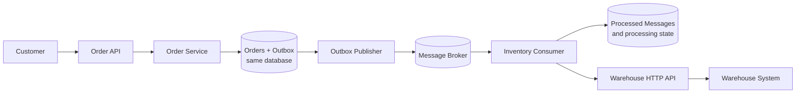

# Prerequisites and Learning Path from Connectivity to Reliable Processing

> **Chapter:** Integration Overview  
> **Scope:** `SPRING_BOOT_INTEGRATION` — system integration in Spring Boot via HTTP clients, databases, caches, message brokers, and Spring Integration adapters; emphasizing configuration, data contracts, transactions, errors, duplicate handling, testing, and observability.

A Spring Boot application rarely operates in isolation. It usually needs to call external APIs, query databases, use caches, consume events, or submit work to queues. **Establishing a working connection** is only the starting point: the system must also behave correctly when the target service is slow, the network drops, a message arrives twice, one step finishes while another fails, or a data contract changes.

This lesson identifies prerequisite knowledge and proposes a learning sequence from basic connectivity to reliably operable integration flows. Afterward, you should be able to explain why to pick synchronous or asynchronous communication, where to place transaction boundaries, which mechanisms prevent duplicate processing, and which failure scenarios must be tested.

## 1. What Should You Know Before Learning Integration?

You do not need to master every technology before starting. You need enough foundational concepts to distinguish bugs in the application, the data, and external systems.

| Knowledge Area | Minimum Entry Level | Why It Is Needed |
|---|---|---|
| Java | Classes, interfaces, records/DTOs, exceptions, collections, `Optional`, basic threads | Read data models, transform payloads, handle exceptions, and understand async tasks. |
| Spring Boot | Dependency injection, beans, `@Configuration`, `@Service`, `application.yml`, profiles, REST controllers | Create clients, externalize configuration, and separate responsibilities across layers. |
| HTTP and JSON | Methods, URIs, headers, 2xx/4xx/5xx statuses, timeouts, TLS, JSON serialization | Call external services and tell whether an HTTP error should be retried. |
| Databases | Basic SQL, primary/unique keys, transactions, commit/rollback, isolation | Keep state consistent, prevent duplicate writes, understand `@Transactional` limits. |
| Concurrency & distributed basics | Race conditions, retries, processing order, connection drops | Recognize that a request or message can execute more than once. |
| Testing & operations | Unit/integration tests, logs, metrics, traces, environment variables | Prove flows work properly and diagnose incidents when things fail. |

Additional topics will be learned as specific needs arise: connection pools, cache eviction, consumer groups, partitions, dead-letter queues (DLQs), circuit breakers, Spring Integration channels, and distributed tracing. Avoid trying to memorize every framework API up front.

### Self-Check Questions

1. Does an HTTP call returning `200 OK` always mean data was durably saved in the remote system? **Not necessarily:** you must understand the API's semantics and business contract.
2. When a client times out, are you certain the server did not process the request? **No:** the server may have processed it while the response was lost.
3. Does `@Transactional` roll back an HTTP call or a message already confirmed by a broker? **No:** standard database transactions do not cover external systems.
4. When a broker redelivers the same message, should the consumer create a second business transaction? **No:** design deduplication using a stable identifier.

If anything feels shaky, reinforce the relevant fundamentals as you practice rather than skipping over them.

## 2. Map of an Integrated System

Consider an ordering application: after receiving a request, the app saves the order and notifies the inventory service to reserve stock. Sending an event via a broker lets the inventory service process independently of when the customer receives a response.



This illustrative flow spans multiple **boundaries** to examine individually:

- **API → application:** authentication, input validation, fast response, and `Idempotency-Key` support if clients can resend requests.
- **Application → database:** use one transaction to write the order and an outbox row, preventing saving an order while losing the event-publish intent.
- **Outbox → broker:** the publisher can fail between the broker receiving the message and marking it sent; therefore the message may be emitted again.
- **Broker → consumer:** the broker can redeliver messages after errors, timeouts, or missing consumer acknowledgments.
- **Consumer → warehouse system:** HTTP has timeouts, rate limits, and transient errors; reservation commands need stable IDs to avoid reserving twice.

From this follows a core principle: **every network boundary can fail independently**. A reliable integration flow must define data, timeouts, post-failure states, retry policies, and recovery mechanisms at each boundary.

### Choosing Communication Mechanisms by Purpose

| Integration Mechanism | Best Fit When | What Must Be Controlled |
|---|---|---|
| Synchronous HTTP (`RestClient`, `WebClient`) | Need immediate reply, e.g., checking stock before displaying results | Timeouts, HTTP statuses, concurrency limits, conditional retries. |
| Database access (`JDBC`, JPA, jOOQ) | Need to persist or query structured state | Transactions, connection pools, schema migrations, locks, and query performance. |
| Caching (`Redis`, cache abstraction) | Read-heavy data tolerating bounded staleness | TTLs, invalidation, cache stampedes, stale data. |
| Brokers (RabbitMQ, Kafka, JMS, Pulsar) | Decouple processing time, buffer bursts, or broadcast events | Acknowledgments, ordering, redelivery, DLQs, idempotency. |
| Spring Integration | Multi-step receive, filter, transform, route, and adapter wiring | Message channels, endpoints, error flows, state, and observability. |

There is no single right choice for every case. HTTP is simpler when an immediate answer is truly required; brokers shine when work can run later under eventual consistency. Spring Integration helps organize multi-step flows yet is unnecessary for a single HTTP call.

## 3. Recommended Learning Sequence: From Connectivity to Reliable Processing

Progress through these stages while keeping **one end-to-end problem** (such as placing orders and syncing inventory) so you see why each new technique exists.

| Stage | Core Topics | Minimum Practice Exercise | Signs of Mastery |
|---|---|---|---|
| **1. Connectivity & configuration** | Client beans, endpoints, profiles, secrets, timeouts, TLS | Call the warehouse API from Spring Boot using configured URLs | Switch environments without code edits; distinguish network errors from app errors. |
| **2. Data contracts** | DTOs, JSON, validation, versions, HTTP statuses, standardized errors | Define request/response types and map warehouse API error codes | Handle missing/invalid data and compatible schema changes cleanly. |
| **3. Data access** | DataSources, pools, JDBC/JPA/jOOQ, migrations | Persist orders with stable identifier keys | Reproducible schema setup, avoiding key collisions and connection leaks. |
| **4. Transaction boundaries** | ACID, basic propagation, local transactions, outbox | Save order and outbox row in the same transaction | Both roll back together if one DB write fails. |
| **5. Caching & auxiliary data** | Cache-aside, TTLs, invalidation; NoSQL when appropriate | Cache product catalog; observe stale reads | Explain when caches must be refreshed or evicted. |
| **6. Messaging** | Producers, consumers, acks, redelivery, consumer groups/partitions, DLQs | Emit `OrderPlaced` and consume in a worker | Deliberately simulate duplicate messages and consumer restarts. |
| **7. Flow orchestration** | Channels, routers, filters, transformers, gateways, and Spring Integration adapters | Route events by type and transform payloads | Trace message paths and identify where errors are handled. |
| **8. Resilience** | Timeout budgets, retries/backoff, circuit breakers, bulkheads, idempotency, reconciliation | Make warehouse API return 503, time out, then recover | No infinite retries, no duplicate side effects, clear final error path. |
| **9. Testing & observability** | Contract/integration tests, tests with real services or containers, logs, metrics, traces | Run happy path, timeouts, duplicate messages, and mid-flight crashes | Trace one order across all components and explain how to recover it. |

**Deliberate ordering:** learn configuration and contracts first because every connection needs them; learn transactions before outbox; learn brokers before redelivery and idempotency; finally apply testing, logs, metrics, and traces to the *entire* flow. Even so, the habit of writing tests and structured logs should start in Stage 1 and deepen through Stage 9.

### Practice Milestone 1 — HTTP Client with Bounded Wait Time

The following example uses `RestClient` in Spring Boot supporting Spring Framework 6.1+. Declare the URL via configuration and set connect and read timeouts; API paths are illustrative only.

```yaml
# application.yml
app:
  warehouse:
    base-url: ${WAREHOUSE_BASE_URL}
```

```java
import java.time.Duration;
import org.springframework.beans.factory.annotation.Qualifier;
import org.springframework.beans.factory.annotation.Value;
import org.springframework.context.annotation.Bean;
import org.springframework.context.annotation.Configuration;
import org.springframework.http.client.SimpleClientHttpRequestFactory;
import org.springframework.stereotype.Service;
import org.springframework.web.client.RestClient;

@Configuration(proxyBeanMethods = false)
class WarehouseHttpConfig {
    @Bean
    RestClient warehouseRestClient(RestClient.Builder builder,
                                   @Value("${app.warehouse.base-url}") String baseUrl) {
        var factory = new SimpleClientHttpRequestFactory();
        factory.setConnectTimeout(Duration.ofSeconds(2));
        factory.setReadTimeout(Duration.ofSeconds(3));
        return builder.baseUrl(baseUrl)
                      .requestFactory(factory)
                      .build();
    }
}

@Service
class WarehouseClient {
    private final RestClient http;

    WarehouseClient(@Qualifier("warehouseRestClient") RestClient http) {
        this.http = http;
    }

    StockResponse getStock(String sku) {
        StockResponse result = http.get()
            .uri("/stocks/{sku}", sku)
            .retrieve()
            .body(StockResponse.class);

        if (result == null) {
            throw new IllegalStateException("Warehouse returned an empty body");
        }
        return result;
    }
}

record StockResponse(String sku, int available) {}
```

This is a basic client setup, not a complete resilience policy. In real applications, add authentication, response size limits, contract-based error handling, connection pool tuning for your HTTP client implementation, and an overall deadline across the operation chain. `retrieve()` throws exceptions by default for many 4xx/5xx error responses; translate those into classified, loggable domain errors. Never automatically retry arbitrary POSTs because a timed-out call may still have been executed by the server.

### Practice Milestone 2 — Getting an Event Out of a Transaction Safely

Suppose placing an order needs to save to the DB and emit `OrderPlaced`. The SQL below shows **one local transaction**; `:order_id` and `:event_id` are application parameters.

```sql
BEGIN;

INSERT INTO orders (id, customer_id, status)
VALUES (:order_id, :customer_id, 'PENDING');

INSERT INTO outbox_events (id, event_type, aggregate_id, payload, published_at)
VALUES (:event_id, 'OrderPlaced', :order_id, :event_json, NULL);

COMMIT;
```

In Java, both writes can live inside one Spring-managed service method annotated with `@Transactional`, provided both repositories share **the same transaction manager and matching DB resource**. A worker reads unpublished outbox rows, sends to the broker, and marks them published; the worker needs retries and coordination to keep multiple instances from claiming the same row. If the broker receives the message yet the worker dies before marking it sent, the row may be emitted again. Thus outbox ensures **publish intent is not lost on commit**, while consumers must still handle duplicates.

Never send HTTP requests or messages and assume a DB transaction can undo external actions that already happened. When a process spans multiple systems, use explicit states, business compensation, or reconciliation.

### Practice Milestone 3 — Consumer Safe on Message Redelivery

Suppose the broker delivers `OrderPlaced` with **at-least-once** semantics. Every event needs a stable `eventId` across redeliveries. Create a table recording processed events per consumer:

```sql
CREATE TABLE processed_messages (
    consumer_name VARCHAR(80) NOT NULL,
    event_id UUID NOT NULL,
    processed_at TIMESTAMP NOT NULL DEFAULT CURRENT_TIMESTAMP,
    PRIMARY KEY (consumer_name, event_id)
);
```

In PostgreSQL, the consumer can start its transaction with:

```sql
INSERT INTO processed_messages (consumer_name, event_id)
VALUES (:consumer_name, :event_id)
ON CONFLICT DO NOTHING;
```

Only when the inserted row count equals **1** should local business updates run; place both the marker insert and those updates in **the same DB transaction**. When the transaction rolls back, the marker rolls back too so the message can be reprocessed. When the inserted row count equals **0**, the event was already processed, so skip local mutations and acknowledge the message per the consumer contract. `ON CONFLICT` is PostgreSQL syntax; other databases require an equivalent mechanism. To prevent race conditions under concurrency, rely on real unique constraints/transactions—never an unsynchronized "SELECT to check, then INSERT".

This marker only protects **state inside the same DB**. If the consumer calls an external warehouse service, pass a stable idempotency key supported by the warehouse, or design requested/confirmed states to reconcile when outcomes are unclear. Neither a broker nor a marker table alone can promise "exactly once" for all external side effects.

## 4. Learn Error Handling Before Increasing Traffic

Different failure types require different responses. Before configuring retries, ask: *Is the operation safe to repeat? Do we know if the server already committed? Is there a time budget for the whole request?*

| Scenario | Appropriate Initial Response | What to Avoid |
|---|---|---|
| Invalid payload, fails validation | Return clear error; log to fix data/contract | Retrying the same payload endlessly. |
| HTTP `401`/`403` from permissions or credentials | Check auth/authorization config and alert | Rapidly retrying as if it were a transient network blip. |
| HTTP `429`, `503`, or temporary disconnect | Bounded retries with backoff + jitter when idempotent; honor `Retry-After` if present | Causing a retry storm or exceeding the request deadline. |
| Timeout after a write request | Check idempotency key, query status, or reconcile | Assuming the server did nothing. |
| Corrupted message, cannot deserialize | Record and route to error/DLQ flow per policy | Requeueing infinitely and stalling the consumer. |
| Consumer dies after DB update before ack | Allow redelivery and deduplicate by `eventId` | Relying on acks to prove business logic ran only once. |
| Cache returns overly stale data | Check TTL, invalidation, and operation consistency needs | Treating cache as authoritative for critical transactions. |

The rule of thumb is **timeouts to bound waiting; retries for transient faults; circuit breakers to stop hammering failing targets; bulkheads to isolate resources; idempotency to keep retries safe; DLQs and reconciliation so unfinished work is never lost**. These mechanisms complement rather than replace one another.

For example, an order-processing step with a 5-second deadline cannot retry 5 times with a 3-second read timeout each and still meet that deadline. Timeouts and retry counts must fit inside the *total time budget*, and concurrent pending operations must be capped to avoid exhausting threads or connection pools.

## 5. Data Contracts, Transactions, and Consistency

A flow traversing HTTP, DB, and brokers needs a stable contract independent of transport details:

- **Identifiers:** `orderId` identifies the business entity; `eventId` identifies the event; `correlationId` supports tracing; `idempotencyKey` identifies a retryable request. Do not automatically collapse them into one value.
- **Structure:** specify required fields, nullable fields, data types, units, timezones, validation rules, and behavior when new fields appear.
- **Compatibility:** adding optional fields is usually more compatible than deleting or redefining fields; producers and consumers can upgrade at different times.
- **States:** explicitly define `PENDING`, `PROCESSING`, `SUCCEEDED`, `FAILED`, and transition ownership. An "order created" event does not automatically mean "stock reserved".
- **Duplicates and ordering:** deduplicate per consumer, and guard against late or out-of-order updates with versions/sequences when required. Brokers do not guarantee a single global order under every configuration.

Within one DB, transactions provide atomicity for operations inside that transaction. Across multiple services, embrace intermediate states and design **eventual consistency** with recovery paths. When compensation is needed, compensating actions can also fail and must be recorded, retried, or handled via controlled manual intervention.

## 6. Testing by Boundary and Failure Scenario

A practice exercise that only passes the "happy path" does not prove reliable integration. Use fakes/stubs for small unit checks, and test with real services or Testcontainers when verifying protocols, schemas, brokers, and transactions.

| Level | What Must Be Proven | Sample Test Cases |
|---|---|---|
| Unit test | Mapping rules, validation, error classification | `400` maps to data error; `503` is retryable depending on operation. |
| HTTP integration/contract | Serialization/deserialization, headers, auth, statuses, and timeouts | API adds a new field; empty body; never responds. |
| DB integration | Schemas/migrations, unique constraints, rollbacks | Outbox insert failure rolls back the order too. |
| Broker integration | Publish/consume, acks, redelivery, DLQ | Consumer dies before ack; same `eventId` delivered twice. |
| End-to-end | Business outcome after partial failure or restart | Publisher sends successfully then dies before marking outbox. |
| Observability | Root causes can be found from real telemetry | Trace an `orderId` across API, outbox, broker, consumer, and warehouse API. |

An effective practice is deliberate fault injection: delay responses by 4 seconds against a 3-second timeout, refuse connections, return `429`, stop and restart consumers, send two events with the same ID, or fail a DB transaction mid-way. Every scenario should have an **expected outcome** written down before running the test.

## 7. Observing a Running Integration Flow

Once asynchronous steps are involved, logging only in the HTTP controller is not enough. Define at minimum:

| Signal | Question It Answers |
|---|---|
| Structured logs with `traceId`/`correlationId`, `orderId`, `eventId` | Where is this order right now? Which message failed? |
| Latency, throughput, and timeout/5xx rate metrics | Is an external system unusually slow or broken? |
| Queue lag, consumer retries, DLQ, and outbox backlog metrics | Is work piling up or stuck? |
| Distributed tracing with HTTP and messaging instrumentation | Which components consumed the time? |
| Alerts based on service objectives and queue backlogs | When must an operator intervene, replay, or reconcile? |

Never log tokens, passwords, personal data, or sensitive payloads. Trace/correlation IDs link events; order/event IDs support business lookups. With async messages, actively propagate or extract trace context via headers using your chosen instrumentation.

Do not watch only technical exceptions: a message that never throws yet sits in `PROCESSING` for hours is still a business incident. Maintain dashboards or queries for stalled states and reconciliation workflows.

## 8. Suggested Practice Roadmap

You can structure practice as four sequential labs sharing the same order dataset:

1. **Lab A — Connectivity:** REST API receives orders and calls warehouse HTTP using environment-configured URLs, timeouts, and error mapping. Test valid warehouse responses, `404`, `503`, and timeouts.
2. **Lab B — Data:** add a DB, migrations, and order-saving transactions; add an outbox table in the same transaction. Verify rollback when outbox insert fails.
3. **Lab C — Asynchronous:** publisher sends `OrderPlaced` to a broker; consumer receives and persists state. Restart workers, force redeliveries, and verify deduplication.
4. **Lab D — Reliability:** add idempotency when calling the warehouse, bounded retries, DLQ/reconciliation, metrics, and tracing. Inject faults between steps and verify recovery.

**Completion criteria:**

- A valid order is created with a clear ID and an outbox row in the same transaction.
- Two requests with the same API idempotency key never create two orders; two deliveries of the same `eventId` never apply local business updates twice.
- Transient failures have bounded retries; permanent failures land in an investigable error state instead of looping forever.
- After publisher or consumer restarts, in-progress orders can continue or be reconciled.
- You can answer "where is this order, how many times was it tried, and why did it fail?" using logs, metrics, traces, and state data.

## 9. Common Misconceptions While Learning

**"Calling the API works, so integration is done."** A successful call does not address data contracts, timeouts, retries, security, monitoring, or lost responses.

**"Adding `@Transactional` protects the entire workflow."** That annotation only coordinates resources managed by the transaction manager. Never assume external HTTP, caches, and brokers join the same transaction automatically.

**"The broker guarantees business-wide exactly-once."** Some platforms support exactly-once within specific scopes, yet that does not extend automatically to separate DBs or HTTP services. Design to receive and reprocess safely.

**"We have retries, so we don't need idempotency."** Retries increase the chance of repeating side effects; idempotency is a primary prerequisite for safely retrying write operations.

**"Cache is always identical to the DB."** Caches can expire, evict keys, or serve stale values. Specify the authoritative source of truth and acceptable consistency levels.

**"Spring Integration replaces all the other components."** Spring Integration helps build flows, routing, and adapters, while HTTP, broker, DB, transaction, and idempotency constraints still must be designed properly.

As you move on to each technology group, always return to three questions: **Where is correct state confirmed? What state is the system in if one step fails? Is re-running that step safe?** Answering those three questions with code, tests, and operational signals is the foundation for progressing from basic connectivity to reliable processing in Spring Boot.
