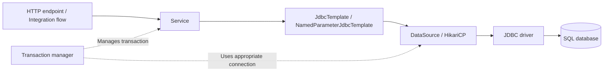

# DataSource, JDBC Driver, and spring-boot-starter-jdbc

In a Spring Boot application, connecting to a SQL database is not just about declaring a URL and a password. The application must also know **who creates the connection**, **which driver communicates with the database management system**, **how connections are reused**, and **how data access code participates in transactions**. The three components `DataSource`, JDBC driver, and `spring-boot-starter-jdbc` form the foundation for organizing that connectivity layer.

This lesson belongs to the **SQL Connectivity** chapter of the **SPRING_BOOT_INTEGRATION** module. In the scope of system integration across HTTP clients, databases, caches, message brokers, and Spring Integration, SQL connectivity commonly serves to store data exchange state, record incoming events, handle deduplication, manage transactions, or implement the transactional outbox pattern. Therefore, beyond simply connecting successfully, we need to pay attention to configuration, data contracts, errors, testing, and observability.

## 1. Learning Objectives

After this lesson, you will be able to:

- Distinguish between `DataSource`, JDBC driver, connection pool, `Connection`, and `JdbcTemplate`.
- Explain the role of `spring-boot-starter-jdbc` and why a database-specific JDBC driver dependency is still required.
- Configure a PostgreSQL `DataSource` and use `NamedParameterJdbcTemplate` to execute SQL safely.
- Understand transaction scope, how to prevent duplicate event writes, common connection errors, and how to test real connectivity.
- Know which signals to observe when an integration flow using SQL is under load.

## 2. The Big Picture: How Do the Components Work Together?

### 2.1. JDBC and the JDBC Driver

**JDBC (Java Database Connectivity)** is Java's standard API for working with relational databases. Interfaces such as `Connection`, `PreparedStatement`, and `ResultSet` belong to the JDBC API. JDBC defines the calling contract; the **JDBC driver** implements communication with a specific database engine over its protocol.

Examples:

| Database | Typical JDBC URL | Driver dependency |
| --- | --- | --- |
| PostgreSQL | `jdbc:postgresql://db-host:5432/integration_db` | `org.postgresql:postgresql` |
| MySQL | `jdbc:mysql://db-host:3306/integration_db` | `com.mysql:mysql-connector-j` |
| MariaDB | `jdbc:mariadb://db-host:3306/integration_db` | `org.mariadb.jdbc:mariadb-java-client` |
| H2 | `jdbc:h2:mem:testdb` | `com.h2database:h2` |

The JDBC driver must be present on the **runtime classpath**. Adding Spring Boot's JDBC starter alone does not automatically provide the PostgreSQL or MySQL driver.

Modern JDBC drivers have a self-registration mechanism via the JDBC Service Provider mechanism, so manually calling `Class.forName("org.postgresql.Driver")` is typically unnecessary. Spring Boot can also infer the driver from a standard JDBC URL; when the driver or a custom URL cannot be inferred, you can configure `spring.datasource.driver-class-name`.

### 2.2. What Is a DataSource?

`javax.sql.DataSource` is the standard interface representing a **source of connections**. Instead of calling `DriverManager.getConnection(...)` manually for every operation, the application obtains a `Connection` from a `DataSource`.

In server environments, a `DataSource` is typically backed by a **connection pool**: a group of physical connections that are created, reused, and bounded in count. When data access code finishes, a standard logical connection close returns the connection to the pool for the next request to reuse, rather than necessarily closing the TCP connection.

Spring Boot with `spring-boot-starter-jdbc` typically uses **HikariCP** as the default pool when this dependency is on the classpath and you do not provide a custom `DataSource` configuration.

### 2.3. JDBC Starter, Spring JDBC, and JdbcTemplate

`spring-boot-starter-jdbc` is a convenience dependency that brings in the libraries needed for JDBC database access and enables Spring Boot's auto-configuration. It is not a JDBC driver.

Different layers hold different responsibilities:

| Component | Role | How you typically interact with it |
| --- | --- | --- |
| JDBC driver | Handles protocol communication with a specific database | Declare runtime dependency |
| `DataSource` | Allocates and manages `Connection` instances | Configure `spring.datasource.*`, occasionally inject directly |
| Connection pool (HikariCP) | Reuses and limits physical connections | Tune `spring.datasource.hikari.*` |
| `JdbcTemplate` | Executes SQL, binds parameters, manages resources, translates exceptions | Call `query`, `queryForObject`, `update` |
| `NamedParameterJdbcTemplate` | Similar to `JdbcTemplate` but uses named parameters | Write `:partnerCode` instead of relying on positional `?` order |
| Transaction manager | Coordinates JDBC connections within a transaction | Use `@Transactional` at the service layer |

`spring-boot-starter-data-jdbc` serves **Spring Data JDBC** and adds a repository/aggregate model. `spring-boot-starter-data-jpa` serves **JPA/ORM**. Both are alternative data access options; this lesson focuses on **explicit SQL via Spring JDBC**.

### 2.4. Data Access Flow Diagram



The typical sequence is: the service calls a repository, `JdbcTemplate` borrows a connection from the `DataSource`, the driver executes the statement against the database, and Spring processes the `ResultSet` and returns the connection to the pool properly. Inside a `@Transactional` transaction, Spring coordinates so that the corresponding statements use the connection bound to the current transaction.

## 3. Setting Up the Project: Which Dependencies Are Needed?

The example uses PostgreSQL with dependency versions managed by Spring Boot's BOM/plugin.

**Gradle (Groovy DSL):**

```groovy
dependencies {
    implementation 'org.springframework.boot:spring-boot-starter-jdbc'
    runtimeOnly 'org.postgresql:postgresql'

    testImplementation 'org.springframework.boot:spring-boot-starter-test'
}
```

**Maven:**

```xml
<dependencies>
    <dependency>
        <groupId>org.springframework.boot</groupId>
        <artifactId>spring-boot-starter-jdbc</artifactId>
    </dependency>
    <dependency>
        <groupId>org.postgresql</groupId>
        <artifactId>postgresql</artifactId>
        <scope>runtime</scope>
    </dependency>
</dependencies>
```

Distinguish the two dependencies:

1. The starter provides Spring JDBC components, transaction management integration, and a standard connection pool.
2. The `postgresql` driver enables the application to actually understand `jdbc:postgresql:...` URLs and connect to PostgreSQL.

Without the driver matching the URL, adding the starter alone is not enough for the application to connect.

## 4. Configuring DataSource in Spring Boot

### 4.1. Minimal Configuration and Pool Settings

In `application.yml`:

```yaml
spring:
  datasource:
    url: ${DB_URL:jdbc:postgresql://localhost:5432/integration_db}
    username: ${DB_USER:integration_app}
    password: ${DB_PASSWORD}
    hikari:
      pool-name: integration-sql-pool
      maximum-pool-size: 10
      connection-timeout: 30000
```

Meaning:

- `spring.datasource.url`: the JDBC address and target database. The default value in the example is only suitable for development environments.
- `username` and `password`: database credentials; supplied via environment variables or the deployment platform's secret management mechanism.
- `maximum-pool-size`: limits the total number of connections a pool can hold, including both active and idle connections.
- `connection-timeout`: the maximum time (in milliseconds) to wait to borrow a connection from the pool before failing. **This is not the SQL query execution timeout.**

This example **requires** the `DB_PASSWORD` environment variable; do not hardcode passwords in the repository. In production, configure the URL, TLS, credentials, and pool size according to actual resources and operational policies.

When a suitable `DataSource` is present and auto-configuration conditions are met, Spring Boot automatically creates supporting beans such as `JdbcTemplate` and `NamedParameterJdbcTemplate`. When defining your own custom `DataSource` bean, be aware of which auto-configurations will back off in favor of that bean.

### 4.2. What Happens When the Application Starts?

For a typical SQL database:

1. Spring Boot detects JDBC classes and dependencies on the classpath.
2. Spring Boot reads `spring.datasource.*` properties and creates a `DataSource` if no application-provided bean exists.
3. The pool/driver prepares connection establishment; some connections may be created immediately or on demand, depending on configuration.
4. Spring Boot registers JDBC and transaction support when eligible.
5. Repositories/services are injected with the data access beans.

Declaring a `DataSource` **does not mean** tables have already been created. Schema management and seed data initialization are separate concerns.

### 4.3. Who Creates Tables and Manages Schema Changes?

For production environments, prefer **versioned migrations** using Flyway or Liquibase. The illustrative example below could live in a Flyway migration. Spring Boot also supports `schema.sql`/`data.sql`, but running these scripts automatically is conditional and defaults primarily toward embedded databases; when using external databases, behavior depends on `spring.sql.init.mode` and related settings.

Avoid enabling uncontrolled schema initialization in production: re-running table creation, dropping, or modifying data can cause severe damage. Choose **one** primary migration mechanism for your deployment environment.

### 4.4. When There Are Multiple Databases

With a single `DataSource`, auto-configuration is straightforward. When an integration application connects simultaneously to an internal database and a partner database, you must explicitly design multiple `DataSource` beans, qualifiers, `JdbcTemplate` beans, and corresponding transaction managers. Never implicitly assume a single `@Transactional` can be atomic across multiple databases or across a database and a message broker.

## 5. Practical Example: Persisting Integration Events Received from a Partner

Suppose an HTTP endpoint receives events from a partner, where each event has a `(partnerCode, eventId)` key pair. Requirements:

- Persist a record of the incoming event.
- Do not store duplicates when the partner resends the same event.
- Record an audit entry for new events within the **same database transaction**.
- Query back the event state using safe SQL parameters.

The example uses **PostgreSQL** SQL syntax; other databases have their own upsert syntax and data types.

### 5.1. SQL Schema

A sample migration:

```sql
CREATE TABLE inbound_delivery (
    id BIGINT GENERATED ALWAYS AS IDENTITY PRIMARY KEY,
    partner_code VARCHAR(64) NOT NULL,
    event_id VARCHAR(128) NOT NULL,
    payload TEXT NOT NULL,
    state VARCHAR(24) NOT NULL DEFAULT 'RECEIVED',
    created_at TIMESTAMPTZ NOT NULL DEFAULT CURRENT_TIMESTAMP,
    CONSTRAINT uq_inbound_partner_event UNIQUE (partner_code, event_id)
);

CREATE TABLE delivery_audit (
    id BIGINT GENERATED ALWAYS AS IDENTITY PRIMARY KEY,
    partner_code VARCHAR(64) NOT NULL,
    event_id VARCHAR(128) NOT NULL,
    action VARCHAR(32) NOT NULL,
    created_at TIMESTAMPTZ NOT NULL DEFAULT CURRENT_TIMESTAMP
);
```

The `UNIQUE (partner_code, event_id)` constraint is a **database-enforced rule**, protecting even when two requests arrive concurrently. Performing a "SELECT to check if it exists" followed by an "INSERT" is not enough to prevent race conditions.

### 5.2. Record Representing Retrieved Data

File `DeliveryRecord.java`:

```java
package com.example.integration.sql;

public record DeliveryRecord(
        long id,
        String partnerCode,
        String eventId,
        String state
) {}
```

This is a DTO/record serving the data access layer; it does not automatically represent the entire HTTP protocol contract. For data exchanged between systems, you should clearly define required fields, formats, versions, and validation at the integration boundary.

### 5.3. Repository Using NamedParameterJdbcTemplate

File `DeliveryRepository.java`:

```java
package com.example.integration.sql;

import java.util.List;
import java.util.Map;
import java.util.Optional;

import org.springframework.jdbc.core.namedparam.MapSqlParameterSource;
import org.springframework.jdbc.core.namedparam.NamedParameterJdbcTemplate;
import org.springframework.stereotype.Repository;

@Repository
public class DeliveryRepository {
    private final NamedParameterJdbcTemplate jdbc;

    public DeliveryRepository(NamedParameterJdbcTemplate jdbc) {
        this.jdbc = jdbc;
    }

    public int insertOnce(String partnerCode, String eventId, String payload) {
        var params = new MapSqlParameterSource()
                .addValue("partnerCode", partnerCode)
                .addValue("eventId", eventId)
                .addValue("payload", payload);

        return jdbc.update("""
                INSERT INTO inbound_delivery (partner_code, event_id, payload)
                VALUES (:partnerCode, :eventId, :payload)
                ON CONFLICT (partner_code, event_id) DO NOTHING
                """, params);
    }

    public void recordAudit(String partnerCode, String eventId) {
        jdbc.update("""
                INSERT INTO delivery_audit (partner_code, event_id, action)
                VALUES (:partnerCode, :eventId, 'ACCEPTED')
                """, Map.of(
                "partnerCode", partnerCode,
                "eventId", eventId
        ));
    }

    public Optional<DeliveryRecord> find(
            String partnerCode, String eventId) {
        List<DeliveryRecord> rows = jdbc.query("""
                SELECT id, partner_code, event_id, state
                FROM inbound_delivery
                WHERE partner_code = :partnerCode
                  AND event_id = :eventId
                """, Map.of(
                "partnerCode", partnerCode,
                "eventId", eventId
        ), (rs, rowNum) -> new DeliveryRecord(
                rs.getLong("id"),
                rs.getString("partner_code"),
                rs.getString("event_id"),
                rs.getString("state")
        ));

        return rows.stream().findFirst();
    }
}
```

Important details:

- `:partnerCode`, `:eventId`, and `:payload` are bound as parameter values. Avoid concatenating user input into SQL, as doing so can cause **SQL injection** or escaping errors.
- `insertOnce` returns the number of inserted rows: PostgreSQL returns **1** if a new row is created and **0** when the specified constraint conflicts with `DO NOTHING`.
- `ON CONFLICT` is PostgreSQL-specific syntax; if migrating to MySQL, SQL Server, or another database, you must adjust it accordingly.
- `query` accepts a `RowMapper` to transform each `ResultSet` row into a Java record.
- `NamedParameterJdbcTemplate` handles opening/closing JDBC resources and translating `SQLException` into Spring's `DataAccessException` hierarchy.

In applications with simple queries, `JdbcTemplate` with `?` placeholders is also valid. When a statement has many parameters or reuses the same parameter multiple times, explicit named parameters make reading and editing easier.

### 5.4. Service Defining the Transaction Boundary

File `DeliveryService.java`:

```java
package com.example.integration.sql;

import org.springframework.stereotype.Service;
import org.springframework.transaction.annotation.Transactional;

@Service
public class DeliveryService {
    private final DeliveryRepository repository;

    public DeliveryService(DeliveryRepository repository) {
        this.repository = repository;
    }

    @Transactional
    public boolean receive(
            String partnerCode, String eventId, String payload) {
        if (partnerCode == null || partnerCode.isBlank()
                || eventId == null || eventId.isBlank()
                || payload == null || payload.isBlank()) {
            throw new IllegalArgumentException("Invalid delivery fields");
        }

        int inserted = repository.insertOnce(partnerCode, eventId, payload);
        if (inserted == 0) {
            return false; // Event already received previously.
        }

        repository.recordAudit(partnerCode, eventId);
        return true; // New event has been recorded.
    }
}
```

With a JDBC transaction manager properly configured for the same `DataSource`, both `INSERT` statements participate in the same transaction. If recording the audit fails and throws a runtime exception, Spring rolls back the transaction by default: the new event record is not committed either.

Note three boundaries:

1. `@Transactional` applies by default when the call goes through a Spring proxy. Calling an annotated method from another method within the same object (self-invocation) normally does not trigger transaction advice.
2. A local JDBC transaction **does not automatically roll back** an HTTP request already sent or a message already published to a broker. If consistency between the database and broker is needed, consider the **transactional outbox** pattern and idempotent redelivery handling.
3. This example only prevents **duplicate writes of incoming events** by the specified key. Handling downstream side effects in subsequent steps requires additional state tracking, business keys, and a corresponding retry strategy.

## 6. Transactions, Connection Management, and Limits to Understand

### 6.1. How Are Connections Used Inside a Transaction?

When a valid `@Transactional` is active, Spring binds the appropriate connection to the current transaction on the execution thread. `JdbcTemplate` operations inside the transaction coordinate using that connection. Upon commit or rollback, Spring completes the transaction and returns the connection to the pool.

Therefore, avoid manually calling `dataSource.getConnection()` and arbitrarily managing commits or closing the connection inside a service whose transactions are managed by Spring. If low-level JDBC operations are unavoidable, use Spring's transaction-synchronized connection mechanism, such as `DataSourceUtils`, or prefer `JdbcTemplate` to minimize mistakes.

### 6.2. Connection Timeout Is Different from Query Timeout

| Case | What needs to be bounded |
| --- | --- |
| No free connections left in the pool | Wait time to borrow from the pool: `connection-timeout` |
| Network/database unresponsive while opening a connection | Driver connection establishment timeout and related network configuration |
| A `SELECT` query running too long | Query/statement timeout, database-side timeout, or corresponding settings |
| Transaction holding locks too long | Transaction timeout, query limits, keeping transactions short |

`spring.datasource.hikari.connection-timeout` only addresses **waiting for a connection from the pool**. Do not treat this property as a time limit for every SQL statement.

### 6.3. Choosing Connection Pool Size

A larger pool does not automatically make the system faster. The maximum total connections to the database is approximately:

```text
Number of application instances × maximum-pool-size per instance
+ connections from other services / tools
```

This total must fit within the database's limits and resources. Monitor actual load, query latency, connection wait times, and long-running transactions before increasing the pool size. For integration flows, balance **concurrent request processing**, **pool size**, and **SQL backend capacity**; otherwise, increasing concurrency only shifts the queue onto the pool or database.

Keep transactions short. Do not call slow HTTP endpoints or wait for broker acknowledgments while holding SQL locks unless there is a specific architectural reason.

## 7. Error Handling and Safety in Integration

### 7.1. Distinguishing Error Categories

Spring JDBC translates `SQLException` into `DataAccessException` subclasses so business code does not need to depend on vendor-specific JDBC error codes.

| Error category | Examples | Typical handling |
| --- | --- | --- |
| Cannot open connection | Database not running, wrong DNS, blocked port, connection slots exhausted | Check infrastructure, log root cause, bounded retry if transient |
| Invalid permissions/credentials | Wrong credentials, missing table privileges | Fix configuration and permissions; do not retry indefinitely |
| Constraint violation | Duplicate unique key, foreign key violation | Treat as business condition or data error; avoid blind retries |
| Invalid SQL/schema mismatch | Wrong column name, missing migration, incompatible syntax | Fix SQL/migration; test against the target database type |
| Contention/timeout | Slow query, lock wait, pool exhaustion | Reduce connection hold time, optimize queries, control concurrency |

Not every `DataAccessException` should be retried. For write operations, you must know whether the operation **might have already committed** before automatically retrying. Use idempotency keys or unique constraints when partners can resend duplicates.

### 7.2. Code Patterns to Avoid

**Creating a new connection per request:**

```java
// Avoid using this approach as the primary database access mechanism in a web service.
Connection connection = DriverManager.getConnection(url, user, password);
```

This bypasses Spring's pool and transaction management and makes it easy to leak resources. Only consider low-level JDBC when special control is genuinely required.

**Concatenating external input into SQL:**

```java
// Unsafe:
String sql = "SELECT * FROM inbound_delivery WHERE event_id = '" + eventId + "'";
```

Use `PreparedStatement`/`JdbcTemplate` with placeholders, or `NamedParameterJdbcTemplate` with named parameters instead. Parameter binding does **not** replace whitelist validation when dynamic table or column names must be chosen, because SQL identifiers cannot be bound like ordinary parameter values.

**Logging secrets:** do not write passwords, connection strings containing credentials, sensitive payloads, or full SQL parameters into unprotected logs. Instead, log correlation IDs, operation names, statuses, and appropriate timing metrics.

### 7.3. TLS, Permissions, and Environment Configuration

- Use a database account that has only the permissions required by the integration flow; separate migration privileges where possible.
- Enable transport protection according to database and environment policies. For example, PostgreSQL offers `sslmode` options; modes requiring encryption and modes that **verify certificates/hostnames** are not equivalent, so choose according to the required security level.
- Load secrets via environment variables or a secret manager, controlling credential lifecycle and rotation mechanisms.
- Clearly separate configurations across local, test, and production environments; prevent default local URLs from leaking into deployed environments.

## 8. Testing SQL Connectivity: Including Concurrency Behavior

Unit tests can mock repositories to verify business decisions, but they **do not prove** that the JDBC URL, SQL dialect, driver, transactions, or unique constraints work properly.

A practical testing strategy includes:

| Test level | What to verify |
| --- | --- |
| Service unit test | Skip audit when `insertOnce` returns 0; record audit when it returns 1 |
| Repository integration test | Driver, column mapping, `ON CONFLICT` syntax, real data read/write |
| Transaction test | When audit fails, the newly inserted event row is rolled back |
| Concurrency test | Two requests with the same `partnerCode + eventId` create only one record |
| Failure test | Unreachable database, timeouts, or query errors are classified and logged appropriately |

`@JdbcTest` provides a test slice focused on JDBC beans, but by default it may replace the `DataSource` with an embedded database. Because the example uses PostgreSQL's `ON CONFLICT`, test the repository against a **real PostgreSQL instance for testing** (such as Testcontainers) and configure tests not to replace the datasource with H2.

A minimal integration test scenario:

```text
Given:
  The test database has run migrations.
  Tables inbound_delivery and delivery_audit are empty.

When:
  receive("partner-a", "evt-1001", "{...}") is called twice.

Then:
  The first call returns true, and the second call returns false.
  inbound_delivery has exactly 1 matching row.
  delivery_audit has exactly 1 ACCEPTED row.

When:
  recordAudit is forced to fail inside a new transaction.

Then:
  No new inbound_delivery row remains from that failed transaction.
```

Note: testing rollback requires ensuring that test setup, the test framework's transaction handling, and fault injection do not mask real behavior. Concurrency tests should use two independent threads/calls with explicit synchronization barriers rather than merely invoking the method sequentially twice.

When using Testcontainers, add the test dependencies matching the project's Spring Boot/Testcontainers versions and configure the container's URL/credentials for the `DataSource`. Binding properties via `@DynamicPropertySource` or `@ServiceConnection` depends on the mechanisms supported by the current Spring Boot version.

## 9. Operational Observability and Troubleshooting

### 9.1. What Should You Measure?

With Spring Boot Actuator and Micrometer properly configured, you can monitor database health and connection pool metrics (such as active, idle, pending connections, and limits). Exact metric names depend on the pool, library versions, and metrics backend in use.

A practical signal set for a SQL integration flow:

- **Latency** of key SQL operations, timeout counts, and errors by category.
- **Pool saturation**: active connection count, wait queue length, and acquisition timeouts.
- **New vs. duplicate event counts** by business key; spikes may indicate continuous partner retries.
- **End-to-end integration flow latency**, retries, and dead-letter/outbox backlog if applicable.
- **Correlation ID / event ID** across HTTP, service, SQL, and downstream systems; avoid logging sensitive payload data.

Health checks indicate whether the database responds at check time, but they do not replace measuring real query capacity under load.

### 9.2. Common Troubleshooting Reference Table

| Symptom | Common cause | First diagnostic step |
| --- | --- | --- |
| `Failed to configure a DataSource` | Missing URL or suitable driver/embedded database | Check active profiles, environment variables, and dependencies |
| `No suitable driver` | Missing JDBC driver or incompatible URL | Match the `jdbc:...` URL against runtime driver dependencies |
| `Connection refused` | Wrong host/port or database not listening | Check network connectivity from where the app actually runs |
| `password authentication failed` | Wrong username/secret or auth policy mismatch | Verify secrets and user privileges in the target environment |
| `relation ... does not exist` | Migrations not applied or wrong schema/search path | Verify connected DB/schema and migration history |
| Timeout borrowing a connection | Pool exhausted, slow queries/transactions, excessive load | Measure active/pending connections and slow SQL statements |
| Duplicate writes despite prior check | Race condition between SELECT and INSERT | Add a unique constraint, upsert, or idempotency design |

Do not resolve pool exhaustion incidents by immediately increasing `maximum-pool-size`: identify whether the root cause is slow queries, long transactions, leaked connections, or backend limits.

## 10. Self-Check Questions

1. Why can an application still report a missing JDBC driver even when `spring-boot-starter-jdbc` is present?
2. What is the difference between `DataSource` and `Connection`? How does a connection pool help when many HTTP requests arrive concurrently?
3. Does HikariCP's `connection-timeout` cancel a slow SQL query? If not, which limits should you check?
4. Why can checking if an event exists before inserting still produce duplicate writes across multiple instances?
5. In the example, if the event insert succeeds but the audit insert throws a runtime exception, what is the final database state? What conditions are required for rollback to take effect?
6. Does a single `@Transactional` guarantee committing to PostgreSQL and publishing to Kafka in one atomic transaction? If not, what mechanism would you consider?
7. Why shouldn't you rely on H2 to prove that a PostgreSQL `ON CONFLICT` statement works correctly in production?

## 11. Key Takeaways and Next Steps

- The **JDBC driver** implements database communication; **`DataSource`** supplies connections; **`spring-boot-starter-jdbc`** provides the Spring JDBC ecosystem and auto-configuration support.
- **HikariCP** reuses connections, but must be sized against the system-wide connection budget; pool timeout is distinct from query timeout.
- **`JdbcTemplate`/`NamedParameterJdbcTemplate`** manage JDBC resource lifecycles, bind parameters safely, and translate exceptions consistently.
- **`@Transactional`** defines transaction boundaries for SQL steps against the same data source; database transactions do not automatically extend to external APIs or message brokers.
- **Unique constraints, testing against the real database engine, and pool/SQL observability** are essential to keep an integration flow stable under retries, high load, or infrastructure failures.

Once you master these three core components, you have the foundation to continue learning JDBC repository design, transactions/outbox patterns, error handling, and coordinating SQL with other Spring Boot integration adapters.
