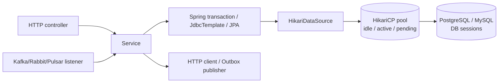
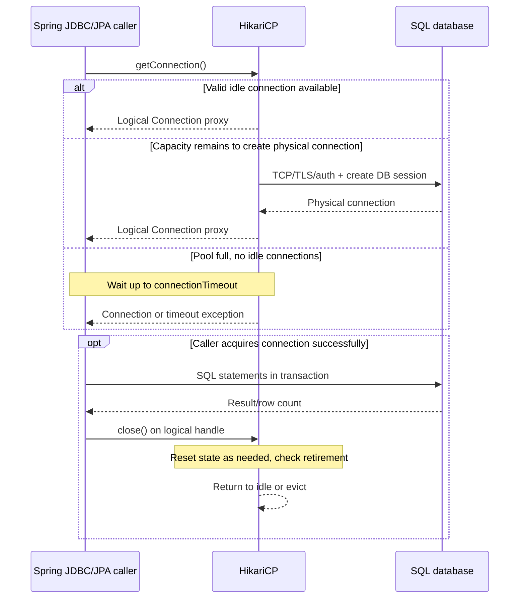
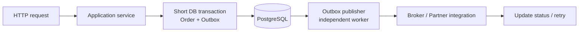
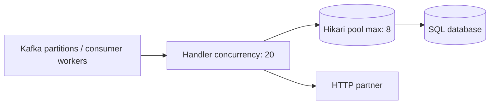

# HikariCP, Pool Sizing, and Connection Lifecycle

## 1. Why Is SQL Connection Management an Integration Problem?

In a **SPRING_BOOT_INTEGRATION** service, the database often sits at the intersection of many workflows: HTTP APIs receiving requests, adapters calling partners, consumers receiving events from Kafka/RabbitMQ/Pulsar, repositories persisting data, and outbox publishers sending messages to a broker. All of them may share a single **JDBC DataSource**.

Database connections are not free. Opening a new connection can involve DNS, TCP, TLS, authentication, and session initialization; the database must also allocate server resources for each connection. If every request opens and closes a physical connection, overhead climbs rapidly. Conversely, holding too many idle connections or keeping transactions open too long can exhaust database resources.

**HikariCP** is the JDBC connection pool that Spring Boot typically auto-configures when Hikari is on the classpath, such as via `spring-boot-starter-jdbc` or `spring-boot-starter-data-jpa`. The pool reuses physical connections while handing application code a `Connection` object with a borrow/return lifecycle:

```text
An HTTP request needs SQL
    → DataSource.getConnection()
    → borrow connection from HikariCP
    → run SQL / transaction
    → Connection.close()
    → RETURN connection to pool, usually without closing TCP immediately
```

Here `close()` performs a **logical handle close**. HikariCP can retain the physical connection for subsequent requests to reuse. Only when a connection dies, expires, or the pool shuts down is the physical connection actually discarded.

### Learning Objectives

After this lesson, you will be able to:

1. Explain the difference between `DataSource`, Hikari pool, physical JDBC connection, and logical connection handle.
2. Configure `spring.datasource.hikari.*` in Spring Boot, especially `maximum-pool-size`, `minimum-idle`, timeouts, and connection lifetimes.
3. Estimate pool size from **connection hold time**, throughput, replica count, and the database connection budget.
4. Understand how `@Transactional`, `JdbcTemplate`, and JPA affect how long a connection remains occupied.
5. Distinguish pool exhaustion, leaks, slow queries, lock contention, network errors, and database connection rejections.
6. Measure and test pools under HTTP, broker, retry, autoscaling, and graceful shutdown scenarios.

> **Reference versions:** Java 17+, Spring Boot 3.x, and HikariCP managed by the Spring Boot BOM. HikariCP defaults may vary by version and how Spring Boot initializes the pool. Tuning examples in this lesson are **starting points for measurement**, not blanket configurations for production.

## 2. Where Does a Connection Pool Sit?



A `HikariDataSource` represents **one pool** serving one data source. When a request or consumer needs to run a query:

- If the pool has a valid idle connection, the caller receives it immediately.
- If `maximumPoolSize` has not been reached, the pool can open a new connection.
- If the pool is at capacity with no idle connections, the caller **waits to acquire a connection** up to `connectionTimeout`.
- If still unavailable, the caller receives a SQL/pool timeout exception; this does not mean the caller's SQL ever ran.
- After the caller returns the connection, Hikari either places it back in the idle list or retires it if needed.

### 2.1. Distinguishing Three Metrics

| Metric | Meaning | Common misconception |
| --- | --- | --- |
| **Active connections** | Connections borrowed and not yet returned | Not all are running SQL: some may be waiting on HTTP, locks, or application code |
| **Idle connections** | Connections in the pool ready to be borrowed | Does not mean the DB session is closed; idle connections still occupy DB slots |
| **Pending threads** | Number of callers waiting to acquire a connection | Not the number of queries currently executing on the database |

`active=20, idle=0, pending=100` on a pool with max 20 indicates many callers are blocked at the **pool entrance**. To find the root cause, inspect what the 20 active connections are doing: slow queries, transactions holding connections during API calls, locks, or unclosed connections.

### 2.2. Each Instance Has Its Own Pool

Suppose you deploy six replicas of `order-service`, each with `maximum-pool-size=16`. The total connections from **this service alone** can approach:

\[
6\times16=96
\]

That excludes other services, migration jobs, BI clients, monitoring, replication, administrative reserved connections, and connections from additional datasources. A pool size that looks modest on one pod can become a **very large connection budget cluster-wide**.

## 3. Adding Dependencies and Spring Boot Configuration

For plain JDBC, use the starter:

```xml
<!-- pom.xml, Spring Boot parent/BOM manages versions -->
<dependency>
    <groupId>org.springframework.boot</groupId>
    <artifactId>spring-boot-starter-jdbc</artifactId>
</dependency>
<dependency>
    <groupId>org.postgresql</groupId>
    <artifactId>postgresql</artifactId>
    <scope>runtime</scope>
</dependency>
```

With Gradle:

```groovy
dependencies {
    implementation 'org.springframework.boot:spring-boot-starter-jdbc'
    runtimeOnly 'org.postgresql:postgresql'
}
```

In a standard Spring Boot setup, `spring-boot-starter-jdbc` brings in HikariCP; if Hikari is present and no custom `DataSource` bean overrides it, Boot defaults to `HikariDataSource`. `spring-boot-starter-data-jpa` also uses Hikari via its JDBC datasource.

Avoid manually calling `new HikariDataSource()` in every service. Let Boot create the bean, manage its lifecycle, and bind `spring.datasource.*` / `spring.datasource.hikari.*` properties.

### 3.1. Example `application.yml`

```yaml
spring:
  datasource:
    url: jdbc:postgresql://db.internal.example:5432/orders
    username: ${DB_USERNAME}
    password: ${DB_PASSWORD}
    driver-class-name: org.postgresql.Driver
    hikari:
      pool-name: orders-primary-pool
      maximum-pool-size: 16
      minimum-idle: 4
      connection-timeout: 2s
      validation-timeout: 1s
      idle-timeout: 10m
      max-lifetime: 25m
      keepalive-time: 2m
```

This is an **example for a hypothetical environment**; replace `db.internal.example`, credentials, and pool budgets to match your real system. Database accounts and secrets must come from secure sources—never commit passwords to Git. In production with TLS, configure PostgreSQL JDBC `sslmode=verify-full`, CA trust, and matching hostname in the URL/driver properties; **HikariCP does not perform TLS verification on behalf of the driver**.

The values above are intentional examples:

- `maximum-pool-size=16` caps the physical connections managed by this pool.
- `minimum-idle=4` allows the pool to expand and shrink between minimum idle and maximum; it does not mean there are always exactly 4 connections total.
- `connection-timeout=2s` caps how long a caller waits to borrow a connection.
- `validation-timeout=1s` caps the liveness check of a connection; must be shorter than `connection-timeout`.
- `idle-timeout=10m` only applies when idle connections can shrink below maximum while staying above minimum idle.
- `max-lifetime=25m` caps the lifetime of a physical connection before pool replacement.
- `keepalive-time=2m` lets the pool periodically check **idle** connections when supported.

All limits must align with proxy, database, driver, transaction, and OS timeouts. Never copy these numbers verbatim across clusters without measurement.

### 3.2. Environment-Specific Configuration

```yaml
# application-local.yml
spring:
  datasource:
    hikari:
      maximum-pool-size: 5
      minimum-idle: 1
```

```yaml
# application-prod.yml
spring:
  datasource:
    hikari:
      maximum-pool-size: ${DB_POOL_MAX_SIZE:12}
      minimum-idle: ${DB_POOL_MIN_IDLE:4}
      connection-timeout: 2s
```

In the YAML above, `DB_POOL_MAX_SIZE` and `DB_POOL_MIN_IDLE` are **configuration values**, not commands telling the database to raise `max_connections`. Operators must compute the budget across peak replica counts and other workloads before raising pool sizes.

## 4. HikariCP Properties You Must Understand Accurately

| Spring Boot property | Effect | What not to infer |
| --- | --- | --- |
| `spring.datasource.hikari.maximum-pool-size` | Maximum connections (active + idle) | Not maximum SQL statements per second |
| `minimum-idle` | Minimum idle connections the pool tries to keep when possible | Not a lower bound on active connections |
| `connection-timeout` | Time a caller waits on `getConnection()` when the pool is busy/unable to supply | Not the SQL query timeout |
| `validation-timeout` | Maximum time to validate a connection's liveness | Does not replace server-side statement timeout |
| `idle-timeout` | Time before an idle connection may be retired when elastic sizing applies | Does not kill active connections mid-transaction |
| `max-lifetime` | Expected maximum lifetime of a physical connection | Does not forcefully kill a connection currently in use |
| `keepalive-time` | Periodically probes idle connections to keep them alive | Does not protect active queries from network timeouts |
| `leak-detection-threshold` | Logs a warning when a connection is held too long | Does not reclaim or auto-fix connection leaks |
| `pool-name` | Identifies the pool in logs and metrics | Does not isolate tenants or DB privileges |
| `register-mbeans` | Enables JMX management if needed | Not required for Micrometer metrics |
| `auto-commit`, `transaction-isolation` | Default connection state upon borrowing per driver/pool mechanism | Does not replace Spring transaction management |
| `connection-init-sql` | SQL executed when a physical connection is created | Not a replacement for migrations/`schema.sql` |
| `data-source-properties.*` | Passes extra properties to the JDBC driver | Names and meanings depend on the driver, not Hikari |

In current HikariCP versions, common defaults are `maximumPoolSize=10`, `connectionTimeout=30s`, and `maxLifetime=30m`; if `minimumIdle` is unset, the pool tends to run as a fixed-size pool equal to `maximumPoolSize`. **Check the exact HikariCP version resolved by your Spring Boot BOM**, since defaults and bounds can vary across releases.

### 4.1. `minimum-idle` and Fixed-Size Pools

HikariCP generally recommends **leaving `minimumIdle` unset** when you want a fixed-size pool that avoids opening new connections during peak spikes. When `minimumIdle=maximumPoolSize`, `idleTimeout` no longer shrinks the pool; idle connections can still occupy slots on the database.

When running **many replicas** or highly bursty workloads, setting `minimum-idle` lower than `maximum-pool-size` reduces baseline connections, at the cost of connection creation latency during bursts. Test both simultaneous startups and traffic bursts instead of assuming one layout is always superior.

### 4.2. `max-lifetime` and Connection Age

Hikari never forcefully evicts a **currently borrowed** physical connection mid-query or mid-transaction simply because `maxLifetime` expired. The connection is marked for retirement and replaced as pool operations allow.

If a proxy/load balancer or database closes connections after roughly 30 minutes, `max-lifetime` is typically set **comfortably below the external limit with a safety buffer**. If the external timeout is much shorter, the pool can borrow dead connections and have to recover. Always match real infrastructure limits rather than picking `25m` just because it appeared in an example.

### 4.3. `keepalive-time` Is Not a Cure-All for Timeouts

Hikari keepalive acts only on **idle** connections, checking liveness and returning them to the pool; it does not fix a SQL statement blocked on a 60-second lock or a socket dropped by a firewall while an application query is running.

Keepalive must respect `maxLifetime` and HikariCP version thresholds. Avoid overly aggressive keepalive intervals across thousands of connections, which add unnecessary traffic and DB CPU without improving throughput.

### 4.4. `connection-test-query` Is Usually Unnecessary

With modern JDBC drivers supporting `Connection.isValid()`, HikariCP uses JDBC4 validation directly. Only set `connection-test-query` when a driver has specific limitations or vendor documentation requires it. A custom `SELECT 1` is not a cure for connection leaks or an overloaded database.

## 5. Detailed Lifecycle: Create, Borrow, Use, Return, and Retire



### 5.1. Creating a Physical Connection

Connection creation involves multiple driver/database steps:

1. Resolve endpoint, open TCP socket, traversing proxies/load balancers if present.
2. Perform TLS handshake when configured on the driver.
3. Authenticate username/password or appropriate credentials.
4. Initialize session per database driver behavior.
5. If `connection-init-sql` is set, execute session initialization SQL per pool rules.

**HikariCP does not create schemas or databases for the application.** `schema.sql`, Flyway/Liquibase, or DBA/migration jobs are separate mechanisms. Using `connection-init-sql` to create tables on every connection is an architectural mistake and can cause contention when multiple instances boot.

### 5.2. Borrowing a Connection

When a service calls `JdbcTemplate` or a JPA repository, Spring acquires a connection via its transaction and resource management infrastructure. If a transaction already bound a connection to the current thread/context, operations can share that connection as appropriate for the transaction manager and driver.

Never assume "every `JdbcTemplate.query` opens a brand-new TCP connection"; with pooling, physical connection creation belongs to the pool, while borrowing a logical handle is fast.

### 5.3. Using a Connection

A borrowed connection may be:

- Executing SQL.
- Waiting on a database lock or network response.
- Holding an open transaction while Java code runs non-SQL logic.
- Waiting on another HTTP call if a developer placed HTTP inside `@Transactional`.

On the Hikari metrics panel, all four cases appear identically as **active**. Distinguish them using tracing, SQL/transaction metrics, and database session states.

### 5.4. Returning a Connection

When code calls `Connection.close()` on the Hikari-issued logical handle, the physical connection normally returns to the pool. The pool can restore tracked state such as auto-commit, read-only, and isolation level; code must follow standard JDBC APIs so the pool tracks state accurately.

When using a Spring transaction manager, **do not manually close a connection belonging to an active transaction** from the wrong context. Prefer `JdbcTemplate`, Spring Data, or `DataSourceUtils` in low-level code so Spring handles acquisition and release cleanly.

### 5.5. Retiring and Closing Connections

Hikari removes connections when they hit `maxLifetime`, fail validation, shrink under `minimumIdle`/`idleTimeout`, or during application shutdown. Upon return, the pool may detect a connection is marked past its lifetime and close it physically instead of returning it to idle.

During graceful shutdown, the pool closes after dependent components have stopped cleanly. Never rely on "pool shutdown" to rescue unacknowledged messages or uncommitted transactions.

## 6. Formula for Estimating Pool Size

A helpful starting point is Little's Law for a steady-state system:

\[
L = \lambda W
\]

If we choose the boundary of **JDBC connection hold time**:

- \(\lambda\): database transactions per second actually requiring a connection.
- \(W\): average time a transaction **holds a connection from borrow until return**.
- \(L\): average concurrent connections held simultaneously.

For example, if a service runs 400 database transactions/second with an average connection hold time of 20 ms:

\[
L = 400 \times 0.020 = 8
\]

The result 8 is the **average concurrency demand under a simplified model**, not a hard rule to set the pool size to exactly 8. Bursts, p99 variance, locks, slow queries, retries, batching, long transactions, and real database capacity all shift actual needs and throughput.

### 6.1. Connection Hold Time Differs from End-to-End HTTP Latency

Suppose an HTTP request takes 300 ms total:

```text
Parse/validate request:      10 ms
DB transaction:              20 ms
Partner HTTP call:          250 ms
Serialize response:          20 ms
Total:                      300 ms
```

If the DB connection is only held during the 20 ms transaction, use `W=0.020s` when sizing the database pool. If instead you place the partner HTTP call **inside the same transaction**, the connection can be held for ~270 ms, requiring an average at 400 req/s of:

\[
400 \times 0.270 = 108 \text{ active connections}
\]

Jumping from 8 to 108 happens not because queries slowed down, but because the **transaction boundary is too wide**. That is why shrinking transactions usually matters far more than enlarging the pool.

### 6.2. Budgeting Across Replicas

Suppose PostgreSQL is configured with `max_connections=120`; operations reserves roughly 20 connections for administration, migrations, monitoring, and other services, leaving an assumed budget of 100.

With 5 replicas of the same service, each configured with `maximum-pool-size=16`:

\[
5 \times 16 = 80
\]

Under these assumptions, 20 connections remain as headroom within the 100-connection budget. When autoscaling grows to 8 replicas:

\[
8 \times 16 = 128
\]

Theoretical demand breaches the budget even though every instance obeys its local cap. You must coordinate **maximum pool size, max replicas, cluster-wide budget, proxies/poolers, and other services' quotas**.

> **Note:** `max_connections` does not mean every single slot is available for applications. PostgreSQL reserves slots/resources for other purposes depending on configuration and roles; always use a budget confirmed by DBA/SRE rather than subtracting an arbitrary guess and treating it as guaranteed.

### 6.3. Do Not Rely Solely on CPU Core Formulas

There are "pool size formulas" based on CPU cores, disk spindles, or rules of thumb. They are only reference points for specific contexts. On modern databases with SSDs, lock contention, network latency, and multi-service concurrency, measure **completed throughput, SQL latency, wait events, and saturation** as pool size varies.

A larger pool can slow the database down due to more queries competing for locks/CPU/I/O. A pool that is too small makes callers wait needlessly while the database has spare capacity. The goal is finding a **stable operating point with headroom**, not maximizing connections.

## 7. Transaction Boundaries Determine Connection Hold Duration

### 7.1. Pattern to Avoid: Calling HTTP Inside a Transaction

```java
@Transactional
public void acceptOrder(OrderCommand command) {
    orderRepository.insert(command);
    partnerClient.reserveStock(command); // May wait several seconds
    outboxRepository.insert(command);
}
```

This demonstrates an anti-pattern. Once the transaction acquires a connection and holds it across a network call, partner latency or timeouts can trigger **pool exhaustion**, hold database locks, and stall unrelated requests. Moreover, JDBC `@Transactional` **cannot roll back** HTTP side effects already committed by the partner.

### 7.2. Separating Transactions from External Side Effects

One approach for event-emitting systems:



Sample code for a short transaction:

```java
package example.integration.order;

import org.springframework.stereotype.Service;
import org.springframework.transaction.annotation.Transactional;

@Service
public class OrderApplicationService {

    private final OrderRepository orders;
    private final OutboxRepository outbox;

    public OrderApplicationService(
            OrderRepository orders,
            OutboxRepository outbox) {
        this.orders = orders;
        this.outbox = outbox;
    }

    @Transactional(timeout = 5)
    public void accept(OrderCommand command) {
        orders.insert(command);
        outbox.enqueueOrderCreated(command.id());
    }
}
```

`OrderRepository`, `OutboxRepository`, and `OrderCommand` are application domain types you define. The key idea is **writing the order and outbox row inside the same database transaction** and returning the connection quickly. A separate worker reads the outbox and sends to the broker/HTTP with appropriate retries and idempotency.

`@Transactional(timeout = 5)` sets a transaction timeout per the Spring transaction manager and underlying technology support. It **does not replace** driver socket timeouts, pool `connectionTimeout`, or HTTP client timeouts. To bound SQL duration reliably, verify how the manager and driver enforce timeouts.

### 7.3. `JdbcTemplate` Helps Manage Resources

```java
package example.integration.order;

import org.springframework.jdbc.core.JdbcTemplate;
import org.springframework.stereotype.Repository;

@Repository
public class OrderLookupRepository {

    private final JdbcTemplate jdbcTemplate;

    public OrderLookupRepository(JdbcTemplate jdbcTemplate) {
        this.jdbcTemplate = jdbcTemplate;
    }

    public boolean exists(String orderId) {
        Integer count = jdbcTemplate.queryForObject(
                "SELECT COUNT(*) FROM orders WHERE id = ?",
                Integer.class,
                orderId);
        return count != null && count > 0;
    }
}
```

`JdbcTemplate` manages opening/closing statements and result sets as well as connection acquisition/release via Spring infrastructure. Outside a transaction, each operation borrows and returns a connection per method call. Inside an active `@Transactional`, Spring binds the connection to the transaction and returns it only when the transaction completes. Never store a `Connection` or `ResultSet` in a singleton bean field.

### 7.4. If Using the JDBC API Directly

```java
public int countOrders(DataSource dataSource) throws SQLException {
    try (Connection connection = dataSource.getConnection();
         PreparedStatement statement = connection.prepareStatement(
                 "SELECT COUNT(*) FROM orders");
         ResultSet result = statement.executeQuery()) {

        result.next();
        return result.getInt(1);
    }
}
```

This uses `javax.sql.DataSource`, `java.sql.Connection`, `PreparedStatement`, `ResultSet`, and `SQLException`. For standalone JDBC calls outside Spring transaction management, **try-with-resources is mandatory** so the logical connection returns even when SQL throws an exception.

If code participates in a Spring-managed transaction, avoid calling `dataSource.getConnection()` in a way that breaks transaction boundaries; prefer `JdbcTemplate` or `DataSourceUtils` with its matching release call.

### 7.5. JPA/Hibernate Does Not Always Acquire Connections Immediately on Transaction Entry

Hibernate's connection acquisition and release strategy depends on version, transaction type, and configuration. A JPA transaction may acquire the JDBC connection later than method entry, and may hold it until commit. Therefore, **measure active connection duration on the real system** rather than guessing from `@Transactional` alone.

Factors like lazy loading, flushing, batch writes, `OpenEntityManagerInView` in web apps, and EntityManager lifecycles must also be evaluated separately. An HTTP controller serializing lazy entities carelessly can trigger SQL outside expected boundaries.

## 8. Six Types of Timeouts to Distinguish

| Timeout | Measured from start to end | Typical configuration |
| --- | --- | --- |
| **Acquire timeout** | Caller waiting to borrow a connection from the pool | `spring.datasource.hikari.connection-timeout` |
| **Connect/login timeout** | Driver establishing socket/authentication to the DB | JDBC driver property, e.g., `connectTimeout` in PostgreSQL |
| **Statement/query timeout** | Execution time of a single statement per JDBC/driver/server semantics | `spring.jdbc.template.query-timeout`, `Statement.setQueryTimeout`, `statement_timeout` |
| **Socket/network read timeout** | Driver waiting for socket data per driver semantics | Driver option, e.g., PostgreSQL `socketTimeout` |
| **Transaction timeout** | Total transaction time per Spring/manager where supported | `@Transactional(timeout = ...)` and transaction policy |
| **HTTP client timeout** | Waiting for partner HTTP connect/response | `RestClient` request factory and HTTP client configuration |

To remember easily:

```text
Wait for connection → connect to DB → run statement → commit/rollback → return connection
  connectionTimeout   connectTimeout    queryTimeout    transaction timeout
```

These limits can **overlap** or start at different points depending on the driver and transaction manager. Never add them rigidly and treat the sum as a guaranteed upper bound on HTTP request duration.

### 8.1. Timeout Example for `JdbcTemplate`

```yaml
spring:
  datasource:
    hikari:
      connection-timeout: 2s
  jdbc:
    template:
      query-timeout: 5s
```

`connection-timeout` is the **borrow budget**. `query-timeout` applies to JDBC statements created by `JdbcTemplate` as supported by the driver, and **does not guarantee all JPA SQL or every third-party library uses the same limit**.

PostgreSQL example adding driver settings where appropriate:

```yaml
spring:
  datasource:
    url: "jdbc:postgresql://db.internal.example:5432/orders?connectTimeout=5&socketTimeout=15"
```

`connectTimeout` and `socketTimeout` in PostgreSQL JDBC are typically specified in **seconds**, unlike `Duration` values in Spring Boot YAML. Do not copy these parameters to MySQL or SQL Server without checking the target driver's documentation.

In production with TLS, you must also verify CA certificates and hostnames using the appropriate SSL mode, such as PostgreSQL `verify-full`. **Pool size never fixes TLS errors or invalid credentials.**

### 8.2. Why Simply Raising `connection-timeout` Can Worsen Incidents

When the pool is full because transactions hold connections too long, increasing `connection-timeout` from 2 to 30 seconds does not make the database stronger. It forces more HTTP request or broker listener threads to wait longer, tying up memory and threads and triggering cascading upstream timeouts.

The proper fix is measuring **active/pending/usage times** and eliminating whatever holds connections too long; size timeouts to your latency budget rather than masking symptoms.

## 9. Pool Exhaustion Is Not Always a Connection Leak

**Pool exhaustion** means all usable connections are borrowed and new callers must wait. This can happen legitimately when traffic exceeds capacity, or because of an application bug.

### 9.1. Typical Root Causes

| Symptom | Likely cause |
| --- | --- |
| Active near maximum, pending rising, SQL latency rising | Slow queries, lock waits, or saturated database |
| High active, low DB CPU, many `idle in transaction` sessions | Transactions holding connections while Java waits on I/O or forgets to finish |
| Active climbs continuously and stays high after ingress stops | Possible leak or severely hung task |
| Total connections below maximum, pending high | DB cannot grant new physical connections, network/auth/proxy errors, or slow pool creation |
| Active normal, app timing out on partner HTTP calls | Bottleneck is outside the JDBC pool |
| Occurs only when scaling up replicas | Total DB connections exceed server budget |

A **connection leak** happens when code borrows a connection and fails to return it, or never exits its usage scope. Not every connection held for 10 seconds is a leak: a legitimate batch, lock wait, or migration transaction can last 10 seconds.

### 9.2. Enabling Leak Detection in a Controlled Manner

```yaml
spring:
  datasource:
    hikari:
      leak-detection-threshold: 10s
```

When a connection stays borrowed past the threshold, Hikari logs a warning with the stack trace of where it was borrowed. **This mechanism only warns**; it does not close active connections. If the caller returns the connection afterward, a follow-up log may indicate the previously flagged connection was returned.

Set the threshold higher than normal expected operations; too low triggers false positives and log floods. Never enable a very short threshold in high-load production without controlling log volume and sensitivity.

### 9.3. Anti-Pattern: Storing a Connection Field in a Singleton

```java
// WRONG: keeping Connection as state on a singleton bean
@Component
class BadRepository {
    private Connection connection; // Prone to leaks and thread-safety bugs
}
```

`Connection` is a finite-lifetime resource, not a thread-safe shared object. Inject `JdbcTemplate` or `DataSource` and borrow/return within each request or transaction scope, never holding handles across asynchronous callbacks.

## 10. Measuring with Actuator, Micrometer, and Hikari Metrics

With Spring Boot Actuator/Micrometer and a properly configured `HikariDataSource`, the application can expose HikariCP metrics such as:

| Common metric | Meaning |
| --- | --- |
| `hikaricp.connections.active` | Currently borrowed connections |
| `hikaricp.connections.idle` | Idle connections |
| `hikaricp.connections.pending` | Threads waiting for a connection |
| `hikaricp.connections` | Total managed connections |
| `hikaricp.connections.max` | Configured maximum size |
| `hikaricp.connections.min` | Configured minimum idle |
| `hikaricp.connections.acquire` | Time taken to acquire a connection, depending on meter implementation |
| `hikaricp.connections.usage` | Duration a connection was held before return |
| `hikaricp.connections.timeout` | Count of callers failing to get a connection before timeout |

Metric names and Prometheus exports may be transformed by the registry, Micrometer, and versions in use. Check which meters **actually** appear rather than assuming all metrics are active.

### 10.1. Adding Actuator

```xml
<dependency>
    <groupId>org.springframework.boot</groupId>
    <artifactId>spring-boot-starter-actuator</artifactId>
</dependency>
```

Example exposing metrics endpoints only in a controlled environment:

```yaml
management:
  endpoints:
    web:
      exposure:
        include: health,info,metrics
```

To export to Prometheus, include the Prometheus registry and configure dedicated exposure and security. **Never expose management endpoints with operational details publicly without authentication and authorization.**

### 10.2. Reading Metrics to Choose Actions

```text
active=16 / max=16
idle=0
pending=40
acquire p95=1.8s
usage p95=900ms
```

Suppose these metrics are observed over 5 minutes. Callers wait nearly two seconds and connections are held nearly a second at p95. Before raising `maximum-pool-size`, check which transactions or SQL drive `usage` up, whether connections are held across HTTP calls, whether DB CPU/lock waits are high, and whether combined connections across all replicas already approach the limit.

Conversely:

```text
active=3 / max=16
idle=13
pending=0
HTTP p99 latency=7s
```

Enlarging the JDBC pool will not fix a partner HTTP bottleneck. Analyze outbound HTTP connection pools, timeouts, retries, rate limits, and upstream behavior instead.

### 10.3. Database-Side Session State

In PostgreSQL, inspect session overview via query (visibility depends on role privileges):

```sql
SELECT state, wait_event_type, COUNT(*) AS sessions
FROM pg_stat_activity
WHERE datname = current_database()
GROUP BY state, wait_event_type
ORDER BY sessions DESC;
```

Seeing many `idle in transaction` sessions points to transaction logic and session cleanup issues. Seeing many `active` sessions waiting on locks means pool tuning will not resolve the underlying lock contention. Tooling and system views differ for MySQL, SQL Server, and Oracle; consult the specific database documentation.

## 11. Broker Listeners and JDBC Pools: Balancing Processing Pace

If a Kafka listener has `concurrency=20` while the DB pool has only 8 connections, that is not automatically wrong; many handlers may not need the DB simultaneously. However, if **every message holds a connection throughout processing**, at least 12 handlers risk blocking on the pool under peak load.



Relationships to manage:

- **Consumer concurrency:** limits simultaneous handlers, bounded by broker/partitioning.
- **JDBC pool size:** limits concurrent physical connections per instance.
- **HTTP concurrency/rate limit:** bounds outbound partner calls; if HTTP runs inside a transaction, it also indirectly delays connection return.
- **Ack/offset:** never acknowledge a message as processed merely because it entered an in-memory queue; commit/persist per contract first.
- **Retry:** connection acquisition errors can be transient; unbounded immediate retries pile up waiting handlers.

### 11.1. When the Pool Temporarily Runs Out of Connections

If a handler hits `SQLTransientConnectionException` or a Hikari timeout exception:

1. Verify whether the database is actually healthy and has capacity.
2. Check active/pending/usage metrics; do not blame every failure on an undersized pool.
3. Keep unfinished work durable in the broker or an inbox/outbox table.
4. Use bounded retries with backoff and jitter for transient failures; route persistent failures to an appropriate error path.
5. Do not ack early just to "clear lag"; nor immediately requeue in a tight loop causing a retry storm.

In Kafka, for slow handlers, watch `max.poll.interval.ms`, batch size, ack policy, and partition assignment. In RabbitMQ or Pulsar, watch prefetch/receiver queues, redelivery, and subscription types. The concepts are parallel, though **property names differ across brokers**.

### 11.2. Transactional Inbox and Outbox

The pool performs best when DB transactions are **short** and contain only operations belonging to a single unit of commit. With an inbox:

```text
Receive Event E
    → BEGIN DB transaction
    → insert receipt with unique event_id + apply business update
    → COMMIT
    → ACK broker
```

If the process crashes after DB commit but before broker ack, the broker may redeliver E. A unique key and transaction catch duplicates to avoid repeating side effects. **The pool only manages connections**; it does not provide exactly-once semantics across the database and broker.

With an outbox, write the business row and outbox row in the same DB transaction, then have a publisher send messages asynchronously. Workers must bound query/send concurrency; if the outbox backlog grows unchecked, it can fill the database even without exhausting the connection pool.

## 12. Autoscaling, Serverless, and Database Limits

In Kubernetes or cloud container orchestration, Hikari pools are **per process**, not shared across pods. Define:

\[
C_{\mathrm{app,max}} = R_{\mathrm{max}} \times P_{\mathrm{max}}
\]

- \(R_{\mathrm{max}}\): maximum number of replicas that can run.
- \(P_{\mathrm{max}}\): maximum pool size per replica.
- \(C_{\mathrm{app,max}}\): theoretical maximum connections opened by that replica group.

If a service uses two datasources, or runs migration workers/cron jobs, compute each separately and add them to the shared budget. Other services may share the same database instance as well.

### 12.1. Do Not Forget Startup Storms

When many replicas boot or roll out simultaneously:

- Each instance may attempt to open initial connections.
- Pools maintaining `minimumIdle` raise baseline connection demand.
- Health checks, migrations, and schema validation may query concurrently.
- Failing login/TLS retries can add extra load and log noise on the database.

Possible mitigations include tuning `minimumIdle`, pacing rollout speed, separating migrations from app startup, and passing readiness only once operational conditions are met. Never set `minimumIdle=0` blindly without testing connection creation latency and your Hikari/Boot version behavior.

### 12.2. Do You Need PgBouncer, RDS Proxy, or a SQL Proxy?

A connection pooler/proxy can help many application instances share server-side connections efficiently in certain architectures. However, understand **pooling modes**, session state, prepared statements, transactions, and driver features:

- Session pooling and transaction pooling have different semantics.
- Prepared statement caches, temporary tables, session variables, and advisory locks may be affected depending on the proxy.
- SSL/TLS may terminate or re-initiate across multiple hops; verify every hop.

Never deploy a proxy and raise `maximumPoolSize` indefinitely: callers waiting on SQL and server compute capacity still have finite limits.

## 13. Multiple DataSources: Each Pool Has Its Own Budget and Lifecycle

An integration application sometimes needs:

```text
primaryOrdersDataSource → PostgreSQL Orders
reportingDataSource     → PostgreSQL Reporting
auditDataSource         → Audit DB
```

Each datasource backed by Hikari has its own pool. When manually configuring multiple `DataSource` beans:

1. Bind distinct `@ConfigurationProperties` prefixes for each `HikariDataSource`.
2. Assign `@Primary` and `@Qualifier` clearly to avoid mis-wiring injections.
3. Scope `JdbcTemplate`, transaction managers, and repositories per datasource.
4. Add each datasource's pool budget to the **database instance it connects to**.
5. Never mistake a single manager's `@Transactional` for a distributed transaction across all databases.

Having `spring.datasource.hikari.maximum-pool-size=16` does not automatically apply that value to custom datasource beans. Verify actual bean binding and pools in the `ApplicationContext`.

### 13.1. Operating Across Multiple Databases

If a service updates the Orders DB and then the Audit DB, a local JDBC transaction on Orders does not automatically roll back changes in the Audit DB. Consider outbox/saga patterns or an intentional distributed transaction mechanism. **Hikari only pools connections**; it is not a cross-database transaction coordinator.

## 14. Testing Hikari Pools in Spring Boot

### 14.1. Unit Tests Cannot Replace Integration Tests with a Real Database

Mocking `JdbcTemplate` tests service logic and exception classification, but cannot prove:

- Connections return properly after transaction commit or rollback.
- Connection timeouts trigger as expected when the pool saturates.
- Driver/TLS and session settings behave properly.
- Whether the DB or proxy drops idle connections.
- Whether autoscaling multiple instances stays within server limits.

Include at least one suite of integration tests against a **database engine and version matching production**, such as PostgreSQL Testcontainers.

### 14.2. Example Test Verifying HikariDataSource

```java
package example.integration.sql;

import com.zaxxer.hikari.HikariDataSource;
import org.junit.jupiter.api.Test;
import org.springframework.beans.factory.annotation.Autowired;
import org.springframework.boot.test.context.SpringBootTest;

import javax.sql.DataSource;

import static org.assertj.core.api.Assertions.assertThat;

@SpringBootTest
class HikariConfigurationTest {

    @Autowired
    DataSource dataSource;

    @Test
    void bootUsesConfiguredHikariPool() {
        assertThat(dataSource).isInstanceOf(HikariDataSource.class);
        HikariDataSource hikari = (HikariDataSource) dataSource;
        assertThat(hikari.getMaximumPoolSize()).isEqualTo(16);
        assertThat(hikari.getMinimumIdle()).isEqualTo(4);
    }
}
```

This example assumes the test profile loads the configuration from section 3 with no overriding custom `DataSource`. Running it requires an available test database, Spring Boot application configuration, and test dependencies. This test verifies **configuration binding**, not high-load pool behavior.

### 14.3. Testing Exhaustion Without Creating Flaky Tests

A deterministic test simulation:

```text
Pool max = 2; connectionTimeout = 1s
Thread A borrows connection #1 and holds on a latch
Thread B borrows connection #2 and holds on a latch
Thread C calls getConnection()
  → waits nearly connectionTimeout
  → fails with timeout while A/B still hold
Release latch for A/B
  → verify A/B return connections
  → new thread borrows successfully
```

Synchronize with latches/barriers, bounded timeouts, `finally` blocks for release/close, and an **isolated test datasource** so unrelated tests do not share the pool. Avoid arbitrary `Thread.sleep` calls and assuming results are deterministic.

### 14.4. Recommended Failure Tests

| Scenario | What to verify |
| --- | --- |
| Brief DB restart | Pool detects dead connections and recreates them once DB recovers |
| Invalid credentials | Clear failure; never falls back to a higher-privilege account |
| Wrong TLS hostname/CA | Driver rejects connection; never enables insecure mode to "pass" |
| Query holding locks | Pending/acquire/usage rise with clear alerts |
| Handler throws exception | Transaction commits/rolls back per policy; connection returns cleanly |
| Worker cancelled/timed out | Does not hold session indefinitely; handles interruption/rollback |
| Scaling from 2 to 8 replicas | Total DB sessions stay within budget and latency stays acceptable |
| Network loss/DB failover | App recovers within bounds; never acks messages before commit |

When testing graceful shutdown, verify that consumers stop accepting new work before the datasource closes, and in-flight transactions complete or roll back within the shutdown deadline.

## 15. Playbook for Investigating "Connection is not available"

Hikari's typical message indicates a caller waited beyond the allowed limit without getting a connection; it is **not enough** to conclude the pool is too small.

| Symptom | Likely root cause | Initial action |
| --- | --- | --- |
| Active=max, pending rising, DB query p99 rising | DB saturated / slow SQL / locks | Profile SQL, indexes, transactions, lock waits; do not blindly enlarge pool |
| Active=max, DB shows many `idle in transaction` | Transactions held during Java/HTTP or never closed | Shrink transaction scope; avoid external I/O inside transactions |
| Active keeps climbing even after load drops | Leak or severely hung tasks | Time-bounded leak detection, thread dumps, inspect `getConnection` paths |
| Total<max while app still waits | Opening new physical connections fails or stalls | Check DB `max_connections`, DNS/TLS/auth, network, proxy |
| Fails only after deploying extra replicas | Cluster-wide DB budget exceeded | Reduce pool per replica/max replicas; coordinate capacity |
| Fails right at startup with zero traffic | DB unready, startup race, wrong cert/credentials | Inspect init/fail-fast logs, reachability, migrations |
| Pool looks healthy while API 5xx rises | Bottleneck outside DB | Check HTTP client pools, brokers, caches, and partner latency |
| Fails only after several hours | Idle sessions dropped; mismatched connection lifetimes | Check DB/proxy idle timeouts, Hikari `max-lifetime`, `keepalive-time` |

### 15.1. Ordered Diagnostic Steps

1. Identify the exact pool name, instance/pod, and failure start time.
2. Read `active`, `idle`, `pending`, `max`, acquire time, and usage time.
3. Compare against ingress/consumer concurrency, replica count, and database `max_connections`.
4. Query DB sessions/wait events, slow queries, and lock contention.
5. Inspect timeouts/retries, transaction boundaries, and network calls holding connections.
6. If a leak is suspected, enable leak detection temporarily and inspect borrow stack traces.
7. Apply one evidence-backed change, re-run load tests, and watch completed throughput and p95/p99 latency.

**Do not treat `leak-detection-threshold` as an automatic connection closer**, and never raise `connection-timeout` indefinitely to hide a hung query.

## 16. Security and Long-Term Connection Operations

HikariCP manages physical JDBC connections, but does not replace:

- **DB authentication and privileges:** grant runtime accounts only required permissions; isolate DDL rights in a migration account where appropriate.
- **TLS:** the JDBC driver must verify certificate chains and hostnames explicitly—never use "trust all" modes.
- **Secret rotation:** changing passwords or certificates requires coordinating datasources, pools, proxies, DB, and new connection creation; do not assume existing sessions automatically re-authenticate.
- **Session state:** avoid leaving session variables or temporary tables unreset before a connection returns for reuse.
- **Observability:** never log sensitive SQL bind parameters, passwords, or raw credentials; keep metric tag cardinality low.

### 16.1. Rotating Credentials or Certificates

An already authenticated physical connection may continue working after an environment secret changes. When opening a new connection, the driver may still use old credentials if the datasource has not been reconfigured; mounting a new secret file does not guarantee Hikari reloads every initialized property automatically.

Safe workflow:

1. Issue new credentials/certificates per security policy, with an overlap window if permitted.
2. Verify the app/runtime sees the updated secret files and compatible trust material.
3. Refresh the datasource/pool or perform a rolling restart using a driver- and platform-supported mechanism.
4. Verify **brand-new connections** pass TLS and authentication.
5. Revoke old credentials once all instances have transitioned and a rollback path is ready.

Do not call `softEvictConnections()` over JMX and call it a complete rotation procedure if the datasource does not yet hold the new credentials or trust material.

### 16.2. Graceful Shutdown and In-Flight Tasks

Closing the Hikari pool while consumers still process messages or HTTP endpoints still accept requests triggers `Connection is closed` errors and unnecessary retries. Coordinate shutdown order:

```text
Stop accepting new traffic / pause consumers
    → let in-flight transactions finish within deadline
    → ack/commit durable work
    → close listeners / publishers / database resources
    → application shutdown
```

For unfinished messages, ensure a durable source remains for redelivery. Pool shutdown does not automatically "drain the backlog," and Spring Boot's grace period must cover active work without being set to infinity.

## 17. Real-World Scenario: Scaling Up Kafka Consumers Triggers Hikari Timeouts

**Hypothetical context:**

- `order-service` runs 4 replicas, each with Hikari max 10.
- Kafka listener concurrency is raised from 4 to 12 per replica.
- The service handles 1,000 events/s, and some events call a 300 ms partner API inside a `@Transactional` method.
- PostgreSQL caps total connections and shares capacity with other services.

**Observed behavior:** Kafka lag fails to drop as expected; `hikaricp.connections.active` hits 10, `pending` climbs, and HTTP requests also time out waiting for connections. The slow partner stretches every transaction and increases how long connections stay occupied.

**Ordered remediation:**

1. Measure connection hold time, SQL execution time, and partner HTTP latency to prove the bottleneck.
2. Move the HTTP call outside the DB transaction; use an outbox or stateful workflow when coordinating DB and partner outcomes.
3. Bound outbound partner concurrency/rate using timeouts and finite retries/backoff.
4. Throttle Kafka poll/batch/concurrency so unworked messages stay safely in the broker rather than piling up in memory or pending connections.
5. Re-verify throughput, active/pending counts, message age, duplicate handling, and total DB connections across all 4 replicas.
6. Only then consider resizing the pool if the DB has spare capacity and the cluster-wide budget permits.

**Lesson:** `maximum-pool-size` is a **database protection limit**, not a throttle knob that makes SQL execute faster. A transaction holding connections across network calls can choke a 10-connection pool even when raw SQL is blazing fast.

## 18. HikariCP Configuration and Operations Checklist

1. **Dependencies:** let Spring Boot manage HikariCP and JDBC driver versions; verify the actual datasource bean.
2. **Endpoint:** ensure driver URL/credentials/TLS are valid, network/proxy/database are reachable, and hostname verification is enforced.
3. **Pool per instance:** size `maximum-pool-size` from measurements; understand `minimum-idle` and connection creation latency.
4. **Global budget:** multiply pool size by peak replicas and sum all datasources/services targeting the same database.
5. **Timeouts:** distinguish acquire, connect, query, socket, transaction, and HTTP timeouts.
6. **Lifecycle:** keep `max-lifetime` comfortably below DB/proxy limits; use `keepalive-time` only for idle connections.
7. **Transactions:** keep DB scope short; avoid holding transactions across slow HTTP/network calls whenever possible.
8. **Resource safety:** use Spring JDBC/`DataSourceUtils` or try-with-resources properly; never store `Connection` in singletons.
9. **Broker semantics:** ack/commit after durable persistence, enforce idempotency for redeliveries, and bound retries.
10. **Metrics:** track active/idle/pending, acquire/usage times, timeout counts, DB wait events, throughput, and p95/p99.
11. **Tests:** test pool exhaustion, DB restarts, leaks, lock waits, credential rotation, autoscaling, and shutdown.
12. **Change discipline:** tune one parameter at a time based on an observed bottleneck, test it, and compare before/after rollout.

### Self-Check Questions

**1.** Does `connection-timeout=2s` mean a `SELECT` query will be aborted after 2 seconds? Why or why not?

**2.** A pool has `maximum-pool-size=20` and `minimum-idle=20`. Does setting `idle-timeout=1m` guarantee idle connections drop to 0 after one minute?

**3.** With 500 transactions/s and an average connection hold time of 15 ms, estimate average active connections using Little's Law. Why shouldn't you immediately lock that number in as a fixed pool size?

**4.** A service has 6 replicas with max pool 16 each; the database allows only 80 application connections after reserving budgets for other services. What happens if every pool grows to max?

**5.** Why can many `idle in transaction` connections cause Hikari to report `active=max` while PostgreSQL CPU stays low?

**6.** When a consumer receives a message, commits to the DB, and fails to ack the broker, will enlarging the Hikari pool prevent duplicate processing? What design is needed instead?

**7.** Does Hikari leak detection automatically reclaim connections after the threshold expires? What scenarios trigger false alarms?

**8.** Why must you inspect both `maxLifetime` and proxy/database timeouts when connections keep breaking after idle periods?

## References

- [Spring Boot 3.5 — SQL Databases](https://docs.spring.io/spring-boot/3.5/reference/data/sql.html): DataSource auto-configuration, connection pools, and Spring JDBC.
- [Spring Boot 3.5 — Common Application Properties](https://docs.spring.io/spring-boot/3.5/appendix/application-properties/index.html): reference for `spring.datasource.hikari.*`, transaction, and JDBC properties.
- [HikariCP — README and Configuration](https://github.com/brettwooldridge/HikariCP): bounds for `connectionTimeout`, `minimumIdle`, `maxLifetime`, `idleTimeout`, `keepaliveTime`, leak detection, and pool sizing guidance.
- [Spring Framework — JDBC Core](https://docs.spring.io/spring-framework/reference/data-access/jdbc/core.html): `JdbcTemplate`, connections, and JDBC resources.
- [PostgreSQL — Monitoring Database Activity](https://www.postgresql.org/docs/current/monitoring-stats.html): `pg_stat_activity`, session states, and wait events.

## Conclusion

HikariCP helps Spring Boot **reuse JDBC connections**, yet pool size is only one piece of SQL capacity. You need to understand the logical borrow/return lifecycle, physical connection lifetime, and the distinction between acquire timeouts and query, transaction, or network timeouts. Proper pool sizing must be driven by **connection hold time, concurrent load, replica counts, database limits, and real measurements**. Especially in systems integrating HTTP, databases, caches, and brokers, avoid holding transactions while waiting on external systems; combine outbox/inbox patterns, acking only after durable persistence, idempotency, observability, and failure testing. Done right, HikariCP acts as an intentional resource guardrail rather than a hidden queue that inflates latency and masks database bottlenecks.
