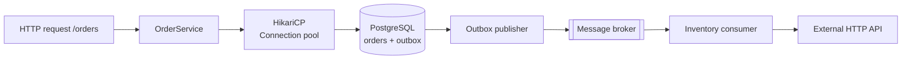
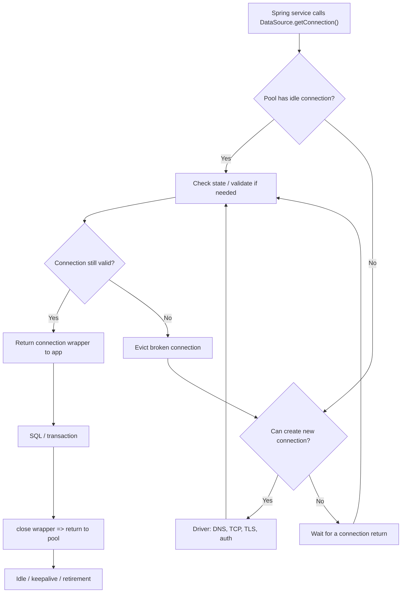
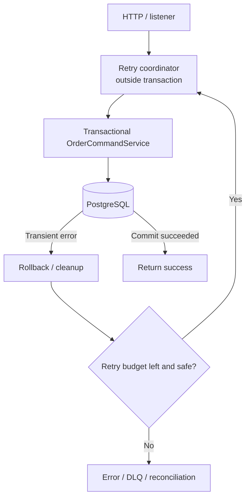
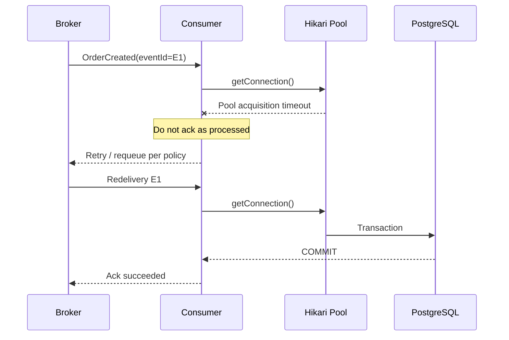

# Connection Timeouts, Validation, and Stale or Invalid Connections

In a Spring Boot system, SQL failures do not always come from a `SELECT` or `INSERT` statement. An application can fail **before even receiving a connection**, hang while opening a TCP socket, borrow a connection the database already closed, or lose connectivity mid-transaction because a database proxy or network changed state.

For instance, an order service saves an order and an outbox event in PostgreSQL. When request volume spikes, HikariCP may report it could not obtain a connection within the allowed wait time. When PostgreSQL restarts, previously healthy pooled connections may become invalid. If the application blindly catches exceptions and retries, the result can be **excessive lock retention, duplicate messages, double-inserted orders, or reporting success when data never committed**.

This lesson belongs to the **SQL Connectivity** chapter of the **SPRING_BOOT_INTEGRATION** module. The focus goes beyond isolated HikariCP properties to the entire boundary across **HTTP clients, SQL transactions, caches, brokers, and Spring Integration adapters**: configuring wait budgets, data contracts, error classification, deduplication, testing, and observing real integration flows.

> **Scope:** Primary examples use Java 17+, Spring Boot 3.x, Spring JDBC, HikariCP, and PostgreSQL 16. Specific property names for Spring Boot, HikariCP, and pgJDBC should be verified against your deployed versions. The principles apply across database engines, though SQLState codes, health query syntax, driver timeouts, and failover behavior vary.

## 1. Learning Objectives

After this lesson, you will be able to:

1. Distinguish **pool acquisition timeout**, **TCP connect timeout**, **validation timeout**, **socket/read timeout**, **statement timeout**, and **transaction timeout**.
2. Explain the lifecycle of a JDBC `Connection` from creation, borrowing, use, and return to retirement or eviction.
3. Configure common HikariCP properties: `connectionTimeout`, `validationTimeout`, `maxLifetime`, `idleTimeout`, `keepaliveTime`, and pool size.
4. Explain why `Connection.isValid(...)` helps detect dead connections yet cannot guarantee the very next SQL statement will succeed.
5. Diagnose pool exhaustion, database restarts, network half-open sockets, server idle timeouts, and mid-transaction disconnects.
6. Design retries **at the right transaction boundary** and prevent duplicate side effects across HTTP and broker flows.
7. Test timeouts and connection recovery using HikariCP, Spring Boot, PostgreSQL/Testcontainers, and fault simulation.
8. Monitor metrics and logs to separate pool, database, network, and business issues.

## 2. Real-World Scenario: Orders, Outbox, and SQL Connectivity

Suppose an application receives `POST /orders`:



Desired guarantees:

- `orders` and `outbox` are written in the **same SQL transaction**.
- If SQL rolls back, `OrderCreated` is never emitted as if the transaction committed.
- If the consumer redelivers the message, inventory is never reserved twice.
- If the database disconnects, the service returns an appropriate error within bounded wait times without blocking all incoming traffic.

However, the flow can fail at very different points:

| Failure point | Example | Potential consequence |
| --- | --- | --- |
| Before borrowing a connection | 20 threads wait on a busy 10-connection pool | Cannot start SQL work |
| Creating a physical connection | Host unreachable, TCP timeout | Pool cannot replenish connections |
| Validating an old connection | Server killed an idle session | Must evict and open another connection |
| Mid-SQL statement | Socket reset, server restart | Transaction fails; commit outcome may be ambiguous |
| After SQL commit, before HTTP response | Client drops connection to the app | Caller may retry and resend the same order |
| After SQL commit, before broker publish | Publisher crashes | Requires outbox/recovery, not just HTTP retries |

Core insight: **the same word "timeout" means very different failure locations and recovery strategies**. No single property covers all scenarios.

## 3. Lifecycle of a JDBC Connection in HikariCP

### 3.1. "Logical" vs. "Physical" Connections

When code executes:

```java
try (Connection connection = dataSource.getConnection()) {
    // Execute SQL.
}
```

with a pooled `DataSource` like HikariCP, the returned object is typically a **connection wrapper/proxy**. Calling `close()` on the wrapper **returns the connection to the pool** if healthy, rather than closing the underlying TCP socket immediately.

Does a physical connection to PostgreSQL use TCP/SSH? No—standard JDBC connects directly over **TCP/TLS using the PostgreSQL wire protocol**, unrelated to SSH unless your infrastructure uses a dedicated tunnel. Connection establishment can include DNS resolution, TCP connect, TLS handshake, authentication, database session creation, and state initialization.



Some steps run asynchronously or use internal optimizations inside Hikari; this diagram illustrates the **conceptual flow** and does not guarantee every single borrow performs a network round-trip.

### 3.2. Three States to Distinguish

- **Idle connection:** already created, sitting in the pool, not currently borrowed.
- **Active/borrowed connection:** currently held by a request, transaction, or job.
- **Broken/stale connection:** the physical connection has died, though the pool or app may not have noticed yet.

The pool manages idle connection lifecycles and tries to detect dead connections during borrows or periodic checks. Still, **an in-use connection can die at any instant**, even immediately after passing validation.

### 3.3. Who Owns Which Responsibility?

| Layer | Responsibility |
| --- | --- |
| Spring Boot | Creates and wires `DataSource`/HikariCP when dependencies match |
| HikariCP | Manages connection counts, borrow waits, validation, retirement, keepalive, metrics |
| JDBC driver | Opens sockets/TLS/auth, runs SQL, implements `Connection.isValid`, query timeout |
| PostgreSQL | Handles transactions, connections/sessions, SQL, locks, server-side timeouts |
| OS/network/proxy | DNS, TCP, firewalls, NAT, load balancers, idle connection policies |
| Business service | Transactions, idempotency, retry boundaries, response contracts |
| Observability | Collects metrics/logs/traces across layers to pinpoint root causes |

Do not blame HikariCP for every `CannotGetJdbcConnectionException`; the root cause often lies in the database, DNS, TLS, credentials, or network infrastructure.

## 4. Six Timeout Groups Frequently Confused

| Type | Where it lives | Clock starts when | Typical cause |
| --- | --- | --- | --- |
| **Pool acquisition timeout** | HikariCP `connectionTimeout` | Caller waits on `getConnection()` for a usable connection | Pool full, no connections available |
| **Physical connect timeout** | JDBC driver `connectTimeout` | Opening socket to host/port | Database down, firewall dropping packets |
| **Validation timeout** | HikariCP `validationTimeout` / JDBC `isValid` | Verifying a connection is still usable | Dead idle socket |
| **Socket/read timeout** | Driver `socketTimeout` | Waiting to read data from socket per driver contract | Unresponsive query or network |
| **SQL statement timeout** | JDBC `Statement.setQueryTimeout`, DB `statement_timeout` | Statement runs (per server/driver semantics) | Slow query / lock wait |
| **Transaction timeout** | Spring `@Transactional(timeout=...)` or DB | Per transaction scope / manager | Transaction exceeds time budget |

An end-to-end request may also involve **HTTP server timeouts, service deadlines, broker listener timeouts**, and client cancellations outside this table.

### 4.1. Pool Acquisition Timeout

HikariCP's `connectionTimeout` is the **maximum time a caller waits for a usable connection from the pool**. It does not mean "TCP connection timeout."

For example, suppose a pool has 10 connections and all 10 are held by active transactions. The 11th request calls `getConnection()` and blocks. Once `connectionTimeout` expires, Hikari throws a `SQLTransientConnectionException` such as:

```text
OrdersPool - Connection is not available,
request timed out after 3000ms.
```

Exact messages vary by version. This tells you **no connection could be borrowed in time**—it does not prove the database is down. Causes include an undersized pool, slow SQL/transactions, hung threads, unclosed connections, or inability to open new connections.

**Do not "fix" this by bumping `connectionTimeout` to 60 seconds**; that often turns fast failures into thousands of threads piling up longer.

### 4.2. JDBC Driver Physical Connect Timeout

When a new physical connection is needed, the JDBC driver must connect to PostgreSQL. In pgJDBC, `connectTimeout` is specified in **seconds**, for example:

```text
jdbc:postgresql://db.internal.example:5432/orders?connectTimeout=5
```

Compare that with Hikari's `connection-timeout: 3000` in **milliseconds**.

Additional phases exist, including DNS resolution, TLS handshake, authentication, and multi-host failover; exact timeout behavior depends on the driver and OS. Thus, **do not treat `connectTimeout=5` as an absolute guarantee that full session establishment completes in 5 seconds**.

### 4.3. Validation Timeout

`validationTimeout` bounds how long Hikari spends confirming a connection is still alive using supported validation mechanisms. Hikari requires this value to be smaller than `connectionTimeout` and enforces a minimum floor depending on version; e.g., 1,000 ms when acquisition is 3,000 ms.

Validation typically relies on JDBC 4 `Connection.isValid(...)`, not a full business query.

### 4.4. Socket/Read Timeout

pgJDBC `socketTimeout` is specified in **seconds**. It limits socket read waits at the driver layer per driver semantics; timing out typically causes the driver to close/invalidate the connection.

```text
jdbc:postgresql://db.internal.example:5432/orders?socketTimeout=30
```

Do not use socket timeout as a substitute for query timeouts or transaction deadlines. A connection may trickle rows slowly, or a query may block on a lock while keeping socket semantics subtle; understand your exact driver's guarantees.

### 4.5. Statement Timeout

Spring JDBC lets you configure query timeouts via `JdbcTemplate` or `Statement`, e.g.:

```java
JdbcTemplate jdbc = new JdbcTemplate(dataSource);
jdbc.setQueryTimeout(8); // Unit: seconds.
```

PostgreSQL also provides server-side `statement_timeout`; for example, scoped inside a transaction when appropriate:

```sql
SET LOCAL statement_timeout = '8s';
SELECT ...;
```

`SET LOCAL` applies to the current transaction; its configuration and scope must be handled carefully under connection pooling. Never alter persistent session state without resetting it, or the next borrower of that pooled connection inherits unexpected limits.

A statement timeout bounds **one SQL statement** per DB/driver semantics. It does not cover pool waiting, DNS, HTTP clients, or retries.

### 4.6. Transaction Timeout

`@Transactional(timeout = 10)` sets a Spring-level transaction budget when supported by the transaction manager:

```java
@Transactional(timeout = 10)
public void createOrder(...) {
    // SQL operations in the same transaction.
}
```

The unit is **seconds**. Enforcement depends on the transaction manager, framework, and how SQL statements are issued. For example, Spring JDBC propagates remaining transaction time to statements created via Spring APIs; you cannot treat this annotation as a hard timer interrupting arbitrary Java or HTTP work right at 10 seconds.

In particular, if code waits on a remote HTTP call **in the middle of a SQL transaction**, there is no universal guarantee Spring will interrupt the HTTP call when the transaction times out. Configure dedicated HTTP client timeouts/deadlines and keep transactions short.

## 5. HikariCP: Configuring Properties Correctly

### 5.1. Dependencies and Assumptions

With Spring Boot 3.x, Spring JDBC and HikariCP are normally included via the starter:

```groovy
dependencies {
    implementation 'org.springframework.boot:spring-boot-starter-jdbc'
    runtimeOnly 'org.postgresql:postgresql'

    testImplementation 'org.springframework.boot:spring-boot-starter-test'
    testImplementation 'org.springframework.boot:spring-boot-testcontainers'
    testImplementation 'org.testcontainers:junit-jupiter'
    testImplementation 'org.testcontainers:postgresql'
}
```

When HikariCP is on the classpath and no other datasource configuration overrides it, Spring Boot typically auto-configures a `HikariDataSource`. In projects with multiple `DataSource` beans, custom datasource factories, or JNDI, verify **which bean is actually active** before assuming properties take effect.

### 5.2. `application.yml` for an Order Service

```yaml
spring:
  datasource:
    url: ${ORDERS_JDBC_URL}
    username: ${ORDERS_DB_USERNAME}
    password: ${ORDERS_DB_PASSWORD}
    hikari:
      pool-name: OrdersPool
      maximum-pool-size: 12
      minimum-idle: 4

      connection-timeout: 3000
      validation-timeout: 1000

      idle-timeout: 600000
      max-lifetime: 1500000
      keepalive-time: 120000

      leak-detection-threshold: 20000
```

**Explanation of parameters—not a "one-size-fits-all production template":**

| Property | Example value | Meaning |
| --- | ---: | --- |
| `maximum-pool-size` | 12 | Maximum physical connections in the pool |
| `minimum-idle` | 4 | Target number of idle connections to maintain when possible |
| `connection-timeout` | 3,000 ms | Wait limit for a usable connection from the pool |
| `validation-timeout` | 1,000 ms | Budget to verify connection liveness |
| `idle-timeout` | 600,000 ms | Target idle retirement delay for excess connections when pool shrinks |
| `max-lifetime` | 1,500,000 ms | Connection age cap to avoid indefinite reuse |
| `keepalive-time` | 120,000 ms | Periodically checks **idle** connections to keep them alive |
| `leak-detection-threshold` | 20,000 ms | Logs warning if borrowed too long; does not close connection |

In HikariCP, many timeout/lifetime properties are configured in **milliseconds**. Never copy `connectTimeout=5` (pgJDBC seconds) into Hikari expecting 5 seconds.

**Key constraints:**

- `validationTimeout < connectionTimeout`.
- `keepaliveTime < maxLifetime` when keepalive is enabled.
- `idleTimeout` mainly matters when the pool can shrink, i.e., `minimumIdle < maximumPoolSize`.
- Pool size should not be chosen solely from requests/second; consider transaction length, database capacity, and concurrent instance count.

### 5.3. Why Avoid Setting Timeouts Too Small?

For example, `connectionTimeout = 300 ms` and `validationTimeout = 250 ms` can cause false failures against a healthy database during minor network jitter, slow DNS/TLS handshakes, or brief pool contention.

Conversely, `connectionTimeout = 120,000 ms` lets HTTP requests stall too long, tying up worker threads and resources in the application tier.

Start from **SLOs and time budgets**:

```text
HTTP request deadline:        8,000 ms
┌─ Business validation:         200 ms
├─ Wait for SQL connection:   1,000 ms
├─ SQL transaction:           2,000 ms
├─ Outbound HTTP:             3,000 ms
└─ Reserve logging/response:    800 ms
Total example budget:         7,000 ms
```

Numbers are illustrative only. Layer timeouts can overlap and do not always add linearly across every code path. The goal is ensuring **the slowest path plus retries** does not silently blow past the business deadline.

## 6. PostgreSQL JDBC: connectTimeout, socketTimeout, and Security

### 6.1. JDBC URL with Driver Properties

Local environment example:

```text
jdbc:postgresql://localhost:5432/orders?connectTimeout=5&socketTimeout=30&tcpKeepAlive=true
```

Or via environment variable:

```bash
export ORDERS_JDBC_URL='jdbc:postgresql://localhost:5432/orders?connectTimeout=5&socketTimeout=30&tcpKeepAlive=true' # Local example, not for production.
```

In pgJDBC:

- `connectTimeout=5`: TCP socket connect timeout, **seconds**.
- `socketTimeout=30`: socket read timeout, **seconds**; the driver can close the connection on expiry.
- `tcpKeepAlive=true`: enables OS-level TCP keepalive. OS intervals can be long and are not equivalent to Hikari `keepaliveTime`.

If traffic traverses a proxy or load balancer, examine idle timeouts and connection lifetimes across **every intermediate hop**.

### 6.2. Do Not Confuse TCP Keepalive with Hikari Keepalive

| Mechanism | Performed by | Purpose |
| --- | --- | --- |
| OS TCP keepalive | Network stack | Probes TCP peer at the socket level |
| pgJDBC `tcpKeepAlive` | Enables socket option per driver/OS support | Helps detect long-dead TCP connections |
| Hikari `keepaliveTime` | Connection pool | Periodically checks **idle connections in the pool** |
| JDBC `Connection.isValid()` | Driver | Checks if a connection is usable at a moment in time |
| Business health query | Application/DB | Verifies functionality the business actually needs |

TCP keepalive does not prove credentials are still authorized, transactions will commit, or queries will finish fast. Conversely, a passing `isValid` does not prevent a connection from dying on the very next millisecond.

### 6.3. TLS and Certificates

For production PostgreSQL, consider TLS with server identity verification (such as `sslmode=verify-full` in pgJDBC with proper CA/trust material).

```text
jdbc:postgresql://db.prod.example:5432/orders?sslmode=verify-full&connectTimeout=5
```

This is an example only. Proper operation requires a trusted certificate authority, a server certificate matching the hostname, driver settings, and trust material paths. Never use `sslmode=disable` or disable hostname verification in production just to "fix" handshake errors or timeouts.

Manage usernames/passwords via a secret manager or protected environment variables; credential rotation may require opening fresh physical connections rather than merely updating environment variables of a running process.

## 7. What Does Connection Validation Actually Mean?

### 7.1. JDBC 4 `Connection.isValid(timeoutSeconds)`

JDBC defines:

```java
boolean alive = connection.isValid(2);
```

Per the JDBC API, `isValid(int timeout)` returns a boolean or throws an exception depending on the condition, with the timeout parameter in **seconds**. Drivers normally implement a lightweight check to confirm the connection remains usable.

With HikariCP and modern JDBC4 drivers, **prefer `Connection.isValid(...)`**. You usually do not need to configure `SELECT 1` as `connectionTestQuery` "just to be sure."

### 7.2. Why `connectionTestQuery` Is Usually Unneeded

Hikari supports:

```yaml
spring:
  datasource:
    hikari:
      connection-test-query: "SELECT 1"
```

However, with modern PostgreSQL JDBC supporting JDBC4 `isValid`, adding `connectionTestQuery` usually **brings no benefit** and can incur different validation overhead.

Only configure `connectionTestQuery` when a driver **does not implement `isValid` properly**, or for a compatibility issue verified by tests. Never use a heavy business query for validation, such as scanning a million-row table on every borrow.

### 7.3. When Does Hikari Validate?

Relevant lifecycle events:

1. When creating a new physical connection, the driver runs connection/auth setup.
2. When borrowing an idle connection, Hikari may check for dead connections before handing it to the caller.
3. An internal optimization may **skip redundant validation when a connection was just used**; there is no contract promising "every single borrow executes `SELECT 1`."
4. When keepalive is enabled and a connection sits **idle**, the pool can periodically probe it to prevent silent closure by servers or proxies.
5. When a broken connection is detected, the pool discards it and acquires or creates a replacement within configured time/policy bounds.

**There is no absolute promise that "the pool always swaps dead connections before SQL runs."** This is a classic *time-of-check versus time-of-use* issue: a connection can be valid when checked and fail the moment the next statement is sent.

### 7.4. What Validation Does Not Verify

`isValid` can succeed even when:

- The user lacks `INSERT` permission on the required table.
- Schema migrations have not run or a table was renamed.
- A transaction hits a deadlock or serialization conflict.
- A specific query hits a lock and exceeds statement timeout.
- The server received `COMMIT`, but the connection dropped before the client read the acknowledgment.
- Business constraints reject the payload despite a healthy connection.

Therefore, distinguish **connection liveness** from **business-level database readiness**. Health checks confirm the system can perform a basic step, not that the entire integration workflow will succeed.

## 8. Invalid or Dead Connections: Common Root Causes

### 8.1. Database Restart / Failover

When PostgreSQL restarts, old physical sessions terminate. HikariCP still holds wrapper/idle references; subsequent borrows must evict dead connections and establish fresh sessions.

Associated issues:

- Active in-flight transactions fail and require controlled rollback/retry.
- DNS or the primary endpoint may change after failover.
- A read replica may reject writes; TCP/JDBC validation passes, yet business writes fail.
- Credentials or TLS certificates may rotate concurrently.
- The pool may open many replacement connections at once, creating a reconnect spike on the recovering database.

### 8.2. Server / Proxy Idle Timeouts

Long-idle connections may be closed by:

- Database policy.
- Proxies such as PgBouncer or cloud database proxies.
- Firewalls, NAT gateways, or load balancers.
- Runtime environment network policies.

PostgreSQL includes settings like `idle_session_timeout` and `idle_in_transaction_session_timeout`. These two **are different**: a completely idle session is very different from a session holding an open transaction while doing nothing. Never use pool keepalive to "protect" a long-idle open transaction; that is a design bug to fix.

### 8.3. Network Half-Open Connections

One side can lose TCP state without the other receiving a FIN or RST packet. The pool may still view the connection as idle and valid on the Java side until I/O or validation occurs.

Consequences:

- The initial borrow may receive an apparently normal connection.
- Running a query hangs until socket timeout or throws an I/O error.
- Hikari evicts the connection once detected as broken, yet the in-flight transaction **cannot automatically resume mid-flight**.

### 8.4. Application Failing to Close Connections

A connection that is not physically broken yet **never returned to the pool** mimics database unavailability: the pool drains, callers wait, and requests time out.

Common bug:

```java
Connection connection = dataSource.getConnection();
PreparedStatement statement = connection.prepareStatement(
        "SELECT * FROM orders WHERE order_id = ?");
statement.setString(1, orderId);
// Statement/connection left unclosed if an exception occurs.
```

Proper approach:

```java
try (Connection connection = dataSource.getConnection();
     PreparedStatement statement = connection.prepareStatement(
             "SELECT state FROM orders WHERE order_id = ?")) {

    statement.setString(1, orderId);
    try (ResultSet rs = statement.executeQuery()) {
        if (rs.next()) {
            return rs.getString("state");
        }
        return null;
    }
}
```

In Spring Boot applications, `JdbcTemplate` is usually simpler and safer for everyday SQL because it manages resource cleanup and exception translation alongside Spring transactions.

## 9. `maxLifetime`, `idleTimeout`, and `keepaliveTime` Serve Different Purposes

### 9.1. `maxLifetime`: Retiring Connections by Age

`maxLifetime` governs the maximum age of pooled connections. Hikari aims to retire connections when idle/returned, rather than yanking a connection out from under an active SQL query just because its age limit arrived.

A sound rule of thumb is setting `maxLifetime` **shorter than the connection lifetime cap enforced by the database, proxy, or infrastructure**, with a comfortable buffer. Still, if the server kills idle connections after 5 minutes, setting `maxLifetime=25 minutes` will not prevent idle drops; examine `keepaliveTime` or lower idle limits instead.

### 9.2. `idleTimeout`: Shrinking the Pool When Idle

When `minimumIdle < maximumPoolSize`, surplus idle connections can be retired to lower resource footprint. Do not expect `idleTimeout` to close each connection on the exact millisecond: background housekeeping and pool rules introduce jitter.

If `minimumIdle` is omitted in HikariCP, the pool typically operates toward fixed size, where `idleTimeout` does not shrink it the way an elastic pool would. Verify effective runtime configuration.

### 9.3. `keepaliveTime`: Probing Idle Connections

`keepaliveTime` lets the pool probe idle connections to reduce the chance an intermediate network device silently drops an unused connection.

Limitations:

- Applies via pool rules to idle connections only.
- Not a heartbeat for active transactions.
- Does not guarantee servers/proxies preserve sessions regardless of idle policies.
- Does not replace driver socket timeouts or retries.
- Too short an interval across large pools adds unnecessary load.

### 9.4. Example Interaction of Values

Suppose a database proxy drops idle connections after **10 minutes**, while traffic arrives in bursts 15 minutes apart:

```text
Proxy idle cutoff:       10 minutes
Hikari maxLifetime:      25 minutes
Hikari keepaliveTime:     2 minutes
Hikari idleTimeout:      10 minutes (pool may shrink)
```

A 2-minute keepalive can prevent idle connections from hitting the idle cutoff **provided infrastructure treats the probe as session-refreshing I/O** and no absolute session age policy overrides it. Test against the real proxy/server.

If server policy **terminates sessions unconditionally after 20 minutes regardless of activity**, keepalive cannot stop that; `maxLifetime` with a proper buffer becomes the primary defense.

## 10. Undersized Pools, Oversized Pools, and Sizing Needs

### 10.1. Pool Exhaustion Is Not Always a Network Outage

Suppose:

```text
App instances:             8
Hikari maximumPoolSize:   25 / instance
Max potential connections: 200
Database max_connections: 150
```

Even though each instance "only" asks for 25 connections, theoretical demand reaches 200, exceeding DB capacity—before even subtracting connections for admin, migrations, monitoring, background jobs, and other apps.

A quick sanity-check formula:

\[
\text{PotentialConnections} =
\sum_{i=1}^{N} \text{maximumPoolSize}_i
\]

This is a **connection ceiling**, not a throughput optimization formula. Optimal concurrency depends on DB CPU, I/O, transaction hold time, query mix, lock contention, and background jobs.

### 10.2. Oversized Pools Also Slow Things Down

When the database lacks capacity for high concurrent queries, raising `maximumPoolSize` can:

- Increase SQL queries fighting for CPU and I/O.
- Worsen lock contention and lengthen transactions.
- Consume more per-connection memory on the database server.
- Drive p95/p99 query completion times higher.
- Slow database recovery when all instances reconnect simultaneously.

Never equate "larger pool = faster." Measure **borrow wait time, connection hold time, SQL latency, and DB CPU/locks** before tuning.

### 10.3. Undersized Pools or Overly Long Hold Times

A method doing:

```java
@Transactional
public void badWorkflow(String orderId) {
    orderRepository.insert(orderId);   // Holds SQL transaction.
    remoteInventoryApi.reserve(orderId); // Waits 10 seconds on HTTP.
    orderRepository.markReserved(orderId);
}
```

can hold connections, transactions, and SQL locks across the HTTP wait. With hundreds of concurrent requests, the pool exhausts even though the SQL itself takes only tens of milliseconds.

A cleaner design:

- Short SQL transaction recording state and outbox.
- Worker outside any transaction calls HTTP.
- Update outcome in a fresh transaction guarded by operation ID/idempotency and a state machine.
- Reconcile state after HTTP timeouts when the remote target may have succeeded.

This is an **integration flow architecture improvement**, not merely tweaking `connectionTimeout`.

## 11. Classifying Errors: Retry or Not?

### 11.1. SQL/JDBC Error Categories

| Category | Symptoms | Approach |
| --- | --- | --- |
| **Pool exhaustion** | `SQLTransientConnectionException`, "Connection is not available" | Inspect active/idle/pending, transaction duration, pool size |
| **Connection error** | `SQLState` class `08` (where supported), I/O error | Evict connection, check DB/network, retry whole operation if safe |
| **Deadlock / serialization failure** | PostgreSQL `40P01` / `40001` | Retry transaction **from the start** with bounds and idempotency |
| **Unique constraint violation** | PostgreSQL `23505` | Usually duplicate or invalid data; do not retry blindly forever |
| **Permission denied** | Database privilege error | Fix roles/secrets/migrations; do not continuously retry |
| **Syntax / schema mismatch** | Wrong query/table/column | Fix code/migrations; retrying never helps |
| **Transaction timeout** | Query timeout, transaction cancelled | Identify statement/locks and state; roll back or retry safely |
| **Uncertain commit outcome** | Connection lost after server received COMMIT | Reconcile by ID; **never assume rollback automatically** |

**Note:** SQLState is part of the JDBC contract, yet not every driver or failure populates it uniformly. Class `08` SQLStates typically indicate connection exceptions. A Hikari pool timeout may not carry the same SQLState as a server-returned PostgreSQL error.

### 11.2. Spring JDBC Exception Translation

With `JdbcTemplate`, many `SQLException` errors translate into `DataAccessException` subclasses, such as:

- `CannotGetJdbcConnectionException` when acquiring a JDBC connection fails.
- `DuplicateKeyException` when a unique constraint blocks duplicate writes per translator rules.
- `DataIntegrityViolationException` for related constraint/data failures.
- `QueryTimeoutException` in supported timeout classifications.

Never write:

```java
catch (DataAccessException ex) {
    return "SUCCESS";
}
```

because doing so hides connectivity failures, constraint errors, and transaction state. Preserve the root cause and SQLState/error category safely, translating to an appropriate response at the proper boundary.

### 11.3. Fatal vs. Non-Fatal `SQLException` for a Connection

Some SQL errors only fail a **single statement**, leaving the connection usable once the transaction is handled properly. Other errors indicate the **physical connection is broken**, requiring Hikari to evict it.

Do not assume every `DataAccessException` forces pool eviction, and do not catch `SQLException` and keep running SQL inside the same broken transaction. In PostgreSQL, once a statement errors inside a transaction, the transaction enters an **aborted** state until rolled back (or rolled back to a valid savepoint).

## 12. Dead Connections Mid-`@Transactional`: Consequences and Retries

### 12.1. Transaction Boundaries Are Decisive

Example:

```java
package com.example.integration.orders;

import org.springframework.jdbc.core.JdbcTemplate;
import org.springframework.stereotype.Service;
import org.springframework.transaction.annotation.Transactional;

@Service
public class OrderCommandService {

    private final JdbcTemplate jdbc;

    public OrderCommandService(JdbcTemplate jdbc) {
        this.jdbc = jdbc;
    }

    @Transactional
    public void createOrderAndOutbox(
            String orderId, String eventId, String payloadJson) {

        jdbc.update(
                "INSERT INTO purchase_order (order_id, state) VALUES (?, ?)",
                orderId, "CREATED");

        jdbc.update("""
                INSERT INTO order_outbox (event_id, order_id, payload_json)
                VALUES (?, ?, ?)
                """,
                eventId, orderId, payloadJson);
    }
}
```

If the connection drops mid-transaction:

1. A SQL call throws an exception and the transaction must be treated as failed.
2. Hikari evicts the broken connection once detected.
3. Spring's transaction manager attempts rollback/cleanup within what the connection allows.
4. The application **must not continue using the old transaction** as if nothing happened.
5. Any retry must start a **brand-new transaction** while preventing duplicate data.

Never retry individual SQL statements inside a broken transaction by "resending just the INSERT"; evaluate the entire operation atomically.

### 12.2. Retry Outside the Transaction

A sound practice places the **retry wrapper outside** the `@Transactional` bean so each attempt enters through the Spring proxy and opens a fresh transaction:



Build a coordinator using `RetryTemplate` or an equivalent backoff retry mechanism that retries **only explicitly permitted error types**. If using Spring Retry `@Retryable`, never place `@Retryable` and `@Transactional` on the same method without verifying actual AOP advice ordering.

Note one critical edge case: if failure hits at **commit**, the coordinator must still treat the outcome as potentially uncertain on network drops. Blind retries can still create duplicates unless the operation ID is stable and SQL enforces unique constraints.

### 12.3. Database-Level Idempotency

Create stable keys for requests:

```sql
CREATE TABLE purchase_order (
    order_id VARCHAR(64) PRIMARY KEY,
    state VARCHAR(32) NOT NULL
);

CREATE TABLE order_outbox (
    event_id VARCHAR(128) PRIMARY KEY,
    order_id VARCHAR(64) NOT NULL
        REFERENCES purchase_order(order_id),
    payload_json TEXT NOT NULL
);
```

With immutable `orderId` and `eventId` per request, unique constraints catch duplicates. One idempotent PostgreSQL pattern is:

```sql
INSERT INTO purchase_order (order_id, state)
VALUES (:orderId, 'CREATED')
ON CONFLICT (order_id) DO NOTHING;
```

Still, `ON CONFLICT DO NOTHING` **does not verify that a retry's payload matches the original request**. If the same `orderId` arrives with a different amount or tenant, the application must detect the business conflict. Likewise, outbox inserts need unique event IDs and proper transaction semantics rather than silently ignoring mismatched data.

### 12.4. Unknown Commit Outcome

Suppose the client sends `COMMIT` to PostgreSQL:

```text
Application                   PostgreSQL
    |                              |
    |---------- COMMIT ----------->|
    |                        commit succeeded
    |<--------- connection lost ----X
    |
    +-- App does not know whether commit occurred.
```

An exception at this point **does not prove the transaction rolled back**. Once connectivity returns, reconcile state using the business ID/idempotency key or a workflow protocol capable of querying prior results.

Especially when HTTP API calls or broker publishes follow SQL commit, manage ordering and duplicate/loss risk via a **transactional outbox**.

## 13. SQL Connectivity with HTTP, Caches, and Brokers

### 13.1. Do Not Extend Transactions Across HTTP

An order API may call a payment gateway or inventory API. Those calls **do not roll back** when a SQL transaction rolls back.

- Keep SQL transactions short to record the request and state.
- Use an outbox/worker to execute external side effects post-commit.
- Keep operation IDs/idempotency keys stable across retries.
- After an HTTP timeout, query remote state when the outcome is unknown.
- Record the result in SQL inside a separate transaction guarded by optimistic locking/versioning.

### 13.2. Caches Can Mask Data Source Failures

If SQL becomes unreachable while Redis cache continues serving old entries, the application may return "success" responses unaware that data is stale.

Distinguish clearly:

- **Read APIs tolerating staleness:** may fall back to cache with TTLs and freshness indicators.
- **Write APIs or critical decisions:** never confirm success based solely on a cache hit.
- **Post-commit cache invalidation:** tie invalidation to durable commits; avoid deleting or updating cache entries based on uncommitted SQL state.

Do not use caches to bypass transaction correctness guarantees.

### 13.3. Broker Redelivery After SQL Failures

When a Kafka/RabbitMQ listener cannot acquire a SQL connection, the adapter can retry or requeue per configuration:



Requirements:

- Ack messages **after required data has committed**, or use an explicit transaction/ack policy.
- Use `eventId`/inbox constraints to deduplicate if the broker redelivers after SQL commit but before ack.
- Bound retries with backoff to avoid a **retry storm** while the database is down.
- Separate contract errors (never endlessly retry malformed payloads) from transient DB errors.
- Route unrecoverable messages to a DLQ/quarantine with a controlled replay process.

### 13.4. Spring Integration Channels and Thread Boundaries

In Spring Integration, transaction contexts normally bind to the current thread/transaction manager. With a synchronous `DirectChannel`, exceptions and transactions propagate along the call stack. Once a flow crosses an `ExecutorChannel`, queue channel, poller, or broker listener, transaction start and commit points shift to different threads and scopes.

Never assume a transaction holding a connection on inbound HTTP covers downstream async steps. Conversely, never let an async worker hold a JDBC connection while "waiting" long periods on an external API without explicit justification.

## 14. Startup, Readiness, and Health Checks

### 14.1. Database Unavailable at Startup

If the database is not ready when Spring Boot boots:

- Hikari may attempt initial connection acquisition and fail, depending on `initializationFailTimeout`, minimum idle, and settings.
- Spring Boot/Flyway/Liquibase may require a connection for migrations and fail context startup.
- `@PostConstruct` hooks or scheduled jobs querying the DB can also fail startup.
- Disabling fail-fast startup does not automatically make the application pass readiness.

**Hikari's `initializationFailTimeout` is not `connectionTimeout`.** It controls how the pool behaves during initial verification/startup; positive, zero, and negative values have distinct semantics in Hikari. Adjust it only after aligning with your platform's startup, retry, and readiness strategy.

### 14.2. Liveness Differs from Readiness

- **Liveness:** is the process still alive and capable of recovering? Avoid automatically killing and restarting pods solely because an external dependency like PostgreSQL is temporarily unavailable.
- **Readiness:** is the instance ready to accept traffic for its primary purpose? For a SQL-dependent service, losing the DB may rightly mark write endpoints unready.

Spring Boot Actuator provides health indicators and probe support; map DB health onto readiness/liveness intentionally. Marking all pods unready during a DB outage halts traffic across the service; sometimes that is right, other times controlled read-only or degraded modes are needed.

### 14.3. Health Queries Are Not Business Transactions

`isValid(true)` returning true does not prove the orders table exists, migrations ran, or `INSERT` privileges are granted. Health checks span levels:

1. **Process health:** service is running and event loop/threads respond.
2. **Pool/connectivity health:** can borrow and validate a connection.
3. **Database service health:** can execute a lightweight query.
4. **Business capability health:** can serve functional operations, potentially checking schema/version/roles.

Never run mutating business transactions inside continuous health probes; that creates side effects and unnecessary load.

## 15. Observability: Which Metrics Separate Root Causes?

### 15.1. Signals from HikariCP

With Spring Boot Actuator/Micrometer configured, Hikari metrics appear under exporter-specific names. Conceptually important signals:

| Metric / signal | Meaning |
| --- | --- |
| **Active connections** | Connections currently borrowed |
| **Idle connections** | Idle connections in the pool |
| **Pending threads** | Callers waiting for connections |
| **Total connections** | Current total connections |
| **Connection acquire time** | Time spent waiting to borrow |
| **Connection usage time** | Duration held by callers |
| **Connection creation time** | Time to establish physical connections |
| **Connection timeout count** | Borrow attempts that timed out |

With Micrometer Prometheus, metrics commonly use the `hikaricp_connections_*` prefix, though exact names, units, labels, and availability depend on Spring Boot/Hikari/Micrometer versions. Verify actual meters via `/actuator/metrics` or your metrics backend rather than hardcoding dashboards from an old blog.

### 15.2. Diagnosing from Combined Metrics

**Case A: Pool saturation**

```text
active ≈ maximumPoolSize
idle ≈ 0
pending rising
acquire latency rising
SQL duration may be high
```

Suspects: pool undersized for workload, long transactions, connection leaks, or slow DB. Check usage time, slow queries, and lock-holding transactions before enlarging the pool.

**Case B: Database/network failure**

```text
pending rising
connection creation failures rising
TCP connect/validation timeouts
DB health failing
```

Suspects: unreachable endpoint, DB out of connections or restarting, wrong TLS or credentials.

**Case C: Connections held too long**

```text
active high
usage duration p99 very high
outbound HTTP latency inside transactions rising
```

Suspects: app holding connections while waiting on HTTP/files/brokers, locked queries, or unclosed connections.

**Case D: Stale idle connections after quiet periods**

```text
Errors hit the first request after a quiet period
validation/network exceptions after long idle
Subsequent requests succeed
```

Suspects: server/proxy closing idle sessions, mismatched Hikari keepalive/lifetime settings, or stale session caches. Correlate database/proxy logs and run fault injection rather than guessing from timers alone.

### 15.3. PostgreSQL SQL Diagnostics

On an authorized database with monitoring privileges, inspect active sessions:

```sql
SELECT
    pid,
    state,
    wait_event_type,
    wait_event,
    now() - xact_start AS transaction_age,
    now() - query_start AS query_age
FROM pg_stat_activity
WHERE datname = current_database()
ORDER BY xact_start NULLS LAST;
```

Never run `pg_terminate_backend` in production to "fix" an exhausted pool without an approved operational procedure. Killing sessions aborts active transactions and increases retries and unknown commit outcomes.

Across multi-instance pools, examine total connections and look for **`idle in transaction` sessions**. These typically indicate long-held transactions rather than a reason to bump max pool size.

### 15.4. Leak Detection

Hikari's `leakDetectionThreshold` logs warnings when a connection stays borrowed too long. It does not close the connection and does not prove a code leak every time:

- A legitimate large query can hold a connection past the threshold.
- A transaction waiting on HTTP triggers the warning.
- A genuine missing `close()` also triggers the warning.

Set the threshold comfortably above normal borrow durations to limit false positives; combine stack traces with metrics and transaction durations. Avoid verbose logging or printing credentials in production.

## 16. Testing with HikariCP and Real PostgreSQL

### 16.1. Why Mocking `DataSource` Is Not Enough

Mocking `JdbcTemplate` or `DataSource` verifies that business logic classifies a synthetic exception, but cannot verify:

- Hikari acquisition timeouts when the pool runs dry.
- JDBC driver timeout and SSL behavior.
- Connection validation when a socket dies.
- Transaction rollback behavior across a database restart.
- Real PostgreSQL SQLState codes.
- Pool behavior after failover.

Integration tests should use real PostgreSQL via Testcontainers or an isolated environment where network and faults can be controlled. Never run fault injection on production databases.

### 16.2. Testcontainers Setup

Gradle example:

```groovy
dependencies {
    implementation 'org.springframework.boot:spring-boot-starter-jdbc'
    runtimeOnly 'org.postgresql:postgresql'

    testImplementation 'org.springframework.boot:spring-boot-starter-test'
    testImplementation 'org.springframework.boot:spring-boot-testcontainers'
    testImplementation 'org.testcontainers:junit-jupiter'
    testImplementation 'org.testcontainers:postgresql'
}
```

Example Spring Boot integration test for JDBC connectivity:

```java
package com.example.integration.sql;

import static org.junit.jupiter.api.Assertions.*;

import org.junit.jupiter.api.Test;
import org.springframework.beans.factory.annotation.Autowired;
import org.springframework.boot.test.context.SpringBootTest;
import org.springframework.boot.testcontainers.service.connection.ServiceConnection;
import org.springframework.jdbc.core.JdbcTemplate;

import org.testcontainers.containers.PostgreSQLContainer;
import org.testcontainers.junit.jupiter.Container;
import org.testcontainers.junit.jupiter.Testcontainers;

@SpringBootTest
@Testcontainers
class PostgreSqlConnectionIT {

    @Container
    @ServiceConnection
    static PostgreSQLContainer<?> postgres =
            new PostgreSQLContainer<>("postgres:16-alpine");

    @Autowired
    JdbcTemplate jdbc;

    @Test
    void connectsAndExecutesSimpleQuery() {
        Integer value = jdbc.queryForObject("SELECT 1", Integer.class);
        assertEquals(1, value);
    }
}
```

This test only verifies basic datasource connectivity and a trivial query. It does not simulate pool exhaustion or stale connections, which are covered below.

### 16.3. Testing Acquisition Timeout with a 1-Connection Pool

Create an **isolated pool inside the test** to measure Hikari behavior without altering the entire Spring context's pool:

```java
package com.example.integration.sql;

import static org.junit.jupiter.api.Assertions.*;

import java.sql.Connection;
import java.sql.SQLException;
import java.sql.SQLTransientConnectionException;

import com.zaxxer.hikari.HikariConfig;
import com.zaxxer.hikari.HikariDataSource;
import org.junit.jupiter.api.Test;
import org.testcontainers.containers.PostgreSQLContainer;

class HikariAcquisitionTimeoutTest {

    @Test
    void waitsThenTimesOutWhenOnlyConnectionIsBorrowed() throws Exception {
        try (PostgreSQLContainer<?> postgres =
                     new PostgreSQLContainer<>("postgres:16-alpine")) {
            postgres.start();

            HikariConfig config = new HikariConfig();
            config.setJdbcUrl(postgres.getJdbcUrl());
            config.setUsername(postgres.getUsername());
            config.setPassword(postgres.getPassword());

            config.setMaximumPoolSize(1);
            config.setMinimumIdle(0);
            config.setConnectionTimeout(800); // Milliseconds.
            config.setValidationTimeout(500); // Must be smaller.

            try (HikariDataSource pool = new HikariDataSource(config);
                 Connection held = pool.getConnection()) {

                assertThrows(SQLTransientConnectionException.class,
                        () -> pool.getConnection());
            }

            // After the connection is returned, borrowing again can be tested
            // if the pool is kept open in a wider scope.
        }
    }
}
```

**Explanation:** The test holds the single available connection and attempts to borrow a second one. Since the pool cannot grant another connection, the second call times out in Hikari. No database shutdown is required for this test.

This is an **illustrative scenario runnable when Testcontainers/Docker is available**; busy CI runners may shift exact timings slightly. Assert **exception type and pool state**, rather than asserting exact elapsed wall-clock completion at 800 ms.

### 16.4. Testing Connections Killed While Idle

An integration test scenario:

1. Create a Hikari pool with `maximumPoolSize=1` and borrow a connection.
2. On that connection, query `SELECT pg_backend_pid()` to capture the PostgreSQL backend PID.
3. Return the connection to the pool (wrapper `close()`).
4. Using an **independent admin connection** from the test, invoke `SELECT pg_terminate_backend(?)` with the captured PID.
5. Borrow a connection from the pool again and run `SELECT 1`.
6. Verify the pool evicts or replaces the dead connection per validation/recovery behavior and executes the query on a fresh connection.
7. Inspect logs and metrics for connection eviction and creation.

**Prerequisite:** The test account needs permission to terminate that backend; dev PostgreSQL containers normally allow this. Never run this against production accounts.

**Test stability:** Hikari optimizes away validation on recently used connections, and server-side termination may be observed asynchronously. Avoid relying on fixed millisecond sleeps expecting the very first borrow to always succeed. Use polling/await with deadlines, or fault-injection tools that wait for backend closure. If one borrow hits the stale connection and fails once, verify the **pool recovers on subsequent borrows** within bounds rather than assuming zero transient errors.

### 16.5. Testing Database Restarts and Network Outages

With Testcontainers, simulate stop/restart or place a network proxy (such as Toxiproxy) in front to inject:

- Initial TCP connection refusal.
- Mid-transaction connection drops.
- Connection drops after idle intervals.
- Delayed queries exceeding socket/statement timeouts.
- Database restarts while the pool holds idle connections.

Measure **retry counts, recovery latency, post-error SQL state, and duplicate event risks**. Do not merely assert "the final request returned 200."

### 16.6. Testing Commit Outcomes and Idempotency

Key scenario:

```text
Given:
  orderId = ORD-101
  eventId = EVT-101
  SQL has UNIQUE(order_id), UNIQUE(event_id)

When:
  App executes createOrderAndOutbox.
  Network drops right when it is unknown whether commit ACK arrived.
  Caller retries with the same orderId/eventId.

Then:
  SQL contains at most one order and one outbox event with matching payload.
  If the prior commit succeeded, retry does not create conflicting data.
  If the prior commit failed, retry completes safely.
  Publisher/consumer still handle redelivery idempotently.
```

Simulating "lost ACK after commit" precisely is difficult; combining fault tests with **business-key reconciliation** and unique constraints is far more practical than guessing commit outcomes from exception text.

## 17. Anti-Patterns and Fixes

| Anti-pattern | Why it is dangerous | Replace with |
| --- | --- | --- |
| Raising `maximumPoolSize` indefinitely on pool timeouts | Overloads the database further | Measure DB CPU/locks, usage time, bound concurrency |
| Setting a huge `connectionTimeout` to "wait for the DB" | Inflates request latency and tied-up threads | Design proper deadlines and fail-fast behavior |
| Confusing `connectionTimeout` with driver `connectTimeout` | Settings affect the wrong layer | Document layer and unit explicitly |
| Using heavy `connectionTestQuery` | Validation adds unnecessary DB load and delay | JDBC4 `isValid` if driver supports it |
| Disabling TLS/hostname validation on errors | Risks connecting to wrong/rogue peers | Fix endpoint, driver, TLS, and trust store |
| Treating `keepaliveTime` as a query timeout | Never stops slow queries | Statement/transaction timeouts and query tuning |
| Calling HTTP inside long SQL transactions | Holds connections/locks, exhausts pool | Outbox/worker and short transactions |
| Catching `DataAccessException` and returning success | Hides commit/rollback failures | Return contract-compliant errors or bounded retries |
| Retrying individual `INSERT`s inside an aborted transaction | Transaction is already invalid | Roll back and retry in a fresh transaction |
| Retrying uncertain commit outcomes without IDs | Can create duplicates | Idempotency keys and reconciliation |
| Treating `isValid` as proof business writes will succeed | Time-of-check/use race, missing grants/migrations | Test business contracts, transactions, and readiness |
| Creating a new datasource/pool per request | Exhausts resources and overloads DB | Application-scoped managed datasource beans |
| Closing physical connections outside the pool | Pool loses track of state | Close wrapper via JDBC API; let pool evict on error |
| Testing only with H2/mocks | Misses PostgreSQL timeouts and SQLState | Integration tests on the target DB engine |

## 18. Playbook for Production SQL Connection Timeouts

### Step 1 — Identify the First Exception and Layer

Collect **secret-free** diagnostics:

- Exception type and root cause.
- SQLState/vendor error code if present.
- Pool name, app instance, request/correlation ID.
- Timestamp, database state, wait duration.
- Did it happen at startup, mid-transaction, or after an idle window?

Distinguish:

```text
Hikari: Connection is not available
    → pool acquisition / capacity / creation issue

Driver: connection refused / connect timeout
    → network, host/port, server listener

Driver: socket read timed out
    → waiting for server/network I/O

Database: too many connections
    → DB capacity / multiple pools

SQLState 08xxx
    → connection failure class (check cause)
```

### Step 2 — Inspect Pool Metrics

- Is active hitting max?
- Is pending climbing steadily?
- Is idle dropping to 0?
- Are usage p95/p99 durations abnormal?
- Are creation time and validation failures rising?

If active is high and usage time is long, investigate transactions/slow SQL before raising pool size. If creation failures climb while active stays low, suspect DB, network, or authentication.

### Step 3 — Inspect Database and Network

- Is PostgreSQL accepting connections at the expected host/port?
- Did a failover, restart, or credential/TLS rotation occur?
- Are `max_connections` or proxy pools saturated?
- Are there many `idle in transaction` sessions?
- Is a proxy or firewall enforcing connection idle timeouts?
- Does DNS/service discovery resolve the expected endpoint?

Never disable TLS/hostname verification or print production credentials into logs to debug.

### Step 4 — Verify Timeout Policies Align

Compare:

```text
HTTP deadline
    ├─ Hikari acquisition timeout (ms)
    ├─ Driver connect timeout (s)
    ├─ Statement / server statement_timeout
    ├─ Driver socket timeout (s)
    └─ Retry attempts + backoff
```

Total elapsed time can breach the HTTP deadline if each layer sets independent limits. When a request is cancelled, check whether the SQL/transaction keeps running and holding the connection depending on framework cancellation support.

### Step 5 — Controlled Recovery

- If DB is genuinely down: shed load / stop retry storms, wait for readiness, let the pool open fresh connections.
- If connections go stale: align pool lifetimes/keepalive with proxy/server policies and test failover.
- If leaking connections: fix unclosed paths or transactions holding connections too long.
- If database is overloaded: tune SQL, locks, concurrency, and pool sizing.
- If commit outcome is unknown: **reconcile by business ID**, never blindly resend.

### Step 6 — Verify Data Integrity

Once the service recovers:

- Count orders, outbox rows, and inbox rows by immutable IDs.
- Check published events, retries, DLQs, and partner responses.
- Reconcile external HTTP side effects if applicable.
- Confirm no lingering transaction or connection leaks remain.

## 19. Pre-Deployment Configuration Checklist

- [ ] Exact Spring Boot, HikariCP, pgJDBC, and PostgreSQL versions are known.
- [ ] Every timeout is documented with its **unit** and target layer.
- [ ] `validationTimeout` is smaller than `connectionTimeout`.
- [ ] `maxLifetime` is shorter than session/proxy limits with a buffer.
- [ ] `keepaliveTime` is enabled only when needed and smaller than `maxLifetime`.
- [ ] `idleTimeout` and `minimumIdle` align with whether the pool should shrink.
- [ ] Combined `maximumPoolSize × instance count` fits within database capacity.
- [ ] SQL transactions are short, never waiting on slow HTTP/broker/file transfers inside transactions.
- [ ] `try-with-resources` or Spring JDBC is used so connections return cleanly.
- [ ] Exceptions are never caught and turned into fake success when SQL fails.
- [ ] Retries have budgets, error filtering, new transaction boundaries, and stable idempotency keys.
- [ ] Outbox/inbox or equivalent patterns protect messages across partial failures.
- [ ] TLS, credentials, and rotation are configured securely.
- [ ] Metrics track pool saturation, acquire time, SQL latency, and timeout/error counts.
- [ ] Tests cover DB restarts/stale connections and pool exhaustion.
- [ ] A reconciliation runbook exists for lost ACKs after commit.

## 20. Self-Check Questions

1. How do Hikari `connectionTimeout` and pgJDBC `connectTimeout` differ in layer and unit?
2. If Hikari reports "Connection is not available," can you conclude PostgreSQL is down?
3. What is `validationTimeout` for, and why must it be smaller than `connectionTimeout`?
4. With modern PostgreSQL JDBC, why is `connectionTestQuery = SELECT 1` usually unnecessary?
5. Does `Connection.isValid()` returning true guarantee the next `INSERT` will succeed?
6. Does `maxLifetime` close an active connection in use by a transaction the instant it expires?
7. How do `keepaliveTime` and OS `tcpKeepAlive` differ?
8. If a proxy drops idle sessions after 5 minutes, will changing `connectionTimeout` fix it?
9. Why can a 20-connection pool across 10 replicas overload a DB with `max_connections=150`?
10. How does an unclosed connection differ from a server-closed connection in pool symptoms?
11. Why can catching `SQLException` inside a PostgreSQL transaction and running another query still fail?
12. When the database restarts mid-transaction, why retry the entire operation in a new transaction instead of retrying individual SQL statements?
13. If the network drops immediately after `COMMIT`, can the app be certain SQL rolled back?
14. How do unique constraints and idempotency keys protect against caller retries after timeouts?
15. Why avoid calling remote HTTP APIs while a SQL transaction holds a connection?
16. In Spring Integration, how does switching from `DirectChannel` to an async channel affect transaction boundaries?
17. How can you test pool exhaustion by holding one connection in a pool of size 1?
18. Why can a test that "borrows a new connection right after killing the backend" be flaky?
19. Which metrics separate pool saturation from database connection creation failures?
20. When a liveness probe sees the DB is down, should every pod always restart? Why or why not?

### Hands-On Exercise

Build a Spring Boot order service using PostgreSQL, HikariCP, and a transactional outbox:

1. Configure Hikari `maximumPoolSize=5`, `connectionTimeout=3000ms`, `validationTimeout=1000ms` alongside JDBC driver `connectTimeout=5s`, `socketTimeout=30s`.
2. Implement `OrderCommandService` using `@Transactional` to insert `purchase_order` and `order_outbox` in the same transaction.
3. Write a Testcontainers integration test proving rollback when the second SQL statement fails.
4. Create an isolated pool with `maximumPoolSize=1`, hold the connection, and assert a second borrow times out.
5. Simulate terminating an idle PostgreSQL backend, observe Hikari evict/recreate the connection, and confirm the next query recovers within bounds.
6. Simulate a database restart mid-transaction; verify order/outbox state after the error.
7. Implement retries outside the transaction with a budget and immutable operation ID; never infinitely retry unique constraint violations.
8. Simulate a network failure with an unknown commit outcome; reconcile via `orderId`.
9. Publish outbox events to a broker, simulate redelivery, and prove the consumer is idempotent.
10. Enable Actuator/Micrometer metrics and track active/idle/pending, acquire latency, timeout counts, and request latency.
11. Write a runbook detailing how to distinguish pool timeout, TCP connect timeout, socket timeout, and SQL statement timeout.

**Completion criteria:** When PostgreSQL slows down or restarts, the service enforces clear wait bounds, never holds connections indefinitely, never loses committed orders/outbox rows, emits no duplicate side effects, and exposes clear metrics/logs for root-cause analysis.

## 21. Key Takeaways

- **Connection timeout is not a single concept.** Hikari acquisition timeout, pgJDBC TCP connect timeout, validation timeout, socket timeout, and SQL/transaction timeouts operate at different layers.
- **HikariCP manages pooled connection lifecycles**, while pgJDBC manages network/protocol communication to PostgreSQL. `close()` on a pooled wrapper typically returns the connection to the pool.
- **JDBC4 `Connection.isValid`** is the preferred validation mechanism; `connectionTestQuery` is unnecessary if the driver supports it well.
- **Validation is a point-in-time snapshot**, not a guarantee a connection stays alive until transaction end.
- **`maxLifetime`, `idleTimeout`, and `keepaliveTime`** solve distinct concerns around age, pool shrinking, and idle liveness.
- **Pool exhaustion** can stem from long transactions, pool sizing, leaks, or DB slowness; adding connections is not always beneficial.
- **Mid-transaction disconnects require deliberate rollback/recovery**, not reusing broken transactions or blind retries.
- **Commit outcomes may be uncertain** after network failures. Business IDs, unique constraints, idempotency, and reconciliation are safer than guessing from exceptions.
- In **SPRING_BOOT_INTEGRATION**, design SQL connectivity alongside HTTP clients, caches, brokers, and Spring Integration flows to prevent duplicates, distributed inconsistencies, and lost recoverability.

### References

1. [HikariCP — Configuration](https://github.com/brettwooldridge/HikariCP#configuration-knobs-baby)
2. [Spring Boot — Data Access](https://docs.spring.io/spring-boot/reference/data/sql.html)
3. [Spring Boot — Common Application Properties](https://docs.spring.io/spring-boot/appendix/application-properties/index.html)
4. [PostgreSQL JDBC — Connection Parameters](https://jdbc.postgresql.org/documentation/use/#connection-parameters/)
5. [Java JDBC — Connection.isValid](https://docs.oracle.com/en/java/javase/17/docs/api/java.sql/java/sql/Connection.html#isValid(int))
6. [Spring Framework — Declarative Transaction Management](https://docs.spring.io/spring-framework/reference/data-access/transaction/declarative.html)
7. [Spring Boot — Testcontainers](https://docs.spring.io/spring-boot/reference/testing/testcontainers.html)
8. [PostgreSQL — Client Connection Defaults](https://www.postgresql.org/docs/current/runtime-config-client.html)
9. [Spring Integration — Reference](https://docs.spring.io/spring-integration/reference/)

**Conclusion:** Reliable SQL connectivity in Spring Boot takes more than setting `connectionTimeout` and assuming the database stays available. You must know which layer owns each timeout, what validation verifies, how the pool handles dead connections, whether a transaction might already have committed, and whether retries can duplicate side effects. When verified against real PostgreSQL with reconciliation data and clear metrics, integration flows across HTTP, SQL, caches, brokers, and Spring Integration recover cleanly instead of failing silently.
