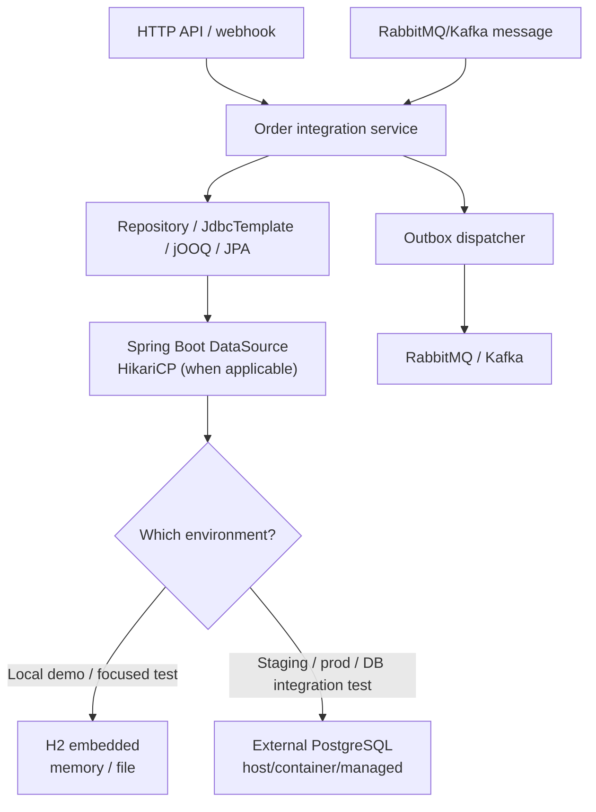
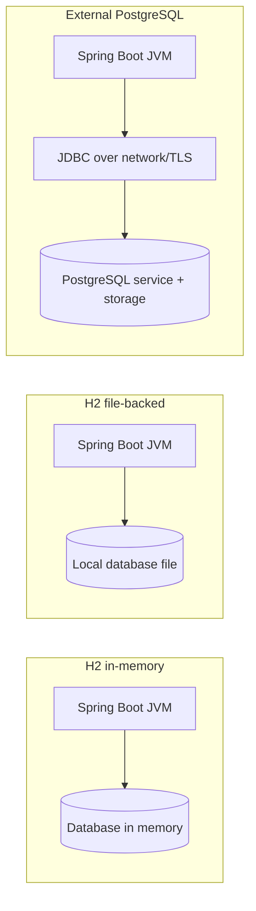
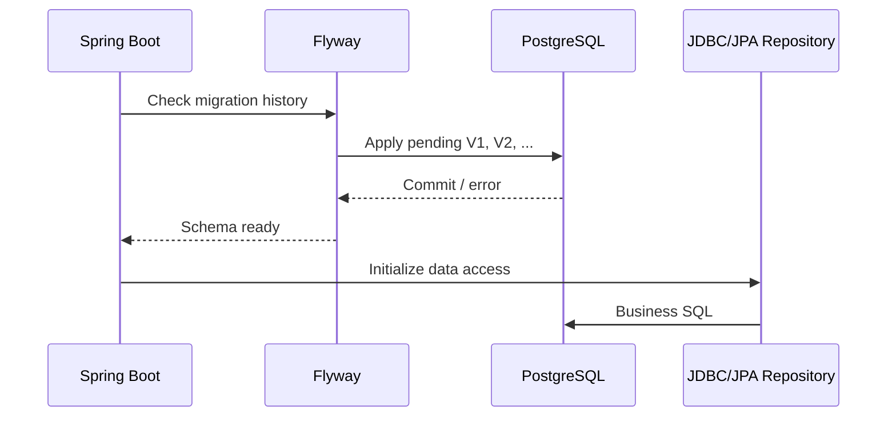
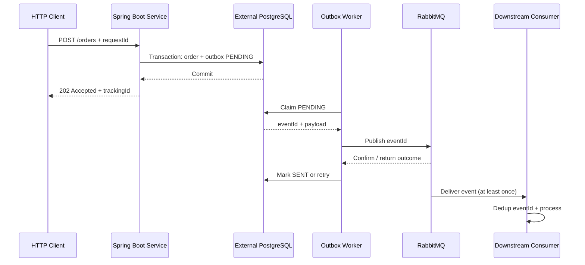
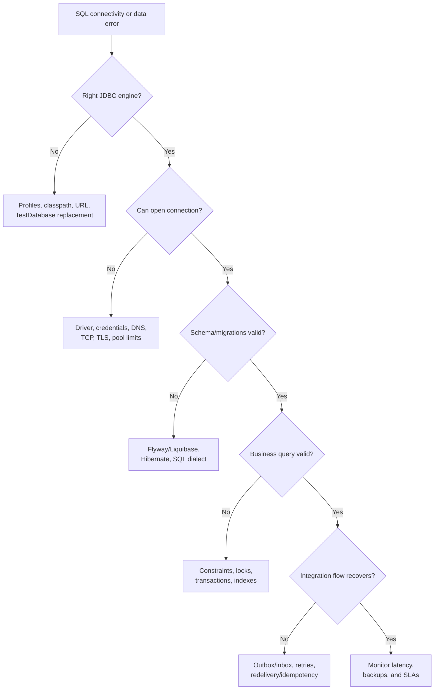

# Distinguishing Embedded Databases from External Database Management Systems

## 1. Why Must You Distinguish Them Up Front When Designing SQL Connectivity?

In the **SPRING_BOOT_INTEGRATION** module, a Spring Boot application does more than call HTTP clients or consume broker messages—it also needs persistence to coordinate multiple systems: synchronization state, inbox tables to block duplicate processing, outbox records staged for publishing, and core business data. A seemingly small choice—using an **embedded database** versus an **external database management system (DBMS)**—affects data lifecycles, JDBC URLs, connection pools, testability, security, deployment, and crash recovery.

Two common scenarios:

- A developer runs the Spring Boot service with **H2 in-memory** on a laptop. The database lives inside the process and typically loses its data when the process stops. Configuration is minimal, fitting quick smoke tests and demos.
- The same service in staging/production connects to **PostgreSQL** running in a container, VM, or managed database service outside the JVM. The database server has its own lifecycle, administration, network connections, and access controls; data persists across application restarts.

Green tests against H2 **do not automatically prove** the application will work properly on PostgreSQL or MySQL. Conversely, integration tests using a real PostgreSQL container deliver far higher fidelity for SQL dialects, migrations, locks, constraints, and connection behavior, though they are heavier than unit tests.

### Lesson Objectives

After this lesson, you will be able to:

1. Distinguish embedded database engines, in-memory storage, file-backed storage, and external DBMS servers.
2. Explain how Spring Boot detects embedded databases and constructs a `DataSource`.
3. Configure H2 explicitly for short-lived experiments and PostgreSQL for external environments.
4. Avoid confusing **database lifetime** with **JVM lifetime**, **connection lifetime**, or Docker container state.
5. Distinguish `schema.sql`/`data.sql` scripts, JPA schema generation, and Flyway/Liquibase migrations.
6. Decide when H2 suffices as a test double and when Testcontainers with the production DBMS is required.
7. Protect JDBC secrets, TLS connections, pools, readiness, migrations, and data durability across restarts.
8. Apply these choices to an HTTP → SQL → broker flow with idempotency and recoverability.

> Scope: Java 17+, Spring Boot 3.x, Spring Framework 6.x, JDBC/HikariCP, H2, and PostgreSQL. Configuration properties and auto-configuration capabilities can vary across major versions; always verify against the Spring Boot BOM, driver, and server version in use.

## 2. Definition: Embedded Is a Deployment Model, Not a Synonym for In-Memory

An **embedded database** is a database engine running inside or alongside the application process, requiring no standalone DBMS server for normal queries. In Java, familiar choices include **H2**, **HSQLDB**, and **Apache Derby** in embedded mode.

An **external DBMS** runs in an independent process or service that the application connects to over a wire protocol. PostgreSQL, MySQL/MariaDB, and Microsoft SQL Server are common examples.

**In-memory** describes where data primarily lives. It is not synonymous with embedded:

- H2 **in-memory**: engine runs inside the JVM; data is generally lost when the JVM shuts down.
- H2 **file-backed embedded**: engine runs inside the JVM while persisting data to disk files; data can survive restarts if files remain intact and are closed/recovered properly.
- H2 **server mode**: the same H2 engine running as a separate server process accepting TCP connections; operationally closer to an external DBMS.
- PostgreSQL in local Docker: **still an external DBMS outside the JVM**, even when container and app share the same machine.
- Managed cloud PostgreSQL: external DBMS with managed operations, backups, networking, credentials, and SLAs.

A database does not become "embedded" just because it runs on `localhost`. The defining criteria are **which process owns the engine and lifecycle, how connections travel, and who owns the data**.

## 3. High-Level Comparison of the Two Models

| Criterion | Embedded database (e.g., H2 embedded) | External DBMS (e.g., PostgreSQL) |
| --- | --- | --- |
| Where does the engine run? | Same JVM/process as the application | Independent database process/service |
| Access path | JDBC calls in-process engine | JDBC driver connects to server |
| Needs server before app starts? | Usually no | Yes; requires endpoint and login access |
| Storage | In-memory or file-backed, per URL | Disk/managed storage, per DBMS |
| Lifecycle | Usually tied to JVM/connections/files | Independent of app; separate operational policies |
| Sharing across replicas | Usually unsuitable directly | Designed for multiple clients/processes |
| Network/TLS | Embedded mode normally needs no network | Requires network policies, TLS, credentials |
| Backup/restore/HA | Usually handled by app/file owner | DBMS tools/policies, HA/replication |
| SQL dialect | H2/HSQLDB/Derby dialect | PostgreSQL/MySQL/SQL Server dialect |
| Constraints/indexes/locking | Present, but behavior differs from production DBMS | Matches production engine/version |
| Test startup | Usually very fast | Provisioning overhead; Testcontainers isolates well |
| Production usage | Fits narrow use cases; durability must be evaluated | Standard for multi-instance services |
| Multi-app scaling | Limited for embedded/file engines | Apps and DB scale and are managed separately |

**There is no absolute rule that "embedded is test-only, external is prod-only."** File-backed H2 can fit a small desktop or appliance app if backups and concurrency are handled properly. Conversely, an external DBMS via Testcontainers is often ideal for integration testing.

## 4. Connectivity Structure in Spring Boot Integration



Layers to separate clearly:

1. **Database engine**: H2 vs. PostgreSQL, process/lifecycle, and persistence guarantees.
2. **JDBC Driver**: implements `java.sql` protocols for the exact engine (`org.h2.Driver` vs. `org.postgresql.Driver`).
3. **`DataSource`**: factory/pool supplying JDBC `Connection` objects.
4. **Spring data access**: `JdbcTemplate`, `JdbcClient`, Spring Data JDBC/JPA, jOOQ, or another library.
5. **Schema manager**: `schema.sql`, Hibernate DDL, or migration tool.
6. **Business integration**: idempotency keys, SQL transactions, inbox/outbox, retries, and message handling.

A successfully initialized `DataSource` **does not prove** the schema is valid, the database is business-ready, or retries/message publishing are safe.

## 5. Embedded Databases Commonly Detected by Spring Boot

In Spring Boot 3.x, JDBC DataSource auto-configuration detects specific embedded databases on the classpath, notably:

| Engine | JDBC driver | Illustrative URL |
| --- | --- | --- |
| H2 | `org.h2.Driver` | `jdbc:h2:mem:orders` |
| HSQLDB | `org.hsqldb.jdbc.JDBCDriver` | `jdbc:hsqldb:mem:orders` |
| Apache Derby | Derby-version-appropriate driver | `jdbc:derby:memory:orders;create=true` |

**Do not assume every embedded database is auto-detected identically by Spring Boot.** SQLite is also a popular embedded engine, yet it is not included in JDBC `DataSourceAutoConfiguration`'s default embedded set; it typically needs explicit dependencies, JDBC URL/driver config, and custom dialect adjustments.

### Detection Conditions to Watch

When `spring-boot-starter-jdbc` (or equivalent dependency) and an embedded DB driver are on the classpath, **no higher-priority connection config exists**, and auto-configuration conditions match, Spring Boot can auto-create an embedded `DataSource` without an explicit URL.

However:

- A user-defined `DataSource` bean exists → auto-configuration can back off.
- An R2DBC `ConnectionFactory` is configured → JDBC `DataSource` auto-configuration conditions may not match; understand which stack is selected.
- Multiple embedded drivers sit on the runtime classpath → automatic selection may not pick what you expect; never rely on accidental ordering.
- `spring.datasource.url` or other connection details are provided → Boot uses the configured source under corresponding rules.
- A runtime containing both PostgreSQL and H2 drivers while **missing a real JDBC URL** can silently fall back to H2 unless environment config guards against it.

**Rule of thumb:** small demos and focused tests can rely on auto-detection; staging and production must use explicit, verified database configuration.

## 6. Basic Dependencies for JDBC and H2

Maven example for Spring Boot (versions managed by BOM):

```xml
<dependencies>
    <dependency>
        <groupId>org.springframework.boot</groupId>
        <artifactId>spring-boot-starter-jdbc</artifactId>
    </dependency>
    <dependency>
        <groupId>com.h2database</groupId>
        <artifactId>h2</artifactId>
        <scope>runtime</scope>
    </dependency>
</dependencies>
```

Gradle:

```groovy
dependencies {
    implementation 'org.springframework.boot:spring-boot-starter-jdbc'
    runtimeOnly 'com.h2database:h2'
}
```

If H2 is solely for testing, place it in **test scope** rather than shipping it on the production classpath:

```xml
<dependency>
    <groupId>com.h2database</groupId>
    <artifactId>h2</artifactId>
    <scope>test</scope>
</dependency>
```

```groovy
testRuntimeOnly 'com.h2database:h2'
```

Never add H2 as a runtime dependency in production builds just because tests use it. Test scope reduces the risk of production silently starting on H2 if a database environment variable is missing.

**JPA starter differs from JDBC starter:** `spring-boot-starter-data-jpa` already pulls in JDBC/`DataSource` infrastructure in standard setups, while adding ORM/Hibernate and entity lifecycles. This lesson focuses on **SQL connectivity**; the same embedded-vs-external selection rules affect JDBC, jOOQ, and JPA alike.

## 7. H2 In-Memory: Usage and When Data Disappears

Example `application-local.yml`:

```yaml
spring:
  datasource:
    url: jdbc:h2:mem:orders;DB_CLOSE_DELAY=-1
    driver-class-name: org.h2.Driver
    username: sa
    password: ""
  sql:
    init:
      mode: always
```

Understanding the URL:

- `jdbc:h2:` identifies H2 JDBC.
- `mem:orders` is a **named in-memory** database scoped to the JVM/classloader/H2 settings.
- `DB_CLOSE_DELAY=-1` keeps the in-memory database alive after the last connection closes **until the JVM exits**; this is an H2 option, not a universal JDBC property.
- `username: sa` and an empty password are simple local demo credentials, never a production account pattern.
- `spring.sql.init.mode=always` tells Spring Boot to run SQL initialization scripts when applicable; avoid mixing it with Flyway/Hibernate schema management.

### Common Mistake: Expecting Data to Survive Restarts

```text
Startup #1
  Spring Boot JVM
    H2 mem:orders  --> INSERT eventId=evt-1001
  Stop JVM
    in-memory state is lost

Startup #2
  Spring Boot JVM
    H2 mem:orders  --> new database; row evt-1001 absent
```

Never use H2 in-memory as a **system of record** for real outbox/inbox tables if crash recovery is required. An in-memory queue or H2 in-memory DB can make a "publish later" demo appear to work while wiping all pending intents on restart.

### Why Does Data Sometimes Vanish During a Single Run?

With in-memory databases, the database name, open connections, `DB_CLOSE_DELAY`, and classloader scope govern lifecycle. Without keeping the DB alive after the last connection closes, closing all connections can destroy the database and recreate an empty one on the next borrow. Use explicit URLs and **never** treat H2's lifecycle behavior as a universal contract for external DBMS servers.

## 8. H2 File-Backed: Embedded Yet Persisted to Disk

Example:

```yaml
spring:
  datasource:
    url: jdbc:h2:file:./data/orderdb
    driver-class-name: org.h2.Driver
    username: sa
    password: ""
```

Differences compared to `mem:`:

- Data and metadata are written to disk files per H2's storage engine, **able to survive restarts** if disk/path persists and the database closes/recovers cleanly.
- `./data/orderdb` is a **relative path from the process working directory**, not always relative to the YAML file location.
- Database files can lock when two processes open them in embedded mode; multi-process access requires explicitly supported H2 modes rather than assuming multiple replicas can share one file on a shared volume.
- File permissions (`chmod`), ownership, disk space, crash recovery, backups, encryption, and restores become your operational responsibilities.
- In Kubernetes, files stored on an **ephemeral container filesystem** vanish when pods are replaced, even though the engine is file-backed. Persistence requires proper volumes and backup/restore strategies.

Thus, **file-backed does not automatically equal SLA-grade durability**. Durability requires durable storage, write synchronization, transactions, and tested recovery procedures. Separate "writes to a file" from "recovers reliably."

### Embedded Databases Across Multiple Replicas Are an Architectural Risk

Running three replicas where each uses `jdbc:h2:file:./data/orderdb` on its own filesystem creates **three independent databases**, not one shared database. If each replica runs its own outbox, state and idempotency split apart. Workloads needing shared state belong on a standalone DBMS server.

## 9. H2 Console: Local Tool, Not a Production UI

When using H2 in dev alongside a supported web stack, Spring Boot can enable the H2 console (depending on versions/dependencies):

```yaml
spring:
  h2:
    console:
      enabled: true
      path: /h2-console
```

**Never expose the H2 console publicly in production.** It provides a raw SQL interface that can expose data/metadata or permit arbitrary modifications if credentials leak. Spring Security, firewall, CSRF, and frame-header exemptions needed locally must never be copied into production runtimes.

When connecting the console to H2 in-memory, enter the **exact same JDBC URL** used by the app (e.g., `jdbc:h2:mem:orders;DB_CLOSE_DELAY=-1`); otherwise you open a separate empty database and wonder why tables "disappeared."

Never use the console as a substitute for migration scripts. Every schema must be reproducible in CI and fresh environments.

## 10. External PostgreSQL: What Must Be Prepared?

A PostgreSQL server—whether on a laptop, VM, or managed cloud—has an independent lifecycle. Spring Boot needs at minimum:

1. **Host, port, and database name**.
2. **Credentials** with sufficient yet minimal privileges.
3. Compatible **JDBC driver**.
4. **Network reachability**: DNS, firewalls, security groups, private networking.
5. **TLS/trust configuration** when required by environment policy.
6. **Schema migrations** and table creation/alter permissions per deployment policy.
7. **Connection pool limits**, timeouts, and readiness checks.
8. **Backups/restores, monitoring, retention, and failure recovery** owned by the DB/platform team.

Maven example:

```xml
<dependencies>
    <dependency>
        <groupId>org.springframework.boot</groupId>
        <artifactId>spring-boot-starter-jdbc</artifactId>
    </dependency>
    <dependency>
        <groupId>org.postgresql</groupId>
        <artifactId>postgresql</artifactId>
        <scope>runtime</scope>
    </dependency>
</dependencies>
```

Gradle:

```groovy
dependencies {
    implementation 'org.springframework.boot:spring-boot-starter-jdbc'
    runtimeOnly 'org.postgresql:postgresql'
}
```

**Do not include H2** in a PostgreSQL production runtime deployment. If H2 exists for testing, verify its dependency scope and ensure the production profile fails fast if endpoints are missing.

## 11. `application-prod.yml`: Explicit Connections and External Secrets

Example `application-prod.yml`:

```yaml
spring:
  datasource:
    url: ${DB_JDBC_URL}
    username: ${DB_USERNAME}
    password: ${DB_PASSWORD}
    driver-class-name: org.postgresql.Driver
    hikari:
      maximum-pool-size: 12
      minimum-idle: 2
      connection-timeout: 5s

  sql:
    init:
      mode: never

  jpa:
    hibernate:
      ddl-auto: validate
```

Here:

- `DB_JDBC_URL` might be `jdbc:postgresql://db.internal.example:5432/orders` in a matching environment.
- Never commit real passwords to Git; inject via a secret manager, workload identity, or deployment-controlled environment variables.
- `driver-class-name` can usually be inferred by Spring Boot from the JDBC URL, though declaring it explicitly can guard against misconfigured URLs. It does not fix a missing driver dependency.
- `HikariCP` is the standard default pool when present on the classpath and conditions match. Benchmark pool values against replica counts and DB connection limits.
- `spring.sql.init.mode=never` disables default script initialization in this profile; Flyway/Liquibase migrations run separately.
- `ddl-auto=validate` only applies when the app uses JPA/Hibernate; in JDBC-only apps it neither generates nor validates schemas.

To fail fast when the DB endpoint is missing, omit `localhost` or `jdbc:h2:mem` fallbacks in production properties. Missing configuration should trigger a clear deployment failure rather than silently connecting to the wrong database.

### Docker Hostnames Depend on Where the App Runs

If the app runs **on the host** while PostgreSQL runs in a container publishing a port, use the host/mapped port. If the app runs **inside the same Docker Compose network**, the hostname is typically the Compose service name, such as `postgres`, with the container port. Never copy `localhost:5432` into an application container expecting it to reach a separate PostgreSQL container; `localhost` inside a container refers to that container itself.

## 12. Most Important Distinction: Data Lifecycle and Failure Boundaries



Understanding failures:

| Scenario | H2 in-memory | H2 file-backed | External PostgreSQL |
| --- | --- | --- | --- |
| App process restarts | State usually lost | State may remain if file intact & valid | State remains if DB service/storage intact |
| App replica replaced | Replica-local data lost | Lost if disk is ephemeral | New pod reconnects to same DB if configured properly |
| DB engine stops | Usually stops with JVM | Usually stops with JVM | Can stop independently of app |
| Network outage between app & DB | Embedded normally uses no network | Embedded normally uses no network | Timeouts, resets, connection refused |
| Concurrent multi-app reads/writes | Hard to share safely | File-lock/concurrency limitations | Built for many concurrent DB clients |
| Backup/restore | No durable state if memory-only | Must back up files properly | DBMS backup/WAL/PITR per engine |
| Read replicas/HA | Not like a DBMS server | Not like a DBMS server | Supports replication/failover if deployed |

**Separate app failures from DB failures:** PostgreSQL keeps running when a Java pod crashes, yet a network outage still cuts the app off from the DB. Client retry logic must respect transaction outcomes and idempotency rather than assuming every network error means a write never happened.

## 13. A JDBC URL Is More Than a Host String: It Chooses the Engine and Semantics

Illustrative URLs:

```text
jdbc:h2:mem:orders;DB_CLOSE_DELAY=-1
jdbc:h2:file:./data/orderdb
jdbc:postgresql://db.internal.example:5432/orders
jdbc:mysql://mysql.internal.example:3306/orders
```

Each URL targets a distinct driver and engine. **Never take an H2 JDBC URL and swap `h2` for `postgresql`**; syntax, connection options, SQL dialects, auth/TLS, and database lifecycles differ completely.

Some JDBC URLs allow username/password as query parameters. Best practice is **keeping secrets out of URLs whenever credentials can be configured separately**, preventing leaks via logs, stack traces, process inspection, or deployment metadata.

When an application uses multiple datasources, each needs clear identity and bean ownership: datasource name, credentials, pool, transaction manager, repository/jOOQ contexts, and schema migrations. A single default `spring.datasource.url` cannot describe two independent databases.

## 14. How Do `DataSource`, `Connection`, and Connection Pools Differ?

A `DataSource` is an object used to acquire JDBC `Connection` instances; it is not a single JDBC connection. In Spring Boot, `DataSourceAutoConfiguration` creates a pooled DataSource (typically HikariCP) when conditions are met.

Example:

```java
import javax.sql.DataSource;
import java.sql.Connection;
import java.sql.DatabaseMetaData;

import org.springframework.stereotype.Component;

@Component
public class DatabaseDiagnostics {

    private final DataSource dataSource;

    public DatabaseDiagnostics(DataSource dataSource) {
        this.dataSource = dataSource;
    }

    public String databaseProduct() throws Exception {
        try (Connection connection = dataSource.getConnection()) {
            DatabaseMetaData metaData = connection.getMetaData();
            return metaData.getDatabaseProductName();
        }
    }
}
```

This method reads metadata to confirm the **actual engine** (e.g., `H2` or `PostgreSQL`). Never log full JDBC URLs or credentials. In multi-datasource apps, inject a specific bean with `@Qualifier` instead of relying blindly on defaults.

Using `try-with-resources` with a pooled datasource **returns the connection to the pool** on `close()`, rather than closing the physical TCP connection right away. That lets identical Java code operate across embedded and external JDBC, even though connection counts, latencies, and failure modes differ.

### Pool Capacity and DB Server Limits Constrain Each Other

Suppose an app runs 5 replicas, each with Hikari max 20 connections: theoretically it can request ~100 connections to PostgreSQL, excluding maintenance jobs, migrations, admin tools, and other services. If the database allows only 80 connections, 20 per replica will fail even though "20" looks small.

With embedded H2, a large pool may pass tests on a single machine without reproducing server contention across replicas. Tune pools based on real concurrency and DB operational limits.

## 15. Readiness: Having a `DataSource` Bean Does Not Mean the Database Is Ready

An application context can create a `DataSource` bean without yet opening a real connection, or startup health checks might test only part of the stack.

Distinct readiness milestones:

1. JDBC driver exists on the classpath.
2. Spring creates the `DataSource` bean.
3. Pool acquires a physical connection.
4. Credentials are accepted.
5. A probe query `SELECT 1` succeeds.
6. Migrations/schema match the expected version.
7. Business queries/transactions succeed under runtime permissions and data constraints.
8. The full HTTP → database → message broker flow runs and recovers cleanly.

Embedded H2 skips network and secret hurdles, so it **never tests** network partitions, TLS verification, firewalls, DNS, or primary failover of a real PostgreSQL cluster.

For external DBMSs, configure appropriate readiness/health checks and alerts. Never spin in an infinite connection retry loop that hides a broken production config; enforce timeouts, backoff, and deadlines, distinguishing transient errors from bad credentials or missing schemas.

## 16. Practicing with `JdbcTemplate`: Business Code Stays Engine-Agnostic

Example service recording processed events:

```sql
CREATE TABLE processed_event (
    source_system VARCHAR(80) NOT NULL,
    event_id VARCHAR(120) NOT NULL,
    processed_at TIMESTAMP WITH TIME ZONE NOT NULL,
    PRIMARY KEY (source_system, event_id)
);
```

`JdbcTemplate` pattern:

```java
import java.time.OffsetDateTime;

import org.springframework.jdbc.core.JdbcTemplate;
import org.springframework.stereotype.Repository;

@Repository
public class ProcessedEventRepository {

    private final JdbcTemplate jdbc;

    public ProcessedEventRepository(JdbcTemplate jdbc) {
        this.jdbc = jdbc;
    }

    public void markProcessed(
            String source, String eventId, OffsetDateTime now) {
        jdbc.update(
            """
            INSERT INTO processed_event
              (source_system, event_id, processed_at)
            VALUES (?, ?, ?)
            """,
            source, eventId, now
        );
    }

    public boolean exists(String source, String eventId) {
        Integer count = jdbc.queryForObject(
            """
            SELECT COUNT(*) FROM processed_event
            WHERE source_system = ? AND event_id = ?
            """,
            Integer.class, source, eventId
        );
        return count != null && count > 0;
    }
}
```

`JdbcTemplate` uses the Spring-supplied `DataSource`; the code avoids building JDBC URLs and uses **bind parameters** instead of string concatenation.

Still, this is **not yet a concurrency-safe idempotency implementation**: two consumers can concurrently read `exists == false` and both call `markProcessed`. The `PRIMARY KEY(source_system, event_id)` enforces race protection at the database; business code must handle unique conflicts as duplicates **inside the right transaction** and keep business side effects within that same boundary.

In PostgreSQL you can use `INSERT ... ON CONFLICT DO NOTHING`; syntax and behavior differ across engines, so test on the real engine. Never assume generic exception catching behaves identically across all DBMSs on unique conflicts.

## 17. Running `schema.sql` and `data.sql` in Spring Boot

Spring Boot can execute scripts like `schema.sql` and `data.sql` depending on configuration and conditions. Spring Boot 3.x properties:

```yaml
spring:
  sql:
    init:
      mode: embedded
      continue-on-error: false
```

In principle:

- `mode: embedded` (the common default) runs initialization when the datasource is detected as **embedded**.
- `mode: always` initializes even non-embedded databases when scripts exist and conditions match.
- `mode: never` disables the script initializer.
- `continue-on-error: false` ensures startup fails if a SQL script errors rather than silently ignoring it.
- `schema.sql`/`data.sql` are application resource scripts; platform-specific script names and path options vary by version.

**Avoid running non-idempotent table-creation scripts on every production startup.** When multiple replicas boot together, or tables already exist, startup can fail or race.

A simple app using H2 in-memory may fit quick demo scripts. Production systems with multiple environments and schema evolution need versioned migrations.

### H2 and PostgreSQL Do Not Always Understand the Same Script

A `schema.sql` using H2-specific syntax can fail on PostgreSQL. Conversely, PostgreSQL offers `JSONB`, `ON CONFLICT`, partial indexes, and DDL features H2 does not match identically. If maintaining platform-specific scripts, test against the **actual target engine** instead of assuming all SQL is portable.

## 18. Hibernate `ddl-auto`: Why Defaults Differ Between Embedded and External

With Spring Data JPA/Hibernate:

```yaml
spring:
  jpa:
    hibernate:
      ddl-auto: validate
```

Common values:

| Value | Primary meaning | Remarks |
| --- | --- | --- |
| `none` | Do not modify schema automatically | Appropriate when Flyway/Liquibase owns the schema |
| `validate` | Validate entity mappings against existing schema | Catches entity/table drift; creates no tables |
| `update` | Attempts to alter schema to match models | Not a replacement for migrations; risky to control |
| `create` | Creates schema from mappings | Destructive to existing data; use deliberately |
| `create-drop` | Creates and drops schema with `SessionFactory` lifecycle | Useful for certain tests/demos; dangerous against real DBs |

In typical Spring Boot 3.x setups, when **no schema manager like Flyway/Liquibase is detected**, Boot may default to `create-drop` for embedded databases and `none` for external databases. However, **this is conditional behavior**, not an intrinsic property of H2 or PostgreSQL. Never rely on defaults to protect or wipe data.

For example, H2 tests might auto-generate tables via Hibernate while production PostgreSQL relies on Flyway. If an entity changes without a Flyway script, H2 tests stay green while production fails—a classic test blind spot.

**Configure `ddl-auto` explicitly** per profile with a single schema owner. For durable systems, `validate` paired with schema migrations catches model drift, though it never replaces real SQL integration tests.

## 19. Flyway or Liquibase: Versioned Schema History

For external databases shared across deployments, manage schema changes with **versioned migrations** such as Flyway or Liquibase instead of ad-hoc DDL at app startup.

Maven Flyway example:

```xml
<dependency>
    <groupId>org.flywaydb</groupId>
    <artifactId>flyway-core</artifactId>
</dependency>
```

Depending on newer Flyway versions and DBMSs, an additional database-specific module (such as `flyway-database-postgresql` in recent modularized Flyway releases) may be required. Let your compatible BOM manage versions and inspect startup logs to confirm the engine is recognized.

Example migration file `src/main/resources/db/migration/V1__create_processed_event.sql`:

```sql
CREATE TABLE processed_event (
    source_system VARCHAR(80) NOT NULL,
    event_id VARCHAR(120) NOT NULL,
    processed_at TIMESTAMP WITH TIME ZONE NOT NULL
        DEFAULT CURRENT_TIMESTAMP,
    PRIMARY KEY (source_system, event_id)
);

CREATE INDEX idx_processed_event_time
    ON processed_event (processed_at);
```

Typical startup sequence:



**Keep a single schema owner:**

- Flyway/Liquibase owns DDL history.
- If using JPA, `ddl-auto=validate` checks entity mappings after migrations.
- Never mix `schema.sql`, Hibernate `create-drop`, and Flyway altering the same tables on competing schedules.
- Test migrations on the production DBMS; passing on H2 does not prove DDL works on PostgreSQL.
- Existing data before a migration requires plans for backfills, locks, downtime, and rolling compatibility.
- In production, consider running migrations as a dedicated deployment step/job rather than granting DDL rights to every application replica.

Flyway does not automatically preserve compatibility between a v2 producer and v1 consumer during rolling deploys. For schemas shared across versions or services, follow **expand → migrate/backfill → contract** and test old/new versions coexisting during rollout.

## 20. When to Use `schema.sql`, Hibernate DDL, or Migrations?

| Situation | Better choice | Limitations to know |
| --- | --- | --- |
| Small disposable H2 table for a quick demo | `schema.sql`/`data.sql` | No versioned migration history |
| Isolated unit/component test with embedded DB | SQL init or migration test | May not match production SQL dialect |
| JPA prototype application | Intentional `ddl-auto=create-drop` | Unsafe for real data; mappings don't replace migrations |
| Production PostgreSQL with persistent data | Flyway/Liquibase or controlled schema provisioning | Requires privilege management and deploy ordering |
| Many replicas starting simultaneously | Clear migration job / locking strategy | Avoid competing or conflicting DDL runs |
| Altering an outbox table actively read by workers | Versioned migrations with backward compatibility | Do not break in-flight messages or workflows |
| Testing migration rollbacks | Test specific migrations on real DBMS | DDL transaction semantics vary across engines |

**Never leave auto-destructive schema modes enabled against databases you need to keep.** A test config accidentally activated against a production database is a severe outage, not merely a minor dev bug.

### Ordering Between Hibernate and `data.sql`

If a project lets Hibernate generate tables and wants `data.sql` to run afterward, Spring Boot provides `spring.jpa.defer-datasource-initialization=true` in supported versions. However, this is an **ordering hook**, not a long-term schema management strategy. When using Flyway/Liquibase, place versioned seed data in migrations or dedicated test-data setups.

## 21. "Standard" SQL May Still Behave Differently on H2 and PostgreSQL

H2 is useful for mapping checks, yet every DBMS has its own dialect, features, and optimizer. Differences that commonly impact Spring Boot Integration:

| Aspect | Embedded H2 | External PostgreSQL |
| --- | --- | --- |
| Upsert | H2 has its own extensions; compatibility mode has limits | `INSERT ... ON CONFLICT` is PostgreSQL-specific |
| JSON | Limited JSON support depending on H2 version | `json`/`jsonb`, dedicated operators, and GIN indexes |
| Identity/sequences | H2-specific auto-increment and sequences | `GENERATED ... AS IDENTITY`, sequences, PostgreSQL syntax |
| Case/identifiers | H2 folding/quoting rules | PostgreSQL folds unquoted identifiers to lowercase |
| Collation | Engine/setting dependent | ICU/libc/database locale and collation rules |
| Timestamp/time zone | H2 formatting and conversions | `timestamp` vs. `timestamptz` with explicit semantics |
| Locks/concurrency | Single process, H2 locking | MVCC, row-level locks, isolation, production contention |
| DDL transactions | H2-specific behavior | Most PostgreSQL DDL is transactional, with exceptions |
| Query planner | H2 optimizer | PostgreSQL planner, index statistics, `EXPLAIN` |
| Partial/expression indexes | Inconsistent support | Rich native PostgreSQL support |
| `FOR UPDATE SKIP LOCKED` | May behave differently or lack full support | Widely used for claiming outbox rows |
| Error codes/exceptions | H2 SQLState and vendor codes | PostgreSQL-specific SQLState/vendor codes |

Example:

```sql
INSERT INTO processed_event(source_system, event_id)
VALUES ('billing', 'evt-1001')
ON CONFLICT (source_system, event_id) DO NOTHING;
```

This statement is **PostgreSQL-specific**, and assumes `processed_at` has a default as in section 19's migration. Even if H2's compatibility mode parses similar syntax, **you cannot infer identical atomicity and concurrency semantics as PostgreSQL**.

Integration paths sensitive to duplicates and retries must be tested against the real database engine rather than just seeing "SQL threw no error."

## 22. How Far Does H2 `MODE=PostgreSQL` Go?

A common setting:

```yaml
spring:
  datasource:
    url: jdbc:h2:mem:orders;MODE=PostgreSQL;DB_CLOSE_DELAY=-1
    username: sa
    password: ""
```

H2 offers partial PostgreSQL syntax and behavior compatibility. It can help simple queries and DDL stay portable, yet:

1. The engine is still **H2**, not real PostgreSQL.
2. Transaction locking, concurrency, isolation, JSONB, indexes, sequences, extensions, and the query planner **are not equivalent**.
3. Compatibility levels vary across H2 versions.
4. It never tests PostgreSQL TCP, TLS, authentication, or network failures.
5. A query accepted by H2 is not guaranteed to work or return identical results on real PostgreSQL.
6. JDBC driver features, SQLState codes, and Hikari session initialization still differ.

**Use compatibility mode for local convenience**, not as final proof for production. Whenever a feature involves `INSERT ... ON CONFLICT`, `SKIP LOCKED`, `jsonb`, transactions, indexes, or migrations, test against real PostgreSQL.

## 23. Multi-Worker Synchronization: H2 Can Hide Race Conditions

Suppose two RabbitMQ consumers simultaneously receive `eventId=evt-1001`. If code writes:

```text
if (!repository.exists(eventId)) {
    performBusinessSideEffect();
    repository.save(eventId);
}
```

two workers can both observe "not found," both execute the side effect, and only then hit a unique conflict. `exists()` followed by `save()` **is not an atomic lock**.

A more reliable approach:

- Enforce a unique constraint on `(source_system, event_id)` in the database.
- Claim/deduplicate within the right transaction before or alongside business side effects.
- On PostgreSQL, `INSERT ... ON CONFLICT DO NOTHING RETURNING ...` can report whether the row was newly inserted.
- Never call HTTP/brokers assuming a SQL rollback can undo remote side effects.
- Test concurrent inserts against a **production-compatible database** and measure transaction outcomes.
- Reuse stable event IDs when retrying after database timeouts.

Single-threaded in-memory H2 tests can make the entire flow look "correct" simply because there is no contention, missing multi-replica/multi-consumer claim races completely.

### Example PostgreSQL Idempotent Claim

```sql
INSERT INTO processed_event(
    source_system, event_id, processed_at
)
VALUES (
    'billing', 'evt-1001', CURRENT_TIMESTAMP
)
ON CONFLICT (source_system, event_id)
DO NOTHING
RETURNING event_id;
```

The literals `'billing'` and `'evt-1001'` are for direct PostgreSQL illustration; in `JdbcTemplate`, use `?` placeholders and bind parameters instead of concatenating values into SQL. More importantly, recording "processed" before side effects **outside the same transaction** can lose work on crashes; design inbox statuses, claims/leases, and idempotency carefully rather than treating one SQL query as a complete solution.

## 24. Fast Tests on H2: Know Exactly What You Are Proving

In Spring Boot Test, `@JdbcTest` and `@DataJpaTest` provide data-access test slices. In many configurations/versions, test slices **replace the configured database with an embedded datasource** if an embedded driver is on the classpath, unless you explicitly opt out.

Example `JdbcTemplate` test running with an H2 profile/test dependencies:

```java
import static org.assertj.core.api.Assertions.assertThat;

import java.sql.Connection;
import javax.sql.DataSource;

import org.junit.jupiter.api.Test;
import org.springframework.beans.factory.annotation.Autowired;
import org.springframework.boot.test.autoconfigure.jdbc.JdbcTest;

@JdbcTest
class EmbeddedJdbcSmokeTest {

    @Autowired
    DataSource dataSource;

    @Test
    void dataSourceIsH2InThisTestConfiguration() throws Exception {
        try (Connection connection = dataSource.getConnection()) {
            assertThat(connection.getMetaData().getDatabaseProductName())
                .isEqualTo("H2");
        }
    }
}
```

This test verifies the **actual test DataSource** is H2. It does not test production migrations, JSONB queries, SQL locking, network/TLS, or multi-replica behavior.

Prerequisites to run:

- `spring-boot-starter-test`, the JDBC starter, and H2 on the test classpath.
- Matching auto-configuration in the test context; otherwise provide explicit datasource configuration.
- With multiple `DataSource` beans, specify the target bean explicitly rather than relying on defaults.
- If Flyway runs in the slice, migrations must be H2-compatible or scoped appropriately.

**Never treat a green `@JdbcTest` as proof for production PostgreSQL.** It only confirms Spring/JDBC wiring and portable SQL ran against H2.

## 25. When Slice Tests Replace the DataSource: Avoid False Conclusions

For repository-focused tests, Spring Boot offers `@AutoConfigureTestDatabase`. If you **intentionally** want PostgreSQL Testcontainers instead of embedded replacement:

```java
import org.springframework.boot.test.autoconfigure.jdbc.AutoConfigureTestDatabase;

@AutoConfigureTestDatabase(
    replace = AutoConfigureTestDatabase.Replace.NONE
)
```

This annotation is an **add-on to a slice test class** (such as `@JdbcTest`/`@DataJpaTest`), not a standalone test marker.

Note changes across Spring Boot 3.x: newer versions add replacement modes like `NON_TEST` that detect test database connections, changing default behavior. `Replace.NONE` explicitly keeps your configured datasource, though you must still ensure connection details/Testcontainers are actually wired.

### A Common Trap

1. A test starts a PostgreSQL container in `@BeforeAll`.
2. The slice test silently swaps the `DataSource` to H2 because the H2 driver is on the classpath.
3. Assertions pass, and the developer thinks PostgreSQL was tested.
4. Production fails on `ON CONFLICT`, sequences, locks, or `JSONB`.

Solution: in at least one critical integration test, **assert the database product name** or exercise a PostgreSQL-specific feature to prove the test actually ran against the right engine.

## 26. PostgreSQL Testcontainers: Testing Against a Real DBMS

Testcontainers launches an isolated PostgreSQL container, usually mapped to a dynamic host port to avoid conflicts on developer laptops and CI runners. With Spring Boot service connections, you may not even need to manually construct `spring.datasource.url`.

Maven dependency example (align Testcontainers artifacts with your BOM/version; common structure for Spring Boot 3.x/Testcontainers 1.x):

```xml
<dependencies>
    <dependency>
        <groupId>org.springframework.boot</groupId>
        <artifactId>spring-boot-testcontainers</artifactId>
        <scope>test</scope>
    </dependency>
    <dependency>
        <groupId>org.testcontainers</groupId>
        <artifactId>junit-jupiter</artifactId>
        <scope>test</scope>
    </dependency>
    <dependency>
        <groupId>org.testcontainers</groupId>
        <artifactId>postgresql</artifactId>
        <scope>test</scope>
    </dependency>
</dependencies>
```

These test dependencies supplement `spring-boot-starter-test`, `spring-boot-starter-jdbc`, the PostgreSQL JDBC driver, and Flyway if used.

A Spring Boot integration test:

```java
import static org.assertj.core.api.Assertions.assertThat;

import org.junit.jupiter.api.Test;
import org.springframework.beans.factory.annotation.Autowired;
import org.springframework.boot.test.context.SpringBootTest;
import org.springframework.boot.testcontainers.service.connection.ServiceConnection;
import org.springframework.jdbc.core.JdbcTemplate;
import org.testcontainers.containers.PostgreSQLContainer;
import org.testcontainers.junit.jupiter.Container;
import org.testcontainers.junit.jupiter.Testcontainers;

@SpringBootTest
@Testcontainers
class PostgreSqlConnectivityIT {

    @Container
    @ServiceConnection
    static PostgreSQLContainer<?> postgres =
        new PostgreSQLContainer<>("postgres:16-alpine")
            .withDatabaseName("orders_test")
            .withUsername("orders_test")
            .withPassword("test_only_password");

    @Autowired
    JdbcTemplate jdbc;

    @Test
    void usesRealPostgreSqlAndMigratedSchema() {
        String database = jdbc.queryForObject(
            "SELECT current_database()", String.class
        );
        assertThat(database).isEqualTo("orders_test");

        Long rows = jdbc.queryForObject(
            "SELECT COUNT(*) FROM processed_event",
            Long.class
        );
        assertThat(rows).isNotNull();
    }
}
```

This assumes `processed_event` was created by a migration like section 19 during test context startup. If the project has not configured migrations, the test must initialize the schema explicitly; do not mistake "table not found" for a connection failure.

**What `@ServiceConnection` solves:** Spring Boot receives container-provided `JdbcConnectionDetails` (JDBC URL/username/password, mapped port) for Boot-managed datasources. It **does not modify `spring.datasource.url` in the `Environment`** and does not automatically configure custom `DataSource` beans written manually.

**What it does not solve:** migrations, unique constraints, concurrency, timeouts, backups, broker publishing, or idempotency. Those require dedicated integration tests.

## 27. Comparing Cost and Fidelity Across Test Layers

A sensible strategy is not "replace every test with Testcontainers," but matching fidelity to what each test needs to prove.

| Test layer | Database to use | Proves | Does not prove |
| --- | --- | --- | --- |
| Domain rule unit test | No DB, fake repository | Pure business rules and error classification | SQL, driver, migrations |
| Simple JDBC component test | Embedded H2 | Portable SQL mapping, bean wiring | PostgreSQL-specific behavior |
| Production-critical repository test | PostgreSQL Testcontainers | Real engine queries/constraints/migrations | Cluster failover and production load |
| Outbox integration test | PostgreSQL + broker | Commit → publish, duplicates, retries, acks | Multi-region deployment topologies |
| Staging end-to-end | Production-like DB service | DNS/TLS, credentials, deployment, topology | Every failure path / peak load |
| Load/failover test | Topology-matched isolated env | Pool saturation, locks, timeouts, replica lag | Every conceivable production failure |

**Never call H2 a "mock PostgreSQL" as if it were an exact stand-in.** It is a separate test engine. For anything relying on PostgreSQL behavior—advisory locks, `jsonb`, `SKIP LOCKED`, materialized views, or `ON CONFLICT`—test against PostgreSQL.

### Testcontainers Lifecycle Hygiene

- Use static `@Container` with `@Testcontainers` for JUnit extension management as shown above.
- Spring Boot service connections read details from containers; the annotation **does not mean every test container starts identically in all setups**.
- Spring Test context caching and differing container lifecycles across test classes can leave a cached context holding a `DataSource` pointed at a stopped container; design sharing/caching intentionally.
- CI Docker runners need sufficient permissions and resources, pinned image versions, and compliance with security policies.
- Never use real production PostgreSQL credentials or data in Testcontainers.

## 28. Local Docker Compose: External Database with Simple Dev Setup

If developers prefer real PostgreSQL daily, run it with Docker Compose instead of H2:

```yaml
services:
  postgres:
    image: postgres:16-alpine
    environment:
      POSTGRES_DB: orders
      POSTGRES_USER: app
      POSTGRES_PASSWORD: local_only_password
    ports:
      - "5432"
```

`ports: ["5432"]` lets Docker publish container port 5432 on a **dynamic host port** in this Compose syntax. If you intentionally need a fixed port for external SQL tools, map it explicitly and manage port conflicts.

In supported Spring Boot versions, the development dependency:

```groovy
dependencies {
    developmentOnly 'org.springframework.boot:spring-boot-docker-compose'
}
```

lets Boot detect/start Compose services and provide typed `JdbcConnectionDetails`. This is **development support**, not an automated way to run production PostgreSQL.

### Distinguishing Three Local Connection Paths

| Approach | Who provides the JDBC URL? | Nature |
| --- | --- | --- |
| Embedded H2 | Boot auto-detects embedded or you set `jdbc:h2:...` | In-JVM engine |
| Manual Docker Compose PostgreSQL | User/config sets host and published port | External DBMS |
| Spring Boot Docker Compose service connection | Boot reads details from supported Compose services | Still external PostgreSQL, not H2 |
| PostgreSQL Testcontainers | Container + `@ServiceConnection` or `@DynamicPropertySource` | External DBMS for tests; clear ephemeral lifecycle |

When Compose support is active, understand its **lifecycle**: when the app starts/stops Compose services, whether services are shared or reused, and whether stopping the app affects other developer processes. Do not assume a Docker database wipes itself when the JVM exits—persistent volumes, container lifecycles, and Compose policies decide.

## 29. External DBMSs Introduce New Failure Modes

With embedded H2, a JDBC call rarely encounters DNS, TCP, or TLS issues. With remote PostgreSQL, failures can stem from:

1. Misconfigured DNS or service discovery.
2. Firewalls, security groups, or network policies blocking ports.
3. Expired TLS certs, broken trust chains, or hostname mismatches.
4. Wrong username/password or missing database/table grants.
5. Server not ready, upgrading, or failing over.
6. Hikari pool exhaustion / connection acquisition timeouts.
7. TCP connections reset mid-transaction.
8. Deadlocks, lock waits, serialization failures.
9. Full disk, WAL storage limits, read-only replicas.
10. Running schema migrations or version mismatches between entities/queries and tables.

Not every `JdbcTemplate` exception means "database unavailable." Spring's `DataAccessException` hierarchy classifies duplicate keys, integrity violations, and transient resource failures; JDBC drivers also surface SQLState and vendor diagnostics. Final classification should match the specific engine and operation.

**Specifically:** a network timeout after sending `COMMIT` can leave the app **uncertain whether the transaction committed**. Re-emitting an event or creating a payment with a new ID can duplicate business effects; rely on idempotency keys, unique constraints, and reconciliation instead of blind SQL retries.

## 30. Connection Security: Embedded Does Not Absolve You, External Needs TLS

### Embedded / File-Backed

- Restrict file/directory permissions for DB files; never store them in public folders or secret-leaking image artifacts.
- Never expose the H2 console to external users.
- If storing sensitive data, consider encryption, backups/restores, and secret lifecycles.
- File databases on shared volumes still require permissions, ownership, and locking policies.
- Never load production data dumps containing PII into local H2 tests without approval and safeguards.

### External PostgreSQL

- Use private networks, firewalls/ACLs, and least-privilege accounts.
- Enable TLS per policy, verifying certificates, trust chains, and hostnames in the JDBC driver.
- With PostgreSQL JDBC URLs, options like `sslmode=verify-full` require proper CA trust config rather than just passing `ssl=true` and assuming server identity is verified.
- Prefer a secret manager or workload identity over hardcoded passwords.
- If using an intermediate pooler or proxy, verify TLS and authentication across **every hop**, not just app-to-proxy.
- Never log raw JDBC URLs containing credentials or sensitive parameters; never print `DB_PASSWORD` in exceptions or reports.

**TLS does not replace authorization.** An encrypted connection authenticating as a shared superuser across all services remains a major security risk.

## 31. Multi-Replica Scaling, Pool Sizing, and Scalability

An application may run 10 replicas in Kubernetes. Using local in-memory or file-backed H2 gives each replica isolated state; events processed on instance A leave no idempotency record on instance B. Load balancers routing retries to another replica produce inconsistent results.

With external PostgreSQL, replicas share a **common source of truth** and use database constraints to block duplicate work. Still:

- Combined connection pools must fit within DBMS/proxy limits.
- Race conditions still exist—sharing one database does not eliminate them automatically.
- With read replicas, reads can lag behind writes; define consistency policies explicitly.
- During failover, in-flight transactions have uncertain outcomes.
- Scaling up workers/broker consumers increases lock contention and retry rates.
- Migrations must keep old and new app versions compatible during rolling deployments.
- Transaction, cursor, or pool leaks can cripple database service even with valid SQL.

Size connection caps from **measurements**: active/idle/pending pool connections, DB server sessions, p95/p99 query latency, lock waits, CPU, disk I/O, replication lag, retries, and business backlogs.

## 32. Relationship with Outbox, Inbox, and Broker Messages

Suppose an Order API receives an HTTP POST, writes an order, and must emit a RabbitMQ event:



**Why does database choice matter here?**

- If an H2 in-memory outbox loses state on crash, `PENDING` events vanish—making the earlier 202 response a broken promise.
- If H2 file-backed lives on ephemeral pod storage, a replacement replica cannot see old outbox rows.
- With external PostgreSQL backed by proper storage/backups, outbox rows survive app restarts and workers can resume claiming them.
- With multiple workers reading the outbox, use PostgreSQL-compatible SQL claims/leases/locking and idempotent publishing/consuming.
- If PostgreSQL commits while the broker is down, workers must not mark events `SENT` before publish confirmation.
- If publish succeeds but confirmation drops, the event may be published again; consumers must handle duplicates.

**An external database provides durable footing, not automatic exactly-once processing.** You still need unique constraints, transaction boundaries, stable event IDs, bounded retries, and observability.

## 33. Testing Migrations, Rollbacks, and Persistence Across Restarts

A solid test suite verifies all three lifecycle modes:

### H2 In-Memory

1. Boot Spring Boot context with `jdbc:h2:mem`.
2. Run migrations/scripts and insert a row.
3. Stop the **entire JVM / test context**.
4. Start a fresh independent environment and verify old rows are not expected to persist.
5. Do not treat creating a fresh DB on restart as an H2 bug.

### H2 File-Backed

1. Use an isolated temporary test directory with proper ownership.
2. Write data and close the engine/app cleanly.
3. Restart pointing to the exact file path and verify rows persist.
4. Test file locks, permissions, disk-full conditions, and backups if required by the real use case.
5. Never share one file across two processes without an H2-supported multi-process access mode.

### External PostgreSQL

1. Start PostgreSQL Testcontainers, migrate schema, insert data.
2. Restart the **application** while keeping the **same PostgreSQL container/volume** running.
3. Verify rows remain intact and migration history is not re-executed.
4. Then test recreating the DB container **without preserving its volume**: data disappears. "External" alone does not guarantee data survives deleting storage.
5. If production requires durability, test real backup/restore and persistent volume configuration, not just app restarts.

**Do not spin up a brand-new Testcontainers instance on each app restart and expect old rows to remain**: that tests a new database, not persistence of the same database service.

## 34. When Should You Use R2DBC Instead of JDBC?

**R2DBC** is a reactive SQL access API built on `ConnectionFactory` instead of JDBC `DataSource`. The underlying database can still be H2 or PostgreSQL, yet **the Java stack and configuration differ**.

| Aspect | JDBC | R2DBC |
| --- | --- | --- |
| Infrastructure API | `DataSource` / `Connection` | `ConnectionFactory` |
| Java I/O model | Typically blocking JDBC | Reactive/non-blocking per driver support |
| Spring integration | `JdbcTemplate`, JPA/JDBC, jOOQ | `DatabaseClient`, `R2dbcEntityTemplate`, reactive repositories |
| URL | `jdbc:postgresql://...` | `r2dbc:postgresql://...` |
| Transaction manager | JDBC/JPA transaction manager | `R2dbcTransactionManager` |
| Auto-configuration | `DataSourceAutoConfiguration` | `R2dbcAutoConfiguration` and related conditions |

**An R2DBC `ConnectionFactory` does not automatically act as a JDBC `DataSource`.** In Spring Boot, configuring an R2DBC `ConnectionFactory` can cause JDBC `DataSource` auto-configuration to back off; if an app genuinely needs both Flyway/JDBC and reactive access, design explicit beans and configuration per Boot version.

Switching to WebFlux does not force changing the SQL engine: the same PostgreSQL server works via an R2DBC driver. Conversely, embedding H2 does not make JDBC calls non-blocking.

## 35. Multiple DataSources or Multiple DBMS Types in One App

Simple Spring Boot apps have one primary JDBC `DataSource`. An integration service, however, might connect to:

- PostgreSQL for orders and outbox.
- A legacy SQL Server solely for reading partner data.
- In-memory H2 for a temporary local/test feature.
- A PostgreSQL read replica for reporting.

With multiple datasources, explicitly establish:

1. Where each `DataSource` gets its JDBC URL, credentials, and pool config.
2. Which bean is `@Primary` and which require `@Qualifier`.
3. Which `JdbcTemplate`/repositories/jOOQ `DSLContext` maps to which database.
4. Which Flyway/Liquibase instance migrates which database.
5. Which transaction manager governs which SQL operations.
6. Whether domain data and event idempotency write to the true system of record.
7. If a query/write succeeds on an auxiliary DB while the orders DB fails, whether real rollback or compensation exists.

**Never assume a default `@Transactional` spans PostgreSQL, SQL Server, and RabbitMQ.** Integrating across systems requires explicit consistency and workflow design, not just `DataSource` bean names.

## 36. Observability: Knowing Which Engine the App Actually Uses

In operations, knowing the actual **database product** is essential—especially if a production image accidentally shipped with the H2 runtime driver.

Signals to track:

| Signal | How to use it |
| --- | --- |
| JDBC product/vendor | Verify the real driver/engine in startup diagnostics |
| Sanitized database name/role | Catch connecting to the wrong environment |
| Pool active/idle/pending connections | Detect pool exhaustion and queue waits |
| DB connect/timeout/auth failures | Separate network issues from permissions/config |
| Query latency p95/p99 | Catch regressions and lock contention |
| Migration version/status | Confirm schema matches app version |
| Outbox backlog age | Measure how long messages wait to publish |
| Inbox duplicate count | Track redelivery and deduplication rate |
| PostgreSQL server CPU/I/O/locks | Identify bottlenecks outside the app |
| Backup freshness/restore tests | Validate durability and recovery objectives |

Actuator/Micrometer can expose a `db` health indicator and pool metrics when dependencies and conditions match. Still, a passing `SELECT 1` never proves migrations are complete or business table write grants work.

**Avoid high cardinality:** never put `orderId`, `eventId`, full JDBC URLs, or credentials into metric labels. Keep IDs in protected structured logs/traces. Restrict Actuator diagnostics to prevent leaking internal details.

## 37. Symptom-Based Troubleshooting

| Symptom | Possible cause | First diagnostic check |
| --- | --- | --- |
| `Failed to configure a DataSource` | Missing URL, driver, or embedded DB | Runtime classpath, `spring.datasource.*`, auto-config conditions |
| `Cannot load driver class: org.postgresql.Driver` | Missing PostgreSQL JDBC driver | Dependency scope/BOM, runtime artifact |
| Tests pass, production SQL syntax fails | H2 dialect differs from PostgreSQL | Run Testcontainers with the real engine |
| H2 tables vanish after app restart | In-memory lifecycle | `mem:` URL vs. persistence requirements |
| H2 file has rows on machine A, missing on B | Per-instance local file | Volumes/replicas, need for shared data source |
| H2 console cannot see tables | Wrong H2 URL/DB scope | Console JDBC URL, identifier casing |
| App in Docker cannot reach `localhost:5432` | `localhost` points to app container | Compose service DNS, host/mapped port |
| `Connection refused` / timeout | DB not running, network policy, wrong port | DNS/TCP, DB readiness, proxy |
| PostgreSQL authentication failed | Wrong secret, username, or role | Secret source, grants, TLS/auth policy |
| Hikari timeout borrowing connection | Pool full, slow query/transaction | Pool metrics, lock waits, leaked connections |
| Flyway migration failed | Wrong-engine DDL, schema drift, missing grants | Migration history, server version, SQL dialect |
| Hibernate `validate` fails | Entity and table mismatch | Compare migration vs. model, target database |
| Test slice silently uses H2 | Embedded replacement | `@AutoConfigureTestDatabase`, JDBC product name |
| External PostgreSQL restart breaks app | Stale connections / failover | Pool reconnection, retries, readiness |
| Duplicate events after DB failover | Uncertain commit outcome + retry | Stable event ID, unique key, reconciliation |
| DB out of connections | Too many replicas/pools | Sum pool caps and DB admission limits |
| Read replica returns stale data | Replication lag | Read/write routing and consistency policy |

### Diagnostic Flowchart



**Do not fix the wrong layer:** raising Hikari's pool size when PostgreSQL hits `max_connections` makes outages worse. Switching to H2 to "fix" PostgreSQL SQL syntax errors makes tests unrepresentative. Enabling Hibernate `ddl-auto=update` to mask failed migrations causes uncontrolled schema drift.

## 38. Common Anti-Patterns

1. **Calling H2 in-memory a "mini PostgreSQL."** H2 is a separate DBMS with a different SQL dialect.
2. **Keeping H2 as a runtime dependency in production with an empty DB URL.** The app may silently boot on the embedded database if auto-config conditions permit.
3. **Returning 202 after writing to an H2 in-memory outbox.** Process crashes wipe pending intents.
4. **Assuming file-backed H2 on container disk is durable storage.** Pod and volume lifecycles govern persistence.
5. **Enabling H2 Console in production.** Expands SQL/data attack surface.
6. **Relying solely on default `@DataJpaTest`.** Slice tests may silently replace the intended external DBMS with H2.
7. **Trusting `MODE=PostgreSQL` completely.** It does not validate PostgreSQL locks, indexes, or JSONB.
8. **Using Hibernate `create-drop` on a database with data to preserve.** Risks total data loss.
9. **Mixing `schema.sql`, `ddl-auto=update`, and Flyway without a clear owner.** Schema lifecycles conflict.
10. **Hardcoding Docker host ports in CI.** Causes conflicts across parallel test runs.
11. **Constructing JDBC URLs inside per-request code.** Bypasses pooling, secrets, and observability.
12. **Failing to close `Connection` handles.** Exhausts the Hikari pool.
13. **Copying `localhost:5432` into an app container.** Wrong network namespace.
14. **Arbitrarily raising pools on every replica.** Breaches DB server connection limits.
15. **Treating green `SELECT 1` as full business readiness.** Schemas and write permissions may still be broken.
16. **Omitting unique constraints on `eventId`.** Redelivery creates duplicate business effects.
17. **Retrying inserts after timeouts without checking commit outcomes.** Doubles side effects.
18. **Logging JDBC URLs containing passwords.** Leaks secrets.
19. **Skipping TLS/hostname verification against managed DBs.** Invites MITM attacks and misrouting.
20. **Taking backups without testing restores.** Leaves recovery objectives unverified.

## 39. Applied Case Study: Payment System Using H2 Locally and PostgreSQL in Production

A payment integration team builds:

- Local service using `jdbc:h2:mem:orders`.
- Devs test `processed_event` via `JdbcTemplate`, storing event IDs and publishing to RabbitMQ.
- Production runs managed PostgreSQL with multiple application replicas.
- Close to launch, the team edits the schema to add `eventId` but forgets a migration.
- H2 tests stay green because `ddl-auto=create-drop` generates the table automatically.
- Production PostgreSQL fails at startup with `column does not exist`.
- During retries, some messages publish before caller timeouts, triggering duplicate processing.

### Step-by-Step Analysis

**Step 1 — Recognize engine differences.** H2 runs in-JVM; PostgreSQL is a separate server with its own schema and lifecycle. Never assume "same JDBC API means identical behavior."

**Step 2 — Pick one schema owner.** Move schema management to versioned Flyway migrations. Set JPA `ddl-auto=validate` if using JPA; never let Hibernate create or alter production tables.

**Step 3 — Add Testcontainers.** Run critical repository and integration tests against real PostgreSQL. Assert database product/DB name and migration history. Test `ON CONFLICT` and outbox claim SQL against the production version.

**Step 4 — Configure production explicitly.** Inject JDBC URLs and credentials from a deployment secret manager. Fail startup if missing; never fall back to H2.

**Step 5 — Design transactions and idempotency.** Write the order and outbox inside one PostgreSQL transaction using stable event IDs and unique constraints; deduplicate broker redeliveries at the consumer.

**Step 6 — Classify timeouts.** If a connection resets after commit or publish confirm drops, check state using stable IDs rather than assuming "nothing happened" and generating new records.

**Step 7 — Test external DBMS failures.** Test DB downtime, bad credentials, network timeouts, pool saturation, migration failures, and startup readiness. H2 tests cover none of these.

**Step 8 — Evaluate multi-replica behavior.** Total Hikari connections must fit DB limits; worker claims/replays must prevent races. Never share H2 files as a multi-pod database.

**Step 9 — Monitor and recover.** Track migration versions, outbox backlog age, SQL error classifications, pool waits, and replica lag. Rehearse backups and restores in an isolated environment.

**Conclusion:** H2 speeds up local iteration, yet never replaces PostgreSQL compatibility testing and durable data design. An environment that is "easy to boot" does not mean "production-representative."

## 40. Self-Check Exercises

### Scenario A — H2 Retains Data After Restart

**Prompt:** An app using `jdbc:h2:file:./data/orders` preserves rows across restarts, so a teammate concludes "H2 is no longer embedded because data survived."

**Analysis:** Incorrect. The database is still **embedded file-backed H2** because the engine runs inside the JVM; disk persistence does not turn it into a PostgreSQL-like server. You still must manage working directories, volumes, file locks, and backups.

### Scenario B — Automated Tests Quietly Use H2

**Prompt:** `@DataJpaTest` passes even though production queries use `jsonb`. Why?

**Analysis:** The slice test likely auto-replaced the datasource with H2 or skipped executing the real `jsonb` query. Use PostgreSQL Testcontainers, disable replacement when needed, and assert engine and query behavior.

### Scenario C — High `maxPoolSize` Still Times Out

**Prompt:** 8 replicas each have Hikari pool size 30, while PostgreSQL permits ~150 application connections. Seeing connection timeouts, the team wants to raise each pool to 60.

**Analysis:** 8 × 30 = 240 connections already exceeds the quota, even before counting other clients. Enlarging pools will worsen contention. Measure active/pending pool connections, query durations, total DB capacity, and per-service/replica quotas.

### Scenario D — PostgreSQL Drops Connection After COMMIT

**Prompt:** The client receives no response from the database after a transaction. Should it retry with a brand-new `eventId`?

**Analysis:** No. The outcome may be uncertain; reuse the stable `eventId`/idempotency key, check state via the unique key, and follow contract-driven retry/reconciliation rules.

### Scenario E — Is Postgres in Docker Compose an Embedded Database?

**Prompt:** Both the app and PostgreSQL run on the same laptop via Compose. A developer calls this an "embedded DB."

**Analysis:** No. PostgreSQL remains an independent server; Spring Boot connects over the network. Co-location on one host affects deployment topology, not the engine model.

## 41. Pre-Deployment Checklist

- [ ] Clearly identified the real engine: embedded H2/HSQLDB/Derby vs. external PostgreSQL/MySQL/SQL Server.
- [ ] Distinguished in-memory, file-backed, and server modes; documented how data survives JVM/pod restarts.
- [ ] Excluded H2 test dependencies from production runtime unless production intentionally uses H2.
- [ ] Production profile defines explicit JDBC URL/credentials and fails fast if missing.
- [ ] Matching driver present and connecting to the right host/port for the app's location (host vs. container vs. cloud).
- [ ] Hikari pool, timeouts, combined connection budget, and DB quotas measured before scaling replicas.
- [ ] TLS enabled with certificate/trust/hostname verification and least-privilege credentials for external DBMSs.
- [ ] H2 console disabled publicly; JDBC URLs and secrets never logged.
- [ ] Single clear schema owner: Flyway/Liquibase, `schema.sql`, or Hibernate DDL—no conflicting mechanisms.
- [ ] Hibernate `ddl-auto` set deliberately; production never auto-drops or auto-creates schemas.
- [ ] Critical migrations tested against the exact DBMS engine and version deployed.
- [ ] Test slices do not silently substitute H2 for PostgreSQL when testing compatibility.
- [ ] H2 compatibility mode is never treated as proof for PostgreSQL JSONB, locking, upserts, or performance.
- [ ] Business code injects `DataSource`/`JdbcTemplate` rather than building JDBC URLs and raw connections manually.
- [ ] SQL uses bind parameters and unique constraints for business IDs/idempotency keys.
- [ ] Inbox/outbox durability survives app crashes; broker redelivery is handled safely.
- [ ] Connection failures, pool saturation, credential errors, migration failures, and outages are tested and monitored.
- [ ] Health/readiness checks configured without treating `SELECT 1` as sufficient.
- [ ] Backup, restore, retention, and HA/failover policies aligned with SLAs, especially for external databases.
- [ ] Spring Boot, driver, database, and Testcontainers versions and auto-configurations verified during upgrades.

**Key takeaway:** "**embedded**" describes where the engine runs; "**in-memory**" describes primary storage; "**file-backed**" describes disk persistence; and "**external**" describes a DBMS with an independent process and lifecycle. Spring Boot abstracts both behind `DataSource`, yet **never unifies SQL dialects, persistence lifecycles, network failures, security, or business recoverability**. In **SPRING_BOOT_INTEGRATION**, choose the database by data boundaries, test concurrency/schema/driver specifics against the real engine, and protect inbox/outbox flows with persistence, unique keys, stable-ID retries, and observability.

## References

- [Spring Boot Reference – SQL Databases](https://docs.spring.io/spring-boot/reference/data/sql.html): embedded databases, DataSource, Hikari, JDBC/JPA, SQL initialization, and schema migrations.
- [Spring Boot Reference – Test Slices](https://docs.spring.io/spring-boot/reference/testing/spring-boot-applications.html): `@JdbcTest`, `@DataJpaTest`, and test database replacement.
- [Spring Boot Reference – Testcontainers](https://docs.spring.io/spring-boot/reference/testing/testcontainers.html): `@ServiceConnection` and JDBC connection details.
- [Spring Boot Reference – Docker Compose Support](https://docs.spring.io/spring-boot/reference/features/dev-services.html): local PostgreSQL development services.
- [H2 Database Documentation](https://h2database.com/html/main.html): in-memory/file URLs, PostgreSQL compatibility mode, and database lifecycle.
- [PostgreSQL Documentation](https://www.postgresql.org/docs/): SQL dialect, transaction isolation, `ON CONFLICT`, locking, TLS, and operational limits.
- [Flyway Documentation](https://documentation.red-gate.com/flyway): versioned schema migrations and deployment.
- [Testcontainers for Java – PostgreSQL](https://java.testcontainers.org/modules/databases/postgres/): integration tests with real PostgreSQL containers.
- [HikariCP Project](https://github.com/brettwooldridge/HikariCP): connection pooling, timeouts, and tuning.

Documentation may evolve across newer Spring Boot or driver releases. Before copying code or configuration into production systems, verify against your deployed BOM, database engine version, schema tooling, and network topology.
