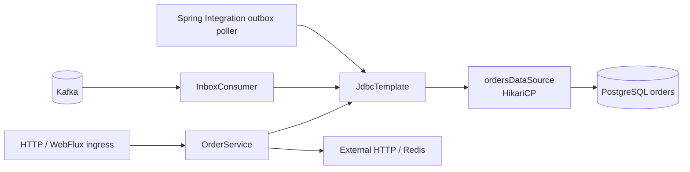
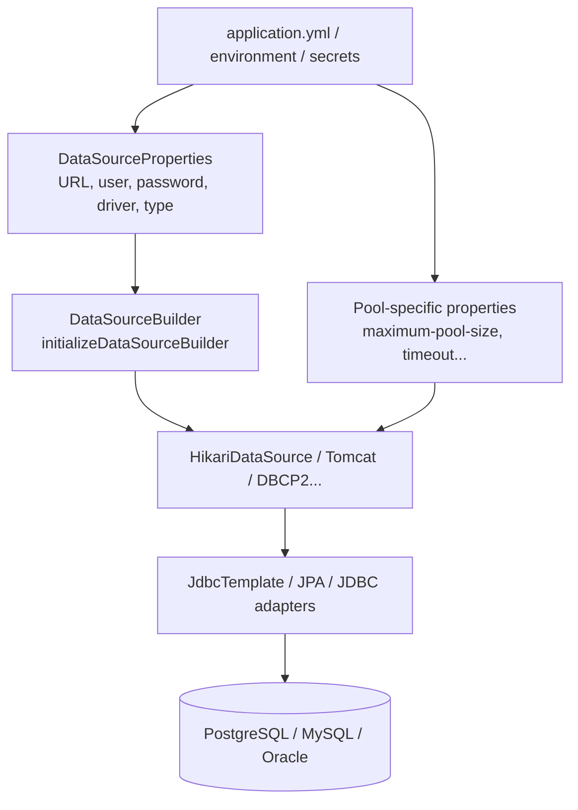
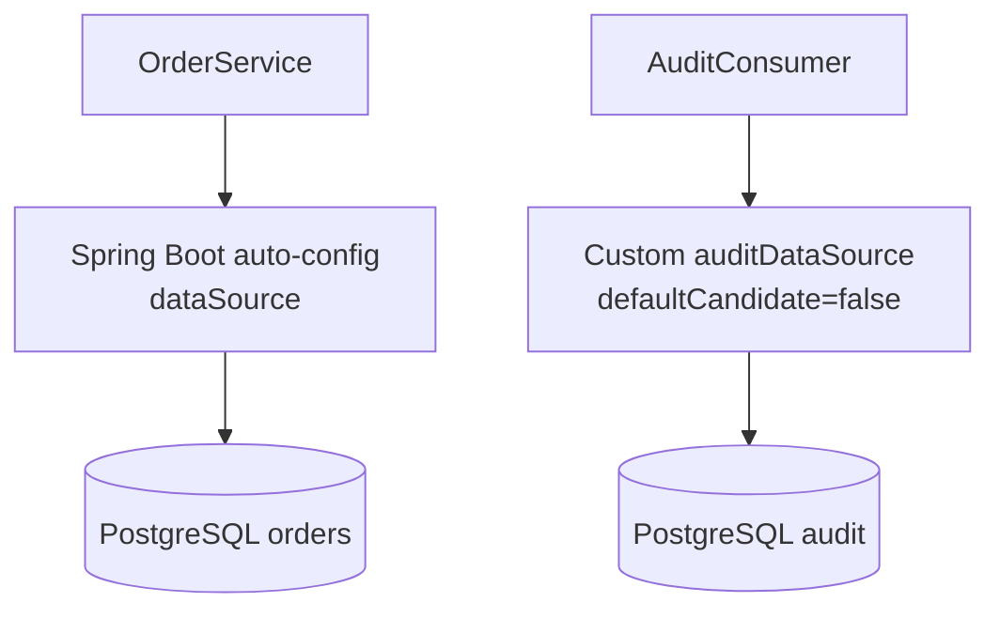
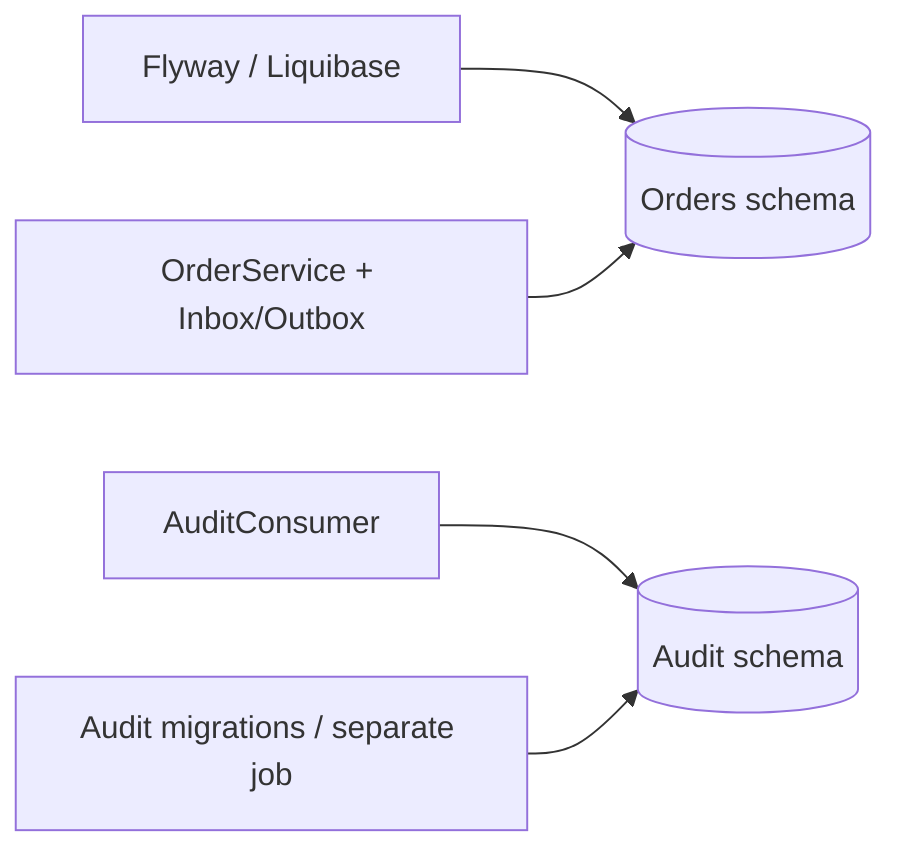
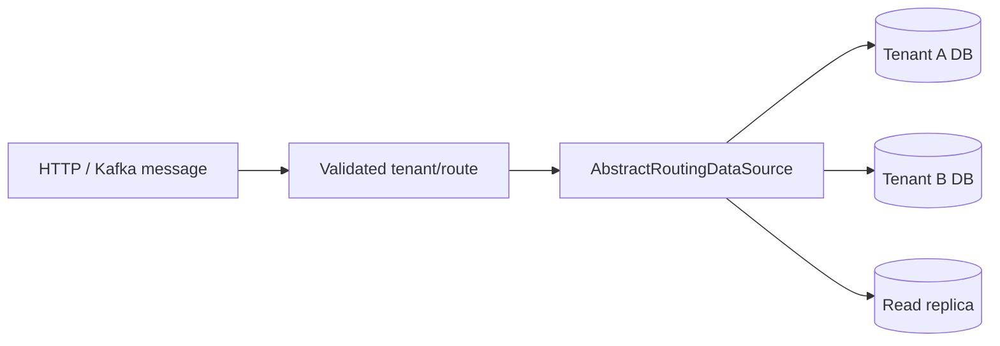
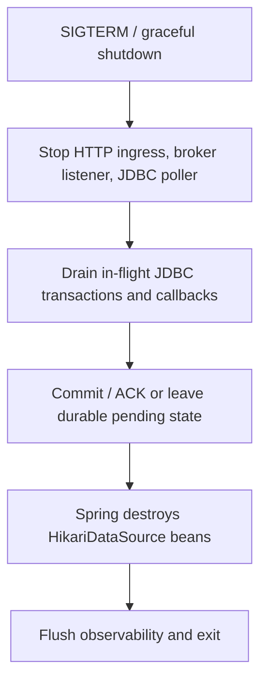
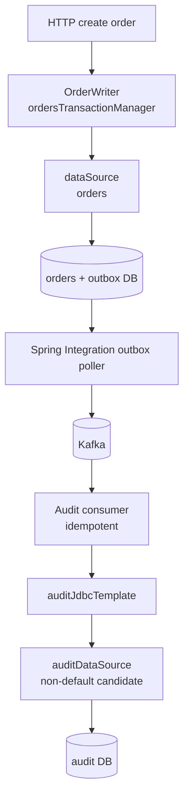

# DataSourceBuilder, DataSourceProperties, and Customizing Data Sources

## 1. Why Understand How Spring Boot Creates a DataSource?

In a Spring Boot system integration application, **SQL connectivity is more than a JDBC URL**. A single service may receive HTTP requests, poll an outbox table, write an inbox deduplication table while consuming Kafka, run Flyway at deployment, and send data to Redis or another HTTP API. Those flows depend on very specific questions:

- Which `DataSource` bean supplies the connections?
- Who chooses HikariCP or another pool, and who applies properties like `maximumPoolSize`?
- Do `JdbcTemplate`, JPA, Spring Batch, and Spring Integration JDBC adapters use the **same** or **different** datasources?
- Does `@Transactional` target the exact `PlatformTransactionManager` for that connection?
- If you create a `DataSource` manually, which Spring Boot auto-configurations still run?
- When two databases or an R2DBC `ConnectionFactory` exist, how do auto-configuration conditions change?

Example order-intake system:



If `ordersDataSource` lacks a URL, Hikari settings fail to bind, or a service accidentally injects `auditDataSource`, the application can fail at startup **or** worse: boot cleanly while reading/writing the wrong database and transaction boundary.

In the **SPRING_BOOT_INTEGRATION** module, this lesson focuses on Spring Boot's tools for **initializing and customizing JDBC data sources** under full control: `DataSourceBuilder`, `DataSourceProperties`, property binding, auto-configuration conditions, and wiring them with transactions, migrations, tests, and operations.

### Learning Objectives

After this lesson, you will be able to:

1. Distinguish `javax.sql.DataSource`, `DataSourceBuilder`, and `DataSourceProperties`.
2. Explain when Spring Boot auto-creates a Hikari `DataSource` and when it backs off.
3. Use `DataSourceBuilder` to pick an explicit `DataSource` implementation and understand the builder's limits.
4. Use `DataSourceProperties.initializeDataSourceBuilder()` to bind `url` properly to Hikari's `jdbcUrl`.
5. Create a custom-managed datasource under an `app.datasource.*` namespace, or add a secondary datasource without accidentally losing the primary one.
6. Wire `JdbcTemplate`, `JdbcClient`, transaction managers, JPA, and Flyway to the intended database.
7. Coexist JDBC alongside R2DBC, JNDI, or Testcontainers without guessing auto-configuration behavior.
8. Design pooling, TLS/secrets, startup/shutdown, metrics, and reliable connectivity tests.

> **Version scope:** Primary APIs and examples target **Spring Boot 3.5.x, Spring Framework 6.x, Java 17+, JDBC/PostgreSQL, and HikariCP**. `DataSourceBuilder` lives in `org.springframework.boot.jdbc`; `DataSourceProperties` lives in `org.springframework.boot.autoconfigure.jdbc` in Boot 3.5. Packages and conditions may differ in Boot 4.x; always consult documentation for your actual runtime version.

## 2. Three Layers of Responsibility: Interface, Builder, and Properties

To avoid confusion, picture them like this:



| Component | Role | What it does not do |
| --- | --- | --- |
| `javax.sql.DataSource` | Java contract supplying JDBC `Connection` instances | Does not define pool sizing, retries, or business transactions |
| `DataSourceBuilder<T>` | Creates an implementation from common properties and can pick pool type | Does not bind every Hikari-specific or vendor-specific setting |
| `DataSourceProperties` | Boot properties bean holding URL, username, password, driver, type, and builder initialization | Not itself a connection pool |
| `@ConfigurationProperties` | Binds external configuration onto a bean | Does not register a bean unless paired with a registration mechanism |
| `DataSourceAutoConfiguration` | Defines how Boot auto-configures a datasource per conditions | Does not always run when the app declares its own `DataSource` |
| `HikariDataSource` | Actual pool implementation managing JDBC connections | Does not manage Kafka offsets or idempotency |
| `JdbcTransactionManager` | Binds and commits/rolls back JDBC transactions for a datasource | Does not cover HTTP/Kafka or R2DBC transactions |

### 2.1. `DataSource` Is a Factory, Not a Shared Connection

```java
// Plain JDBC example illustrating ownership
try (Connection connection = dataSource.getConnection()) {
    try (PreparedStatement ps = connection.prepareStatement(
            "SELECT COUNT(*) FROM orders")) {
        try (ResultSet rs = ps.executeQuery()) {
            rs.next();
            long count = rs.getLong(1);
        }
    }
}
```

When `dataSource` is Hikari, `Connection.close()` on the proxy normally **returns the connection to the pool** rather than closing the physical socket. `HikariDataSource.close()`, by contrast, shuts down the entire pool—never call it after individual requests.

Most Spring applications should use `JdbcTemplate`/`JdbcClient` or repository APIs so Spring handles connection borrowing/returning and transaction synchronization cleanly. A JDBC `Connection` **must not be shared arbitrarily across threads**.

### 2.2. These Three Components Do Not Make Cross-Integration Atomic

`DataSourceBuilder` creates a datasource, not a message broker transaction. If `OrderService` writes to PostgreSQL and then calls an HTTP API or publishes to Kafka, a JDBC rollback cannot undo a request already processed by the partner. Those flows require outbox/inbox patterns, idempotency, error recovery, and timeout budgets.

## 3. First: When Should You Not Write a Custom `DataSource` Bean?

With a single SQL database and HikariCP, **Boot's default auto-configuration is usually the best choice**:

```xml
<dependencies>
    <dependency>
        <groupId>org.springframework.boot</groupId>
        <artifactId>spring-boot-starter-jdbc</artifactId>
    </dependency>
    <dependency>
        <groupId>org.postgresql</groupId>
        <artifactId>postgresql</artifactId>
        <scope>runtime</scope>
    </dependency>
</dependencies>
```

```yaml
spring:
  datasource:
    url: jdbc:postgresql://db.internal.example:5432/orders
    username: ${DB_USERNAME}
    password: ${DB_PASSWORD}
    hikari:
      pool-name: orders-hikari
      maximum-pool-size: 12
      minimum-idle: 2
      connection-timeout: 3000
```

With the JDBC starter and Hikari on the classpath under matching conditions, Spring Boot:

1. Binds `spring.datasource.*` into `DataSourceProperties`.
2. Infers the driver when the URL is recognized.
3. Picks HikariCP when available and unoverridden, following pool precedence order.
4. Binds `spring.datasource.hikari.*` onto the pool configuration.
5. Configures dependent JDBC infrastructure such as `JdbcTemplate`, transaction manager, health, and metrics based on dependencies/conditions.

**Do not add `@Bean HikariDataSource` just to change `maximum-pool-size` from 10 to 12.** Existing properties handle that cleanly while preserving Spring Boot's auto-configuration wiring.

### 3.1. Key Conditions

In Boot 3.5, `DataSourceAutoConfiguration`:

- Requires necessary JDBC/embedded database infrastructure classes on the classpath.
- **Backs off when an R2DBC `io.r2dbc.spi.ConnectionFactory` bean is present**, via `@ConditionalOnMissingBean(type = "io.r2dbc.spi.ConnectionFactory")`.
- Pooled datasource configuration also checks for existing `DataSource`/XA beans.
- Declaring a custom `DataSource` as a standard candidate suppresses Boot's default auto-configured datasource.

**The presence of `spring.datasource.url` does not guarantee a bean is created** if another condition caused auto-configuration to back off. When debugging, read the condition evaluation report rather than guessing from YAML.

### 3.2. Pool Selection Mechanism

Per Boot 3.5 documentation, standard configuration prefers HikariCP when available, followed conditionally by pools such as Tomcat JDBC, Commons DBCP2, and Oracle UCP. You can override this via `spring.datasource.type` for the standard auto-configuration path.

In an application with multiple connection pools on the classpath, **never** assume adding a library will leave the inferred pool type unchanged. When an implementation must be fixed, set `.type(HikariDataSource.class)` and verify with tests.

### 3.3. Embedded Databases Are a Separate Case

H2/HSQLDB/Derby can be configured by Boot for local/test usage when dependencies and conditions apply. Without `spring.datasource.url`, Boot may fall back to an embedded database before failing for a missing URL. Never run H2 tests and assume production PostgreSQL `jsonb`, `FOR UPDATE SKIP LOCKED`, isolation levels, and schema migrations are verified.

## 4. `DataSourceBuilder`: Building Instances When Customization Is Needed

Core Spring Boot 3.5 API:

```java
import org.springframework.boot.jdbc.DataSourceBuilder;

// Illustrative values; never hardcode secrets in production.
HikariDataSource dataSource = DataSourceBuilder.create()
        .type(HikariDataSource.class)
        .driverClassName("org.postgresql.Driver")
        .url("jdbc:postgresql://localhost:5432/orders")
        .username("orders_app")
        .password("dev-only-secret")
        .build();
```

In this snippet, imports also require `com.zaxxer.hikari.HikariDataSource`. `DataSourceBuilder` offers these primary methods:

| Method | Purpose |
| --- | --- |
| `create()` / `create(ClassLoader)` | Initializes builder and detects supported implementations |
| `type(Class<D>)` | Selects the exact `DataSource` implementation |
| `url(String)` | Sets common JDBC URL; builder maps pool-specific property names |
| `driverClassName(String)` | Sets JDBC driver when not inferred or overriding inference |
| `username(String)` / `password(String)` | JDBC login credentials |
| `build()` | Instantiates the datasource |
| `derivedFrom(DataSource)` | Creates a builder seeded from basic settings of an existing datasource |

**The builder is not an ORM, pool manager, or connection validator.** It handles common connection properties and implementation lookup. Pool-specific features such as `maximumPoolSize`, `idleTimeout`, and `leakDetectionThreshold` must be bound via bean/pool-specific configuration.

### 4.1. Why Specify `type(Class)`?

If you write:

```java
DataSource dataSource = DataSourceBuilder.create().build();
```

the builder picks an implementation from the classpath by detection order. That works for demos, yet risks consistency when production expects **Hikari metrics and pooling behavior**—especially if transitive dependencies introduce another pool.

```java
HikariDataSource dataSource = DataSourceBuilder.create()
        .type(HikariDataSource.class)
        .build();
```

gives a concrete return type, better IDE metadata when binding `@ConfigurationProperties`, and prevents accidental pool swaps via classpath changes.

### 4.2. `derivedFrom` Does Not Clone a Live Pool

```java
DataSourceBuilder<?> builder =
        DataSourceBuilder.derivedFrom(existingDataSource);
```

This creates a builder from **the datasource type and basic connection settings** of an existing instance. It **does not copy all pool tuning settings**, open physical connections, transaction contexts, metrics, or secret rotation policies. Never use it as a shortcut to "clone an identical production pool" without checking every property.

### 4.3. When to Use the Builder Directly?

- Building a specialized `DataSource` from custom code or custom properties.
- Locking down a specific implementation class.
- Creating a non-pooled datasource for a narrowly scoped admin or test utility.
- Converting vendor-specific configuration into a standard bean type.

For a Hikari `DataSource` backed by `spring.datasource.url` or `app.datasource.url`, prefer **`DataSourceProperties.initializeDataSourceBuilder()`** to avoid `url` vs. `jdbc-url` binding traps.

## 5. `DataSourceProperties`: Spring Boot's Normalized JDBC Config Model

`org.springframework.boot.autoconfigure.jdbc.DataSourceProperties` holds common properties:

- `url`, `username`, `password`, `driverClassName`.
- `type` when allowing implementation selection.
- Embedded database options, datasource name, JNDI, and XA metadata.
- Helpers to resolve URL/driver/username appropriately and initialize a pre-populated `DataSourceBuilder`.

Most importantly:

```java
HikariDataSource pool = properties
        .initializeDataSourceBuilder()
        .type(HikariDataSource.class)
        .build();
```

`initializeDataSourceBuilder()` does not "start the database"; it transfers settings from `DataSourceProperties` into the builder and performs the normalization required across datasource implementations with differing property names.

### 5.1. Classic Trap: Hikari Has `jdbcUrl`, Not `url`

Suppose you write:

```java
@Bean
@ConfigurationProperties("app.datasource")
public HikariDataSource dataSource() {
    return DataSourceBuilder.create()
            .type(HikariDataSource.class)
            .build();
}
```

with:

```yaml
app:
  datasource:
    url: jdbc:postgresql://localhost:5432/orders
    username: orders_app
```

**The catch:** `HikariDataSource` exposes the JavaBean property `jdbcUrl`, not `url`. When `@ConfigurationProperties` binds **directly onto the Hikari bean**, `app.datasource.url` does not map as many expect. You may hit an error like "jdbcUrl is required with driverClassName" or end up with a missing URL.

When binding directly to Hikari, the key must be:

```yaml
app:
  datasource:
    jdbc-url: jdbc:postgresql://localhost:5432/orders
    username: orders_app
```

With `DataSourceProperties`, however, you can keep standard **`url`** and let the builder translate it. That is why the two-layer pattern below is cleaner.

### 5.2. Prefixes That Are Not Interchangeable

| Prefix | Configuration path | Notes |
| --- | --- | --- |
| `spring.datasource.url` | Boot-standard `DataSourceProperties` | Handled by default auto-configuration |
| `spring.datasource.hikari.maximum-pool-size` | Hikari-specific settings for auto-configured datasource | Does not automatically apply to custom beans |
| `app.datasource.url` | Bound only if you put `@ConfigurationProperties("app.datasource")` on `DataSourceProperties` | **Custom** prefix; not automatically read by Boot |
| `app.datasource.configuration.maximum-pool-size` | Bound only if you bind onto a custom `HikariDataSource` | Effective only when annotation prefix matches |
| `app.datasource.jdbc-url` | Direct binding onto Hikari bean | Couples YAML tightly to implementation |
| `spring.r2dbc.url` | R2DBC `ConnectionFactory` | Does not configure a JDBC datasource |

You cannot invent an arbitrary YAML key and expect Boot to bind it. **Whichever `@Bean` method carries `@ConfigurationProperties` defines the active prefix.**

### 5.3. Difference Between the `DataSourceProperties` Class and the `DataSourceProperties` Bean

The class is a Java type with an API; the bean is a Spring-registered instance bound to a prefix. Calling `new DataSourceProperties()` inside an ordinary method without Spring's binder does not read `application.yml`.

On a `@Bean` method, `@ConfigurationProperties` handles binding after construction. Spring Boot may register a default bean of this type when JDBC auto-configuration runs; if you want a custom namespace, **register your own separate bean** as in section 6 rather than depending on a bean that vanishes if auto-configuration conditions change.

## 6. Complete Custom `DataSource`: `DataSourceProperties` + Hikari

Use this pattern when you want a custom `app.datasource.*` namespace while keeping Boot's standard JDBC URL and driver normalization.

### 6.1. Two-Tier YAML

```yaml
app:
  datasource:
    url: jdbc:postgresql://db.internal.example:5432/orders
    username: ${ORDERS_DB_USER}
    password: ${ORDERS_DB_PASSWORD}
    configuration:
      pool-name: orders-custom-hikari
      maximum-pool-size: 12
      minimum-idle: 2
      connection-timeout: 3000
      validation-timeout: 1000
```

- `app.datasource.url/username/password` bind into `DataSourceProperties`.
- `app.datasource.configuration.*` bind into `HikariDataSource`.
- `configuration` is an **arbitrary chosen sub-namespace**, not a built-in Spring Boot default prefix.
- Required environment variables come from secret management; never store production passwords in source.

### 6.2. Java Configuration

```java
// OrdersDataSourceConfiguration.java
package example.integration.config;

import com.zaxxer.hikari.HikariDataSource;
import org.springframework.beans.factory.annotation.Qualifier;
import org.springframework.boot.autoconfigure.jdbc.DataSourceProperties;
import org.springframework.boot.context.properties.ConfigurationProperties;
import org.springframework.context.annotation.Bean;
import org.springframework.context.annotation.Configuration;
import org.springframework.context.annotation.Primary;

@Configuration(proxyBeanMethods = false)
public class OrdersDataSourceConfiguration {

    @Bean("ordersDataSourceProperties")
    @Primary
    @ConfigurationProperties("app.datasource")
    DataSourceProperties ordersDataSourceProperties() {
        return new DataSourceProperties();
    }

    @Bean("dataSource")
    @Primary
    @ConfigurationProperties("app.datasource.configuration")
    HikariDataSource ordersDataSource(
            @Qualifier("ordersDataSourceProperties")
            DataSourceProperties properties) {

        return properties.initializeDataSourceBuilder()
                .type(HikariDataSource.class)
                .build();
    }
}
```

`@Primary` on properties prevents ambiguous injection if another properties bean exists. `@Primary` on the datasource establishes the default candidate if secondary beans exist. `@Qualifier` guarantees `dataSource` uses `ordersDataSourceProperties`.

### 6.3. Binding Diagram

```text
app.datasource.url ----------------------+
app.datasource.username/password -------+--> DataSourceProperties bean
                                        |
                                        v
                             initializeDataSourceBuilder()
                                        |
                                        v
                            HikariDataSource jdbcUrl
                                        ^
app.datasource.configuration.* ---------+--> Hikari setters
```

If you forget the second `@ConfigurationProperties`, the pool may still connect to the DB, but `maximum-pool-size` falls back to Hikari's default. If you forget `@ConfigurationProperties` on `DataSourceProperties`, the JDBC URL is missing at bean creation time.

### 6.4. Why Return the Concrete Pool Type?

Returning `HikariDataSource` instead of plain `DataSource` gives Spring Boot tooling/IDEs richer metadata for pool-specific properties. It also locks the pool type in code; `app.datasource.type` will not swap it to another implementation while `.type(HikariDataSource.class)` is set.

### 6.5. Never Create a Pool Per HTTP Request

```java
// Anti-pattern: creating a new pool per request, unmanaged by Spring.
public void handleRequest() {
    HikariDataSource ds = properties.initializeDataSourceBuilder()
            .type(HikariDataSource.class)
            .build();
    // ...
}
```

Every `build()` call spins up a brand-new datasource, opening extra connections and leaking cleanup. Create **one Spring-managed bean per pool**, inject it into clients/handlers, and let Spring close it at `ApplicationContext` shutdown.

## 7. Comparing Three Custom `DataSource` Approaches

| Approach | Example | Pros | Watch-outs |
| --- | --- | --- | --- |
| Boot auto-config | Only `spring.datasource.*` and `spring.datasource.hikari.*` | Minimal code; preserves wiring/metrics/initialization | Auto-config conditions can back off |
| Builder + direct binding | `DataSourceBuilder.create().type(...).build()` + `@ConfigurationProperties` | Concise and flexible | Hikari requires `jdbc-url`, not `url`, under direct binding |
| Custom `DataSourceProperties` + builder + pool binding | Two beans and split prefixes | Standard `url`, clean two-tier config, easy to test | Must keep prefixes, qualifiers, and bean names consistent |

### 7.1. Choosing the Right Approach

- Standard single DB with Hikari: **prefer Boot auto-config**.
- Single DB with a custom namespace: `DataSourceProperties` + explicit pool.
- Two DBs: explicitly decide primary/secondary and bean candidate semantics.
- Application-server-managed pool: consider JNDI instead of layering another pool on top.
- R2DBC runtime where Flyway needs JDBC: the app does not necessarily need a `DataSource` bean if the migration tool uses its own JDBC URL.

### 7.2. Successful Binding Does Not Prove Business Configuration Is Right

`@ConfigurationProperties` binds and can validate types/constraints, yet never proves:

- The URL targets the right database or tenant.
- The user holds only minimal required privileges.
- TLS CA/hostname verification is valid.
- Schema migrations have run.
- Pool sizing fits real concurrency and latency.

Pair binding with runtime connectivity tests and contract tests covering these checks.

## 8. Two DataSources: Keeping Boot's Default and Adding a Secondary Pool

Suppose the system has a primary `orders` database and a secondary `audit` database:



Spring Boot 3.5 runs on Spring Framework 6.2, supporting `@Bean(defaultCandidate = false)`. This is vital if you want to **add a secondary datasource while letting Boot auto-configure the primary datasource**. If the secondary bean stays a normal default candidate, `@ConditionalOnMissingBean(DataSource.class)` can suppress auto-configuration of the primary datasource.

### 8.1. Illustrative YAML

```yaml
spring:
  datasource:
    url: jdbc:postgresql://orders-db.internal:5432/orders
    username: ${ORDERS_DB_USER}
    password: ${ORDERS_DB_PASSWORD}
    hikari:
      pool-name: orders-pool
      maximum-pool-size: 12

app:
  audit:
    datasource:
      url: jdbc:postgresql://audit-db.internal:5432/audit
      username: ${AUDIT_DB_USER}
      password: ${AUDIT_DB_PASSWORD}
      configuration:
        pool-name: audit-pool
        maximum-pool-size: 4
```

### 8.2. Secondary `DataSource` in Boot 3.5

```java
// AuditDataSourceConfiguration.java
package example.integration.config;

import com.zaxxer.hikari.HikariDataSource;
import org.springframework.beans.factory.annotation.Qualifier;
import org.springframework.boot.autoconfigure.jdbc.DataSourceProperties;
import org.springframework.boot.context.properties.ConfigurationProperties;
import org.springframework.context.annotation.Bean;
import org.springframework.context.annotation.Configuration;

@Configuration(proxyBeanMethods = false)
public class AuditDataSourceConfiguration {

    @Bean(name = "auditDataSourceProperties", defaultCandidate = false)
    @Qualifier("audit")
    @ConfigurationProperties("app.audit.datasource")
    DataSourceProperties auditDataSourceProperties() {
        return new DataSourceProperties();
    }

    @Bean(name = "auditDataSource", defaultCandidate = false)
    @Qualifier("audit")
    @ConfigurationProperties("app.audit.datasource.configuration")
    HikariDataSource auditDataSource(
            @Qualifier("audit") DataSourceProperties properties) {
        return properties.initializeDataSourceBuilder()
                .type(HikariDataSource.class)
                .build();
    }
}
```

This adds only the secondary datasource; Boot can still create the primary `dataSource` from `spring.datasource.*` when other conditions allow. `@Qualifier("audit")` targets injection points, while `defaultCandidate=false` prevents the secondary bean from causing default auto-configuration to back off.

### 8.3. Distinguishing `@Primary`, `@Qualifier`, and `defaultCandidate`

| Annotation | What it solves | What it does not solve |
| --- | --- | --- |
| `@Primary` | Picks the preferred bean when multiple candidates match injection | Does not stop Boot auto-config from backing off if the extra bean is still a default candidate |
| `@Qualifier` | Selects a specific bean at an injection point | Does not create connections or transactions |
| `@Bean(defaultCandidate=false)` | Excludes the extra bean as a default candidate in matching conditions | Does not hide the bean when explicitly requested via qualifier |

**Never replace `defaultCandidate=false` with `@Primary` on the secondary datasource.** The two annotations mean completely different things.

### 8.4. Pool-Specific Settings Do Not "Cascade" to the Secondary Bean

In this example, `spring.datasource.hikari.maximum-pool-size` applies to the primary pool; `app.audit.datasource.configuration.maximum-pool-size` applies to the secondary pool. A custom `HikariDataSource` never inherits Boot's default prefix automatically without matching annotations/configurers.

### 8.5. Expected Bean Graph

```text
dataSource                 -> HikariDataSource (orders-db)
auditDataSource            -> HikariDataSource (audit-db)
dataSourceProperties       -> spring.datasource.*
auditDataSourceProperties  -> app.audit.datasource.*
```

The primary bean is normally named `dataSource`; if custom or third-party auto-config exists, verify actual bean names and URLs in the context.

## 9. Two Explicit DataSources: An Alternative Pattern

When the app wants full control over both pools, declare both explicitly:

```text
ordersDataSource (@Primary)
auditDataSource  (inject with qualifier only)
```

### 9.1. Java Configuration

```java
// TwoExplicitDataSourcesConfiguration.java
package example.integration.config;

import com.zaxxer.hikari.HikariDataSource;
import org.springframework.beans.factory.annotation.Qualifier;
import org.springframework.boot.autoconfigure.jdbc.DataSourceProperties;
import org.springframework.boot.context.properties.ConfigurationProperties;
import org.springframework.context.annotation.Bean;
import org.springframework.context.annotation.Configuration;
import org.springframework.context.annotation.Primary;

@Configuration(proxyBeanMethods = false)
public class TwoExplicitDataSourcesConfiguration {

    @Bean("ordersProperties")
    @Primary
    @ConfigurationProperties("app.orders.datasource")
    DataSourceProperties ordersProperties() {
        return new DataSourceProperties();
    }

    @Bean("auditProperties")
    @ConfigurationProperties("app.audit.datasource")
    DataSourceProperties auditProperties() {
        return new DataSourceProperties();
    }

    @Bean("ordersDataSource")
    @Primary
    @ConfigurationProperties("app.orders.datasource.configuration")
    HikariDataSource ordersDataSource(
            @Qualifier("ordersProperties") DataSourceProperties properties) {
        return properties.initializeDataSourceBuilder()
                .type(HikariDataSource.class)
                .build();
    }

    @Bean("auditDataSource")
    @ConfigurationProperties("app.audit.datasource.configuration")
    HikariDataSource auditDataSource(
            @Qualifier("auditProperties") DataSourceProperties properties) {
        return properties.initializeDataSourceBuilder()
                .type(HikariDataSource.class)
                .build();
    }
}
```

**Do not enable this configuration alongside the examples in sections 6 or 8.** They are mutually exclusive alternatives; overlapping them causes bean name collisions or multiple `@Primary` conflicts.

### 9.2. YAML

```yaml
app:
  orders:
    datasource:
      url: jdbc:postgresql://orders-db.internal:5432/orders
      username: ${ORDERS_DB_USER}
      password: ${ORDERS_DB_PASSWORD}
      configuration:
        pool-name: orders-pool
        maximum-pool-size: 12
  audit:
    datasource:
      url: jdbc:postgresql://audit-db.internal:5432/audit
      username: ${AUDIT_DB_USER}
      password: ${AUDIT_DB_PASSWORD}
      configuration:
        pool-name: audit-pool
        maximum-pool-size: 4
```

### 9.3. `@Primary` Is Not a Transaction Manager

`@Primary` only resolves injection ambiguity. It **does not** merge two datasources into a single transaction, let the audit `JdbcTemplate` join an orders transaction, or govern database schema ownership.

## 10. Customizing `JdbcTemplate`, `JdbcClient`, and Adapters per `DataSource`

With a single datasource, Boot auto-creates `JdbcTemplate`, `NamedParameterJdbcTemplate`, and `JdbcClient` based on beans and conditions. With two distinct business datasources, **creating named clients explicitly** makes reviews and tests clearer.

### 10.1. Creating Two `JdbcTemplate` Beans

```java
// JdbcClientsConfiguration.java
package example.integration.config;

import javax.sql.DataSource;
import org.springframework.beans.factory.annotation.Qualifier;
import org.springframework.context.annotation.Bean;
import org.springframework.context.annotation.Configuration;
import org.springframework.context.annotation.Primary;
import org.springframework.jdbc.core.JdbcTemplate;
import org.springframework.jdbc.core.simple.JdbcClient;

@Configuration(proxyBeanMethods = false)
public class JdbcClientsConfiguration {

    @Bean("ordersJdbcTemplate")
    @Primary
    JdbcTemplate ordersJdbcTemplate(
            @Qualifier("ordersDataSource") DataSource dataSource) {
        return new JdbcTemplate(dataSource);
    }

    @Bean("auditJdbcTemplate")
    JdbcTemplate auditJdbcTemplate(
            @Qualifier("auditDataSource") DataSource dataSource) {
        return new JdbcTemplate(dataSource);
    }

    @Bean("auditJdbcClient")
    JdbcClient auditJdbcClient(
            @Qualifier("auditJdbcTemplate") JdbcTemplate jdbc) {
        return JdbcClient.create(jdbc);
    }
}
```

This matches **section 9** (two custom beans, primary named `ordersDataSource`). If using **section 8**, the primary orders bean is normally named `dataSource`; replace `@Qualifier("ordersDataSource")` with `@Qualifier("dataSource")`.

Boot's `JdbcTemplate`/`NamedParameterJdbcTemplate` auto-configuration conditions can back off once user-defined beans exist. Once multiple templates exist, never expect an unqualified `JdbcClient` to exist or select the intended DB; register named beans and inject with `@Qualifier`.

### 10.2. Repositories/Services Targeting Specific Pools

```java
// AuditRecorder.java
package example.integration.audit;

import org.springframework.beans.factory.annotation.Qualifier;
import org.springframework.jdbc.core.JdbcTemplate;
import org.springframework.stereotype.Service;

@Service
public class AuditRecorder {

    private final JdbcTemplate auditJdbc;

    public AuditRecorder(
            @Qualifier("auditJdbcTemplate") JdbcTemplate auditJdbc) {
        this.auditJdbc = auditJdbc;
    }

    public int record(String eventId, String category) {
        return auditJdbc.update("""
                INSERT INTO integration_audit (event_id, category)
                VALUES (?, ?)
                ON CONFLICT (event_id) DO NOTHING
                """, eventId, category);
    }
}
```

This PostgreSQL SQL requires a migration creating `integration_audit`. `ON CONFLICT` prevents duplicate rows for repeated event IDs, yet does not replace validating that **identical IDs carry identical business payloads** if producers can send conflicting data.

### 10.3. `JdbcClient` Does Not Make JDBC Reactive

`JdbcClient` is a fluent API over Spring JDBC—still blocking. In WebFlux, isolate blocking JDBC off the Netty event loop, bound concurrency, and watch Hikari pending counts. `JdbcClient` is not R2DBC's `DatabaseClient`.

### 10.4. Spring Integration JDBC Adapters

`JdbcPollingChannelAdapter`, `JdbcMessageHandler`, and `JdbcOutboundGateway` use their configured `DataSource`/`JdbcOperations`. If the audit adapter uses `auditDataSource` while transaction advice targets the orders transaction manager, they **do not share a transaction**. Always use explicit names/qualifiers and test rollbacks.

## 11. Transaction Managers: Which `DataSource` Governs Which Transaction?

`JdbcTransactionManager` (`PlatformTransactionManager`) manages JDBC connections for one `DataSource`. With two datasources:

```java
// JdbcTransactionsConfiguration.java
package example.integration.config;

import javax.sql.DataSource;
import org.springframework.beans.factory.annotation.Qualifier;
import org.springframework.context.annotation.Bean;
import org.springframework.context.annotation.Configuration;
import org.springframework.context.annotation.Primary;
import org.springframework.jdbc.support.JdbcTransactionManager;
import org.springframework.transaction.PlatformTransactionManager;

@Configuration(proxyBeanMethods = false)
public class JdbcTransactionsConfiguration {

    @Bean("ordersTransactionManager")
    @Primary
    PlatformTransactionManager ordersTransactionManager(
            @Qualifier("ordersDataSource") DataSource dataSource) {
        return new JdbcTransactionManager(dataSource);
    }

    @Bean("auditTransactionManager")
    PlatformTransactionManager auditTransactionManager(
            @Qualifier("auditDataSource") DataSource dataSource) {
        return new JdbcTransactionManager(dataSource);
    }
}
```

This matches section 9. With a Boot auto-configured primary datasource (section 8), change the orders qualifier to `dataSource`. Avoid registering multiple default transaction managers and relying on unqualified `@Transactional` without verifying which manager runs.

### 11.1. Service Choosing the Transaction Owner

```java
// OrderWriter.java
package example.integration.orders;

import org.springframework.beans.factory.annotation.Qualifier;
import org.springframework.jdbc.core.JdbcTemplate;
import org.springframework.stereotype.Service;
import org.springframework.transaction.annotation.Transactional;

@Service
public class OrderWriter {

    private final JdbcTemplate jdbc;

    public OrderWriter(
            @Qualifier("ordersJdbcTemplate") JdbcTemplate jdbc) {
        this.jdbc = jdbc;
    }

    @Transactional(transactionManager = "ordersTransactionManager")
    public void save(String orderId) {
        jdbc.update("""
                INSERT INTO orders(order_id, status)
                VALUES (?, 'NEW')
                """, orderId);
    }
}
```

When invoked through a Spring proxy from another bean, this uses `ordersTransactionManager`. Calling `auditJdbcTemplate` inside this same method **does not enlist the audit connection** into the orders transaction simply because an annotation sits on the method.

### 11.2. Two DataSources Do Not Automatically Provide Distributed Transactions

Suppose:

```text
ordersDataSource → INSERT orders
auditDataSource  → INSERT audit_events
```

If orders commits and audit fails, you end up with an order without an audit record. Options:

- Use **one database/transaction owner** if both writes truly must be atomic.
- Write a **transactional outbox** alongside orders in one transaction; a worker writes audit later with retries and idempotency.
- Use saga/compensation when systems are independent and require recovery.
- Use XA/JTA if infrastructure supports it, understanding costs, timeouts, and heuristic outcomes.

Never claim **exactly-once effects across two DBs** solely via `@Transactional`. Inject faults between the two commits in tests and verify consistency.

### 11.3. JPA Uses Its Own Transaction Manager When Applicable

If `ordersDataSource` backs a Hibernate/JPA `EntityManagerFactory`, you generally need `JpaTransactionManager` to coordinate JPA operations. `JdbcTransactionManager` is for Spring JDBC; do not swap a JPA manager for a JDBC manager while ignoring persistence context and flush semantics.

With multiple `EntityManagerFactory` beans, each repository group requires its own `entityManagerFactoryRef`, `transactionManagerRef`, package scanning, and migrations. A `@Primary DataSource` **does not** magically configure a second JPA stack.

## 12. Flyway/Liquibase and Schema Initialization with Multiple Pools

Migrations must target the **right database**, run under a user with schema privileges, and finish before business handlers or pollers touch the tables.



### 12.1. Which Source Does Flyway Pick by Default?

Per Boot 3.5 docs, Flyway normally uses the primary (or `@Primary`) datasource when unconfigured. To point Flyway at a **different migration source**, you can:

- Mark the bean with `@FlywayDataSource`.
- Configure `spring.flyway.url`/`user`/`password` so Flyway opens its own JDBC connection.
- Run migrations via a CI/CD job or Flyway CLI with credentials isolated from the app.

```yaml
spring:
  flyway:
    enabled: true
    locations: classpath:db/migration
    url: jdbc:postgresql://orders-db.internal:5432/orders
    user: ${DB_MIGRATION_USER}
    password: ${DB_MIGRATION_PASSWORD}
    validate-on-migrate: true
    clean-disabled: true
```

By default Flyway does not migrate **every** datasource bean automatically. Never assume `auditDataSource` has tables just because Flyway succeeded against `ordersDataSource`.

### 12.2. `@FlywayDataSource` Example for a Dedicated Migration Pool

```java
// MigrationDataSourceConfiguration.java
package example.integration.config;

import com.zaxxer.hikari.HikariDataSource;
import org.springframework.boot.autoconfigure.flyway.FlywayDataSource;
import org.springframework.boot.autoconfigure.jdbc.DataSourceProperties;
import org.springframework.boot.context.properties.ConfigurationProperties;
import org.springframework.context.annotation.Bean;
import org.springframework.context.annotation.Configuration;
import org.springframework.beans.factory.annotation.Qualifier;

@Configuration(proxyBeanMethods = false)
public class MigrationDataSourceConfiguration {

    @Bean(name = "migrationProperties", defaultCandidate = false)
    @ConfigurationProperties("app.migration.datasource")
    DataSourceProperties migrationProperties() {
        return new DataSourceProperties();
    }

    @Bean(name = "migrationDataSource", defaultCandidate = false)
    @FlywayDataSource
    @ConfigurationProperties("app.migration.datasource.configuration")
    HikariDataSource migrationDataSource(
            @Qualifier("migrationProperties")
            DataSourceProperties properties) {
        return properties.initializeDataSourceBuilder()
                .type(HikariDataSource.class)
                .build();
    }
}
```

This is an **alternative** to `spring.flyway.url/user/password`; there is no need to create an extra migration pool if Flyway's native connection config already suffices. `defaultCandidate=false` prevents the extra bean from suppressing primary datasource auto-configuration. Ensure business clients never accidentally inject the migration bean via unqualified injection.

### 12.3. Liquibase Also Needs Target Selection

Liquibase normally picks the primary datasource; `@LiquibaseDataSource` selects an alternate bean. If a project includes Flyway, Liquibase, `schema.sql/data.sql`, and Hibernate `ddl-auto=update`, prevent **multiple schema owners** from modifying production tables concurrently.

A clean pattern:

```yaml
spring:
  sql:
    init:
      mode: never
  jpa:
    hibernate:
      ddl-auto: validate
```

The JPA section applies only if the application actually uses JPA. `validate` verifies the schema matches entities without creating tables.

### 12.4. Migrating Multiple Databases

When `orders` and `audit` DBs are independent, you may need **two migration jobs or configurations**, each with its own schema history. Point each to distinct `locations`, database URLs, and credentials; never accidentally apply orders migrations to the audit DB.

When Kubernetes boots multiple replicas simultaneously, rely on tool-supported migration locking/coordination and compatible rollout contracts (expand/contract). Above all, ensure Kafka endpoints do not poll tables before migrations finish.

## 13. Using R2DBC Alongside JDBC

R2DBC uses `io.r2dbc.spi.ConnectionFactory`, not `javax.sql.DataSource`. In Spring Boot 3.5, `DataSourceAutoConfiguration` **backs off when an R2DBC `ConnectionFactory` bean is present**.

```text
Spring context
  ├── ConnectionFactory (R2DBC, nonblocking)
  │      └── DatabaseClient / Reactive repositories
  └── DataSource (JDBC, blocking) [if explicitly created by app]
         └── JdbcTemplate / Flyway / Integration JDBC adapter
```

Declaring both `spring.r2dbc.url` and `spring.datasource.url` does not necessarily create both beans. If you genuinely need both paths, **declare the `DataSource` explicitly** per section 6/9 or re-enable auto-configuration as documented in Boot 3.5 with `@Import(DataSourceAutoConfiguration.class)`, verifying with a context test.

### 13.1. Do Not Mix the Two Transaction Types

- `R2dbcTransactionManager` manages reactive transactions via Reactor Context.
- `JdbcTransactionManager` manages thread-bound JDBC transactions.
- The two connections **do not share a transaction** even on the exact same PostgreSQL host and database.

If a business workflow needs atomic order + outbox writes, keep both in **one** SQL stack and **one** transaction—never write the order with R2DBC and the outbox with JDBC expecting atomicity.

### 13.2. Never Run Blocking JDBC on the WebFlux Event Loop

When WebFlux must call legacy `JdbcTemplate`, offload the blocking call:

```java
return Mono.fromCallable(() -> legacyJdbcService.load(orderId))
        .subscribeOn(Schedulers.boundedElastic());
```

This requires importing `reactor.core.publisher.Mono` and `reactor.core.scheduler.Schedulers`. It **only switches threads**—it does not make JDBC non-blocking or atomic with R2DBC; you still need Hikari capacity, timeouts, and concurrency limits.

## 14. JNDI: Container/Application-Server-Owned `DataSource`

When deploying to a Jakarta EE application server or runtime providing JNDI datasources:

```yaml
spring:
  datasource:
    jndi-name: java:jboss/datasources/orders
```

`spring.datasource.jndi-name` instructs Boot to look up the container-managed datasource instead of building a new pool from app-level URL/credentials.

Key traits:

- The application server owns the pool and connections, so pool settings live on the server.
- Never call `close()` on a JNDI datasource as if Spring Boot created and owned it.
- Verify transaction and JTA participation against the server configuration.
- This is not the standard choice for self-contained containerized Spring Boot fat JARs, which typically use Boot-managed Hikari pools.

### 14.1. Never Mix JNDI Unintentionally with `DataSourceBuilder`

If using `spring.datasource.jndi-name`, do not also construct a `DataSourceBuilder` bean for the **same source** out of URL-configuration habit. Doing so opens a second pool, bypasses server-managed transactions, and complicates metrics and credentials.

## 15. `JdbcConnectionDetails` and Dynamic Configuration Sources

Since Spring Boot 3.1, `JdbcConnectionDetails` provides JDBC connection details such as URL, username, password, and driver. Spring Boot consumes it in auto-configuration, notably with **Testcontainers `@ServiceConnection`** and other service connections.

```text
spring.datasource.*      ───────┐
                                ├─> Boot auto-configuration → DataSource
JdbcConnectionDetails    ───────┘
  (e.g. Testcontainers service connection)
```

However, **`DataSourceBuilder` and custom manual beans do not automatically pick up all connection detail sources**:

```java
@Bean
HikariDataSource myDataSource(DataSourceProperties properties) {
    return properties.initializeDataSourceBuilder()
            .type(HikariDataSource.class)
            .build();
}
```

This code reads **values bound into `DataSourceProperties`**, without automatically consuming another `JdbcConnectionDetails` unless explicitly wired. Therefore:

- For Boot auto-configured datasources, Testcontainers `@ServiceConnection` is usually very convenient.
- For custom `app.orders.datasource.*` and `app.audit.datasource.*`, use `@DynamicPropertySource` or explicit test properties targeting **the exact custom prefixes** unless custom connection-details integration is built.
- If defining a custom `JdbcConnectionDetails`, verify the datasource creation path actually consumes it rather than just checking the bean exists.

### 15.1. Do Not Equate Connection Details with Secret Rotation

`JdbcConnectionDetails` can supply credentials at bean construction, yet does not automatically re-authenticate every open connection in Hikari when a password changes. Rotation requires coordinating **credential retrieval, pool replacement/recycling, connection lifetimes, TLS, and in-flight transactions**.

### 15.2. Configuration Source Precedence

Environment variables, `application-{profile}.yml`, command-line args, config imports, Kubernetes secrets, and service connection details follow Spring Boot precedence rules and conditions. Never assume a single **universal precedence order** without checking whether the datasource uses auto-configuration or custom beans.

In tests or staging, inspect effective values **without logging passwords**, confirming JDBC URL, username, schema, and pool name.

## 16. Environment-Specific Configuration and Secrets Management

Configuration can use placeholders:

```yaml
app:
  datasource:
    url: ${ORDERS_JDBC_URL}
    username: ${ORDERS_DB_USER}
    password: ${ORDERS_DB_PASSWORD}
    configuration:
      pool-name: orders-main
      maximum-pool-size: ${ORDERS_POOL_MAX:12}
      connection-timeout: ${ORDERS_POOL_ACQUIRE_MS:3000}
```

These keys work only when **`DataSourceProperties` and `HikariDataSource` beans actually bind `app.datasource` and `app.datasource.configuration`** as in section 6.

### 16.1. Separating Local, Test, and Production Configs

| Environment | Database source | Notes |
| --- | --- | --- |
| Local | Local/container PostgreSQL, least-privilege account | Never use real production credentials |
| Unit test | Fake datasource when testing pure mapping/config | Does not verify SQL or vendor behavior |
| Integration test | PostgreSQL Testcontainers | Verifies driver, schema, pool, transactions |
| Staging | Production-like infrastructure | TLS, networking, DB roles, and max connections |
| Production | Managed PostgreSQL/cluster | Secret rotation, failover, SLOs, backups, monitoring |

### 16.2. Keep Secrets Out of Metadata and Logs

Avoid:

```java
log.info("Datasource config {}", properties);
log.info("JDBC URL = {}", dataSource.getJdbcUrl());
```

JDBC URLs sometimes carry query parameters, credentials, or vendor-specific tokens. Log only **pool name, logical datasource name, sanitized host alias, non-sensitive DB role, connection status, and duration** when needed. Actuator `/env`, `/configprops`, and `/conditions` can expose configuration details; restrict exposure and enforce RBAC.

### 16.3. TLS and Hostname Verification per JDBC Driver

PostgreSQL example:

```yaml
app:
  datasource:
    url: "jdbc:postgresql://orders-db.internal:5432/orders?sslmode=verify-full&sslrootcert=/etc/db-ca/ca.pem"
```

`sslmode=verify-full` enforces TLS and hostname verification per PostgreSQL JDBC driver semantics. Mount the CA certificate inside the container at the configured path with read permissions. MySQL, Oracle, and SQL Server drivers use different TLS options; never copy query parameters across vendors. Avoid configurations that trust all certificates or skip hostname checks just to bypass connection errors.

### 16.4. Separating DB Privileges by Workload

```text
orders_runtime  → SELECT/INSERT/UPDATE on required business tables
audit_runtime   → INSERT into audit table and strictly limited reads
migration_role  → DDL/Flyway (used at migration stage only)
reporting_role  → read-only / replica where contract allows
```

Adding multiple datasources is an opportunity to **narrow privileges** and isolate resources, not an excuse to reuse a superuser across every pool.

## 17. HikariCP Tuning: Do Not Treat `maximumPoolSize` as the Only Knob

Spring Boot 3.5's Hikari auto-config uses `spring.datasource.hikari.*`. For custom pools in sections 6/9, equivalent keys typically sit under `*.configuration.*`.

### 17.1. Core Properties

| Hikari property | Meaning | Pitfalls to avoid |
| --- | --- | --- |
| `maximumPoolSize` | Caps connections managed by the pool | Setting higher than DB / total pod capacity |
| `minimumIdle` | Target idle connections | Setting too high across many replicas wastes slots |
| `connectionTimeout` | Max wait to **borrow a connection from the pool** (ms) | Mistaking for SQL query timeout |
| `validationTimeout` | Time budget to validate a connection (ms) | Setting unreasonably relative to `connectionTimeout` |
| `idleTimeout` | Duration before idle connections may retire when eligible | Assuming all connections close after exact time |
| `maxLifetime` | Expected max lifetime of a pooled connection | Exceeding DB/network lifetime limits causes resets |
| `keepaliveTime` | Periodically pings idle connections when applicable | Does not replace validation or firewall/network design |
| `leakDetectionThreshold` | Logs warnings for long-held connections | Not definitive proof of a connection leak |
| `poolName` | Pool label in logs and metrics | Duplicate names make distinguishing DBs hard |

### 17.2. Intentional Example Configuration

```yaml
spring:
  datasource:
    hikari:
      pool-name: orders-pool
      maximum-pool-size: 12
      minimum-idle: 2
      connection-timeout: 3000
      validation-timeout: 1000
      idle-timeout: 600000
      max-lifetime: 1500000
      keepalive-time: 300000
```

Durations above are milliseconds per Hikari properties—**illustrative values**, not mandatory defaults for every environment. Measure under real traffic and adjust for DB `max_connections`, networks/firewalls, latency, and failover behavior. Hikari enforces internal min/max bounds and relationships between timeouts; check version docs if startup reports property validation errors.

### 17.3. Pool Acquisition Timeout vs. Query Timeout

```text
HTTP request
  → Hikari.getConnection() [connectionTimeout]
  → SQL statement execute [query/statement timeout]
  → COMMIT [transaction/DB timeout]
```

Setting `connectionTimeout=3000` only bounds waiting up to ~3 seconds to obtain a connection per pool semantics. A `SELECT` executed after acquiring a connection can still run indefinitely unless query/statement and lock timeouts are configured.

In Spring JDBC you can configure `JdbcTemplate` query timeouts, transaction timeouts, or vendor-specific `statement_timeout`/lock timeouts. Watch scope and precedence: session-level statement timeouts can bleed into subsequent queries on reused pooled connections unless properly reset.

### 17.4. Leak Detection Does Not Auto-Fix Bugs

If Hikari logs connection leak warnings, common causes include:

- Code borrowing a `Connection` manually without closing it.
- Long transactions holding connections while calling partner HTTP APIs.
- Queries stuck on locks or slow DB I/O.
- Threads blocked on external calls.
- Using raw JDBC connections outside Spring transaction management.

Never raise `maximumPoolSize` indefinitely to silence warnings; inspect thread dumps, transaction durations, slow queries, and connection ownership.

## 18. Computing System-Wide Connection Budgets

Suppose each pod runs:

```text
orders Hikari max = 12 connections
audit Hikari max  =  4 connections
reporting pool    =  3 connections
-------------------------------
up to             = 19 application connections/pod
```

Across 6 replicas, potential demand reaches `6 × 19 = 114` application connections, before counting Flyway, monitoring, background jobs, admin clients, and other applications.

### 18.1. Capacity Formula

\[
C_{\mathrm{app,max}} =
\sum_{i=1}^{N_{\mathrm{replicas}}}
\sum_{j=1}^{M_{\mathrm{datasources}}}P_{i,j}.
\]

\(P_{i,j}\) is the maximum pool size of datasource \(j\) on replica \(i\). This gives the **configured ceiling**, not the number of connections always open at rest. Leave database headroom for migrations, replication/maintenance, and incident handling.

### 18.2. Pool Settings Alone Do Not Boost Throughput

If PostgreSQL CPU/I/O or row locks are saturated, adding connections typically worsens throughput. If Kafka consumer concurrency rises while Hikari max stays fixed, threads **queue for connections**, raising latency and triggering redeliveries from slow handlers.

A balanced strategy:

- Cap HTTP concurrency/rate to downstream budgets.
- Size Kafka poll/prefetch or listener concurrency to DB transaction throughput.
- Keep indexes sharp, batch sizes tuned, and transactions short.
- Route heavy reporting queries to a read replica if consistency contracts permit.
- Monitor oldest pending outbox/inbox age, not just Hikari active counts.

### 18.3. Read Replicas Do Not Guarantee Read-After-Write Consistency

If one datasource points to the primary and another to a read replica, replication lag can cause a read right after writing an order to return stale data. A "not found" result does not mean the database lost data. Design read/write consistency guarantees and fallback rules deliberately.

## 19. Routing DataSources, Multi-Tenancy, and Read/Write Splitting

When serving multiple tenants or read/write splits, Spring Framework's `AbstractRoutingDataSource` picks the target datasource **when acquiring a connection**, based on a lookup key:



This is powerful, yet introduces risks:

1. **Routing keys must be authenticated:** never let an unverified `X-Tenant-ID` HTTP header choose another tenant's database.
2. **Thread-bound context:** `ThreadLocal` keys do not automatically propagate across `@Async`, `ExecutorChannel`, or WebFlux schedulers; implement proper context propagation.
3. **When transactions start:** once a transaction binds a connection, changing the routing key mid-transaction generally does not switch datasources.
4. **Avoid read replicas for read-after-write** when strong consistency is required.
5. **Resource proliferation:** per-tenant pools can explode total connection counts; enforce lifecycle eviction and global budgets.

### 19.1. Routing Alone Is Not Sharding or Multi-Tenant Security

`AbstractRoutingDataSource` routes connections; it does not provide migrations, per-tenant ACLs, isolation policies, or distributed transactions. Before scaling to thousands of tenants, evaluate pool-per-tenant overhead and database topology.

### 19.2. Never Mutate a Live `DataSource` to Switch Tenants

Never call `hikari.setJdbcUrl(...)` on a running pool to swap tenants per request. The pool still holds open connections to the previous database, and mutating live config is not atomic across threads. Use routing or tenant-aware clients with explicit lifecycles and resource isolation.

## 20. Startup, Readiness, Failover, Rotation, and Graceful Shutdown

A constructed `DataSource` bean does not prove the database is ready. With Hikari, connection acquisition or initialization timing depends on configuration and first use.

### 20.1. Startup Boundaries

```text
Spring context creates DataSource bean
    ↓
Hikari tries to initialize/acquire connections
    ↓
Flyway/Liquibase migrates schema
    ↓
JdbcTemplate/Repositories become usable
    ↓
HTTP readiness and broker consumers accept work
```

Actual order depends on bean dependencies and auto-configuration. Never start a `@PostConstruct` Kafka poller or background thread querying tables **before** migrations finish. Spring Boot provides database initializer detection and `@DependsOnDatabaseInitialization` for custom beans that must wait on initialization.

### 20.2. Do Not Equate DB Health with Overall System Health

`DataSourceHealthIndicator` checks JDBC connectivity per Actuator configuration. Yet `UP` does not prove:

- Schema migrations are at the right version.
- The runtime user has `INSERT`/`UPDATE` privileges on business tables.
- Replica lag meets SLOs.
- Hikari has capacity for traffic spikes.
- Kafka listeners handle redelivery idempotently.
- External HTTP partners are reachable.

Health checks have distinct roles: readiness reflects whether an instance should receive new traffic; liveness should not flap and trigger pod restart storms just because a query temporarily slowed down.

### 20.3. Failover Does Not Instantly Rewrite Everything

PostgreSQL primary failover can change IPs/endpoints or drop sockets. Hikari detects dead connections and opens replacements per driver/DB/network behavior; **dropped in-flight transactions never resume automatically**. Business workflows need bounded **whole-transaction** retries with idempotency—never repeat an unguarded HTTP payment charge without an idempotency key.

With DNS failover or managed proxies, check driver behavior, DNS caching, connection lifetimes, and health settings; never call `DataSourceBuilder.build()` inside a per-request retry loop to work around outages.

### 20.4. Secret / Password Rotation

Changing an environment variable after startup **does not automatically refresh** credentials on a running datasource bean. Strategy:

1. Provision the new secret with an overlap window if supported.
2. Have the app pick up the new configuration via a supported mechanism and recycle/recreate connections per driver/pool semantics.
3. Verify permissions and TLS before revoking old credentials.
4. Drain in-flight transactions; never abruptly close the pool while broker listeners still run.
5. Keep a rollback/restart plan ready if rotation fails.

Some mechanisms require a **rolling restart** rather than hot reload; exact options depend on the secret provider, pool owner, and JDBC driver. Never assume `@RefreshScope` safely rotates credentials across all pools on its own.

### 20.5. Stop Work Sources Before Closing Pools



If a business bean's `@PreDestroy` calls `dataSource.close()` before Kafka consumers or pollers stop, handlers hit "HikariPool has been closed." Let Spring manage resource lifecycles: `SmartLifecycle` halts ingress and workers first, and pools close during context destruction.

Graceful shutdown improves clean completion rates; for `SIGKILL` or node crashes, correctness still depends on inbox/outbox, idempotency, and broker redelivery.

## 21. Testcontainers: Verifying Both Pools Target the Right Databases

With multiple datasources, mocking `DataSource` only tests injection—never URLs, JDBC drivers, schemas, or pool bindings. PostgreSQL Testcontainers verifies **two independent connections**.

### 21.1. Test Dependencies

```xml
<dependency>
    <groupId>org.springframework.boot</groupId>
    <artifactId>spring-boot-starter-test</artifactId>
    <scope>test</scope>
</dependency>
<dependency>
    <groupId>org.testcontainers</groupId>
    <artifactId>junit-jupiter</artifactId>
    <scope>test</scope>
</dependency>
<dependency>
    <groupId>org.testcontainers</groupId>
    <artifactId>postgresql</artifactId>
    <scope>test</scope>
</dependency>
```

With the Boot parent/BOM, let the BOM align starter and Testcontainers versions rather than mixing arbitrary versions. Tests require Docker or a compatible container runtime.

### 21.2. Integration Test for Two Explicit DataSources

```java
// TwoDataSourcesIT.java
package example.integration.config;

import com.zaxxer.hikari.HikariDataSource;
import org.junit.jupiter.api.Test;
import org.springframework.beans.factory.annotation.Autowired;
import org.springframework.beans.factory.annotation.Qualifier;
import org.springframework.boot.test.context.SpringBootTest;
import org.springframework.jdbc.core.JdbcTemplate;
import org.springframework.test.context.DynamicPropertyRegistry;
import org.springframework.test.context.DynamicPropertySource;
import org.testcontainers.containers.PostgreSQLContainer;
import org.testcontainers.junit.jupiter.Container;
import org.testcontainers.junit.jupiter.Testcontainers;

import static org.assertj.core.api.Assertions.assertThat;

@SpringBootTest
@Testcontainers
class TwoDataSourcesIT {

    @Container
    static PostgreSQLContainer<?> orders =
            new PostgreSQLContainer<>("postgres:16-alpine")
                    .withDatabaseName("orders");

    @Container
    static PostgreSQLContainer<?> audit =
            new PostgreSQLContainer<>("postgres:16-alpine")
                    .withDatabaseName("audit");

    @DynamicPropertySource
    static void databases(DynamicPropertyRegistry registry) {
        registry.add("app.orders.datasource.url", orders::getJdbcUrl);
        registry.add("app.orders.datasource.username", orders::getUsername);
        registry.add("app.orders.datasource.password", orders::getPassword);
        registry.add("app.orders.datasource.configuration.maximum-pool-size",
                () -> "8");

        registry.add("app.audit.datasource.url", audit::getJdbcUrl);
        registry.add("app.audit.datasource.username", audit::getUsername);
        registry.add("app.audit.datasource.password", audit::getPassword);
        registry.add("app.audit.datasource.configuration.maximum-pool-size",
                () -> "3");
    }

    @Autowired
    @Qualifier("ordersJdbcTemplate")
    JdbcTemplate ordersJdbc;

    @Autowired
    @Qualifier("auditJdbcTemplate")
    JdbcTemplate auditJdbc;

    @Autowired
    @Qualifier("ordersDataSource")
    HikariDataSource ordersPool;

    @Autowired
    @Qualifier("auditDataSource")
    HikariDataSource auditPool;

    @Test
    void bothPoolsHaveCorrectUrlAndConfiguration() {
        String fromOrders = ordersJdbc.queryForObject(
                "SELECT current_database()", String.class);
        String fromAudit = auditJdbc.queryForObject(
                "SELECT current_database()", String.class);

        assertThat(fromOrders).isEqualTo("orders");
        assertThat(fromAudit).isEqualTo("audit");
        assertThat(fromOrders).isNotEqualTo(fromAudit);

        assertThat(ordersPool.getMaximumPoolSize()).isEqualTo(8);
        assertThat(auditPool.getMaximumPoolSize()).isEqualTo(3);
        assertThat(ordersPool.getJdbcUrl()).startsWith("jdbc:postgresql:");
        assertThat(auditPool.getJdbcUrl()).startsWith("jdbc:postgresql:");
    }
}
```

This test assumes the Spring Boot context registers only **section 9's two explicit datasources** with section 10's `JdbcClientsConfiguration`, and no Flyway config expecting missing tables. If Flyway or JPA auto-init is enabled, provide test migrations or disable unrelated initializers in the test profile intentionally.

**Why `@DynamicPropertySource` instead of just `@ServiceConnection`?** Section 9's beans bind **custom prefixes** via app-created `DataSourceProperties`. `@DynamicPropertySource` maps URLs and credentials directly to those prefixes; do not assume `@ServiceConnection` maps both custom datasources automatically.

### 21.3. Negative Binding Test Case

In an isolated test context, intentionally bind:

```yaml
app:
  datasource:
    url: jdbc:postgresql://localhost:5432/orders
```

directly onto `@Bean HikariDataSource` via `@ConfigurationProperties("app.datasource")` and assert `getJdbcUrl()` misses the expected value (or fails startup/acquisition depending on Hikari version). Then switch to `DataSourceProperties.initializeDataSourceBuilder()` with the **same `url`**, asserting `getJdbcUrl()` binds properly.

Isolate configuration without attempting to connect to a non-existent DB; the goal is proving the **property binding difference**, not network connectivity.

### 21.4. Testing Transaction Managers Target the Right `DataSource`

An integration test can:

1. Create `orders` table in the orders DB and `integration_audit` in the audit DB.
2. Inside `@Transactional("ordersTransactionManager")`, insert an order then throw an exception.
3. Assert the order insert rolled back in the orders DB.
4. Inside `@Transactional("auditTransactionManager")`, insert an audit row then throw an exception.
5. Assert the audit insert rolled back independently in the audit DB.
6. Write to both and fail midway; prove **there is no cross-DB atomicity by default**.

**Do not annotate the test method with `@Transactional`** when verifying real commits and multi-thread behavior: Spring Test rolls back test-managed transactions by default, obscuring service behavior. Call Spring service proxies from non-transactional test methods and prepare fixtures in committed transactions.

### 21.5. Testing Shutdown Lifecycle When Closing `ApplicationContext`

To verify no poller uses a closed datasource:

```text
Start Spring context and JDBC poller
  → begin a transaction/handler with controllable latch
  → request context shutdown
  → stop poller/consumer, wait in-flight work
  → close Hikari pool
  → verify no "pool closed" during active business work
```

This is a timing-sensitive integration test; use latches/futures with deadlines and proper lifecycle owners. Never use `Thread.sleep(1000)` as proof all transactions finished.

## 22. Diagnosing Auto-Configuration and Binding

### 22.1. Enabling the Condition Evaluation Report

```bash
java -jar orders-service.jar --debug
```

Or configure logging (in dev/test profiles; avoid leaving enabled long-term in production):

```yaml
logging:
  level:
    org.springframework.boot.autoconfigure: DEBUG
```

Check entries such as:

- `DataSourceAutoConfiguration`: matched or backed off?
- `DataSourceConfiguration.Hikari`: Hikari present and no user-defined default datasource?
- `JdbcTemplateAutoConfiguration`, `DataSourceTransactionManagerAutoConfiguration`: which bean conditions mismatched?
- `FlywayAutoConfiguration` / `LiquibaseAutoConfiguration`: which database was selected for migration?
- `R2dbcAutoConfiguration`: did a `ConnectionFactory` cause JDBC auto-config to back off?

**Do not grep for "Hikari" in logs and assume all properties bound cleanly.** Verify `getJdbcUrl()`, `getMaximumPoolSize()`, connection queries, and database/schema names.

### 22.2. Actuator `/conditions` and `/configprops`

`/actuator/conditions`, `/actuator/configprops`, and `/actuator/health` aid debugging when safely exposed per policy. Never expose `/env` or `/configprops` publicly to inspect secrets; enforce sanitized outputs, access auditing, and RBAC.

### 22.3. Separating Binding Errors from Connection Errors

```text
Missing jdbcUrl/driver             → bean configuration / property binding
No suitable driver                 → driver classpath / JDBC URL mismatch
Connection refused/timed out      → host/port/network/database availability
Password authentication failed    → credentials/roles
PKIX/hostname verification failed → TLS trust/certificate/SAN
Relation does not exist           → wrong DB/schema/migration
Hikari pool exhausted             → pool/workload/long transactions
```

A TLS error cannot be fixed by switching `url` to `jdbc-url` if the datasource already has the right URL. A binding error cannot be fixed by raising `connection-timeout` without inspecting property mapping.

## 23. Troubleshooting Matrix: From Startup to Production

| Symptom | Common cause | Inspection / fix |
| --- | --- | --- |
| `Failed to configure a DataSource` | Missing URL, embedded DB, or driver | Inspect effective properties, driver dependency, auto-config report |
| `No suitable driver` | Wrong JDBC URL scheme or missing driver | Check `jdbc:postgresql://...`, runtime classpath driver |
| Hikari reports `jdbcUrl is required` | Bound `app.datasource.url` directly to Hikari | Use `jdbc-url` direct binding or `DataSourceProperties` |
| `@ConfigurationProperties` ignores `maximum-pool-size` | Wrong prefix between `DataSourceProperties` and pool bean | Check annotations on both bean methods |
| `spring.datasource.hikari.maximum-pool-size` set, custom pool stays default | Custom pool binds `app.*.configuration`, not default prefix | Use the bean's actual prefix and test `getMaximumPoolSize()` |
| `auditDataSource` exists, primary `dataSource` disappeared | Secondary bean suppressed Boot JDBC auto-config | Add `@Bean(defaultCandidate=false)` in Boot 3.5, or declare both explicitly |
| `NoUniqueBeanDefinitionException: DataSource` | Two default-candidate beans, no selection | Clarify `@Primary`, `@Qualifier`, and default-candidate semantics |
| Audit writes go into Orders DB | Unqualified `JdbcTemplate`/`DataSource` injection | Name templates/managers and inject with `@Qualifier` |
| Audit transaction fails to roll back | Manager governs Orders datasource while audit query uses another | Align datasource and transaction manager; test rollback |
| Flyway migrates wrong database | Missing `@FlywayDataSource` or migration JDBC URL | Set migration owner/credentials and test schema versions |
| JPA fails to build `EntityManagerFactory` | Incomplete DataSource/`EntityManagerFactory`/repo package setup | Verify JPA starter, `@Primary`, entity scanning, and config |
| `spring.datasource.url` set, no `DataSource` bean created | R2DBC `ConnectionFactory` caused JDBC auto-config to back off | Define explicit JDBC beans or documented re-enable and test |
| `JdbcTemplate` missing | JDBC starter/bean conditions unmet | Inspect client auto-config and declare explicit templates |
| App boots yet reads wrong table | URL targets wrong DB or wrong `search_path`/schema | Query `current_database()`, `current_schema()` as runtime user |
| `password authentication failed` | Wrong secret/profile/role or rotated credentials | Verify secret provisioning, accounts, failover; never log passwords |
| `PKIX path building failed` | Untrusted truststore/CA | Check JDBC driver TLS trust, CA chain, certificate hostname |
| `HikariPool has been closed` mid-consumer | `DataSource` destroyed before pollers/workers stopped | Stop ingress and drain work before closing pools |
| Hikari connection timeout | Pool saturated by concurrency, slow queries, or leaks | Check Hikari active/pending, DB lock waits, query timeouts, pool budget |
| Hikari leak detection warnings | Long transactions, unclosed connections, or lock waits | Thread dumps, transaction durations, `try-with-resources` |
| Testcontainers `@ServiceConnection` skips custom bean | Custom namespace unmapped by connection details | Use `@DynamicPropertySource` for custom prefixes |
| Production DB connections exceed max | Combined `pool max × replicas` too high | Compute cluster capacity, cut concurrency/pools, leave reserve |
| Partial failures after failover | Stale connections or interrupted transactions | Bounded whole-transaction retries with idempotency; avoid constant pool resizing |

### 23.1. Runbook 1: Adding Audit `DataSource` Made Orders `DataSource` Disappear

1. Confirm that **before the change**, Boot auto-configured a single `dataSource`.
2. Inspect the newly added `auditDataSource` bean: does it have `@Bean(defaultCandidate=false)`?
3. Read the `DataSourceAutoConfiguration` condition report.
4. Check whether an R2DBC `ConnectionFactory` newly appeared on the classpath/context.
5. Pick one strategy: Boot auto-primary + non-default secondary, or two explicit custom beans.
6. Check `@Qualifier` across all JDBC clients, transaction managers, and migrations.
7. Run integration tests with two PostgreSQL containers querying `current_database()` on each.
8. Deploy only after verifying business SQL and outbox/inbox target the right databases.

### 23.2. Runbook 2: Pool Size Configured as 12, Running as 10

1. Verify the property source matches the active environment/profile.
2. Determine whether the bean is Boot auto-configured or custom.
3. If auto-configured, inspect `spring.datasource.hikari.maximum-pool-size`.
4. If custom, inspect `@ConfigurationProperties("...configuration")` prefix matching.
5. Assert actual `HikariDataSource.getMaximumPoolSize()` in an integration test.
6. If using JNDI, tune the pool in the owning container rather than app-level Hikari properties.
7. Check whether two pools share the same name and logs are showing the wrong pool.

### 23.3. Runbook 3: `@Transactional` Still Writes to the Wrong Database

1. Locate the active service/bean method and the `@Qualifier` on its `JdbcTemplate`.
2. Trace which `DataSource` that `JdbcTemplate` uses.
3. Trace which `PlatformTransactionManager` was selected and which `DataSource` it manages.
4. Confirm `@Transactional` is intercepted via Spring proxy (not self-invocation).
5. Check whether execution crossed threads via `@Async` or `ExecutorChannel`.
6. Inject an error between two JDBC operations and assert rollback on the intended DB.
7. If cross-DB consistency is required, use outbox/saga or dedicated distributed transaction tooling rather than annotations alone.

## 24. Comprehensive Case Study: Adding an Audit `DataSource` Breaks the Orders Flow

**Hypothetical context:** an `orders-integration` service uses Spring Boot `spring-boot-starter-jdbc` with Orders PostgreSQL. It accepts HTTP requests, writes order + outbox in one JDBC transaction, and runs a Spring Integration poller publishing to Kafka.

To write audit events into a separate database, the team adds:

```java
// Anti-pattern when intending to keep Boot's auto-configured primary datasource:
@Bean
@ConfigurationProperties("app.audit.datasource")
public HikariDataSource auditDataSource() {
    return DataSourceBuilder.create()
            .type(HikariDataSource.class).build();
}
```

And YAML:

```yaml
app:
  audit:
    datasource:
      url: jdbc:postgresql://audit-db.internal:5432/audit
      username: ${AUDIT_DB_USER}
      password: ${AUDIT_DB_PASSWORD}
```

### 24.1. Three Bugs That Can Trigger Simultaneously

**Bug 1 — Auto-config backs off:** Because `auditDataSource` is a default candidate, primary datasource conditions fail to match. The `dataSource` from `spring.datasource.*` is never created. Unqualified `DataSource` consumers either receive the audit datasource or fail startup with a missing `dataSource` bean.

**Bug 2 — `url` fails to bind to Hikari:** `@ConfigurationProperties("app.audit.datasource")` binds directly onto Hikari, which expects `jdbc-url`. The audit pool initializes without a URL or fails to connect.

**Bug 3 — Wrong transaction manager:** If a writer picks up the audit `JdbcTemplate` while running under the orders transaction manager, writes bypass the expected transaction. Audit rows can persist even if the orders transaction rolls back, or vice versa.

### 24.2. Reviewable Fix

1. Keep the primary orders datasource auto-configured from `spring.datasource.*`.
2. Define separate audit **`DataSourceProperties`** and `HikariDataSource` beans, both marked `@Bean(defaultCandidate=false)` per section 8.
3. Apply `@Qualifier("audit")` for audit datasource injection; declare explicit `auditJdbcTemplate` and `auditTransactionManager`.
4. Use `app.audit.datasource.url` on `DataSourceProperties`, and `app.audit.datasource.configuration.maximum-pool-size` for Hikari settings.
5. Keep outbox/inbox tables inside the **orders database** and anchor business transactions there.
6. If audit must follow commits reliably, write audit intents into the orders outbox and deliver/replay to the audit service/DB idempotently rather than assuming cross-DB atomicity.
7. Boot two Testcontainers databases and query `current_database()` from both clients.
8. Test transaction rollbacks and Kafka redeliveries, confirming orders/outbox and audit follow contracts.

### 24.3. Flow After Fixing



The fixed design preserves order/outbox atomicity inside **one datasource**; audit stays eventually consistent under at-least-once delivery. If the audit DB goes offline temporarily, Kafka + outbox/inbox + retries + `eventId` receipts prevent lost or duplicated business effects.

### 24.4. Never Judge Correctness Just Because the App Starts

An app can start cleanly while wired to the **wrong datasource**. A bare `contextLoads()` test is insufficient. Verify:

- Bean graph contains **exactly two datasources**.
- JDBC URLs, database/schema names, and users match expectations.
- Primary/secondary pool sizes and qualifier wiring are accurate.
- Transaction rollbacks affect the intended DB.
- Flyway migrations apply to the intended schemas.
- Outbox consumers ack only after durable persistence and deduplicate redeliveries.
- Shutdown does not close Hikari pools while JDBC pollers remain active.

## 25. Practical Design Principles for Data Sources in Integration

### 25.1. Create a Separate `DataSource` Only When It Has a Clear Responsibility

Never add a second pool merely to separate two Java classes when the same DB, user, and connection budget suffice. Every additional pool increases:

- Connections and resource footprint.
- Secrets, TLS, and configuration surface.
- Metrics, health checks, and alert overhead.
- Risk of cross-boundary transaction bugs.
- Complexity during migrations, rollouts, rotations, and shutdowns.

Add a datasource when justified by a **different database, different DB role, workload isolation, tenancy, or read-replica consistency contract**.

### 25.2. Choose One Configuration Owner per Property

```text
Boot auto-config orders:
  spring.datasource.*
  spring.datasource.hikari.*

Custom audit:
  app.audit.datasource.*
  app.audit.datasource.configuration.*
```

Avoid scattering config across `spring.datasource.url`, `app.datasource.url`, hardcoded Java builders, and new environment variables for the same JDBC connection. Ambiguous precedence makes reviews error-prone.

### 25.3. Every JDBC Workload Needs Bounded Concurrency and Timeouts

- HTTP ingestion bounds concurrent requests.
- Kafka listener concurrency never exceeds DB transaction throughput.
- Spring Integration JDBC pollers use bounded batch sizes, cadence, and backoff.
- Hikari `maximum-pool-size` stays below the DB budget allocated to the pod.
- SQL statements, transaction locks, and connection acquisition enforce deadlines.
- In-memory JVM queues never replace durable inbox/outbox tables.

### 25.4. Observe Business Completion

Hikari active/idle/pending metrics are technical signals; pair them with:

- HTTP requests durably persisted.
- Committed inbox events and duplicate receipt counts.
- Oldest pending outbox age and broker ACK errors.
- Unsynced audit/report backlogs.
- Retry/DLT/parking lot ages.
- Connection failover and secret rotation events.

A service with an unsaturated pool can still **lose messages** if it acks the broker before DB commit or pushes work into a volatile queue before a crash.

## 26. Pre-Deployment Checklist

1. **Decide whether a custom bean is needed**; if merely changing Hikari pool size, use Boot properties.
2. **Classpath:** JDBC starter, version/URL-matched driver, and Hikari implementation.
3. **Auto-config conditions:** check `DataSourceAutoConfiguration` and R2DBC `ConnectionFactory`.
4. **DataSourceBuilder:** understand `type`, `url`, `driverClassName`, `build`, and pool-binding limits.
5. **DataSourceProperties:** use exact prefixes; `initializeDataSourceBuilder()` normalizes URL/driver.
6. **Hikari URL:** direct binding uses `jdbc-url`; standard properties use `url`.
7. **Pool-specific binding:** add the second annotation matching `*.configuration.*`.
8. **Bean ownership:** one managed pool per role; never call `build()` per request.
9. **Two DataSources:** mark secondary pools `defaultCandidate=false` to preserve Boot's auto-primary.
10. **Primary/qualifier:** `@Primary` for default injection; `@Qualifier` for explicit targets.
11. **Transaction managers:** each JDBC datasource gets its own manager; never invent cross-DB transactions.
12. **JPA:** if using Hibernate, separate `EntityManagerFactory`, transaction manager, and repository packages.
13. **JDBC clients:** wire `JdbcTemplate`, `JdbcClient`, and Integration JDBC adapters to the right datasource.
14. **Migrations:** designate Flyway/Liquibase owners, schemas, and databases; never auto-migrate every datasource blindly.
15. **JNDI:** do not create another pool if the container already owns the datasource.
16. **R2DBC:** `ConnectionFactory` does not replace `DataSource`, and reactive transactions do not span JDBC.
17. **Service connections:** with custom prefixes, explicitly test `@DynamicPropertySource` or connection details.
18. **TLS/secrets:** CA/hostname verification, least-privilege credentials, rotation, and no raw URL/password logging.
19. **Hikari settings:** pool size, acquire timeout, max lifetime, keepalive, validation, and leak warnings.
20. **Capacity:** sum `max pools × replicas`; reserve DB slots for migrations and operations.
21. **Routing/tenancy:** authenticated route keys, context propagation, and transaction scoping.
22. **Health/metrics:** Actuator protected by RBAC, Hikari pending/latency, SQL locks, and business completion.
23. **Testing:** verify bean graph, pool binding, two Testcontainers DBs, schemas, and transaction rollbacks.
24. **Failure testing:** test DB failover, wrong credentials, TLS errors, query timeouts, and pool exhaustion.
25. **Shutdown:** stop HTTP consumers/pollers and drain JDBC work before destroying pools.
26. **Integration correctness:** inbox/outbox, idempotency, retry budgets, and broker ACK timing.

### Self-Check Questions

**1.** How do `DataSourceBuilder` and `DataSourceProperties` differ in responsibility? Why doesn't the builder automatically bind all Hikari settings?

**2.** For a standard single PostgreSQL Hikari datasource, when is `spring.datasource.*` better than writing a custom `@Bean`?

**3.** Why can `@Bean HikariDataSource` + `@ConfigurationProperties("app.datasource")` fail to pick up `url`?

**4.** How does `DataSourceProperties.initializeDataSourceBuilder()` solve the `url`/`jdbc-url` trap?

**5.** How do `@Primary` and `@Bean(defaultCandidate=false)` differ when adding an audit datasource?

**6.** If the orders datasource is Boot-created and the audit datasource is explicit, how do you ensure the audit `JdbcTemplate` never touches the orders database?

**7.** Do two `JdbcTransactionManager` beans over two datasources automatically create a distributed transaction?

**8.** Does `spring.datasource.hikari.maximum-pool-size=12` automatically apply to `app.audit.datasource.configuration.*`?

**9.** When Flyway starts, how do you ensure it migrates the **orders schema**, not the audit schema?

**10.** Why is Testcontainers with two databases far more valuable than `contextLoads()` for multi-datasource setups?

**11.** Does Hikari `connectionTimeout=3000` cap total SQL query execution at 3 seconds?

**12.** If 6 pods each run pools of 12 and 4 connections, what is the configured app ceiling, and what else needs reserved connections?

**13.** Why do Redis, Kafka, and HTTP client retries still need idempotency even when PostgreSQL uses transactions?

**14.** Why can't a JDBC `DataSource` and an R2DBC `ConnectionFactory` substitute for each other inside a transaction?

**15.** If "HikariPool has been closed" appears in a Spring Integration poller after a rolling deployment, which lifecycle ordering do you inspect first?

## References

- [Spring Boot 3.5 — Configure a Custom DataSource / Two DataSources](https://docs.spring.io/spring-boot/3.5/how-to/data-access.html): using `DataSourceBuilder`, `DataSourceProperties`, `@Bean(defaultCandidate=false)`, and URL binding.
- [Spring Boot 3.5 — SQL Databases](https://docs.spring.io/spring-boot/3.5/reference/data/sql.html): auto-configuration, Hikari, JDBC clients, JPA, JNDI, and R2DBC.
- [Spring Boot 3.5 — DataSourceBuilder API](https://docs.spring.io/spring-boot/3.5/api/java/org/springframework/boot/jdbc/DataSourceBuilder.html): methods, pool type detection, and `derivedFrom`.
- [Spring Boot 3.5 — DataSourceProperties API](https://docs.spring.io/spring-boot/3.5/api/java/org/springframework/boot/autoconfigure/jdbc/DataSourceProperties.html): common properties, `initializeDataSourceBuilder()`, and URL/driver determination.
- [Spring Boot 3.5 — DataSourceAutoConfiguration API](https://docs.spring.io/spring-boot/3.5/api/java/org/springframework/boot/autoconfigure/jdbc/DataSourceAutoConfiguration.html): conditional auto-configuration and R2DBC exclusion.
- [Spring Boot 3.5 — JdbcConnectionDetails API](https://docs.spring.io/spring-boot/3.5/api/java/org/springframework/boot/autoconfigure/jdbc/JdbcConnectionDetails.html): connection details contract.
- [Spring Boot 3.5 — Database Initialization](https://docs.spring.io/spring-boot/3.5/how-to/data-initialization.html): Flyway/Liquibase, migration datasources, and script initialization.
- [Spring Framework — JDBC](https://docs.spring.io/spring-framework/reference/data-access/jdbc.html): `JdbcTemplate`, `JdbcClient`, connections, and SQL exceptions.
- [Spring Framework — Transaction Management](https://docs.spring.io/spring-framework/reference/data-access/transaction.html): `PlatformTransactionManager`, transaction scopes, and propagation.
- [HikariCP — Configuration](https://github.com/brettwooldridge/HikariCP#configuration-knobs-baby): pool size, timeouts, lifetime, keepalive, and leak detection.
- [Spring Integration — JDBC](https://docs.spring.io/spring-integration/reference/jdbc.html): JDBC adapters, gateways, and transaction boundaries.
- [Testcontainers — PostgreSQL](https://java.testcontainers.org/modules/databases/postgres/): testing against real PostgreSQL.

## Conclusion

`DataSourceBuilder` and `DataSourceProperties` help Spring Boot construct **intentional JDBC `DataSource` instances**, yet each tool has a distinct role: the builder instantiates an implementation from common properties, while `DataSourceProperties` normalizes URLs, drivers, and builder setup—critical because Hikari expects `jdbcUrl` rather than `url` under direct binding. For a **single standard Hikari database**, prefer Boot auto-configuration and `spring.datasource.*`. When **custom or multiple data sources** are required, pick clear namespaces, use two-tier `@ConfigurationProperties`, apply `@Primary`/`@Qualifier` and `defaultCandidate=false` deliberately, and verify pooling, transactions, and migrations against real databases. Across HTTP, PostgreSQL, caches, brokers, and Spring Integration, correctness ultimately depends on **matching transaction managers, bounded connection budgets, TLS/secrets, graceful shutdown, inbox/outbox, and idempotency**—not merely seeing a `DataSource` bean initialize.
