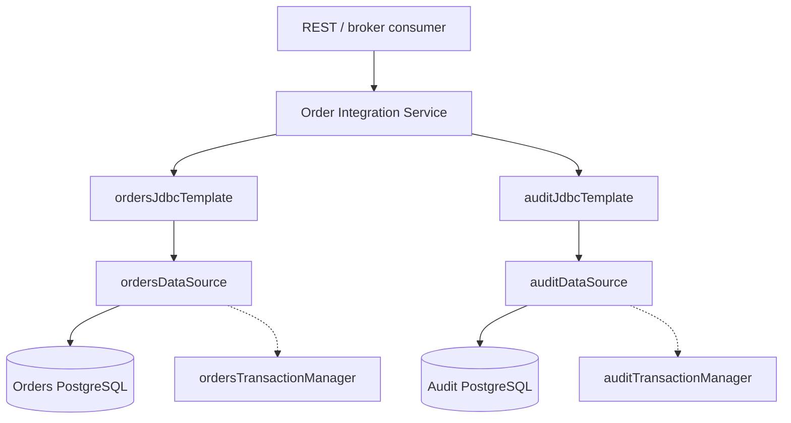
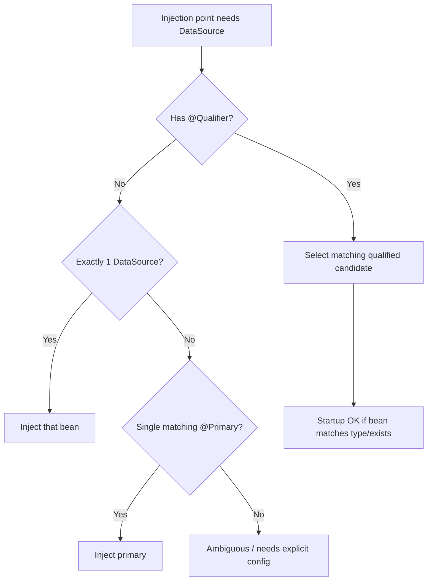
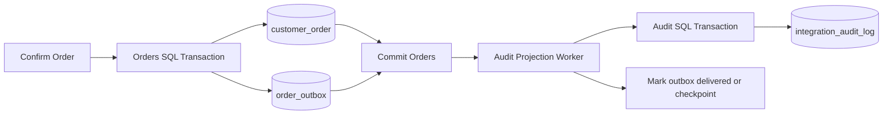

# Configuring Multiple DataSources with @Primary and Qualifiers

## 1. When Does a Spring Boot Application Need Multiple DataSources?

In an integration application, data rarely lives in a single database. For instance, an **Order Integration Service** processes orders in a primary PostgreSQL database while persisting reconciliation/audit records in a separate PostgreSQL database. Or the application reads a legacy ERP database while writing new business tables, queries a reporting replica, or stores integration checkpoints in a dedicated database.

With a single `DataSource`, Spring Boot automatically configures the connection pool, `JdbcTemplate`, transaction manager, and related database infrastructure from `spring.datasource.*`. Once **multiple `DataSource` beans** exist, resolution is no longer automatic:

- Which controller or service should use the Orders database?
- Which Audit database should the audit repository borrow connections from?
- Which bean is injected when a component asks simply for `DataSource`?
- Which database does `@Transactional` roll back?
- Which datasource does Flyway or Liquibase migrate?
- Which persistence unit are JPA repositories and `EntityManagerFactory` bound to?
- When two databases commit separately, how is consistency preserved?

Spring's two fundamental tools are **`@Primary`** and **`@Qualifier`**, yet they only solve **bean selection during dependency injection**. They **do not** create distributed transactions, route SQL statements automatically by table name, or guarantee framework initializers and migration tools always target the right database.

This lesson belongs to the **SQL Connectivity** chapter of the **SPRING_BOOT_INTEGRATION** module, focusing on Spring Boot integration across HTTP clients, databases, caches, message brokers, and Spring Integration adapters. Examples connect datasource selection with configuration, data contracts, transactions, errors, retries, testing, observability, and idempotency.

### 1.1. Learning Objectives

After this lesson, you will be able to:

1. Configure two independent `DataSourceProperties` and two `HikariDataSource` beans in Spring Boot.
2. Understand `@Primary` rules when injecting by type and how `@Qualifier` targets an exact bean.
3. Create per-datasource `JdbcTemplate`/`NamedParameterJdbcTemplate`/`JdbcClient` beans so queries never hit the wrong DB accidentally.
4. Register independent `PlatformTransactionManager` beans and apply `@Transactional(transactionManager = "...")` to the right data boundary.
5. Distinguish multi-datasource JDBC setups from JPA multi-`EntityManagerFactory`/`@EnableJpaRepositories` setups.
6. Direct Flyway/migrations to each database intentionally, preventing one migration from writing into the wrong DB.
7. Identify transaction limits across databases so `@Primary` is never mistaken for cross-DB atomicity.
8. Test routing, pool isolation, rollbacks, and database ownership using PostgreSQL Testcontainers.
9. Diagnose startup failures, bean ambiguity, `url`/`jdbcUrl` binding bugs, pool exhaustion, and mismatched transaction managers.

> **Version and scope:** Examples use Java 17+, Spring Boot 3.2+/Spring Framework 6.x, PostgreSQL, and HikariCP. Some auto-configuration hooks or builder APIs vary across minor releases; verify against your project's BOM and documentation before applying. Java snippets omit imports/packages, and test code provides illustrative skeletons; complete designs to match your real schema and infrastructure. Never read secrets from incoming user requests.

### 1.2. Two Databases Used Throughout Examples

| Datasource | Role | Sample data | Transaction owner |
|---|---|---|---|
| `ordersDataSource` | Primary business database | `customer_order`, `order_outbox` | `ordersTransactionManager` |
| `auditDataSource` | Log / reconciliation database | `integration_audit_log` | `auditTransactionManager` |

Diagram:



Both databases could live on one server in development, yet they use **two connection pools** and two separate transaction managers. To keep failure windows explicit, examples model **two independent PostgreSQL databases**; never assume sharing a Java thread merges them into one transaction.

## 2. Understanding `@Primary` and `@Qualifier` Properly

### 2.1. `@Primary` Marks the Default Candidate Among Multiple Beans of the Same Type

If the Spring container holds:

```java
@Bean("ordersDataSource")
@Primary
DataSource ordersDataSource() { /* ... */ }

@Bean("auditDataSource")
DataSource auditDataSource() { /* ... */ }
```

then an unqualified injection point:

```java
@Component
class DefaultDataSourceUser {
    DefaultDataSourceUser(DataSource dataSource) {
        // In this example, the primary bean is ordersDataSource.
    }
}
```

normally receives `ordersDataSource` as the **single** matching primary candidate. This helps auto-configurations or legacy code expecting one default `DataSource`.

**However, `@Primary` does not automatically:**

- Route all `JdbcTemplate` instances to Orders if they carry an Audit qualifier.
- Infer the right bean from table names or repository names.
- Span a single transaction across both databases.
- Pick the intended `@Transactional` manager in every topology with multiple `PlatformTransactionManager` beans.
- Control Flyway or Liquibase outside auto-configuration rules.

Mark only **one** primary candidate per type within an overlapping injection scope; marking both DataSources `@Primary` restores ambiguity.

### 2.2. `@Qualifier` Declares an Explicit Dependency

For an Audit-specific repository:

```java
@Repository
public class AuditLogRepository {
    private final JdbcTemplate auditJdbc;

    public AuditLogRepository(
            @Qualifier("auditJdbcTemplate")
            JdbcTemplate auditJdbc) {
        this.auditJdbc = auditJdbc;
    }
}
```

The bean name/qualifier on the constructor is an **explicit wiring contract**: the Audit repository cannot fall back to Orders simply because Orders is primary. If the qualified bean is missing, startup fails—far safer than silently writing into the wrong database.

Parameter or field names like `auditJdbcTemplate` can sometimes act as resolution hints when builds retain parameter names, yet **never rely on that** for critical data routing. Use explicit `@Qualifier` and test it.

### 2.3. Resolution Order with Multiple Beans

Key rules:

- Bean type filters first: `@Qualifier("auditDataSource")` cannot turn a `HikariDataSource` into a `JdbcTemplate` bean.
- `@Primary` selects the default candidate when an injection point omits a qualifier.
- `@Qualifier` at an injection point selects the matching candidate/bean name even if another bean is `@Primary`.
- `@Resource(name = "...")` follows by-name semantics with slightly different behavior; in modern Spring with constructor injection, `@Qualifier` is usually clearer.
- When injecting a collection such as `List<DataSource>` or `Map<String, DataSource>`, having a primary bean **does not exclude the other beans**. `@Primary` resolves ambiguity only for single-valued dependencies.
- Defining custom `@Bean`s of a type can cause auto-configurations guarded by `@ConditionalOnMissingBean` to **back off**; never assume Boot still creates a fallback `DataSource`.

### 2.4. Disambiguation Flowchart



This diagram omits deeper Spring resolution mechanics (fallbacks, priority, parameter name matching) that vary across versions; in multi-database integration systems, **explicit qualifiers** make code far easier to audit than relying on heuristics.

### 2.5. Do Not Pick Primary Emotionally as "The Most Important Database"

Primary should be whichever datasource components **need as their default**, such as the Orders database. In your own code carrying side effects, still specify explicit qualifiers even when a primary exists.

If two databases have equal standing, you might consider **omitting `@Primary`** on application dependencies to force explicit choice everywhere. Still, several Spring Boot auto-configurations expect a single candidate unless explicitly overridden; this lesson designates Orders as primary to illustrate Boot integration while enforcing qualifiers at DAO and transaction boundaries.

## 3. `DataSourceProperties`, `HikariDataSource`, and URL Binding

### 3.1. Components to Distinguish

| Component | Role | Example |
|---|---|---|
| `DataSourceProperties` | Reads JDBC URL/driver/username/password from config | `app.datasource.orders.url` |
| `DataSource` | Interface supplying JDBC connections | `ordersDataSource` |
| `HikariDataSource` | Connection pool implementation | `maximumPoolSize=10` |
| `JdbcTemplate` | Executes SQL via the target datasource | `ordersJdbcTemplate` |
| `PlatformTransactionManager` | Local begin/commit/rollback | `ordersTransactionManager` |
| `EntityManagerFactory` | JPA persistence unit, if using JPA | `ordersEntityManagerFactory` |

In Boot's default **single-datasource** setup, the framework creates supporting beans automatically. Once you define **two user-defined `DataSource` beans**, you must explicitly manage pool construction, `JdbcTemplate` beans, transaction managers, and initializers/migrations. Do not assume Boot automatically generates two complete sets.

### 3.2. Why Use `DataSourceProperties` Instead of Binding URL Directly onto Hikari?

HikariCP exposes `jdbcUrl`, whereas standard Spring Boot configuration uses `spring.datasource.url`. `DataSourceProperties` knows how to translate **`url` into pool-specific `jdbcUrl`** when you invoke:

```java
properties.initializeDataSourceBuilder()
    .type(HikariDataSource.class)
    .build();
```

If you put `@ConfigurationProperties("app.datasource.orders")` directly on `HikariDataSource` while YAML defines `url`, you can encounter `jdbcUrl is required with driverClassName` or an unbound URL. Splitting **connection** properties from **pool configuration** avoids this trap.

### 3.3. Configuration Convention for Two Databases

```yaml
# application-local.yml, illustrative; production uses secrets
app:
  datasource:
    orders:
      url: jdbc:postgresql://127.0.0.1:15432/orders
      username: orders_user
      password: ${ORDERS_DB_PASSWORD:orders-local-only}
      driver-class-name: org.postgresql.Driver
      configuration:
        pool-name: orders-pool
        maximum-pool-size: 10
        minimum-idle: 2
        connection-timeout: 3000
        validation-timeout: 1000
    audit:
      url: jdbc:postgresql://127.0.0.1:25432/audit
      username: audit_user
      password: ${AUDIT_DB_PASSWORD:audit-local-only}
      driver-class-name: org.postgresql.Driver
      configuration:
        pool-name: audit-pool
        maximum-pool-size: 4
        minimum-idle: 1
        connection-timeout: 3000
        validation-timeout: 1000
```

`app.datasource.*` is an **application-defined namespace**, not a built-in Spring Boot property prefix that auto-creates two DataSources. You must define two `@ConfigurationProperties` beans and two `DataSource` beans explicitly.

Hikari's `connection-timeout` measures time spent **waiting to borrow a connection from the pool** when none are idle; it is **not** the PostgreSQL driver's TCP connect timeout. For PostgreSQL driver timeouts, inspect JDBC URL/driver properties like `connectTimeout`, `socketTimeout`, and TLS per your driver version docs. Never rely on Hikari's connection timeout to guarantee database network calls never hang past 3 seconds.

Fallback passwords in YAML are strictly for local execution; in production **never supply dummy default passwords** that let an app boot against the wrong environment. Use secret managers, environment injection, network segmentation, TLS, and least-privilege DB roles.

## 4. Configuring Two `DataSource` Beans with `@Primary`

### 4.1. Self-Contained Java Configuration

```java
// MultiDataSourceConfiguration.java — imports omitted
@Configuration(proxyBeanMethods = false)
public class MultiDataSourceConfiguration {

    @Bean("ordersDataSourceProperties")
    @Primary
    @ConfigurationProperties("app.datasource.orders")
    public DataSourceProperties ordersDataSourceProperties() {
        return new DataSourceProperties();
    }

    @Bean("auditDataSourceProperties")
    @ConfigurationProperties("app.datasource.audit")
    public DataSourceProperties auditDataSourceProperties() {
        return new DataSourceProperties();
    }

    @Bean("ordersDataSource")
    @Primary
    @ConfigurationProperties(
            "app.datasource.orders.configuration")
    public HikariDataSource ordersDataSource(
            @Qualifier("ordersDataSourceProperties")
            DataSourceProperties props) {
        return props.initializeDataSourceBuilder()
                .type(HikariDataSource.class)
                .build();
    }

    @Bean("auditDataSource")
    @ConfigurationProperties(
            "app.datasource.audit.configuration")
    public HikariDataSource auditDataSource(
            @Qualifier("auditDataSourceProperties")
            DataSourceProperties props) {
        return props.initializeDataSourceBuilder()
                .type(HikariDataSource.class)
                .build();
    }
}
```

Explanation:

1. `ordersDataSourceProperties` binds `url`, `username`, `password`, and `driver-class-name` from `app.datasource.orders`.
2. `auditDataSourceProperties` binds the matching properties from `app.datasource.audit`.
3. `ordersDataSource` is initialized from **Orders properties** and then binds Hikari settings from `app.datasource.orders.configuration`.
4. `auditDataSource` is initialized from **Audit properties** and binds its own Hikari settings independently.
5. `@Primary` sits on both Orders `DataSourceProperties` **and** Orders `DataSource` because some auto-configurations/initializers expect a default candidate of both types.
6. `@Qualifier` on method parameters prevents Orders and Audit DataSources from crossing properties.

**Never** mark the Audit datasource `@Primary`. With wiring intact, unqualified `DataSource` injection resolves to Orders; any method needing Audit specifies `@Qualifier("auditDataSource")`.

### 4.2. Why Return `HikariDataSource` from the `@Bean` Method?

Declaring the return type `HikariDataSource` lets Spring's property binder see pool-specific setters like `setMaximumPoolSize` and `setPoolName`. If a method returns only `DataSource` while carrying `@ConfigurationProperties`, pool-specific property binding may fail to apply as expected because the bean's exposed type metadata is less specific.

Depending on Spring Boot versions, `DataSourceBuilder` supports other pools; if selecting Tomcat JDBC or DBCP2, return the matching type and check exact property names. Never copy a `HikariDataSource` bean and pass Tomcat-only properties.

### 4.3. Treat Bean Names as a Configuration Contract

Convention:

```text
ordersDataSourceProperties
ordersDataSource
ordersJdbcTemplate
ordersTransactionManager

auditDataSourceProperties
auditDataSource
auditJdbcTemplate
auditTransactionManager
```

Consistent prefixes make code traceable end to end: repository → template → datasource → pool → database. If someone renames `auditDataSource` without updating `@Qualifier("auditDataSource")`, startup fails immediately instead of silently falling back to Orders.

### 4.4. Understanding Boot Auto-Configuration Once `DataSource` Beans Exist

Normally `DataSourceAutoConfiguration` creates a datasource when no user-defined bean exists. Once you define both `ordersDataSource` and `auditDataSource`, **do not expect Boot to also build another bean from `spring.datasource.*`**. Other auto-configurations may either pick the primary candidate or require explicit wiring:

- `JdbcTemplateAutoConfiguration` may create one default template for the primary candidate, yet **will not create both named templates automatically**.
- `DataSourceTransactionManagerAutoConfiguration` depends on missing-bean conditions; once you create custom managers, wire them explicitly.
- `HibernateJpaAutoConfiguration` expects matching datasource/persistence setup and normally does not build two `EntityManagerFactory` units from two pools.
- `FlywayAutoConfiguration`/SQL initialization targets one primary datasource unless configured; migrating two DBs needs explicit coordination.
- Health/metrics may report multiple pools; inspect exact metric names and tags rather than assuming one.

Especially if `spring.datasource.url` still lingers alongside `app.datasource.orders.url`, check **which bean actually consumes which namespace**; unreferenced YAML keys have zero effect.

### 4.5. Catch Missing or Invalid Config at Startup

`DataSourceProperties` catches basic gaps when building the pool, yet do not wait for the first live SQL failure. Add binding checks or a validated policy record:

```java
// Illustrates startup validation, not a replacement for
// Spring Boot's default DataSourceProperties.
@ConfigurationProperties(prefix = "app.db-policy")
public record DatabasePolicy(
        boolean requireTls,
        int maxTotalConnections
) {
    public DatabasePolicy {
        if (maxTotalConnections < 1) {
            throw new IllegalArgumentException(
                    "max-total-connections must be positive");
        }
    }
}
```

In production, validate JDBC URL hosts/databases against trusted deployment configs, enforce TLS/truststore/hostname verification, and prevent connecting to unintended environments. Never allow HTTP clients to supply arbitrary JDBC URLs due to SSRF and database exfiltration risks.

## 5. `JdbcTemplate` and `@Qualifier` per Database

### 5.1. Creating Two `JdbcTemplate` Beans

```java
// Add to MultiDataSourceConfiguration
@Bean("ordersJdbcTemplate")
@Primary
public JdbcTemplate ordersJdbcTemplate(
        @Qualifier("ordersDataSource") DataSource ds) {
    return new JdbcTemplate(ds);
}

@Bean("auditJdbcTemplate")
public JdbcTemplate auditJdbcTemplate(
        @Qualifier("auditDataSource") DataSource ds) {
    return new JdbcTemplate(ds);
}
```

`JdbcTemplate` is reusable and thread-safe once configured; each holds a reference to its injected datasource. **Never** mutate a singleton `JdbcTemplate`'s datasource per request or tenant at runtime. For dynamic multi-tenancy, use dedicated routing/multitenancy contracts with access checks rather than swapping `@Qualifier` from user input.

### 5.2. Repositories Must Access Only Their Assigned Database

```java
@Repository
public class OrderJdbcRepository {
    private final JdbcTemplate jdbc;

    public OrderJdbcRepository(
            @Qualifier("ordersJdbcTemplate")
            JdbcTemplate jdbc) {
        this.jdbc = jdbc;
    }

    public int confirm(String tenant, String orderId) {
        return jdbc.update("""
            UPDATE customer_order
               SET status = 'CONFIRMED'
             WHERE tenant_id = ?
               AND order_id = ?
               AND status = 'PENDING'
            """, tenant, orderId);
    }
}

@Repository
public class AuditJdbcRepository {
    private final JdbcTemplate jdbc;

    public AuditJdbcRepository(
            @Qualifier("auditJdbcTemplate")
            JdbcTemplate jdbc) {
        this.jdbc = jdbc;
    }

    public int write(
            UUID eventId, String tenantId,
            String orderId, String eventType) {
        return jdbc.update("""
            INSERT INTO integration_audit_log(
                event_id, tenant_id,
                aggregate_id, event_type)
            VALUES (?, ?, ?, ?)
            ON CONFLICT (event_id) DO NOTHING
            """, eventId, tenantId,
                 orderId, eventType);
    }
}
```

This uses PostgreSQL SQL; schema/migrations must create the tables. `ON CONFLICT` is not portable across all databases. Always use bind parameters rather than concatenating user input into SQL, especially `tenantId`/`orderId` from REST or broker payloads. Select databases through bean wiring, never by building datasource URLs from user input.

### 5.3. Do Not Let `@Primary` Hide a Missing Qualifier on a DAO

Anti-pattern:

```java
@Repository
class AuditRepositoryIncorrect {
    AuditRepositoryIncorrect(JdbcTemplate jdbcTemplate) {
        // If ordersJdbcTemplate is @Primary,
        // this will write AUDIT into the Orders DB!
    }
}
```

Bugs like this can stay silent if both databases happen to contain an `integration_audit_log` table from copied schemas—SQL "succeeds" while writing into the wrong database. Therefore **tests must verify target DB contents in both databases**, not just assert method return values.

### 5.4. `NamedParameterJdbcTemplate` and `JdbcClient` Also Need Qualifiers

For SQL statements with many parameters, declare dedicated named templates:

```java
@Bean("ordersNamedJdbc")
@Primary
NamedParameterJdbcTemplate ordersNamedJdbc(
        @Qualifier("ordersDataSource") DataSource ds) {
    return new NamedParameterJdbcTemplate(ds);
}

@Bean("auditNamedJdbc")
NamedParameterJdbcTemplate auditNamedJdbc(
        @Qualifier("auditDataSource") DataSource ds) {
    return new NamedParameterJdbcTemplate(ds);
}
```

In Spring Framework 6.1+, `JdbcClient` offers a fluent JDBC API:

```java
@Bean("ordersJdbcClient")
@Primary
JdbcClient ordersJdbcClient(
        @Qualifier("ordersDataSource") DataSource ds) {
    return JdbcClient.create(ds);
}

@Bean("auditJdbcClient")
JdbcClient auditJdbcClient(
        @Qualifier("auditDataSource") DataSource ds) {
    return JdbcClient.create(ds);
}
```

`JdbcClient` improves ergonomics for CRUD/read queries, yet **does not change transaction boundaries**: a client built from `auditDataSource` still borrows Audit connections. Never assume two clients share a transaction merely because both expose the same fluent interface.

### 5.5. Other Integration Components Must Also Pick the Right DataSource

In Spring Boot Integration, several components can require a database:

- Spring Integration JDBC inbound pollers and outbound adapters.
- `JdbcMessageStore` or persistent message channels.
- Outbox publisher checkpoints, lock tables, or scheduling state.
- Spring Batch metadata store.
- Spring Session JDBC.
- Quartz JDBC JobStore.
- Flyway/Liquibase schema migrations.
- Application-specific reconciliation/reporting services.

Do not assume an adapter automatically chooses `auditDataSource` just because a table is named `audit_*`. Inspect each constructor or DSL factory to see which `DataSource`/`JdbcTemplate`/`PlatformTransactionManager` it accepts, and pass explicit `@Qualifier` beans. When a primary exists, auto-configuration defaults to **Orders**—fine for business data, wrong for isolated integration metadata.

## 6. `@Transactional` and Two `PlatformTransactionManager` Beans

### 6.1. Each Database Has Its Own Local Transaction Manager

For imperative JDBC, use `JdbcTransactionManager` (Spring JDBC) or `DataSourceTransactionManager`:

```java
// Add to MultiDataSourceConfiguration
@Bean("ordersTransactionManager")
@Primary
public PlatformTransactionManager ordersTransactionManager(
        @Qualifier("ordersDataSource") DataSource ds) {
    return new JdbcTransactionManager(ds);
}

@Bean("auditTransactionManager")
public PlatformTransactionManager auditTransactionManager(
        @Qualifier("auditDataSource") DataSource ds) {
    return new JdbcTransactionManager(ds);
}
```

Each manager controls connections, commits, and rollbacks strictly within its injected datasource. They do not synchronize commits across Orders and Audit, nor are they XA/JTA transaction managers.

### 6.2. Specifying the Exact Transaction Manager at Service Boundaries

```java
@Service
public class OrderCommandService {
    private final OrderJdbcRepository orders;

    public OrderCommandService(OrderJdbcRepository orders) {
        this.orders = orders;
    }

    @Transactional("ordersTransactionManager")
    public void confirm(String tenantId, String orderId) {
        int changed = orders.confirm(tenantId, orderId);
        if (changed != 1) {
            throw new IllegalStateException(
                    "Order is not in PENDING state");
        }
        // order_outbox can also be written to the same Orders DB here.
    }
}

@Service
public class AuditCommandService {
    private final AuditJdbcRepository audit;

    public AuditCommandService(AuditJdbcRepository audit) {
        this.audit = audit;
    }

    @Transactional("auditTransactionManager")
    public void record(
            UUID eventId, String tenantId,
            String orderId, String type) {
        audit.write(eventId, tenantId, orderId, type);
    }
}
```

Even though `ordersTransactionManager` is `@Primary`, explicit `@Transactional("...")` keeps intent clear and avoids relying on default resolution conventions. When custom transaction managers exist, relying on a single `@Primary` does not replace specifying managers explicitly at database-specific boundaries.

### 6.3. Sharing a Thread Does Not Mean Sharing a Transaction Across Two Databases

Anti-pattern:

```java
@Transactional("ordersTransactionManager")
public void confirmAndAuditBad(
        String tenantId, String orderId) {
    ordersJdbcTemplate.update("""
        UPDATE customer_order SET status='CONFIRMED'
         WHERE tenant_id=? AND order_id=?
        """, tenantId, orderId);
    auditJdbcTemplate.update("""
        INSERT INTO integration_audit_log(
            event_id, tenant_id,
            aggregate_id, event_type)
        VALUES (?, ?, ?, 'ORDER_CONFIRMED')
        """, UUID.randomUUID(), tenantId, orderId);
}
```

`ordersTransactionManager` manages only the **Orders connection**. When `auditJdbcTemplate` acquires a connection from `auditDataSource`, it does not automatically join the Orders transaction. Depending on pool/driver settings, the audit SQL may auto-commit independently. If Orders subsequently rolls back, the Audit row stays committed.

**Marking both DataSources `@Primary` or nesting `@Transactional` annotations will not solve this.** Choose explicit business semantics: is Audit best-effort or mandatory? If mandatory, write the audit intent/outbox inside the Orders transaction and deliver to the Audit DB via at-least-once processing + idempotency.

### 6.4. `REQUIRES_NEW` Only Starts a Fresh Local Transaction

```java
@Transactional(
        transactionManager = "auditTransactionManager",
        propagation = Propagation.REQUIRES_NEW)
public void writeAuditInIndependentTx(...) { /* ... */ }
```

When called through a Spring proxy, this opens a transaction under the **Audit manager**, yet does not turn Orders + Audit into an atomic commit. Called from an Orders transaction, you can observe:

1. Audit commits successfully.
2. Orders commit fails or rolls back.
3. The Audit row remains committed.

If Audit "must never exist when Orders rolls back," use an outbox/after-commit pipeline with durability and compensation rather than expecting `REQUIRES_NEW` to perform a distributed rollback.

### 6.5. Rollback Rules Still Apply Only to the Selected Manager

By default Spring's transaction interceptor rolls back on unchecked exceptions (`RuntimeException`/`Error`), while checked exceptions require explicit rules when desired. Example:

```java
@Transactional(
        transactionManager = "ordersTransactionManager",
        rollbackFor = IOException.class)
public void writeAndValidate(...) throws IOException {
    // JDBC work on Orders DB
}
```

This rule affects **only the Orders local transaction rollback**. An HTTP POST, RabbitMQ publish, or SQL run on `auditDataSource` outside the Orders manager still will not roll back alongside Orders.

### 6.6. `TransactionSynchronizationManager` Is Not a Database Router

In imperative JDBC/JPA, Spring binds resources per thread and transaction manager; `TransactionSynchronizationManager.isActualTransactionActive()` indicates an active transaction context exists, **not that Audit JDBC work participates in the Orders transaction**. Verify the active `DataSource` resource and transaction manager, and prove rollback behavior with real database assertions.

With `@Async`, `CompletableFuture`, or Spring Integration `ExecutorChannel`, thread-bound transactions do not automatically cross thread boundaries. Worker threads need their own transaction on the intended database, and cross-system guarantees require outbox, idempotency, and reconciliation.

## 7. Reading/Writing Two Databases Safely: Local Transactions and Outbox

### 7.1. The Cross-Database Order + Audit Problem

Suppose the business contract for "confirm order and record audit" requires:

> Every `CONFIRMED` order must eventually have a matching audit entry, even if the Audit DB is temporarily offline. No audit entry may be recorded for an uncommitted order.

Writing straight to the Audit DB inside `@Transactional("ordersTransactionManager")` leaves a split-commit window. The durable pattern is **writing the Order update + audit intent/outbox inside the same Orders database transaction**, then running an idempotent worker to project intents to the Audit database.



### 7.2. Illustrative Schema in the Orders Database

```sql
CREATE TABLE customer_order (
    tenant_id    VARCHAR(80) NOT NULL,
    order_id     VARCHAR(80) NOT NULL,
    status       VARCHAR(32) NOT NULL,
    version      BIGINT NOT NULL DEFAULT 0,
    PRIMARY KEY (tenant_id, order_id)
);

CREATE TABLE order_outbox (
    event_id          UUID PRIMARY KEY,
    tenant_id         VARCHAR(80) NOT NULL,
    aggregate_id      VARCHAR(80) NOT NULL,
    event_type        VARCHAR(80) NOT NULL,
    payload_json      JSONB NOT NULL,
    status            VARCHAR(24) NOT NULL DEFAULT 'PENDING',
    attempts          INTEGER NOT NULL DEFAULT 0,
    created_at        TIMESTAMPTZ NOT NULL
                      DEFAULT CURRENT_TIMESTAMP,
    delivered_at      TIMESTAMPTZ,
    CONSTRAINT ck_orders_outbox_status
      CHECK (status IN ('PENDING','SENT'))
);
```

### 7.3. Illustrative Schema in the Audit Database

```sql
CREATE TABLE integration_audit_log (
    event_id      UUID PRIMARY KEY,
    tenant_id     VARCHAR(80) NOT NULL,
    aggregate_id  VARCHAR(80) NOT NULL,
    event_type    VARCHAR(80) NOT NULL,
    processed_at  TIMESTAMPTZ NOT NULL
                  DEFAULT CURRENT_TIMESTAMP
);
```

Unique `event_id` makes Audit inserts idempotent. If the worker crashes after Audit commits but before marking the Orders outbox row `SENT`, the event replays safely; Audit's `INSERT ... ON CONFLICT DO NOTHING` blocks duplicate audit rows. If business rules allow only one event type/operation per aggregate, enforce an additional unique business key.

### 7.4. Transaction Writing Order and Outbox

```java
@Service
public class ConfirmOrderWithOutboxService {
    private final JdbcTemplate ordersJdbc;
    private final ObjectMapper mapper;

    public ConfirmOrderWithOutboxService(
            @Qualifier("ordersJdbcTemplate")
            JdbcTemplate ordersJdbc,
            ObjectMapper mapper) {
        this.ordersJdbc = ordersJdbc;
        this.mapper = mapper;
    }

    @Transactional("ordersTransactionManager")
    public void confirm(
            String tenantId, String orderId, UUID eventId) {
        // Validate IDs and authorization at the application boundary.
        int changed = ordersJdbc.update("""
            UPDATE customer_order
               SET status='CONFIRMED', version=version+1
             WHERE tenant_id=? AND order_id=?
               AND status='PENDING'
            """, tenantId, orderId);

        if (changed != 1) {
            throw new IllegalStateException(
                    "Order cannot be confirmed");
        }

        String payload;
        try {
            payload = mapper.writeValueAsString(
                Map.of("tenantId", tenantId, "orderId", orderId));
        } catch (JsonProcessingException ex) {
            throw new IllegalStateException(
                    "Failed to serialize event", ex);
        }

        ordersJdbc.update("""
            INSERT INTO order_outbox(
                event_id, tenant_id, aggregate_id,
                event_type, payload_json)
            VALUES (?, ?, ?, 'ORDER_CONFIRMED',
                    CAST(? AS jsonb))
            """, eventId, tenantId, orderId, payload);
    }
}
```

This illustrates a **local atomic commit**; production also needs a stable unique command/operation ID at the HTTP/broker boundary so retrying `confirm` never mints a fresh `eventId`, plus schema version/contract validation. Keep `eventId` deterministic across replays—never generate a new random UUID on every retry of the same logical command.

### 7.5. Audit Consumer/Worker Using Its Separate Audit Manager

```java
@Service
public class AuditProjectionService {
    private final JdbcTemplate auditJdbc;

    public AuditProjectionService(
            @Qualifier("auditJdbcTemplate")
            JdbcTemplate auditJdbc) {
        this.auditJdbc = auditJdbc;
    }

    @Transactional("auditTransactionManager")
    public void apply(
            UUID eventId, String tenantId,
            String aggregateId, String eventType) {
        auditJdbc.update("""
            INSERT INTO integration_audit_log(
                event_id, tenant_id, aggregate_id,
                event_type)
            VALUES (?, ?, ?, ?)
            ON CONFLICT (event_id) DO NOTHING
            """, eventId, tenantId,
                 aggregateId, eventType);
    }
}
```

The worker reads `order_outbox` from the Orders datasource, invokes `AuditProjectionService.apply` in an Audit transaction, waits for commit, and marks the Orders outbox row `SENT` in **a separate Orders transaction**. If it crashes between Audit commit and Orders update, replay is safe because Audit's unique key rejects duplicates.

Never keep the Orders transaction open while waiting on the Audit DB, a broker, or HTTP. With multiple workers, use claim/lease/fencing tokens or partition ownership on the outbox instead of uncoordinated select-then-update. When audit insertion fails, **keep the outbox row `PENDING`**, apply bounded retries with backoff, and route persistent failures to manual review.

### 7.6. A Hand-Written Transaction Chain Does Not Guarantee Distributed Atomicity

You may see code like:

```java
@Transactional("ordersTransactionManager")
public void confirm(...) {
    orderService.confirmLocally(...);
    auditService.writeWithAuditTransaction(...);
}
```

Even when each bean is properly proxied and Audit uses `REQUIRES_NEW`, **the commit order across two databases** leaves a failure window; if one commits and the other fails, nothing automatically rolls back the first database. `@Primary` has no bearing on this.

If your organization genuinely requires ACID across two XA-capable resources, you need a JTA/XA coordinator, XA-capable datasources, recovery logs, and an operational plan. Never assume adding `JtaTransactionManager` over two ordinary local `HikariDataSource` pools provides two-phase commit. In microservice architectures, outbox/idempotency/compensation is usually easier to reason about and operate.

## 8. Multiple DataSources in Spring Data JPA Applications

### 8.1. JDBC Multi-DataSource vs. JPA Multi-EntityManagerFactory

`JdbcTemplate` only needs a `DataSource`. By contrast, Spring Data JPA repositories require:

- Which `EntityManagerFactory` owns which entity mappings and persistence unit.
- Which `JpaTransactionManager` coordinates the `EntityManager`/connections for that persistence unit.
- Which repository packages `@EnableJpaRepositories` scans.
- Which Hibernate/JPA settings and schema validation apply to each database.

Simply creating two `DataSource` beans and putting `@Qualifier("auditDataSource")` on JPA repositories is **insufficient**, because JPA repository factories require a specific `EntityManagerFactory`, not just a JDBC connection.

### 8.2. Separating Packages by Ownership

Example project layout:

```text
com.example.integration
  /orders
    /jpa
      OrderEntity
      OrderJpaRepository
  /audit
    /jpa
      AuditEntity
      AuditJpaRepository
  /configuration
      MultiDataSourceConfiguration
      OrdersJpaConfiguration
      AuditJpaConfiguration
```

Prevent Orders `@Entity` and Audit `@Entity` classes from being scanned into the same persistence unit when they belong to distinct schemas or databases. `@EnableJpaRepositories` on the two configuration classes must point to **non-overlapping packages** or define explicit filters.

### 8.3. Orders `EntityManagerFactory` / Transaction Manager

```java
@Configuration(proxyBeanMethods = false)
@EnableJpaRepositories(
    basePackages = "com.example.integration.orders.jpa",
    entityManagerFactoryRef = "ordersEntityManagerFactory",
    transactionManagerRef = "ordersJpaTransactionManager")
public class OrdersJpaConfiguration {

    @Bean("ordersEntityManagerFactory")
    @Primary
    public LocalContainerEntityManagerFactoryBean
    ordersEntityManagerFactory(
            EntityManagerFactoryBuilder builder,
            @Qualifier("ordersDataSource") DataSource ds) {
        return builder
                .dataSource(ds)
                .packages(
                    com.example.integration.orders.jpa
                        .OrderEntity.class)
                .persistenceUnit("orders-unit")
                .build();
    }

    @Bean("ordersJpaTransactionManager")
    @Primary
    public PlatformTransactionManager ordersJpaTransactionManager(
            @Qualifier("ordersEntityManagerFactory")
            EntityManagerFactory emf) {
        return new JpaTransactionManager(emf);
    }
}
```

`EntityManagerFactoryBuilder` is supplied by Boot's JPA auto-configuration when conditions match; custom configuration or explicit builders may be needed if auto-configuration is overridden. `@Primary` on the EMF and `JpaTransactionManager` satisfies injection points needing default JPA resources, while repository packages and managers remain explicitly wired.

### 8.4. Audit `EntityManagerFactory` / Transaction Manager

```java
@Configuration(proxyBeanMethods = false)
@EnableJpaRepositories(
    basePackages = "com.example.integration.audit.jpa",
    entityManagerFactoryRef = "auditEntityManagerFactory",
    transactionManagerRef = "auditJpaTransactionManager")
public class AuditJpaConfiguration {

    @Bean("auditEntityManagerFactory")
    public LocalContainerEntityManagerFactoryBean
    auditEntityManagerFactory(
            EntityManagerFactoryBuilder builder,
            @Qualifier("auditDataSource") DataSource ds) {
        return builder
                .dataSource(ds)
                .packages(
                    com.example.integration.audit.jpa
                        .AuditEntity.class)
                .persistenceUnit("audit-unit")
                .build();
    }

    @Bean("auditJpaTransactionManager")
    public PlatformTransactionManager auditJpaTransactionManager(
            @Qualifier("auditEntityManagerFactory")
            EntityManagerFactory emf) {
        return new JpaTransactionManager(emf);
    }
}
```

With this separation, `OrderJpaRepository` targets the Orders EMF and `AuditJpaRepository` targets the Audit EMF. Never mark the Audit EMF primary just because a repository fails; fix `basePackages`, `entityManagerFactoryRef`, and `transactionManagerRef` accurately.

### 8.5. Selecting the Right Manager in JPA Services

```java
@Service
public class JpaOrderApplicationService {
    private final OrderJpaRepository orders;

    public JpaOrderApplicationService(
            OrderJpaRepository orders) {
        this.orders = orders;
    }

    @Transactional("ordersJpaTransactionManager")
    public void confirm(String orderId) {
        OrderEntity order = orders.findById(orderId)
                .orElseThrow();
        order.confirm();
    }
}

@Service
public class JpaAuditApplicationService {
    private final AuditJpaRepository audits;

    public JpaAuditApplicationService(
            AuditJpaRepository audits) {
        this.audits = audits;
    }

    @Transactional("auditJpaTransactionManager")
    public void record(AuditEntity audit) {
        audits.save(audit);
    }
}
```

**This is a JPA variant of the JDBC setup**—do not register both a JDBC `ordersTransactionManager` and a JPA `ordersJpaTransactionManager` on the same datasource without an explicit resolution strategy. When a project combines JPA and `JdbcTemplate` against the same Orders database, `JpaTransactionManager` can coordinate JDBC access on the same `DataSource` when configured compatibly; test transaction participation and connection sharing rather than registering two competing managers on one pool.

### 8.6. JPA Multi-DataSource Pitfalls

- `@EnableJpaRepositories` scans the wrong package, causing repositories to encounter unmanaged entities and throw `Not a managed type`.
- Wiring the right EMF while pointing `transactionManagerRef` to the other database's manager.
- Hibernate `ddl-auto=update` accidentally altering the wrong schema; prefer Flyway/Liquibase and `validate` when production needs versioned migrations.
- `spring.jpa.properties.*` supplies global defaults to the builder, yet each persistence unit may need its own dialect, naming strategy, or vendor settings. Configure each EMF explicitly when they differ rather than assuming global properties fit both.
- Spring Data JPA repositories carry default `@Transactional` metadata, yet **service boundaries** and the manager configured on `@EnableJpaRepositories` must still align—never mix an Audit JPA transaction with Orders JDBC work.
- Open EntityManager in View is not a solution for JPA multi-database transactions; keeping persistence contexts open across HTTP requests increases connection usage, latency, and subtle lazy-loading bugs.
- When the second database is a read replica, guard against accidentally writing to the replica via JPA or expecting read-your-writes without explicit routing/consistency rules.

## 9. Database Migrations: Both Databases Must Have Clear Owners

### 9.1. Flyway Auto-Configuration Picks a "Default" Unless Told Otherwise

With a single datasource, Boot auto-configures Flyway easily. In multi-datasource setups without explicit routing, an Audit migration might run against the primary Orders datasource, or only one database gets migrated while the other fails at runtime with missing tables.

`@FlywayDataSource` (where supported by your Boot version) directs **Spring Boot's single auto-configured Flyway** to a specific datasource; it does not make Boot spin up two independent `Flyway` migrators automatically for every `DataSource` bean. When two databases need separate migrations, define two explicit migrators or run separate deployment migration pipelines.

### 9.2. Configuring Two Explicit `Flyway` Beans

Example using Spring Boot application-managed migrations in a hands-on setup:

```yaml
spring:
  flyway:
    enabled: false
  sql:
    init:
      mode: never
```

And:

```java
@Configuration(proxyBeanMethods = false)
public class MultiDatabaseMigrationConfiguration {

    @Bean(name = "ordersFlyway", initMethod = "migrate")
    public Flyway ordersFlyway(
            @Qualifier("ordersDataSource") DataSource ds) {
        return Flyway.configure()
                .dataSource(ds)
                .locations("classpath:db/migration/orders")
                .load();
    }

    @Bean(name = "auditFlyway", initMethod = "migrate")
    public Flyway auditFlyway(
            @Qualifier("auditDataSource") DataSource ds) {
        return Flyway.configure()
                .dataSource(ds)
                .locations("classpath:db/migration/audit")
                .load();
    }
}
```

`spring.flyway.enabled=false` stops Boot from auto-migrating one default datasource in this manual setup; it **does not** stop `@Bean(initMethod="migrate")` from running when Spring initializes those beans. `spring.sql.init.mode=never` prevents unintended `schema.sql`/`data.sql` execution. Production may run Flyway via CI/CD jobs instead of per pod; the key is that **each datasource has an explicit migration owner and locations**.

### 9.3. Ensure Migrations Complete Before JPA or DAOs Touch Tables

Declaring two Flyway beans does not automatically guarantee other initializers run **after** migrations in the desired order. In manual setups, declare explicit dependencies:

```java
@Bean("ordersJdbcTemplate")
@Primary
@DependsOn("ordersFlyway")
JdbcTemplate ordersJdbcTemplate(
        @Qualifier("ordersDataSource") DataSource ds) {
    return new JdbcTemplate(ds);
}

@Bean("auditJdbcTemplate")
@DependsOn("auditFlyway")
JdbcTemplate auditJdbcTemplate(
        @Qualifier("auditDataSource") DataSource ds) {
    return new JdbcTemplate(ds);
}
```

This **replaces** the `JdbcTemplate` bean definitions from section 5—do not register duplicate beans with the same names. With JPA, add `@DependsOn("ordersFlyway")` on the Orders EMF bean and likewise for Audit; if using other framework auto-initializers, verify startup ordering before production.

Never run two independent migrators sharing the same Flyway schema history table inside the same schema without separate namespacing. If two DataSources really point to the **same physical database/schema**, separate history tables/locations and ownership—or better yet, question why two pools exist before overlapping migrations.

### 9.4. Cross-Database Schema Changes Are Not Atomic

A deployment may migrate Orders cleanly while the Audit migration fails. No application transaction manager rolls back the Orders migration just because the Audit DB experienced an outage. Plan migrations with:

- Backwards-compatible expand/migrate/contract steps across app versions.
- Independently tracked schema versions for Orders and Audit.
- Testcontainers migration tests across both databases.
- Rollforward/recovery procedures if one database migration fails mid-deploy.
- Post-migration checks on Hibernate validation and repository SQL mappings.
- Never run `Flyway.clean()` in production to recover from a misconfigured qualifier.

### 9.5. Spring Batch, Quartz, and Spring Integration JDBC Stores

Depending on Boot/starter versions, subsystems provide dedicated annotations or settings to target a datasource—such as `@BatchDataSource` for Batch metadata or `@QuartzDataSource` for Quartz JDBC JobStore. Those target **only that subsystem**, without changing `@Qualifier` wiring in your application repositories.

For Spring Integration `JdbcMessageStore`, JDBC pollers, and adapters, supply the intended `DataSource`/`JdbcTemplate`/transaction advice explicitly:

```java
// Illustrative JDBC message store bean; schema
// namespace/message group must be configured per version.
@Bean("auditMessageStore")
JdbcMessageStore auditMessageStore(
        @Qualifier("auditDataSource") DataSource ds) {
    return new JdbcMessageStore(ds);
}
```

If the message store lives in the Audit DB, an Orders transaction rollback **does not** roll back inserts into the Audit JDBC store. For integration paths requiring atomic persistence + queued intent, store outbox/integration state in the business DB or choose a compatible transaction/routing pattern.

## 10. Multi-Connection Patterns Easily Confused with Multi-DataSource

### 10.1. Two Pools Pointing to the Same Physical Database: Is It Worth It?

Two Hikari pools can point to the same PostgreSQL cluster and database/schema using different credentials or workload profiles. They **remain two distinct datasource beans and two independent connection pools**. If each pool allows max 10 connections across 5 replicas, maximum demand reaches ~100 pool connections (before migrations/maintenance), not 10.

Do this only for clear reasons such as:

- Isolating long-running reporting queries from OLTP traffic.
- Using restricted read-only credentials for analytics/reporting.
- Capping max connections or statement timeouts for a background worker.
- Routing to a read replica per consistency rules.

If both pools target the same DB with identical privileges for no operational reason, you merely double resource and lifecycle overhead. `@Primary` does not limit total server connections.

### 10.2. Read Replicas and Consistency Boundaries

Another common pattern:

```text
ordersWriteDataSource -> PostgreSQL primary
ordersReadDataSource  -> PostgreSQL replica
```

Never treat `@Primary` as an automatic read-replica router for `SELECT` queries. If `OrderService` requires **read-your-writes** immediately after commit, querying a replica may return stale state due to replication lag. Separate DAO/read use cases or define explicit routing policies with primary fallback where needed.

Service example:

```java
@Service
class OrderReadService {
    private final JdbcTemplate replicaJdbc;

    OrderReadService(
            @Qualifier("ordersReadJdbcTemplate")
            JdbcTemplate replicaJdbc) {
        this.replicaJdbc = replicaJdbc;
    }

    public Optional<String> findStatus(
            String tenant, String orderId) {
        // Replica may lag and return stale status.
        List<String> statuses = replicaJdbc.query(
                """
                SELECT status FROM customer_order
                 WHERE tenant_id=? AND order_id=?
                """,
                (rs, rowNum) -> rs.getString(1),
                tenant, orderId);
        return statuses.stream().findFirst();
    }
}
```

`ordersReadJdbcTemplate` requires a **separately defined** bean backed by the read datasource—it was not part of the earlier Orders/Audit config. This snippet illustrates consistency semantics, not a pre-existing bean. Never base critical transactional decisions such as payment capture or inventory reservation on stale replica reads.

### 10.3. `AbstractRoutingDataSource` Solves a Different Problem

`AbstractRoutingDataSource` picks a target datasource at runtime from a routing key (commonly thread-local context) and is used for read/write splitting or multi-tenancy:

```java
public class TenantRoutingDataSource
        extends AbstractRoutingDataSource {
    @Override
    protected Object determineCurrentLookupKey() {
        return TenantContext.getTenantId();
    }
}
```

This is only a skeleton; `TenantContext` must be implemented safely, always set and cleared cleanly, derived from an authenticated principal, and tested for async thread propagation. Routing DataSources normally pick the target **when acquiring a connection**; once a transaction binds a connection, switching the routing key mid-transaction generally does not change databases.

**Never populate a `ThreadLocal` tenant key from an unverified HTTP header** to let callers choose another tenant's database. Across `@Async`/executors or Reactor reactive contexts, `ThreadLocal` has well-known pitfalls; design context propagation and security carefully.

### 10.4. `@Primary` Does Not Replace Per-Request Datasource Routing

With two fixed databases (Orders and Audit), `@Qualifier` on repositories is far simpler and easier to audit than a dynamic routing datasource. If only one service occasionally accesses Audit, avoid forcing the whole app onto thread-local routing that risks leaking tenant context across reused worker threads.

### 10.5. One Connection per Transaction: Do Not Expect a Second DataSource to Join

Inside `@Transactional("ordersTransactionManager")`, `JdbcTemplate` from the Orders DataSource uses the transaction manager's bound connection when configured properly. Calling `JdbcTemplate` from the Audit DataSource opens a **separate connection** outside that manager. There is no "two JDBC connections share a transaction because they run on the same Java thread" unless an actual distributed transaction coordinator enlists both.

### 10.6. Isolation Levels Are Scoped per Database

`@Transactional(isolation = Isolation.REPEATABLE_READ)` on the Orders manager sets isolation on the Orders JDBC connection (as supported by driver/DB). It never applies isolation to `auditDataSource` when Audit work runs in its own transaction. Likewise, `readOnly=true` is a hint/context interpreted per manager and driver; it is **not a security boundary** replacing database-level read-only credentials.

### 10.7. `LazyConnectionDataSourceProxy` and Transaction-Aware Proxies

Spring provides wrappers such as `LazyConnectionDataSourceProxy` and `TransactionAwareDataSourceProxy`. They serve specific purposes like deferring physical connection checkout or bridging legacy plain-JDBC code, yet in multi-DataSource setups you must verify **bean identity and that the transaction manager wraps the exact target datasource**.

Never wrap a datasource in a proxy while injecting the **raw unwrapped `DataSource` instance** into `JdbcTemplate` if you expect transaction managers and DAOs to share connections; test commit and rollback on real connections. Never add wrappers trying to silence `NoUniqueBeanDefinitionException`—fix that with proper `@Qualifier` and `@Primary` design.

## 11. Testcontainers: Proving Both DataSources Hit the Intended Databases

### 11.1. Why Trivial Tests Are Insufficient

A unit test like:

```java
DataSource ds = mock(DataSource.class);
JdbcTemplate jdbc = new JdbcTemplate(ds);
```

checks constructor wiring with a mock, but never proves:

- Orders and Audit receive distinct JDBC URLs.
- Hikari pools authenticate with the right usernames/passwords/databases.
- Migrations run on the intended schemas.
- `@Transactional("ordersTransactionManager")` rolls back Orders without touching Audit.
- Spring Boot does not swap datasources in a test slice.
- Both transaction managers are selected accurately by qualifier at runtime.

Running **two independent PostgreSQL containers** brings tests much closer to production without touching real databases.

### 11.2. Test Dependencies Setup

```xml
<dependencies>
  <dependency>
    <groupId>org.springframework.boot</groupId>
    <artifactId>spring-boot-starter-jdbc</artifactId>
  </dependency>
  <dependency>
    <groupId>com.zaxxer</groupId>
    <artifactId>HikariCP</artifactId>
  </dependency>
  <dependency>
    <groupId>org.postgresql</groupId>
    <artifactId>postgresql</artifactId>
    <scope>runtime</scope>
  </dependency>
  <dependency>
    <groupId>org.springframework.boot</groupId>
    <artifactId>spring-boot-starter-test</artifactId>
    <scope>test</scope>
  </dependency>
  <dependency>
    <groupId>org.testcontainers</groupId>
    <artifactId>junit-jupiter</artifactId>
    <scope>test</scope>
  </dependency>
  <dependency>
    <groupId>org.testcontainers</groupId>
    <artifactId>postgresql</artifactId>
    <scope>test</scope>
  </dependency>
</dependencies>
```

`spring-boot-starter-jdbc` normally pulls in HikariCP via Boot dependency management, so declaring HikariCP separately may be redundant unless exclusions or explicit visibility apply. Let the Spring Boot BOM align versions rather than mixing incompatible PostgreSQL or Jakarta packages.

### 11.3. Spring Context Test with Two Containers

```java
// MultiDataSourceIT.java — imports/static imports omitted
@SpringBootTest(
    webEnvironment = SpringBootTest.WebEnvironment.NONE)
@Testcontainers
class MultiDataSourceIT {

    @Container
    static PostgreSQLContainer<?> ordersDb =
        new PostgreSQLContainer<>("postgres:16-alpine")
            .withDatabaseName("orders")
            .withUsername("orders_user")
            .withPassword("orders-test-secret");

    @Container
    static PostgreSQLContainer<?> auditDb =
        new PostgreSQLContainer<>("postgres:16-alpine")
            .withDatabaseName("audit")
            .withUsername("audit_user")
            .withPassword("audit-test-secret");

    @DynamicPropertySource
    static void databaseProperties(
            DynamicPropertyRegistry registry) {
        registry.add(
            "app.datasource.orders.url", ordersDb::getJdbcUrl);
        registry.add(
            "app.datasource.orders.username",
            ordersDb::getUsername);
        registry.add(
            "app.datasource.orders.password",
            ordersDb::getPassword);
        registry.add(
            "app.datasource.audit.url", auditDb::getJdbcUrl);
        registry.add(
            "app.datasource.audit.username",
            auditDb::getUsername);
        registry.add(
            "app.datasource.audit.password",
            auditDb::getPassword);
    }

    @Autowired
    ApplicationContext context;

    @Autowired
    @Qualifier("ordersDataSource")
    DataSource ordersDataSource;

    @Autowired
    @Qualifier("auditDataSource")
    DataSource auditDataSource;

    @Autowired
    @Qualifier("ordersJdbcTemplate")
    JdbcTemplate ordersJdbc;

    @Autowired
    @Qualifier("auditJdbcTemplate")
    JdbcTemplate auditJdbc;

    @Test
    void primaryAndQualifiersSelectCorrectBeans()
            throws SQLException {
        assertSame(ordersDataSource,
                context.getBean(DataSource.class));

        assertNotSame(ordersDataSource, auditDataSource);

        try (Connection orders =
                     ordersDataSource.getConnection();
             Connection audit =
                     auditDataSource.getConnection()) {

            assertNotEquals(
                    orders.getMetaData().getURL(),
                    audit.getMetaData().getURL());
            assertEquals(
                    "orders", orders.getCatalog());
            assertEquals(
                    "audit", audit.getCatalog());
        }
    }
}
```

In PostgreSQL, `Connection.getCatalog()` typically reports the database name, though you should check your driver version's catalog behavior; verify via metadata URL/database name and `SELECT current_database()` when certainty matters:

```java
assertEquals("orders", ordersJdbc.queryForObject(
        "SELECT current_database()", String.class));
assertEquals("audit", auditJdbc.queryForObject(
        "SELECT current_database()", String.class));
```

Never log full JDBC URLs or passwords in production diagnostics. Tests use ephemeral Testcontainers credentials. `@DynamicPropertySource` targets the **custom namespaces** `app.datasource.*`, not default `spring.datasource.url`, because the custom beans bind those prefixes.

### 11.4. Why Not Rely Solely on `@ServiceConnection` for Two Databases?

`@ServiceConnection` shines when Spring Boot maps `ConnectionDetails` unambiguously for one service type. When a single test context holds **two PostgreSQL containers and two custom `DataSourceProperties` prefixes**, do not assume Spring Boot splits them automatically into Orders and Audit. `@DynamicPropertySource` above pins each URL, username, and password to its exact prefix.

If your project uses `@ServiceConnection` with named connection details or version-specific test configuration, write assertions proving each bean maps to the right container rather than expecting name matching by magic.

### 11.5. Preventing Unintended Test Database Replacement

`@JdbcTest`/`@DataJpaTest` test slices often substitute an embedded datasource if present on the classpath, and may exclude `MultiDataSourceConfiguration`. For reliable multi-database testing:

- Use `@SpringBootTest` + Testcontainers as above, or import explicit configs into the slice.
- If using slices with embedded replacement, inspect `@AutoConfigureTestDatabase(replace = AutoConfigureTestDatabase.Replace.NONE)` per your Boot version.
- Do not assert only a repository return value; check `current_database()` or rows directly in each DB.
- Run migrations for both Orders and Audit so one DB does not pass accidentally from leftover state.

### 11.6. Separate Read-Only Metadata Tests from Write Tests

Wiring tests should verify bean identity and database names. Transaction tests must seed data and assert real commits/rollbacks. Placing `@Transactional` on a test method can cause `@Transactional(REQUIRED)` service calls to join an outer test transaction that Spring Test rolls back at test end, masking real commit behavior.

To test **actual commits**, leave `@Transactional` off the test method, invoke the service through its Spring proxy, and query from an independent JDBC connection afterward. If manually steering test transactions with `TestTransaction`, verify which transaction manager it binds.

## 12. Testing Commits, Rollbacks, and Cross-Database Failures

### 12.1. Happy Path Across Two Independent Databases

Once migrations have created `customer_order` in Orders and `integration_audit_log` in Audit:

```java
@Autowired
OrderCommandService orderCommands;

@Autowired
AuditCommandService auditCommands;

@Test
void writesToTheRightDatabase() {
    String tenant = "TENANT-A";
    String orderId = "O-" + UUID.randomUUID();
    UUID eventId = UUID.randomUUID();

    ordersJdbc.update("""
        INSERT INTO customer_order(
            tenant_id, order_id, status)
        VALUES (?, ?, 'PENDING')
        """, tenant, orderId);

    orderCommands.confirm(tenant, orderId);
    auditCommands.record(
            eventId, tenant, orderId, "ORDER_CONFIRMED");

    assertEquals("CONFIRMED", ordersJdbc.queryForObject("""
        SELECT status FROM customer_order
         WHERE tenant_id=? AND order_id=?
        """, String.class, tenant, orderId));

    assertEquals(1, auditJdbc.queryForObject("""
        SELECT COUNT(*) FROM integration_audit_log
         WHERE event_id=?
        """, Integer.class, eventId));
}
```

In this snippet, fields/methods belong inside `MultiDataSourceIT` from section 11, assuming matching migrations and schemas. To catch misrouting even harder, assert `SELECT current_database()` from both templates and ensure Audit tables do not exist inside the Orders DB so wrong wiring fails loudly.

**Limitation of the happy path:** it proves each manager/repository works when both DBs are healthy, not that the two writes are atomic across databases.

### 12.2. Testing Rollback in an Orders Local Transaction

Create a separate Spring-managed bean so calls pass through a Spring proxy:

```java
@TestConfiguration(proxyBeanMethods = false)
class RollbackProbeConfig {
    @Bean
    OrdersRollbackProbe ordersRollbackProbe(
            @Qualifier("ordersJdbcTemplate")
            JdbcTemplate jdbc) {
        return new OrdersRollbackProbe(jdbc);
    }
}

class OrdersRollbackProbe {
    private final JdbcTemplate jdbc;

    OrdersRollbackProbe(JdbcTemplate jdbc) {
        this.jdbc = jdbc;
    }

    @Transactional("ordersTransactionManager")
    public void changeThenFail(
            String tenant, String orderId) {
        jdbc.update("""
            UPDATE customer_order
               SET status='CONFIRMED'
             WHERE tenant_id=? AND order_id=?
            """, tenant, orderId);
        throw new IllegalStateException(
                "Fault injection after SQL");
    }
}
```

Import `RollbackProbeConfig` into the test context (e.g., `@Import(RollbackProbeConfig.class)`), insert an order in `PENDING` state first, then:

```java
assertThrows(IllegalStateException.class,
        () -> rollbackProbe.changeThenFail(tenant, orderId));

assertEquals("PENDING", ordersJdbc.queryForObject("""
    SELECT status FROM customer_order
     WHERE tenant_id=? AND order_id=?
    """, String.class, tenant, orderId));
```

This tests genuine rollback because the SQL `UPDATE` runs inside the Orders transaction and the unchecked exception causes the proxy to roll back. Remember: keeping `@Transactional` off the test method itself ensures the outer test transaction does not obscure what the service committed or rolled back.

### 12.3. Testing Independent Audit Rollback

Similarly:

```java
@Transactional("auditTransactionManager")
public void writeAuditThenFail(
        UUID eventId, String tenantId,
        String orderId, String eventType) {
    auditJdbc.update("""
        INSERT INTO integration_audit_log(
            event_id, tenant_id,
            aggregate_id, event_type)
        VALUES (?, ?, ?, ?)
        """, eventId, tenantId,
             orderId, eventType);
    throw new IllegalStateException(
            "Simulated Audit rollback");
}
```

This must live inside a **Spring-managed bean invoked via proxy**; pasting the method straight into the test class and calling `this.writeAuditThenFail(...)` bypasses `@Transactional`. Assert afterward that `Audit` gained no row and `Orders` remained untouched. Supply valid non-null values for `tenant_id` and `aggregate_id` matching the schema so the test verifies intentional rollback rather than failing on a `NOT NULL` error.

### 12.4. Test Proving Two Databases Do Not Share an Atomic Transaction

An intentionally unsafe probe clarifies the boundary:

```java
@Service
class CrossDatabaseFailureProbe {
    private final JdbcTemplate ordersJdbc;
    private final AuditCommandService auditService;

    CrossDatabaseFailureProbe(
            @Qualifier("ordersJdbcTemplate")
            JdbcTemplate ordersJdbc,
            AuditCommandService auditService) {
        this.ordersJdbc = ordersJdbc;
        this.auditService = auditService;
    }

    @Transactional("ordersTransactionManager")
    public void auditCommitsButOrdersRollsBack(
            String tenant, String orderId,
            UUID auditEventId) {
        ordersJdbc.update("""
            UPDATE customer_order
               SET status='CONFIRMED'
             WHERE tenant_id=? AND order_id=?
            """, tenant, orderId);

        // Different bean, Audit's transaction manager:
        auditService.record(
                auditEventId, tenant,
                orderId, "ORDER_CONFIRMED");

        // Audit transaction already committed before this failure.
        throw new IllegalStateException(
                "Orders rollback after Audit commit");
    }
}
```

Outcome after calling the bean through its Spring proxy:

| Database | State after failure | Why? |
|---|---|---|
| Orders | Order remains `PENDING` | `ordersTransactionManager` rolled back |
| Audit | `integration_audit_log` contains event | `auditTransactionManager` committed independently |

Run this strictly against disposable test containers, never production. It provides concrete proof that **`@Primary` or nested `@Transactional` annotations do not create distributed atomicity**. Replace the probe with the outbox worker from section 7 and verify safe failure recovery.

### 12.5. Concurrent Writes and Unique Constraints

When two workers process the same `eventId` in Audit:

```sql
INSERT INTO integration_audit_log(
    event_id, tenant_id, aggregate_id, event_type)
VALUES (?, ?, ?, ?)
ON CONFLICT (event_id) DO NOTHING;
```

The unique PK stops two concurrent local inserts from committing the same event twice. Test using two independent concurrent connections/transactions; calling `existsById` then `insert` still races. Use database unique constraints/conditional inserts for idempotency rather than single-JVM `synchronized` blocks across multi-replica deployments.

### 12.6. Why Test Target `DataSource` Even When SQL Succeeds?

If Orders and Audit share identical table names from migration history, a repository missing `@Qualifier` can silently hit the primary Orders DB and succeed. Acceptance tests should verify:

1. `ordersJdbcTemplate` returns `current_database() = orders`.
2. `auditJdbcTemplate` returns `current_database() = audit`.
3. Calling the Audit repository increases row counts **only in the Audit database**.
4. Rolling back the Audit manager rolls back only Audit writes enrolled in that transaction.
5. Bean names and qualifiers are exact; deliberately changing a qualifier to a bogus name should fail startup or tests.

### 12.7. JPA Multiple-EMF Test

For the JPA variant, assert:

```java
@Autowired
@Qualifier("ordersEntityManagerFactory")
EntityManagerFactory ordersEmf;

@Autowired
@Qualifier("auditEntityManagerFactory")
EntityManagerFactory auditEmf;

@Test
void entityPackagesAreSeparated() {
    assertNotNull(ordersEmf.getMetamodel()
            .entity(OrderEntity.class));
    assertNotNull(auditEmf.getMetamodel()
            .entity(AuditEntity.class));

    assertThrows(IllegalArgumentException.class,
            () -> ordersEmf.getMetamodel()
                .entity(AuditEntity.class));
}
```

If an application intentionally maps shared entities into both persistence units, adjust the third assertion. The goal is catching **accidental entity/repository cross-scanning**, not treating separate EMFs as proof of cross-DB atomicity.

### 12.8. Testing Failover per DataSource

When only the Audit database is unavailable:

- The Orders service can continue accepting commands and committing local outbox rows if business policy allows.
- The Audit projection worker retries without deleting durable event intents.
- No thread or connection storms erupt when the Audit pool saturates or DNS fails.
- Health/readiness policies reflect business needs; do not let liveness restart Order Service pods just because Audit is offline when durable replay exists.

When the Orders database is unavailable, order confirmation APIs must never return "fake success" simply because Audit is still up. If business state cannot commit, never emit RabbitMQ or HTTP side effects for uncommitted data.

## 13. Pool Sizing and Timeouts Across Multiple `HikariDataSource` Beans

### 13.1. Two Pools Do Not Automatically Share a Quota

Suppose:

```text
orders maximum-pool-size = 10
audit maximum-pool-size  = 4
application replicas      = 6

theoretical pool maxima:
  orders = 10 × 6 = 60 connections
  audit  =  4 × 6 = 24 connections
```

These are **configured pool ceilings**, not live active usage; the database also reserves connections for migrations, admin tools, monitoring, and other services. If both pools hit the same PostgreSQL cluster, combined ceilings can exceed `max_connections` and cause cluster-wide outages.

### 13.2. Important Hikari Settings

| Hikari setting | Meaning | Common mistake |
|---|---|---|
| `maximumPoolSize` | Total connections allowed in the pool | Sizing too large; multiple replicas overload the DB |
| `minimumIdle` | Target idle connections | Preallocating unnecessary server slots |
| `connectionTimeout` | Max wait to borrow a connection | Confusing with TCP connect timeout |
| `validationTimeout` | Connection liveness check limit | Setting incompatible values relative to `connectionTimeout` |
| `idleTimeout` | Idle duration before retiring surplus connections | Treating as a transaction TTL |
| `maxLifetime` | Max lifetime of a pooled connection | Exceeding server/network lifetime limits causes dropped sockets |
| `keepaliveTime` | Probes idle connections per pool policy | Not a substitute for statement socket read timeouts |
| `leakDetectionThreshold` | Warns on long-held connections | Does not close or fix leaks |
| `poolName` | Pool label in logs and metrics | Duplicate names obscure dashboards |

In the YAML example, `connection-timeout: 3000` is milliseconds for Hikari. For PostgreSQL driver URL/driver properties like `connectTimeout` or `socketTimeout`, units vary by driver (pgJDBC commonly uses seconds). Never copy `3000` from Hikari into driver properties without checking units.

### 13.3. Query Timeout Differs from Connection Timeout

A DAO borrows a connection and runs a 60-second query; `Hikari connectionTimeout=3000ms` **will not** stop the statement after 3 seconds. Configure DB-side `statement_timeout`, JDBC `Statement#setQueryTimeout`, or `JdbcTemplate#setQueryTimeout` where needed and test against the real driver/server.

In PostgreSQL, `statement_timeout` can be scoped per user, session, or transaction by policy, avoiding a global limit so tight it breaks migrations or maintenance queries. Separate query deadlines from caller SLAs instead of substituting pool checkout timeouts.

### 13.4. Holding Transactions Open Across HTTP/Broker Calls Exhausts Pools

Anti-pattern:

```java
@Transactional("ordersTransactionManager")
public void confirmSlow(String orderId) {
    ordersJdbc.update(...);
    shippingHttpClient.createShipment(...); // waits on network
    rabbitTemplate.convertAndSend(...);
}
```

The JDBC transaction holds connections and row locks while Shipping or RabbitMQ stalls. Once 10 concurrent requests occupy the Orders pool, new requests wait and time out; enlarging the pool endlessly overloads the database.

Move outbound side effects out of SQL transactions using an outbox, workers, and idempotency to keep connection hold times tiny. Even with virtual threads, connection pools and database servers remain finite bottlenecks.

### 13.5. Separate Pools Help Fault Isolation, Yet Are Not Complete Isolation Alone

A slow Audit DB can exhaust the 4-connection Audit pool while the 10-connection Orders pool keeps serving. Yet if both share an application worker executor or synchronous HTTP calls wait on Audit, threads still back up across the app. For genuine isolation:

- Dedicated workers/queues for audit projection.
- Timeouts, backoff, circuit breakers, and bounded retries.
- Separate pools and separate metrics.
- Business APIs avoid blocking on remote Audit commits when unnecessary.
- Durable outbox buffers events while the Audit DB is offline.

## 14. TLS, Secrets, and Access Privileges per `DataSource`

### 14.1. Scope Credentials and Roles per Data Domain

The Orders user should access only required Orders schema objects. The Audit user may need append/read access on audit tables, with zero permissions to `UPDATE` orders, `DROP` tables, or read unrelated customer data. Never share a single PostgreSQL superuser across both pools.

`@Qualifier("auditDataSource")` is **in-application wiring hygiene**, not a security boundary against a compromised codebase. Database grants, network ACLs, TLS, and DB auditing remain mandatory.

### 14.2. PostgreSQL TLS and Hostname Verification

JDBC URLs supplied via secrets or trusted deployment config:

```text
jdbc:postgresql://orders-db.internal:5432/orders?sslmode=verify-full
jdbc:postgresql://audit-db.internal:5432/audit?sslmode=verify-full
```

`sslmode=verify-full` enforces certificate hostname verification per PostgreSQL JDBC driver semantics when CA/trust settings are provided. In production, supply root CAs/truststores as required by the driver and verify certificates on both endpoints. Never bypass TLS handshake errors with `sslmode=disable` or trust-all settings.

### 14.3. Keep Credentials Out of Exceptions and Actuator Output

Spring Boot Actuator `/env` and `/configprops` sanitize values depending on version, yet endpoints must still be locked down. Never log `DataSourceProperties` or raw JDBC URLs containing query tokens, certificate keys, or passwords. Log only pool names, redacted host/role identifiers, and connectivity outcomes.

### 14.4. Secret Rotation and Pool Lifecycles

Hikari pools retain authenticated physical connections. When rotating passwords/secrets, existing connections may keep working until revoked/closed while new connections fail if the bean still holds old credentials. Follow a rotation workflow:

1. Create the new credential and verify permissions.
2. Deploy/reconfigure pools with the new secret.
3. Drain/evict old connections per lifecycle policy.
4. Confirm both Orders and Audit connect under their intended roles.
5. Revoke old credentials after the compatibility window.

Never mutate `HikariDataSource` username/password concurrently under load expecting every pooled connection to switch atomically. For dynamic rotation, use supported secret/credential providers backed by integration tests.

### 14.5. Tenant Isolation Must Never Rely on the Primary Bean

An HTTP tenant ID must never choose the target DataSource host or schema unchecked. Authenticate and authorize tenants from security principals, bind query parameters, and enforce tenant predicates. For multi-tenant sharding, use a trusted routing registry and secret mapping rather than accepting user-supplied JDBC URLs. Cross-tenant leaks rarely throw SQL exceptions—queries "succeed" while returning another tenant's data.

## 15. Observing Both Databases as Independent Dependencies

### 15.1. Give Each Pool a Meaningful Name

```yaml
app:
  datasource:
    orders:
      configuration:
        pool-name: orders-pool
    audit:
      configuration:
        pool-name: audit-pool
```

Distinct pool names appear in Hikari logs and Micrometer metrics. When an app logs "connection timeout," you immediately know whether **orders-pool** or **audit-pool** stalled—instead of guessing between generic `HikariPool-1` labels across replicas and restarts.

### 15.2. Useful Metrics per Pool

| Category | Metric / attribute | Operational question |
|---|---|---|
| Connection | Active/idle/total/pending connections per pool | Which pool is draining? |
| Acquisition | Connection borrow wait time, timeout count | Are threads queuing on max pool? |
| Usage | Connection usage duration | Are transactions holding connections too long? |
| Connection creation | Physical connection open time, creation errors | Are the DB, network, or TLS slow/failing? |
| Application | Orders commits/rollbacks, Audit projection successes/failures | Is the failure in the business DB or audit worker? |
| Outbox | `PENDING` count, oldest age, retry attempts | Is an Audit outage piling up events? |
| DB server | Active sessions, lock waits, statement latency | Is pool growth a cause or a symptom? |
| Health | Orders reachability vs. Audit reachability | Should Audit downtime block the Orders API? |

Spring Boot Actuator/Micrometer exports Hikari metrics when enabled—commonly `hikaricp.connections.active` and `hikaricp.connections.pending` tagged by pool—though **exact names and tags vary by version**. Domain metrics such as `audit_projection_retry_total` must be instrumented in application services; Hikari does not emit them automatically.

### 15.3. Never Use Arbitrary IDs as Metric Tags

Stable low-cardinality tags:

```text
datasource=orders|audit
operation=confirm_order|project_audit
outcome=commit|rollback|timeout
database_role=primary|audit
```

Never attach raw `orderId`, `tenantId`, email addresses, credential-bearing URLs, or PII-laden SQL text to metric tags; high cardinality overwhelms metrics backends and leaks sensitive data. Keep correlation IDs inside access-controlled, redacted structured logs and traces.

### 15.4. Health Checks for Two Pools

Boot health indicators check each `DataSource` bean. Still:

- Health `UP` proves only that a probe connection/query succeeded at check time—not that migrations, repositories, or transactions work on both DBs.
- If the Audit DB goes offline, aggregate health may flip `DOWN`, even when the Orders API should keep accepting commands and buffering to its outbox.
- Liveness probes must not endlessly kill and restart services just because an optional downstream dependency is offline.
- Design readiness around the ability to accept new work rather than marking the whole service unready whenever any datasource blinks.

Configure Actuator health groups and protect endpoints per security policy. Never expose full JDBC connection URLs, database usernames, or internal network details publicly.

### 15.5. Tracing Transactions at Runtime

For controlled debugging/testing:

```yaml
logging:
  level:
    org.springframework.transaction: DEBUG
    org.springframework.jdbc.datasource: DEBUG
    com.zaxxer.hikari: INFO
```

Spring transaction logs show which manager begins, commits, or rolls back, yet **"Executing SQL" alone does not prove commit**. Verify JDBC transaction outcomes and read back state in a separate transaction. Never enable raw SQL bind parameter logging indiscriminately in production, as logs can capture tokens, emails, and PII.

### 15.6. Monitoring Cross-DB Consistency via Projection Lag

When Audit serves as a projected model fed by an Orders outbox:

```text
Orders committed at T0
Audit event projected at T1
projection lag = T1 - T0
```

Track lag, pending outbox counts, and retry errors. An Order lacking an Audit row for **a few milliseconds** fits eventual consistency; lacking one **beyond SLA** signals a broken projection. Never present an eventually consistent pipeline as linearizable read-after-write Audit guarantees.

## 16. Systematic Multi-DataSource Troubleshooting

### 16.1. Error and Root-Cause Matrix

| Symptom | Possible cause | How to verify |
|---|---|---|
| `NoUniqueBeanDefinitionException: DataSource` | Two beans of same type, no single candidate | Ensure exactly one `@Primary` or explicit `@Qualifier` |
| Audit constructor silently receives Orders | Missing `@Qualifier`, Orders is `@Primary` | Query `current_database()` via each template |
| `jdbcUrl is required with driverClassName` | Bound `url` directly onto Hikari | Use `DataSourceProperties.initializeDataSourceBuilder()` or `jdbc-url` |
| Changing `spring.datasource.*` has no effect on Orders | App uses custom `app.datasource.orders` namespace | Inspect effective properties and bean definitions |
| Pool settings ignored | Wrong `.configuration` prefix, or bean is not Hikari | Inspect pool MXBean or config in tests |
| Two `JdbcTemplate` beans cause ambiguous injection | Missing `@Primary`/`@Qualifier` | Check bean names and constructor qualifiers |
| `@Transactional` never executes | Self-invocation or non-proxied object | Invoke through Spring service proxy; test rollback |
| Audit SQL stays committed when Orders fails | Audit connection sits outside Orders local TX | Use proper manager; adopt outbox if consistency is required |
| `UnexpectedRollbackException` | Inner TX marked rollback-only, outer caught and returned | Trace propagation and original exception |
| `Not a managed type` in JPA | Entity outside EMF scanned packages | Fix `@EnableJpaRepositories` and EMF package scanning |
| JPA repository writes to wrong DB | Wrong `entityManagerFactoryRef`/`transactionManagerRef` | Test each EMF/URL/table independently |
| Flyway migrates Orders instead of Audit | Default/primary candidate picked | Define explicit per-DB Flyway beans and locations |
| `relation does not exist` only in Audit | Audit migration skipped or wrong schema | Check Flyway history, database, and schema |
| Hikari times out only during reporting | Pool saturation or long transactions | Check active/pending/usage metrics |
| Driver connect fails despite high pool timeout | DNS/network/TLS issue; driver connect timeout is separate | Inspect driver cause and JDBC URL |
| Read replica shows stale status | Replication lag / read-your-writes mismatch | Query primary; monitor replica lag |
| Tests pass, production writes to wrong DB | Embedded test slice replacement | Use Testcontainers for both DBs + `current_database()` |
| Audit DB outage restarts whole app | Overly strict health/liveness policy | Decouple readiness and business progress |
| Secret rotation breaks pool | Credential mismatch across old vs. new connections | Follow rotation workflow and pool draining |
| Spring Integration JDBC stores data in Orders | Adapter injected auto-selected primary DS | Inject explicit Audit `DataSource` bean |

### 16.2. Seven-Step Runbook to Verify the Right DataSource

**Step 1 — Confirm database ownership.** Map `Orders DAO → Orders JdbcTemplate → Orders DataSource → Orders PostgreSQL`, and likewise for Audit. Document which use cases may read or write each DB.

**Step 2 — Inspect bean definitions.** Confirm exactly two `DataSourceProperties`, two `HikariDataSource`, two `JdbcTemplate` beans, and matching managers with expected names. `@Primary` should sit only on Orders where ambiguity applies.

**Step 3 — Inspect effective configuration.** Active profiles, property precedence, URLs, usernames, and pool settings. Handle `/actuator/configprops` carefully if sensitive details appear; never log secrets.

**Step 4 — Verify physical databases.** In a safe environment, run `SELECT current_database()` from both templates. Never trust bean names or pool names alone.

**Step 5 — Verify transaction managers.** Check `@Transactional("...")` on public proxy-invoked service methods; DAO and manager must target the same datasource.

**Step 6 — Verify migrations and adapters.** Confirm Flyway ran on both DBs in order, JPA EMF/repo packages match, and Spring Batch/Quartz/Integration stores target their intended sources.

**Step 7 — Reproduce and verify behaviorally.** Write real SQL commit/rollback tests against two Testcontainers instances. A config tweak without behavioral tests is just a hypothesis—never close an incident simply because the app starts.

### 16.3. Signs `url` and `jdbcUrl` Were Confused

Broken example:

```java
@Bean("ordersDataSource")
@ConfigurationProperties("app.datasource.orders")
HikariDataSource wrongDirectBinding() {
    return new HikariDataSource();
}
```

With YAML:

```yaml
app:
  datasource:
    orders:
      url: jdbc:postgresql://localhost:15432/orders
      driver-class-name: org.postgresql.Driver
```

Hikari uses `jdbcUrl`, so direct binding fails to populate the URL. Switch to `DataSourceProperties` as in section 4—or if intentionally binding directly to Hikari, use `jdbc-url` and test Hikari settings. Never "fix" this by hardcoding the URL inside Java while leaving unused YAML behind.

### 16.4. `@Primary` Does Not Always Select the Transaction Manager

`@Primary` guides dependency injection, whereas transaction infrastructure also checks `TransactionManagementConfigurer`, beans named `transactionManager`, repository `transactionManagerRef`, and explicit `@Transactional("...")`. Therefore:

- Never assume every `@Transactional` automatically picks Orders just because `ordersDataSource` is primary.
- Use explicit `@Transactional(transactionManager = "ordersTransactionManager")` or `@Transactional("auditTransactionManager")` whenever multiple managers exist.
- With JPA, keep `@EnableJpaRepositories(transactionManagerRef = "...")` aligned too.
- When one method calls across DB services, trace the manager and propagation of each method explicitly.

### 16.5. When Refactoring Moves `@Primary`

If a developer moves `@Primary` from Orders to Audit without fixing DAOs that omitted qualifiers:

1. Unqualified SQL silently redirects to the other database.
2. Queries may fail on missing tables—or worse, succeed while corrupting data.
3. Auto-configured migrations, health checks, or scheduler metadata may flip targets.

Changing `@Primary` is a **system behavior change**, not a harmless annotation refactor. Re-test database routing, transaction managers, initializers/migrations, and integration adapters. Consider adding a code review/lint rule requiring explicit `@Qualifier` on all DAO constructors.

### 16.6. When `SQLException` Chains Omit the DataSource Name

A stack trace may report only `PSQLException: connection refused` or `SQLTransientConnectionException: Connection is not available`. Without pool names or bean context, diagnosing Orders vs. Audit is hard. Always:

- Include service operation + logical datasource name in logs (never raw URLs/secrets).
- Monitor Hikari pool names alongside active/pending metrics.
- Walk the cause chain: authentication, DNS, TCP connect, TLS, query timeout, or pool exhaustion.
- Confirm the target host/port in trusted configuration.
- Correlate with DB server metrics and deployment/restart timelines.

Never catch `SQLException` and return `Optional.empty()` or `Collections.emptyList()` as "no records found": a database outage is not an empty business result.

### 16.7. Failure Mode When Both Databases Share a Host

If Orders and Audit are separate database names on the same PostgreSQL host, one server outage knocks out both pools simultaneously. "Two DataSources" does not mean **two independent failure domains**. True availability isolation requires separate server topology, permissions, capacity, and backups/restores. Moreover, sharing one server means both pools add to the same total connection pressure.

## 17. Roadmap for Designing, Upgrading, and Operating Multi-DataSource in Production

### 17.1. Pattern Selection Table

| Requirement | Preferred design | Notes |
|---|---|---|
| App talks to two fixed PostgreSQL DBs | Two `DataSourceProperties` + Hikari + qualified templates | Pick one `@Primary` if defaults are needed |
| Two JPA repository groups | Two EMFs + `JpaTransactionManager` + `@EnableJpaRepositories` | Never let one EMF scan the other's entities |
| Best-effort Audit tolerable to drop when down | Separate audit service/transaction | Document the delivery guarantee explicitly |
| Mandatory Audit that must survive Order commit | Orders outbox + idempotent Audit projection | Eventual consistency, bounded retries |
| Reporting queries on replica | Separate read DataSource or policy-based routing | Account for replication lag and authorization |
| Dynamic SaaS multi-tenant shards | Trusted routing registry + per-tenant policy | Never pick DB from unverified input |
| Dedicated Spring Batch metadata | Subsystem datasource annotation/config per Boot version | Do not blindly default to primary |
| Dedicated Quartz JDBC JobStore | Dedicated subsystem datasource config | Verify migrations and transactions |
| Flyway on both DBs | Two explicit migrators/owners | Prevent migrating the wrong schema |
| Strict ACID across two DBs | Compatible XA/JTA infra or consolidate data ownership | `@Primary` never solves this |
| Two DBs needing no joint writes | Qualified DAO/service contracts | Avoid overengineering distributed TX |

### 17.2. Decisions to Lock Down Before Coding

Before writing two `@Bean DataSource` methods, agree on:

1. **Ownership:** are Orders and Audit two separate DBs or two schemas on one server?
2. **Consistency:** are simultaneous commits required, or is eventual consistency acceptable?
3. **Technology:** JDBC-only or Spring Data JPA? Mixing JDBC and JPA on one DataSource?
4. **Migrations:** who runs Flyway/Liquibase for each DB, and who holds DDL rights?
5. **Resilience:** if Audit DB goes down, should the Orders API stay up?
6. **Capacity:** does `(pool max per source) × replicas` fit DB connection limits?
7. **Observability:** are pool names, latencies, error budgets, and backlog metrics separated?
8. **Security:** roles, schemas, TLS/CA, secrets, and tenant isolation?
9. **Recovery:** do cross-DB writes use outbox/inbox/idempotency?
10. **Testing:** do two real DB test fixtures verify routing and rollbacks?

Without clear ownership and consistency answers, adding more DataSources merely hides bugs deeper.

### 17.3. Migration Plan from One to Two DataSources

Suppose an app starts with `spring.datasource.*` pointing to Orders DB and adds an Audit DB:

```text
Step 1. Inventory existing repositories, services, and migrations
Step 2. Confirm Orders as default/primary if appropriate
Step 3. Introduce app.datasource.orders and app.datasource.audit
Step 4. Create qualified DataSourceProperties and Hikari beans
Step 5. Wire separate JdbcTemplate and transaction manager beans
Step 6. Switch Audit DAOs to @Qualifier("auditJdbcTemplate")
Step 7. Split Flyway schemas, locations, and migration ownership
Step 8. Run Testcontainers routing and transaction tests
Step 9. Add an outbox if cross-DB audit persistence must be lossless
Step 10. Update metrics, pools, secrets, health/readiness, and rollout
```

Do not simply rename `spring.datasource.url` to `app.datasource.orders.url` expecting Boot's auto-configuration to carry on unchanged: defining manual `DataSource` beans turns off defaults that must be explicitly restored and verified. Keep regression tests for every datasource consumer (Batch, Quartz, Integration JDBC, Session, JPA).

### 17.4. Upgrading Spring Boot / Hibernate / Hikari

During upgrades:

- Re-verify `DataSourceProperties.initializeDataSourceBuilder` and Hikari property binding against the new Boot minor version.
- Re-verify `@Primary` on `DataSourceProperties`/`DataSource` and explicit transaction managers.
- Inspect auto-configuration condition reports in case Boot changed default manager, `JdbcTemplate`, or JPA builder creation.
- Check Spring Framework 6.1+ `JdbcClient` API usage if adopted.
- Verify Hibernate/Jakarta persistence packages, `EntityManagerFactoryBuilder`, repository scanning, and per-EMF vendor settings.
- Verify Flyway compatibility with your PostgreSQL version, database plugins, and deploy ordering.
- Verify Hikari connection validation, `maxLifetime`/`keepaliveTime`, and server idle timeouts.
- Run two-container integration tests including Audit-down and Orders-down fault injection.

Never declare an upgrade safe just because `contextLoads()` passes. A single dependency shift can alter transaction manager resolution, default beans, and pool settings.

### 17.5. Deployment and Rollback Checklist

#### Before Deployment

- Two-DB migration and rollback strategy documented.
- Secrets and CA trust provisioned for each DB.
- Least-privilege roles scoped to each schema.
- Projected `pool max × replicas` fits DB connection budgets.
- Routing and transaction tests pass against real DBs without in-memory substitution.
- Secondary-datasource integrations configured explicitly and tested.
- Alerts set on outbox/audit projection backlogs.
- Backup/restore rehearsed for both DBs, with an owner for consistency repair runbooks.

#### During Rollout

- Scale replicas gradually while watching pool connections/pending and DB CPU/locks.
- Confirm `current_database()` and datasource identity using internal-only diagnostics.
- Watch for unexpected write or permission errors in Orders/Audit.
- If Audit DB drops out, verify Orders APIs stay healthy per policy and outbox backlog grows safely.
- Never downgrade TLS or elevate to superuser to bypass connection errors.

#### After Deployment

- Compare Order confirmations against Audit projection lag against SLOs.
- Verify Flyway history in **both** databases.
- Verify active transaction manager bean names, sanitized Actuator configs, and pool metric names.
- Schedule regular drills for replay/deduplication and failover tests in staging.

## 18. Comprehensive Exercises, Questions, and Knowledge Checklist

### 18.1. Exercise A — Registering Two DataSources

Create `ordersDataSourceProperties`/`auditDataSourceProperties` from two custom prefixes, and build Hikari-backed `ordersDataSource`/`auditDataSource`. Designate Orders as primary. Create one component injecting unqualified `DataSource` and another injecting `@Qualifier("auditDataSource")`.

**Pass criteria:** unqualified injection receives Orders; Audit injection receives the exact Audit instance with a distinct JDBC URL. Both pools honor configured max sizes and pool names; no accidental third datasource exists.

### 18.2. Exercise B — JDBC Binding and the `url`/`jdbcUrl` Bug

Intentionally bind a `HikariDataSource` directly to YAML `url` and observe the failure when `jdbcUrl` is missing. Refactor to `DataSourceProperties.initializeDataSourceBuilder()` and verify connectivity. Add `.configuration` pool binding and assert the effective `maximumPoolSize`.

**Pass criteria:** clearly distinguish common JDBC properties from Hikari-specific properties; never fix by hardcoding DB URLs.

### 18.3. Exercise C — Qualifiers Prevent Writing to the Wrong Database

Implement Orders DAO and Audit DAO with constructor qualifiers. Create identically named marker tables in both databases so misrouting **does not throw a SQL error**. Invoke the Audit DAO, then assert the row count rose in Audit DB while Orders DB remained unchanged.

**Pass criteria:** assertions inspect the destination database directly rather than trusting method return values.

### 18.4. Exercise D — Independent Transaction Managers

Register `ordersTransactionManager` and `auditTransactionManager` and annotate two service methods. Demonstrate that an Orders rollback does not roll back an already-committed Audit write in an intentionally flawed orchestration. Refactor using `Order + Outbox` in the Orders SQL transaction plus an Audit projection worker.

**Pass criteria:** document failure windows and prove durable intent/replay rather than claiming two managers form one atomic transaction.

### 18.5. Exercise E — Two `EntityManagerFactory` Beans

Create package `orders.jpa` (`OrderEntity`/`OrderJpaRepository`) and package `audit.jpa` (`AuditEntity`/`AuditJpaRepository`). Configure two EMFs and `JpaTransactionManager` beans with matching `entityManagerFactoryRef` and `transactionManagerRef`. Verify `getMetamodel()` isolation and reads/writes to each database.

**Pass criteria:** no `Not a managed type` errors, no misdirected writes, explicit transaction managers on services.

### 18.6. Exercise F — Flyway per Database

Create `db/migration/orders/V1__orders.sql` and `db/migration/audit/V1__audit.sql` with two Flyway migrators. Boot the Testcontainers app and inspect Flyway history in each DB. Intentionally disable one migrator and confirm tests for that DB catch the missing schema.

**Pass criteria:** Audit migrations never run against Orders; dependent DAOs/EMFs never initialize before required migrations complete.

### 18.7. Exercise G — Audit DB Outage

After committing Order + outbox, stop the Audit Testcontainer or block its network in the test environment. Confirm the Audit projection worker retries without deleting the outbox row. Restore the Audit DB and verify the worker processes the same event ID cleanly with Audit's unique constraint blocking duplicates.

**Pass criteria:** Orders transactions remain unaffected, Audit catches up eventually, zero lost events, zero retry storms.

### 18.8. Exercise H — Hikari Pool Saturation

Set `audit maximum-pool-size=2` and start two long Audit transactions synchronized by a latch. Verify a third concurrent Audit request waits and times out per policy while the Orders pool stays completely healthy.

**Pass criteria:** correct pool identified, Hikari acquisition timeout distinguished from PostgreSQL network/query timeout, and connections/transactions cleaned up post-test.

### 18.9. Exercise I — Read Replicas and Read-Your-Writes

Simulate a replica returning lagged data after an Orders commit. Build a service policy routing freshness-critical reads to the primary and reporting queries to the read datasource. Measure lag and document the API's consistency guarantee.

**Pass criteria:** stale replica reads are never fed into critical transactional decisions without version or freshness checks.

### 18.10. Self-Check Questions

1. What does `@Primary` decide when two `DataSource` beans exist?
2. What does `@Qualifier("auditDataSource")` accomplish that `@Primary` cannot?
3. Why place `@Primary` on both `ordersDataSourceProperties` and `ordersDataSource` in the sample configuration?
4. Why does `HikariDataSource` use `jdbcUrl` while `DataSourceProperties` uses `url`?
5. Does `spring.datasource.hikari.maximum-pool-size` automatically apply to a bean bound under `app.datasource.audit`?
6. Why doesn't Boot auto-create `ordersJdbcTemplate` and `auditJdbcTemplate` simply because two pools exist?
7. How do you verify an Audit repository does not accidentally write to Orders when both schemas have identical table names?
8. When `@Transactional("ordersTransactionManager")` invokes `auditJdbcTemplate`, does Audit SQL automatically roll back with Orders?
9. Does `REQUIRES_NEW` on the Audit manager provide distributed ACID?
10. If durable audit logs are required after Orders commits even when Audit DB is offline, which pattern fits?
11. Why does `@EnableJpaRepositories` require `entityManagerFactoryRef` and `transactionManagerRef`?
12. What usually causes `Not a managed type` in multi-DB JPA setups?
13. Why doesn't `@FlywayDataSource` automatically create two independent migration pipelines?
14. Do two `@Bean(initMethod="migrate")` beans need ordering guarantees before EMFs and DAOs?
15. Do `JdbcClient` or `NamedParameterJdbcTemplate` change transaction boundaries?
16. Which datasource should a Spring Integration `JdbcMessageStore` inject if integration metadata belongs in the Audit DB?
17. How does Hikari connection timeout differ from PostgreSQL socket/query timeouts?
18. What is the formula to estimate total max connections across two pools and multiple replicas?
19. Does a read replica guarantee seeing a newly committed Order right away?
20. When is `AbstractRoutingDataSource` less suitable than `@Qualifier` with two fixed DAOs, and what tenant-context risks exist?
21. Which DB might `@DataJpaTest`/`@JdbcTest` accidentally substitute during tests?
22. Why is `@SpringBootTest` + two PostgreSQL Testcontainers suited for routing and rollback tests?
23. How can putting `@Transactional` on a test method mislead commit assertions?
24. If the Audit database is unreachable, how should readiness vs. liveness be designed?
25. Why does using a superuser database account defeat the security value of `@Qualifier`?
26. Which lifecycle steps are needed when rotating credentials across two connection pools?
27. When switching `@Primary` from Orders to Audit, which tests and regressions must be re-run?
28. When `hikaricp.connections.pending` spikes, how do you identify which pool is bottlenecked?

### 18.11. Production Readiness Checklist

- [ ] Ownership and justification for multiple DataSources (vs. single datasource/schema) are documented.
- [ ] Both `DataSourceProperties` bind their exact custom prefixes without mixing up `url` and `jdbcUrl`.
- [ ] Hikari pools have distinct names, max/min sizes, timeouts, and lifecycles.
- [ ] At most one clear `@Primary` candidate exists for `DataSource`/`DataSourceProperties` (when defaults are needed).
- [ ] Critical repositories and adapters use explicit `@Qualifier`, not parameter-name hints.
- [ ] `JdbcTemplate`/`NamedParameterJdbcTemplate`/`JdbcClient` match their exact `DataSource`.
- [ ] Each DB has its own `PlatformTransactionManager`, and transactional service methods name the manager explicitly.
- [ ] Code never assumes an Orders transaction rolls back HTTP, broker, or Audit commits.
- [ ] Cross-DB consistent events/audits use a local outbox, idempotent consumers, and retries/reconciliation.
- [ ] For JPA, EMF, repository packages, and `transactionManagerRef` are isolated with zero entity mixing.
- [ ] Each DB has independent migration ownership, locations, history, version tracking, and verified startup ordering.
- [ ] Spring Batch, Quartz, Spring Integration JDBC stores, message stores, and schedulers inject the intended datasource.
- [ ] Production never relies on `spring.sql.init` or Hibernate auto-DDL in place of controlled migrations.
- [ ] Credentials, roles, TLS, CAs, host allowlists, and tenant authorization are strictly separated.
- [ ] `Pool sizes × replicas` fits DB connection quotas; connection, query, and read timeouts match each layer.
- [ ] Health/readiness/liveness separate primary business DB availability from optional audit/reporting dependencies.
- [ ] Metrics and logs carry pool names and operation tags without secrets or high-cardinality IDs.
- [ ] Testcontainers tests verify `current_database()`, bean wiring, and independent commit/rollback behavior.
- [ ] Negative tests cover wrong qualifiers, missing migrations, Audit DB downtime, and pool saturation.
- [ ] Runbooks exist for cross-DB partial commits, stale replicas, projection backlogs, and secret rotation.

**Key takeaway:** `@Primary` selects **one default bean** when multiple candidates of the same type exist; `@Qualifier` pins the **exact bean** for a DAO, template, transaction manager, or integration adapter. In Spring Boot multi-DataSource setups, wire **properties → Hikari pools → templates/EMFs → transaction managers → migrations/tests** explicitly. Two local transaction managers never make a distributed ACID transaction: whenever Orders and Audit must stay consistent, build **outbox, retries, and idempotency** rather than relying on bean-selection annotations.
