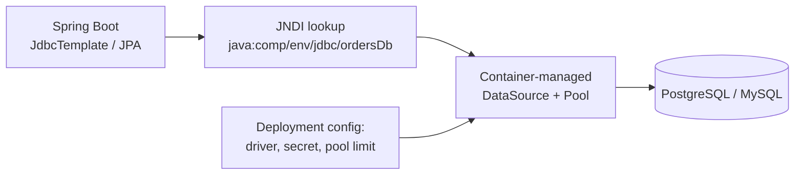

# JNDI DataSource and Deployment-Managed Connections

## 1. Context: Who Is Responsible for Creating SQL Connections?

In the **SPRING_BOOT_INTEGRATION** module, a Spring Boot application connects to databases, HTTP services, caches, and message brokers to implement integration flows. Specifically for SQL, how the application obtains its `DataSource` directly affects configuration management, transactions, retries, connection limits, and operability.

In a standalone Spring Boot application, we usually declare `spring.datasource.url`, username/password, and let Spring Boot create the connection pool (typically HikariCP if present on the classpath). However, in enterprise environments, the application may be deployed as a **WAR on an application server or servlet container** that already provides connection pools managed by the operations team.

Instead of creating its own pool, the application looks up a resource by name in **JNDI (Java Naming and Directory Interface)**:

```text
JNDI name: java:comp/env/jdbc/ordersDb
Resource type: javax.sql.DataSource
Managed by: container / application server
Used by: Spring JdbcTemplate, Spring Data JDBC, or JPA
```

JNDI acts like a **runtime resource directory**. The name `jdbc/ordersDb` specifies which resource to retrieve; pool configuration, database address, driver, and credentials reside in the deployment environment. `DataSource` is the object the application calls to borrow a `Connection`. With a pooled `DataSource`, `Connection.close()` normally **returns the connection to the pool**, rather than closing the physical connection every time.



**Lesson objective:** Configure and verify a Spring Boot application using a deployment-managed JNDI `DataSource`, understand responsibility and transaction boundaries, and accurately diagnose naming context, connection pool, and release-lifecycle errors.

## 2. Distinguishing JNDI, DataSource, and Connection Pool

| Component | Role | Example |
| --- | --- | --- |
| JNDI naming context | Maps a logical name to an object at application runtime. | `java:comp/env/jdbc/ordersDb` |
| `DataSource` | Standard API for the application to obtain a JDBC `Connection`. | `javax.sql.DataSource` |
| Connection pool | Manages physical connections, borrowing, idle state, timeouts, and validation. | Tomcat JDBC Pool, pool provided by the application server |
| JDBC driver | Speaks the wire protocol with the database. | `org.postgresql.Driver` |
| Spring JDBC/JPA | Uses `DataSource` to execute queries and coordinate transactions. | `JdbcTemplate`, `EntityManager` |
| Transaction manager | Controls BEGIN/COMMIT/ROLLBACK for the corresponding resource scope. | `JdbcTransactionManager`, `JpaTransactionManager`, `JtaTransactionManager` |

**JNDI is neither a pool nor a database.** A lookup simply returns the object already registered by the container. If the corresponding resource does not exist, the application cannot infer the server URL or credentials on its own.

### Understanding the `java:comp/env` Path

- `java:comp/env` is the component environment namespace in common Java/Jakarta EE deployments; a `jdbc/ordersDb` resource there is typically referenced in full as `java:comp/env/jdbc/ordersDb`.
- This is a **logical name**, not a hostname or JDBC URL. The name must match the container's actual binding.
- Some application servers use their own namespaces, such as `java:/...` or `java:jboss/...`. In those cases, use the **exact name bound by the server**, rather than rewriting it to `java:comp/env`.
- The standard JDBC interface remains **`javax.sql.DataSource` from Java SE**, even in applications using Jakarta EE's `jakarta.servlet.*`. Do not change it to `jakarta.sql.DataSource`.

## 3. When Should You Use a JNDI DataSource?

| Requirement | Appropriate approach |
| --- | --- |
| Spring Boot executable JAR running as a standalone service or standard Docker container | Usually configure `spring.datasource.url` and let the application manage its own pool. |
| WAR deployed in Tomcat/application server with operations-provided SQL resources | JNDI `DataSource` retrieves the exact container-managed resource. |
| Multiple applications sharing centralized pool, driver, credential, and infrastructure monitoring policies | JNDI can help unify policies at the container level; you still need isolated privileges and connection limits per app. |
| System requiring distributed transactions across multiple resources | JNDI alone is **not enough**; evaluate the actual `DataSource` type, transaction manager, and JTA/XA support. |
| Unit or integration tests running outside the application server | Provide a different `DataSource` via profiles or test configuration. |

The primary benefit is **decoupling connection configuration from code and artifacts**, leveraging the environment's operational governance. In return, the application **depends on the runtime naming context and container resources**; deployment requires coordination across the application, application server, and database.

## 4. Configuring Spring Boot for JNDI Lookup

Spring Boot supports the `spring.datasource.jndi-name` property. Example dedicated to a container environment:

```yaml
# application-container.yml
spring:
  datasource:
    jndi-name: java:comp/env/jdbc/ordersDb
```

When deploying, enable the profile via an environment variable or equivalent configuration:

```text
SPRING_PROFILES_ACTIVE=container
```

With this configuration, Spring Boot looks up the `DataSource` from JNDI and uses that bean for auto-configured JDBC/JPA integrations. **Do not also declare `spring.datasource.url`, `username`, and `password` expecting Spring Boot to create a second pool** for the same purpose. JNDI pool settings must be configured **where the resource is created**.

For local execution outside the application server, separate the configuration:

```yaml
# application-local.yml
spring:
  datasource:
    url: jdbc:postgresql://localhost:5432/orders
    username: ${DB_USERNAME:orders_dev}
    password: ${DB_PASSWORD:local_only}
    hikari:
      maximum-pool-size: 5
```

The two profiles have **different DataSource ownership models**:

- `container`: JNDI lookup, pool owned by the container; `spring.datasource.hikari.*` properties do not control a container-created pool.
- `local`: Spring Boot creates the pool; `spring.datasource.hikari.*` applies if HikariCP is used.

Do not activate both profiles simultaneously when they provide conflicting configuration mechanisms. The local values above are for testing only; real environments must supply credentials through a proper secret management mechanism and restrict permissions under least privilege.

### Required Dependencies

With Spring JDBC, you need the Spring Boot JDBC starter and the JDBC driver appropriate for your deployment model:

```groovy
dependencies {
    implementation 'org.springframework.boot:spring-boot-starter-jdbc'
    implementation 'org.springframework.boot:spring-boot-starter-web'
    // Running JAR/local with JDBC URL: include the driver on the application classpath.
    runtimeOnly 'org.postgresql:postgresql'
}
```

On **external Tomcat**, when the JDBC resource is created and managed by Tomcat, the JDBC driver typically must be visible to **Tomcat's classloader**, such as in `CATALINA_BASE/lib`, depending on server configuration. A driver located solely inside the WAR's `WEB-INF/lib` may not be visible to the container's factory/pool. Check the documentation for your specific container and coordinate driver placement to avoid conflicting driver versions.

## 5. Example JNDI Resource Configuration in External Tomcat

Suppose a Spring Boot application is deployed as a WAR into a JNDI-enabled Tomcat server. Operations creates a context descriptor for the application, such as `conf/Catalina/localhost/orders.xml` in `CATALINA_BASE`, with illustrative content:

```xml
<Context>
    <Resource
        name="jdbc/ordersDb"
        auth="Container"
        type="javax.sql.DataSource"
        factory="org.apache.tomcat.jdbc.pool.DataSourceFactory"
        driverClassName="org.postgresql.Driver"
        url="jdbc:postgresql://db.internal:5432/orders"
        username="orders_app"
        password="REPLACE_VIA_SECURE_DEPLOYMENT"
        initialSize="3"
        minIdle="3"
        maxIdle="10"
        maxActive="25"
        maxWait="10000"
        validationQuery="SELECT 1"
        testOnBorrow="true" />
</Context>
```

This example uses **Tomcat JDBC Pool** with `org.apache.tomcat.jdbc.pool.DataSourceFactory`. If the container uses another pool, property names like `maxActive`/`maxWait` may differ; do not copy them verbatim to HikariCP or DBCP2.

Explanation of key attributes:

| Attribute | Meaning |
| --- | --- |
| `name="jdbc/ordersDb"` | Local resource name; the application looks up `java:comp/env/jdbc/ordersDb` in this Tomcat configuration. |
| `type="javax.sql.DataSource"` | The JDBC interface type used by Spring. |
| `driverClassName`, `url` | Specifies the driver and database endpoint. |
| `username`, `password` | Application account supplied by deployment; requires secure secret storage. |
| `initialSize` / `minIdle` / `maxIdle` | Initial, minimum idle, and maximum idle connections according to pool semantics. |
| `maxActive` | Maximum concurrent connections the pool can allocate. |
| `maxWait` | Wait time (in milliseconds) to borrow a connection before failing according to pool behavior. |
| `validationQuery` / `testOnBorrow` | Validates that a connection is still usable upon borrowing, trading off some validation overhead. |

These numbers are **illustrative values** and must be sized based on replica count, concurrency, database connection limits, and real workload. For example, 4 instances each allowing up to 25 connections can reach **100 SQL connections** before even counting other workers, migrations, monitoring, and reserves.

**Never place real passwords in source code or the WAR.** If the container stores the password in a context file, that file is still a secret-bearing artifact: it requires restricted permissions, platform secret-injection/rotation mechanisms, and must not be copied into logs or source repositories. A placeholder like `REPLACE_VIA_SECURE_DEPLOYMENT` **does not automatically fetch a secret from a vault**; actual secret injection depends on the deployment platform.

### WAR-Packaged Spring Boot Applications

When deploying to an external servlet container, a Spring Boot application may need `SpringBootServletInitializer` and WAR packaging according to its build setup:

```java
import org.springframework.boot.SpringApplication;
import org.springframework.boot.autoconfigure.SpringBootApplication;
import org.springframework.boot.builder.SpringApplicationBuilder;
import org.springframework.boot.web.servlet.support.SpringBootServletInitializer;

@SpringBootApplication
public class OrdersApplication extends SpringBootServletInitializer {

    @Override
    protected SpringApplicationBuilder configure(
            SpringApplicationBuilder application) {
        return application.sources(OrdersApplication.class);
    }

    public static void main(String[] args) {
        SpringApplication.run(OrdersApplication.class, args);
    }
}
```

In Gradle, building a WAR requires enabling the `war` packaging plugin, using the appropriate servlet container dependency configuration (typically `providedRuntime` for the Tomcat starter), and verifying that the external Tomcat's Servlet/Jakarta version matches the Spring Boot version. **Running `java -jar` with embedded Tomcat does not automatically create the JNDI resource above.** External Tomcat resource configuration only takes effect when the application actually runs inside the context where it is bound.

## 6. Using the DataSource via Spring JDBC

Once the `DataSource` bean is available, developers should use `JdbcTemplate` or standard Spring Data/JPA abstractions. Application queries do not need to know whether the pool is owned by Tomcat or Spring Boot:

```java
import java.util.Optional;
import org.springframework.jdbc.core.JdbcTemplate;
import org.springframework.stereotype.Repository;
import org.springframework.transaction.annotation.Transactional;

@Repository
public class OrderRepository {

    private final JdbcTemplate jdbc;

    public OrderRepository(JdbcTemplate jdbc) {
        this.jdbc = jdbc;
    }

    public Optional<String> findStatus(long orderId) {
        return jdbc.query(
                "SELECT status FROM customer_orders WHERE id = ?",
                (rs, rowNum) -> rs.getString("status"),
                orderId)
                .stream()
                .findFirst();
    }

    @Transactional
    public boolean markShippedIfReady(long orderId) {
        int updated = jdbc.update("""
                UPDATE customer_orders
                   SET status = 'SHIPPED'
                 WHERE id = ? AND status = 'READY'
                """, orderId);
        return updated == 1;
    }
}
```

`JdbcTemplate` borrows and returns a `Connection` through Spring JDBC's resource management. When a method runs inside a Spring-managed transaction, Spring participates using the connection/transaction properly bound to the thread. If using plain JDBC:

```java
try (var connection = dataSource.getConnection();
     var statement = connection.prepareStatement("SELECT 1");
     var resultSet = statement.executeQuery()) {
    // Use resultSet.
}
// close() connection handle to return it to the pool.
```

Avoid storing a `Connection` in a singleton field, cache, or HTTP session; avoid forgetting to close it on exception paths. For Spring-managed transactions, prefer `JdbcTemplate`, or if lower-level access is required, use Spring's transaction-aware connection acquisition/release APIs. Calling `DriverManager.getConnection(...)` directly bypasses the JNDI resource and container pool policies.

### Common Misunderstanding About `@Transactional`

`@Transactional` only takes effect when transaction management is actually configured and calls pass through the appropriate Spring proxy/context. In a JDBC application with a single `DataSource`, Spring Boot normally auto-configures a suitable transaction manager. However, you must confirm that the manager uses the **right JNDI `DataSource`**.

Suppose a service updates SQL and then publishes a message to RabbitMQ:

```text
BEGIN SQL TRANSACTION
UPDATE customer_orders ...
COMMIT SQL TRANSACTION
PUBLISH event ...
```

The publish operation **is not automatically inside the SQL transaction**. If the DB commit succeeds but publishing fails, the two systems can drift out of sync. When consistency is required, consider the **transactional outbox** pattern, idempotency, retries, and compensating actions; JNDI does not automatically provide atomicity between SQL and a broker.

## 7. How Does a JNDI DataSource Differ from a JTA/XA DataSource?

These are two different architectural decisions:

- **JNDI** answers **where to look up the resource**. A standard non-XA `DataSource` can also be bound in JNDI.
- **JDBC local transactions** are scoped to a single connection/database resource. Spring JDBC can use `JdbcTransactionManager` or `DataSourceTransactionManager`.
- **JTA/XA** coordinates transactions across multiple XA-capable resources, using a dedicated transaction manager and XA support.

A resource named `java:comp/env/jdbc/ordersDb` **does not become XA merely by residing in JNDI**. If the server provides an XA DataSource and a JTA transaction manager, the Spring/application configuration must be reviewed against that specific application server. Carefully weigh cost, recovery, heuristic failures, and actual resource support before adopting XA.

In many Spring Boot systems integrating HTTP, caches, SQL, and brokers, *end-to-end* workflows typically rely on **outbox/inbox, idempotency, and event-driven compensation** rather than expecting every system to join a single XA transaction.

## 8. Testing Locally and in Deployment Environments

### Testing Repository Logic Outside the Container

Developer machines or test runners do not necessarily have a `java:comp/env` naming context. When writing unit or integration tests for `OrderRepository`, use a `local` or `test` profile with a standalone `DataSource`, such as PostgreSQL Testcontainers. This validates SQL and transaction logic without mocking an entire application server.

Example Spring JDBC test after the test profile provides a working `DataSource`:

```java
import static org.assertj.core.api.Assertions.assertThat;
import org.junit.jupiter.api.Test;
import org.springframework.beans.factory.annotation.Autowired;
import org.springframework.boot.test.context.SpringBootTest;
import org.springframework.test.context.ActiveProfiles;

@SpringBootTest
@ActiveProfiles("test")
class OrderRepositoryIntegrationTest {

    @Autowired
    OrderRepository orders;

    @Test
    void readsAnExistingOrder() {
        // Test fixture must create row id=101, status=READY.
        assertThat(orders.findStatus(101L)).contains("READY");
    }
}
```

This is an integration skeleton: the `customer_orders` fixture and `application-test.yml` or `@TestConfiguration` must exist in the actual test suite. This test **does not verify the JNDI lookup**; it only tests the repository and `DataSource` usage.

### Real Runtime Testing with JNDI

After deploying the WAR to a container configured with the resource:

1. Enable the `container` profile and verify the application **starts up cleanly** with no lookup errors.
2. Verify that the runtime binds the exact expected name, `javax.sql.DataSource` type, and SQL permissions.
3. Run a parameterized read-only query, confirming the expected database, schema, and role.
4. Execute a write transaction against **rollback-safe test data** to verify the transaction manager and rollback behavior.
5. Observe container pool metrics/JMX, active/idle connections, and borrow timeout errors.
6. Test recovery during temporary database unavailability, failover, credential rotation, or planned application server restarts.

A simple non-mutating probe for test environments:

```java
import javax.sql.DataSource;
import org.springframework.boot.ApplicationArguments;
import org.springframework.boot.ApplicationRunner;
import org.springframework.context.annotation.Profile;
import org.springframework.stereotype.Component;

@Component
@Profile("container")
public class ContainerDataSourceProbe implements ApplicationRunner {
    private final DataSource dataSource;

    public ContainerDataSourceProbe(DataSource dataSource) {
        this.dataSource = dataSource;
    }

    @Override
    public void run(ApplicationArguments args) throws Exception {
        try (var connection = dataSource.getConnection()) {
            if (!connection.isValid(3)) {
                throw new IllegalStateException("JNDI database connection invalid");
            }
        }
    }
}
```

This probe checks connectivity at startup; in production you must explicitly decide whether startup should **fail fast** if the database is not yet ready. Some systems allow startup to proceed and wait for DB recovery using readiness/health checks according to deployment policy. Do not run heavy connectivity probe queries on every request.

When `spring-boot-starter-actuator` is present, the DataSource health endpoint can assist with readiness/diagnostics depending on configuration. However, detailed metrics such as active/idle/waiting counts of a **container-managed pool** may reside in the container's JMX/console rather than appearing automatically under the application's HikariCP metric names.

## 9. Common Error Matrix and Remediation

| Symptom | Causes to check | How to isolate |
| --- | --- | --- |
| `NameNotFoundException` | Wrong JNDI name, resource unbound, or outside the application context. | Compare `spring.datasource.jndi-name` with resource name, context descriptor, and Tomcat startup logs. |
| `NoInitialContextException` | Application running where no suitable JNDI naming context exists, e.g., local executable JAR. | Check execution mode and active profile; switch to `local` when JNDI is absent. |
| `ClassCastException` or wrong resource type | Binding returns an object other than `javax.sql.DataSource`. | Inspect `type`/factory and the actual bound resource. |
| `ClassNotFoundException: org.postgresql.Driver` | Driver not visible to the classloader providing the resource. | Check JDBC driver placement/version and container logs. |
| `SQLException: authentication failed` | Wrong credentials/secret or missing role privileges. | Check secret injection, expiration, and DB grants; never log credentials. |
| `CannotGetJdbcConnectionException` or borrow timeout | Pool exhausted, connection leak, DB bottleneck, or network failure. | Inspect active/idle/waiting, `maxActive`, slow queries, and DB sessions. |
| Stale connections after failover | Validation/idle eviction and timeouts misconfigured. | Test recovery and review pool validation and driver/network timeouts. |
| Tuning `spring.datasource.hikari.maximum-pool-size` has no effect | The pool lives in Tomcat, not Spring Boot's HikariCP. | Verify the actual DataSource bean and configure the resource in the container. |
| App works locally, WAR deployment fails | Packaging, Servlet version mismatch, missing resource/driver, or wrong profile. | Read deployment logs and verify Boot/Tomcat/Jakarta compatibility. |
| `@Transactional` does not roll back as expected | Wrong transaction manager, self-invocation, or connections created outside Spring. | Verify proxy, active manager, DataSource, and transaction boundaries. |

### Distinguishing JNDI Lookup Errors from Connection Borrow Errors

1. **Lookup failure**: could not retrieve the `DataSource`; root cause is primarily namespace, binding, or resource startup. At this point it may not have even attempted to contact the database.
2. **Lookup succeeds, `getConnection()` fails**: the resource exists, but driver, network, authentication, or the pool has an issue.
3. **Connection succeeds, SQL fails**: check schema, query syntax, privileges, transaction isolation, timeouts, deadlocks, and migration version.

Accurate classification cuts down troubleshooting time, especially when separate teams own application code, containers, and databases.

## 10. Operating the Pool: Capacity, Timeouts, and Fault Isolation

Even when the environment owns the pool, the application must still understand its limits:

- **Maximum connections**: estimate across all instances, workers, and auxiliary processes, leaving headroom for the database and administrative connections.
- **Borrow timeout**: connection wait budget; too short increases errors under traffic spikes, while too long causes requests/workers to hoard threads and build backlogs.
- **Validation**: prevents handing out dead connections after network blips or DB failovers; weigh the overhead if validating on every borrow.
- **Idle eviction and lifetime**: coordinate with server/database idle timeouts and network proxies to prevent stale connections.
- **Transaction duration**: longer transactions hold connections longer; avoid calling slow HTTP/broker endpoints while holding a SQL transaction unless necessary.
- **Access privileges**: each application identity should have only the permissions it needs; do not share an admin credential for convenience.
- **Observability**: measure request latency, SQL latency, active/idle/waiting connections, borrow failures, transaction rollbacks, and pool wait times.

You should rehearse at least two scenarios: **DB disconnect while the application is running** and **pool exhaustion under bounded load**. Testing only successful startup and `SELECT 1` leaves you blind to how the system behaves under timeouts, deadlocks, failovers, or overload.

### Do Not Fix Transactions with Blind Retries

A SQL error can occur at **COMMIT time** after statements have already executed. When the client loses its connection, the commit outcome may be ambiguous to the caller. For operations that create orders, deduct funds, or process broker events, rely on business keys/idempotency, unique constraints, and controlled retry policies. Switching the DataSource to JNDI **does not eliminate** duplicate processing or uncertain commit outcomes.

## 11. Suggested Hands-On Exercise

**Scenario:** A Spring Boot order-management service uses JDBC. Locally, the development team connects to PostgreSQL using HikariCP. In production, the application runs as a WAR on external Tomcat, and operations manages the pool under `java:comp/env/jdbc/ordersDb`.

Requirements:

1. Build two profiles, `local` and `container`; verify which component owns the connection pool in each profile.
2. Configure the Tomcat resource as shown in the example, confirming the JNDI name and that the driver is visible in the proper classloader.
3. Create the `customer_orders(id, status)` table and test `findStatus`/`markShippedIfReady`.
4. Intentionally rename the resource from `jdbc/ordersDb` to `jdbc/ordersMissing`: observe the **lookup error type** and fix it.
5. Limit `maxActive` in a test environment and apply controlled concurrent load: observe connection waits and timeout responses.
6. Test `@Transactional` rollback when a SQL statement throws an exception; verify the DB retains no partial state.
7. Confirm metrics/health actually originate from the container pool and add an alert for rising borrow timeouts.

### Completion Criteria

| Verification | Expected outcome |
| --- | --- |
| Local profile | App receives a Boot-created DataSource, queries work, and Hikari settings take effect. |
| Container profile | WAR receives the expected JNDI DataSource; pool settings reside in external Tomcat. |
| Wrong JNDI name | Startup or lookup fails with clear logs; does not silently fall back to another DB. |
| Wrong DB credentials | Lookup may succeed, but acquiring a connection fails; error is clearly attributable to pool/DB. |
| DB transaction rollback | SQL changes within the transaction are not partially committed. |
| Pool exhaustion | Wait time is bounded, errors are measured, and the pool recovers once connections are returned. |
| Recovery | After the DB returns, connections are validated or replaced according to configured policy. |

## 12. Review Questions

1. Why does `spring.datasource.jndi-name` differ in operational ownership from `spring.datasource.url`?
2. Does `java:comp/env/jdbc/ordersDb` point to a configuration file, a database, or a `DataSource` object?
3. In Tomcat, why is placing the driver inside the WAR sometimes insufficient for a Tomcat-managed resource?
4. Does `javax.sql.DataSource` need to be changed to `jakarta.sql.DataSource` when using Spring Boot 3 and Tomcat 10?
5. How can you test a repository outside a JNDI context? What does that test not prove?
6. Does a JNDI DataSource automatically guarantee distributed transactions between SQL and RabbitMQ?
7. When `NameNotFoundException` occurs, how does your first isolation step differ from when `getConnection()` times out?
8. Why does changing `spring.datasource.hikari.maximum-pool-size` have no effect on Tomcat JDBC Pool?

## Summary

A **JNDI DataSource** is how Spring Boot consumes SQL connections already registered and managed by the deployment environment. The application only needs to know a valid resource name, such as `java:comp/env/jdbc/ordersDb`; the container is responsible for the driver, pool, endpoint, and credential injection. Clearly distinguishing lookup from borrowing a connection, Spring-managed local transactions from JTA/XA, and container pools from Boot-managed pools is the key to deploying and troubleshooting accurately. When integrating SQL with HTTP, caches, or brokers, you must still independently design idempotency, error handling, and transaction observability.

### References

- [Spring Boot Reference — Working with SQL Databases](https://docs.spring.io/spring-boot/reference/data/sql.html)
- [Apache Tomcat — JNDI DataSource HOW-TO](https://tomcat.apache.org/tomcat-10.1-doc/jndi-datasource-examples-howto.html)
- [Apache Tomcat — JNDI Resources HOW-TO](https://tomcat.apache.org/tomcat-10.1-doc/jndi-resources-howto.html)
- [Spring Framework — Controlling Database Connections](https://docs.spring.io/spring-framework/reference/data-access/jdbc/connections.html)
