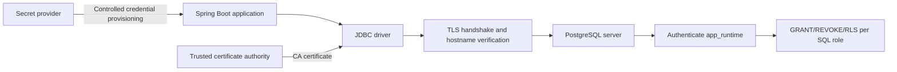
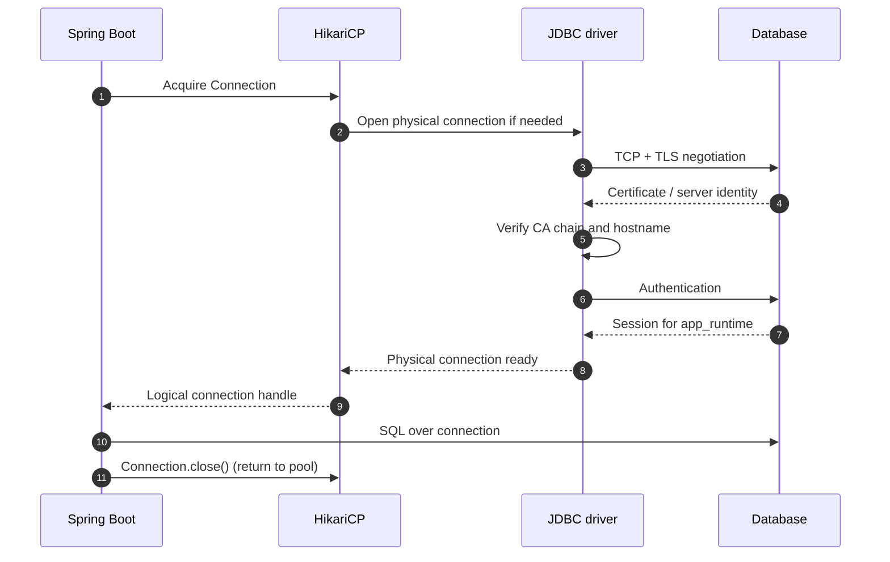
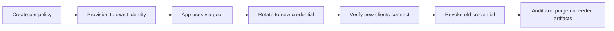
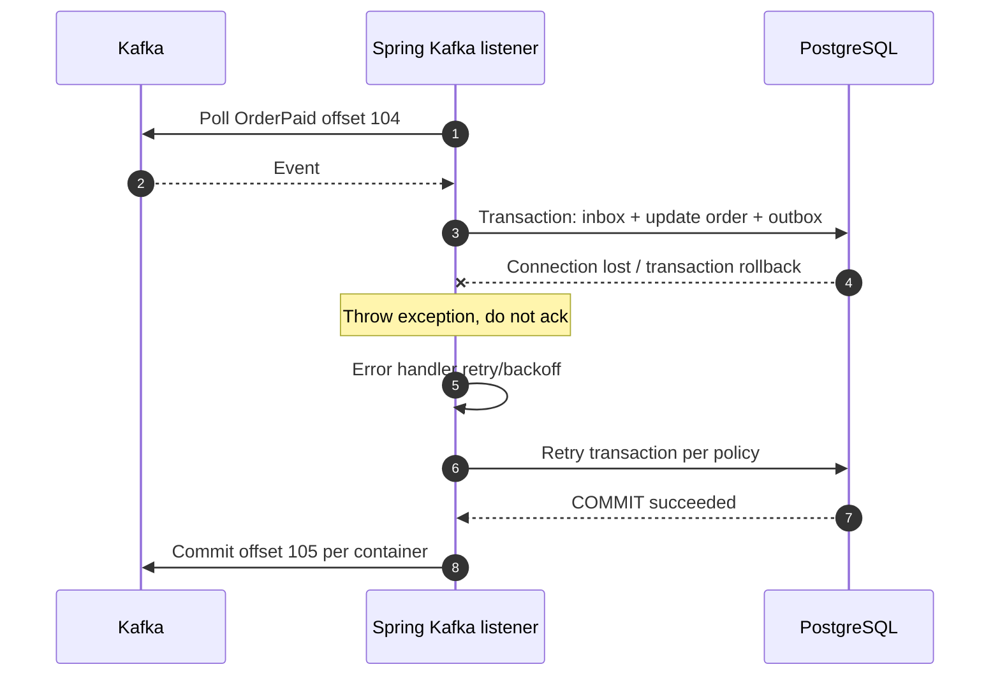

# TLS/SSL, Least-Privilege Accounts, and Secrets Management

A Spring Boot application connecting to PostgreSQL, MySQL, or another SQL database typically needs three things: **a protected transport channel**, **a database identity restricted to necessary permissions**, and **credentials managed securely throughout their lifecycle**. Simply adding `ssl=true` or storing a password in an environment variable is not enough to satisfy all three requirements.

Imagine `order-service` receiving HTTP requests, writing orders to PostgreSQL, updating inbox/outbox tables for Kafka synchronization, and calling a payment system. Without server identity verification on the SQL connection, the application could send credentials to a spoofed endpoint. If it runs as the schema owner, a single SQL injection bug or misconfiguration could drop tables. If a password rotates while HikariCP keeps opening new connections with the old credential, a routine secret rotation can trigger a production outage.

This lesson belongs to the **SQL Connectivity** chapter of the **SPRING_BOOT_INTEGRATION** module. The goal is organizing Spring Boot integration across HTTP clients, databases, caches, brokers, and Spring Integration adapters with careful attention to configuration, data contracts, transactions, errors, deduplication, testing, and observability. Main examples use Spring Boot 3.x, JDBC/HikariCP, and PostgreSQL; when adapting to other drivers or databases, verify exact properties and behaviors for your deployed versions.

## 1. Learning Outcomes

After this lesson, you will be able to:

1. Distinguish TLS encryption, CA certificate verification, **hostname** verification, and database account authentication.
2. Configure PostgreSQL connections with `sslmode=verify-full` and understand how it differs from `require` and downgradable modes.
3. Design **least-privilege** permissions across runtime, migration, read-only, and operational roles.
4. Keep secrets out of source code and artifacts, inject them via runtime environments or secret stores, and plan **rotation** without breaking connectivity.
5. Understand the Hikari connection pool lifecycle, timeout parameters, connection validation, and risks during credential rotation.
6. Tie SQL security requirements to Flyway/Liquibase, transactions, inbox/outbox, auditing, and downstream dependencies.
7. Design tests covering both happy paths and negative cases: invalid certs, insufficient privileges, expired secrets, and temporary DB outages.

## 2. Three Independent Control Layers

Secure SQL connectivity treats **transport**, **identity/authorization**, and **secret lifecycle** as separate concerns:

| Layer | Objective | Control examples | What it does not guarantee alone |
|---|---|---|---|
| **TLS/SSL** | Encrypt data in transit and verify endpoint identity | TLS + trusted CA + hostname validation | Connected user has only minimal privileges |
| **Database authentication/authorization** | Verify user identity and limit accessible resources | SCRAM/strong auth mechanism, minimal `GRANT`s | Passwords stay out of logs or artifacts |
| **Secrets management** | Protect, distribute, rotate, and revoke credentials | Vault/Kubernetes Secret/mounted secret, IAM, audit | Driver verifies hostnames or queries resist SQL injection |

Supporting controls matter just as much: private networks, firewalls/security groups, egress controls, input validation, parameterized queries, backups, encryption at rest, and monitoring. They complement these three layers without replacing one another.

### 2.1. Why "SSL" in Legacy Names Should Be Understood as TLS

`SSL` is a historical term; modern systems normally negotiate **TLS**. An option or class containing `ssl` does not guarantee old SSL protocols are used or that strong TLS is enforced. Inspect the actual **TLS version and cipher** negotiated by driver and server, as well as policies disabling weak protocols. Do not treat a padlock icon or `ssl` in a URL as sufficient proof.

### 2.2. Trust Model



In this diagram, the CA certificate is not a secret password. It is a **trust anchor** used to verify server identity; ensure CA contents cannot be tampered with by untrusted sources. Database passwords, keys, and tokens are the credentials requiring restricted read access and rotation.

## 3. Path of a JDBC Connection

Simplified sequence when Spring Boot uses `DataSource`:



When the app calls `Connection.close()` on a Hikari-borrowed connection, it normally **returns the connection to the pool** rather than closing TCP and redoing the TLS handshake immediately. That is why rotating a secret or CA certificate does not automatically take effect on all existing connections.

### 3.1. States to Distinguish

- **TCP connected:** socket opened, yet TLS or server identity may remain unverified.
- **TLS established:** encrypted session exists, yet the TLS mode may not verify CA or hostname.
- **Authenticated:** database accepted the principal/password/certificate, yet that role might lack required `SELECT`/`INSERT` grants.
- **Authorized:** the specific query is permitted; grants can vary by schema, table, or column.
- **Application usable:** schema migrations and business invariants hold; never infer this from `SELECT 1` alone.

## 4. What Does TLS Protect and What Risks Remain?

TLS serves two core goals: protecting **confidentiality and integrity in transit** and, when verification is configured properly, proving you are talking to the **exact server** intended.

If traffic is encrypted without verifying the hostname and CA, a rogue server can still negotiate TLS. Anyone controlling a network path or misdirecting DNS could capture credentials or application payloads depending on authentication and connection settings.

Example:

```text
App intends to call:
  db.orders.internal.example

Certificate valid for:
  staging-db.internal.example

CA may be valid, but hostname mismatches.
With strict hostname verification enabled -> connection must FAIL.
```

Never "fix" this by disabling certificate verification. Reissue the certificate with the matching DNS Subject Alternative Name (SAN) or fix the target hostname to match the certificate and topology.

### 4.1. TLS Does Not Prevent Every SQL Risk

Even a `verify-full` connection cannot stop:

- SQL injection caused by string concatenation instead of bind parameters;
- Remote code execution letting an attacker read passwords from memory;
- A runtime role granted `SUPERUSER` or unnecessary DDL rights;
- Secrets committed to Git, build artifacts, or container images;
- Backups or replicas storing sensitive data insecurely;
- A Kafka offset being acknowledged before its SQL transaction commits.

Therefore, SQL transport settings must pair with broader data and operational controls across the integration architecture.

## 5. PostgreSQL JDBC: `sslmode` Must Be Chosen Deliberately

PgJDBC supports multiple `sslmode` values. Key modes:

| `sslmode` | Intended behavior | Risks and when to use |
|---|---|---|
| `disable` | No TLS | Acceptable only in controlled local/test environments if policy allows |
| `allow` | May start unencrypted then try TLS | Allows downgrade; unsuitable when TLS is mandatory |
| `prefer` | Prefers TLS, can fall back to unencrypted | Does not "enforce TLS"; verify driver behavior |
| `require` | Requires a TLS connection | Insufficient to claim full hostname/server identity verification |
| `verify-ca` | TLS plus CA certificate check | Does not verify hostname like `verify-full` |
| `verify-full` | TLS, CA certificate check, **and** server hostname check | Proper starting choice when strict server authentication is required |

Exact semantics of `require` and `verify-ca` can vary across driver versions, SSL factories, and truststores; verify in the documentation for your deployed PgJDBC version. For production, standardize on **`verify-full`**, managed CAs, and stable hostnames to eliminate ambiguity.

### 5.1. Configuring PostgreSQL `verify-full`

Suppose the database DNS name is `db.orders.internal.example`, the server certificate includes that SAN, and the trusted CA is mounted at `/etc/db-certs/ca.pem`:

```yaml
# application-prod.yml
spring:
  datasource:
    url: jdbc:postgresql://db.orders.internal.example:5432/orders?sslmode=verify-full&sslrootcert=/etc/db-certs/ca.pem
    username: app_runtime
    hikari:
      maximum-pool-size: 12
      minimum-idle: 2
      connection-timeout: 3000     # milliseconds
      validation-timeout: 2000     # milliseconds
      max-lifetime: 1500000        # milliseconds
      keepalive-time: 120000       # milliseconds
  flyway:
    enabled: false
```

Notice `spring.datasource.password` is absent here. The password arrives from a secret provider or configuration tree (see later sections). `flyway.enabled: false` illustrates running production migrations via a separate privileged job; local/test environments may differ.

Conditions for a successful connection:

1. Client connects to the exact hostname listed in the certificate's SAN.
2. Required root/intermediate CA chain is trusted properly by the driver.
3. Certificate is within its validity dates and valid for server authentication.
4. Server supports compatible TLS versions and ciphers.
5. Principal `app_runtime` authenticates and holds database access grants.
6. Firewalls, DNS, and routing allow reaching the server.

If a proxy or connection pooler like PgBouncer sits in front, **TLS hostname verification checks the TLS endpoint** the JDBC driver connects to directly. Verify whether it terminates TLS and opens a separate TLS hop to the DB; never assume client → proxy checks protect proxy → database automatically.

### 5.2. Why Avoid Arbitrary IP Addresses?

If the URL uses `jdbc:postgresql://10.0.1.10:5432/...` while the certificate only lists DNS SAN `db.orders.internal.example`, `verify-full` fails because no IP SAN matches. Never downgrade to `verify-ca` to bypass hostname mismatches. Use the DNS/service name matching the certificate or issue a certificate with the right SANs.

### 5.3. Certificate Authorities and Client Certificates

Distinguish clearly:

- **Server TLS:** server presents a certificate; client checks CA and hostname.
- **mTLS / client certificate authentication:** database requires the client to present a certificate; driver needs private key/certificate and server needs trust/client identity mapping.
- **Password authentication over TLS:** client still sends username/password; TLS encrypts the channel and authenticates the server.

PostgreSQL deployments often combine server-verified TLS **and** SCRAM password auth without requiring mTLS. If enterprise policy requires client certificates, configure `sslcert`/`sslkey` in formats supported by your PgJDBC version, protect private key file permissions, and plan issuance/rotation. Private keys are highly sensitive secrets—**never** put them in Git, images, or logs.

Do not assume supplying `sslcert` eliminates the need for a database role/username; mapping certificates to database principals depends on PostgreSQL authentication rules and operational contracts.

## 6. Other Database Engines Use Different Syntax

Never apply PostgreSQL's `sslmode=verify-full` blindly to other JDBC drivers:

| Driver / DBMS | Suggested strict mode | Additional checks |
|---|---|---|
| **PostgreSQL PgJDBC** | `sslmode=verify-full` | CA file/truststore, hostname SAN, driver SSL factory |
| **MySQL Connector/J 8.x** | `sslMode=VERIFY_IDENTITY` | Truststore, certificate chain, hostname, server TLS support |
| **Microsoft SQL Server JDBC** | `encrypt=true` and `trustServerCertificate=false` | Hostname validation, driver/JVM truststore, cert policy |
| **Oracle JDBC** | TCPS with verified certificate/trust config | Wallet/truststore, endpoint/service name, driver version |

MySQL example:

```text
jdbc:mysql://mysql.orders.internal.example:3306/orders?sslMode=VERIFY_IDENTITY
```

With MySQL Connector/J, configure trust anchors/truststore if the certificate is not signed by a default trusted CA. `VERIFY_CA` checks the CA, whereas hostname verification behaves differently from `VERIFY_IDENTITY`. Avoid `sslMode=PREFERRED` when TLS is **mandatory**, as it does not block fallback.

SQL Server example:

```text
jdbc:sqlserver://sql.orders.internal.example:1433;databaseName=orders;encrypt=true;trustServerCertificate=false
```

This SQL Server URL illustrates baseline policy only. Newer driver versions change `encrypt` defaults and advanced options; verify version, hostname/certificate matching, and truststore setup. `trustServerCertificate=true` skips certificate verification and should never be used just to "get past" production config errors.

## 7. Verifying Connections Actually Use TLS

Config on paper is not enough. On PostgreSQL, inside **the application's actual session**, query:

```sql
SELECT
    ssl,
    version,
    cipher,
    bits
FROM pg_stat_ssl
WHERE pid = pg_backend_pid();
```

`ssl=true` with an approved `version` confirms the current session is encrypted. It **does not by itself prove the client verified the hostname**; confirm that via driver config inspection and a negative test with a mismatched hostname or certificate.

Confirm the active role:

```sql
SELECT current_user, session_user, current_database();
```

On MySQL, inspect the session SSL cipher via session status variables depending on version:

```sql
SHOW SESSION STATUS LIKE 'Ssl_cipher';
```

A non-empty cipher indicates TLS was negotiated. As with PostgreSQL, do not infer hostname verification from the cipher alone.

### 7.1. Negative Tests Matter More Than an "SSL Enabled" Log Line

Create a test environment with an untrusted certificate or a SAN mismatch. Under strict settings, the application must **fail to connect**. If it still connects, investigate SSL mode and trust settings. Never run this experiment by breaking live production certificates or secrets.

## 8. Least Privilege: The Application Should Not Own the Database

**Least privilege** means each account holds only the permissions needed for its assigned task, for the required scope and duration. For an order-writing app, separate at minimum:

| Identity | Reasonable privileges | Avoid granting |
|---|---|---|
| `app_runtime` | CONNECT; USAGE on schema; required SELECT/INSERT/UPDATE on specific tables and sequences | SUPERUSER, CREATEDB, CREATEROLE, CREATE/DROP schema, production DDL |
| `app_readonly` | CONNECT, USAGE, SELECT on allowed tables/views | INSERT/UPDATE/DELETE/DDL |
| `app_migrator` | Rights to create/alter schemas, tables, and indexes within migration scope | Cluster-wide superuser unless truly required |
| `db_operator` | Controlled operational, backup, and diagnostic rights per role | Sharing credentials with runtime services |
| `replication_user` | Minimal replication rights per topology | Unnecessary business data access |

Scope grants to **exact application behavior**: read models need only SELECT; inbox consumers need INSERT on the idempotency table; outbox publishers need UPDATE on `published_at`; migration jobs need DDL. If a SQL bean never uses DELETE, do not grant DELETE just out of "CRUD habit."

### 8.1. Why Runtime Accounts Should Not Have DDL Rights

If a SQL injection vulnerability or binding bug leads to `DROP TABLE orders`, the database must reject it because the runtime role lacks ownership and DDL rights. Least privilege is a damage-containment layer, not a substitute for parameterized queries or input validation.

### 8.2. Shared Roles Across Services Break Accountability

If `order-service` and `billing-service` both log in as `app_runtime` with access across all schemas, database audits cannot tell which service touched what, and one compromise impacts both. Prefer distinct identities per service, environment, and function, scoped per schema, table, or view.

## 9. PostgreSQL: Designing Runtime and Migrator Roles

Suppose database `orders` has schema `orders`, with migrations run by `app_migrator`. A privileged DBA/automation process creates the roles and distributes credentials via secret management; never embed real passwords in documentation scripts.

```sql
-- Executed by an authorized administrative account.
CREATE ROLE app_migrator LOGIN;
CREATE ROLE app_runtime LOGIN;
CREATE ROLE app_readonly LOGIN;

-- Schema is owned by the migration role in this example.
CREATE SCHEMA orders AUTHORIZATION app_migrator;

GRANT CONNECT ON DATABASE orders TO app_runtime, app_readonly;
GRANT USAGE ON SCHEMA orders TO app_runtime, app_readonly;

-- Runtime can read and write existing tables.
GRANT SELECT, INSERT, UPDATE ON ALL TABLES
    IN SCHEMA orders TO app_runtime;

-- Read-only cannot write.
GRANT SELECT ON ALL TABLES
    IN SCHEMA orders TO app_readonly;

-- Only when tables use corresponding sequences.
GRANT USAGE ON ALL SEQUENCES
    IN SCHEMA orders TO app_runtime;

-- Future tables/sequences created by app_migrator.
ALTER DEFAULT PRIVILEGES FOR ROLE app_migrator IN SCHEMA orders
    GRANT SELECT, INSERT, UPDATE ON TABLES TO app_runtime;

ALTER DEFAULT PRIVILEGES FOR ROLE app_migrator IN SCHEMA orders
    GRANT SELECT ON TABLES TO app_readonly;

ALTER DEFAULT PRIVILEGES FOR ROLE app_migrator IN SCHEMA orders
    GRANT USAGE ON SEQUENCES TO app_runtime;
```

This example illustrates privilege separation. It **does not** mean an app needs UPDATE on every table: production should replace `ON ALL TABLES` with per-table/view grants or domain-specific roles, granting DELETE only for valid use cases.

PostgreSQL caveats:

1. **USAGE on a schema** does not automatically grant SELECT or INSERT on tables inside it.
2. `ALTER DEFAULT PRIVILEGES FOR ROLE app_migrator` applies only to objects **created later by that role** in the specified scope; it does not retroactively grant rights on existing objects.
3. Objects created by **another role** use different default privileges; do not assume they inherit `app_migrator` defaults.
4. Table/schema owners hold rights far beyond explicit `GRANT`s; never run runtime traffic as the owner role.
5. Inspect sequences, functions, views, `search_path`, triggers, and privileged extensions too.
6. Accounts with `CREATEROLE`, `SUPERUSER`, or broad role memberships can escalate scope; review inherited privileges too.

### 9.1. Default Database and Schema Privileges

In PostgreSQL, certain privileges may be granted to `PUBLIC` depending on configuration, version, and database history—such as CONNECT or rights on schema `public`. Never assume granting `CONNECT` to three roles blocks every other role from connecting.

If hardening is needed, DBAs should audit and revoke excess privileges per policy, evaluating impact on other apps in production first:

```sql
-- ONLY after confirming impact and required privileges:
REVOKE CREATE ON SCHEMA public FROM PUBLIC;
```

Never run broad `REVOKE` statements on a shared database merely because a guide recommends least privilege. Audit effective grants and test in a controlled environment first.

### 9.2. SQL to Inspect Effective Privileges

Log in **as the actual runtime account** and inspect:

```sql
SELECT
    current_user,
    has_database_privilege(current_user, current_database(), 'CONNECT')
        AS can_connect,
    has_schema_privilege(current_user, 'orders', 'USAGE')
        AS can_use_orders_schema,
    has_schema_privilege(current_user, 'orders', 'CREATE')
        AS can_create_in_orders;

SELECT
    has_table_privilege(
        current_user, 'orders.order_events', 'SELECT') AS can_read,
    has_table_privilege(
        current_user, 'orders.order_events', 'INSERT') AS can_insert,
    has_table_privilege(
        current_user, 'orders.order_events', 'DELETE') AS can_delete;
```

These queries assume `orders.order_events` exists. If not yet created, `has_table_privilege` by name errors out; check schema migrations first. Expected results should match each service's privilege matrix rather than assuming all runtime roles share identical rights.

## 10. Migration vs. Runtime: Two Distinct Privilege Lifecycles

Flyway/Liquibase needs to create tables, alter columns, build indexes, and occasionally run data migrations. Those rights are normally **unneeded** during daily request and message processing.

Two common approaches:

| Approach | How it works | Trade-offs |
|---|---|---|
| **Migrations run at Spring Boot startup** | App holds separate migrator credentials for startup, then uses a low-privilege account at runtime | Convenient locally, though the runtime binary/process still accesses DDL credentials |
| **Migration job separated from application** | Pipeline/job runs migrator before rollout; runtime receives only low-privilege credentials | Cleaner privilege isolation; requires CI/CD orchestration and schema compatibility |

For production environments requiring strict separation, a dedicated migration job is cleaner. In Spring Boot development with Flyway, you can configure separate migration properties where supported:

```yaml
# Example for a development profile running migrations at startup.
spring:
  datasource:
    url: jdbc:postgresql://db.dev.example:5432/orders?sslmode=verify-full&sslrootcert=/etc/db-certs/ca.pem
    username: app_runtime
  flyway:
    enabled: true
    url: jdbc:postgresql://db.dev.example:5432/orders?sslmode=verify-full&sslrootcert=/etc/db-certs/ca.pem
    user: app_migrator
    schemas: orders
```

Supply `spring.datasource.password` and `spring.flyway.password` from **two separate secrets**, never hardcoded in the file. Do not assume simply changing `spring.flyway.user` configures separate migration roles identically across all Spring Boot versions; verify the final configuration and startup logs.

When migrations run separately, the runtime app should disable automatic migrations or configure appropriate checks, verifying schema version before accepting traffic. A migration breaking backward compatibility with older app code can still cause downtime even when the migrator account is locked down.

### 10.1. Even the Migrator Account Should Not Be Superuser

In PostgreSQL, if the migrator owns the application's schema and tables, it can execute DDL within that scope without `SUPERUSER` or `CREATEDB`. If a migration needs extensions or cluster-level changes, separate that into an approved DBA/infra step rather than leaving permanent superuser rights on the migrator "just for one run."

### 10.2. Is a Read-Only User Truly Read-Only?

An account with only `SELECT` on allowed tables might still invoke a function with side effects if `EXECUTE` rights allow it, or reach data through poorly scoped views. Particularly in PostgreSQL, review functions, default `PUBLIC` execute grants, `SECURITY DEFINER` ownership, and row-level security if enabled. Least privilege means **effective privileges**, not just one `GRANT SELECT` line.

## 11. Row-Level Security and Per-Tenant Isolation

When multiple tenants share a schema, separating database roles per service does not isolate tenant data from each other. PostgreSQL Row-Level Security (RLS) adds a tenant barrier, but must be engineered carefully:

```sql
-- Illustration on orders.orders table with tenant_id.
ALTER TABLE orders.orders ENABLE ROW LEVEL SECURITY;

CREATE POLICY orders_tenant_policy ON orders.orders
    USING (tenant_id = current_setting('app.tenant_id', true))
    WITH CHECK (tenant_id = current_setting('app.tenant_id', true));
```

Ensure `tenant_id` and `app.tenant_id` match types or cast properly (e.g., if `tenant_id` is UUID). The session variable must be populated **from an authenticated identity**, never trusting an arbitrary raw HTTP header. Inside a connection pool, setting a session-scoped variable improperly can leak one tenant's context to the next request.

In PostgreSQL, use transaction-scoped `SET LOCAL` when appropriate and ensure subsequent queries run in the same connection and transaction; never set persistent session variables across borrowers without resetting them. Table owners or roles with `BYPASSRLS` bypass policies per PostgreSQL rules; always test with the actual runtime role, never the schema owner.

RLS is an architectural option, not mandatory for every service. Even with RLS, maintain application-level authorization, constraints, and cross-tenant tests.

## 12. Secrets: What Is Secret and What Is Not?

In SQL connectivity, items carry different sensitivity levels:

| Item | Typical sensitivity | How to manage |
|---|---|---|
| DB password | Secret credential | Secret store, minimal read access, rotation |
| Client TLS private key | Highly sensitive secret | Protected file/keystore, read-only mount, rotation |
| IAM database auth token | Short-lived token | Generated and refreshed per identity; avoid logging |
| CA public certificate | Public trust anchor (not a password) | Integrity-controlled distribution, version/rotation |
| DB hostname / database name | Topology config (usually non-secret) | Environment-specific config; restrict exposure per policy |
| DB username | Config metadata; sometimes sensitive | Externalized config; avoid hardcoding if policy requires |
| JDBC URL | Can leak credentials if misused | Keep passwords/tokens out of URLs; redact in logs |

Passwords leak through many channels: `application.yml` committed to Git, environment dumps in debug diagnostics, CI logs, heap dumps, exceptions echoing JDBC URLs, backup files, shell history, or overly permissive Actuator dashboards.

### 12.1. Do Not Encrypt a Password in Source and Commit the Key Beside It

Base64-encoding a password or encrypting a config file while placing the decryption key in the same repository **provides no real secret isolation**. If the app must decrypt values, the key must come from an independent channel with separate access controls and lifecycles.

### 12.2. Mechanisms to Deliver Secrets to Applications

Common patterns:

1. **Environment variables** injected by orchestrators/CI: simple to adopt, though exposed via process inspection or debug dumps if access is uncontrolled.
2. **Mounted read-only secret files**: avoids some environment-leak paths; requires proper mount paths and filesystem permissions.
3. **Secrets manager / Vault** integrated per platform standards: provides audit trails, versioning, rotation, and dynamic credentials.
4. **Identity-based authentication** such as IAM/managed identity for supported databases: eliminates static passwords, yet requires token refresh compatible with the pool.

No mechanism is automatically "leak-proof." Choose what fits your platform alongside privilege separation, log redaction, incident response, and rotation capability.

## 13. Spring Boot Externalized Configuration: Keeping Secrets Out of Artifacts

Spring Boot externalized configuration lets property sources override settings per environment.

Simple environment variable example:

```text
SPRING_DATASOURCE_URL
SPRING_DATASOURCE_USERNAME
SPRING_DATASOURCE_PASSWORD
```

These follow Spring Boot's standard relaxed binding rules. Never put real values into documentation or shell history. In production, the URL might come from a ConfigMap/CI while the password comes from a secret store.

### 13.1. Loading via Config Trees from Mounted Files

Spring Boot supports configuration trees where **filenames are property keys** and file contents are values:

```text
/run/secrets/orders-db/
  spring.datasource.password
```

The `spring.datasource.password` file holds only the platform-mounted password (never created manually in source control).

Production configuration:

```yaml
spring:
  config:
    import: "configtree:/run/secrets/orders-db/"
  datasource:
    url: jdbc:postgresql://db.orders.internal.example:5432/orders?sslmode=verify-full&sslrootcert=/etc/db-certs/ca.pem
    username: app_runtime
```

When present and readable, `spring.datasource.password` binds via the config tree. Do not add an `optional:` prefix in production if a missing secret should fail startup; keep separate profiles for local/test. Restrict directory permissions and ensure the mount exists **before** the app starts.

Specifically: **mounting a secret file does not automatically map it to Spring properties** across all setups. Docker/Kubernetes only creates files; the app needs `spring.config.import` or an equivalent secret integration.

### 13.2. Conceptual Kubernetes Secret Mount Example

Below is an **illustrative pod spec snippet**, not a complete Deployment manifest:

```yaml
spec:
  containers:
    - name: order-service
      image: example/order-service:1.0
      volumeMounts:
        - name: orders-db-secret
          mountPath: /run/secrets/orders-db
          readOnly: true
  volumes:
    - name: orders-db-secret
      secret:
        secretName: orders-db-credentials
        items:
          - key: password
            path: spring.datasource.password
```

The `orders-db-credentials` Secret must be provisioned securely in the cluster with a `password` key. Enforce RBAC, secret encryption at rest, minimal Pod/Secret read permissions, and auditing. Never commit a Secret manifest containing base64-encoded passwords and call it "encrypted": Base64 is merely encoding.

### 13.3. Secrets and Configuration Profiles

The `local` profile can use Testcontainers or restricted dev credentials; `prod` requires strict TLS URLs and production secret providers. Never let a `dev` profile with `sslmode=disable` activate accidentally in production. Add startup/CI checks to enforce environment guards.

## 14. Credential Lifecycle: Provision, Use, Rotate, Revoke

Every credential has a lifecycle:



Common pitfalls:

- The secret store updates, yet the running process still holds the old password bound at startup.
- Existing Hikari connections stay healthy while new connections get rejected.
- Replicas roll out sequentially; changing a single login's password in place breaks older replicas opening new connections.
- Certificates or old CAs expire without an overlap trust plan.
- IAM tokens expire faster than physical connection lifetimes; new connections fail if Hikari reuses expired tokens.

### 14.1. Safe Rotation Using Dual Identities When Needed

A controlled rotation pattern:

1. Create a new login/credential with **identical least privileges**, such as `app_runtime_v2`, while `app_runtime_v1` remains active.
2. Provision the new secret to the new app revision; verify TLS, auth, and grants.
3. Roll out replicas gradually, shift traffic, and monitor pool and new-connection failure metrics.
4. Confirm no instances still rely on the old credential; revoke the old login/credential as scheduled.
5. Check active sessions and terminate them per policy if immediate revocation is required for a security incident.

This is a **strategy**, not the only PostgreSQL workflow. If rotating a single role's password in place, carefully coordinate secret updates, pool refreshes/restarts, and rollouts to avoid breaking new connections. With dynamic Vault/IAM credentials, design TTLs, renewals, and revocations specifically.

### 14.2. Updating a Mounted Secret File Does Not Automatically Refresh Hikari

Configuration properties normally bind at application startup. Kubernetes may update a mounted file on disk, yet an existing `HikariDataSource` does not re-read the password automatically. Use a supported refresh mechanism:

- Rolling restart of the application after rotation;
- Secret refresh integration capable of properly reinitializing the datasource;
- Creating a new datasource/pool and draining the old pool intentionally;
- For short-lived tokens, using a datasource/credential provider designed to fetch a fresh token whenever creating a new physical connection.

Never call password setters on Hikari and assume every open connection switches credentials. Always test the pool opening **additional connections** after updating the secret.

## 15. HikariCP: Security Interacts with Connection Lifecycles

Spring Boot typically uses HikariCP for JDBC pooling when on the classpath. Hikari retains physical connections so every query avoids repeating TCP, TLS, and auth handshakes.

```text
HTTP request / Kafka listener
  -> DataSource.getConnection()
  -> Hikari returns an existing pooled connection
  -> begin transaction/SQL
  -> Connection.close()
  -> connection returns to pool
```

Key parameters:

| Hikari property | Meaning | What to check |
|---|---|---|
| `maximumPoolSize` | Max physical connections the pool can manage | Does total across all replicas fit DB limits? |
| `minimumIdle` | Target idle connections Hikari tries to keep | Startup surge, resource footprint |
| `connectionTimeout` | Max wait for a connection from the pool | Not a timeout for a single SQL query |
| `validationTimeout` | Timeout for connection liveness check | Does not replace statement/query timeout |
| `maxLifetime` | Max age of a physical connection in the pool | Should be shorter than DB/proxy limits to avoid stale connections |
| `idleTimeout` | Idle duration before surplus connections can retire | Depends on `minimumIdle` and pool rules |
| `keepaliveTime` | Periodically probes idle connections to keep alive | Does not turn network/DB outages into success |
| `leakDetectionThreshold` | Diagnostic warning for long-held connections | Set high enough; not a fix for resource leaks |

`maxLifetime` does not forcibly close a connection currently borrowed mid-transaction. It governs pool retirement; configure query and transaction timeouts separately.

### 15.1. Calculating Total Connections Across Replicas

If each replica sets `maximumPoolSize=12` across 10 replicas, potential physical connections from the app reach:

\[
10 \times 12 = 120
\]

That is the **theoretical maximum** for this app group alone, excluding Flyway, admin clients, workers, monitoring, and other apps. Compare against database/proxy caps, CPU, and real workloads. Never raise pool size merely because requests time out: the root cause may be slow queries, lock contention, or connection leaks.

### 15.2. Timeouts Belong to Distinct Layers

```text
connectionTimeout (pool): waiting to borrow Connection
JDBC connect timeout: establishing TCP/TLS/auth
statement/query timeout: bounding SQL execution
transaction deadline: bounding the whole unit of work
API deadline: total duration of HTTP request/workflow
```

`connectionTimeout=3000` will not abort a `SELECT` blocked on a lock for 30 seconds. Configure statement/transaction timeouts per DB/driver, Spring `@Transactional(timeout=...)` where supported, or SQL session limits—and verify rollback behavior and idempotent retries.

### 15.3. Connection Pools and Rotation

During password rotation, existing authenticated sessions can keep working while new connections fail once the old password is revoked. The pool can "look healthy" until traffic scales up or connections retire. Therefore, rotation tests must force **brand-new connections**, not just run `SELECT` on existing pooled handles.

## 16. Fail Fast, Retries, and Security Incidents

Not every SQL error should be retried the same way:

| Error | Possible cause | Preferred behavior |
|---|---|---|
| Hostname certificate mismatch | Wrong URL or wrong cert SAN | Fail fast, alert on config; never downgrade verification |
| Untrusted CA | Wrong CA mount or missing rotation update | Fail fast, fix trust chain |
| Password/role rejected | Wrong/expired secret or revoked role | Fail fast/escalate; never retry infinitely |
| Permission denied | Role lacks required `GRANT` | Fix privilege matrix/migration; never widen role arbitrarily |
| Brief connection refused/timeout | DB starting up, transient network issue | Bounded retries with backoff within startup/recovery budget |
| Connection pool exhausted | Undersized pool, slow query, leak, slow DB | Inspect pool/SQL latency; fix root cause |
| Deadlock/serialization failure | Transaction conflict | Retry entire transaction if idempotent and DB error allows |
| SQL constraint violation | Duplicate ID, foreign key, validation | Usually business/data error; do not unconditionally retry |
| Schema missing | Migrations not applied or wrong DB/schema | Check deployment order, fail readiness appropriately |

PostgreSQL SQLSTATE examples:

```text
08xxx : class 08, connection exception
28P01 : invalid_password
42501 : insufficient_privilege
42P01 : undefined_table
23505 : unique_violation
40001 : serialization_failure
40P01 : deadlock_detected
```

Do not classify every `SQLException` as transient hoping the system "self-heals." Drivers and Spring exception translators classify errors differently; test against the real database and base retries on SQLState/error contracts, transaction boundaries, retry limits, and idempotency.

### 16.1. Never Downgrade TLS on Errors

A dangerous anti-pattern:

```text
Connection failed with sslmode=verify-full
    -> retry using sslmode=require
    -> retry using sslmode=disable
```

This silently turns a trust or hostname error into an unauthenticated or unencrypted connection. If production requires server identity verification, enforce strict TLS and fix the underlying cause. Allow relaxed modes only in isolated environments under explicit policy approval.

## 17. Valid SQL Connectivity Does Not Make Queries Safe

Suppose the app uses `sslmode=verify-full` and a runtime role with only `SELECT/INSERT/UPDATE` on specific tables. If code concatenates HTTP input into SQL, attackers can still manipulate query logic within those runtime privileges:

```java
// Wrong example: untrusted input concatenated directly into SQL string.
String sql = "SELECT * FROM orders.orders WHERE order_id = '"
    + untrustedOrderId + "'";
return jdbcTemplate.queryForList(sql);
```

Always use bind parameters:

```java
String sql = """
    SELECT order_id, status, total_minor
    FROM orders.orders
    WHERE order_id = ?
    """;

return jdbcTemplate.queryForList(sql, untrustedOrderId);
```

This separates **SQL code** from **data values**, pairing with least privilege to contain damage if another flaw occurs. Never pass SQL fragments, table names, or column names directly from user input into `?` expecting the driver to treat them as identifiers; select identifiers from strict allowlists controlled by the application.

### 17.1. Privileges Change the Blast Radius of SQL Injection

| Runtime privilege | Impact if SQL injection occurs |
|---|---|
| `SELECT` on allowed tables only | Data exfiltration risk remains, but writes/deletes are blocked |
| `SELECT/INSERT/UPDATE` on limited tables | Data can be read or modified within that scope |
| Schema owner / DDL | Attacker can alter or destroy schema structures |
| Superuser / cluster-wide role | Blast radius extends far beyond one schema or service |

Least privilege **shrinks blast radius**; it never replaces query parameterization, input validation, auditing, and database constraints.

### 17.2. SQL Errors and Sensitive Information

Connection error logs should record error class, logical service name, SQLState, trace ID, and retry state. Avoid logging:

- JDBC URLs if query parameters contain credentials/tokens;
- bind parameter values with PII, card numbers, or tokens;
- secret file contents or environment variable dumps;
- full stack traces repeated thousands of times inside retry loops;
- detailed schema internals on public-facing endpoints.

Keep internal error details protected by RBAC and retention policies, returning safe error codes and correlation IDs in HTTP responses.

## 18. Least Privilege for Inbox/Outbox and Integration Adapters

Integration services commonly maintain **reliability** tables alongside business tables: `processed_events` (inbox), `outbox_messages`, `integration_jobs`, or `webhook_attempts`.

Example:

```sql
CREATE TABLE orders.processed_events (
    consumer_name VARCHAR(100) NOT NULL,
    event_id VARCHAR(160) NOT NULL,
    processed_at TIMESTAMPTZ NOT NULL DEFAULT now(),
    PRIMARY KEY (consumer_name, event_id)
);

CREATE TABLE orders.outbox_messages (
    message_id UUID PRIMARY KEY,
    event_type VARCHAR(100) NOT NULL,
    payload_json JSONB NOT NULL,
    published_at TIMESTAMPTZ,
    created_at TIMESTAMPTZ NOT NULL DEFAULT now()
);
```

Tables should be created by the migration principal. When separating the order-writing service and the outbox publisher, grant per role:

```sql
-- Illustrative only; roles must exist and hold CONNECT/USAGE first.
GRANT SELECT, INSERT ON orders.processed_events TO app_runtime;
GRANT SELECT, INSERT ON orders.outbox_messages TO app_runtime;

-- If a separate worker runs, grant intentionally:
GRANT SELECT, UPDATE ON orders.outbox_messages TO outbox_publisher;
```

Do not assume every outbox publisher needs only SELECT/UPDATE: depending on claiming, cleanup, archival, and publish tracking, exact table privileges vary. Conversely, if a publisher never deletes rows, do not grant DELETE. When using `FOR UPDATE SKIP LOCKED`, verify required privileges and transaction behavior against the real DB.

### 18.1. Operations in the Same Database Must Share the Transaction Boundary

Suppose a Kafka consumer processes `OrderPaidEvent`:

```text
BEGIN DB transaction (app_runtime)
  INSERT processed_events(eventId)
  UPDATE orders SET paid = true
  INSERT outbox_messages(InvoiceRequested)
COMMIT

After DB commit:
  acknowledge Kafka record/offset per container policy
```

If the DB denies the inbox `INSERT` due to missing privileges, the app must **roll back the entire transaction** and never ack the event as processed. If the business update commits while the outbox `INSERT` fails due to broken transaction boundaries, outbound events are lost. Accurate privileges and proper transaction boundaries are both mandatory.

### 18.2. Never "Temporarily Elevate Privileges" at Runtime to Silence Errors

When the app reports `permission denied for relation processed_events`, reflexively granting `ALL PRIVILEGES` to runtime can hide missing migrations or wrong schema targeting. Instead verify:

1. Which database, schema, and principal the app connected with.
2. Whether the object exists under the expected owner.
3. Whether the service's privilege matrix authorizes that operation.
4. Whether role memberships, RLS, or default grants affect it.
5. Only when valid, grant minimal privileges through migrations or infrastructure-as-code.

## 19. Authentication and Secret Rotation in Managed Infrastructure

Not every SQL deployment relies on static passwords:

| Option | Characteristics | Spring Boot design points |
|---|---|---|
| Long-lived username/password | Broad compatibility, simple | Clear secret store, rotation, and revocation |
| Dynamic database credentials | Secret provider issues TTL-bounded accounts/passwords | Renewal, pool retirement, privileges on dynamic accounts |
| IAM / managed identity tokens | Runtime identity fetches short-lived tokens | Supply fresh token per new connection; align IAM and DB grants |
| Client certificate authentication | Identity via TLS client cert where DB supports it | Private key rotation, trust chain, cert-to-role mapping |

With short-lived IAM tokens, **never** fetch a token once at startup and treat it as a permanent Hikari password if it expires quickly. Use a connection/credential provider designed to supply fresh tokens whenever physical connections are created.

### 19.1. Event-Driven Secret Refresh vs. Physical Pool Rotation

Three lifecycles must coordinate:

```text
Secret store version
       |
       v
Application configuration / credential provider
       |
       v
New physical connections from pool
       |
       v
Existing authenticated database sessions
```

The application learning a new secret **does not mean** existing physical connections reopen. Revoking an old password **does not mean** existing DB sessions close instantaneously. Compliance rotation policies may require draining/restarting sessions or terminating backends immediately on compromise.

### 19.2. Avoid the "Secret Bootstrap Problem"

If the app authenticates to a secret manager using a hardcoded password embedded inside its JAR, that secret still lacks clean lifecycle management. Prefer platform-provided runtime identities (service accounts, workload identities, instance identities) with tightly scoped secret read permissions and impersonation controls.

## 20. Issuing and Revoking Certificates: TLS Also Has a Lifecycle

Server certificates expire and change when upgrading managed DBs, replacing proxies, changing domains, or rotating CAs. Maintain a plan:

1. **Inventory:** know which apps connect to which hosts, trust which CAs, and run which driver versions.
2. **Issue new certificates:** match client DNS SANs; manage CA chains cleanly.
3. **Overlap trust when needed:** when changing CAs, add the new CA to client truststores before the server switches certificates, supporting both during transition per policy.
4. **Test strict connections:** open brand-new physical connections verifying hostname and TLS version.
5. **Switch server certificate:** follow rollout schedule while watching failure rates and handshakes.
6. **Revoke old trust:** once nothing relies on the old CA/cert, retire and audit.

No single script fits every managed database; platforms define their own CA bundles and rotation windows. Regardless, the rule holds: **never disable `verify-full` to get through a certificate change**.

### 20.1. If a Certificate Is Valid Yet Its Private Key Leaks

Execute incident response: issue new certs/keys, revoke or retire compromised keys via PKI, investigate impersonation, and update trust/revocation lists per architecture. "Restarting the app" achieves nothing if a rogue endpoint can still present a trusted certificate.

## 21. Docker Compose and Local Development: Keep Weak Configs Out of Production

Local environments often use PostgreSQL containers without TLS. That can be acceptable on isolated localhost if policy permits, provided you clearly mark what **is not production-representative**.

Local-only Compose example:

```yaml
services:
  postgres:
    image: postgres:16-alpine
    environment:
      POSTGRES_DB: orders
      POSTGRES_USER: postgres
      POSTGRES_PASSWORD_FILE: /run/secrets/postgres_password
    secrets:
      - postgres_password
    ports:
      - "127.0.0.1:55432:5432"
    healthcheck:
      test: ["CMD-SHELL", "pg_isready -U postgres -d orders"]
      interval: 3s
      timeout: 2s
      retries: 20

secrets:
  postgres_password:
    file: ./local-secrets/postgres_password.txt
```

`POSTGRES_PASSWORD_FILE` is supported by standard official PostgreSQL Docker images; verify your exact image tag. Keep `./local-secrets/postgres_password.txt` **outside version control** with restrictive file permissions. This snippet only defines the Postgres container, not secret injection for a host Java process.

A Spring Boot app on the **host** connects via the published port:

```yaml
# application-local.yml; never use in production.
spring:
  datasource:
    url: jdbc:postgresql://localhost:55432/orders
    username: postgres
```

Supply the local password via environment variables or a mounted file as in section 13. Using the `postgres` admin role may be acceptable for an **isolated test container**, yet testing least privilege requires creating and using `app_runtime` even in integration tests. For apps running inside the Compose network, target `postgres:5432` instead of `localhost:55432`.

### 21.1. A Healthy Service Does Not Prove Low-Privilege Accounts Work

`pg_isready` only verifies the server accepts probe connections; it does not prove:

- `app_runtime` can log in with the new secret;
- the JDBC client enforces TLS `verify-full`;
- schema migrations have run;
- the role has `INSERT` permissions on inbox/outbox tables;
- the database permits transaction operations.

Local Compose/Testcontainers health checks solve startup ordering only. Application tests must still exercise the actual target datasource and account.

## 22. Liveness, Readiness, and SQL Security

Spring Boot Actuator exposes a `db` health indicator when configured with a datasource. Distinguish:

- **Liveness:** can the process still make progress? Temporary DB unavailability does not mean restarting pods fixes anything.
- **Readiness:** can the instance accept traffic under contract? If every endpoint needs the DB, readiness should depend on it; if the DB backs only optional features, design appropriate degraded modes.
- **Security failures:** invalid certificates or revoked credentials warrant clear alerts and controlled fail-fast/recovery rather than infinite silent retries.

Example enabling probes:

```yaml
management:
  endpoint:
    health:
      probes:
        enabled: true
      group:
        readiness:
          include: readinessState,db
  endpoints:
    web:
      exposure:
        include: health,info
```

This suits services where the `db` health indicator exists and the DB is mandatory for serving traffic. Never place the DB inside liveness probes where a brief DB outage triggers mass pod restarts. Also test automatic reconnection after recovery.

### 22.1. Management Endpoints Also Need Protection

Never expose `/actuator/env`, `/actuator/configprops`, thread dumps, or heap dumps publicly. Depending on versions and config, Actuator sanitizes sensitive values, yet **sanitization never replaces authentication, authorization, or network restrictions**. Lock down the management plane per security policy and avoid logging datasource passwords or secret properties.

## 23. Observing Hikari and SQL Errors Without Leaking Secrets

With Micrometer/Actuator configured, applications collect Hikari pool, JDBC, and SQL metrics depending on instrumentation.

| Metric / signal | Question to answer |
|---|---|
| Pool active/idle/pending/max | Are we short on connections or leaking them? |
| Connection acquire latency | How long do requests wait on the pool? |
| Connection creation failures | Are the driver or DB rejecting new connections? |
| Query/transaction latency | Is SQL slow or is the pool slow? |
| SQLSTATE error counts by category | Permission errors, bad credentials, connection drops, deadlocks? |
| DB ready/unready transitions | Did the app survive an outage and recover? |
| Certificate expiry dashboard | Are any CA, server, or client certs nearing expiration? |
| Secret rotation deployment status | Which replicas run which credential version? |
| Connection retry/backoff exhausted | Is the system stuck trying to self-heal? |
| Inbox/outbox lag | Are SQL errors stalling the integration flow? |

Never use raw JDBC URLs with query values, arbitrary DB usernames, raw secret versions, or order IDs as metric labels. Pool names can use stable bounded strings like `orders-primary` or `orders-readonly` as long as cardinality stays finite and non-sensitive.

### 23.1. Logging Failed New Connections Safely

Example redacted log event:

```text
event=db_connection_failed
datasource=orders-primary
sqlState=28P01
errorClass=AUTHENTICATION
attempt=1
action=REQUIRE_CREDENTIAL_REVIEW
traceId=<controlled trace id>
```

Never log `password=...`, `Authorization=...`, or `clientKey=...`. If driver exception messages include hosts, schemas, or usernames, log them only when policy permits and lock down log access.

### 23.2. Pool Keeps Running After a Secret Is Revoked

Classic symptom of a broken rotation:

```text
active connections: 5
idle connections: 0
pending threads: rising
new connection failures: rising
application success rate: steadily dropping
```

Never conclude the DB is healthy just because queries on existing connections still return 200; separate established sessions from new-connection authentication.

## 24. Testing Least Privilege with the Actual Runtime Account

An integration test running as superuser `postgres` passes even when the production role lacks grants or holds overly broad rights. Use a datasource authenticating **as the runtime account** for privilege tests.

JUnit example with `JdbcTemplate`:

```java
import static org.assertj.core.api.Assertions.assertThat;

import org.junit.jupiter.api.Test;
import org.springframework.beans.factory.annotation.Autowired;
import org.springframework.boot.test.context.SpringBootTest;
import org.springframework.jdbc.core.JdbcTemplate;

@SpringBootTest
class SqlRuntimePrivilegeTest {

    @Autowired
    JdbcTemplate jdbc;

    @Test
    void runtimeRoleCanReadButCannotCreateSchemaObjects() {
        Boolean canRead = jdbc.queryForObject("""
            SELECT has_table_privilege(
                current_user, 'orders.order_events', 'SELECT')
            """, Boolean.class);

        Boolean canCreate = jdbc.queryForObject("""
            SELECT has_schema_privilege(
                current_user, 'orders', 'CREATE')
            """, Boolean.class);

        assertThat(canRead).isTrue();
        assertThat(canCreate).isFalse();
    }
}
```

This test assumes schema and `orders.order_events` are already migrated, `JdbcTemplate` is wired, and the test datasource authenticates as `app_runtime`. It **does not create databases or roles automatically**; roles, grants, and schemas must be provisioned beforehand in test fixtures/migrations. Avoid testing DDL rights by creating/dropping real tables in production; check privilege metadata and verify negative behavior in an isolated test database.

### 24.1. Realistic Negative Testing

In an isolated test environment:

```text
Given: app_runtime holds only granted SELECT/INSERT/UPDATE

When:
  app_runtime attempts DELETE on a table without DELETE privileges

Then:
  database rejects it (PostgreSQL may return SQLSTATE 42501)
  transaction rolls back
  application records metrics/audit per policy
  does not retry the same permission error indefinitely
```

Never run negative tests against production datasets. Isolate test accounts with tight network rules and proper cleanup.

### 24.2. Testing the Separate Migration Principal

A test suite should verify:

1. `app_migrator` creates and alters schemas per scripts without superuser rights.
2. `app_runtime` connects after migrations and operates on intended tables.
3. `app_runtime` **cannot** CREATE/DROP/ALTER unless explicitly required.
4. `app_readonly` reads allowed views/tables and cannot mutate data.
5. Newly created objects after migrations receive proper default privileges when configured.

Never check one old table and assume permissions apply to every future table; default privileges are a common failure point when owners or migrators change.

## 25. Testing TLS with Both Valid and Invalid Certificates

SSL tests must exercise **the real JDBC driver and a TLS-enabled database**, because fake JDBC or in-memory engines rarely perform matching certificate validation. Use Testcontainers or a dedicated test database with its own CA, explicit SAN certificates, and TLS enabled.

Minimum matrix:

| Scenario | Config / stimulus | Expectation |
|---|---|---|
| Valid CA and hostname | `verify-full`, matching CA/SAN | Connection succeeds |
| Wrong CA | `verify-full`, trusting a different CA | Connection fails |
| Wrong hostname | `verify-full`, hostname outside SAN | Connection fails |
| Expired cert | Test certificate past expiry | Connection fails |
| Server lacks TLS | Client requires TLS | Connection fails |
| Wrong role/password | Valid TLS, bad credentials | Auth fails, no fallback |
| Role lacks SELECT/INSERT | Valid TLS/auth | Query rejected per least privilege |
| CA rotation | Transition window trusting both CAs | New connections succeed seamlessly across cert swap |

**Note:** default `PostgreSQLContainer` setups in many integration tests **do not enable TLS**, so a passing Testcontainers JDBC test does not verify strict TLS. Testing `verify-full` requires explicit SSL server/cert setup or an equivalent TLS test environment.

### 25.1. Verifying Fresh Handshakes and New Connections

Tests must open **brand-new physical JDBC connections** with the target certificate and hostname rather than reusing an already-pooled connection. When testing through Hikari, create a fresh datasource per test case or invoke the driver directly in the test harness to guarantee a fresh handshake executes.

### 25.2. Never Put Production Private Keys in Public Test Fixtures

When generating CA/private keys for integration tests, use **disposable test-only keys/certs** with zero value outside tests—never reuse production certificates. Keep real secrets out of repositories, test logs, and build artifacts. Storing internal test public CA certs may be fine per policy, while private keys must stay strictly controlled.

## 26. Testing Zero-Disruption Secret Rotation

A meaningful rotation test covers both **existing sessions** and **new connections**:

```text
Given:
  App is running with app_runtime_v1.
  Hikari already holds open physical connections.
  Requests and Kafka consumers are processing normally.

When:
  DBA/secret manager creates app_runtime_v2 with equivalent privileges.
  Provisions the new secret to the app.
  Performs a rolling restart or supported datasource refresh.
  Opens additional physical connections.
  Revokes v1 credentials once v2 runs stably.

Then:
  New connections authenticate as v2.
  No overly broad role is created.
  App error rate and pool wait stay within acceptable thresholds.
  In-flight SQL transactions commit or roll back cleanly.
  Kafka records are never acked before DB commit.
  Old sessions/credentials are revoked as planned.
```

If rotating the same role's password in place, tests must mirror real overlap windows or rollout synchronization; failed new connections may appear until every instance receives the new secret. Never claim zero downtime without proving it under production-representative scale and timeouts.

### 26.1. Failed Rotation Scenario

If the new secret is wrong or lacks grants, the workflow must **halt rollout** via guardrails, keep healthy instances serving per policy, and surface the exact cause. Secret rollback works only while the old credential remains valid; if already revoked, follow an emergency reissue/recovery procedure rather than widening permissions to superuser.

## 27. Database Outages and Transactions Across Kafka/HTTP

In a Spring Boot integration service, SQL errors also affect message acknowledgments and HTTP responses.

### 27.1. Kafka Consumers and Inbox/Outbox



If the DB connection drops **before** commit, the transaction rolls back. If a network error hits **right at commit**, the client may not know whether the DB committed. Never infer rollback solely from an exception; use business keys and inbox unique constraints for idempotent retries.

If the DB commits while Kafka offset commit fails, Kafka may redeliver the record; the inbox absorbs duplicates. If the listener acks the offset before the DB transaction commits durably, events can be lost.

### 27.2. HTTP Requests and Uncertain Outcomes

A `POST /orders` endpoint writing to the DB and calling a Payment API needs a state machine/outbox if work must survive post-commit crashes. Enabling TLS and least privilege on the DB **does not create a distributed transaction** between PostgreSQL and Payment.

When the DB temporarily fails, return an appropriate status (such as 503 when unable to persist durably), rather than returning 200 and dropping data. For accepted operations, provide an operation ID and status endpoint so callers can poll and retry safely.

### 27.3. Read Replicas and Least Privilege

When using read replicas:

- Configure a separate read-only datasource with a dedicated read-only role and `verify-full` TLS to the replica.
- Replication lag affects read-after-write consistency; never assume a replica `SELECT` sees a fresh primary commit immediately.
- Never route outbox claims or write transactions to a read-only replica.
- If routing via `@Transactional(readOnly=true)`, verify whether your implementation actually directs queries to the replica or treats it merely as a transaction manager hint.

Splitting datasources lets you isolate pools and monitoring, at the cost of managing credentials and TLS per endpoint.

## 28. Troubleshooting: Pinpointing the Broken Layer

When startup reports "Cannot get JDBC Connection":

| Symptom | Causes to check | Action |
|---|---|---|
| `UnknownHostException` | Bad DNS/hostname, private DNS unresolved | Check DNS, VPC/network, endpoint config |
| `ConnectException: Connection refused` | DB not listening or blocked by network policy | Check server readiness, port/firewall |
| Connect timeout | Packet drop, overloaded proxy/DB | Check routing, firewalls, connect timeout |
| TLS handshake / certificate error | CA, SAN/hostname, cert expiry, TLS version | Inspect cert and trust; keep strict verification |
| `invalid_password` / auth failed | Bad secret, expired/revoked role | Audit secret version, role, rotation |
| `permission denied for relation` | Wrong grants/owner/schema/RLS | Check `current_user`, grants, migrations |
| `relation does not exist` | Missing migration, wrong schema/`search_path` | Check DB/schema version; stop infinite retries |
| Pool timeout | Hikari active maxed, slow query, lock, leak | Inspect pool/SQL latency and sizing |
| Fails only after rotation | Old sessions live, new connections fail | Test new login, inspect credential refresh |
| Fails only inside containers | `localhost` hits container, wrong DNS/CA paths | Check topology and mounted files |
| Fails only on replica | Read-only mode, lag, wrong endpoint | Check routing, SSL URL, role |

### 28.1. Investigation Workflow Without Leaking Secrets

1. Identify environment, logical datasource, driver version, SQLState, and failure timestamp.
2. Check network reachability and DNS from the **exact runtime namespace** (host/container/pod).
3. Verify certificate chain and hostname in a controlled check without logging private keys.
4. Confirm secrets are mounted/injected at the right version and the app reloaded/restarted per policy.
5. Log in as the runtime role in a test environment to check permissions; in production use only approved read-only diagnostic queries.
6. Inspect migration state, default grants, connection pool, lock waits, and DB limits.
7. Assess impact on HTTP/Kafka/RabbitMQ: unacked events, outbox backlog, or uncertain transaction outcomes.
8. Apply minimal scoped fixes, roll out in order, measure recovery, and record the incident timeline.

Never paste JDBC URLs containing passwords or raw Secret contents into issues or tickets. Share only approved redacted diagnostics.

## 29. Scenario Matrix and Solutions

### Scenario A — TLS Encrypts Traffic Yet Connects to the Wrong Server

The app uses `sslmode=require`. A DNS record points to a different proxy presenting a certificate that does not match `db.orders.internal.example`, yet the connection still succeeds.

**Solution:** requiring TLS alone does not verify hostname identity. Switch to `sslmode=verify-full` with valid CA/SANs, verify the trust chain, and add negative hostname mismatch tests.

### Scenario B — Fixing Migration Errors by Granting Superuser

After deployment, the runtime app hits `permission denied to CREATE TABLE`. Operations proposes granting `SUPERUSER` to `app_runtime` to unblock it.

**Solution:** verify whether migrations ran via `app_migrator` or a dedicated job. Runtime should not run daily DDL; apply schema updates via a scoped migration principal and keep runtime least-privileged.

### Scenario C — Password Rotated Yet Only Some Requests Fail

A new secret is mounted; requests on idle existing connections succeed, but under rising traffic Hikari opens new connections and fails with `invalid_password`.

**Solution:** bound config/pools never picked up the new credential, or the DB revoked the old role before rollout completed. Test opening fresh physical connections and implement proper refresh/restart; never judge rotation success from queries on existing pooled connections.

### Scenario D — Kafka Lag Spikes After Revoking Inbox INSERT

The Kafka listener polls records and reads the DB, yet `INSERT` into `processed_events` is rejected; error-handler retries push lag upward.

**Solution:** inspect actual runtime role grants, migration owner, and schema; restore the required `INSERT` grant if the contract demands it. Keep Kafka acks after DB commits and never swallow errors by bypassing the inbox, which breaks deduplication.

### Scenario E — Testcontainers Passes Yet Production Fails TLS

Integration tests pass against a non-TLS `PostgreSQLContainer`, whereas production `verify-full` fails due to a SAN mismatch.

**Solution:** standard Testcontainers proves SQL, schema, and business logic only. Add dedicated TLS-enabled tests with matching CA and hostnames, including negative CA/hostname mismatch cases.

### Scenario F — Read-Only User Modifies Data Anyway

A DB account holds only `GRANT SELECT` on tables, yet a `SECURITY DEFINER` function with `EXECUTE` granted to `PUBLIC` performs an `UPDATE`.

**Solution:** privilege audits must inspect **effective privileges**, including function execution, ownership, RLS, and role inheritance. Test as the actual principal and revoke excess function execution rights per contract.

### Scenario G — Tenant Data Leaks Across the Hikari Pool

The app sets `app.tenant_id` at session scope and returns the connection to the pool. The next request borrows the same connection and reads the prior tenant's rows.

**Solution:** never leave unreset tenant context on pooled sessions. Use transaction-scoped `SET LOCAL` where appropriate, derive identity from authenticated principals, verify transaction boundaries, and run cross-tenant tests.

### Scenario H — Database Drops Right at COMMIT

A listener finishes SQL writes and loses network connectivity calling commit. The app catches an exception and retries the event. Could the record have committed?

**Solution:** yes. Commit outcomes can be ambiguous to clients when responses drop; pair unique event IDs/inbox tables in the same local transaction with idempotent retries—never create duplicate orders or charges solely because a response vanished.

## 30. Production Checklist for SQL Connectivity

- [ ] JDBC driver/version and TLS mode are pinned and policy-checked; production enforces server hostname verification.
- [ ] CAs/certificates are distributed securely with matching SANs, rotation schedules, and expiration alerts.
- [ ] TLS downgrade on verification failures is disallowed; negative tests cover bad CAs and mismatched hostnames.
- [ ] Separate DB users per service and environment; runtime is never owner/superuser without explicit approval.
- [ ] Privileges reviewed across databases, schemas, tables, sequences, functions, views, and RLS.
- [ ] Migrations run via a dedicated principal/job; production runtime services lack DDL rights.
- [ ] Secrets stay out of Git, images, URLs, config dumps, and logs; secret read access is tightly restricted.
- [ ] Spring Boot loads secrets via verified external config, mounted files, or runtime identity.
- [ ] Rotation covers existing sessions, new connections, and multiple replicas; never assume file edits auto-reload pools.
- [ ] Hikari pool sizes, borrow timeouts, validation, and lifetimes match workload and DB limits.
- [ ] Dedicated SQL query/transaction timeouts configured; retries apply only to safe errors and idempotent actions.
- [ ] Parameterized queries and constraints enforced; least privilege complements rather than replaces them.
- [ ] Health/readiness checks reflect real traffic capability; brief DB outages do not trigger mass pod restarts.
- [ ] Tests cover the actual runtime role, negative privilege cases, and TLS failures beyond happy paths.
- [ ] Metrics track pools, auth/TLS/permission failures, rotation status, inbox/outbox lag, and error rates.
- [ ] Kafka/RabbitMQ acks happen only after durable DB commit per contract.
- [ ] Outbox/inbox and recovery handle uncertain DB commit or broker ack outcomes safely.
- [ ] Runbooks exist for certificate mismatch, invalid password, missing grants, schema mismatch, and failed rotations.

## 31. Summary

Secure SQL connectivity in Spring Boot requires **all three defenses simultaneously**. First, configure TLS with CA and hostname verification so the application knows it speaks to the real database. Second, limit runtime accounts to only the business tables and operations actually needed, keeping migration, read-only, and operational roles separate. Third, provision, consume, rotate, and revoke passwords, client keys, and tokens through verifiable secret workflows that account for Hikari pool physical connection lifecycles.

In the **SPRING_BOOT_INTEGRATION** module, these controls must align with transaction boundaries and message acknowledgments: authentication and privilege failures must surface at the right layer, inbox/outbox writes must commit atomically, and retries must never create duplicate side effects. With negative tests, pool/SSL/SQLSTATE observability, and clear rotation runbooks, applications recover cleanly from connection errors while preserving strict access boundaries and data contracts.
