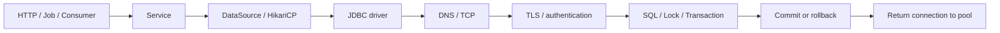
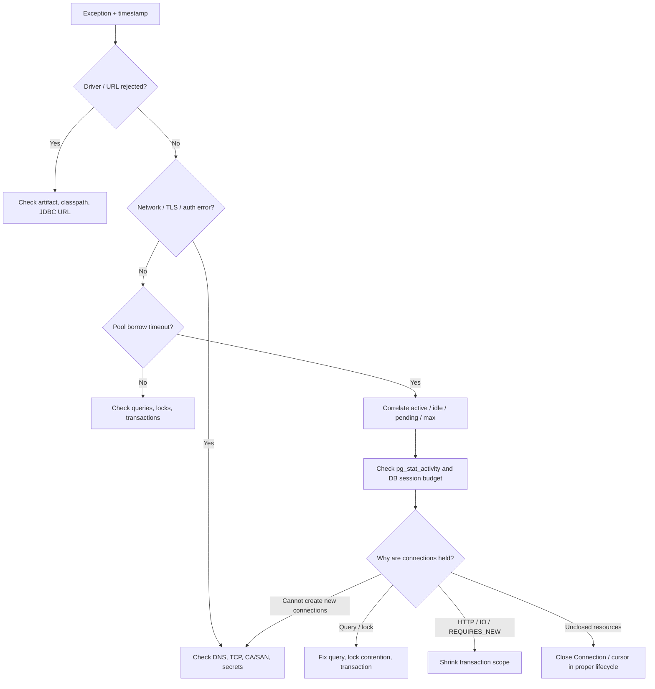

# Diagnosing Driver, Certificate, Pool Exhaustion, and Long-Held Transaction Errors

In a Spring Boot application, a "cannot connect to database" error can originate at several different stages: Java cannot find the JDBC driver, the driver fails the TLS handshake with the server, HikariCP has no idle connections left for new requests, or a transaction borrows a connection and holds it for too long. These situations can produce identical symptoms at the HTTP layer (rising latency, 500/503 errors), yet require completely different fixes.

This lesson belongs to the **SQL Connectivity** chapter within **SPRING_BOOT_INTEGRATION**: organizing Spring Boot integration with external systems and databases in a configurable, error-resilient, testable, and observable way. The emphasis is on **evidence-based diagnosis** before altering configuration or touching a live system.

After this lesson, you will be able to:

- Identify whether a failure occurs during driver loading, network/TLS establishment, pool borrowing, or transaction execution.
- Read exception cause chains, SQLState codes, HikariCP metrics, and SQL session states to form a hypothesis.
- Distinguish **pool exhaustion**, **connection leaks**, **slow queries**, **lock waits**, and **transactions holding connections too long**.
- Remediate the true root cause, verify fixes, and build test scenarios that reproduce the failure.

> **Example scope:** Application code uses Spring Boot + JDBC/JPA + HikariCP; database diagnostic queries are illustrated using PostgreSQL. TLS property names, error codes, and administrative queries vary by driver and database engine. Configuration numbers are examples, not universal optimal values.

## 1. Identifying the Stage Where Failure Occurs

### 1.1. Path of a SQL Operation



This is the **logical** path. HikariCP manages physical connections created by the driver; when a thread calls `DataSource.getConnection()`, it typically receives a proxy to an existing connection or waits for the pool to create/allocate one. With JPA, when `@Transactional` starts and when a physical connection is borrowed can differ depending on the ORM and configuration. Therefore, **transaction duration** and **connection hold time** should be measured separately when possible.

| Stage | Common symptoms | First distinguishing question |
|---|---|---|
| Driver loading / JDBC config | `ClassNotFoundException`, `Cannot load driver class`, `No suitable driver` | Is the driver inside the actual runtime artifact and does the URL use the right protocol? |
| Network / authentication | `Connection refused`, connection timed out, `password authentication failed` | Can it reach the right host/port? Does the server accept the login? |
| TLS / certificates | `SSLHandshakeException`, `PKIX path building failed`, hostname mismatch, expired cert | Is the server certificate valid for the target name and trusted CA set? |
| Borrowing connection | `Connection is not available, request timed out` | How many connections are `active`/`idle`/`pending`? Can the pool create new ones? |
| SQL / transaction | Very slow query, `idle in transaction`, lock wait, deadlock | What are borrowed connections doing and how long have transactions been open? |

**Do not reason solely from the surface exception.** For instance, Hikari reports a borrow timeout because the pool is fully occupied; the pool may be occupied because queries are waiting on locks, HTTP calls run inside transactions, `Connection` objects leak, or the database rejects new physical connections. Increasing `maximum-pool-size` before checking can make the outage worse.

### 1.2. Capture an Incident "Snapshot" Before Fixing

Record at least:

1. **Timing and scope:** did the failure happen at startup or after running for some time; one instance or all; after a deploy/secret rotation/cert change or during traffic spikes?
2. **Root exception:** complete `Caused by` chain, JDBC exception type, SQLState, vendor code, and timeout value in the message; strip passwords/tokens before sharing logs.
3. **Actual runtime environment:** artifact/container image, active profiles, driver, JDK, redacted JDBC URL, host/port, and effective TLS/pool properties.
4. **Pool and database at the same timestamp:** `active`, `idle`, `pending`, max pool size, DB session counts, transaction age, lock waits, and query latency.
5. **Call path:** which HTTP request, job, message consumer, or batch triggered the failure; are traces/spans, correlation IDs, or transaction logs available?

Correlating signals at the **same timestamp** is far more valuable than isolated snapshots. A full pool during a one-second traffic spike does not prove a leak; conversely, active connections creeping upward over hours under steady load warrants investigation.

### 1.3. Do Not Lump All Timeouts Together

| Limit type | What it waits on | Meaning when exceeded |
|---|---|---|
| Hikari `connectionTimeout` | A thread **borrowing** a connection from the pool | No connection granted in time; does not indicate whether SQL ever ran |
| Driver `connectTimeout` (name/unit vary by driver) | Establishing a connection to the DB | May involve network, routing, firewall, or DB listener |
| TLS handshake timeout | Completing the TLS session | May stem from network, TLS compatibility, certificates, or server |
| JDBC query/statement timeout | An executing SQL statement | May indicate a slow query, lock wait, or overloaded server |
| Transaction timeout | Transaction budget in framework/DB | Enforcement depends on transaction manager/driver; does not guarantee instant interruption of all operations |
| Driver socket/read timeout | Waiting for data on the socket | Slow server, network interruption, or overly aggressive timeout |

Document the property name, unit, and scope for the **exact driver in use**; never copy timeout numbers blindly between PostgreSQL, MySQL, and SQL Server.

## 2. Setting Up an Observable Baseline Configuration

Suppose a Spring Boot application uses PostgreSQL. A reference configuration:

```kotlin
// build.gradle.kts — showing relevant dependencies
dependencies {
    implementation("org.springframework.boot:spring-boot-starter-jdbc")
    implementation("org.springframework.boot:spring-boot-starter-actuator")
    runtimeOnly("org.postgresql:postgresql")
}
```

```yaml
# application.yml — values are illustrative only
spring:
  datasource:
    url: "jdbc:postgresql://pg.internal.example:5432/orders?sslmode=verify-full&sslrootcert=/etc/db-certs/ca.pem&ApplicationName=orders-api"
    username: ${DB_USERNAME}
    password: ${DB_PASSWORD}
    hikari:
      pool-name: orders-main
      maximum-pool-size: 10
      connection-timeout: 5000 # milliseconds; wait time to borrow a connection

management:
  endpoints:
    web:
      exposure:
        include: health,info,metrics
```

Store passwords in a secret store or environment variables; distribute CA certificates via a controlled deployment mechanism. The `/etc/db-certs/ca.pem` path and domain name above are hypothetical. `sslmode=verify-full` and `sslrootcert` are **PostgreSQL JDBC syntax**, not universal TLS settings across all drivers.

In Spring Boot, the JDBC/JPA starter typically configures a `DataSource` and uses HikariCP if present on the classpath; custom beans, application settings, or multiple datasources can alter this behavior. You do not need to set `spring.datasource.driver-class-name` when Boot/the driver infers it from the URL, but if configured manually, the class name must be exact.

When Actuator and Micrometer are enabled, Hikari metrics commonly include:

- `hikaricp.connections.active` — currently borrowed connections;
- `hikaricp.connections.idle` — connections ready to borrow;
- `hikaricp.connections.pending` — threads waiting to borrow;
- `hikaricp.connections.max` / `hikaricp.connections.min` — pool bounds/configuration;
- `hikaricp.connections.acquire`, `hikaricp.connections.usage`, `hikaricp.connections.creation` — duration measurements when instrumented;
- `hikaricp.connections.timeout` — count of borrow timeouts when exported.

You can inspect registered metrics through authorized Actuator endpoints such as `/actuator/metrics` and `/actuator/metrics/hikaricp.connections.active`. Metric names exported to Prometheus typically convert dots to underscores and may add suffixes by metric type; verify in your monitoring system. **Never expose detailed Actuator/metric endpoints publicly to the Internet.**

## 3. Error Group 1 — JDBC Driver and Connection Configuration

### 3.1. Accurate Identification

Example messages:

```text
java.lang.ClassNotFoundException: org.postgresql.Driver
Cannot load driver class: org.postgresql.Driver
java.sql.SQLException: No suitable driver found for jdbc:...
Failed to configure a DataSource: 'url' attribute is not specified ...
```

These are **not identical**:

- `ClassNotFoundException` / `Cannot load driver class`: the required class is absent or not loaded at runtime.
- `No suitable driver`: no registered driver claims that URL; could be classpath **or malformed URL**.
- `url attribute is not specified`: the application lacks effective datasource configuration; do not jump to blaming missing driver libraries.
- Driver loads, but `Connection refused` or `password authentication failed`: driver discovery succeeded—move on to network/authentication diagnostics.

### 3.2. Verification Order

**Step 1 — verify the JDBC URL.** Typical syntax:

```text
PostgreSQL: jdbc:postgresql://pg.internal.example:5432/orders
MySQL:      jdbc:mysql://mysql.internal.example:3306/orders
SQL Server: jdbc:sqlserver://sql.internal.example:1433;databaseName=orders
```

For example, `jdbc:postgres://...` is not a valid PostgreSQL JDBC URL prefix. Inspect the effective configuration after profiles, environment variables, secrets, and command-line overrides are applied—not just `application.yml` in source control.

**Step 2 — verify the dependency is present at runtime.** In Gradle, `compileOnly` or `testImplementation` does not put the driver into the production runtime artifact. `runtimeOnly("org.postgresql:postgresql")` is a standard declaration in Gradle when the framework discovers the driver automatically. In Maven, declare the driver dependency with the appropriate runtime scope.

**Step 3 — inspect the actual packaged artifact.** For a Spring Boot executable JAR using the default layout:

```bash
jar tf build/libs/app.jar | grep 'BOOT-INF/lib/postgresql-'
```

In PowerShell, replace `grep` with `Select-String`. For containers, inspect the **deployed JAR/image**, because files on a developer's machine may differ from the running image. For WARs, exploded deployments, or native images, inspection steps differ.

**Step 4 — inspect datasource initialization.** Is there a custom `DataSource` bean? Are there multiple datasources where one lacks configuration/dependencies? Does a profile switch the URL to another database engine? Does config force an invalid `driver-class-name`?

**Step 5 — test the network layer separately.** Once the driver loads, check DNS, port, network policies, DB listener, and authentication. Stop editing classpath dependencies if the root exception shows the server actively refusing TCP connections.

### 3.3. Remediation and Verification

Fix the runtime dependency, URL, or property binding according to the findings above; rebuild the artifact/image and test using the production-like package. A startup smoke check can borrow a connection from `DataSource` and run `SELECT 1` against a test PostgreSQL instance. This verifies connectivity in the test environment; it does not prove production certificates or full table permissions.

**Never "fix" driver errors by increasing pool size or disabling TLS.** Those belong to different stages of the connection path.

## 4. Error Group 2 — Certificates and TLS Sessions

TLS protects the transport channel between the application and the SQL server. For full verification, the client must verify both the **trust chain** and the server's **hostname identity**. If the DB requires mTLS, the client must also present an appropriate client certificate.

### 4.1. Reading Messages to Pick the Right Branch

| Symptom | Primary hypothesis | What to check |
|---|---|---|
| `PKIX path building failed` / `unable to find valid certification path` | Client cannot build a trust path to the CA | Root/intermediate CAs, CA file/truststore, driver trust config |
| `No subject alternative DNS name matching ...` | Host in URL does not match certificate SAN | DNS name in JDBC URL, server certificate SAN entries |
| `CertificateExpiredException` / not yet valid cert | Clock or certificate outside validity window | System clock, `notBefore`/`notAfter`, cert rotation schedule |
| `handshake_failure` / `bad_certificate` | TLS mismatch or rejected client certificate | Supported TLS versions/ciphers, mTLS requirement, client key/cert |
| Old connections work, new connections fail after cert rotation | New cert or CA not rolled out to all instances | New certificate chain, secret mounts, pod rollout, actual CA source |

Messages may be wrapped inside `PSQLException`, `SQLNonTransientConnectionException`, or pool exceptions. Always walk down to the **deepest meaningful root cause** in the exception chain.

### 4.2. Safe Verification Procedure

1. **Check the exact endpoint.** Does the JDBC URL use a DNS alias, IP address, proxy/load balancer endpoint, or hostname different from the certificate's SAN? Connecting by IP when the cert only lists DNS names typically fails hostname verification.
2. **Inspect the certificate actually presented by the server.** Verify subject, SAN, validity dates, issuer, and root/intermediate chain on the exact endpoint the app connects to. Do not guess from certificates stored on a different DB host.
3. **Check the client's trusted CAs.** Is the file actually mounted in the container? Does the process have read permission? Does the driver use a dedicated CA file or the Java truststore? Some JDBC drivers use their own trust configuration.
4. **If mTLS is enabled**, verify that the client certificate and private key match as a pair, are valid, and are trusted by the server; do not configure a client certificate when the server only uses one-way TLS.
5. **Correlate timing.** If errors start right after rotation or rollout, inspect which configuration/certificate version each instance holds. Existing physical connections can keep working while new connections fail.
6. **Test from the same runtime environment.** Use a small test app or protocol/driver-aware tool with the exact same hostname and CA. "TCP port open" does not prove TLS trust succeeds.

**PostgreSQL JDBC example with hostname verification:**

```properties
spring.datasource.url=jdbc:postgresql://pg.internal.example:5432/orders?sslmode=verify-full&sslrootcert=/etc/db-certs/ca.pem
```

`sslmode=verify-full` enforces certificate and hostname verification. `sslrootcert` provides the CA certificate path used by PostgreSQL JDBC's SSL mechanism. When using a Java truststore or custom `SSLFactory`, confirm the rules for your exact driver version; never assume `-Djavax.net.ssl.trustStore` governs every JDBC TLS setup.

Different drivers use different property names:

| Driver | Illustrative mode enforcing identity verification |
|---|---|
| PostgreSQL JDBC | `sslmode=verify-full` |
| MySQL Connector/J | `sslMode=VERIFY_IDENTITY` |
| Microsoft JDBC Driver for SQL Server | `encrypt=true` with `trustServerCertificate=false` and matching hostname |

These are **driver lookup hints**, not drop-in interchangeable query strings. Read the documentation for your specific driver and version to configure CAs, truststores, keystores, and certificate rotation.

### 4.3. What Not to Do When Certificates Fail

- Do not switch to `sslmode=disable`, `trustServerCertificate=true`, or disable hostname verification in production just to silence the error. Doing so strips server authentication and can mask connecting to the wrong endpoint.
- Never paste private keys into source code, logs, or screenshots.
- Do not treat `pg_isready`, `ping`, or a TCP port check as proof that JDBC TLS verification passed.
- If enabling handshake debug logging (such as `javax.net.debug=ssl,handshake` in an appropriate Java environment), enable it only temporarily, restrict log access, and filter sensitive data.

### 4.4. Post-Fix Verification

From a fresh instance, open a new fully verified TLS connection, execute `SELECT 1`, close it, and confirm zero handshake errors. Always test **creating a brand-new connection** after CA/certificate rotation rather than reusing a DB session opened before rotation.

## 5. Error Group 3 — Pool Cannot Supply a Connection

HikariCP is a connection pool: concurrent requests contend for a finite number of physical connections. When no connection becomes available before `connectionTimeout`, the borrowing thread receives an exception such as:

```text
java.sql.SQLTransientConnectionException:
orders-main - Connection is not available, request timed out after 5000ms
```

This symptom means **a connection could not be borrowed in time**. It does not by itself prove "the pool is too small."

### 5.1. Correlating Metrics

Notation:

- `A` = borrowed connections (`active`).
- `I` = idle connections (`idle`).
- `P` = waiting threads (`pending`).
- `M` = pool cap (`maximumPoolSize`).

| Observation over time | What may be happening | Next investigation |
|---|---|---|
| `A ≈ M`, `I ≈ 0`, `P > 0` | Pool is saturated | Borrow duration, query latency, open transactions, DB locks, leaks |
| `A < M` while `P > 0` persists | Pool cannot create/allocate fast enough | Slow connection creation, DB limits, network/TLS errors, thread scheduling |
| `A` climbs steadily and never drops when traffic subsides | Long-held connections or leaks | Borrow stack traces, unfinished transactions, hung threads |
| `P` rises alongside query latency and lock waits | Connections occupied by slow SQL/locks | DB wait events, SQL statements, blocking transactions |
| DB reports "too many connections" when pool expands | Total connections exceed DB budget | Pools across all replicas/datasources and other clients |

**Note:** a single point-in-time pool snapshot is inconclusive. An `active` connection may be executing a valid query; Hikari only knows it is checked out, not what it is doing inside the DB.

### 5.2. Minimum Evidence Set

Plot side by side over the same time window:

- `active`, `idle`, `pending`, `max`, and `timeout` count for the **exact pool**.
- Connection `acquire` and `usage` durations if instrumented.
- Request rate, HTTP/job/consumer latency, worker thread counts, and instance counts.
- DB: session counts, open transactions, lock-waiting sessions, query latency, CPU/IO.
- Failed connections / failed new connection creations due to auth, TLS, DB limits, or network.

If the pool is named `orders-main`, filter by that pool tag so different pools are not summed together. In multi-datasource apps, monitor each pool separately.

### 5.3. PostgreSQL-Side Diagnostics

**Group connections by application and state:**

```sql
SELECT application_name,
       state,
       COUNT(*) AS sessions
FROM pg_stat_activity
WHERE datname = current_database()
GROUP BY application_name, state
ORDER BY application_name, state;
```

**Find long-running or waiting transactions:**

```sql
SELECT pid,
       usename,
       application_name,
       state,
       now() - xact_start AS transaction_age,
       now() - query_start AS query_age,
       wait_event_type,
       wait_event,
       LEFT(query, 160) AS query_sample
FROM pg_stat_activity
WHERE datname = current_database()
  AND pid <> pg_backend_pid()
ORDER BY xact_start ASC NULLS LAST;
```

**Find sessions blocked by other sessions:**

```sql
SELECT pid,
       application_name,
       state,
       now() - xact_start AS transaction_age,
       wait_event_type,
       wait_event,
       pg_blocking_pids(pid) AS blocking_pids,
       LEFT(query, 160) AS query_sample
FROM pg_stat_activity
WHERE datname = current_database()
  AND cardinality(pg_blocking_pids(pid)) > 0
ORDER BY transaction_age DESC NULLS LAST;
```

These queries are PostgreSQL examples and require appropriate monitoring privileges. The `query` column may contain application literals if SQL was built insecurely; restrict access and redact data before sharing reports. On MySQL or SQL Server, use Performance Schema, DMVs, or vendor tooling instead.

`state = 'idle in transaction'` means the session is inside an open transaction while running no query at the moment of sampling; it may still hold locks and transaction resources. `state = 'active'` does not always mean burning CPU: it may be **waiting on a lock or I/O**. Use `wait_event_type` and `pg_blocking_pids` to distinguish them.

### 5.4. Evaluating Capacity Before Enlarging the Pool

A basic estimate of average concurrent connections needed:

\[
\text{avg busy connections} \approx
\text{DB ops/second} \times
\text{connection hold time per op (seconds)}
\]

This applies throughput–latency math as an **average estimate** only, and does not replace measuring peak load and latency distributions. Use **connection hold time**, not full HTTP request duration if the request also calls non-DB services.

Suppose 6 replicas each have a max pool of 18 connections: this group alone can open **108 connections**. If the DB budget for the app is around 80 connections after reserves and other services, enlarging the pool or adding replicas breaches capacity. Sum all datasources, workers, schedulers, batches, migrations, and other apps; never treat DB `max_connections` as the application's exclusive budget.

Fix root causes first: slow queries, locks, transactions holding connections, connection creation failures, or leaks. Adjust `maximum-pool-size` only when the DB has spare resource headroom, the app has genuine parallel demand, and load tests confirm improvement. With Hikari, leave `minimum-idle` unset unless specifically required; keeping the default generally runs the pool close to fixed size.

### 5.5. Distinguishing a "Leak" from Legitimate Long Borrows

Hikari can warn when a connection stays borrowed beyond `leakDetectionThreshold`. Enable it temporarily in controlled environments:

```yaml
spring:
  datasource:
    hikari:
      leak-detection-threshold: 20000 # ms, for time-bounded diagnostics only
```

An "apparent connection leak" stack trace only means the connection **was held past the threshold**; legitimate long transactions trigger it too. If the connection is later returned, it was a long borrow rather than a permanent leak. Set the threshold above normal borrow durations, obey Hikari's supported bounds, and turn it back off after investigation to avoid log noise.

True leaks usually occur when code manually manages a `Connection` and forgets to close it on all exception paths. Proper resource cleanup example:

```java
import java.sql.Connection;
import java.sql.PreparedStatement;
import java.sql.ResultSet;
import javax.sql.DataSource;

public long countPending(DataSource dataSource) throws Exception {
    String sql = "SELECT COUNT(*) FROM orders WHERE status = ?";

    try (Connection connection = dataSource.getConnection();
         PreparedStatement statement = connection.prepareStatement(sql)) {
        statement.setString(1, "PENDING");
        try (ResultSet result = statement.executeQuery()) {
            result.next();
            return result.getLong(1);
        }
    }
}
```

In Spring apps, `JdbcTemplate` and standard ORM components manage connection borrow/return via Spring infrastructure; prefer built-in abstractions to avoid manual mistakes. With streaming results, cursors, or lazy data APIs, ensure the underlying resources close promptly once the consumer finishes reading.

## 6. Error Group 4 — Transactions Holding Connections Too Long

### 6.1. Why Does a Long Transaction Exhaust the Pool?

Once a physical connection is borrowed to run SQL in a transaction, it generally cannot serve another transaction until the transaction completes and returns the connection. If many threads hold connections while waiting on HTTP, file I/O, message brokers, or DB locks, `active` hits the ceiling even with low DB CPU.

Example of an overly broad transaction scope:

```java
@Service
public class CheckoutService {
    private final OrderRepository orders;
    private final InventoryClient inventory;

    public CheckoutService(OrderRepository orders, InventoryClient inventory) {
        this.orders = orders;
        this.inventory = inventory;
    }

    @Transactional
    public void checkout(OrderRequest request) {
        orders.save(Order.pending(request));    // May begin borrowing a connection
        inventory.reserve(request.productId()); // Slow HTTP call inside DB transaction
        orders.markReserved(request.orderId());
    }
}
```

This is an illustrative snippet, not complete production logic. Depending on Hibernate/transaction manager behavior, physical connection acquisition might be delayed until SQL runs inside `@Transactional`; however, once borrowed with the transaction open, an intermediate HTTP call extends the hold duration. HTTP client timeouts and pool timeouts are **two separate boundaries**.

### 6.2. Intentionally Narrowing Transaction Boundaries

Where business rules allow, perform lookups/HTTP calls before starting the transaction, keeping the transaction strictly around atomic SQL operations:

```java
@Service
public class CheckoutService {
    private final InventoryClient inventory;
    private final TransactionTemplate tx;
    private final OrderRepository orders;
    private final OutboxRepository outbox;

    public CheckoutService(
            InventoryClient inventory,
            TransactionTemplate tx,
            OrderRepository orders,
            OutboxRepository outbox) {
        this.inventory = inventory;
        this.tx = tx;
        this.orders = orders;
        this.outbox = outbox;
    }

    public void checkout(OrderRequest request) {
        ReservationQuote quote = inventory.quote(request.productId()); // Outside DB transaction

        tx.executeWithoutResult(status -> {
            Order order = orders.save(Order.pending(request, quote));
            outbox.save(OutboxEvent.orderCreated(order.getId()));
        });
    }
}
```

This example uses `TransactionTemplate` so transaction boundaries are explicit in code; `Order`, `ReservationQuote`, and the repositories are illustrative types. The outbox row must be written in the **same transaction** as the business data, with a separate worker delivering events externally afterward. This pattern fits cases requiring reliable post-commit event publishing.

**Important limitation:** moving HTTP outside the transaction does not automatically make external system state and the DB atomic. The `quote` could go stale before commit; business logic needs versioning, idempotency, re-validation, or compensation flows when needed. If real inventory was already reserved externally before DB commit, you need a way to release or reconcile it on failure.

### 6.3. Common Pitfalls

| Code pattern / situation | Risk | Diagnosis / fix |
|---|---|---|
| `@Transactional` wrapping HTTP calls, broker sends, sleeps, or file I/O | Holds connections/locks longer than SQL needs | Measure non-DB time; shrink transaction, use outbox where needed |
| Huge queries or missing indexes inside transactions | Connections stay busy, requests queue up | Check query plans, slow queries, indexes, paging/batching |
| One transaction waiting on another's lock | Sessions `active` yet stalled | `pg_blocking_pids`, transaction age, lock/update ordering |
| Calling `REQUIRES_NEW` inside a transaction holding a connection | May require an **extra** connection for the inner transaction | Check concurrent threads vs. pool size; avoid unnecessary nesting |
| Returning a streaming result outside its managed scope | Cursors/connections stay unclosed | Consume and close resources within a valid scope |
| Open Session in View enabled | Triggers late queries during response rendering, hides N+1 | Map DTOs and load needed relations in the service; measure real connection usage |
| Self-invocation calling `@Transactional` on the same object | Spring transaction proxy may not intercept | Verify proxy boundary, split into a separate bean, or use `TransactionTemplate` |

Never assume "`@Transactional` always borrows a connection at method entry": acquisition timing, Hibernate release mode, and datasource settings affect it. Measure real traces and metrics. Likewise, `Open Session in View` does not automatically mean the physical connection stays open across the entire HTTP response.

### 6.4. Inspecting Transactions in PostgreSQL

From the `pg_stat_activity` queries above, inspect:

- `xact_start`: transaction start timestamp; `now() - xact_start` is transaction age.
- `query_start`: start time of the current/most recent query; interpret alongside `state`.
- Prolonged `idle in transaction`: the app or client failed to end the transaction.
- `wait_event_type = 'Lock'`: locate the blocking PID, then trace the code path holding that transaction.
- `pg_blocking_pids(pid)`: list of blocking PIDs; blindly killing PIDs triggers rollbacks and business impact.

During production incidents, terminate DB sessions manually only after assessing impact and following approved operational runbooks. Killing a long transaction frees locks quickly, but does not fix the code causing it.

### 6.5. Place Timeouts at the Right Layer

For example, PostgreSQL supports `statement_timeout` to cap individual statements and `idle_in_transaction_session_timeout` to prevent sessions sitting idle inside open transactions. Set values based on workload, privileges, migrations, and actual SLOs. Spring's `@Transactional(timeout=...)` or `TransactionTemplate` timeout depends on the transaction manager and SQL execution path; never treat it as an absolute replacement for DB or driver timeouts.

A "safe" timeout policy must answer: how long do normal requests run, does an aborted transaction roll back cleanly, does the app retry, is the retry idempotent, and will the timeout accidentally kill legitimate batch jobs?

## 7. Evidence-Based Troubleshooting Runbook

The workflow below prioritizes isolating failures with minimal changes. It applies to HTTP APIs, scheduled jobs, and Spring Boot message consumers.

### Step 1 — Locate the Primary Symptom

- Fails right when creating `DataSource`/starting up: check driver, URL config, secrets, new connectivity, TLS.
- Runs fine then starts timing out borrowing connections: check pool and DB sessions.
- Queries execute slowly or deadlock: inspect locks, execution plans, and transactions.
- Only a subset of instances fail: compare deployments, profiles, CA mounts, config, and network reachability for that subset.

### Step 2 — Correlate Application Evidence with the Database



### Step 3 — Apply Targeted Fixes

| Evidence-backed conclusion | Primary change | Verification |
|---|---|---|
| Driver missing from artifact | Fix runtime dependency/packaging | New artifact includes driver and passes connection test |
| Wrong URL driver / missing datasource config | Fix URL, profile, property binding | App targets right endpoint and creates `DataSource` |
| Wrong CA/SAN/TLS | Fix CA chain, hostname, or issue valid cert | Fresh connection passes TLS verification |
| DB out of sessions | Lower total connection budget, fix hold paths, coordinate with DBA | DB accepts new connections; session count stays within budget |
| Slow query/lock | Optimize SQL/indexes, shrink lock scope, fix blocking transaction | Query latency/lock waits drop, `pending` drops |
| HTTP/IO inside transaction | Shrink transaction boundaries | `connection usage` and transaction age drop |
| Manual `Connection` unclosed | Fix lifecycle via try-with-resources or Spring abstractions | `active` returns to baseline after load; no leak warnings |

### Step 4 — Verify and Document the Incident

After deploying the fix, observe across a representative load window: error rate, peak `pending`, `active`, borrow latency, query latency, transaction age, DB session counts, and timeout rate. Compare against pre-incident baselines and check for secondary errors from retries or rollbacks. Record the **root cause**, **distinguishing signals**, **remediation applied**, and **early-warning conditions** for future runbooks.

## 8. Four Classic Diagnostic Scenarios

### Scenario A — New Deploy Reports Driver Not Found

**Symptom:** works locally, but the production image fails startup with `Cannot load driver class: org.postgresql.Driver`.

**Correlation:** source code references the driver, yet the production artifact/image lacks `postgresql-*.jar`. The dependency was accidentally placed in `testImplementation` or excluded from runtime packaging.

**Fix:** move the dependency to runtime scope, rebuild the image, verify the JAR contents **inside the new image**, and run a `SELECT 1` smoke test. Tuning pool settings will not fix this failure.

### Scenario B — After Certificate Rotation, Only New Connections Fail

**Symptom:** some requests keep working on existing connections; newly started instances fail with `PKIX path building failed`. Hikari may also log timeouts because the pool cannot create replacement connections.

**Correlation:** the new CA is not mounted yet or the server chain lacks an intermediate CA; a subset of instances still holds the old CA bundle. Also check SANs if the endpoint hostname changed.

**Fix:** distribute the complete CA/chain, ensure hostname matches SANs, and perform a verified rollout. Test using a **brand-new JDBC connection** with verification enabled. Never disable certificate checks to "keep the service up."

### Scenario C — 10-Connection Pool Saturated While DB CPU Is Low

**Symptom:** `active=10`, `idle=0`, `pending` climbs, API returns `Connection is not available`; DB CPU stays low. `pg_stat_activity` shows many `idle in transaction` sessions.

**Correlation:** threads hold open transactions after `INSERT` while waiting ~12 seconds on an HTTP call to an inventory service. The bottleneck is not SQL execution; borrow duration is inflated by network I/O.

**Fix:** move HTTP calls outside the DB transaction where business rules allow, write to an outbox if post-commit events are required, configure HTTP client timeouts, and ensure retries/idempotency. Verify connection hold time, `pending`, and timeouts drop under the same load.

### Scenario D — Active Connections Do Not Drop After Traffic Stops

**Symptom:** `active` climbs slowly over hours; few new requests arrive yet the pool stays nearly full. Leak warnings point to a method calling `dataSource.getConnection()` manually.

**Correlation:** early-return or exception paths bypass `close()`. No matching long-running transactions exist; connections are borrowed and never returned.

**Fix:** use try-with-resources or switch to `JdbcTemplate`; add a test throwing an exception mid-operation to confirm resources always close. After fixing, connections return to the pool when requests complete; monitor across multiple load cycles.

## 9. Preventive Testing and Production Observability

### 9.1. Practical Test Matrix

| Test layer | Scenario | Expected result |
|---|---|---|
| Package/smoke | Boot deployed artifact with runtime driver and test URL | Driver loads, app connects, `SELECT 1` succeeds |
| TLS integration | Use production-like server/cert with valid CA and hostname | Connection succeeds with verification enabled |
| TLS negative | Use wrong CA, wrong hostname, or expired cert in test env | Connection clearly rejected; no insecure fallback |
| Pool saturation | Small pool (e.g., `maximum-pool-size=2`), controlled concurrent DB ops | Threads wait/timeout per policy; connections return when load ends |
| Failure path | Throw exception after borrowing `Connection` or mid-transaction | Connection closes/returns, transaction rolls back as designed |
| Transaction latency | Simulate slow remote HTTP or locked query in test env | Traces highlight hold time; refactoring lowers `usage` |
| Recovery | Temporarily block new connections then restore in test env | App recovers cleanly or surfaces clear errors per retry policy |

Testcontainers with PostgreSQL is useful for reproducing SQL and pool behavior in CI. However, a PostgreSQL container without TLS enabled by default **does not prove** CA/hostname verification works; TLS requires dedicated scenarios with explicit certificates, endpoints, and CAs. Never run pool exhaustion tests, artificial transaction hangs, or experimental cert rotations directly on production.

### 9.2. Actionable Alerts

A well-operated system needs at least per-datasource/pool dashboards linked to traces and DB health. Alerts should be grounded in SLOs/baselines with reasonable sustain windows, for example:

- `pending > 0` sustained **alongside** rising `timeout` counts and request latency breaching SLO;
- `active` pinned near `max` even after traffic drops, or abnormal spikes in `usage`;
- transactions with `transaction_age` exceeding application limits;
- rising `idle in transaction` sessions or lock waits;
- new connection failures from TLS, auth, or DB connection limits spiking after a deploy/rotation.

Do not alert blindly on "high active = error." A busy pool during peak traffic can be completely healthy if latency and timeouts stay within SLO; alerts must give on-call engineers clear diagnostic context for next steps.

### 9.3. Security and Reliability Notes

- JDBC logs can expose SQL, parameters, URLs, and personal data. Mask secrets, restrict log access, and never leave full SQL parameter or handshake debug logging on indefinitely.
- Set `application_name` or a trusted instance identifier on SQL connections to correlate `pg_stat_activity` with metrics/logs (never use sensitive strings as the application name).
- Separate timeouts for borrowing connections, opening connections, SQL queries, and HTTP clients; use bounded retries with backoff and idempotency. Uncontrolled retries amplify pool and DB congestion.
- Across multiple replicas, budget total DB connections including other components such as batch jobs and admin tools.
- After fixing issues, test **commit, rollback, and close** paths—not just the happy path.

## 10. Short On-Call Incident Checklist

1. Capture the root stack trace, SQLState, timestamp, artifact version, and affected instances.
2. Classify stage: driver/URL → DNS/TCP/auth → TLS → pool borrow → query/transaction.
3. For driver issues: verify the **classpath inside the actual running artifact**, JDBC URL, and effective profiles.
4. For TLS: verify hostname/SAN, CA chain, validity dates, and client certificate requirements using a fresh connection.
5. For pool issues: examine **active + idle + pending + max + timeout** over time alongside DB session counts.
6. For transactions: inspect `pg_stat_activity`, `transaction_age`, `idle in transaction`, lock waits, queries, and any HTTP/IO inside `@Transactional`.
7. Fix the root cause, test in a controlled environment, observe under representative load, and document the evidence.

**Key takeaway:** an exception thrown by `DataSource.getConnection()` tells you **where the request failed**, not necessarily **where the root cause began**. Accurate diagnosis connects evidence across the driver and TLS, HikariCP, the SQL server, transactions, and the business integration flow.
