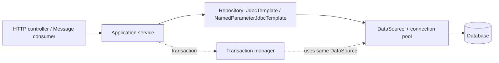

# `JdbcTemplate`, `NamedParameterJdbcTemplate`, and Spring Boot Auto-Configuration

In **SPRING_BOOT_INTEGRATION**, the database is often a link in an integration flow: receiving an HTTP request or message, checking state, updating data, and returning a result or emitting subsequent events. `JdbcTemplate` and `NamedParameterJdbcTemplate` help execute SQL with full control while leveraging the connections, transactions, exception mapping, and observability provided by Spring Boot. This lesson belongs to the **JDBC and jOOQ** chapter and focuses on the JDBC data-access layer; jOOQ is placed alongside JDBC in the tool-selection section.

## Learning Objectives

After this lesson, you will be able to:

- Explain the roles of `DataSource`, the connection pool, `JdbcTemplate`, and `NamedParameterJdbcTemplate` in a Spring Boot application.
- Configure connections, environment variables, SQL initialization, and pool properties suited to each environment.
- Write parameterized queries, map results to Java objects, perform updates, and handle collection parameters.
- Define transaction boundaries, affected row counts, retryable errors, and ways to prevent duplicate message processing.
- Choose a testing strategy and observability signals for a real-world data integration flow.

## 1. Where Does JDBC Fit in Integration Architecture?

JDBC is Java's API for working with relational databases through a driver. With plain JDBC, developers must manage `Connection`, `PreparedStatement`, `ResultSet`, resource closing, and `SQLException` conversion. Spring JDBC preserves full control over SQL while handling most of that boilerplate work.



Their roles are not interchangeable:

| Component | Responsibility |
| --- | --- |
| `DataSource` | Provides connections to the database management system. |
| Connection pool (typically HikariCP) | Reuses connections; controls the number of open connections and connection acquisition wait time. |
| `JdbcTemplate` | Executes SQL using `?` placeholders, binds parameters, maps results, releases resources, and translates JDBC errors into Spring's exception hierarchy. |
| `NamedParameterJdbcTemplate` | Provides `:tenThamSo` syntax; translates to JDBC parameters, convenient for multi-condition queries and `IN` clauses. |
| `PlatformTransactionManager` | Enlists JDBC operations into the same transaction when running in a `@Transactional` context. |

`JdbcTemplate` is not an ORM: it does not auto-generate queries from object relationships, does not track entity changes automatically, and does not create distributed transactions across the database, HTTP, and message brokers. Those are important boundaries when designing integration adapters.

## 2. What Does Spring Boot Auto-Configure?

When an application has the appropriate JDBC dependencies, database driver, and connection properties, Spring Boot can automatically create the `DataSource`, `JdbcTemplate`, `NamedParameterJdbcTemplate`, and JDBC transaction infrastructure. Under typical configuration, HikariCP is the default pool when present on the classpath. If the application declares custom beans, auto-configuration conditions may change; with multiple `DataSource`s, you must explicitly select the corresponding bean and transaction manager.

Maven example using PostgreSQL (versions managed by the Spring Boot BOM or project parent):

```xml
<dependencies>
    <dependency>
        <groupId>org.springframework.boot</groupId>
        <artifactId>spring-boot-starter-jdbc</artifactId>
    </dependency>
    <dependency>
        <groupId>org.postgresql</groupId>
        <artifactId>postgresql</artifactId>
        <scope>runtime</scope>
    </dependency>
</dependencies>
```

Example `application.yml` (values are illustrative only and must be tuned to your database capacity and actual load):

```yaml
spring:
  datasource:
    url: jdbc:postgresql://${DB_HOST:localhost}:5432/${DB_NAME:integration_demo}
    username: ${DB_USER}
    password: ${DB_PASSWORD}
    hikari:
      pool-name: integration-db-pool
      maximum-pool-size: 10
      minimum-idle: 2
      connection-timeout: 30000
  sql:
    init:
      mode: never
```

`DB_USER` and `DB_PASSWORD` must be supplied from environment variables or a secrets manager; never place real passwords in source code. The driver is usually inferred by Boot from the JDBC URL and dependencies. `spring.datasource.hikari.connection-timeout` is measured in milliseconds; running out of time to acquire a connection can cause an operation to fail even when its SQL is very fast.

| Configuration | Interpretation and Notes |
| --- | --- |
| `spring.datasource.url` | JDBC URL containing the host, port, database name, and necessary connection options. |
| `spring.datasource.username/password` | Access identity following least-privilege principles, retrieved from a secret store. |
| `spring.datasource.hikari.maximum-pool-size` | Pool connection limit; must be balanced against the total number of instances, other applications, and DB limits. |
| `spring.datasource.hikari.connection-timeout` | Wait-time limit to obtain an idle connection from the pool, not the maximum duration for every SQL statement. |
| `spring.sql.init.mode` | Controls running `schema.sql`/`data.sql` scripts; `never` is used when schema is managed by dedicated migrations. |

For production services, schema changes should be managed with Flyway or Liquibase, and only **one** mechanism should own schema creation/modification. `spring.sql.init.mode=always` allows running SQL init scripts even on non-embedded databases, which is useful for demos but can easily conflict with migrations or production data if misused. Separate configuration by profile (`dev`, `test`, `prod`) and never let convenience options used during experimentation leak into production.

### Schema Used Throughout the Examples

The following examples use PostgreSQL and two simple tables:

```sql
CREATE TABLE customer_profile (
    id           BIGINT GENERATED ALWAYS AS IDENTITY PRIMARY KEY,
    email        VARCHAR(320) NOT NULL UNIQUE,
    display_name VARCHAR(160) NOT NULL,
    status       VARCHAR(20) NOT NULL,
    updated_at   TIMESTAMPTZ NOT NULL DEFAULT NOW()
);

CREATE TABLE processed_message (
    message_id   VARCHAR(100) PRIMARY KEY,
    processed_at TIMESTAMPTZ NOT NULL
);
```

`customer_profile` holds business data; `processed_message` records a message that has already been processed in the same database, supporting the duplicate-handling example in the transaction section. The DDL above uses PostgreSQL syntax and requires corresponding migrations before running the application.

## 3. `JdbcTemplate`: Positional SQL, Result Mapping, and Updates

`JdbcTemplate` fits short SQL statements with few parameters and a clear parameter order. The object is provided via dependency injection; there is no need to call `new JdbcTemplate(...)` at each call site. Below is a reusable repository in Spring Boot:

```java
import java.util.List;
import java.util.Optional;

import org.springframework.jdbc.core.JdbcTemplate;
import org.springframework.jdbc.core.RowMapper;
import org.springframework.stereotype.Repository;

public record Customer(long id, String email, String displayName, String status) {}

@Repository
public class CustomerRepository {
    private static final String COLUMNS =
            "id, email, display_name, status";

    private static final RowMapper<Customer> CUSTOMER_MAPPER = (rs, rowNum) ->
            new Customer(
                    rs.getLong("id"),
                    rs.getString("email"),
                    rs.getString("display_name"),
                    rs.getString("status"));

    private final JdbcTemplate jdbc;

    public CustomerRepository(JdbcTemplate jdbc) {
        this.jdbc = jdbc;
    }

    public Optional<Customer> findById(long id) {
        List<Customer> rows = jdbc.query(
                "SELECT " + COLUMNS + " FROM customer_profile WHERE id = ?",
                CUSTOMER_MAPPER,
                id);
        return rows.stream().findFirst();
    }

    public int rename(long id, String newName) {
        return jdbc.update(
                "UPDATE customer_profile " +
                "SET display_name = ?, updated_at = NOW() WHERE id = ?",
                newName, id);
    }
}
```

**Note on the code snippet:** Java requires each `public` top-level type to reside in its own file. When putting the example into an application, place `Customer` in `Customer.java` and `CustomerRepository` in `CustomerRepository.java`; the snippet combines them for easier side-by-side reading.

The `query(sql, rowMapper, args...)` method uses a `PreparedStatement`; data is bound to `?` placeholders in order. `RowMapper<Customer>` transforms **one row** of a `ResultSet` into **one** object; `query(...)` returns an empty list when no rows match. `update(...)` returns the number of affected rows: if updating by primary key returns `0`, the record may not exist; any value other than `1` warrants revisiting the query assumptions.

When a query must return exactly one row, `queryForObject(...)` is a concise option, though keep in mind it throws an exception if zero rows or more than one row are returned. For APIs returning `Optional`, using `query(...)` as shown above expresses the not-found case directly.

**Do not concatenate input values into SQL:**

```java
// Wrong: client data becomes part of the SQL syntax.
String unsafe = "SELECT id FROM customer_profile WHERE email = '" + email + "'";

// Right: email is passed as an SQL value.
List<Long> ids = jdbc.queryForList(
        "SELECT id FROM customer_profile WHERE email = ?",
        Long.class,
        email);
```

Parameter binding protects **values**; table names, column names, and `ORDER BY` directions cannot be passed via `?` or `:param`. For dynamic sorting queries, map the user's selection against an allowlist of permitted SQL identifiers and only concatenate vetted identifiers.

## 4. `NamedParameterJdbcTemplate`: Readable SQL When Parameters Multiply

`NamedParameterJdbcTemplate` wraps the corresponding JDBC operations but uses `:id`, `:status` instead of repeated `?` placeholders. Spring Boot typically provides this bean alongside `JdbcTemplate`, so it can be injected directly into repositories.

```java
import java.util.Collection;
import java.util.List;

import org.springframework.jdbc.core.RowMapper;
import org.springframework.jdbc.core.namedparam.MapSqlParameterSource;
import org.springframework.jdbc.core.namedparam.NamedParameterJdbcTemplate;
import org.springframework.stereotype.Repository;

@Repository
public class CustomerSearchRepository {
    private static final RowMapper<Customer> MAPPER = (rs, rowNum) ->
            new Customer(
                    rs.getLong("id"),
                    rs.getString("email"),
                    rs.getString("display_name"),
                    rs.getString("status"));

    private final NamedParameterJdbcTemplate namedJdbc;

    public CustomerSearchRepository(NamedParameterJdbcTemplate namedJdbc) {
        this.namedJdbc = namedJdbc;
    }

    public List<Customer> findByStatusAndIds(
            String status, Collection<Long> customerIds) {
        if (customerIds.isEmpty()) {
            return List.of();
        }

        String sql = """
                SELECT id, email, display_name, status
                FROM customer_profile
                WHERE status = :status AND id IN (:ids)
                ORDER BY id
                """;

        var params = new MapSqlParameterSource()
                .addValue("status", status)
                .addValue("ids", customerIds);

        return namedJdbc.query(sql, params, MAPPER);
    }
}
```

In this example, `:ids` is expanded into the number of placeholders matching the elements in the collection. An empty list is handled upfront because `IN ()` is not valid SQL on many database engines. For very large lists, split into batches or use a temporary table/appropriate join instead of generating queries with thousands of uncontrolled parameters.

`MapSqlParameterSource` is convenient when declaring values and, if needed, explicit JDBC types. `Map<String, ?>` also works well for simple queries. For batches, you can use `namedJdbc.batchUpdate(sql, SqlParameterSource[])`; check the update counts returned by the driver and verify business requirements, because some drivers may report `SUCCESS_NO_INFO` instead of exact per-statement row counts.

### Which API Should You Choose?

| Need | Typically Suitable Tool | Points to Check |
| --- | --- | --- |
| Small queries, few parameters | `JdbcTemplate` | Ordering of `?` placeholders. |
| Multi-condition queries, reusing the same value | `NamedParameterJdbcTemplate` | Parameter names must match the SQL. |
| `IN` queries over a collection | `NamedParameterJdbcTemplate` | Empty collections and parameter count limits. |
| Complex dynamic queries needing an SQL DSL and schema-generated types | jOOQ | Dialect configuration, code generation, and migration management. |
| Wanting aggregate mapping and repositories in the Spring Data model | Spring Data JDBC | Mapping/aggregate rules, which differ from per-statement SQL control. |

`JdbcTemplate` and jOOQ are not mutually exclusive: different adapters can share the same `DataSource` and an appropriate transaction manager. Choose based on SQL complexity, maintainability, and query-control requirements—not technology name.

## 5. Transactions: Consistency Across Multiple SQL Statements

A single `update(...)` statement does not guarantee atomicity for an **entire** business flow. When an event requires writing to multiple tables, place the transaction boundary on a business-meaningful service or a Spring-managed handler:

```java
import org.springframework.jdbc.core.JdbcTemplate;
import org.springframework.stereotype.Service;
import org.springframework.transaction.annotation.Transactional;

@Service
public class CustomerStatusHandler {
    private final JdbcTemplate jdbc;

    public CustomerStatusHandler(JdbcTemplate jdbc) {
        this.jdbc = jdbc;
    }

    @Transactional
    public void applyStatusChanged(String messageId, long customerId, String status) {
        int firstDelivery = jdbc.update(
                "INSERT INTO processed_message (message_id, processed_at) " +
                "VALUES (?, NOW()) ON CONFLICT (message_id) DO NOTHING",
                messageId);

        if (firstDelivery == 0) {
            return; // This message has already been processed and committed.
        }

        int changed = jdbc.update(
                "UPDATE customer_profile " +
                "SET status = ?, updated_at = NOW() WHERE id = ?",
                status, customerId);

        if (changed != 1) {
            throw new IllegalStateException("Customer not found: " + customerId);
        }
    }
}
```

This is a **PostgreSQL-specific `messageId` idempotency** approach. The primary key on `processed_message` combined with `ON CONFLICT ... DO NOTHING` ensures repeated deliveries do not update the status a second time. If the customer update fails and the exception rolls back the transaction, the record in `processed_message` is also rolled back, allowing the system to retry once the cause is resolved. You must use a stable message ID defined by the sender's contract; never generate a new ID on each retry.

Conditions required for the example to work correctly:

1. Both JDBC statements use the same `DataSource` managed by the transaction manager.
2. `applyStatusChanged(...)` is invoked through the Spring bean/proxy, not via an internal call from another method on the same instance while expecting `@Transactional` to take effect.
3. The exception on a missing record propagates out to trigger rollback. By default, `@Transactional` rolls back on `RuntimeException` and `Error`; checked exceptions follow different rules and must be configured explicitly when needed.
4. The broker's message acknowledgment mechanism must align with the commit point. A database transaction does **not** automatically encompass broker acks or calls to another HTTP service.

If you need reliable **database write followed by message publish**, consider a transactional outbox: write the business row and the outbox record in the same transaction, then have an independent publisher send the outbox entries and record progress. Combine outbox with idempotent consumer handling to tolerate duplicate delivery; do not extrapolate this into an "exactly-once" guarantee across all systems.

`@Transactional(readOnly = true)` is useful for expressing read-only intent and may enable driver/database optimizations; it is not a security mechanism guaranteeing that all writes are blocked. Avoid keeping transactions open while waiting on HTTP or broker calls, as connection hold time and locks can increase significantly.

## 6. Error Handling and Retries in Database Adapters

Spring JDBC translates `SQLException` into the unchecked `DataAccessException` family. This lets services classify errors by handling intent without depending directly on vendor-specific driver error codes.

| Symptom | Example Scenario | Handling Approach |
| --- | --- | --- |
| `DuplicateKeyException` | Duplicate primary/unique key on insert | Determine whether it is a legitimate duplicate request or a business conflict; do not retry blindly. |
| `DataIntegrityViolationException` | Data constraint violation | Check input contract, DB constraints, and update flow. |
| `CannotGetJdbcConnectionException` | Database unavailable, pool/connection failure | Inspect connections/pool; retry with bounds if the operation is safe to repeat. |
| `QueryTimeoutException` | Query exceeded configured time limit | Inspect execution plan, locks, DB load, and overall request deadline. |
| `EmptyResultDataAccessException` | `queryForObject(...)` found no row | Translate to `404`, `Optional.empty()`, or an appropriate business outcome. |

Not every error is transient, and not every write command is safe to retry. When you must retry work with side effects, use idempotency keys, attempt limits, and backoff, and distinguish temporary connection failures from data-contract errors. Timeouts for connection acquisition, SQL execution, and the overall request/message deadline must be aligned to avoid backlog buildup.

## 7. Performance, Security, and Observability

**Operational principles:**

- **Connection pool:** do not set `maximum-pool-size` equal to concurrent request count if the DB cannot sustain it. Total connections across all instances is the number you must check; observe active, pending, and timed-out connections before increasing pool size.
- **Queries:** select only needed columns rather than `SELECT *`, add indexes for real filter/join keys, paginate when reading many rows, and inspect execution plans when queries are slow.
- **Batching and data volume:** use `batchUpdate` for many statements of the same shape; for large datasets, process in pages/chunks with bounded memory and transaction scope.
- **Trust boundaries:** bind all input **values**; allowlist vetted column names, table names, and sort directions. Grant DB user privileges following least privilege.
- **Duration and transactions:** avoid external I/O outside the database inside transactions; control lock duration and set timeouts appropriate for the work.
- **Sensitive data:** avoid logging SQL together with secrets, personal data, or full payloads; log request/correlation IDs and sanitized fields instead.

With Spring Boot Actuator and Micrometer configured, you can monitor database health, HikariCP pool utilization and wait times (such as `hikaricp.connections.*` metrics when exported), request latency, and service-layer errors. A correlation ID should propagate through the HTTP request/message, service, and queries to link a DB error back to the integration flow that triggered it. Detailed SQL logging should only be enabled temporarily in controlled environments, avoiding exposure of parameter values.

## 8. Testing Around the Boundaries You Need to Guarantee

| Level | Goal | Implementation Suggestion |
| --- | --- | --- |
| Service unit test | Verify business branching, `0/1` row handling, error reactions | Use a fake or mocked repository; do not claim SQL syntax correctness from this test type. |
| JDBC slice test | Verify SQL, mapping, and repository against a test database | Use `@JdbcTest`; import repositories as needed, prepare schema and data explicitly. |
| Integration test with real DB | Verify syntax/dialect, unique constraints, transactions, `ON CONFLICT` | Use PostgreSQL via Testcontainers, run real migrations, and configure not to replace with an embedded DB. |
| Consumer/adapter test | Verify redelivery, duplicate handling, rollback, and ack | Replay the same `messageId`, inject failures mid-transaction, assert update counts and retry conditions. |

Do not use H2 to conclude that PostgreSQL-specific SQL (`ON CONFLICT`, data types, locking) has been verified. With `@JdbcTest`, Spring Boot may automatically replace the database with an embedded database depending on dependencies/configuration; when real PostgreSQL is needed, configure `@AutoConfigureTestDatabase(replace = NONE)` appropriate for your Boot version and supply the JDBC URL from Testcontainers.

A high-value test suite for the `CustomerStatusHandler` example:

1. **New message, existing customer:** creates exactly one `processed_message`, updates exactly one customer.
2. **Repeated message:** invoked twice with the same ID; status and side effects are not applied a second time.
3. **Missing customer:** throws an error; no `processed_message` mark remains after rollback.
4. **Two concurrent consumers:** the same `messageId` must obey the unique constraint without compounding business effects.
5. **Transient DB error:** retries under a bounded backoff policy without turning a permanently failing message into an infinite loop.

## 9. Common Pitfalls

**`JdbcTemplate` ran the SQL—why isn't the data committed yet?** If the method runs inside another open transaction, changes only commit when the entire transaction succeeds. Check `@Transactional` boundaries, exception types, and the active transaction manager.

**Why are connections exhausted even with pooling enabled?** A pool only reuses connections; it does not make connections infinite. Slow queries, long transactions, unclosed streams/result sets, or scaling up too many instances can all force requests to wait. For standard callbacks/queries, `JdbcTemplate` manages resources; when using streaming APIs, ensure streams are closed according to the API contract.

**Why does `IN (:ids)` fail on an empty list?** The expanded SQL syntax is invalid on many databases. Return an empty result early or define clear semantics for an empty filter.

**Should SQL be placed in controllers?** No. Keep SQL in repositories/adapters called by services so controllers/consumers stay focused on input contracts, orchestration, and proper error translation. That way the same logic can serve HTTP, scheduled jobs, or message consumers.

**When should you move to jOOQ?** When SQL involves many joins, CTEs, subqueries, dynamic conditions, or needs a schema-checked DSL. `JdbcTemplate` remains useful for straightforward statements and small adapters; both still require transaction, timeout, retry, and observability handling at the system level.

## 10. Checklist for Applying This to a Real Integration Flow

Before promoting a JDBC adapter to a live environment, verify: whether the data contract and DB constraints are aligned; whether SQL binds parameters and handles zero-row cases; whether transaction boundaries and affected-row checks are clearly defined; whether message redelivery has an idempotency key; whether timeouts/retries are bounded and errors are classified; whether tests cover the real database dialect, unique constraints, and concurrency; and whether pool usage, slow queries, and DB errors are observable via metrics/logs/traces.

**Remember:** Spring Boot provides connection configuration and infrastructure, `JdbcTemplate`/`NamedParameterJdbcTemplate` make SQL execution safe and clear, and integration correctness comes from your application's own data contracts, transactions, duplicate handling, error strategy, testing, and operations.
