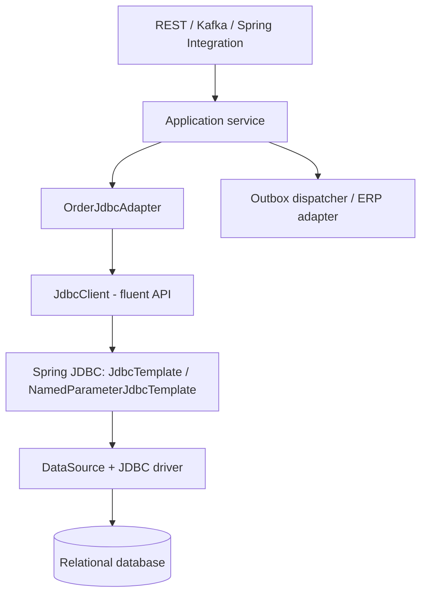

# `JdbcClient` and Fluent SQL Query API

## 1. What Problem Does `JdbcClient` Solve?

When a Spring Boot application integrates with PostgreSQL, MySQL, or another relational database, many operations do not need a full ORM model. For instance, an adapter may simply look up an order by external system ID, update status upon receiving a broker message, write a reconciliation row, or store an event in an outbox. Explicit SQL is often a good fit because developers retain control over tables, filter predicates, joins, and exactly when data is updated.

**`JdbcClient`** is a synchronous, *fluent*-style API added in **Spring Framework 6.1** for working with Spring JDBC. Instead of passing SQL, parameters, and a mapper in one long call to `JdbcTemplate`, you chain steps together: **`sql(...)` → `param(...)`/`params(...)` → `query(...)`/`update()` → `list()`/`single()`/`optional()`**.

In the **`SPRING_BOOT_INTEGRATION`** module, `JdbcClient` is useful for integration flows across HTTP clients, databases, caches, message brokers, and Spring Integration adapters. API conciseness is only one part of the picture: you must simultaneously design **connection configuration, data contracts, transactions, error classification, duplicate handling, testing, and SQL observability**.

Running example: the `order-integration` service receives an `externalOrderId` from REST or Kafka, looks up the `integration_order` table, transitions status from `PENDING` to `PROCESSING`, creates an outbox event, and lets a separate worker send a request to the ERP. We will use `JdbcClient` for data access and explain the safety boundaries of this design.

After this lesson, you will be able to:

- Configure and obtain `JdbcClient` in Spring Boot in a way appropriate to your framework version.
- Write `SELECT`, `INSERT`, `UPDATE`, and `DELETE` using the fluent API with named or positional parameters.
- Choose correctly among `.list()`, `.optional()`, `.single()`, and `RowMapper`.
- Understand the relationship between `JdbcClient`, `JdbcTemplate`, `NamedParameterJdbcTemplate`, `DataSource`, and the transaction manager.
- Apply prepared statements, unique constraints, optimistic updates, timeouts, and outbox in integration flows.
- Know when to keep `JdbcClient` and when to reach for `JdbcTemplate`, jOOQ, or another data-access tool.

## 2. Where Does `JdbcClient` Sit in the JDBC Ecosystem?

Standard Java JDBC provides `Connection`, `PreparedStatement`, `ResultSet`, and resource-management operations. Spring JDBC builds connection acquisition/release, parameter binding, exception translation, row mapping, and Spring transaction participation on top of that. `JdbcClient` puts a fluent facade over that existing infrastructure—it is **not a new JDBC driver or ORM**.

| Component | Primary Responsibility | When Is It Appropriate? |
|---|---|---|
| Plain JDBC | Works directly with `Connection`, `PreparedStatement`, `ResultSet`. | Need low-level JDBC API control and accept verbose resource-handling code. |
| `JdbcTemplate` | Executes SQL and manages JDBC lifecycle; supports callbacks, batching, and detailed APIs. | Cases needing a flexible/low-level API, batch updates, or custom callbacks. |
| `NamedParameterJdbcTemplate` | Supports `:name` in SQL, mapping names to JDBC parameters. | SQL with many named parameters or controlled dynamic conditions. |
| **`JdbcClient`** | Fluent facade unifying common JDBC operations. | Standard SQL read/write repositories or adapters where concise, expressive code is desired. |
| jOOQ | Structural, dialect-aware SQL DSL with optional schema code generation. | Complex queries, rich SQL expressions, type safety/dialect requirements. |
| Spring Data JPA | ORM and entity/persistence-context management. | Domain genuinely needs an entity model, associations, and object lifecycle management. |



Because it relies on Spring JDBC underneath, `JdbcClient` can participate in the same Spring transaction as other JDBC operations **if they use the properly configured `DataSource` and transaction manager**. It remains a *blocking* API: calling it from traditional request-handling threads is fine, but it must not block a WebFlux event loop.

## 3. Version Requirements, Dependencies, and Auto-Configuration

`JdbcClient` was introduced in **Spring Framework 6.1**, typically paired with **Spring Boot 3.2 or later** in the Boot 3.x generation. In older projects using Boot 3.0/3.1 (Spring Framework 6.0), do not assume this class exists. Before applying examples, check the actual Spring Boot/Spring Framework versions and your project's BOM.

With Maven:

```xml
<dependency>
    <groupId>org.springframework.boot</groupId>
    <artifactId>spring-boot-starter-jdbc</artifactId>
</dependency>

<dependency>
    <groupId>org.postgresql</groupId>
    <artifactId>postgresql</artifactId>
    <scope>runtime</scope>
</dependency>
```

With Gradle Kotlin DSL:

```kotlin
dependencies {
    implementation("org.springframework.boot:spring-boot-starter-jdbc")
    runtimeOnly("org.postgresql:postgresql")
}
```

If the application already includes a starter that brings in Spring JDBC, such as `spring-boot-starter-data-jpa`, you may not need to declare `starter-jdbc` again; inspect the dependency graph rather than duplicating dependencies out of habit. `spring-boot-starter-jdbc` commonly supplies **HikariCP** as the connection pool under standard Boot defaults, though the database driver must still be on the classpath.

Example `application.yml`:

```yaml
spring:
  datasource:
    url: ${ORDERS_DB_URL}
    username: ${ORDERS_DB_USERNAME}
    password: ${ORDERS_DB_PASSWORD}
    hikari:
      maximum-pool-size: 12
      connection-timeout: 500
```

`spring.datasource.hikari.connection-timeout` is specified in **milliseconds**; in this example, 500 ms is the wait time to borrow a connection from the pool, **not** the maximum timeout of an SQL query. Pool and timeout numbers must be chosen from actual load and database limits, not copied verbatim from demos into production.

In standard Boot 3.2+ configurations, when Spring JDBC conditions and a suitable `NamedParameterJdbcOperations` candidate are present, Boot can **auto-configure a `JdbcClient` bean**. If the bean is missing, inspect the classpath, `DataSource`, JDBC configuration, number of `NamedParameterJdbcOperations` beans, user-declared beans, and the *Condition Evaluation Report* for your Boot version. In environments with **multiple DataSources**, do not expect Boot to guess which business datasource to use; declare explicit names/qualifiers and configuration.

If manual instantiation is needed, you can write:

```java
import javax.sql.DataSource;
import org.springframework.context.annotation.Bean;
import org.springframework.context.annotation.Configuration;
import org.springframework.jdbc.core.simple.JdbcClient;

@Configuration
class OrdersJdbcConfiguration {
    @Bean("ordersJdbcClient")
    JdbcClient ordersJdbcClient(DataSource ordersDataSource) {
        return JdbcClient.create(ordersDataSource);
    }
}
```

This snippet is only valid when `ordersDataSource` injects the intended datasource. With multiple `DataSource`s, apply `@Qualifier("ordersDataSource")` to the parameter and avoid creating an unnecessary extra `JdbcClient` bean if Boot already creates the right one for a single datasource.

## 4. Basic Fluent API: From SQL to Result

Common syntax:

```java
jdbcClient.sql("SELECT ... WHERE id = :id")
          .param("id", id)
          .query(rowMapper)
          .optional();
```

Step-by-step breakdown:

1. **`sql(String)`** starts a query or update statement. The SQL is still written by the developer; Spring does not auto-discover table structure.
2. **`param(...)`/`params(...)`** binds parameter values. You can use named parameters like `:id` or positional `?` placeholders.
3. **`query(...)`** configures how to map the `ResultSet`, such as a `RowMapper<T>` or a simple target type.
4. **`.list()`/`.optional()`/`.single()`/`.stream()`** executes the query and consumes results according to expected cardinality.
5. **`.update()`** executes `INSERT`, `UPDATE`, `DELETE`, or another suitable data-modification statement and returns the affected row count.

Do not confuse `JdbcClient` with a full query-builder DSL. "Fluent" here means a **fluent Java API wrapping raw SQL**, not a type-safe structural builder like jOOQ's `select(...).from(...).where(...)`.

### 4.1. Named Parameters

```java
List<String> statuses = jdbcClient.sql("""
        SELECT status
        FROM integration_order
        WHERE customer_id = :customerId
        ORDER BY updated_at DESC
        """)
    .param("customerId", customerId)
    .query(String.class)
    .list();
```

The name `:customerId` in SQL must match the name passed to `.param("customerId", ...)`. Named parameters are especially readable when statements have multiple conditions or reuse the same parameter more than once.

### 4.2. Positional Parameters

```java
List<String> statuses = jdbcClient.sql("""
        SELECT status
        FROM integration_order
        WHERE customer_id = ? AND source_system = ?
        """)
    .param(customerId)
    .param("ERP-A")
    .query(String.class)
    .list();
```

With `?`, values are bound in order. If condition order changes, parameter order must be audited; therefore named parameters usually reduce maintenance mistakes on longer SQL statements. A single statement should use **one consistent parameter style** to avoid confusion and unexpected behavior.

### 4.3. Binding Multiple Parameters at Once

```java
Map<String, Object> filters = Map.of(
    "customerId", customerId,
    "sourceSystem", "ERP-A"
);

List<String> statuses = jdbcClient.sql("""
        SELECT status
        FROM integration_order
        WHERE customer_id = :customerId
          AND source_system = :sourceSystem
        """)
    .params(filters)
    .query(String.class)
    .list();
```

`Map.of(...)` cannot hold `null` values; if a parameter may be absent, deliberately choose an appropriate structure and SQL type. Dynamic queries with many parameters are a good reason to separate SQL construction from binding while checking allowed filter conditions.

## 5. `RowMapper`: Turning an SQL Row into a Meaningful Model

Assume the business table is managed by migrations:

```sql
CREATE TABLE integration_order (
    id BIGINT PRIMARY KEY,
    external_order_id VARCHAR(100) NOT NULL UNIQUE,
    source_system VARCHAR(40) NOT NULL,
    status VARCHAR(30) NOT NULL,
    updated_at TIMESTAMP WITH TIME ZONE NOT NULL
);
```

This schema illustrates **PostgreSQL**; on other databases, timestamp types, table-creation syntax, and time-mapping approaches may differ.

Define a read model:

```java
import java.time.OffsetDateTime;

public record IntegrationOrder(
        long id,
        String externalOrderId,
        String sourceSystem,
        String status,
        OffsetDateTime updatedAt) { }
```

And an explicit `RowMapper`:

```java
import org.springframework.jdbc.core.RowMapper;

static final RowMapper<IntegrationOrder> ORDER_ROW_MAPPER = (rs, rowNum) ->
        new IntegrationOrder(
                rs.getLong("id"),
                rs.getString("external_order_id"),
                rs.getString("source_system"),
                rs.getString("status"),
                rs.getObject("updated_at", OffsetDateTime.class)
        );
```

`RowMapper<T>` runs for each row in the `ResultSet`. Pay attention to how the driver converts `TIMESTAMP WITH TIME ZONE`: this example uses PostgreSQL JDBC with `OffsetDateTime`; on other databases/drivers, you may need to convert from `Timestamp`, `Instant`, or another temporal type per contract.

The advantage of an explicit mapper is that key decisions stay visible: `external_order_id` maps to `externalOrderId`, status is a string or enum, and timestamps carry or omit an offset. For sensitive data contracts, explicit mapping is easier to test and review.

`JdbcClient` also supports querying by class, such as `.query(String.class)` for a single column or suitable object mapping. However, do not assume auto-mapping always understands column names, constructors, enums, and `null` values for every domain class; use `RowMapper` whenever specific conversion rules apply.

## 6. `.list()`, `.optional()`, and `.single()`: Declaring Row-Count Expectations

These three terminal methods express different **cardinality contracts**:

| API | Expectation | 0 Rows | Multiple Rows |
|---|---|---|---|
| `.list()` | Any number of rows | Empty list | List with multiple elements |
| `.optional()` | 0 or 1 row | `Optional.empty()` | Throws incorrect result-size error |
| `.single()` | Exactly 1 row | Throws empty result error | Throws incorrect result-size error |

Example looking up an order by `external_order_id`:

```java
public Optional<IntegrationOrder> findByExternalId(String externalId) {
    return jdbcClient.sql("""
            SELECT id, external_order_id, source_system, status, updated_at
            FROM integration_order
            WHERE external_order_id = :externalId
            """)
        .param("externalId", externalId)
        .query(ORDER_ROW_MAPPER)
        .optional();
}
```

Because the table has `UNIQUE (external_order_id)`, `.optional()` matches the query contract. Without a unique constraint, using `.optional()` causes duplicate rows to throw an exception—which is usually a signal to investigate rather than silently picking one row at random.

In flows requiring exactly one system configuration row, `.single()` expresses the data constraint well. For lookups by user-supplied ID, however, **not found is a normal business outcome**; `.optional()` lets the application service decide whether to return 404 or another appropriate response.

These APIs can throw `DataAccessException` or subclasses such as `EmptyResultDataAccessException` and `IncorrectResultSizeDataAccessException` depending on the situation. Do not return `null` on all errors, as that conflates **no record found** with **database disconnected**.

### Reading Multiple Rows and Bounding Results

```java
public List<IntegrationOrder> findPending(int limit) {
    int safeLimit = Math.max(1, Math.min(limit, 500));
    return jdbcClient.sql("""
            SELECT id, external_order_id, source_system, status, updated_at
            FROM integration_order
            WHERE status = :status
            ORDER BY id
            LIMIT :limit
            """)
        .param("status", "PENDING")
        .param("limit", safeLimit)
        .query(ORDER_ROW_MAPPER)
        .list();
}
```

`LIMIT` is PostgreSQL-illustrative syntax. On other databases, use the corresponding pagination syntax. In integration jobs or REST APIs, multi-row queries must enforce **bounds, pagination, or streaming** to avoid accidentally loading millions of rows into RAM.

## 7. `INSERT`, `UPDATE`, and `DELETE` with `.update()`

Unlike `SELECT`, write operations usually need the **number of affected rows** to decide the next step.

```java
public int updateStatus(long id, String newStatus) {
    return jdbcClient.sql("""
            UPDATE integration_order
            SET status = :status, updated_at = CURRENT_TIMESTAMP
            WHERE id = :id
            """)
        .param("status", newStatus)
        .param("id", id)
        .update();
}
```

The return value is typically the affected row count reported by the JDBC driver. Do not assume `update()` returning `1` means the entire integration succeeded: if external API calls or event publishing follow, those actions have their own outcomes and transactions.

### 7.1. Conditional State Transitions

When redelivering the same event from Kafka/RabbitMQ, an `UPDATE` without a status predicate can overwrite another worker's outcome. A safer pattern is **database compare-and-set**:

```java
public boolean claimPendingOrder(long id) {
    int updated = jdbcClient.sql("""
            UPDATE integration_order
            SET status = 'PROCESSING', updated_at = CURRENT_TIMESTAMP
            WHERE id = :id AND status = 'PENDING'
            """)
        .param("id", id)
        .update();

    return updated == 1;
}
```

If the result is `0`, either the order does not exist or it has already left `PENDING`; the application must distinguish those if required by the domain. Under concurrency, the database ensures atomicity for the single `UPDATE` under appropriate isolation/locking; checking in Java first and writing afterward **cannot replace** `WHERE status = 'PENDING'`.

### 7.2. Inserts and Unique Constraints

```java
public int insertOrder(long id, String externalId, String sourceSystem) {
    return jdbcClient.sql("""
            INSERT INTO integration_order
                (id, external_order_id, source_system, status, updated_at)
            VALUES (:id, :externalId, :sourceSystem, 'PENDING', CURRENT_TIMESTAMP)
            """)
        .param("id", id)
        .param("externalId", externalId)
        .param("sourceSystem", sourceSystem)
        .update();
}
```

Duplicate `externalOrderId` deliveries must be handled using a **database unique constraint** and business policy. Never rely solely on `SELECT` before `INSERT` to prevent duplicates: two consumers can both see "not present" and both attempt to insert. Depending on the database, use a properly designed conditional insert/upsert, or catch `DuplicateKeyException` and read the existing record to verify payload consistency.

If database-generated primary keys are required, check the generated-keys API for your `JdbcClient` version or use `JdbcTemplate`/`SimpleJdbcInsert` with `KeyHolder`. Never assume every database/driver returns generated keys identically.

### 7.3. Conditional Deletes

```java
int deleted = jdbcClient.sql("""
        DELETE FROM integration_order
        WHERE id = :id AND status = 'CANCELLED'
        """)
    .param("id", orderId)
    .update();
```

Keeping `status = 'CANCELLED'` prevents accidentally deleting active orders. For tables with audit or reconciliation requirements, consider **soft deletes** or business status transitions instead of physical deletion.

## 8. Dynamic Queries and SQL Injection Boundaries

`JdbcClient` binds values through prepared statements; it **cannot** bind table names, column names, or `ORDER BY` directions as ordinary values. Never concatenate user-supplied strings directly to construct SQL structure.

**Unsafe** example:

```java
// Do not do this: sortField comes directly from a query parameter.
String sql = "SELECT * FROM integration_order ORDER BY " + sortField;
```

Use an allowlist instead:

```java
String orderBy = switch (sortKey) {
    case "updated" -> "updated_at";
    case "id" -> "id";
    default -> throw new IllegalArgumentException("Unsupported sort key");
};

String sql = """
        SELECT id, external_order_id, source_system, status, updated_at
        FROM integration_order
        WHERE source_system = :sourceSystem
        ORDER BY """ + orderBy + " ASC";

List<IntegrationOrder> results = jdbcClient.sql(sql)
        .param("sourceSystem", sourceSystem)
        .query(ORDER_ROW_MAPPER)
        .list();
```

Here only **application-approved constants** appear in the SQL structure, while `sourceSystem` still flows through `.param(...)`. The `switch` assumes `sortKey` is non-null; if it can be null, handle the default upfront.

For `IN (:ids)` predicates, Spring JDBC can expand collections for named parameters in standard cases. However, an **empty list** can yield invalid SQL or differing semantics across databases; when `ids.isEmpty()`, handle it early (for example, returning an empty list). Very large lists can also hit database parameter-count limits, so split into batches, use a temporary table, or choose a dialect-appropriate approach.

Long SQL queries can remain readable if split into controlled fragments, but once dynamic expressions, joins, and dialect concerns proliferate, evaluate jOOQ instead of building a string-concatenation SQL generator by hand.

## 9. Transactions with `JdbcClient`: Their True Scope

When Spring Boot has a JDBC `DataSource` and corresponding transaction manager, `@Transactional` allows multiple SQL statements to participate in one database transaction.

Example claiming an order and writing an outbox row in the same database:

```java
import java.util.UUID;
import org.springframework.stereotype.Service;
import org.springframework.transaction.annotation.Transactional;

@Service
public class OrderAcceptanceService {
    private final JdbcClient jdbcClient;

    public OrderAcceptanceService(JdbcClient jdbcClient) {
        this.jdbcClient = jdbcClient;
    }

    @Transactional
    public boolean claimAndRecordEvent(long orderId, String payload) {
        int changed = jdbcClient.sql("""
                UPDATE integration_order
                SET status = 'PROCESSING', updated_at = CURRENT_TIMESTAMP
                WHERE id = :id AND status = 'PENDING'
                """)
            .param("id", orderId)
            .update();

        if (changed == 0) {
            return false;
        }

        jdbcClient.sql("""
                INSERT INTO outbox_event
                    (event_id, aggregate_id, event_type, payload, created_at)
                VALUES (:eventId, :aggregateId, :eventType, :payload,
                        CURRENT_TIMESTAMP)
                """)
            .param("eventId", UUID.randomUUID().toString())
            .param("aggregateId", orderId)
            .param("eventType", "ORDER_CLAIMED")
            .param("payload", payload)
            .update();

        return true;
    }
}
```

The example assumes `outbox_event` exists with compatible columns/types created via migrations and a unique constraint on `event_id`. The transaction will **commit both SQL operations** or roll back both when an error triggers Spring's rollback policy. For unchecked exceptions, the default rollback behavior typically applies; for checked exceptions or custom policies, declare them explicitly.

A separate worker/outbox dispatcher reads `outbox_event` and publishes to the broker/ERP after the transaction commits. This avoids **DB write succeeds but message publish fails** or **message sent before DB transaction rolls back**, which occur when the two operations are separate without an outbox.

Never treat `@Transactional` as an automatic ACID transaction spanning HTTP, SOAP, Kafka, or RabbitMQ. An external timeout after sending a write request can leave an **unknown processing outcome**; use idempotency keys, pending states, and reconciliation. An outbox guarantees that the business change and the intent to emit an event commit atomically in the DB; broker delivery can still be **at-least-once**, so consumers must deduplicate.

### 9.1. Common Transaction Pitfalls

- `@Transactional` is typically proxy-based; internal calls from the same bean (*self-invocation*) can bypass the transaction interceptor.
- Two `JdbcClient` instances backed by **two different `DataSource`s** do not automatically share a local transaction; design transaction boundaries and consistency mechanisms explicitly.
- Making HTTP calls to an ERP while holding a DB transaction prolongs connection and lock retention; prefer short transactions and multi-step workflows when the domain allows.
- Transaction isolation alone does not prevent every race condition: combine unique constraints, conditional updates, and optimistic/pessimistic locking as appropriate.
- `@Transactional(readOnly = true)` primarily communicates intent and can assist driver/database optimizations; it is not an absolute security barrier blocking every `UPDATE`.

## 10. Error Management, Timeouts, and Pool Limits

A concise fluent API still requires explicit operational policies. Spring JDBC maps many `SQLException`s to subclasses of `DataAccessException`, letting the application layer classify failures without depending entirely on vendor error codes.

| Error Category | Examples | Handling in Integration Flows |
|---|---|---|
| Duplicate data | `DuplicateKeyException` | Inspect business key and idempotency; do not blindly retry the identical `INSERT`. |
| Constraint violation | `DataIntegrityViolationException` | Check data contract, FKs, NOT NULL, column lengths; route to business error or dead-letter/quarantine. |
| Unexpected row count | `EmptyResultDataAccessException`, `IncorrectResultSizeDataAccessException` | Review `.single()`/`.optional()` expectations and unique constraints. |
| DB unavailable | JDBC connection acquisition, driver/network errors | Bounded retry if the operation is safe, detailed metrics/logs, avoid overload storms. |
| Locks, deadlocks, timeouts | DB errors translated per driver/dialect | Evaluate transaction, isolation, and operation-appropriate retry; do not retry whole workflows with external side effects. |
| Bad SQL/schema | Bad SQL grammar, missing table/column | Fix code/migrations; do not loop retries on non-transient errors. |

With Boot/Hikari, distinguish:

```yaml
spring:
  datasource:
    hikari:
      maximum-pool-size: 12
      connection-timeout: 500
  jdbc:
    template:
      query-timeout: 2s
```

`connection-timeout` is the wait time to **acquire a connection from the Hikari pool**. `spring.jdbc.template.query-timeout` is the query/statement timeout Boot applies to the auto-configured `JdbcTemplate` when conditions match; since `JdbcClient` uses the template infrastructure underneath, ensure your client uses **that configured template**. If you manually construct `JdbcClient` from a `DataSource`, do not assume Boot's template query-timeout setting automatically applies to your manually created client.

Query timeout is a safeguard, **not a guarantee of the entire end-to-end deadline**, because pool wait, transaction locks, network time, and pre/post-SQL steps still add up. A request with a 300 ms DB budget should not configure a 2-second query timeout and consider its SLA covered; enforce limits at the caller layer and measure actual latencies.

### 10.1. Pool Size and Replica Count

If 5 application instances each configure `maximum-pool-size: 12`, total potential connections from this pool reach around **60** against the same datasource (excluding rolling deployments, batch workers, and other pools). Reconcile this against the database's total connection quota and allocations for other services. Increasing pool size when the database is lock-bound usually worsens contention, so inspect active/pending connections, query plans, and transaction durations before raising limits.

### 10.2. Timeouts, Retries, and Idempotency

If a consumer receives a message again via broker redelivery, `SELECT` queries are usually safe to retry with bounds. Conversely, if an SQL `INSERT` commits but the broker ack fails, reprocessing risks duplicate inserts. Use a **unique business key + business-aware `DuplicateKey` handling**, and ack only after the result has been durably stored/reconciled per system contract.

## 11. `JdbcClient` for Batches or Large Data Streams

`.list()` loads the entire result set into memory, which fits bounded results. For large datasets, two approaches apply:

1. **Pagination / keyset pagination:** query small pages with a stable ordering, suited to workers with checkpoint/restart.
2. **Streaming / cursor:** process rows one by one in a controlled stream, keeping in mind the connection may remain held until the stream closes; understand driver behavior, fetch size, transactions, and resource lifetimes.

Conceptual streaming example:

```java
try (Stream<IntegrationOrder> rows = jdbcClient.sql("""
        SELECT id, external_order_id, source_system, status, updated_at
        FROM integration_order
        WHERE status = :status
        ORDER BY id
        """)
        .param("status", "PENDING")
        .query(ORDER_ROW_MAPPER)
        .stream()) {

    rows.forEach(order -> processOrder(order));
}
```

`Stream` here is `java.util.stream.Stream`. Always close the stream to release JDBC resources. **Never make slow HTTP calls per item while holding open a DB cursor/connection**; it is usually better to read a page of IDs, release the DB connection, and process via a queue/worker with checkpointing.

For writing many rows, `JdbcTemplate.batchUpdate(...)` or another batching tool can be much more suitable than calling `.update()` thousands of times in a loop. `JdbcClient` does not replace every `JdbcTemplate` API; both can be used side by side on the same datasource and transaction manager when configured consistently.

## 12. When to Choose `JdbcClient` vs. jOOQ

Because this lesson is part of the **JDBC and jOOQ** chapter, it helps to contrast these two SQL-oriented tools that have different philosophies.

| Criterion | `JdbcClient` | jOOQ |
|---|---|---|
| SQL representation | Handwritten SQL strings, fluent bind/map/execute chain. | Java DSL modeling SQL constructs, capable of dialect-specific SQL rendering. |
| Schema type safety | No compile-time verification of table/column names; relies on tests/migration alignment. | Can generate classes from schema to catch many name/type mismatches at compile time. |
| Simple queries | Very concise; no code generation needed. | Also clean, but adds build/configuration overhead. |
| Joins, CTEs, window functions, complex dynamic SQL | Must author and manage SQL strings manually. | DSL often organizes and reuses expressions cleanly and supports dialects. |
| Database-specific SQL | Written directly for the target database. | Can render SQL per dialect, though semantic differences still require verification. |
| Dependency footprint | Primarily Spring JDBC and driver. | Adds dependencies and potential codegen/licensing considerations depending on version/edition. |
| Transactions | Participates in Spring transactions via matching datasource/transaction manager. | Integrates with Spring transactions, provided `DSLContext`/`ConnectionProvider` are wired properly. |

Illustration of the same query:

```java
// JdbcClient: handwritten SQL.
var pendingIds = jdbcClient.sql("""
        SELECT id FROM integration_order
        WHERE status = :status
        ORDER BY id
        """)
    .param("status", "PENDING")
    .query(Long.class)
    .list();
```

With jOOQ (assuming `INTEGRATION_ORDER` was generated from the schema), the corresponding code looks like:

```java
var pendingIds = dsl.select(INTEGRATION_ORDER.ID)
    .from(INTEGRATION_ORDER)
    .where(INTEGRATION_ORDER.STATUS.eq("PENDING"))
    .orderBy(INTEGRATION_ORDER.ID)
    .fetch(INTEGRATION_ORDER.ID);
```

Both snippets require different setup: `jdbcClient` needs the Spring JDBC bean, while `dsl` and `INTEGRATION_ORDER` only exist after configuring jOOQ and code generation. Base your decision on **SQL complexity, schema governance, team familiarity, and operational requirements**, not line count alone.

## 13. Separating SQL Adapters from Integration Logic

A practical package layout:

```text
com.example.integration.orders
├── application
│   └── AcceptOrderService       # Business rules, transaction boundary
├── domain
│   ├── IntegrationOrder
│   └── OrderStatus
└── infrastructure
    ├── jdbc
    │   └── OrderJdbcAdapter     # JdbcClient, SQL, RowMapper
    ├── messaging
    │   └── OutboxDispatcher     # Publish and ack/retry
    └── erp
        └── ErpClient            # HTTP/SOAP integration
```

`OrderJdbcAdapter` should expose domain-meaningful operations such as `findByExternalId`, `claimPendingOrder`, or `saveOutboxEvent`; controllers and consumers do not need to know SQL statements or column names. Schema changes remain isolated to the adapter and migrations. If PostgreSQL is replaced with another database, review SQL dialect, type mapping, isolation, generated keys, and lock semantics.

When a Spring Integration flow invokes an adapter, identify which steps run **synchronously** on the caller thread, which hand off to a queue, and when messages are acknowledged. Blocking `JdbcClient` calls should run on an appropriately sized endpoint/executor; do not allow unconstrained message concurrency to exhaust the Hikari pool. For retriable work, implement idempotency at the **database table/unique constraint** level rather than relying solely on broker acks.

## 14. Testing `JdbcClient` and SQL Contracts

To ensure SQL correctness, test against a real schema or database environment close to production. Mocking `JdbcClient` helps verify business branching, but it cannot catch bad SQL syntax, wrong column names, `NOT NULL` violations, timezone bugs, concurrency races, or isolation issues.

| Test Level | Goal | Recommendation |
|---|---|---|
| Adapter mapper unit test | `ResultSet` converts types and nullability properly. | Appropriate fixtures/mapping tests; verify missing columns or temporal type mismatches. |
| JDBC slice test | SQL executes against a properly configured data context. | `@JdbcTest`, migration/schema setup, and injected `JdbcClient` if supported by your Boot version. |
| Integration test with real DB | Unique constraints, transactions, dialect, and locking work as designed. | Testcontainers for PostgreSQL/MySQL when project setup allows. |
| Duplicate-handling test | Receiving the same external ID twice does not double-write. | Run concurrent inserts/updates; verify unique business key enforcement. |
| External-failure test | DB commit followed by ERP/broker timeout remains reconcilable. | Test outbox, replay, retries, and indeterminate states. |

Integration test sketch:

```java
@SpringBootTest(properties = "spring.batch.job.enabled=false")
class OrderJdbcAdapterIntegrationTest {
    @Autowired JdbcClient jdbcClient;

    @Test
    void returnsEmptyWhenExternalOrderDoesNotExist() {
        var result = jdbcClient.sql("""
                SELECT id, external_order_id, source_system, status, updated_at
                FROM integration_order
                WHERE external_order_id = :externalId
                """)
            .param("externalId", "missing-order-123")
            .query(ORDER_ROW_MAPPER)
            .optional();

        assertThat(result).isEmpty();
    }
}
```

This example assumes JUnit, AssertJ, Spring Test, a test database, migrated tables, and `ORDER_ROW_MAPPER` are configured; `spring.batch.job.enabled=false` is only illustrative if the application also uses Spring Batch and wants to suppress startup jobs during tests. In a JDBC-only project, that property is unnecessary. Reliable tests must seed their own data and maintain isolation rather than depending on pre-existing database state.

Whenever migrations advance, re-run SQL tests against the updated schema; JDBC errors surface at runtime, so **compiling cleanly does not guarantee valid SQL**.

## 15. Observing Query Performance and Errors

In production, measure the following signals per datasource and operation:

- **Connection pool:** Hikari active/idle/pending counts, connection acquisition time, acquisition timeouts.
- **Queries:** execution latency, rows read/written, query timeouts, and high-latency queries; distinguish pool wait time from SQL execution time.
- **Transactions:** duration, commits/rollbacks, lock contention, deadlocks, and long-lived transactions holding connections.
- **Errors:** SQL grammar errors, integrity constraint violations, disconnects, timeouts, mapping failures, and retry counts.
- **Integration flow:** correlation ID, masked/redacted business keys, unpublished outbox backlog count, and lag from DB commit to broker ack.

Spring Boot Actuator/Micrometer can expose connection-pool metrics when the corresponding registry and instrumentation are enabled. `JdbcClient` does not automatically emit detailed per-SQL metrics; add instrumentation at the adapter or datasource layer while avoiding excessive tag cardinality.

**Never log raw SQL containing sensitive data or all bind parameters in production.** Log stable operation names such as `order.findByExternalId`, duration, status, row count, and normalized error codes. If database slow-query logging is enabled, restrict access, retention, and data masking per security policy.

## 16. Common Design Mistakes

| Mistake | Why It Is Dangerous | Fix |
|---|---|---|
| Assuming the fluent API prevents all SQL injection | String-concatenated identifiers/`ORDER BY` remain injectable. | Bind **values**; allowlist **SQL structure**. |
| Using `.single()` for lookups that may not exist | Throws exceptions on normal business misses. | Use `.optional()` when 0..1 is the contract. |
| Skipping unique constraints in favor of `SELECT` then `INSERT` | Race condition between concurrent consumers. | Enforce unique keys + proper duplicate/upsert handling. |
| Mistaking `JdbcClient` for asynchronous/non-blocking | Threads block during queries or pool waits. | Place blocking JDBC on dedicated threads/executors with bounded concurrency. |
| Calling an ERP inside a long DB transaction | Holds connections/locks and cannot roll back remote side effects. | Keep transactions short; use outbox/reconciliation. |
| Unbounded `.list()` queries | Spikes heap, GC, and connection hold time. | Use pagination/keyset or controlled streaming. |
| Creating a new JDBC pool per request | Exhausts sockets/connections and defeats pooling. | Use the Boot-managed singleton datasource. |
| Retrying every `DataAccessException` | Contract, constraint, and bad-SQL errors cannot self-heal. | Classify errors, bound retries, and ensure idempotency. |
| Treating a timeout as proof the write did not happen | The DB may have committed after the client stopped waiting. | Reconcile state using request/business keys and unique constraints. |
| Switching to jOOQ just for DSL aesthetics | Adds codegen and setup overhead when SQL is trivial. | Choose based on query complexity and real operational needs. |

## 17. Checklist Before Deploying a JDBC Adapter to Production

- [ ] Spring Framework/Spring Boot version includes `JdbcClient`; JDBC and driver dependencies align with the BOM.
- [ ] Correct `DataSource`, connection pool, and transaction manager are wired; multiple datasources use explicit names/qualifiers.
- [ ] SQL uses parameter binding for data; dynamic identifiers/sort keys come from allowlists.
- [ ] `RowMapper` handles columns, monetary types, enums, timezones, and `NULL` per contract.
- [ ] `.list()`, `.optional()`, and `.single()` match cardinality; database enforces unique constraints where required.
- [ ] Write operations inspect affected rows; concurrent state transitions use atomic SQL predicates.
- [ ] Migrations manage tables, indexes, unique constraints, and outbox; SQL is tested against the real schema.
- [ ] Transactions are short and tied to the right datasource; remote HTTP/broker calls are not assumed inside DB transactions.
- [ ] Retries apply only to appropriate errors; message redeliveries rely on idempotency/unique business keys.
- [ ] Connection acquisition timeout, query timeout, concurrency, and end-to-end deadlines are kept distinct.
- [ ] Large reads use pagination/streaming with proper connection lifecycle management.
- [ ] Tests cover duplicates, rollbacks, restarts/replays, and pool/query/error metrics per dependency.

## 18. Summary

`JdbcClient` brings a fluent style to common SQL operations in Spring Boot while still building on Spring JDBC: `DataSource`, `JdbcTemplate`, named parameter binding, mapping, and transaction integration. The typical flow is **`sql` → `param` → `query` → `optional/list/single`** for queries, or **`sql` → `param` → `update`** for writes. Developers remain responsible for SQL, schemas, indexes, cardinality, and transaction semantics.

In system integration, adapter quality is measured not by how few lines of Java you write, but by stability under duplicate messages, database overload, contract violations, transaction rollbacks, and external service timeouts. Choose `JdbcClient` for clear SQL statements, keep `JdbcTemplate` when specialized JDBC APIs are needed, and consider jOOQ when complex dynamic queries demand a schema-aware DSL. Combining these tools with **unique constraints, conditional updates, an outbox, thorough testing, and observability** yields an integration boundary that is operable and recoverable.
