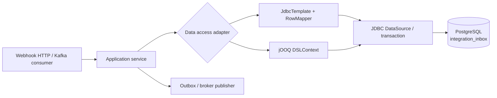
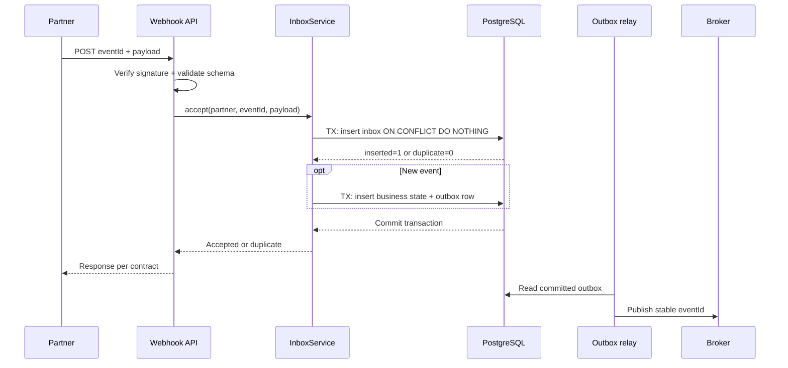

# Row Mapping, Parameter Binding, and Handling Null Values

> **Chapter:** JDBC and jOOQ  
> **Module:** `SPRING_BOOT_INTEGRATION` — organizing system integration in Spring Boot across HTTP clients, databases, caches, message brokers, and Spring Integration adapters. The focus is on configuration, data contracts, transactions, error/duplicate handling, testing, and observability of integration flows.

## 1. Problem: Same SQL Row, Misinterpreted State in Java

Suppose a Spring Boot service receives webhooks from a shipping partner. A webhook may be redelivered if the partner does not receive an HTTP response. The service stores each event in an inbox table, then processes it and publishes a message to a broker.

A row in the database might contain:

- `event_id = 'evt-42'`: a mandatory identifier used to prevent duplicate processing.
- `external_ref = NULL`: the partner has not returned a reference code yet; distinct from an empty string.
- `retry_count = NULL`: retry count is not recorded yet; **distinct** from `0` confirmed retries.
- `processed_at = NULL`: the event has not been processed yet; distinct from the current timestamp.

If Java reads `retry_count` with `ResultSet.getInt(...)` without checking `wasNull()`, SQL `NULL` is misread as `0`. If code queries `WHERE external_ref = ?` with a `null` parameter, it will not find rows where `external_ref IS NULL` because SQL uses three-valued logic. If SQL is built by concatenating strings from the webhook, incoming data can break syntax or introduce SQL injection.

Therefore, when using JDBC or jOOQ, you must understand **three boundaries** together:

1. **Row mapping:** from SQL columns and types to Java objects/DTOs.
2. **Parameter binding:** from Java values to typed JDBC parameters, never concatenating data directly into SQL.
3. **`NULL` semantics:** distinguishing unknown/not-applicable values from empty strings, numeric `0`, Boolean `false`, and missing fields.

### Learning Objectives

After this lesson, you will be able to:

- Write `RowMapper<T>` with `JdbcTemplate` and `NamedParameterJdbcTemplate`.
- Use positional/named parameters, typed `NULL`, batch parameters, and safely handle data arriving from HTTP/brokers.
- Map nullable results to Java reference types, `Optional` at query boundaries, and timezone-aware timestamps.
- Use jOOQ `DSLContext`, schema-generated record/field types, value binding, and `IS NULL` predicates.
- Design an inbox/outbox with unique constraints, SQL upserts, transactions, and idempotency.
- Diagnose mapping/SQL parameter bugs, optimize batch/streaming access, and test against a real database.

## 2. What Are the Responsibilities of JDBC, Spring JDBC, and jOOQ?

| Layer | Role | API Examples |
|---|---|---|
| **JDBC** | Java specification for opening connections, creating statements, binding values, and reading `ResultSet`. | `Connection`, `PreparedStatement`, `ResultSet`, `Types` |
| **Spring JDBC** | Reduces connection open/close boilerplate, translates exceptions, integrates with Spring transactions. | `JdbcTemplate`, `NamedParameterJdbcTemplate`, `RowMapper` |
| **jOOQ** | Java DSL representing SQL, supporting SQL types, dialects, and optional schema code generation. | `DSLContext`, `Field<T>`, `Record`, code generation |
| **Spring Boot** | Creates/configures beans based on dependencies and properties when conditions match. | `DataSource`, `JdbcTemplate`, `NamedParameterJdbcTemplate`, `DSLContext` via auto-configuration |
| **Application** | Defines schema, idempotency, transactions, contracts, retries, logging, and business logic. | `InboxRepository`, `WebhookIntakeService` |

**Both JDBC and jOOQ can use a JDBC driver** to talk to a relational database. jOOQ does not automatically turn synchronous JDBC calls into reactive I/O. When an application uses Spring WebFlux, you must control where blocking JDBC code runs or pick a reactive technology suited to your requirements.

### 2.1. Dependencies and Spring Boot Configuration

Gradle Groovy DSL example using both Spring JDBC and jOOQ; assumes the project already applies appropriate Spring Boot dependency management:

```gradle
dependencies {
    implementation("org.springframework.boot:spring-boot-starter-jdbc")
    implementation("org.springframework.boot:spring-boot-starter-jooq")
    runtimeOnly("org.postgresql:postgresql")
    testImplementation("org.springframework.boot:spring-boot-starter-test")
}
```

```yaml
spring:
  datasource:
    url: ${DB_JDBC_URL}
    username: ${DB_USERNAME}
    password: ${DB_PASSWORD}
  jooq:
    sql-dialect: POSTGRES
```

Spring Boot can auto-configure `DataSource`, `JdbcTemplate`, `NamedParameterJdbcTemplate`, and `DSLContext` when classpath and bean conditions match. Check your actual Spring Boot, jOOQ, and JDBC driver versions and bean wiring if the application has multiple datasources or custom configuration. **jOOQ code generation** is a separate build step: adding the starter does not automatically generate the `INTEGRATION_INBOX` Java classes shown in section 9.



Both data-access approaches can coexist in the same application, but do not mix up their parameter-binding styles, transaction boundaries, or mapping conventions.

## 3. Sample Schema and Meaning of Each NULL Value

Throughout this lesson, PostgreSQL is used with the following illustrative schema:

```sql
CREATE TABLE integration_inbox (
    id BIGINT GENERATED BY DEFAULT AS IDENTITY PRIMARY KEY,
    partner VARCHAR(64) NOT NULL,
    event_id VARCHAR(128) NOT NULL,
    payload TEXT NOT NULL,
    external_ref VARCHAR(128) NULL,
    retry_count INTEGER NULL CHECK (retry_count >= 0),
    processed_at TIMESTAMPTZ NULL,
    status VARCHAR(24) NOT NULL,
    received_at TIMESTAMPTZ NOT NULL DEFAULT CURRENT_TIMESTAMP,
    CONSTRAINT uq_inbox_partner_event UNIQUE (partner, event_id)
);

CREATE INDEX idx_inbox_pending
    ON integration_inbox (status, received_at);
```

This is PostgreSQL DDL, not DDL automatically generated by JDBC/jOOQ on every database. Other engines have different identity/timestamp syntax. Production requires versioned migrations such as Flyway or Liquibase.

### 3.1. Column Contracts and Java Types

| SQL Column | NULL Allowed? | Suggested Java Type | Meaning |
|---|---:|---|---|
| `id BIGINT` | No | `long` or `Long` | Internal key; DB-generated |
| `partner VARCHAR` | No | `String` | Webhook source |
| `event_id VARCHAR` | No | `String` | Stable ID when the same event is redelivered |
| `payload TEXT` | No | `String` | Validated/canonicalized payload per contract |
| `external_ref VARCHAR` | Yes | Nullable `String` | Partner reference may not exist yet |
| `retry_count INTEGER` | Yes | Nullable `Integer` | `NULL` means unknown/unmeasured; `0` means confirmed zero |
| `processed_at TIMESTAMPTZ` | Yes | Nullable `Instant` | `null` when not yet processed |
| `status VARCHAR` | No | `String` or enum after validation | `RECEIVED`, `PROCESSED`, `FAILED` per contract |
| `received_at TIMESTAMPTZ` | No | `Instant` | System receipt timestamp |

`UNIQUE (partner, event_id)` is only reliable as a deduplication key when both columns are **`NOT NULL`**. In PostgreSQL, standard unique constraints treat `NULL` values as distinct; a nullable business key can allow multiple rows that look logically "identical." Make message identity `NOT NULL` before designing SQL upserts.

### 3.2. Defining a DTO Without Losing NULL Semantics

```java
import java.time.Instant;

public record InboxRow(
    long id,
    String partner,
    String eventId,
    String payload,
    String externalRef,
    Integer retryCount,
    Instant processedAt,
    String status
) {}
```

`Integer` is used instead of `int` because `retry_count` can be SQL `NULL`. `String externalRef` and `Instant processedAt` can also be `null`. A record does not automatically enforce database constraints; if strict invariants are needed, validate in the constructor/factory and explicitly represent unknown states.

This DTO is a **data-layer projection**, not automatically a JSON contract returned straight to clients. When building an API, decide explicitly how missing fields and `null` fields differ, and avoid exposing `payload` if it contains PII or credentials.

## 4. `RowMapper<T>` with `JdbcTemplate`: One Row to One Object

Spring JDBC provides `RowMapper<T>`:

```java
@FunctionalInterface
public interface RowMapper<T> {
    T mapRow(ResultSet rs, int rowNum) throws SQLException;
}
```

The method is called **once per row** in the `ResultSet`. It extracts the right columns, converts types, and builds a Java object. `rowNum` is the row position in the result set, not a database primary key ID.

Mapping example with `NULL` handling:

```java
import java.sql.ResultSet;
import java.sql.SQLException;
import java.sql.Timestamp;
import java.time.Instant;
import org.springframework.jdbc.core.RowMapper;

public final class InboxRowMapper implements RowMapper<InboxRow> {

    @Override
    public InboxRow mapRow(ResultSet rs, int rowNum) throws SQLException {
        Integer retryCount = (Integer) rs.getObject("retry_count");
        Timestamp processedTimestamp = rs.getTimestamp("processed_at");

        Instant processedAt = processedTimestamp == null
            ? null
            : processedTimestamp.toInstant();

        return new InboxRow(
            rs.getLong("id"),
            rs.getString("partner"),
            rs.getString("event_id"),
            rs.getString("payload"),
            rs.getString("external_ref"),
            retryCount,
            processedAt,
            rs.getString("status")
        );
    }
}
```

With PostgreSQL JDBC, reading an `INTEGER` via `getObject(...)` typically returns `Integer`. When supporting multiple drivers and SQL types, you can use `getObject("retry_count", Integer.class)` if the driver supports that typed mapping, or call `getInt(...)` followed by `wasNull()` as shown in the next section.

For `TIMESTAMPTZ`, `Timestamp.toInstant()` preserves the absolute instant when the driver converts accurately. With JDBC 4.2 and a supporting driver, you can read `OffsetDateTime` via `getObject("processed_at", OffsetDateTime.class)` and call `toInstant()`. Always verify driver timezone behavior and actual migrations.

### 4.1. Reading Columns by Name vs. by Index

`rs.getString("event_id")` references the **column label**. If a query uses an alias:

```sql
SELECT event_id AS message_key FROM integration_inbox
```

then the mapper must read `"message_key"`, not necessarily the original column name `"event_id"`. When writing `SELECT` projections, always use stable aliases and fetch only the columns the mapper needs.

Reading by index like `rs.getString(3)` breaks easily if `SELECT` column order changes. Reading by label is usually easier to maintain, though labels must stay consistent with the SQL query.

### 4.2. Never Perform Side Effects Inside `RowMapper`

`RowMapper` should be a pure data-conversion function—do not call HTTP clients, publish Kafka messages, or update another table while reading rows. It can be re-invoked if a query is retried or during batch processing. Place side effects in an application service with proper transactions and idempotency.

## 5. The `getInt()`, `getBoolean()`, and `wasNull()` Trap

JDBC getters for **primitive types** return default values when the SQL column is `NULL`:

- `ResultSet.getInt(...)` returns `0` for SQL `NULL`.
- `ResultSet.getLong(...)` returns `0L` for SQL `NULL`.
- `ResultSet.getBoolean(...)` returns `false` for SQL `NULL`.

Therefore, to distinguish `NULL` from an actual value, call `wasNull()` **immediately after the corresponding getter**:

```java
int rawRetryCount = rs.getInt("retry_count");
Integer retryCount = rs.wasNull() ? null : rawRetryCount;

boolean rawFlag = rs.getBoolean("verified");
Boolean verified = rs.wasNull() ? null : rawFlag;
```

The `verified` snippet assumes another table has a `verified BOOLEAN NULL` column; the inbox table in section 3 does not have this column.

**Never do this:**

```java
int count = rs.getInt("retry_count");
String partner = rs.getString("partner");
boolean countWasNull = rs.wasNull(); // WRONG: checks the just-read column "partner"
```

`wasNull()` reports whether **the most recently read value from `ResultSet`** was SQL `NULL`, not a remembered map of NULLs per column. Reading another column before calling it yields the wrong state.

### 5.1. Getters Returning Reference Types

`getString(...)` returns `null` if SQL is `NULL`. `getTimestamp(...)` can also return `null`; never call `.toInstant()` directly without checking first.

```java
// Wrong if processed_at is NULL:
Instant processedAt = rs.getTimestamp("processed_at").toInstant();

// Right:
Timestamp ts = rs.getTimestamp("processed_at");
Instant processedAt = ts == null ? null : ts.toInstant();
```

With `getObject(column, Integer.class)`, the Java type is clearer, yet conversion behavior still depends on the JDBC driver and SQL type. Do not blindly coerce any `NUMERIC`, `DECIMAL`, or `BIGINT` into `Integer`.

### 5.2. Do Not Turn NULL into `0` or an Empty String

`COALESCE(retry_count, 0)` can be handy for aggregations, but **it erases "unmeasured" information**. Use it only when the domain explicitly defines "absent" as equivalent to zero.

Similarly:

```java
String externalRef = rs.getString("external_ref");
// Do not default: externalRef == null ? "" : externalRef
```

If the contract states a missing partner code means awaiting confirmation, returning `""` can trick downstream steps into thinking an empty code was issued. Preserve `null` or map to an explicit domain state type.

## 6. Writing Repositories with `JdbcTemplate` and Positional Parameters

`JdbcTemplate` eliminates `PreparedStatement` boilerplate, closes resources, and translates `SQLException` into Spring's `DataAccessException` hierarchy. When querying, always **bind values** rather than concatenating strings.

```java
import java.util.List;
import java.util.Optional;
import org.springframework.jdbc.core.JdbcTemplate;
import org.springframework.stereotype.Repository;

@Repository
public class JdbcInboxReader {
    private static final String SELECT_COLUMNS = """
        SELECT id, partner, event_id, payload,
               external_ref, retry_count, processed_at, status
        FROM integration_inbox
        """;

    private final JdbcTemplate jdbc;
    private final InboxRowMapper mapper = new InboxRowMapper();

    public JdbcInboxReader(JdbcTemplate jdbc) {
        this.jdbc = jdbc;
    }

    public Optional<InboxRow> findByEvent(String partner, String eventId) {
        String sql = SELECT_COLUMNS
            + " WHERE partner = ? AND event_id = ?";

        List<InboxRow> rows = jdbc.query(sql, mapper, partner, eventId);
        return rows.stream().findFirst();
    }
}
```

Here `?` is a **parameter marker**. Spring/JDBC binds `partner` and `eventId` positionally; quotes or SQL characters in input values are treated as **data**, never executed as SQL commands.

`Optional<InboxRow>` fits **lookup results that may not exist**, which is better than returning `null` for the whole object when no row matches. Do not wrap **every nullable field** in a record with `Optional`.

### 6.1. `query()`, `queryForObject()`, and Zero Rows

- `query(...)` typically returns `List<T>` (which may be empty).
- `queryForObject(...)` expects a single row/result by contract; when no row exists it can throw `EmptyResultDataAccessException`, and when multiple rows exist it can throw an incorrect-result-size exception.
- `queryForList(...)`/`queryForMap(...)` suit dynamic shapes but sacrifice DTO type safety.

When a unique constraint guarantees at most one row, calling `query(...)` and converting the list to `Optional` expresses "not found" cleanly without using exceptions for normal control flow. If multiple rows ever appear unexpectedly due to schema drift, investigate rather than silently picking the first element.

### 6.2. SQL Injection and Dynamic Table Names

Bind parameters apply only to **data values**. You cannot use `?` to dynamically bind table names, column names, or SQL keywords:

```sql
-- Wrong idea: JDBC parameters do not act as table names:
SELECT * FROM ?
```

If business logic requires choosing a table or column, use an **allowlist** of known identifiers—never pass strings from webhooks/HTTP straight into SQL. In jOOQ, `DSL.name(...)` represents structured identifiers, yet you must still enforce an allowlist/authorization if the input comes from users.

## 7. `NamedParameterJdbcTemplate`: Named Parameters and Typed NULL

SQL statements with many variables or repeated values become far more readable with `NamedParameterJdbcTemplate`:

```java
import java.sql.Types;
import org.springframework.jdbc.core.namedparam.MapSqlParameterSource;
import org.springframework.jdbc.core.namedparam.NamedParameterJdbcTemplate;
import org.springframework.stereotype.Repository;

@Repository
public class NamedInboxWriter {

    private final NamedParameterJdbcTemplate jdbc;

    public NamedInboxWriter(NamedParameterJdbcTemplate jdbc) {
        this.jdbc = jdbc;
    }

    public int insertIfAbsent(
            String partner,
            String eventId,
            String payload,
            String externalRef,
            Integer retryCount) {

        String sql = """
            INSERT INTO integration_inbox (
                partner, event_id, payload,
                external_ref, retry_count, status
            )
            VALUES (
                :partner, :eventId, :payload,
                :externalRef, :retryCount, :status
            )
            ON CONFLICT (partner, event_id) DO NOTHING
            """;

        MapSqlParameterSource params = new MapSqlParameterSource()
            .addValue("partner", partner, Types.VARCHAR)
            .addValue("eventId", eventId, Types.VARCHAR)
            .addValue("payload", payload, Types.VARCHAR)
            .addValue("externalRef", externalRef, Types.VARCHAR)
            .addValue("retryCount", retryCount, Types.INTEGER)
            .addValue("status", "RECEIVED", Types.VARCHAR);

        return jdbc.update(sql, params);
    }
}
```

In PostgreSQL, `INSERT ... ON CONFLICT ... DO NOTHING` returns an update count of `1` when a row is inserted and `0` when a key-conflicting row is skipped. This forms the **database-level** foundation for webhook intake idempotency.

`externalRef` or `retryCount` may be `null`. Passing `Types.VARCHAR` and `Types.INTEGER` supplies JDBC type metadata to Spring and the driver during binding. With certain drivers and `NULL` values, omitting the SQL type can prevent the driver from inferring an appropriate type.

**Note:** supplying types alone does not prove inputs are valid; `partner` and `eventId` must still be validated at the HTTP/message boundary, and the unique constraint must actually exist via migrations.

### 7.1. Typed NULL with Plain `PreparedStatement`

JDBC provides `setNull(index, sqlType)`:

```java
String sql = """
    UPDATE integration_inbox
    SET retry_count = ?
    WHERE partner = ? AND event_id = ?
    """;

try (PreparedStatement ps = connection.prepareStatement(sql)) {
    ps.setNull(1, java.sql.Types.INTEGER);
    ps.setString(2, partner);
    ps.setString(3, eventId);
    int updated = ps.executeUpdate();
}
```

This snippet illustrates only **the statement part**, assuming `connection` is created and managed externally. With plain JDBC, you must manage connection, statement, and transaction lifecycles as well as `SQLException` handling. In Spring applications, `JdbcTemplate`/`NamedParameterJdbcTemplate` reduce resource-leak risks and coordinate better with transactions.

### 7.2. A NULL Value Must Be Bound, Not Concatenated as the Word "NULL"

```java
// Do not do this: SQL concatenates input data, injection risk.
String unsafe = "WHERE event_id = '" + eventId + "'";

// Right: bind.
jdbc.query(
    "SELECT id FROM integration_inbox WHERE event_id = :eventId",
    new MapSqlParameterSource("eventId", eventId),
    (rs, rowNum) -> rs.getLong("id")
);
```

A Java `null` bound through the proper API becomes **SQL NULL**, not the string literal `"null"` or `'NULL'`. Still, that does not turn `=` into an `IS NULL` check; SQL null predicates must be handled explicitly.

### 7.3. `IN` List Parameters

`NamedParameterJdbcTemplate` can expand a collection inside `IN (:ids)` into the corresponding placeholders:

```java
String sql = """
    SELECT id, partner, event_id, payload,
           external_ref, retry_count, processed_at, status
    FROM integration_inbox
    WHERE id IN (:ids)
    """;

var params = new MapSqlParameterSource("ids", List.of(10L, 11L, 12L));
List<InboxRow> rows = jdbc.query(sql, params, new InboxRowMapper());
```

If `ids` is empty, many databases reject `IN ()` or handle empty expansions unexpectedly. Applications should proactively return an empty list (if valid for the domain) or issue a different SQL query. Never accept an unbounded list directly from a client.

## 8. SQL NULL Uses Three-Valued Logic

SQL predicates evaluate to **TRUE**, **FALSE**, or **UNKNOWN**. Comparing against `NULL` with `=` or `<>` typically evaluates to `UNKNOWN`, and `WHERE` only retains rows where the condition evaluates to `TRUE`.

```sql
-- Cannot find rows where external_ref is NULL:
SELECT * FROM integration_inbox WHERE external_ref = NULL;

-- Right:
SELECT * FROM integration_inbox WHERE external_ref IS NULL;

-- Find rows that already have external_ref:
SELECT * FROM integration_inbox WHERE external_ref IS NOT NULL;
```

Even when JDBC binds Java `null` to `?`:

```sql
WHERE external_ref = ?
```

passing `NULL` still **does not mean** `external_ref IS NULL`.

### 8.1. Defining Null Meaning in Search APIs

A search API may have three distinct requirements:

1. **No filter:** return all inbox entries without an `external_ref` condition.
2. **Filter `externalRef` equals a value:** use `external_ref = :externalRef` and bind the string.
3. **Find records missing `externalRef`:** use `external_ref IS NULL`.

If Java uses a single `String externalRef` where `null` means both "no filter" and "filter for NULL," the API becomes ambiguous. Use a DTO with an enum/filter mode, an `onlyMissingExternalRef` flag, or separate endpoints with clear contracts.

### 8.2. Dynamic Predicates with `JdbcTemplate`

```java
public List<InboxRow> findByExternalRef(String externalRef) {
    String sql = """
        SELECT id, partner, event_id, payload,
               external_ref, retry_count, processed_at, status
        FROM integration_inbox
        WHERE external_ref
        """;

    if (externalRef == null) {
        return jdbc.query(sql + " IS NULL", new InboxRowMapper());
    }

    return jdbc.query(sql + " = ?", new InboxRowMapper(), externalRef);
}
```

In this example, `null` **intentionally** means "find rows where `external_ref` is SQL NULL." If the requirement were "apply no filter," do not reuse this convention—use a branch without `WHERE external_ref`.

### 8.3. PostgreSQL-Specific Null-Safe Comparison

PostgreSQL supports `IS NOT DISTINCT FROM` for null-safe equality:

```sql
SELECT id
FROM integration_inbox
WHERE external_ref IS NOT DISTINCT FROM :externalRef;
```

This uses named-parameter syntax as executed through `NamedParameterJdbcTemplate`. When `externalRef = null`, SQL `NULL` rows match; when a string is passed, it behaves like value equality. This syntax is supported by PostgreSQL and certain other engines, so do not assume identical support or performance across every SQL dialect.

### 8.4. Commonly Misunderstood SQL Expressions

| Expression | Behavior to Remember |
|---|---|
| `col = NULL` | `UNKNOWN`; never matches SQL NULL |
| `col IS NULL` | `TRUE` if `col` is SQL NULL |
| `COALESCE(col, 0)` | Returns `0` when NULL; can erase "unknown" |
| `COUNT(*)` | Counts all matching rows |
| `COUNT(col)` | Counts only rows where `col IS NOT NULL` |
| `SUM(col)` | Ignores NULLs; returns NULL if no non-NULL values exist |
| `NULLIF(a, b)` | Turns equal values into NULL |
| `NOT (col = :v)` when `col` is NULL | Still `UNKNOWN`; does not select NULL rows |

**Never coerce out-of-contract data to default values** merely to avoid `NullPointerException`. If `retry_count = NULL` genuinely means "unmeasured," preserve that state until the domain explicitly decides whether it equals `0` or a separate state.

## 9. jOOQ: Typed Fields, Records, and Explicit Mapping

jOOQ builds SQL via a DSL and can **generate Java classes from the database schema**. With generated code, an SQL column such as `retry_count INTEGER` is represented as `Field<Integer>`, and `processed_at TIMESTAMPTZ` maps to the temporal type configured by the dialect and generator.

The examples assume code generation has run against the schema in section 3 and produced `INTEGRATION_INBOX`. Actual package names depend on your generator configuration.

### 9.1. Selecting and Mapping Records to DTOs

```java
import static com.example.jooq.tables.IntegrationInbox.INTEGRATION_INBOX;

import java.time.OffsetDateTime;
import java.util.Optional;
import org.jooq.DSLContext;
import org.springframework.stereotype.Repository;

@Repository
public class JooqInboxReader {
    private final DSLContext dsl;

    public JooqInboxReader(DSLContext dsl) {
        this.dsl = dsl;
    }

    public Optional<InboxRow> findByEvent(String partner, String eventId) {
        return dsl.selectFrom(INTEGRATION_INBOX)
            .where(INTEGRATION_INBOX.PARTNER.eq(partner))
            .and(INTEGRATION_INBOX.EVENT_ID.eq(eventId))
            .fetchOptional(record -> {
                OffsetDateTime processed =
                    record.get(INTEGRATION_INBOX.PROCESSED_AT);

                return new InboxRow(
                    record.get(INTEGRATION_INBOX.ID),
                    record.get(INTEGRATION_INBOX.PARTNER),
                    record.get(INTEGRATION_INBOX.EVENT_ID),
                    record.get(INTEGRATION_INBOX.PAYLOAD),
                    record.get(INTEGRATION_INBOX.EXTERNAL_REF),
                    record.get(INTEGRATION_INBOX.RETRY_COUNT),
                    processed == null ? null : processed.toInstant(),
                    record.get(INTEGRATION_INBOX.STATUS)
                );
            });
    }
}
```

Requirements for this example to work:

- The code generator has produced `IntegrationInbox` with matching field names and types from the database.
- `PROCESSED_AT` maps to `OffsetDateTime` under the active configuration/dialect; if mapped differently, convert from the actual Java type.
- `ID` is `BIGINT NOT NULL`, generated as `Long` and unboxed to `long`. Avoid unboxing nullable columns directly to primitives.
- `DSLContext` is configured with the matching datasource, SQL dialect, and transaction integration.

jOOQ can map records directly to POJOs/records via APIs like `fetchInto(...)` depending on mapping capabilities and naming conventions, yet **explicit mapping** as above makes null and temporal semantics easy to audit.

### 9.2. jOOQ Does Not Turn NULL into `Optional` Automatically

`record.get(INTEGRATION_INBOX.RETRY_COUNT)` can return `null` if the SQL column is `NULL`. jOOQ provides compile-time field types, yet `Field<Integer>` does not mean every row is non-null. DDL `NOT NULL` constraints and data integrity govern that; and in outer joins, even a `NOT NULL` source column can become `NULL` in the projection.

When mapping records from a `LEFT JOIN`, check whether the joined side is absent. Never let `rs.getInt(...)` or Java unboxing erase that fact.

### 9.3. Dedicated `RecordMapper` for Complex Queries

You can extract a `RecordMapper<R, U>` when multiple queries share the same projection, provided the mapper matches the selected fields. A mapper accepting an untyped `Record` and casting by positional index carries the same fragility as positional JDBC column mapping.

Designate a **repository adapter** class responsible for converting jOOQ records into DTOs/domain types; do not leak generated table types into controllers or business contracts.

## 10. jOOQ and Parameters: Automatic Binding, Typed NULL, Safe Queries

In jOOQ, the expression:

```java
dsl.selectFrom(INTEGRATION_INBOX)
   .where(INTEGRATION_INBOX.PARTNER.eq(partner))
   .and(INTEGRATION_INBOX.EVENT_ID.eq(eventId))
   .fetch();
```

typically generates SQL with bind variables for **values**, rather than concatenating `partner`/`eventId` strings into SQL. Exact rendering/binding depends on jOOQ settings, `ParamType`, and dialect; for safety, never force untrusted data inline and never build SQL via string concatenation.

### 10.1. `INSERT` with Nullable Fields and Idempotency

```java
import static com.example.jooq.tables.IntegrationInbox.INTEGRATION_INBOX;
import org.jooq.DSLContext;

public int insertIfAbsent(DSLContext dsl,
                          String partner,
                          String eventId,
                          String payload,
                          String externalRef,
                          Integer retryCount) {

    return dsl.insertInto(INTEGRATION_INBOX)
        .set(INTEGRATION_INBOX.PARTNER, partner)
        .set(INTEGRATION_INBOX.EVENT_ID, eventId)
        .set(INTEGRATION_INBOX.PAYLOAD, payload)
        .set(INTEGRATION_INBOX.EXTERNAL_REF, externalRef)
        .set(INTEGRATION_INBOX.RETRY_COUNT, retryCount)
        .set(INTEGRATION_INBOX.STATUS, "RECEIVED")
        .onConflict(
            INTEGRATION_INBOX.PARTNER,
            INTEGRATION_INBOX.EVENT_ID
        )
        .doNothing()
        .execute();
}
```

This example targets **PostgreSQL and dialects with matching support in your jOOQ version**. `execute()` returns the affected row count; with PostgreSQL `ON CONFLICT DO NOTHING`, `1` normally means inserted and `0` means duplicate skipped.

`retryCount = null` is not silently replaced with `0`. jOOQ knows the SQL type from the generated field. When constructing dynamic SQL expressions without generated fields, you may need to supply an explicit data type to avoid untyped `NULL` parameters.

### 10.2. `IS NULL` Conditions Must Be Written Explicitly

```java
// Find rows without a reference code:
dsl.selectFrom(INTEGRATION_INBOX)
   .where(INTEGRATION_INBOX.EXTERNAL_REF.isNull())
   .fetch();

// Find rows that already have a code:
dsl.selectFrom(INTEGRATION_INBOX)
   .where(INTEGRATION_INBOX.EXTERNAL_REF.isNotNull())
   .fetch();
```

For optional filters, choose the condition deliberately:

```java
import org.jooq.Condition;

Condition condition = externalRef == null
    ? INTEGRATION_INBOX.EXTERNAL_REF.isNull()
    : INTEGRATION_INBOX.EXTERNAL_REF.eq(externalRef);

var rows = dsl.selectFrom(INTEGRATION_INBOX)
    .where(condition)
    .fetch();
```

Never confuse "Java parameter is `null`" with "apply no filter." If `null` means no filtering, build a different `Condition` (for instance, only append the predicate when a filter is supplied). While jOOQ offers dialect-dependent null-safe comparison helpers, `isNull()/isNotNull()` is the clearest and makes the contract unmistakable.

### 10.3. Bind Values Are Not SQL Identifiers

`dsl.select(...).where(field.eq(value))` binds **values**. When selecting a column requested by a user, allowlist only known fields:

```java
import org.jooq.Field;

Field<?> selectedField = switch (sortBy) {
    case "receivedAt" -> INTEGRATION_INBOX.RECEIVED_AT;
    case "status" -> INTEGRATION_INBOX.STATUS;
    default -> throw new IllegalArgumentException("Unsupported sort field");
};
```

This is an allowlist example; never pass user input to `DSL.field(userInput)` as if it were a trusted SQL fragment. SQL injection can still occur through **identifiers, raw SQL fragments, or inline rendering**, even when filter values use bind parameters.

## 11. Data Types and Conversion: Null Is Only Part of the Problem

### 11.1. `BIGINT`, `INTEGER`, and Overflow

- `BIGINT` typically maps to `Long`/`long`.
- `INTEGER` typically maps to `Integer`/`int`.
- `NUMERIC`/`DECIMAL` should use `BigDecimal`, especially for monetary amounts or exchange rates—avoid `float`/`double` where decimal exactness is required.
- Casting `Long` down to `int` risks overflow. Never assume every database ID fits in a 32-bit integer.

### 11.2. `TIMESTAMP`, `TIMESTAMPTZ`, and Timezones

PostgreSQL distinguishes `TIMESTAMP WITHOUT TIME ZONE` from `TIMESTAMP WITH TIME ZONE`. Prefer:

- `Instant` or `OffsetDateTime` when the data represents an **absolute instant in time**.
- `LocalDate` for business dates with no time component.
- `LocalDateTime` only when genuinely modeling wall-clock time without an offset and defined clearly by contract.

`processed_at = NULL` must still remain unprocessed. Never generate `Instant.now()` inside a mapper upon encountering SQL NULL—that fabricates a processing timestamp.

With JDBC drivers and jOOQ converters, verify connection timezone, driver mapping, and API JSON formatting to prevent shifted timestamps across timezones.

### 11.3. Enums and Unknown States

A `status VARCHAR NOT NULL` column can map to a Java enum:

```java
public enum InboxStatus {
    RECEIVED, PROCESSING, PROCESSED, FAILED
}
```

Calling `InboxStatus.valueOf(raw)` is only safe when you have defined how to handle **new values** added by another system or migration. For external data, implement validation/versioning and an explicit error branch rather than collapsing every unfamiliar status into `FAILED` and discarding the original value.

### 11.4. Nullable Booleans, JSON, and Binary Data

- `BOOLEAN NULL` differs from `false`; use `Boolean` when three states exist.
- PostgreSQL `JSONB` has driver-specific representations; use tested adapters/converters instead of assuming `getString` behaves identically across drivers.
- `BYTEA` and BLOBs require memory, stream, and size management; never convert large payloads to `String` in logs.

## 12. Handwritten `RowMapper` or Auto-Mapping?

Spring JDBC offers helpers like `BeanPropertyRowMapper` and `DataClassRowMapper` (depending on version), while jOOQ provides `fetchInto` and record-to-POJO mappers.

| Criterion | Manual `RowMapper` | Auto-Mapping | jOOQ Generated Fields + Manual Mapping |
|---|---|---|---|
| Columns and aliases | Explicit | Relies on names and conventions | Explicit / type-checked |
| SQL NULL handling | Controlled per field | Depends on mapper/converter | Nullable Java references must still be handled |
| Immutable DTOs/records | Easy via constructor | Requires constructor/record support in mapper | Easy to construct DTOs from `record.get(Field<T>)` |
| SQL flexibility | High, self-managed | Suits simple CRUD/projections | High with DSL/dialect support |
| Schema error detection | Runtime on query execution | Runtime/mapper conventions | Codegen catches part of drift at compile time |
| Code overhead | More | Less | Requires generator + adapter |

**Note:** `BeanPropertyRowMapper` targets JavaBeans with setters/matching constructors; it does not reliably map every immutable record or nullable column into primitives. `DataClassRowMapper` supports data classes/records via constructors depending on Spring version. When auto-mapping obscures "NULL means unknown," explicit manual mapping is usually easier to review.

### 12.1. Do Not Rely on `SELECT *` When Mapping Stability Matters

A migration adding a column or changing a join can introduce colliding column labels. Specify an explicit projection:

```sql
SELECT i.id AS inbox_id,
       i.partner,
       i.event_id,
       i.processed_at
FROM integration_inbox i
WHERE i.status = ?
```

The mapper must read the alias `inbox_id` instead of `id`. In joined queries, prefix aliases distinctively so IDs from different tables are never mixed up.

## 13. Transactions and Deduplication: Webhook Intake Example

### 13.1. Placing Mapping at the Right Integration Boundary



Service example using `NamedInboxWriter` from section 7:

```java
import org.springframework.stereotype.Service;
import org.springframework.transaction.annotation.Transactional;

@Service
public class WebhookInboxService {
    private final NamedInboxWriter inboxWriter;
    private final OutboxWriter outboxWriter;

    public WebhookInboxService(
            NamedInboxWriter inboxWriter,
            OutboxWriter outboxWriter) {
        this.inboxWriter = inboxWriter;
        this.outboxWriter = outboxWriter;
    }

    @Transactional
    public boolean accept(String partner, String eventId, String payload) {
        int inserted = inboxWriter.insertIfAbsent(
            partner, eventId, payload, null, null);

        if (inserted == 0) {
            return false;
        }

        outboxWriter.insertEvent(eventId, partner, payload);
        return true;
    }
}
```

`OutboxWriter` is an application-defined interface/adapter. For the example to guarantee atomicity, `NamedInboxWriter`, `OutboxWriter`, and `@Transactional` must share **the same datasource and transaction manager**, and the outbox table must have appropriate keys/policies created via migrations.

If the database commits but the process crashes before publishing to the broker, the relay still has the outbox record to retry. If the broker receives the event but the relay misses the confirmation, the relay may republish **the same event ID**, so the consumer needs inbox deduplication. **A JDBC transaction does not automatically wrap an HTTP client or broker.**

### 13.2. Never Check Existence Before Inserting When Deduplicating

```text
Request A: SELECT evt-42 not found
Request B: SELECT evt-42 not found
Request A: INSERT evt-42
Request B: INSERT evt-42
```

Without a unique constraint, both A and B can insert the same event. With a unique constraint and `INSERT ... ON CONFLICT DO NOTHING`, the database arbitrates concurrency at the write boundary. `@Transactional` alone does not eliminate every race condition.

### 13.3. Meaning of Affected Row Counts

Spring JDBC's `update(...)` and jOOQ's `execute()` in the upsert example return an update count. With PostgreSQL and `ON CONFLICT DO NOTHING`:

- `1`: one row inserted.
- `0`: zero rows inserted due to conflict.
- Other values/semantics require checking the SQL or driver/dialect—do not treat this as a universal contract across every database.

Never collapse legitimate duplicates and database failures into the same outcome. If the database disconnects, the SQL call must **throw an error** so the caller can retry or report according to policy.

## 14. JDBC, jOOQ, and Spring Transactions

Inside an `@Transactional` application service, Spring JDBC uses Spring infrastructure to acquire the transaction-bound connection; jOOQ can likewise join the Spring transaction when `DSLContext` and its connection provider are wired for Spring integration.

**Never assume** two adapters share a transaction simply because both bean names include `DataSource`. With multiple datasources or a custom jOOQ `DSLContext`, verify:

1. `JdbcTemplate`/`NamedParameterJdbcTemplate` uses the intended `DataSource`.
2. `DSLContext` uses a connection provider/transaction integration aligned with that datasource.
3. `@Transactional` selects the right transaction manager.
4. No independent JDBC connection is opened via `DriverManager.getConnection(...)` inside the transactional method.
5. An integration test confirms both adapters roll back when one step throws an exception.

Dangerous bug example: inbox insert runs on datasource A while outbox insert runs on datasource B; an `@Transactional` bound to A rolls back A while B commits independently, leaving an "event published without an inbox record" hazard.

### 14.1. Isolation, Locks, and Retries

Transaction isolation and DB constraints govern races. An upsert backed by a unique constraint is usually simpler and more reliable than check-then-insert; yet under concurrent transactions, lock waits, deadlocks, or timeouts can occur. Retry policies must be bounded, use backoff, and preserve a stable event ID.

Never retry an entire webhook endlessly on schema or validation errors. Never let a consumer callback commit its offset before required business state is durably committed or saved.

## 15. Performance, Batching, and Large Datasets

### 15.1. Do Not Materialize Millions of Records into a `List` Unnecessarily

`jdbc.query(...)` and jOOQ `fetch()` materialize results according to their APIs. For large volumes, use keyset pagination, resource-managed streaming/cursors, or an appropriate chunk/batch framework.

- **Pagination:** use a stable sort key and project only needed columns.
- **Streaming/cursors:** close the stream/result and understand how long the connection stays open.
- **Batch updates:** group parameter sets, while bounding batch size so connections are not held too long.
- **N+1 queries:** never issue additional queries inside `RowMapper` per row.
- **Slow SQL/indexes:** inspect execution plans and index `(partner, event_id)` and `(status, received_at)`.

Batch insert example with Spring JDBC:

```java
import java.sql.PreparedStatement;
import java.sql.SQLException;
import java.util.List;
import org.springframework.jdbc.core.BatchPreparedStatementSetter;

public int[] insertBatch(JdbcTemplate jdbc, List<IncomingEvent> events) {
    return jdbc.batchUpdate("""
        INSERT INTO integration_inbox (
            partner, event_id, payload,
            external_ref, retry_count, status
        )
        VALUES (?, ?, ?, ?, ?, ?)
        ON CONFLICT (partner, event_id) DO NOTHING
        """,
        new BatchPreparedStatementSetter() {
            @Override
            public void setValues(PreparedStatement ps, int i)
                    throws SQLException {

                IncomingEvent event = events.get(i);
                ps.setString(1, event.partner());
                ps.setString(2, event.eventId());
                ps.setString(3, event.payload());

                if (event.externalRef() == null) {
                    ps.setNull(4, java.sql.Types.VARCHAR);
                } else {
                    ps.setString(4, event.externalRef());
                }

                if (event.retryCount() == null) {
                    ps.setNull(5, java.sql.Types.INTEGER);
                } else {
                    ps.setInt(5, event.retryCount());
                }

                ps.setString(6, "RECEIVED");
            }

            @Override
            public int getBatchSize() {
                return events.size();
            }
        });
}
```

`IncomingEvent` is an application-defined DTO with the accessors shown. `int[]` conveys JDBC batch outcomes; values can depend on the driver (and may include `SUCCESS_NO_INFO`), so never assume every element is always `0` or `1`. When you need idempotency and exact counts of newly inserted records, verify PostgreSQL driver behavior and actual contracts.

### 15.2. Keep Transactions Short and Know Your Data Boundaries

Never hold a database transaction open while calling a partner HTTP endpoint or waiting on a broker publish unless required by a specific consistency design. Write state and outbox together in a fast transaction, and let a relay perform external I/O afterward.

A paginated query may re-read items after a crash or retry. Writers should enforce deduplication keys, idempotent operations, and tests for repeated batches.

## 16. Common Pitfalls and Diagnostics

| Symptom | Likely Cause | Fix |
|---|---|---|
| `retry_count` is always `0` even when DB has NULL | `getInt` called without `wasNull` | Use `Integer` with `getObject` or `wasNull` in the right place |
| `NullPointerException` on timestamp | Calling `toInstant()` on SQL NULL | Check for null before converting |
| `WHERE external_ref = ?` with null returns no rows | SQL three-valued logic | Use `IS NULL` or intentional null-safe comparison |
| `BadSqlGrammarException` | Syntax/dialect error, wrong alias, or placeholder mismatch | Check SQL, bind types, and DB dialect |
| `DataIntegrityViolationException` | `NOT NULL`/`UNIQUE`/`CHECK`/foreign-key violation | Distinguish valid duplicates from real data errors; use upsert if appropriate |
| `DataAccessException` when binding NULL | Driver cannot infer SQL type | Supply `Types.*`/`SqlParameterSource` or typed jOOQ fields |
| Wrong mapping on joins | Duplicate column labels or `SELECT *` | Use explicit aliases and stable projections |
| Monetary precision loss | Casting `DECIMAL` into `double`/`float` | Use `BigDecimal` |
| Timezone shift | Mapping timestamps without timezone clarity | Standardize on `Instant`/`OffsetDateTime` and test DB/driver |
| jOOQ codegen out of sync with schema | Pending migrations or stale generated sources | Version schema changes, regenerate, and recompile |
| Inbox/outbox do not roll back together | Different datasources or transaction managers | Audit wiring and write a transaction integration test |
| Retries create duplicate inserts | Missing unique key or changing key | Enforce `UNIQUE NOT NULL` + stable event ID/upsert |
| Slow queries, rising memory | Materializing large results or N+1 | Use bounded pagination/streaming with resource cleanup, indexes, batching |
| Logs expose PII | Logging raw bind values/payloads | Log IDs, status, latency; mask sensitive fields |

### 16.1. Classify Exceptions Before Retrying

Spring JDBC maps many `SQLException`s into `DataAccessException`. jOOQ has its own exception hierarchy. Never retry solely based on a generic class name; inspect SQLState/vendor error codes, transaction layer, and failure nature:

- **Transient errors:** connection drops, deadlocks, lock timeouts, resource shortages; retry with backoff and bounds.
- **Contract errors:** missing required fields, type mismatches, schema drift; fail fast/quarantine instead of looping infinitely.
- **Valid duplicates:** upsert inserts nothing; increment duplicate metrics rather than treating as an outage.
- **Uncertain outcomes:** timeout after an external side effect; reconcile before retrying non-idempotent work.

## 17. Testing Mapping, Bind Params, NULL, and Idempotency

Use **the same database engine as production** when testing PostgreSQL-dependent SQL (`ON CONFLICT`, `TIMESTAMPTZ`, check/unique constraints). H2 compatibility mode does not necessarily reproduce all PostgreSQL behaviors. Testcontainers is a common choice for integration tests paired with production-like migrations.

### 17.1. Minimum Test Cases

| Case | What to Verify |
|---|---|
| `retry_count = NULL` | DTO receives `null`, not `0` |
| `retry_count = 0` | DTO receives `0`, distinct from NULL |
| `external_ref = NULL` | Java field is `null`; `IS NULL` query finds it |
| `external_ref = ''` | Empty string remains distinct from SQL NULL |
| `processed_at = NULL` | Mapper does not throw `NullPointerException` |
| `processed_at` with offset/timezone | `Instant` value is accurate without timezone drift |
| `event_id` containing quotes/SQL chars | Bound as data without altering SQL |
| Missing `partner`/`event_id` | Rejected properly by validation/DB |
| Two concurrent requests with same event ID | Only one insert succeeds thanks to unique constraint |
| Duplicate event after commit | Duplicate does not trigger additional side effects |
| Failure after inbox insert | Same transaction rolls back inbox/outbox properly |
| Broker temporarily down after DB commit | Outbox stays pending and retries cleanly |
| Stale jOOQ generated code | CI/codegen/compile catches schema drift |
| Multiple datasources | Readers/writers and transaction managers target the right DBs |

### 17.2. Behavioral Test Example with `JdbcTemplate`

Assume the test initializes a clean PostgreSQL database with schema and `NamedInboxWriter` bean:

```java
import static org.assertj.core.api.Assertions.assertThat;

import org.junit.jupiter.api.Test;
import org.springframework.beans.factory.annotation.Autowired;
import org.springframework.boot.test.context.SpringBootTest;
import org.springframework.jdbc.core.JdbcTemplate;

@SpringBootTest
class InboxJdbcIntegrationTest {

    @Autowired
    NamedInboxWriter writer;

    @Autowired
    JdbcTemplate jdbc;

    @Test
    void duplicateEventIsIgnored() {
        int first = writer.insertIfAbsent(
            "shipping-a", "evt-42", "{}", null, null);

        int second = writer.insertIfAbsent(
            "shipping-a", "evt-42", "{}", null, null);

        Integer count = jdbc.queryForObject(
            """
            SELECT COUNT(*)
            FROM integration_inbox
            WHERE partner = ? AND event_id = ?
            """,
            Integer.class,
            "shipping-a",
            "evt-42"
        );

        assertThat(first).isEqualTo(1);
        assertThat(second).isEqualTo(0);
        assertThat(count).isEqualTo(1);
    }
}
```

This test is only reliable when the test database is clean/isolated and migrations have created the unique constraint. With parallel tests or rollback test transactions, manage fixtures and lifecycles explicitly. To verify the mapper, add tests reading rows back and asserting `retryCount() == null` and `processedAt() == null`; to verify concurrency, execute controlled parallel inserts.

### 17.3. Testing jOOQ Against Generated Schemas

When using generated code, CI should:

1. Start a DB from current migrations.
2. Run code generation against it.
3. Compile jOOQ adapters to catch renamed/retyped tables or fields.
4. Run integration tests covering reads/writes and SQL NULLs.
5. Inspect SQL bind types/dialect on failure while redacting sensitive values in logs.

Not every bug is caught by the compiler: dynamic queries, custom converters, timezones, transactions, and idempotency still require execution against a real database.

## 18. Observing Data Flows from HTTP to Database and Broker

Measure both **business outcomes** and **technical behavior**:

| Layer | Metrics / Logs | Why Needed? |
|---|---|---|
| HTTP inbound | Status, validation failures, latency, partner | Pinpoints where webhooks are rejected |
| JDBC/jOOQ | Query duration, SQLState errors, pool utilization | Identifies DB/pool/SQL bottlenecks |
| Inbox | Inserted/duplicate counts, unprocessed `RECEIVED` rows | Detects redeliveries and backlog |
| Outbox | Oldest pending age, publish attempts/failures | Surfaces bottlenecks before the broker |
| Broker/consumer | Publish acks, consumer lag, retries, DLT/DLQ | Distinguishes published vs. processed |
| Business result | Processed/failed/reconciled counts | Prevents mistaking SQL success for end-to-end success |

Use `eventId` and `correlationId` to correlate webhooks, transactions, outbox entries, broker messages, and consumers. `eventId` drives deduplication; `correlationId` traces a workflow that may span multiple events. Avoid logging raw SQL **with sensitive bind values**, webhook payloads, tokens, or credentials.

Spring Boot Actuator/Micrometer can expose pool/SQL/HTTP metrics when configured, whereas metrics like `inbox.duplicate` or outbox age must be defined and updated intentionally by the application. Never treat "SQL update count = 1" as proof that the partner system received the event.

## 19. When to Choose `JdbcTemplate` vs. jOOQ?

| Use Case | Primary Candidate | Rationale |
|---|---|---|
| A few short, simple SQL queries with minimal schema | `JdbcTemplate` | Minimal dependencies, straightforward |
| Many named parameters, nullable values | `NamedParameterJdbcTemplate` | Readable SQL; supplies types for NULLs |
| Complex queries, joins/CTEs/heavy dialect features | jOOQ | Expressive SQL DSL with generated schema support |
| Want compile-time checks for column renames/types | jOOQ code generation | Reduces manual column-name errors when schema evolves |
| Dynamic SQL with many optional filters | jOOQ or controlled builder | Safe condition composition without input string concatenation |
| Team has SQL migrations and wants direct raw SQL | Spring JDBC | Easy to compare directly with DB SQL |
| Transactions spanning data-access adapters | Both, if wired properly | Transactions depend on datasource/manager, not library name |
| End-to-end reactive I/O | Not synchronous JDBC/jOOQ by default | Choose an appropriate driver/model; isolate blocking calls |

Neither option automatically solves all `NULL`, idempotency, transaction, or under-specified contract issues. Decide based on SQL complexity, team skills, dialect needs, migrations, and maintenance cost.

## 20. Checklist Before Moving a JDBC/jOOQ Adapter to Production

1. **Schema:** Do `NOT NULL`, unique keys, types, indexes, and migrations match the contract?
2. **Mapping:** Do nullable SQL columns use Java reference types? Do primitive getters check `wasNull()` in the exact right position?
3. **Time:** Are dates/times and timezones normalized and tested with realistic data?
4. **Parameters:** Are all input values bound; are dynamic table/column names allowlisted?
5. **Typed null:** Does the driver understand `NULL` for every SQL type? Have nullable inserts/updates been tested?
6. **SQL logic:** Do queries use `IS NULL` instead of `= NULL`, and do APIs separate "no filter" from "filter for NULL"?
7. **Results:** Are 0 rows, 1 row, multiple rows, duplicates, and real errors distinguished?
8. **Transactions:** Do JDBC, jOOQ, and outbox share the right datasource and transaction manager?
9. **Idempotency:** Is `event_id` stable, backed by a unique constraint, and tested against concurrent webhook races?
10. **Load:** Have query projections, indexes, pagination/streaming, pool sizes, and batch sizes been measured?
11. **Errors:** Are exceptions classified before retrying, avoiding infinite retries on poison data?
12. **Security:** Are sensitive bind values/payloads kept out of logs, and is SQL concatenation avoided?
13. **Testing:** Tested against a real database for nulls/empty/zero, races, rollbacks, restarts, and broker outages?
14. **Observability:** Are duplicate, backlog, latency, SQLState, and trace/correlation signals in place?

### Quick Self-Check

**Question 1:** `retry_count INTEGER NULL` read via `getInt("retry_count")` returns `0`. Can we conclude the SQL value is `0`?  
**Answer:** No. Call `wasNull()` immediately after `getInt` or use a nullable `Integer` mapping.

**Question 2:** Does binding `null` to `WHERE external_ref = :externalRef` find rows with SQL `NULL`?  
**Answer:** No. Use `IS NULL` or an explicit null-safe predicate.

**Question 3:** Does `@Transactional` guarantee both the inbox insert and an external HTTP POST roll back on error?  
**Answer:** No. A database transaction does not roll back HTTP side effects. Use an outbox/idempotency or reconciliation.

**Question 4:** Does jOOQ's `Field<Integer>` mean the Java value is always non-null?  
**Answer:** No. SQL NULL, outer joins, and runtime data must still be handled.

**Question 5:** Why not use a nullable `event_id` for deduplication?  
**Answer:** Unique constraints with NULL can allow multiple rows lacking IDs; identity must be stable, required, and constrained unique by contract.

**Question 6:** When should `Optional<InboxRow>` be used?  
**Answer:** When the entire lookup may return no row; do not use it to dodge defining the semantics of individual nullable fields.

---

In the **JDBC and jOOQ** chapter of `SPRING_BOOT_INTEGRATION`, remember: **row mapping determines how Java interprets an SQL row; parameter binding determines how data enters SQL safely; and `NULL` rules govern the correctness of both reads and writes**. When an integration flow receives webhooks, persists inbox/outbox rows, and publishes to a broker, combine typed `RowMapper`/jOOQ mappings, typed `NULL`s, unique constraints, transactions, retry/idempotency logic, and observability so "unknown" data never turns into wrong business outcomes.
