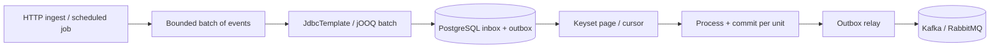
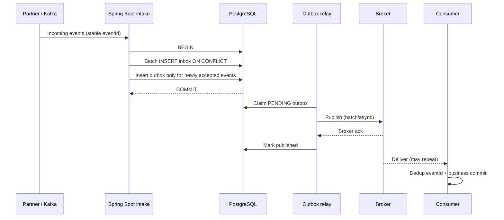

# Batch Updates, Auto-Generated Keys, and Querying Large Datasets

> **Chapter:** JDBC and jOOQ  
> **Module:** `SPRING_BOOT_INTEGRATION` — organizing system integration in Spring Boot across HTTP clients, databases, caches, message brokers, and Spring Integration adapters; focused on configuration, data contracts, transactions, errors, duplicate handling, testing, and observability.
>
> **Example Scope:** Java 17+, Spring Boot 3+, Spring JDBC, and jOOQ with PostgreSQL. Specific APIs, dialects, and generated record types vary by version, so verify against your project's dependencies and code generation setup. SQL `ON CONFLICT`, `RETURNING`, and `SKIP LOCKED` in this lesson are PostgreSQL syntax and should not be assumed portable across all databases.

## 1. Problem: Millions of Webhooks, Auto-Generated Keys, and RAM Exhaustion Risk

An integration service ingests delivery events via HTTP and Kafka. Each event carries a partner-provided `eventId` stored in an inbox table to prevent duplicate processing. A scheduled task selects pending events, updates their status, and writes outbox events to publish to a broker.

When data volume is small, this naive code appears fine:

```java
for (InboundEvent event : events) {
    jdbc.update("INSERT INTO integration_inbox ...", /* params */);
}

List<InboxRow> allRows = jdbc.query(
    "SELECT * FROM integration_inbox",
    inboxRowMapper
);
```

At hundreds of thousands or millions of rows, however, several problems emerge:

- Each individual `update` incurs per-statement/round-trip overhead; ingestion slows down even while the database still has spare capacity.
- `query(...)` returning the entire list can retain excessive objects on the JVM heap.
- If inserts retrieve IDs via `SELECT MAX(id)`, concurrent writers can accidentally grab **another row's ID**.
- If a batch fails partway through, the application may not know which subset committed or how to retry safely.
- Deep `OFFSET 1000000` pagination forces the database to scan and discard rows while concurrent inserts/updates shift pages.
- Wrapping HTTP calls or Kafka publishes inside a JDBC transaction holds pool connections for a long time without achieving cross-system atomicity.

This lesson focuses on three complementary capabilities:

1. **Batch updates:** writing many rows/SQL statements efficiently while controlling transactions, per-row outcomes, and memory bounds.
2. **Auto-generated keys:** retrieving IDs directly from inserts or `RETURNING`, while separating technical IDs from business deduplication keys.
3. **Querying large datasets:** using keyset pagination, chunking, cursors, or resource-managed streaming, and knowing when to adopt Spring Batch jobs.

### Target Outcomes

After this lesson, you will be able to choose the right `JdbcTemplate.batchUpdate`, `NamedParameterJdbcTemplate.batchUpdate`, or jOOQ batch API, retrieve generated keys safely via `KeyHolder` or SQL `RETURNING`, read large datasets via pagination/cursors, test crashes/retries, and evaluate trade-offs in a multi-instance Spring Boot application.

## 2. Distinguishing JDBC Batching, Multi-Row SQL Inserts, and Spring Batch

These three mechanisms have similar names yet solve problems at different layers.

| Mechanism | Essence | When to Use |
|---|---|---|
| **JDBC batch** | Groups multiple parameter sets/statements for the driver to execute via `addBatch`/`executeBatch` or an equivalent abstraction. | Writing hundreds or thousands of records in a single call. |
| **Multi-row SQL insert** | A single SQL statement like `INSERT ... VALUES (...), (...), ...`. | Reducing statement count and using `RETURNING` on one statement where supported by the DB dialect. |
| **Spring Batch** | `Job`/`Step` framework with chunk processing, checkpoints, restarts, and job metadata. | Large batch imports or reconciliations requiring execution history and restartability. |

Spring Batch can **call JDBC batching inside an `ItemWriter`**, yet Spring Batch is not synonymous with `JdbcTemplate.batchUpdate`. JDBC batching does not provide `JobInstance`, `StepExecution`, checkpoints, or restart orchestration.



**Core rule:** Batching reduces overhead—it does **not** eliminate the need for transactions, deduplication keys, or resource bounds.

## 3. Preparing a Consistent Schema for Examples

Use the following inbox and outbox tables on PostgreSQL:

```sql
CREATE TABLE integration_inbox (
    id BIGINT GENERATED BY DEFAULT AS IDENTITY PRIMARY KEY,
    partner VARCHAR(64) NOT NULL,
    event_id VARCHAR(160) NOT NULL,
    payload TEXT NOT NULL,
    status VARCHAR(24) NOT NULL DEFAULT 'RECEIVED',
    retry_count INTEGER NOT NULL DEFAULT 0,
    received_at TIMESTAMPTZ NOT NULL DEFAULT CURRENT_TIMESTAMP,
    processed_at TIMESTAMPTZ NULL,
    CONSTRAINT uq_inbox_partner_event UNIQUE (partner, event_id)
);

CREATE INDEX idx_inbox_status_id
    ON integration_inbox (status, id);

CREATE TABLE integration_outbox (
    id BIGINT GENERATED BY DEFAULT AS IDENTITY PRIMARY KEY,
    event_id VARCHAR(160) NOT NULL UNIQUE,
    topic VARCHAR(200) NOT NULL,
    payload TEXT NOT NULL,
    state VARCHAR(24) NOT NULL DEFAULT 'PENDING',
    created_at TIMESTAMPTZ NOT NULL DEFAULT CURRENT_TIMESTAMP
);
```

The inbox table uses two distinct kinds of IDs:

- `id`: database-generated `BIGINT IDENTITY` technical key; supports joins, ordered scans, and keyset cursors.
- `(partner, event_id)`: **mandatory** unique business key preventing the same webhook from being processed twice. It must remain stable across retries.

**Never** use auto-increment `id` instead of `event_id` for deduplication. Redeliveries of the same event may correspond to multiple transport attempts, while the business key stays identical.

Input DTO and read projection used in examples:

```java
public record InboundEvent(
    String partner,
    String eventId,
    String payload
) {}

public record InboxPageRow(
    long id,
    String partner,
    String eventId,
    String status
) {}
```

The examples assume requests have already been authenticated and `partner`/`eventId`/`payload` validated before writing. Payloads and event IDs must have bounded sizes; never allow unbounded request writes.

### 3.1. Minimal Spring Boot Configuration

```gradle
dependencies {
    implementation("org.springframework.boot:spring-boot-starter-jdbc")
    implementation("org.springframework.boot:spring-boot-starter-jooq")
    runtimeOnly("org.postgresql:postgresql")

    testImplementation("org.springframework.boot:spring-boot-starter-test")
}
```

```yaml
spring:
  datasource:
    url: ${DB_JDBC_URL}
    username: ${DB_USERNAME}
    password: ${DB_PASSWORD}
    hikari:
      maximum-pool-size: 12
  jooq:
    sql-dialect: POSTGRES
```

Spring Boot can auto-configure `DataSource`, `JdbcTemplate`, `NamedParameterJdbcTemplate`, and `DSLContext` when dependencies and bean conditions align. Defining manual datasource or template beans can cause parts of default configuration to **back off**; with multiple datasources, declare explicit qualifiers, transaction managers, and jOOQ connection providers.

The generated jOOQ classes in this lesson are illustrative; adding the starter **does not automatically generate** `IntegrationInboxRecord` or `INTEGRATION_INBOX`. Generating schema types requires configuring build-time code generation against compatible migration versions.

## 4. Row-by-Row Writes: Simple, Not Optimal at High Volume

A straightforward loop:

```java
for (InboundEvent event : events) {
    jdbc.update(
        """
        INSERT INTO integration_inbox (partner, event_id, payload)
        VALUES (?, ?, ?)
        ON CONFLICT (partner, event_id) DO NOTHING
        """,
        event.partner(), event.eventId(), event.payload()
    );
}
```

may be perfectly reasonable for a handful of rows. At high volume, however, each `update` performs a separate JDBC operation; total latency depends on driver, network, and database overhead. Because databases differ in statement preparation and caching, effectiveness must be **measured** under realistic workloads.

Before optimizing, answer these questions:

1. How many records arrive per second or batch?
2. Do the records share **the same SQL shape** differing only in bind values?
3. Do you need **per-row** outcomes?
4. If one record violates a constraint, should the **entire batch** roll back or should records be isolated individually?
5. How long will a transaction hold locks, and will that affect other HTTP/consumer flows?
6. Do you need generated IDs returned immediately for every record?

JDBC batching specifically fits **repeated execution of the same statement** with different parameter sets.

## 5. `JdbcTemplate.batchUpdate` with `BatchPreparedStatementSetter`

`JdbcTemplate.batchUpdate(String, BatchPreparedStatementSetter)` lets you specify the record count and bind parameters for each item.

```java
import java.sql.PreparedStatement;
import java.sql.SQLException;
import java.util.List;

import org.springframework.jdbc.core.BatchPreparedStatementSetter;
import org.springframework.jdbc.core.JdbcTemplate;
import org.springframework.stereotype.Repository;

@Repository
public class JdbcInboxBatchWriter {

    private static final String SQL = """
        INSERT INTO integration_inbox (partner, event_id, payload, status)
        VALUES (?, ?, ?, 'RECEIVED')
        ON CONFLICT (partner, event_id) DO NOTHING
        """;

    private final JdbcTemplate jdbc;

    public JdbcInboxBatchWriter(JdbcTemplate jdbc) {
        this.jdbc = jdbc;
    }

    public int[] insertPage(List<InboundEvent> events) {
        if (events.isEmpty()) {
            return new int[0];
        }

        return jdbc.batchUpdate(SQL, new BatchPreparedStatementSetter() {

            @Override
            public void setValues(PreparedStatement ps, int index)
                    throws SQLException {
                InboundEvent event = events.get(index);

                ps.setString(1, event.partner());
                ps.setString(2, event.eventId());
                ps.setString(3, event.payload());
            }

            @Override
            public int getBatchSize() {
                return events.size();
            }
        });
    }
}
```

Here `events` is **a bounded page**, not a `List` holding millions of records. `ON CONFLICT DO NOTHING` relies on the real unique constraint so redelivering the same event produces no duplicate row.

### 5.1. `int[]` Is Not Always an Exact Per-Item Row Count

JDBC batching returns `int[]`, yet elements are not guaranteed to be `0` or `1`. Under JDBC, a driver may return:

- `0`, `1`, ...: affected row count when known.
- `Statement.SUCCESS_NO_INFO` = `-2`: succeeded, row count unknown.
- `Statement.EXECUTE_FAILED` = `-3`: statement failed, depending on driver batch error reporting.

When `BatchUpdateException` occurs, update counts may reflect only partial execution or specific positions depending on driver behavior. **Never blindly sum every array entry into a "newly inserted events" metric** without handling `-2` and real failure semantics.

On PostgreSQL, `INSERT ... ON CONFLICT DO NOTHING` often reports `1` on insert and `0` on skipped conflict, though driver batching/rewriting options can alter count reporting. When you require **exact per-event outcomes**, consider a `RETURNING` statement correlated by business key.

### 5.2. JDBC Batching Does Not Create a Transaction for the Whole Use Case

A batch is a **driver submission mechanism**, not an atomic guarantee across an entire business use case. When one statement fails, what remains committed or rolled back depends on transaction boundaries, autocommit, and database behavior.

Place `@Transactional` on the **application service** covering the atomic unit of work rather than relying solely on calling `batchUpdate`.

## 6. `NamedParameterJdbcTemplate.batchUpdate`

Named parameters improve readability when inserts span many columns or reuse fields. Example:

```java
import java.sql.Types;
import java.util.List;

import org.springframework.jdbc.core.namedparam.MapSqlParameterSource;
import org.springframework.jdbc.core.namedparam.NamedParameterJdbcTemplate;
import org.springframework.jdbc.core.namedparam.SqlParameterSource;
import org.springframework.stereotype.Repository;

@Repository
public class NamedInboxBatchWriter {
    private final NamedParameterJdbcTemplate jdbc;

    public NamedInboxBatchWriter(NamedParameterJdbcTemplate jdbc) {
        this.jdbc = jdbc;
    }

    public int[] insertPage(List<InboundEvent> events) {
        String sql = """
            INSERT INTO integration_inbox (partner, event_id, payload)
            VALUES (:partner, :eventId, :payload)
            ON CONFLICT (partner, event_id) DO NOTHING
            """;

        SqlParameterSource[] args = events.stream()
            .map(event -> new MapSqlParameterSource()
                .addValue("partner", event.partner(), Types.VARCHAR)
                .addValue("eventId", event.eventId(), Types.VARCHAR)
                .addValue("payload", event.payload(), Types.VARCHAR))
            .toArray(SqlParameterSource[]::new);

        return args.length == 0 ? new int[0] : jdbc.batchUpdate(sql, args);
    }
}
```

Benefits: named parameters prevent positional mix-ups, make nullable fields clear, and specify `Types.*` when drivers need explicit SQL types. One `MapSqlParameterSource` is allocated per item, which carries memory overhead if batches grow too large.

For JavaBeans or records with supported accessors, Spring provides helpers like `SqlParameterSourceUtils.createBatch(...)`, though type and nullability mappings must still be verified. Explicit binding is usually safer for contracts involving `NULL`, enums, or custom `JSONB` handling.

### 6.1. Never Concatenate Data into SQL to "Speed Up" Batches

Both `JdbcTemplate` and `NamedParameterJdbcTemplate` rely on prepared/bound parameters. Never build SQL via:

```java
// Do not do this:
String sql = "INSERT INTO inbox(payload) VALUES ('"
    + userControlledPayload + "')";
```

Concatenating inputs causes SQL injection, escaping bugs, and varying statement shapes. Efficient batching depends on **one constant statement shape paired with varying bind values**.

## 7. Splitting Batches into Bounded Pages

If an upstream source provides 100,000 records, avoid building one `SqlParameterSource[]` array for all 100,000 without good reason. Chunking operates at two levels:

- **Application page:** load at most N records from HTTP/file/queue, process, and release so the entire dataset never sits in RAM.
- **JDBC batch size:** the number of statements/parameter sets the driver submits per batch execution, typically tuned independently.

`JdbcTemplate` offers an overload that splits a `Collection` into multiple JDBC batches:

```java
import java.util.Collection;
import org.springframework.jdbc.core.JdbcTemplate;

public int[][] insertInDriverBatches(
        JdbcTemplate jdbc,
        Collection<InboundEvent> events,
        int jdbcBatchSize) {

    if (jdbcBatchSize <= 0 || jdbcBatchSize > 2_000) {
        throw new IllegalArgumentException("Invalid JDBC batch size");
    }

    String sql = """
        INSERT INTO integration_inbox (partner, event_id, payload)
        VALUES (?, ?, ?)
        ON CONFLICT (partner, event_id) DO NOTHING
        """;

    return jdbc.batchUpdate(
        sql,
        events,
        jdbcBatchSize,
        (ps, event) -> {
            ps.setString(1, event.partner());
            ps.setString(2, event.eventId());
            ps.setString(3, event.payload());
        }
    );
}
```

It returns `int[][]` per sub-batch. Note that this overload **does not stream the input `Collection`**: if `events` already holds 1 million objects, the memory is already consumed. For huge inputs, use an iterator/page reader or Spring Batch reader to keep only a bounded slice in memory.

### 7.1. Choosing Batch Size by Measurement

No magic number fits every workload. Start testing sizes such as 100, 500, or 1,000 items and measure:

- Actual round-trips and throughput.
- Transaction duration and lock hold time.
- Payload size and producer/JDBC driver memory footprint.
- Database bind-parameter, packet, and statement limits.
- Contention from concurrent writers and readers.
- Effort to isolate a single bad record in a batch.

A batch of 1,000 tiny payloads behaves very differently from 1,000 multi-megabyte JSON payloads. Cap **both item count and total byte size**, not item count alone.

### 7.2. Driver-Dependent PostgreSQL JDBC Optimizations

The PostgreSQL JDBC driver offers options such as `reWriteBatchedInserts` to rewrite certain batch `INSERT`s into multi-value statements. Actual behavior, speedup, and interactions with `RETURNING`, `ON CONFLICT`, and differing SQL shapes must be measured on your **real driver and version**. Never enable an option and assume every batch is rewritten or update counts remain identical.

## 8. Transaction Boundaries and Error-Isolation Strategies

Example application service:

```java
import java.util.List;
import org.springframework.stereotype.Service;
import org.springframework.transaction.annotation.Transactional;

@Service
public class InboxImportService {
    private final JdbcInboxBatchWriter writer;
    private final OutboxBatchWriter outboxWriter;

    public InboxImportService(
            JdbcInboxBatchWriter writer,
            OutboxBatchWriter outboxWriter) {
        this.writer = writer;
        this.outboxWriter = outboxWriter;
    }

    @Transactional
    public void acceptPage(List<InboundEvent> events) {
        writer.insertPage(events);
        outboxWriter.prepareEventsForNewInboxRows(events);
    }
}
```

`OutboxBatchWriter` here is an **application-defined adapter**. `prepareEventsForNewInboxRows` **must identify only newly inserted events**, or use idempotent SQL/conditions so duplicates never spawn new outbox events. This snippet shows the service boundary, not a full outbox implementation.

To keep **inbox + outbox** atomic, both writers must share the same database and transaction manager. If `outboxWriter` targets a different datasource, `@Transactional` alone does not turn two databases into a distributed transaction.

### 8.1. What If One Record in a Batch Fails?

Three common policies:

1. **All-or-nothing per page:** roll back the whole page, fix the input, and retry; appropriate when the page is an indivisible business unit.
2. **Bisect/shrink to isolate the bad record:** roll back, reduce batch size or split the page in half to isolate invalid data; requires bounded retries and no duplicate side effects.
3. **Skip/quarantine the bad record:** when allowed by contract, record a rejection status with reason and proceed with remaining records; never silently drop critical financial or workflow events.

In PostgreSQL, any failed statement inside a transaction typically puts the transaction into an aborted state until rollback (or rollback to an explicit savepoint). **Never** catch an exception and blindly issue further statements inside the same aborted transaction.

### 8.2. Commit Granularity Should Match Business Units

A single transaction spanning millions of rows causes lock contention, heavy WAL/log growth, long connection holds, and expensive rollbacks. Commit per appropriately sized page or chunk while ensuring:

- Stable business keys and unique constraints prevent duplicates on retry.
- Checkpoints/progress update only after successful persistence.
- Outbox events carry stable IDs within the appropriate transaction.
- Operators understand that "300/500 pages completed" **does not mean** the whole job finished.

## 9. Auto-Generated Keys: Identity/Sequence vs. Event ID

PostgreSQL supports `GENERATED ... AS IDENTITY`, sequences, and other key-generation mechanisms. At the JDBC layer, drivers can return generated keys right after an insert.

### 9.1. Things You Must Never Infer from Auto-Incrementing IDs

- **IDs are not guaranteed contiguous:** rollbacks, crashes, or concurrent sessions leave gaps in sequences.
- **IDs do not represent strict commit order:** transaction A may draw a smaller ID and commit later than transaction B with a larger ID.
- **IDs do not deduplicate webhooks:** a partner resending an event creates a new ID unless blocked by a business unique constraint.
- **IDs in table A imply nothing about IDs in table B** without an explicit foreign key or contract.
- **Never use `SELECT MAX(id)` to locate a just-inserted row:** another writer can insert between your two statements.

Auto-generated IDs serve internal record management and indexed pagination; event identity still belongs to `(partner, event_id)`.

## 10. Retrieving Generated Keys with `GeneratedKeyHolder`

Spring JDBC provides `KeyHolder` to receive keys returned by the driver after a supported insert.

```java
import java.sql.PreparedStatement;
import java.util.Objects;

import org.springframework.jdbc.core.JdbcTemplate;
import org.springframework.jdbc.support.GeneratedKeyHolder;
import org.springframework.jdbc.support.KeyHolder;
import org.springframework.stereotype.Repository;

@Repository
public class JdbcInboxSingleWriter {

    private final JdbcTemplate jdbc;

    public JdbcInboxSingleWriter(JdbcTemplate jdbc) {
        this.jdbc = jdbc;
    }

    public long insertAndGetId(InboundEvent event) {
        KeyHolder keys = new GeneratedKeyHolder();

        int updated = jdbc.update(connection -> {
            PreparedStatement ps = connection.prepareStatement(
                """
                INSERT INTO integration_inbox
                    (partner, event_id, payload)
                VALUES (?, ?, ?)
                """,
                new String[] {"id"}
            );
            ps.setString(1, event.partner());
            ps.setString(2, event.eventId());
            ps.setString(3, event.payload());
            return ps;
        }, keys);

        if (updated != 1) {
            throw new IllegalStateException("Expected exactly one inserted row");
        }

        Number id = Objects.requireNonNull(
            keys.getKey(), "Database returned no generated id");
        return id.longValue();
    }
}
```

Notice there is **no `ON CONFLICT DO NOTHING`** here: if `(partner, event_id)` already exists, the unique constraint fails the insert and no ID is generated for the duplicate.

### 10.1. Why Specify `new String[]{"id"}`?

Calling `getGeneratedKeys()` without specifying key columns can cause some drivers/databases to return multiple columns or unexpected metadata. `GeneratedKeyHolder.getKey()` only fits results with **a single numeric key**. When multiple columns or database-specific outputs are needed, use `getKeys()`/`getKeyList()` per contract or explicit SQL `RETURNING`.

**Never** assume every generated key is a `Long`: drivers may return other `Number` types or non-numeric IDs. For overflow-sensitive systems, check bounds rather than unconditionally calling `longValue()`.

### 10.2. Generated Keys Are Returned After Insert, Not After Commit

An insert can return an ID while the enclosing transaction **still rolls back** later. Knowing an ID does not prove the entity exists in a committed state.

If an application returns HTTP `201` right after obtaining an ID before the transaction commits, define the boundary clearly. Typically the service persists and commits before the controller returns success; for asynchronous processing, return an accurate acceptance status instead.

## 11. `NamedParameterJdbcTemplate` and `KeyHolder`

When statements have many fields, named parameters avoid positional errors, and Spring JDBC supports returning generated keys on updates.

```java
import org.springframework.jdbc.core.namedparam.MapSqlParameterSource;
import org.springframework.jdbc.core.namedparam.NamedParameterJdbcTemplate;
import org.springframework.jdbc.support.GeneratedKeyHolder;

public long insertAndGetId(
        NamedParameterJdbcTemplate jdbc, InboundEvent event) {

    String sql = """
        INSERT INTO integration_inbox (partner, event_id, payload)
        VALUES (:partner, :eventId, :payload)
        """;

    var args = new MapSqlParameterSource()
        .addValue("partner", event.partner())
        .addValue("eventId", event.eventId())
        .addValue("payload", event.payload());

    var keys = new GeneratedKeyHolder();

    int updated = jdbc.update(sql, args, keys, new String[] {"id"});

    if (updated != 1 || keys.getKey() == null) {
        throw new IllegalStateException("No inserted id");
    }

    return keys.getKey().longValue();
}
```

This statement omits `ON CONFLICT`, so duplicates throw a constraint error. When the contract requires "insert if absent; otherwise return existing ID," **add a lookup path by business key** rather than expecting `KeyHolder` to return an ID from a `DO NOTHING` statement that inserted nothing.

### 11.1. Race Condition When Fetching the ID of an Existing Event

A common flow:

1. Try `INSERT ... ON CONFLICT DO NOTHING RETURNING id`.
2. If no row is returned, execute `SELECT id WHERE partner=? AND event_id=?`.

Under PostgreSQL `READ COMMITTED`, executing these as **two separate statements under suitable transaction handling** normally works once a conflict with another transaction resolves. However, do not assume a **single-statement CTE** can always see a row just committed by a concurrent transaction: snapshot rules and conflict resolution can produce a case where a conflict is detected yet the conflicting row is invisible to a `SELECT` within the same statement. Under high concurrency, test thoroughly and design a retry for unexpectedly empty lookups.

## 12. PostgreSQL `INSERT ... RETURNING` for Explicit ID Retrieval

PostgreSQL supports `RETURNING` on DML statements. Use it when you want results returned and mapped like a query.

```sql
INSERT INTO integration_inbox (partner, event_id, payload)
VALUES (:partner, :eventId, :payload)
RETURNING id, partner, event_id;
```

With `NamedParameterJdbcTemplate`, this returns a result set, so you can call `queryForObject` with a mapper:

```java
public long insertReturningId(
        NamedParameterJdbcTemplate jdbc, InboundEvent event) {

    String sql = """
        INSERT INTO integration_inbox (partner, event_id, payload)
        VALUES (:partner, :eventId, :payload)
        RETURNING id
        """;

    var args = new MapSqlParameterSource()
        .addValue("partner", event.partner())
        .addValue("eventId", event.eventId())
        .addValue("payload", event.payload());

    Long id = jdbc.queryForObject(
        sql, args, (rs, rowNum) -> rs.getLong("id"));

    return java.util.Objects.requireNonNull(id);
}
```

This is PostgreSQL-specific SQL, not a guaranteed cross-dialect JDBC feature.

### 12.1. `DO NOTHING RETURNING` May Return Zero Rows

```sql
INSERT INTO integration_inbox (partner, event_id, payload)
VALUES (:partner, :eventId, :payload)
ON CONFLICT (partner, event_id) DO NOTHING
RETURNING id;
```

When a conflict occurs, the statement **inserts nothing**, so `RETURNING` emits no row for that event. Do not call `queryForObject` expecting one row unconditionally. Use `query(...)` and handle an empty list or an optional result abstraction.

### 12.2. Multi-Row `RETURNING`: Never Map by Position Under Conflicts

Suppose one statement supplies three events, and the second already exists; `DO NOTHING RETURNING id, event_id` returns only the **two newly inserted rows**. If code assumes the second returned row corresponds to the second input item, IDs get assigned to the wrong events.

**Safer approach:** return `event_id` (and `partner`) alongside `id` and correlate results by business key. If duplicates can appear within the same input batch, validate/deduplicate the batch before building the statement or use SQL designed for that case.

### 12.3. Never Use `RETURNING` to Pull Huge Payloads into RAM

A bulk insert returning hundreds of thousands of rows with `RETURNING *` consumes substantial RAM and network bandwidth. Return only `id` and essential business keys, keep batches bounded, and plan recovery for missing responses or transaction rollbacks.

## 13. jOOQ: `DSLContext` and Generated Keys with `returning()`

jOOQ provides a typed DSL supporting `RETURNING` according to SQL dialect capabilities. Examples assume code generation has created `INTEGRATION_INBOX` matching the schema in section 3.

```java
import static com.example.jooq.tables.IntegrationInbox.INTEGRATION_INBOX;

import org.jooq.DSLContext;
import org.springframework.stereotype.Repository;

@Repository
public class JooqInboxWriter {
    private final DSLContext dsl;

    public JooqInboxWriter(DSLContext dsl) {
        this.dsl = dsl;
    }

    public long insertAndReturnId(InboundEvent event) {
        var row = dsl.insertInto(INTEGRATION_INBOX)
            .set(INTEGRATION_INBOX.PARTNER, event.partner())
            .set(INTEGRATION_INBOX.EVENT_ID, event.eventId())
            .set(INTEGRATION_INBOX.PAYLOAD, event.payload())
            .set(INTEGRATION_INBOX.STATUS, "RECEIVED")
            .returning(INTEGRATION_INBOX.ID)
            .fetchOne();

        if (row == null) {
            throw new IllegalStateException("Insert returned no row");
        }

        Long id = row.get(INTEGRATION_INBOX.ID);
        return java.util.Objects.requireNonNull(id);
    }
}
```

On PostgreSQL, jOOQ can render `INSERT ... RETURNING id`. `.fetchOne()` is appropriate here only because the statement expects to insert a single row. When adding `onConflict(...).doNothing()`, a duplicate produces an empty result:

```java
var inserted = dsl.insertInto(INTEGRATION_INBOX)
    .set(INTEGRATION_INBOX.PARTNER, event.partner())
    .set(INTEGRATION_INBOX.EVENT_ID, event.eventId())
    .set(INTEGRATION_INBOX.PAYLOAD, event.payload())
    .set(INTEGRATION_INBOX.STATUS, "RECEIVED")
    .onConflict(
        INTEGRATION_INBOX.PARTNER,
        INTEGRATION_INBOX.EVENT_ID
    )
    .doNothing()
    .returning(INTEGRATION_INBOX.ID)
    .fetchOne();

if (inserted == null) {
    // Duplicate by business key: no new ID generated.
}
```

**Code generation catches certain column-name and type mistakes at compile time**, yet it never replaces unique constraints, migrations, transactions, or tests against a real database.

## 14. jOOQ Batching: Repeating Bind Values on the Same SQL

jOOQ supports multiple batch modes. For a fixed SQL statement with varying parameter sets, use `BatchBindStep`:

```java
import java.util.List;
import org.jooq.BatchBindStep;
import org.jooq.DSLContext;

public int[] insertBatch(DSLContext dsl, List<InboundEvent> events) {
    if (events.isEmpty()) {
        return new int[0];
    }

    BatchBindStep batch = dsl.batch("""
        INSERT INTO integration_inbox (partner, event_id, payload)
        VALUES (?, ?, ?)
        ON CONFLICT (partner, event_id) DO NOTHING
        """);

    for (InboundEvent event : events) {
        batch.bind(event.partner(), event.eventId(), event.payload());
    }

    return batch.execute();
}
```

This takes a Spring-configured `DSLContext`, uses fixed SQL with bound values, and never accepts table or column names from user input. In real applications, inject `DSLContext` into a repository via constructor and place transactions in an application service.

### 14.1. `batchInsert(records)` Differs from Batching with `DO NOTHING`

With jOOQ-generated `UpdatableRecord`/`TableRecord` classes, you may also see:

```java
var r = dsl.newRecord(INTEGRATION_INBOX);
r.setPartner(event.partner());
r.setEventId(event.eventId());
r.setPayload(event.payload());
r.setStatus("RECEIVED");

int[] counts = dsl.batchInsert(r).execute();
```

`batchInsert` works for straightforward record inserts, yet it **does not automatically add `ON CONFLICT DO NOTHING`**. If business logic requires deduplication, choose an SQL/DSL statement with an explicit conflict policy or rely on unique constraints and contract-driven error handling.

Remember too: `batchInsert` does not promise portable generated ID retrieval for every record across all drivers. When you need **the ID of every inserted row**, distinguish high-speed batching from explicit `RETURNING`/key-correlation mechanisms and run integration tests on your real driver and dialect.

### 14.2. When to Use the DSL Instead of Plain SQL Batches?

- Queries evolve with schema changes and you want compiler checks on field names and types.
- You need to compose complex conditions, CTEs, or `RETURNING` clauses.
- You need explicit support for a specific SQL dialect.
- Your team has already invested in code generation and schema migration tests.

Whether using the DSL or plain SQL, batch size, transactions, generated keys, locks, and side effects still require careful application-level design.

## 15. One Batch `INSERT` Returning IDs for Many Rows: Pick the Right Contract

Three requirements are commonly conflated:

| Requirement | Approach |
|---|---|
| "Ingest all events fast; no immediate technical ID needed" | JDBC/jOOQ batch + unique constraint/upsert |
| "Create one entity at a time and return its generated ID" | `KeyHolder` or jOOQ `returning(ID)` |
| "Insert many events and accurately map event → new ID" | Multi-row `RETURNING id, partner, event_id`, correlated by business key |

A safe hybrid is: **avoid requiring generated IDs during ingestion**, use `eventId` as the cross-system identifier, and query the DB by business key after commit only when an internal ID is truly needed.

### 15.1. Using Multi-Row `VALUES` When Bulk `RETURNING` Is Needed

PostgreSQL example:

```sql
INSERT INTO integration_inbox (partner, event_id, payload)
VALUES
    (:partner1, :eventId1, :payload1),
    (:partner2, :eventId2, :payload2)
ON CONFLICT (partner, event_id) DO NOTHING
RETURNING id, partner, event_id;
```

This shows two fixed rows for illustration. When building dynamic SQL for N rows:

- Cap N and total bind parameter count.
- Generate placeholders only for a **controlled** N; bind every value.
- Never derive placeholder or column names from untrusted data.
- When N is 0, never execute an empty `VALUES` clause.
- Map results using returned `(partner, event_id, id)` rather than output position.

Do not equate multi-row SQL `INSERT` with JDBC batching as identical APIs; benchmark both on your specific driver and dialect.

## 16. Querying Large Datasets: Why `queryForList`/`fetch()` Causes OOM

With:

```java
List<InboxPageRow> all = jdbc.query(
    "SELECT id, partner, event_id, status FROM integration_inbox",
    (rs, rowNum) -> new InboxPageRow(
        rs.getLong("id"),
        rs.getString("partner"),
        rs.getString("event_id"),
        rs.getString("status")
    )
);
```

`JdbcTemplate.query(...)` with a `RowMapper` returning `List` materializes every object. jOOQ `fetch()` likewise builds results in memory. Selecting millions of rows causes:

- Heap growth and GC pauses.
- Long-held JDBC connections.
- Network/DB congestion transferring unnecessary data.
- Timeouts and inability to resume cleanly if the process crashes midway.
- Connection pool starvation for other callers.

**A per-row callback does not guarantee the driver is streaming from the database**: the driver may still prefetch many or all rows. Distinguish **how the application allocates objects** from **how the JDBC driver fetches the result set**.

### 16.1. Three Main Strategies

| Strategy | Memory | Resumability | Key Considerations |
|---|---|---|---|
| **Keyset pagination** | Bounded per page | Persist last key/checkpoint | Needs stable sort key, index, and policy for changing data |
| **Cursor / streaming** | Potentially bounded, depending on driver/fetch size | Hard to resume cleanly if cursor drops | Holds connection/transaction long; resources must be closed |
| **OFFSET pagination** | Bounded per page | Offset shifts as data mutates | Deep pages waste work skipping rows and risk duplicates/skips |

For a **restartable integration job**, keyset pagination combined with idempotent writers and durable checkpoints is usually much easier to operate than a cursor held open for hours.

## 17. `OFFSET` Pagination: Easy to Write, Poor Fit at Scale

Example:

```sql
SELECT id, partner, event_id, status
FROM integration_inbox
WHERE status = 'RECEIVED'
ORDER BY id
LIMIT :limit OFFSET :offset;
```

Drawbacks:

1. The DB may have to scan and discard many rows on deep pages; cost grows with offset.
2. If rows are deleted or change status between queries, subsequent pages can **skip** or **re-read** rows.
3. `ORDER BY` must guarantee deterministic ordering; sorting on a column with duplicate values produces unstable pages.
4. Resuming from offset N assumes the dataset did not shift—rarely true for an actively processed inbox.

`OFFSET` remains fine for small UI screens, low-churn data, or stable snapshots; it is not inherently wrong everywhere. Just avoid it as the default for exporting or reconciling millions of rows.

## 18. Keyset Pagination: Fetching the Next Page After the Last Seen Key

With an increasing `id` key, the SQL becomes:

```sql
SELECT id, partner, event_id, status
FROM integration_inbox
WHERE status = 'RECEIVED'
  AND id > :afterId
ORDER BY id ASC
LIMIT :pageSize;
```

Start with `afterId = 0` when IDs are positive. After **successfully** processing a page, update `afterId` to the highest ID read in that page. The DB leverages the `(status, id)` index from the sample schema.

### 18.1. Spring JDBC Code Reading One Page

```java
import java.util.List;
import org.springframework.jdbc.core.namedparam.MapSqlParameterSource;
import org.springframework.jdbc.core.namedparam.NamedParameterJdbcTemplate;
import org.springframework.stereotype.Repository;

@Repository
public class InboxPageReader {
    private final NamedParameterJdbcTemplate jdbc;

    public InboxPageReader(NamedParameterJdbcTemplate jdbc) {
        this.jdbc = jdbc;
    }

    public List<InboxPageRow> nextPage(long afterId, int pageSize) {
        if (pageSize < 1 || pageSize > 1_000) {
            throw new IllegalArgumentException("Invalid page size");
        }

        return jdbc.query(
            """
            SELECT id, partner, event_id, status
            FROM integration_inbox
            WHERE status = 'RECEIVED'
              AND id > :afterId
            ORDER BY id
            LIMIT :pageSize
            """,
            new MapSqlParameterSource()
                .addValue("afterId", afterId)
                .addValue("pageSize", pageSize),
            (rs, rowNum) -> new InboxPageRow(
                rs.getLong("id"),
                rs.getString("partner"),
                rs.getString("event_id"),
                rs.getString("status")
            )
        );
    }
}
```

This returns **one bounded page**, not the entire table. As the service processes the page, update progress within the **transaction/job state**. Never advance the checkpoint before business writes and outbox inserts commit, or a crash will lose unprocessed rows.

### 18.2. Important Note on Concurrent Commits

`id > afterId` **does not create a consistent snapshot by itself**. Transaction A may obtain a lower ID yet commit after transaction B with a higher ID. If the scanner advances `afterId` past A's ID before A commits, A's row can be missed in the current pass.

On an inbox table **receiving concurrent writes**, pick an explicit strategy:

- Read only a frozen/snapshotted input set for the job.
- Periodically re-scan `status = 'RECEIVED'` to pick up late-committing rows, backed by checkpoints and idempotency.
- Use a claim queue via `FOR UPDATE SKIP LOCKED` when the goal is distributing pending work rather than treating a keyset cursor as a queue.
- For reports requiring a consistent snapshot, use an appropriate transaction isolation level while evaluating the cost of long-lived snapshots.

Setting a high-water mark `MAX(id)` bounds **most** newly arriving data in a pass, yet **does not eliminate** transactions that drew IDs early and committed late. Never claim "zero missed rows" from a numeric cursor alone.

## 19. jOOQ Keyset Pagination with Generated Fields

Assuming `INTEGRATION_INBOX` is generated:

```java
import static com.example.jooq.tables.IntegrationInbox.INTEGRATION_INBOX;

import java.util.List;
import org.jooq.DSLContext;

public List<InboxPageRow> loadPage(
        DSLContext dsl, long afterId, int pageSize) {

    if (pageSize <= 0 || pageSize > 1_000) {
        throw new IllegalArgumentException("Invalid page size");
    }

    return dsl.select(
            INTEGRATION_INBOX.ID,
            INTEGRATION_INBOX.PARTNER,
            INTEGRATION_INBOX.EVENT_ID,
            INTEGRATION_INBOX.STATUS)
        .from(INTEGRATION_INBOX)
        .where(INTEGRATION_INBOX.STATUS.eq("RECEIVED"))
        .and(INTEGRATION_INBOX.ID.gt(afterId))
        .orderBy(INTEGRATION_INBOX.ID.asc())
        .limit(pageSize)
        .fetch(record -> new InboxPageRow(
            record.get(INTEGRATION_INBOX.ID),
            record.get(INTEGRATION_INBOX.PARTNER),
            record.get(INTEGRATION_INBOX.EVENT_ID),
            record.get(INTEGRATION_INBOX.STATUS)
        ));
}
```

The typed DSL catches column renames/type changes during codegen; the pagination logic remains **application-designed keyset pagination**. Persist and query using the exact same ordering and key columns.

### 19.1. Keyset Pagination Across Multiple Sort Columns

When sorting by `received_at` and `id` to break ties on equal timestamps, compare the pair **lexicographically**:

```sql
WHERE (received_at, id) > (:lastReceivedAt, :lastId)
ORDER BY received_at, id
LIMIT :pageSize
```

This is **PostgreSQL row-value comparison**. On other engines, express it as:

```sql
WHERE received_at > :lastReceivedAt
   OR (received_at = :lastReceivedAt AND id > :lastId)
```

Persist both sort columns in the checkpoint and add an index on `(received_at, id)` matching your filter/status predicates. If sort keys can be NULL or mutated after reading, adjust comparison rules and contracts accordingly.

## 20. Cursors and Streaming with Spring JDBC

`JdbcTemplate` can process rows through a `RowCallbackHandler` without accumulating a `List`. To limit how many rows the driver fetches per round-trip, configure `fetchSize` on the `PreparedStatement`:

```java
import java.sql.PreparedStatement;
import java.sql.ResultSet;

import org.springframework.jdbc.core.JdbcTemplate;
import org.springframework.jdbc.core.RowCallbackHandler;
import org.springframework.stereotype.Service;
import org.springframework.transaction.annotation.Transactional;

@Service
public class InboxExportService {
    private final JdbcTemplate jdbc;

    public InboxExportService(JdbcTemplate jdbc) {
        this.jdbc = jdbc;
    }

    @Transactional(readOnly = true)
    public void exportToBoundedSink(InboxRowSink sink) {
        jdbc.query(
            connection -> {
                PreparedStatement ps = connection.prepareStatement(
                    """
                    SELECT id, partner, event_id, status
                    FROM integration_inbox
                    ORDER BY id
                    """);
                ps.setFetchSize(500);
                return ps;
            },
            (RowCallbackHandler) rs -> sink.accept(
                new InboxPageRow(
                    rs.getLong("id"),
                    rs.getString("partner"),
                    rs.getString("event_id"),
                    rs.getString("status")
                )
            )
        );
    }
}
```

`InboxRowSink` is an application-defined interface/adapter that **must consume rows with bounded memory**. This example illustrates the API without file/S3/HTTP stream wiring.

### 20.1. `fetchSize` Is a Hint, Not a Universal Streaming Guarantee

Drivers impose different prerequisites. For **PostgreSQL JDBC**, server-side cursors/chunked fetching generally require the connection **not to be in autocommit mode**, `fetchSize > 0`, and a compatible result set type; `@Transactional(readOnly = true)` usually establishes a Spring-managed transaction and connection, though you must verify against your actual datasource and transaction manager.

Some drivers still buffer results or behave differently depending on settings. A per-row callback **does not guarantee** the JDBC driver is not pre-loading the full result set.

### 20.2. Never Make Slow HTTP Calls Inside `RowCallbackHandler`

While a cursor stays open, the application holds a connection—and potentially a transaction/snapshot. If `sink.accept(...)` calls a partner API taking seconds per row, the pool drains rapidly.

Better approaches:

- Stream data quickly to a bounded file/buffer or an internal batch.
- Decouple DB scanning from network I/O using durable queues, outboxes, or job tables.
- Use keyset pages and shorter transactions when resumability and retries are needed.
- Ensure `ResultSet`, `Statement`, and `Connection` close even if the sink throws (Spring templates handle this when used properly).

### 20.3. `@Transactional(readOnly = true)` Is Not Magic

Read-only hints communicate intent to the transaction infrastructure and driver and clarify read paths; they do **not** guarantee every database blocks writes identically across all engines, nor do they provide a single consistent snapshot across multiple separate page transactions.

## 21. jOOQ `fetchLazy()`: Cursors with Explicit Lifecycles

jOOQ `fetch()` materializes data. When lazy iteration is desired, use `fetchLazy()` and close the `Cursor`:

```java
import static com.example.jooq.tables.IntegrationInbox.INTEGRATION_INBOX;

import org.jooq.DSLContext;

public void exportWithCursor(DSLContext dsl, InboxRowSink sink) {
    try (var cursor = dsl.select(
            INTEGRATION_INBOX.ID,
            INTEGRATION_INBOX.PARTNER,
            INTEGRATION_INBOX.EVENT_ID,
            INTEGRATION_INBOX.STATUS)
        .from(INTEGRATION_INBOX)
        .orderBy(INTEGRATION_INBOX.ID)
        .fetchLazy()) {

        for (var record : cursor) {
            sink.accept(new InboxPageRow(
                record.get(INTEGRATION_INBOX.ID),
                record.get(INTEGRATION_INBOX.PARTNER),
                record.get(INTEGRATION_INBOX.EVENT_ID),
                record.get(INTEGRATION_INBOX.STATUS)
            ));
        }
    }
}
```

`try-with-resources` guarantees the cursor closes on completion or exception. Still, true **server-side streaming** depends on the JDBC driver, connection/transaction state, and fetch size; `fetchLazy()` does not guarantee identical memory buffering across all databases.

Returning a stream/cursor outside the method/service after the transaction closes will fail further reads or hold resources unexpectedly long. Consume cursors inside a managed, explicitly closed boundary, or switch to keyset pages for easy resumption.

### 21.1. Choosing Keyset vs. Cursor

| Need | Recommended Approach |
|---|---|
| Export one fast snapshot continuously without mid-job resume | Cursor/`fetchLazy` with managed transaction and resource cleanup |
| Multi-hour job that must restart after crashes | Keyset + persisted checkpoint + idempotent writer |
| Distribute `PENDING` tasks across multiple workers | DB locking/lease claim, not just a cursor |
| HTTP endpoint returning pages to users | Keyset pagination / opaque cursor token |
| Heavy reporting where the DB excels at aggregation | Push aggregation down to SQL instead of loading all rows into Java |
| Source must be consistent at one exact point in time | Snapshot/isolation level or explicitly prepared immutable input |

## 22. Multiple Workers: `SKIP LOCKED` and Work-Claiming

In multi-instance deployments, two workers querying `WHERE status='RECEIVED'` concurrently can see the same event before either updates it. When the goal is **work distribution**, keyset pagination alone is insufficient.

PostgreSQL supports a short work-claiming pattern using `FOR UPDATE SKIP LOCKED`:

```sql
WITH picked AS (
    SELECT id
    FROM integration_inbox
    WHERE status = 'RECEIVED'
    ORDER BY id
    LIMIT :batchSize
    FOR UPDATE SKIP LOCKED
)
UPDATE integration_inbox AS i
SET status = 'PROCESSING'
FROM picked
WHERE i.id = picked.id
RETURNING i.id, i.partner, i.event_id;
```

**Operational flow:**

1. In a short transaction, select and lock a batch of pending rows not locked by other workers.
2. Mark them `PROCESSING` and commit the claim.
3. Run business processing by ID/event ID with idempotency.
4. Update to `PROCESSED` or `FAILED`/retry on completion.

`SKIP LOCKED` suits **work-queue patterns**, yet it does **not** deliver a complete snapshot of data. Rows currently locked by another worker are skipped in that scan and revisited on subsequent passes.

### 22.1. Include Leases and Recovery for Crashed Workers

If a worker claims rows and crashes, those rows can stay stuck in `PROCESSING` forever. Production tables need columns such as `locked_until`, `attempt_count`, `worker_id`, or retry states, along with a reaper job to reclaim expired leases.

Never hold DB locks across multi-minute partner HTTP calls. Short claim + lease + bounded retry + idempotency outperforms holding transactions/locks across network I/O.

### 22.2. Claim Order Differs from Completion Order

`ORDER BY id` prioritizes selection order at query time, yet across multiple workers, **completion order is not guaranteed**. When events for the same aggregate must run in version order, use `aggregateId`, versions/checkpoints, or sequential routing rather than relying solely on auto-increment IDs.

## 23. Atomic Inbox/Outbox Writes, Publishing After Commit

A webhook batch may need to persist **inbox + business state + outbox** within one database transaction:



Two scenarios must be handled:

- **Duplicate inbound:** the same `(partner, event_id)` arrives again. Never create new outbox side effects just because a request arrived; the unique constraint arbitrates.
- **Duplicate publish:** the relay published to the broker then crashed before marking the outbox sent. Retrying can republish the same event, so consumers must deduplicate by business ID.

When you need to guarantee outbox rows are created **only for newly inserted inbox rows**, PostgreSQL allows `INSERT ... RETURNING`/CTEs within the transaction to capture the `event_id`s of newly inserted rows. Never rely on `SUCCESS_NO_INFO` batch counts to infer which items were new if the driver omits per-row counts.

### 23.1. Never Batch HTTP/Broker Calls as If They Were in the JDBC Transaction

`@Transactional` governs the datasource's transaction. Calling `RestClient`, `KafkaTemplate`, or `RabbitTemplate` inside the same Java method **does not enlist them in an atomic commit** with PostgreSQL.

Use outbox/inbox tables, bounded retries, idempotency keys, and reconciliation. This matters even more with large batches: a failure at the end of a batch **cannot undo** hundreds of HTTP side effects already executed on a partner system.

## 24. Performance: Measure Metrics Instead of Guessing

### 24.1. Technical Metrics

| Component | Metrics to Watch | Warning Signs |
|---|---|---|
| Batch insert | Rows/sec, batch latency, driver update-count flags | Large batches yield no throughput improvement |
| JDBC pool | Active/idle/pending counts, wait time | Pool exhausted; HTTP requests waiting for connections |
| Database | Transaction duration, WAL, lock waits, deadlocks | Pages too large or hot-row contention |
| Large queries | p95/p99 duration, rows scanned/returned, bytes | Deep `OFFSET`, missing index, over-fetching columns |
| JVM | Heap, GC pauses, allocation rate | Materializing millions of DTOs |
| Cursors | Long-held connection count, transaction age | Streaming tying up the pool |
| Inbox | Received/duplicate/processed counts, oldest pending age | Retry storms or worker backlog |
| Outbox | Oldest pending age, publish failures/retries | DB committing while events stall before broker |
| Consumer | Lag, retries, dead-letter, dedup count | Downstream falling behind |

### 24.2. Query Plans and Indexes

Before blaming Java mapping, run `EXPLAIN (ANALYZE, BUFFERS)` in a safe environment with representative data. An index on `(status, id)` supports `status='RECEIVED' AND id > ... ORDER BY id`, while other queries may require different indexes or strategies.

Avoid adding indexes indiscriminately: each index slows down `INSERT`s and `UPDATE`s. Large write batches reduce round-trips, yet remain bounded by WAL throughput, index maintenance, disk I/O, and locks.

### 24.3. Payload and Network Overhead

- `SELECT` only needed columns: do not pull `payload TEXT` if you only need IDs and statuses.
- Bound both record counts and byte sizes per page.
- Never enable SQL bind-value logging for webhooks containing sensitive data.
- Configure timeouts at JDBC, network, and database layers per policy; do not confuse query timeouts with HTTP timeouts.
- Across multiple pods, total connections = pool per pod × pod count, and must fit within database budgets.

## 25. Testing: Row Counts, Generated Keys, Pagination, and Crashes

Unit tests can verify mappers and checkpoint logic. However, the following require **integration tests with the real PostgreSQL driver**: generated keys, `RETURNING`, `ON CONFLICT`, server-side cursors, `SKIP LOCKED`, and JDBC batch update counts.

### 25.1. Minimum Test Matrix

| Scenario | What to Verify |
|---|---|
| 0-item batch | No statement sent; empty result returned |
| 1/100/1000-item batch | All rows persisted per SQL and transaction rules |
| Same `eventId` twice in one batch | Unique constraint deduplicates; outbox not duplicated |
| Two concurrent batches with same event | Only one business row; no check-then-insert race |
| One item violates `NOT NULL` or schema | Transaction/rollback behaves properly; no false completion mark |
| Driver returns `SUCCESS_NO_INFO` | Logic does not miscount rows |
| Single-insert generated key | Key matches the just-inserted row; no `MAX(id)` |
| Duplicate with `DO NOTHING RETURNING` | No generated row returned; optional handling works |
| Multi-row `RETURNING` with conflict | IDs mapped by `(partner, event_id)`, not by index |
| Chunk/page writer fails after partial pages | Idempotent retry and accurate checkpoint |
| `OFFSET` under mutating data | Demonstrates page drift; unsuitable where exactness is required |
| Keyset after crash | Resumes from persisted cursor without dropped/duplicated effects |
| Lower-ID transaction commits late | Re-scan/claim/snapshot handles it; no false keyset perfection claims |
| Cursor / `fetchLazy` | Resources close on completion, exception, and cancellation |
| Multiple workers claiming | No row processed concurrently; expired leases reclaimed |
| Outbox publish after DB commit | Broker outage preserves publish intent; retries keep event ID |

### 25.2. Generated-Key and Duplicate Integration Test Example

```java
import static org.assertj.core.api.Assertions.assertThat;

import org.junit.jupiter.api.Test;
import org.springframework.beans.factory.annotation.Autowired;
import org.springframework.boot.test.context.SpringBootTest;
import org.springframework.jdbc.core.JdbcTemplate;

@SpringBootTest
class InboxGeneratedKeyTest {

    @Autowired
    private JdbcInboxSingleWriter writer;

    @Autowired
    private JdbcTemplate jdbc;

    @Test
    void generatedKeyPointsToInsertedRow() {
        InboundEvent event = new InboundEvent(
            "shipping-a", "evt-test-unique-101", "{}");

        long id = writer.insertAndGetId(event);

        String savedEventId = jdbc.queryForObject(
            "SELECT event_id FROM integration_inbox WHERE id = ?",
            String.class,
            id
        );

        assertThat(id).isPositive();
        assertThat(savedEventId).isEqualTo(event.eventId());
    }
}
```

This test assumes **real PostgreSQL and migrated schema**, isolated test data, and non-colliding event IDs across tests. Use Testcontainers per your project's workflow. For parallel test suites, assign unique keys and clear transaction/cleanup lifecycles rather than relying on pre-populated state.

### 25.3. Tests Must Also Measure Resources

Beyond functional assertions:

- Benchmark batch sizes using representative payloads and concurrency.
- Inspect heap/GC while scanning millions of rows; verify no unbounded `List` accumulates.
- Check connection pool health after a cursor throws an exception; connections must be released.
- Test throughput when the broker is unavailable, outbox backlog grows, and workers experience backpressure.
- Run schema migrations + jOOQ codegen + compile in CI to catch stale generated fields.

## 26. Common Implementation Mistakes

| Symptom | Common Cause | Fix |
|---|---|---|
| `batchUpdate` slower than expected | Too few rows, varying SQL shapes, driver/network bottleneck | Benchmark and review driver settings |
| JDBC batch returns `-2` | Driver's `SUCCESS_NO_INFO` | Do not treat as negative row count; verify DB/results as needed |
| One bad row breaks whole page | Constraint/SQL error, aborted transaction | Apply rollback policy, split pages, or quarantine |
| `KeyHolder` has no ID | Driver/statement returned no key or SQL inserted nothing | Specify key column; handle `RETURNING`/duplicates |
| `KeyHolder` returns multiple columns | Key columns not constrained | Pass `new String[]{"id"}` or use `getKeyList()` |
| Two different events get the same ID | Using `MAX(id)` or assuming positional generated keys | Use `getGeneratedKeys`/`RETURNING` per statement and business key |
| Gaps in IDs | Sequence rollbacks/caching/concurrency | Normal; never treat IDs as contiguous sequence numbers |
| Query OOM | `queryForList`/`fetch()` over entire table | Use memory-bounded keyset pages or cursors |
| Cursor still consumes lots of RAM | Driver buffered all rows due to autocommit/`fetchSize` | Verify driver, transaction, `fetchSize`, and test empirically |
| Connection pool exhausted | Cursors/transactions holding connections too long | Shorten pages/transactions and monitor pool metrics |
| `OFFSET` pages miss records | Concurrent `INSERT`/`UPDATE`/`DELETE` | Switch to keyset, snapshot, or claim pattern |
| Keyset misses late-committing rows | ID allocation order != commit order | Add re-scan, leases, or consistent snapshot |
| Multiple workers process same row | Selecting pending rows without claiming | Add claim lock/lease + uniqueness/idempotency |
| Inbox committed, event lost | Broker publish outside DB transaction | Use transactional outbox + relay/retry |
| Outbox sends duplicates | Relay crashed after publish before marking sent | Enforce consumer idempotency by event ID |
| jOOQ code fails with field type error | Codegen out of sync with migrations | Align schema, regenerate, and retest |
| Status reports success before consumer finishes | Confusing DB commit/publish ack with business ack | Track observability per integration boundary |

## 27. Choosing a Technique for the Requirement

| Requirement | Starting Solution | Condition for Reliability |
|---|---|---|
| Write a few records, need ID immediately | `JdbcTemplate.update` + `KeyHolder` | Unique key and appropriate transaction |
| Write many records with identical SQL | `JdbcTemplate.batchUpdate` / named batch | Bounded batch size, rollback/retry policy |
| Complex SQL, typed DSL | jOOQ DSL and batch/`returning()` | Generated schema and matching dialect |
| Need IDs of newly inserted rows in bulk `INSERT` | `INSERT ... RETURNING id, business_key` | Never correlate by output position under conflicts |
| Query large pages with restartability | Keyset + checkpoint | Stable key, explicit input/commit semantics |
| Stream data continuously | JDBC `fetchSize`/callback or jOOQ `fetchLazy` | Proper transaction/driver setup and resource closing |
| Distribute tasks to multiple workers | `FOR UPDATE SKIP LOCKED` + lease | Recovery for crashed workers, idempotency |
| Multi-hour job with retry/skip/monitoring | Spring Batch Job/Step | `JobRepository`, restartable reader/writer |
| Write DB then publish to Kafka/Rabbit | Outbox after DB commit | Stable event ID, retries, consumer dedup |

## 28. Production Readiness Checklist

1. **Schema:** Are identity/sequences, unique business keys, indexes, and constraints managed by migrations?
2. **Parameters:** Are all inputs bound; is SQL never built from payload or dynamic client field names?
3. **Batch size:** Are record count and byte limits based on benchmarks rather than guesses?
4. **Transactions:** Are pages/chunks committed per valid business unit without overly long transactions?
5. **Mid-batch errors:** Is the policy explicit—roll back page, bisect, or quarantine?
6. **Counts:** Are `SUCCESS_NO_INFO`, partial failures, and driver behaviors handled?
7. **Generated keys:** Obtained from statement/`RETURNING`, never `MAX(id)` or brittle positional mapping?
8. **Duplicates:** Enforced via unique constraints, `ON CONFLICT`/upsert, and stable event IDs across retries?
9. **Cursors/pages:** No full-table `List` loads; cursors/connections closed and hold times bounded?
10. **Pagination:** Indexed keyset chosen, with concurrent-commit and snapshot trade-offs understood?
11. **Workers:** If claiming work, are lease/reclaim and post-crash deduplication in place?
12. **Outbox:** Are database commit and publish intent atomic, with safe relay retries?
13. **Downstream:** Do consumers deduplicate, ack at the right boundary, and avoid treating publish acks as business completion?
14. **Testing:** Verified against real PostgreSQL for generated keys, batch counts, cursors, concurrency, rollbacks, and crash injection?
15. **Observability:** Tracking throughput, p95 batches, DB pool, cursor lifetime, inbox duplicates, outbox age, and consumer lag?
16. **Security:** Payloads/secrets kept out of logs; least-privilege SQL/broker roles and input bounds enforced?

## 29. Knowledge Self-Check

**Question 1:** Does `JdbcTemplate.batchUpdate` guarantee one transaction across all 100,000 records?  
**Answer:** Not by the batch API alone. You must define explicit transaction boundaries and typically chunk into pages with checkpoints and idempotent writers.

**Question 2:** Why can't `SELECT MAX(id)` reliably retrieve the ID of a newly inserted row under multiple writers?  
**Answer:** Another transaction can insert a higher ID concurrently; `MAX(id)` is not tied to your statement or connection. Use `KeyHolder`/`RETURNING`.

**Question 3:** A batch has three events and the second hits `ON CONFLICT DO NOTHING`. Can we map the returned IDs by output position?  
**Answer:** No. `RETURNING` emits only rows actually inserted; correlate using `(partner, event_id)` or a stable business key.

**Question 4:** Does `getGeneratedKeys` returning an ID mean the row is committed?  
**Answer:** No. The transaction may still roll back afterward, and sequence IDs can have gaps.

**Question 5:** Does `JdbcTemplate.query(..., RowCallbackHandler)` guarantee the database streams only one row at a time?  
**Answer:** No. The callback avoids building a `List`, yet the driver may still prefetch/buffer results; on PostgreSQL verify `fetchSize`, transaction, and autocommit for server-side cursors.

**Question 6:** Why can keyset `WHERE id > :lastId` miss a late-committing row?  
**Answer:** Identity allocation order does not guarantee commit order. A transaction with a lower ID can commit after the cursor has already passed that ID; use snapshots, re-scans, or work-claiming as needed.

**Question 7:** Does `SKIP LOCKED` handle worker crashes by itself?  
**Answer:** No. You still need leases/timeouts, reclamation of stuck `PROCESSING` tasks, bounded retries, and idempotency.

**Question 8:** When batch-inserting inbox rows and publishing to Kafka inside one `@Transactional` method, are both atomic?  
**Answer:** No. JDBC transactions do not cover brokers by default. Persist an outbox inside the DB transaction, publish after commit, and deduplicate at the consumer.

**Question 9:** When should you choose Spring Batch over plain `batchUpdate`?  
**Answer:** When you need a `Job`/`Step` model, post-crash restarts, checkpoints, skip/retry policies, and execution metadata for large, long-running pipelines.

---

In the **JDBC and jOOQ** chapter of `SPRING_BOOT_INTEGRATION`, keep these roles distinct: **batch updates optimize SQL submission; generated keys identify newly created database rows; keyset pagination and cursors govern how large datasets are read**. None of these replaces transactions, unique keys, checkpoints, outboxes, retries, or observability. Combined at the right boundaries, they let your system handle high throughput while knowing **which rows were written, which work committed, and which events still need redelivery**.
