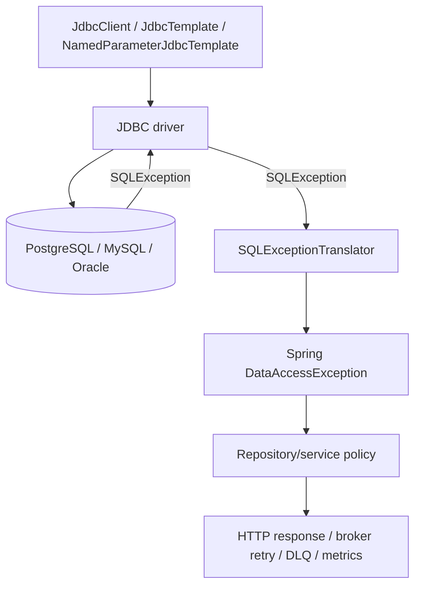
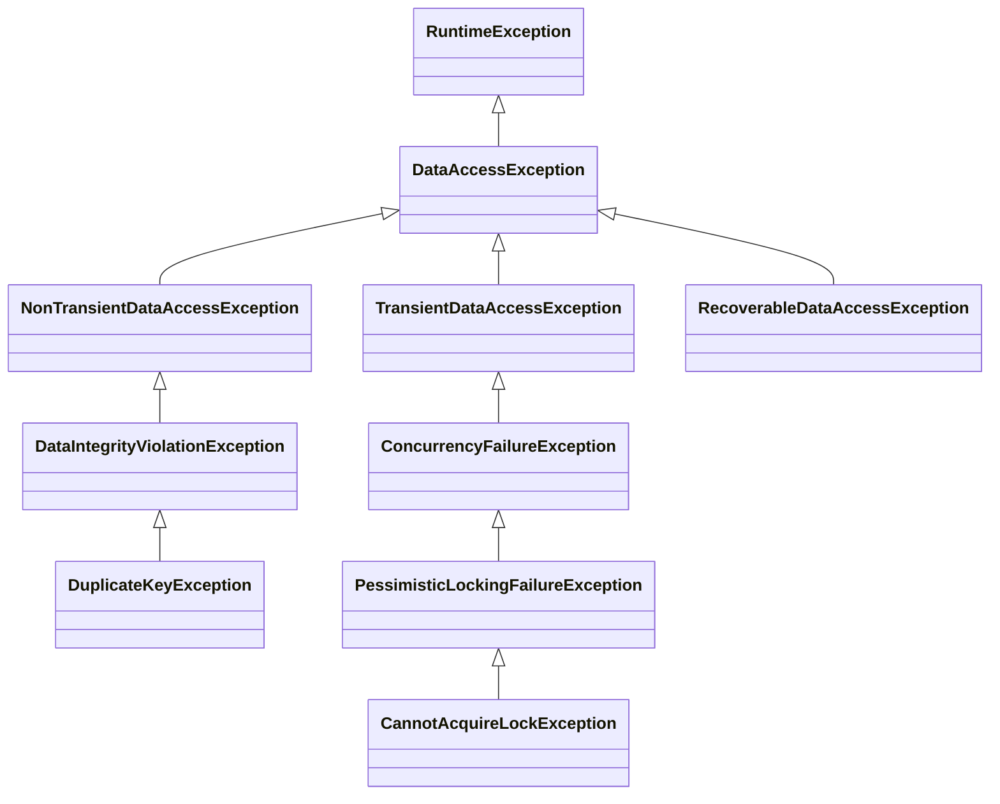
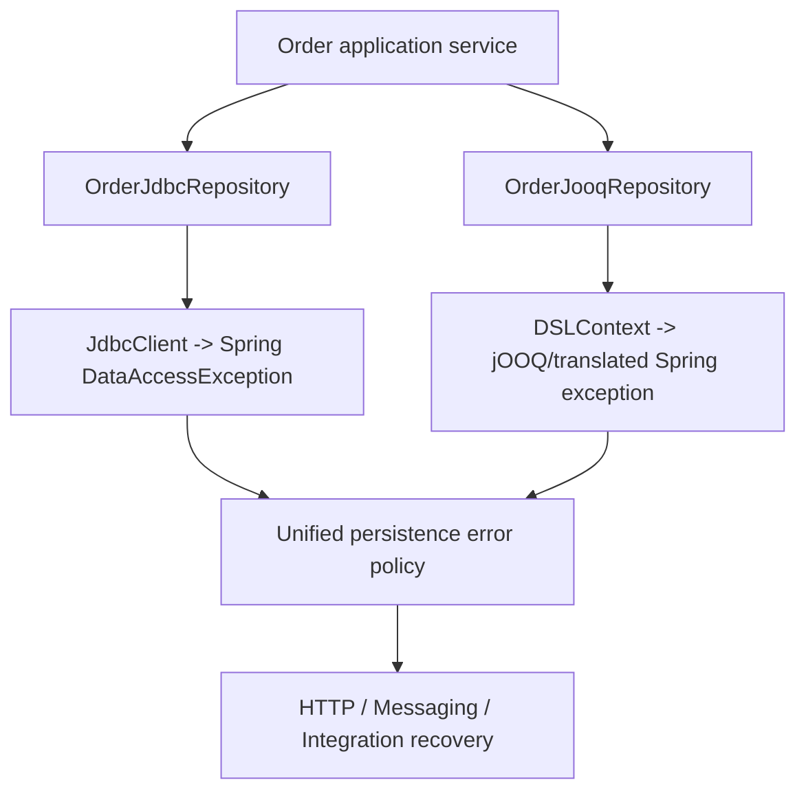
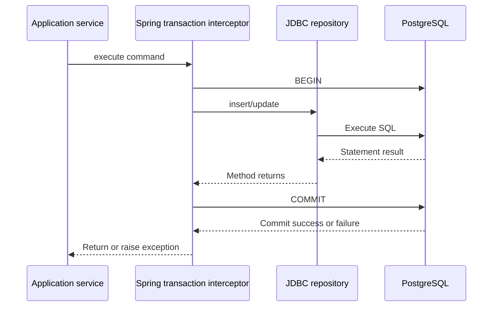
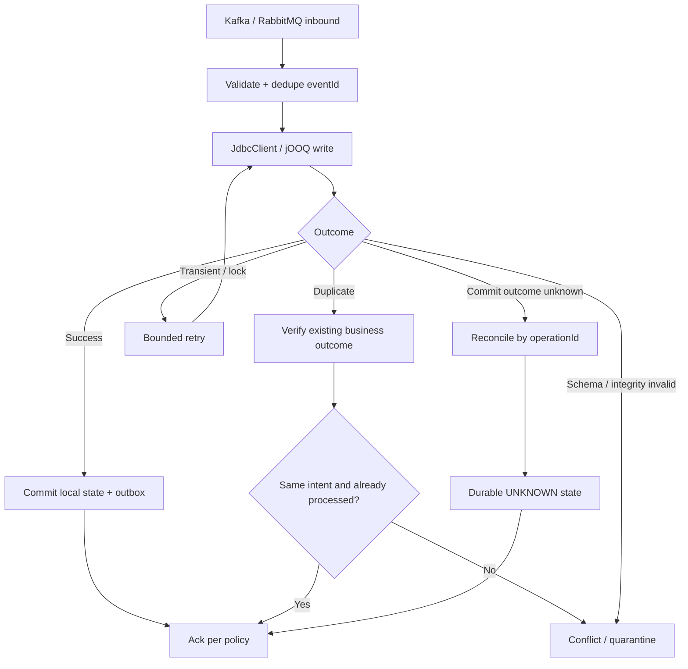

# Translating SQL Exceptions into `DataAccessException`

## 1. Problem: Same SQL Failure, Application Should Not Depend on the Driver

A Spring Boot application may use `JdbcTemplate`, `JdbcClient`, or jOOQ to persist order state in PostgreSQL, query internal systems, update an outbox table, and emit events to Kafka or RabbitMQ. When a query fails, the JDBC driver can throw an `SQLException` carrying an SQLState, a vendor error code, and a vendor-specific message. If every service, HTTP controller, and consumer had to understand PostgreSQL/MySQL error codes, error handling would be **tightly coupled to the database**.

For example, two requests try to create an order with business ID `O-42`. The database rejects the second insert due to a unique constraint. One caller catches `SQLException` and returns HTTP 500, another checks whether the message contains the word "duplicate", and a Kafka consumer retries endlessly. Three different reactions to an error that **cannot be fixed by retrying**.

Spring provides the **`org.springframework.dao.DataAccessException`** hierarchy and **`SQLExceptionTranslator`** implementations to describe errors conceptually: invalid SQL grammar, data integrity violation, failure to obtain a connection, timeout, lock conflict, or uncategorized failure. This is the core of this lesson in the **JDBC and jOOQ** chapter of the **SPRING_BOOT_INTEGRATION** module—covering Spring Boot integration via HTTP clients, databases, caches, message brokers, and Spring Integration adapters; focusing on configuration, data contracts, errors, duplicate handling, testing, and real-world observability.

**Key point:** exception translation helps the application layer handle **more stable error categories**, not decide on its own whether to return `409`, retry a payment, or mark a message processed. Business policy must be decided **after technical error classification**.

After this lesson, you will be able to:

- Distinguish `SQLException`, SQLState, vendor error codes, and `DataAccessException`.
- Understand where Spring JDBC translators are invoked and when manual translation is needed.
- Write repositories with `JdbcTemplate`/`JdbcClient` and handle key subclasses.
- Recognize **two different classes sharing the name `DataAccessException`** in Spring and jOOQ.
- Design safe retries/idempotency, HTTP/broker responses, rollbacks, and reconciliation.
- Test exception mapping against real PostgreSQL rather than mocking Java exceptions alone.
- Observe errors using useful technical signals without leaking SQL parameters or secrets.

## 2. From JDBC Drivers to a Common Error Language

An `SQLException` may carry:

- `getSQLState()`: standardized 5-character SQLSTATE code at the SQL/JDBC level, supplemented by database-specific codes.
- `getErrorCode()`: vendor-specific numeric code, **not consistent** across PostgreSQL, MySQL, Oracle, or SQL Server.
- `getMessage()`: description that can vary by driver, locale, version, and SQL content.
- `getCause()` and `getNextException()`: cause chain or additional exceptions, especially in batches.
- JDBC 4 subclasses such as `SQLIntegrityConstraintViolationException`, `SQLTransientConnectionException`, and `SQLTimeoutException` when raised by the driver.

Spring translates these into an appropriate exception under `org.springframework.dao`:



Do not read this diagram as guaranteeing every `SQLException` always maps to an exact narrow subclass: **classification granularity depends on the driver, exception type, translator, SQLState, vendor code, and framework version**. Without a specific mapping, the application may receive `UncategorizedSQLException` or a broader exception.

### 2.1. Three Benefits of This Abstraction

1. **Reduced vendor coupling:** services catch `DataIntegrityViolationException` rather than knowing PostgreSQL's `23505` or each database's error code.
2. **Unchecked exceptions:** `DataAccessException` is a runtime exception; repositories do not need `throws SQLException` on every method signature.
3. **Uniform handling boundary:** logging, HTTP error mapping, retry classification, and telemetry can center on persistence error categories.

These benefits **do not erase differences** across databases. When distinguishing a specific unique constraint, deadlock, or `JSONB` error, the application still needs to know its SQL/schema contract and run integration tests against the target database.

## 3. Key `DataAccessException` Hierarchy for Design

Spring's hierarchy is broad. The table below highlights the categories you encounter most often:

| Spring Class / Group | Approximate Meaning | Initial Handling Direction |
|---|---|---|
| `DataAccessException` | Unchecked base class for data-access errors. | Technical boundary; do not retry all subclasses. |
| `NonTransientDataAccessException` | Errors that typically do not vanish if retried identically. | Inspect contract, schema, or input data errors. |
| `TransientDataAccessException` | Potentially temporary resource or locking errors. | Consider **conditional** bounded retry within a deadline. |
| `RecoverableDataAccessException` | Potentially recoverable after corrective action, e.g., reconnecting or intervention. | Does not mean blind immediate hot retry. |
| `DataIntegrityViolationException` | Integrity constraint violation (unique, FK, NOT NULL, CHECK). | Classify conflict vs. validation failure by constraint. |
| `DuplicateKeyException` | Specialized case of unique-key violation. | Check idempotency/business key; do not automatically assume success. |
| `BadSqlGrammarException` | Invalid SQL as classified by the translator. | Fix code, query, or migration; generally do not retry. |
| `CannotGetJdbcConnectionException` | Could not acquire a JDBC connection. | Check DB, pool, and network; throttle load. |
| `DataAccessResourceFailureException` | Storage/resource dependency failed. | Check availability, timeouts, and circuit breakers. |
| `CannotAcquireLockException` | Could not acquire a lock during data access. | Bounded retry may help if the operation is safe. |
| `QueryTimeoutException` | Query exceeded timeout threshold where detected. | Inspect SQL, indexes, and load; timeout does not prove no side effect occurred. |
| `UncategorizedSQLException` | `SQLException` with no more specific mapping. | Preserve SQL cause, alert, and classify further. |

**Distinction:** `DuplicateKeyException` extends `DataIntegrityViolationException`. If `catch (DataIntegrityViolationException)` precedes `catch (DuplicateKeyException)` in the same chain, the specialized catch is shadowed and Java will report an unreachable catch block.

Concurrency classes such as `OptimisticLockingFailureException`, `PessimisticLockingFailureException`, and `CannotSerializeTransactionException` represent different failure modes. However, not every failed update comes from `SQLExceptionTranslator`: **zero rows updated** in application-checked optimistic locking is a separate case.

### 3.1. Simplified Class Diagram of Key Branches



This diagram shows **only part** of the exception tree for clarity, not the full API; inspect the hierarchy in your exact Spring Framework version before catching a specific subclass.

## 4. `SQLException`, SQLState, and Vendor Error Codes

SQLState is normally a **5-character** string. The first two characters identify the error class; the last three describe the specific condition. SQLState does not carry all the business context an application needs.

Common PostgreSQL examples:

| SQLState | PostgreSQL Meaning | Possible Spring Exception Group |
|---|---|---|
| `23505` | Unique violation. | `DuplicateKeyException` or `DataIntegrityViolationException`. |
| `23503` | Foreign key violation. | `DataIntegrityViolationException`. |
| `23502` | Not-null violation. | `DataIntegrityViolationException`. |
| `23514` | Check constraint violation. | `DataIntegrityViolationException`. |
| `40001` | Serialization failure. | Concurrency/transient group depending on translator. |
| `40P01` | Deadlock detected. | Lock/concurrency group depending on translator. |
| `55P03` | Lock not available. | Lock-acquisition failure or fallback depending on mapping. |
| `42P01` | Undefined table. | SQL grammar / invalid resource usage group. |
| `08006` | Connection failure. | Resource / connection failure group. |
| `57014` | Query canceled. | Timeout / cancellation or fallback depending on origin. |

This table lists **PostgreSQL codes to explain root causes**, not a guarantee that Spring returns the exact same subclass for every SQLState. Translation also depends on vendor error codes, JDBC subclasses, translator fallbacks, and whether the exception carries an SQLState at all.

### 4.1. SQLState Class Prefixes

- `23`: integrity constraint violation.
- `08`: connection exception.
- `40`: transaction rollback.
- `42`: syntax error or access rule violation.

On SQL Server, Oracle, or MySQL, vendor error codes and `SQLException` subclasses may provide better classification signals for specific conditions. **Never hardcode `23505` inside business services** if data abstraction is your goal; keep vendor-specific logic in adapters/translators and test against the real database.

### 4.2. Never Parse `getMessage()` Strings to Make Decisions

Anti-pattern:

```java
catch (SQLException ex) {
    if (ex.getMessage().contains("duplicate key")) {
        return "already processed";
    }
    throw ex;
}
```

Messages can change, be localized, or include table names and data. Rely instead on translated subclasses, structured constraint metadata when truly needed, and schema-enforced **unique business keys**. SQLState and vendor codes aid diagnosis and translation rather than replacing business policy.

## 5. Why Does Spring Have Multiple `SQLExceptionTranslator` Implementations?

Spring JDBC defines the interface:

```java
package org.springframework.jdbc.support;

public interface SQLExceptionTranslator {
    org.springframework.dao.DataAccessException translate(
        String task, String sql, java.sql.SQLException ex);
}
```

This shows the **conceptual signature**, not code to copy into a project. A translator returns a specific `DataAccessException` **or `null` if it cannot classify the error**, so callers normally wire a fallback.

Key implementations:

| Translator | Primary Signal | Typical Use Case |
|---|---|---|
| `SQLExceptionSubclassTranslator` | JDBC 4 `SQLException` subclasses, with fallbacks when needed. | Driver throws standard typed subclasses reliably. |
| `SQLStateSQLExceptionTranslator` | `SQLException` SQLState. | Meaningful SQLStates with minimal reliance on vendor codes. |
| `SQLErrorCodeSQLExceptionTranslator` | Vendor error-code lookup tables with fallback. | Finer vendor error recognition when `DataSource`/database product metadata is available. |
| Custom `SQLExceptionTranslator` | Custom rules using SQLState, vendor code, and context. | Defaults miss an important application-specific case. |

In Spring Framework 6.x, default translator selection depends on error-code definitions and `JdbcAccessor`/`JdbcTemplate` configuration; never assume **every version** defaults to a single fixed class. Always inspect **which translator your Spring JDBC components actually use**, and verify with integration tests.

### 5.1. Fallback Chaining Matters

A vendor-code translator might not recognize a particular code, falling back to JDBC subclasses or SQLState before ultimately returning a broader category. Consequently:

- Receiving `UncategorizedSQLException` is not necessarily a Spring bug; the driver may omit metadata or lack a mapping.
- Upgrading driver or library versions can alter the exact subclass produced for the same error.
- Business services should catch **sufficiently broad groups**, relying on very narrow subclasses only when tested against the target setup.

## 6. `JdbcTemplate` Translates Errors at the SQL Execution Boundary

`JdbcTemplate` catches `SQLException` inside JDBC execution and translates it into `DataAccessException` via its translator. Repositories calling `JdbcTemplate` do not need `catch (SQLException)` around every query.

Domain example:

```java
public record OrderCommand(
        String orderId, String customerId, String status) {}

public record OrderRow(
        String orderId, String customerId,
        String status, long version) {}
```

Repository:

```java
import org.springframework.jdbc.core.JdbcTemplate;
import org.springframework.stereotype.Repository;

@Repository
public class OrderJdbcRepository {
    private final JdbcTemplate jdbc;

    public OrderJdbcRepository(JdbcTemplate jdbc) {
        this.jdbc = jdbc;
    }

    public int insert(OrderCommand command) {
        return jdbc.update("""
            INSERT INTO orders(order_id, customer_id, status, version)
            VALUES (?, ?, ?, 0)
            """,
            command.orderId(),
            command.customerId(),
            command.status());
    }

    public OrderRow findById(String id) {
        return jdbc.queryForObject("""
            SELECT order_id, customer_id, status, version
            FROM orders
            WHERE order_id = ?
            """,
            (rs, rowNum) -> new OrderRow(
                rs.getString("order_id"),
                rs.getString("customer_id"),
                rs.getString("status"),
                rs.getLong("version")),
            id);
    }
}
```

Assuming the database has the `orders` table (created by Flyway/Liquibase) and Spring Boot configured `DataSource` and `JdbcTemplate`, a unique-constraint violation on insert throws `DataIntegrityViolationException` or a subclass like `DuplicateKeyException` without checked `SQLException` handling.

### 6.1. JDBC Failures vs. Result-Cardinality Failures

`findById` using `queryForObject` expects one row. When zero rows match, Spring throws `EmptyResultDataAccessException` (a subclass of `IncorrectResultSizeDataAccessException`). **This is not an SQLSTATE error rejected by the DB**; it reflects the JDBC API's cardinality contract.

Never lump all `DataAccessException`s together as "DB down." `EmptyResultDataAccessException` on lookup may map to `Optional.empty()`, whereas `CannotGetJdbcConnectionException` demands resource/availability handling.

Safer example when "not found" is normal:

```java
public java.util.Optional<OrderRow> findOptional(String id) {
    var rows = jdbc.query("""
        SELECT order_id, customer_id, status, version
        FROM orders WHERE order_id = ?
        """,
        (rs, rowNum) -> new OrderRow(
            rs.getString("order_id"),
            rs.getString("customer_id"),
            rs.getString("status"),
            rs.getLong("version")),
        id);

    return rows.stream().findFirst();
}
```

This assumes `order_id` has a unique constraint; otherwise picking the first row could mask duplicate data. Querying a list avoids using exceptions for normal **not-found** control flow.

## 7. `JdbcClient` and `NamedParameterJdbcTemplate` Inherit Translation

Since Spring Framework 6.1+, `JdbcClient` offers a fluent API built on Spring JDBC infrastructure. When your Spring Boot version auto-configures `JdbcClient`, inject it into repositories:

```java
import org.springframework.jdbc.core.simple.JdbcClient;
import org.springframework.stereotype.Repository;

@Repository
public class OrderJdbcClientRepository {
    private final JdbcClient jdbc;

    public OrderJdbcClientRepository(JdbcClient jdbc) {
        this.jdbc = jdbc;
    }

    public int insert(OrderCommand command) {
        return jdbc.sql("""
                INSERT INTO orders(order_id, customer_id, status, version)
                VALUES (:orderId, :customerId, :status, 0)
                """)
            .param("orderId", command.orderId())
            .param("customerId", command.customerId())
            .param("status", command.status())
            .update();
    }

    public java.util.Optional<String> findStatus(String orderId) {
        return jdbc.sql("""
                SELECT status FROM orders WHERE order_id = :id
                """)
            .param("id", orderId)
            .query(String.class)
            .optional();
    }
}
```

JDBC errors from `JdbcClient`/`NamedParameterJdbcTemplate` flow through the underlying `JdbcTemplate` infrastructure and are translated into `DataAccessException`. You do not need a separate translator just because a repository adopts the fluent API.

**Note:** switching APIs does not alter transaction isolation, SQL schemas, driver behavior, or error code meanings. Moving from a single-row query to `optional()` changes **missing-row semantics**, not exception translation.

### 7.1. Repository-to-Service Contracts

Repositories should express operations in data-layer terms:

- `insertOrder(...)`: unique-constraint violation surfaces as a persistence failure.
- `findOrderById(...)`: valid absence returns `Optional.empty()`.
- `updateStatusIfVersionMatches(...)`: returns affected row count so the service evaluates optimistic concurrency.
- `recordConsumedEvent(...)`: uses a unique business key for idempotency.

Avoid forcing repositories to return booleans ("succeeded or failed") for all failures; losing deadlock, pool exhaustion, and schema-mismatch distinctions makes recovery unsafe.

## 8. When Using Raw JDBC: Translate at the Adapter Layer

If code invokes `Connection.prepareStatement(...)` directly, the JDBC driver still throws raw `SQLException`. `@Repository` **does not automatically turn raw `SQLException`s into `DataAccessException`**. You can invoke Spring's `SQLExceptionTranslator` explicitly.

Raw JDBC example managing connections compatibly with Spring transactions:

```java
import java.sql.Connection;
import java.sql.PreparedStatement;
import java.sql.SQLException;
import javax.sql.DataSource;

import org.springframework.dao.DataAccessException;
import org.springframework.jdbc.UncategorizedSQLException;
import org.springframework.jdbc.datasource.DataSourceUtils;
import org.springframework.jdbc.support.SQLErrorCodeSQLExceptionTranslator;
import org.springframework.jdbc.support.SQLExceptionTranslator;
import org.springframework.stereotype.Repository;

@Repository
public class RawOrderJdbcGateway {

    private final DataSource dataSource;
    private final SQLExceptionTranslator translator;

    public RawOrderJdbcGateway(DataSource dataSource) {
        this.dataSource = dataSource;
        this.translator =
                new SQLErrorCodeSQLExceptionTranslator(dataSource);
    }

    public void insert(String orderId, String status) {
        String sql = """
            INSERT INTO orders(order_id, customer_id, status, version)
            VALUES (?, 'unknown', ?, 0)
            """;

        Connection connection = DataSourceUtils.getConnection(dataSource);

        try (PreparedStatement ps = connection.prepareStatement(sql)) {
            ps.setString(1, orderId);
            ps.setString(2, status);
            ps.executeUpdate();
        } catch (SQLException ex) {
            DataAccessException mapped =
                    translator.translate("insert order", sql, ex);

            throw mapped != null
                    ? mapped
                    : new UncategorizedSQLException("insert order", sql, ex);
        } finally {
            DataSourceUtils.releaseConnection(connection, dataSource);
        }
    }
}
```

This is an **example of the translation mechanism**: `customer_id='unknown'` only keeps the snippet short, not a business recommendation; real schemas must match your contract. `DataSourceUtils` acquires and releases connections according to Spring transaction synchronization. Never write `try (Connection connection = dataSource.getConnection())` assuming it automatically joins Spring-managed transactions.

Where Spring templates fit, **prefer `JdbcTemplate`/`JdbcClient`** over hand-rolling connection and translation boilerplate. Drop to raw JDBC only for specific needs like vendor driver APIs.

### 8.1. Failures That Do Not Originate as `SQLException`

`DataSourceUtils.getConnection(...)` itself can throw `DataAccessException` if obtaining a connection fails. Java bugs like `NullPointerException`, DTO binding errors, or service contract errors must never be "translated into SQL errors" by catching `Exception` and masquerading them as `BadSqlGrammarException`.

A translator handles `SQLException`, not arbitrary application exceptions.

## 9. `@Repository` and `PersistenceExceptionTranslationPostProcessor`: Understanding the Limits

Spring provides exception translation for persistence beans such as Hibernate/JPA repositories or technologies with a matching `PersistenceExceptionTranslator`. `@Repository` is a stereotype marker enabling post-processors to discover those beans in the context.

Two distinct mechanisms apply:

1. **`JdbcTemplate`/`JdbcClient` translate `SQLException` during SQL execution.** That happens inside Spring JDBC regardless of whether you catch `SQLException` yourself.
2. **Proxy-boundary exception translation** on `@Repository` beans can translate native runtime exceptions thrown by a provider **when a translator is registered and the proxy intercepts the call**.

Never assume merely putting `@Repository` on a handwritten JDBC class translates all checked SQL exceptions or arbitrary Java exceptions automatically. Verify by triggering **real failures** through the Spring proxy bean and asserting the exception type rather than staring at annotations.

### 9.1. Self-Invocation and Swallowed Errors

If DAO code catches and returns `null`:

```java
try {
    return executeJdbc();
} catch (SQLException ex) {
    return null; // Anti-pattern: loses the error category and breaks proper retry/alerting.
}
```

no outer translator can see the cause. Likewise, internal calls within the same class bypass repository proxy advice. To eliminate ambiguity, use Spring JDBC templates for SQL execution and translate errors **right at the data-access boundary**.

## 10. jOOQ Has a Different `DataAccessException` Than Spring

This is the single biggest source of confusion in the **JDBC and jOOQ** chapter:

| Ecosystem | Class | Meaning |
|---|---|---|
| Spring | `org.springframework.dao.DataAccessException` | Base runtime exception for Spring data access. |
| jOOQ | `org.jooq.exception.DataAccessException` | Runtime exception thrown by jOOQ when a jOOQ operation fails. |
| JDBC | `java.sql.SQLException` | Checked exception of the JDBC/driver API. |

These two `DataAccessException` types **are completely separate classes and must not be confused in imports**. Java cannot import two classes with the same simple name in one file; use fully qualified class names whenever distinguishing both.

```java
// Spring:
org.springframework.dao.DataAccessException springFailure;

// jOOQ:
org.jooq.exception.DataAccessException jooqFailure;
```

This snippet merely contrasts class names, not runnable logic. A `catch (org.springframework.dao.DataAccessException ex)` block **will not catch** an untranslated `org.jooq.exception.DataAccessException`.

### 10.1. jOOQ Does Not Inherently Run Through Spring JDBC's Translator

jOOQ uses `DSLContext`, `org.jooq.Configuration`, and its own execute listeners. Outside **Spring Boot auto-configuration**, JDBC exceptions are typically wrapped by jOOQ into jOOQ exceptions. Under **Spring Boot auto-configuration** with the translation execute listener registered, SQL errors may be translated into `org.springframework.dao` exceptions.

The key is neither "jOOQ always throws Spring exceptions" nor "jOOQ never throws Spring exceptions," but **checking how `DSLContext`/`Configuration` was constructed and which listeners are registered**.

## 11. Spring Boot + jOOQ: Inspect How `DSLContext` Is Created

A compatible Boot 3.x project can declare:

```kotlin
dependencies {
    implementation("org.springframework.boot:spring-boot-starter-jooq")
    runtimeOnly("org.postgresql:postgresql")
}
```

Simple repository using jOOQ bind parameters instead of concatenating SQL strings:

```java
import org.jooq.DSLContext;
import org.springframework.stereotype.Repository;

@Repository
public class OrderJooqRepository {

    private final DSLContext dsl;

    public OrderJooqRepository(DSLContext dsl) {
        this.dsl = dsl;
    }

    public int insert(String orderId, String customerId) {
        return dsl.execute("""
            INSERT INTO orders(order_id, customer_id, status, version)
            VALUES (?, ?, 'NEW', 0)
            """,
            orderId, customerId);
    }
}
```

This runs when the `orders` schema exists and `DSLContext` is configured by Boot or the application. When Boot auto-configuration owns `DSLContext` and registers the exception-translation listener for that Boot version, SQL failures in jOOQ surface as Spring `DataAccessException`s. If the application builds its own context:

```java
DSLContext custom = org.jooq.impl.DSL.using(
        jdbcConnection, org.jooq.SQLDialect.POSTGRES);
```

then **never assume** it shares Boot's listeners or transaction integration. A manually created `DSLContext` may bypass exception translators, connection providers, transaction providers, and observability wiring.

### 11.1. Verify Instead of Guessing

In any jOOQ application, check:

1. Who creates `DSLContext`: Spring Boot auto-configuration or a custom factory?
2. Does `Configuration` include an exception-translating `ExecuteListenerProvider`?
3. At the repository boundary, is a duplicate-key error actually **Spring's** or **jOOQ's** exception?
4. Are SQLState, vendor code, and root `SQLException` preserved in the cause chain?
5. Does `@Transactional` use the same `DataSource` and Spring transaction manager?
6. After upgrading the driver, jOOQ, or Boot, do integration tests still catch the expected exception types?

Never hardcode catching a Spring exception class in a service if a custom jOOQ path throws untranslated jOOQ exceptions. Normalize **at the adapter boundary** before business logic branches on errors.

### 11.2. Should You Register a Translation Listener Manually?

Not necessarily. When Boot manages jOOQ properly, you generally want to keep Boot's built-in exception translation wiring. If you customize `org.jooq.Configuration`, verify it preserves or registers the corresponding listener. Simply adding `@Repository` does not prove jOOQ exceptions are translated.

If writing a custom listener/adapter, recognize that jOOQ exceptions can represent jOOQ logic/configuration errors **without any underlying `SQLException`**. Translate to Spring SQL exceptions only when an SQL cause exists; never force every jOOQ exception into `DuplicateKeyException` or `TransientDataAccessException`.

## 12. Enforcing a Consistent Exception Boundary Between JDBC and jOOQ

One service may use both `JdbcClient` and jOOQ:



If the application exposes Spring `DataAccessException` at repository boundaries, make sure every adapter upholds that contract. Two practical ways:

- **Prefer Spring Boot-managed integration** for `JdbcClient` and jOOQ, keeping Boot's translators/listeners active where supported.
- **Write explicit adapter wrappers** around custom jOOQ paths, inspecting and translating JDBC causes per policy while keeping non-SQL failures distinct or mapping them to accurately named adapter exceptions.

API controllers should never catch both `org.jooq.exception.DataAccessException` and Spring `DataAccessException` to guess which library ran—that indicates an unnormalized data-access boundary.

### 12.1. Preserving Causes and Safe Messages

When wrapping exceptions:

- Preserve the original `cause` for SQLState/vendor-code diagnostics.
- Log operation name and dependency, never full SQL bind values or PII.
- Avoid generic wrappers like "Internal server error" that discard root causes.
- Never leak raw database server messages in HTTP responses to end users.

`DataAccessException` is not a business DTO. APIs should map classified error codes to stable public response structures.

## 13. When Default Mapping Falls Short: Custom Translators

Suppose on a specific database or driver, a lock contention error carries a vendor code/SQLState that the default translator fails to recognize cleanly. You can configure a policy-driven `SQLExceptionTranslator`, usually attached to the relevant `JdbcTemplate`/DAO or wrapper.

Example showing targeted customization for **PostgreSQL**:

```java
import javax.sql.DataSource;
import org.springframework.dao.CannotAcquireLockException;
import org.springframework.jdbc.support.SQLErrorCodeSQLExceptionTranslator;
import org.springframework.jdbc.support.SQLExceptionTranslator;

public final class SqlTranslationPolicy {

    public static SQLExceptionTranslator postgres(DataSource source) {
        SQLErrorCodeSQLExceptionTranslator translator =
                new SQLErrorCodeSQLExceptionTranslator(source);

        translator.setCustomTranslator((task, sql, exception) -> {
            if ("55P03".equals(exception.getSQLState())) {
                return new CannotAcquireLockException(
                        "Cannot acquire PostgreSQL lock during " + task,
                        exception);
            }
            return null; // Let the translator fall back to its built-in policy.
        });

        return translator;
    }
}
```

This is a **narrow mapping** example, not a prescription to customize every system. `55P03` is PostgreSQL-specific; switching databases means updating or removing that rule. Verify `setCustomTranslator` or extension hooks on your Spring version and test with real exceptions.

Never attach a custom translator to a test-only `JdbcTemplate` and assume jOOQ or all production repositories inherit it. Customizations must be wired into the **actual production data-access path**. When replacing a Spring Boot auto-configured template, preserve transaction wiring, settings, observability, and binding behavior.

### 13.1. When Is Custom Mapping Justified?

Consider it when:

- A vendor error surfaces as `UncategorizedSQLException`, yet system policy needs to distinguish lock contention.
- A driver version exposes metadata quirks the default translator does not parse.
- A critical constraint/domain error must be classified at the adapter layer to avoid string parsing in services.

Never customize translation to turn every `DataIntegrityViolationException` into `DuplicateKeyException`: not every integrity violation is a duplicate key, and conflating them misleads APIs and consumers.

## 14. Exception Details Worth Preserving for Diagnostics

Whether Spring translated the error or not, `Throwable.getCause()` may contain an `SQLException` or driver wrapper. In batches, `BatchUpdateException` may also expose `getUpdateCounts()` and `getNextException()` showing which statements succeeded or failed.

Diagnostic-only helper for internal logging:

```java
import java.sql.SQLException;
import org.springframework.dao.DataAccessException;

static SQLException findSqlCause(DataAccessException failure) {
    Throwable cursor = failure;
    while (cursor != null) {
        if (cursor instanceof SQLException sql) {
            return sql;
        }
        cursor = cursor.getCause();
    }
    return null;
}
```

This walks `cause` only, not `SQLException.getNextException()`, and does not cover arbitrary exception graphs. For batch diagnostics, traverse chained exceptions with bounded depth, cycle guards, and no sensitive payload logging.

### 14.1. What to Log vs. What to Exclude

| Keep | Avoid |
|---|---|
| `operation=insert-order`, `repository=orders`, dependency, exception class. | Full SQL containing literals with PII or tokens. |
| SQLState and vendor error code when present. | Raw request bodies or sensitive payment references. |
| Vetted constraint identifier, if helpful. | Raw database server error messages returned to users. |
| Transaction/attempt count, duration, pool saturation. | Order IDs or customer IDs as metric tags. |
| Correlation ID in access-controlled logs/traces. | Passwords, JDBC URLs with credentials, or secret query params. |

A log line like "SQL failed: `INSERT INTO users VALUES ('email@example.com', ...)`" leaks sensitive data. Avoid concatenating inputs into SQL from the start; always use bind parameters.

## 15. `DuplicateKeyException` Is Not a Command to "Treat as Success"

In a consumer reprocessing an `OrderPaid` event, a unique key `(consumer_name, event_id)` supports idempotency. Yet a `DuplicateKeyException` could stem from:

- The same event ID already processed earlier.
- A colliding business key `order_id` with a **different payload**.
- Another unique constraint on external reference or email.
- Two workers racing on insert where one has not yet completed the business effect.

**Never blindly catch `DuplicateKeyException` and ack the message.** Verify **which constraint fired** and confirm whether the existing record matches the same business intent, payload hash, state, and side effects.

Schema example:

```sql
CREATE TABLE consumed_events (
    consumer_name VARCHAR(80) NOT NULL,
    event_id VARCHAR(100) NOT NULL,
    payload_hash VARCHAR(64) NOT NULL,
    processed_at TIMESTAMPTZ NOT NULL DEFAULT now(),
    PRIMARY KEY (consumer_name, event_id)
);
```

Explicit PostgreSQL idempotency check:

```java
int inserted = jdbc.sql("""
        INSERT INTO consumed_events(
            consumer_name, event_id, payload_hash)
        VALUES (:consumer, :eventId, :hash)
        ON CONFLICT (consumer_name, event_id) DO NOTHING
        """)
    .param("consumer", consumerName)
    .param("eventId", eventId)
    .param("hash", payloadHash)
    .update();

if (inserted == 0) {
    // Re-read the record by key to compare hash and outcome;
    // do not assume duplicate means already succeeded.
}
```

This assumes `jdbc` is `JdbcClient`. `ON CONFLICT` is PostgreSQL syntax, not portable across every vendor. When relying on this SQL, the unique constraint is **part of the business contract and migrations** and must be tested on real PostgreSQL.

### 15.1. Inserting the Marker Before the Business Update

If you insert the `consumed_events` marker and commit before updating the order, the process could crash mid-flight; redelivery then sees the marker and skips incomplete work. Persist the marker and business update in **the same transaction** when they share a datasource, or use an explicit state machine/inbox (`PROCESSING`/`SUCCEEDED`) with recovery.

Exception translation only identifies duplicates; **the commit boundary** determines whether idempotency is actually safe.

## 16. `DataIntegrityViolationException` and HTTP API Contracts

Never expose raw exception classes or SQLSTATE codes to external callers. The HTTP layer maps persistence categories into stable API error codes based on context:

| Business Scenario | Possible Persistence Error | Appropriate HTTP Mapping |
|---|---|---|
| Creating a resource with an existing business ID. | `DuplicateKeyException` or integrity violation. | `409 Conflict` with a stable error code. |
| Referenced `customer_id` foreign key missing. | `DataIntegrityViolationException`. | `400`/`422` if invalid input per contract; possibly `409` on state race. |
| DB or network unavailable. | `CannotGetJdbcConnectionException` / resource failure. | `503 Service Unavailable` where appropriate. |
| Broken SQL schema or migration. | `BadSqlGrammarException` or invalid resource usage. | `500` and alert developers/operators. |
| Optimistic version mismatch. | 0 rows updated or adapter concurrency exception. | `409 Conflict` / `412 Precondition Failed` per HTTP contract. |
| Lookup finds no record. | `Optional.empty()` or `EmptyResultDataAccessException`. | `404` when querying a resource. |

No universal lookup table turns "every `DataAccessException` into HTTP 409." A unique violation on an internal **outbox** table differs completely from a client creating a duplicate resource; context and constraint identity decide the response.

An application/gateway layer should translate technical database failures into domain exceptions:

```java
public record ApiError(String code, String message) {}
```

```java
public class OrderAlreadyExistsException extends RuntimeException {
    public OrderAlreadyExistsException(String orderId, Throwable cause) {
        super("Order already exists: " + orderId, cause);
    }
}
```

Public responses should use vetted public messages rather than raw exception `getMessage()` strings that may contain internal IDs. Avoid repeating `DuplicateKeyException` catches in every controller when translation belongs closer to the service or gateway semantics.

## 17. Transient Does Not Mean Every Write Is Safe to Retry

A seemingly temporary error such as a connection reset or query timeout tempts applications to retry. Yet on **writes**, the client may not know whether the database already committed before the response/connection dropped.

For example:

```text
Consumer receives event E42
  -> INSERT outbox / UPDATE order
  -> database commit succeeds
  -> network fails before client receives response
  -> caller observes connection failure
  -> retries INSERT with a new key
  -> duplicate business effect
```

Therefore, retries require **both conditions**:

1. The error is likely transient (based on exception, SQLState, and context).
2. **The operation is safe to repeat** via known transaction rollback, idempotent keys, unique constraints, CAS/version checks, or reconciliation.

### 17.1. Different Handling Across Error Groups

| Group | Retry? | Conditions |
|---|---|---|
| `DuplicateKeyException` | Usually no. | Verify the duplicate shares the same business intent rather than data corruption. |
| `BadSqlGrammarException` | Never hot-retry. | Fix query, migration, or permissions; deploy or roll back. |
| `CannotAcquireLockException` | Bounded retry possible. | Previous attempt rolled back; use backoff/jitter, deadline, and idempotency. |
| `QueryTimeoutException` on read-only query | Possible per SLO. | Check DB load and query plan; avoid retry storms. |
| Connection failure during write/commit | Carefully—outcome may be `UNKNOWN`. | Look up status by business key before re-issuing. |
| `UncategorizedSQLException` | Do not auto-retry. | Inspect metadata/root cause and add rules/tests. |

**`TransientDataAccessException` is a technical hint, not an unlimited retry license.** Integration stacks also include HTTP client retries, Spring Integration advice, and broker redeliveries; if each layer retries three times, total attempts multiply unexpectedly.

### 17.2. Enforce an Overall Retry Budget

Design policies specifying:

- Maximum attempts, including the initial attempt.
- Exponential backoff, jitter, and per-dependency quotas.
- Remaining time budget against the request/business deadline.
- Retry ownership at **one layer** to avoid nested multiplication.
- Stable unique `operationId` and `eventId`.
- Explicit states: `RETRY_WAIT`, `FAILED_FINAL`, `UNKNOWN`, and `SUCCEEDED`.
- Recovery/DLQ/inbox workflows with clear replay ownership.

Never hold database transactions or connections open just to sleep during backoff in an outage; use durable retry queues or job tables when delays are long.

## 18. Transaction Boundaries and When Errors Surface

`DataAccessException` surfaces when `JdbcTemplate`/jOOQ invokes JDBC, yet **commit can happen after the repository method returns**. When Spring `@Transactional` wraps a service, commit-time exceptions are thrown when the transaction interceptor finishes—outside any repository `try/catch`.



In practice, proxy/caller wiring can vary from this simplified diagram; the key insight is that **statement execution is not the only failure point**. Deferred constraints can fail at commit time, and dropping the network during commit creates an uncertain outcome.

### 18.1. Spring Transaction Rollback

Spring's `@Transactional` rolls back by default when an unchecked runtime exception or `Error` escapes the transactional method, and `DataAccessException` is unchecked. Keep these nuances in mind:

- Catching the exception **inside the method** and returning normally can cause Spring to commit unless the transaction is marked rollback-only.
- Joining an outer transaction that is marked `rollback-only` triggers `UnexpectedRollbackException` later.
- Deferred DB constraints or commit-time network drops appear outside the repository call.
- Rolling back a JDBC transaction never rolls back external HTTP/SOAP side effects or Kafka publishes.

When a service must update the DB and publish an event, use a **transactional outbox** to commit the publish intent atomically. Never assume exception translation provides distributed transactions.

### 18.2. Batch Errors and Partial Success

In JDBC batches, `BatchUpdateException` may carry update counts for statements completed prior to the failure. Depending on autocommit/transaction mode, partial effects might already exist. **Never retry an entire batch with fresh business IDs** before checking transaction boundaries and committed state.

For safe repeatable batches, enforce unique keys, chunk boundaries, and explicit per-item status. Under Spring Batch, retry/skip policies interact with job repositories and chunk transactions; never blindly skip all `DataIntegrityViolationException`s or corrupt records will vanish silently.

## 19. Optimistic Locking: Not Every Conflict Throws `SQLException`

Consider a conditional update:

```sql
UPDATE orders
SET status = :status,
    version = version + 1
WHERE order_id = :id
  AND version = :expected_version;
```

If another worker modified the row first, the SQL executes **without any error** and returns `0 rows updated`. There is no SQLSTATE or `SQLException` to translate!

Explicit check:

```java
int updated = jdbc.sql("""
        UPDATE orders
        SET status = :status, version = version + 1
        WHERE order_id = :id AND version = :version
        """)
    .param("status", newStatus)
    .param("id", orderId)
    .param("version", expectedVersion)
    .update();

if (updated == 0) {
    throw new org.springframework.dao.OptimisticLockingFailureException(
            "Order version changed");
}
```

Here the application **explicitly throws a Spring concurrency exception** to signal a contract conflict; `SQLExceptionTranslator` did not produce it. If `updated > 1`, the schema lacks a unique key or the query is wrong—treat that as an invariant violation.

**Do not look for an SQLState to handle conflicts that produce no SQL error.** That misses the real signal in row counts and business versions.

## 20. Integrating with Kafka/RabbitMQ and Spring Integration

A consumer may invoke a repository, receive a `DataAccessException`, and decide how to acknowledge:



This diagram illustrates **a decision architecture**, not something a listener container executes automatically. You must configure transactions, ack modes, and error handlers on your Kafka/RabbitMQ adapters and Spring Integration flows.

### 20.1. Acknowledge Only After Durable Persistence

- If DB updates/outbox commit before Kafka offset commit, the event may redeliver; idempotency handles it.
- Acking before DB commit risks **losing work** on crash.
- If an exception routes to an in-memory error channel whose recovery callback returns normally, the container may ack even without a durable failure record.
- On duplicates, verify matching business intent before acking rather than relying blindly on `DuplicateKeyException`.

### 20.2. Keep Retry Ownership at One Layer

Spring Integration has `RequestHandlerRetryAdvice`; Kafka/RabbitMQ containers have error handlers, delayed retries, and DLT/DLQ routing. Pick one primary retry owner to avoid multiplying database calls. Transient `DataAccessException`s may be retried **when safe**, while schema/contract corruption should go to quarantine with alerts.

### 20.3. Caches Do Not Fix Source-of-Truth Errors

If orders are cached in Redis, a `DataIntegrityViolationException` from PostgreSQL still demands write-path handling. Never serve a cache hit as if the DB write succeeded. Conversely, if DB commit succeeds but Redis invalidation fails, that is **a separate consistency issue**—not something translatable into a duplicate key.

## 21. Unit Testing `SQLExceptionTranslator`

You can unit-test translation without booting a database by constructing an `SQLException` with an explicit SQLState:

```java
import java.sql.SQLException;
import org.junit.jupiter.api.Test;
import org.springframework.dao.DataIntegrityViolationException;
import org.springframework.dao.DataAccessException;
import org.springframework.jdbc.support.SQLStateSQLExceptionTranslator;

import static org.junit.jupiter.api.Assertions.assertInstanceOf;

class SqlStateTranslatorTest {

    @Test
    void integrityClassBecomesSpringDataAccessFailure() {
        SQLException sql = new SQLException(
                "synthetic unique violation", "23505", 0);

        DataAccessException translated =
                new SQLStateSQLExceptionTranslator()
                        .translate("insert event",
                                   "INSERT INTO consumed_events ...",
                                   sql);

        assertInstanceOf(
                DataIntegrityViolationException.class, translated);
    }
}
```

This verifies **a specific translator invoked directly** with SQLState `23505`; it does not prove the real PostgreSQL driver emits that exact exception or that production `JdbcTemplate`/jOOQ uses that translator.

Never assert exact driver message strings, as they vary across versions. If testing for `DuplicateKeyException`, verify your production translator, driver, and version map that finely; when business logic only needs integrity violation grouping, asserting the superclass is less brittle.

### 21.1. Testing When a Custom Translator Returns `null`

If you write a custom translator handling only specific SQLStates, test the **fallback** path when rules do not match. Guard against `NullPointerException` when calling `SQLExceptionTranslator.translate(...)` manually and receiving `null`. Standard Spring JDBC templates handle fallbacks automatically.

## 22. Integration Testing with PostgreSQL and Testcontainers

To verify the full path **driver → Spring JDBC → repository → service**, run real PostgreSQL via Testcontainers. Dependencies compatible with Spring Boot `@ServiceConnection`:

```kotlin
dependencies {
    implementation("org.springframework.boot:spring-boot-starter-jdbc")
    runtimeOnly("org.postgresql:postgresql")

    testImplementation("org.springframework.boot:spring-boot-starter-test")
    testImplementation("org.springframework.boot:spring-boot-testcontainers")
    testImplementation("org.testcontainers:junit-jupiter")
    testImplementation("org.testcontainers:postgresql")
}
```

Test assuming application migrations create the `orders` table with a unique key on `order_id`:

```java
import java.util.UUID;
import org.junit.jupiter.api.Test;
import org.springframework.beans.factory.annotation.Autowired;
import org.springframework.boot.test.context.SpringBootTest;
import org.springframework.boot.testcontainers.service.connection.ServiceConnection;
import org.springframework.dao.DataIntegrityViolationException;
import org.springframework.jdbc.core.JdbcTemplate;
import org.testcontainers.containers.PostgreSQLContainer;
import org.testcontainers.junit.jupiter.Container;
import org.testcontainers.junit.jupiter.Testcontainers;

import static org.junit.jupiter.api.Assertions.assertThrows;

@SpringBootTest
@Testcontainers
class JdbcSqlExceptionTranslationIT {

    @Container
    @ServiceConnection
    static PostgreSQLContainer<?> postgres =
            new PostgreSQLContainer<>("postgres:16-alpine");

    @Autowired
    JdbcTemplate jdbc;

    @Test
    void duplicateOrderIdIsIntegrityFailure() {
        String id = "it-" + UUID.randomUUID();

        jdbc.update("""
            INSERT INTO orders(order_id, customer_id, status, version)
            VALUES (?, ?, ?, 0)
            """, id, "customer-it", "NEW");

        assertThrows(DataIntegrityViolationException.class, () ->
            jdbc.update("""
                INSERT INTO orders(order_id, customer_id, status, version)
                VALUES (?, ?, ?, 0)
                """, id, "customer-it", "NEW"));
    }
}
```

Asserting `DataIntegrityViolationException` accepts specialized subclasses like `DuplicateKeyException`. This test requires the real schema rather than auto-generated tables. `@ServiceConnection` requires compatible Spring Boot Testcontainers support, and `@Testcontainers`/`@Container` manage container lifecycle in JUnit Jupiter.

**Do not assert only raw driver `SQLException`.** The goal is proving **Spring's template throws the right `DataAccessException` category**, because that is the contract repositories and services depend on.

### 22.1. When `@ServiceConnection` Is Unavailable

Use `@DynamicPropertySource` instead:

```java
@DynamicPropertySource
static void jdbcProperties(DynamicPropertyRegistry registry) {
    registry.add("spring.datasource.url", postgres::getJdbcUrl);
    registry.add("spring.datasource.username", postgres::getUsername);
    registry.add("spring.datasource.password", postgres::getPassword);
}
```

This alternative applies when service connections are unsupported; ensure proper `DynamicPropertyRegistry`/`DynamicPropertySource` imports and container lifecycle, and avoid configuring competing datasources pointing at different PostgreSQL containers.

### 22.2. Testing Real jOOQ Translation

When using `DSLContext`, add an analogous test calling **your production jOOQ repository bean** instead of `JdbcTemplate`. Assert the exception type matching your contract:

- If Spring Boot-managed jOOQ translation is active, expect Spring's `DataIntegrityViolationException` (or subclass).
- If a custom `DSLContext` only throws jOOQ exceptions, the test should catch that mismatch immediately—**never loosen the test to accept both** if your architecture requires one unified exception hierarchy.
- Verify SQLState/cause preservation, without letting raw SQL messages leak into API responses.

## 23. Testing Concurrency, Transactions, and Failure Windows

A single duplicate-key test is not enough for loaded integration flows.

| Scenario | What Must Be Proven |
|---|---|
| Two workers insert the same business key concurrently. | Database unique constraint blocks duplicates; only one business effect survives. |
| Transaction writing order + outbox rolls back. | No half-written state remains. |
| Optimistic version conflict. | `0 rows updated` maps to a conflict exception without waiting on SQL translation. |
| Real DB deadlock/serialization failure. | Exception classifies properly, failed attempt rolls back, and bounded retry succeeds. |
| Connection pool exhausted. | Resource failure is not misclassified as duplicate or validation error. |
| Connection drops during write commit. | Treated as potentially `UNKNOWN` outcome; never retried with a brand-new key. |
| Kafka redelivery after DB commit before ack. | Inbox/idempotency blocks duplicate side effects. |
| Out-of-order events. | Version check prevents stale state overwrites. |
| Custom jOOQ differs from Boot-managed `DSLContext`. | Exception-type discrepancy fails tests early. |
| Migration modifies a unique constraint. | Repository and business error mappings remain accurate. |
| Partial batch execution failure. | Recovery neither drops nor duplicates records. |

In concurrency tests, use `CountDownLatch`/barriers with timeouts and independent transactions rather than `Thread.sleep(...)` hoping to trigger deadlocks. Remember that `@Transactional` on a JUnit test method automatically rolls back and can mask after-commit logic; to test real commits and outbox behavior, let the service under test manage its own commits.

## 24. Observability: Operational Value of Error Classification

Clean translation lets metrics and logs use **stable error categories** instead of parsing driver strings. Still, Spring Boot/Micrometer does not automatically emit counters for every `DataAccessException` subclass; instrument repository/adapter/business boundaries explicitly alongside pool and JDBC metrics.

| Signal | Purpose |
|---|---|
| Error class (`DataIntegrityViolationException`, `CannotAcquireLockException`, ...) | Separates data errors from infrastructure outages. |
| SQLState class (`23`, `40`, `08`, `42`) | Aids DB root-cause diagnosis. |
| Vendor error code | Identifies DB-specific causes during support. |
| Operation name (`insert-order`, `claim-outbox`, ...) | Pinpoints the failing step without leaking data. |
| Hikari active/idle/pending/timeout | Reveals connection-pool saturation. |
| DB lock waits / deadlocks / slow queries | Exposes contention and query bottlenecks. |
| Retry attempts / exhausted | Detects retry storms. |
| Kafka lag / Rabbit queue depth / outbox backlog | Shows downstream pipeline impact. |
| Business state `PENDING`/`UNKNOWN`/`FAILED` | Tracks stuck operations needing reconciliation. |

Never place `orderId`, `customerId`, `eventId`, or raw SQL in **metric labels**. Keep tags bounded (`operation=insert-order`, `database=orders`, `errorType=integrity`) and record correlation/business IDs in access-controlled logs and traces with appropriate retention.

### 24.1. Separating Measurement Sources

- HTTP 500 alone does not distinguish a DB deadlock from a unique conflict or an ERP timeout.
- High Hikari pending counts do not prove the database schema is broken.
- Rising Kafka consumer lag may stem from DB lock contention, requiring correlated traces/metrics.
- A spike in `DataIntegrityViolationException` after a deployment often signals migration or contract drift rather than traffic growth.

Alert on **error rates, latency, backlogs, and stuck business states** rather than raw exception log counts alone.

## 25. Troubleshooting: Tracing Symptoms Back to Translation Boundaries

| Symptom | Common Cause | Investigation Steps |
|---|---|---|
| Raw `SQLException` leaks out of service API. | Raw JDBC missing translator, bypassing Spring templates. | Inspect repository path and catch boundaries. |
| `@Repository` present, yet jOOQ throws jOOQ exceptions. | Custom `DSLContext` lacks translation listener. | Check Boot jOOQ config/listeners and test production bean. |
| Duplicate key turns into `UncategorizedSQLException`. | Translator, vendor code, or driver metadata mismatch. | Inspect SQLState, error code, driver, and translator setup. |
| Some unique violations map to `DataIntegrityViolationException` instead of `DuplicateKeyException`. | Translator classifies only to the integrity level. | Assert superclass or add explicit mapping if strictly required. |
| API returns `409` for every DB failure. | Over-broad `DataAccessException` catch. | Separate conflicts, resource outages, and server bugs. |
| Kafka consumer infinitely retries schema-invalid payloads. | Treating all `DataAccessException`s as transient. | Separate non-transient/contract errors into DLQ/quarantine. |
| Replay creates duplicate business actions despite catching duplicate key. | Ignoring constraint identity, payload hash, or outcome. | Enforce idempotency key and atomic DB transaction. |
| SQL times out yet DB contains the new row. | Server committed after caller gave up. | Reconcile by business key before retrying. |
| H2 tests pass, PostgreSQL fails. | Divergent SQL dialects, constraints, or lock semantics. | Run Testcontainers against production-like DB. |
| Deadlock retries keep failing. | Transaction marked rollback-only or retried inside same boundary. | Retry around a fresh transaction boundary with backoff and concurrency tests. |
| Exception thrown after repository method returns. | Deferred constraint or commit-time failure. | Check transaction interceptor and commit logs. |
| Error metrics lack SQLState. | Only inspecting top-level Spring exception without cause chain. | Safely walk cause chain with bounded depth. |
| SQLSTATE lost when wrapping exceptions. | Adapter throws new exception without passing `cause`. | Preserve `cause`; mask messages before API responses. |

### 25.1. Short Diagnostic Playbook

1. Identify the operation (insert/update/query/batch/commit) and target database.
2. Capture the outermost exception class and underlying `SQLException` (SQLState/vendor code) if present.
3. Verify the execution path: raw JDBC, `JdbcTemplate`, `JdbcClient`, or jOOQ.
4. Confirm which translator, listener, and connection provider are actually active.
5. Cross-check schema, constraints, migrations, and transaction/connection boundaries.
6. Separate retryable transient errors from contract failures and `UNKNOWN` write outcomes.
7. Add a test using the real driver and database reproducing the failure—never just a mocked message string.
8. Only then adjust the translator, retry policy, or HTTP/broker mapping.

## 26. Anti-Patterns to Avoid

1. Catching `SQLException` directly across business services and matching message text.
2. Catching every `DataAccessException` and returning `null`/`false`, erasing root causes.
3. Catching `DuplicateKeyException` and acking Kafka **without** verifying matching business intent.
4. Catching `DataIntegrityViolationException` and assuming every case is a duplicate key.
5. Retrying `BadSqlGrammarException` or validation errors indefinitely.
6. Retrying every `TransientDataAccessException` on writes without idempotency or `UNKNOWN` outcome checks.
7. Treating jOOQ's `DataAccessException` and Spring's `DataAccessException` as the same class.
8. Instantiating `DSLContext` outside Boot while assuming listeners and transaction wiring remain active.
9. Assuming `@Repository` translates `SQLException`s that your own code already caught and swallowed.
10. Creating `SQLErrorCodeSQLExceptionTranslator` without wiring it into the real repository/template.
11. Catching arbitrary exceptions and wrapping them as `BadSqlGrammarException` for uniform logging.
12. Logging raw SQL with literals, bound parameters, or driver messages containing sensitive data.
13. Treating `0 rows updated` in optimistic locking as an SQL translation bug.
14. Committing an inbox marker in a separate transaction before the business update, breaking deduplication.
15. Acking the broker after handling an error purely in an in-memory error channel.
16. Relying solely on H2 or mocks for SQL dialect, constraint, and transaction behavior needing PostgreSQL.
17. Inspecting exceptions only inside repositories while ignoring deferred commit-time failures.
18. Assuming switching databases or drivers preserves every exact exception subclass unchanged.

## 27. Checklist for Implementing Exception Translation in Spring Boot Integration

- [ ] Identified source of truth, SQL dialect, driver, schema, and business constraints.
- [ ] `JdbcTemplate`/`JdbcClient`/`NamedParameterJdbcTemplate` use Spring-configured infrastructure.
- [ ] Any raw JDBC paths use a translator and `DataSourceUtils` at proper boundaries.
- [ ] Distinguished Spring `org.springframework.dao.DataAccessException` from jOOQ `org.jooq.exception.DataAccessException`.
- [ ] For jOOQ, verified production `DSLContext`/`Configuration`/listeners wiring.
- [ ] Verified actual default translator behavior rather than assuming identical subclasses across versions.
- [ ] Defined explicit policies for integrity, SQL grammar, connection, lock, timeout, and uncategorized failures.
- [ ] Managed unique business keys and constraint names through migrations.
- [ ] Handled duplicate events by event ID, consumer name, payload hash, and outcome—not exception catching alone.
- [ ] Modeled not-found outcomes cleanly per API rather than treating them as DB outages.
- [ ] Checked affected row counts or version columns for optimistic locking even without `SQLException`.
- [ ] Bounded retries/backoff/deadlines and limited retries to safe operations.
- [ ] Recorded `UNKNOWN` write/commit outcomes whenever evidence is insufficient to prove non-execution.
- [ ] Committed local DB state and outbox atomically when reliable broker publishing is needed.
- [ ] Acked consumers only after durable handoff, backed by inbox/unique keys for redeliveries.
- [ ] Mapped technical errors at HTTP APIs to domain/API codes without leaking SQLSTATE/driver messages.
- [ ] Tested translators in unit tests and real database/driver behavior in integration tests.
- [ ] Tested concurrency, transaction rollbacks, commit failures, partial batch success, and duplicate processing.
- [ ] Preserved root causes in logs/traces while masking SQL parameters, PII, and secrets.
- [ ] Restricted metric tags to bounded operation/error categories, excluding `orderId`/`eventId`.
- [ ] Maintained runbooks distinguishing schema regressions, dependency outages, lock contention, and retry storms.

## 28. Summary

**`SQLExceptionTranslator` converts JDBC/driver failures into the `org.springframework.dao.DataAccessException` hierarchy so repositories and services can respond consistently to integrity, query, connection, and contention errors.** `JdbcTemplate` and Spring JDBC APIs built atop it handle this automatically; raw JDBC requires translation at the adapter. With jOOQ, remember that **`org.jooq.exception.DataAccessException` is not Spring's class of the same name**, and verify exception-translation wiring on your production `DSLContext`.

In **SPRING_BOOT_INTEGRATION**, exception translation is only **the first step of a recovery policy**. Reliable integration also requires accurate constraints and business keys, idempotency across broker redeliveries, bounded retries, explicit `UNKNOWN` write-outcome handling, clean HTTP error contracts, atomic transactions/outboxes, real-database integration tests, and privacy-safe observability. When those boundaries are clear, applications respond predictably to duplicates, lock conflicts, database outages, and migration bugs without coupling to SQL driver error strings.
