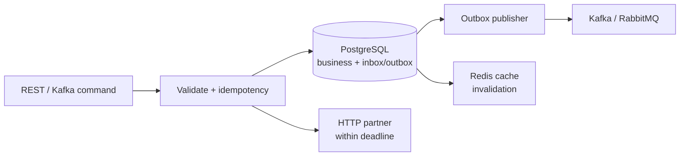

# Testing SQL Against Real Database Engines and Dialect Differences

## 1. Why Can H2 SQL Tests Produce Misleading Results?

In a **Spring Boot Integration** system, JDBC or jOOQ writes frequently sit between partner HTTP calls, Redis cache updates, Kafka/RabbitMQ consumption, and transactional outbox publishing. An SQL statement that passes against an in-memory mock database yet fails in production PostgreSQL or MySQL can derail the entire flow: unintended rollbacks, dropped events, duplicate consumer processing, or corrupted reconciliation data.

Consider a service consuming a `ReserveStock` command from Kafka:

1. Reads the record and extracts `eventId`, `orderId`, and `tenantId`.
2. Uses JDBC/jOOQ to check whether the event was already processed and updates stock inside a transaction.
3. Persists an outbox row to publish `StockReserved` after DB commit.
4. Consumers or HTTP callers may retry the same operation if responses or acks drop.

Correctness depends on **real unique constraints, transaction isolation, row locking, SQL dialect, and the real driver**. H2 running in PostgreSQL emulation mode—or a mocked `JdbcTemplate`—cannot prove any of those properties.

**Guiding principle:** For business-critical SQL, run at least one integration test layer against **the exact DBMS and compatible major version used in production**, using real schema migrations and the real JDBC/jOOQ execution path. Unit tests with mocks or H2 still serve fast logic checks, yet they never replace tests verifying real SQL semantics.

### Learning Objectives

- Identify the classes of bugs that unit tests and in-memory databases fail to catch.
- Use Testcontainers with Spring Boot to run JDBC/jOOQ tests on real PostgreSQL or MySQL.
- Verify migrations, schemas, unique constraints, transactions, isolation, and concurrency.
- Distinguish **SQL dialect**, **jOOQ's SQL rendering**, and **actual DBMS runtime behavior**.
- Design tests covering JSON, UPSERT, pagination, timestamps/timezones, locking, and error mapping.
- Apply these tests across HTTP–database–outbox–broker flows without making false consistency claims.

## 2. Testing Levels and What Each Level Proves

| Level | Tools | Proves Well | Does Not Prove |
| --- | --- | --- | --- |
| Unit test | Mockito, fake repositories, mock DSL wrappers | Branching logic, pure mapping, business errors | Real SQL execution, transactions, or locking |
| SQL render test | jOOQ `DSL.using(SQLDialect.POSTGRES)`, SQL snapshots | SQL rendered by jOOQ for a target dialect | Whether the server accepts or executes it accurately |
| DB integration test | Testcontainers PostgreSQL/MySQL, `JdbcTemplate`, `DSLContext` | Real DDL, constraints, codecs, transactions, and driver | Production networking, backups, or cluster failover |
| Integration flow test | Spring Boot + DB container + broker/HTTP test server | End-to-end path from API/message to DB/outbox, rollback, retry | Every production infrastructure failure mode |
| Staging / rehearsal | Production-like DBMS, version, collation, extensions, topology | Near-real performance and infrastructure traits | Absolute safety under full real-world traffic |

H2's "PostgreSQL compatibility mode" is **a limited syntax and behavior emulation**, not real PostgreSQL. It can accept certain statements while diverging on `JSONB`, operators, unique-constraint errors, lock contention, temporal types, and query planners. Even in jOOQ, observing valid rendered SQL does not prove the database will accept it or return the expected rows.

### 2.1. What Does a Dialect Encompass?

A *dialect* goes far beyond keyword syntax. A DBMS also defines:

- Data types: `UUID`, `JSONB`, `TIMESTAMPTZ`, `BOOLEAN`, arrays, generated columns.
- DDL and migrations: identity/autoincrement, partial indexes, functional indexes, constraints.
- DML: `INSERT ... ON CONFLICT`, `ON DUPLICATE KEY UPDATE`, `MERGE`, `RETURNING`.
- Locking: `FOR UPDATE`, `SKIP LOCKED`, isolation levels, deadlock detection, gap/next-key locks.
- Matching/collation: case sensitivity, accents, trailing spaces, locale sorting.
- `NULL` and three-valued logic; `NULL` placement in `ORDER BY` and uniqueness of `NULL`s.
- Built-in functions for timestamps, JSON, strings, UUIDs, and search.
- JDBC metadata, exceptions/SQLSTATEs, batch counts, generated keys, and session settings.

An SQL statement that "looks like ANSI SQL" can still behave differently across engines and configurations. That is why tests must assert **results, final persisted state, and concurrency behavior**, not merely absence of exceptions.

## 3. Selecting the Right DBMS for Test Environments

If production runs PostgreSQL 16, start with a pinned PostgreSQL 16.x image matching your project's policy. If production runs MySQL 8, test real SQL on matching MySQL 8. If a system **supports both**, run a test matrix covering **every supported dialect**, rather than merely rendering the same jOOQ query under two enum values.

| Context | Recommended Test Setup |
| --- | --- |
| App targets PostgreSQL in production | Matching PostgreSQL container + real migrations |
| App targets MySQL in production | Matching MySQL container + real migrations/schema |
| Library supports both PostgreSQL and MySQL | Two separate test suites or CI jobs, one per engine |
| SQL performs outbox/lock/UPSERT work | Transaction and concurrency tests on the target DBMS |
| Pure parser or mapping logic | Fast unit tests without starting containers |
| Network / failover / HA testing | Dedicated cluster/replica environment, not a single container |

Containers are not mandatory for every single test. Still, **a real container** provides reproducible data isolated from developer machines without risking shared databases. Never use credentials with access to a production DB when running tests.

## 4. Spring Boot + Testcontainers + JDBC/jOOQ

The examples below target **Spring Boot 3.3+**, Java 17+, PostgreSQL, and JUnit Jupiter. They illustrate Spring Boot Testcontainers, Spring JDBC, and Spring jOOQ APIs; align versions with your project's BOM.

### 4.1. Dependencies

```kotlin
// build.gradle.kts — versions managed by Spring Boot dependency management
implementation("org.springframework.boot:spring-boot-starter-jdbc")
implementation("org.springframework.boot:spring-boot-starter-jooq")
runtimeOnly("org.postgresql:postgresql")

// Migration example. On newer Flyway releases check the PostgreSQL support module.
implementation("org.flywaydb:flyway-core")
implementation("org.flywaydb:flyway-database-postgresql")

testImplementation("org.springframework.boot:spring-boot-starter-test")
testImplementation("org.springframework.boot:spring-boot-testcontainers")
testImplementation("org.testcontainers:junit-jupiter")
testImplementation("org.testcontainers:postgresql")
```

Spring Boot auto-configures `DataSource`, `JdbcTemplate`, and `DSLContext` when dependencies and properties align. If the application declares multiple `DataSource`s, transaction managers, or custom jOOQ `Configuration` beans, verify which beans participate in tests rather than assuming tests hit the PostgreSQL container while DAOs actually hit an embedded DB.

### 4.2. Real Dependencies via `@ServiceConnection`

```java
import org.junit.jupiter.api.Test;
import org.springframework.beans.factory.annotation.Autowired;
import org.springframework.boot.test.context.SpringBootTest;
import org.springframework.boot.testcontainers.service.connection.ServiceConnection;
import org.springframework.jdbc.core.JdbcTemplate;
import org.testcontainers.containers.PostgreSQLContainer;
import org.testcontainers.junit.jupiter.Container;
import org.testcontainers.junit.jupiter.Testcontainers;

import static org.junit.jupiter.api.Assertions.assertEquals;

@SpringBootTest
@Testcontainers
class PostgreSqlSmokeIT {

    @Container
    @ServiceConnection
    static PostgreSQLContainer<?> postgres =
            new PostgreSQLContainer<>("postgres:16.4");

    @Autowired JdbcTemplate jdbc;

    @Test
    void connectsToRealPostgreSql() {
        String version = jdbc.queryForObject(
                "SELECT version()", String.class);
        org.junit.jupiter.api.Assertions.assertTrue(
                version.contains("PostgreSQL"));
        assertEquals(1, jdbc.queryForObject(
                "SELECT 1", Integer.class));
    }
}
```

In Spring Boot 3.1+, `@ServiceConnection` supplies connection details from the container so auto-configuration connects to the real DB. Ensure Spring Boot Testcontainers is on the classpath and container runtime access is available. Alternatively, use `@DynamicPropertySource` to populate `spring.datasource.url`, `username`, and `password`—never configure both sources simultaneously and rely on precedence luck.

This smoke test proves **connectivity to real PostgreSQL**; it does not yet verify schemas, jOOQ, transactions, or business logic. In CI environments prohibiting Docker, provision an isolated real DB service with explicit connection settings rather than silently falling back to H2.

### 4.3. Migrations and jOOQ Dialect

Example configuration for tests whose schema is managed by Flyway:

```yaml
# Example application-test.yml
spring:
  jooq:
    sql-dialect: POSTGRES
  flyway:
    enabled: true
  sql:
    init:
      mode: never
```

`spring.jooq.sql-dialect` tells jOOQ how to render SQL; it **does not turn PostgreSQL into MySQL** or vice versa. In production, align the dialect with the real DBMS. While omitting it lets Boot infer dialect from JDBC metadata in some setups, verify explicitly when using multiple datasources or proxies.

Migrations are the **source of truth for schema**. Sample structure inside a project-managed PostgreSQL migration:

```sql
CREATE TABLE purchase_orders (
    id BIGINT GENERATED BY DEFAULT AS IDENTITY PRIMARY KEY,
    order_id VARCHAR(80) NOT NULL UNIQUE,
    tenant_id VARCHAR(64) NOT NULL,
    external_ref VARCHAR(120) NOT NULL,
    status VARCHAR(24) NOT NULL,
    created_at TIMESTAMPTZ NOT NULL DEFAULT CURRENT_TIMESTAMP,
    CONSTRAINT uk_purchase_orders_tenant_ref
        UNIQUE (tenant_id, external_ref)
);

CREATE INDEX idx_purchase_orders_tenant_created
    ON purchase_orders (tenant_id, created_at, id);
```

This is an **illustrative SQL snippet in the lesson**, without creating new migration files. Real projects should place it in the migration pipeline, let Flyway run on test context startup, and let JDBC/jOOQ query that migrated schema. Never let tests run ad-hoc `CREATE TABLE IF NOT EXISTS` statements differing from production migrations, as that masks missing or drifted migrations.

When using jOOQ code generation, generate classes from the **matching schema/version**, typically against a migrated database during the build pipeline. Whenever the schema changes, verify both generated classes and migrations instead of hand-editing generated code to get compilation green.

## 5. Testing Real Unique Constraints with `JdbcTemplate`

A key integration contract is that **repeated requests with the same idempotency key must not create two orders**. Enforce this with a durable unique constraint rather than `SELECT` before `INSERT` in application code.

The test below assumes Flyway created `purchase_orders` as shown in section 4:

```java
import org.junit.jupiter.api.BeforeEach;
import org.junit.jupiter.api.Test;
import org.springframework.beans.factory.annotation.Autowired;
import org.springframework.boot.test.context.SpringBootTest;
import org.springframework.boot.testcontainers.service.connection.ServiceConnection;
import org.springframework.dao.DuplicateKeyException;
import org.springframework.jdbc.core.JdbcTemplate;
import org.testcontainers.containers.PostgreSQLContainer;
import org.testcontainers.junit.jupiter.Container;
import org.testcontainers.junit.jupiter.Testcontainers;

import static org.junit.jupiter.api.Assertions.assertEquals;
import static org.junit.jupiter.api.Assertions.assertThrows;

@SpringBootTest
@Testcontainers
class PurchaseOrderJdbcIT {

    @Container
    @ServiceConnection
    static PostgreSQLContainer<?> postgres =
            new PostgreSQLContainer<>("postgres:16.4");

    @Autowired JdbcTemplate jdbc;

    @BeforeEach
    void reset() {
        jdbc.update("DELETE FROM purchase_orders");
    }

    @Test
    void enforcesIdempotencyKeyWithinTenant() {
        String sql = """
                INSERT INTO purchase_orders
                    (order_id, tenant_id, external_ref, status)
                VALUES (?, ?, ?, ?)
                """;

        jdbc.update(sql, "ORD-101", "tenant-a", "checkout-42", "NEW");

        assertThrows(DuplicateKeyException.class,
                () -> jdbc.update(sql,
                        "ORD-102", "tenant-a", "checkout-42", "NEW"));

        jdbc.update(sql, "ORD-103", "tenant-b", "checkout-42", "NEW");

        Integer count = jdbc.queryForObject(
                "SELECT count(*) FROM purchase_orders",
                Integer.class);
        assertEquals(2, count);
    }
}
```

In PostgreSQL, `UNIQUE (tenant_id, external_ref)` allows the same `external_ref` under a **different tenant** while rejecting duplicates within the same tenant. `JdbcTemplate` translates the driver's unique violation into `DuplicateKeyException` via Spring exception translation. Treat this as an **error-contract assertion**: whenever changing DBMS or Spring versions, re-verify the actual SQLSTATE and exception class.

Do not equate a unique constraint with complete idempotency. To replay the **original outcome** for the same idempotency key, the service must persist and check payload fingerprints and stored operation states/responses per policy—never simply catch any `DuplicateKeyException` and return success.

### 5.1. Why `SELECT` Then `INSERT` Is Not Enough

```text
Request A                    Request B
SELECT key K -> not found    SELECT key K -> not found
INSERT key K                 INSERT key K
COMMIT                       -> unique constraint rejects
```

Two requests can both observe "not found" without proper locking or constraints. A sequential test will never expose this race. Test concurrent requests using real connections/transactions and assert final row counts. In real domains, map concurrency conflicts into proper idempotent responses rather than leaking unexplained HTTP 500s.

## 6. jOOQ: Render SQL by Dialect, Always Execute on the Real DBMS

jOOQ builds type-safe SQL via its DSL and can translate certain constructs across dialects. However, **rendering an SQL string** is not behavioral verification; you must execute it against the real engine.

### 6.1. JDBC and jOOQ Querying the Same Schema

Example using Spring Boot-injected `DSLContext`; to stay self-contained, it uses `DSL.name(...)` instead of codegen classes:

```java
import org.jooq.DSLContext;
import org.jooq.Field;
import org.jooq.Table;
import org.jooq.impl.DSL;
import org.springframework.jdbc.core.JdbcTemplate;

import static org.junit.jupiter.api.Assertions.assertEquals;

void verifyJooqQuery(DSLContext dsl, JdbcTemplate jdbc) {
    jdbc.update("""
            INSERT INTO purchase_orders
                (order_id, tenant_id, external_ref, status)
            VALUES (?, ?, ?, ?)
            """, "ORD-201", "tenant-a", "ref-201", "NEW");

    Table<?> orders = DSL.table(DSL.name("purchase_orders"));
    Field<String> orderId =
            DSL.field(DSL.name("order_id"), String.class);
    Field<String> status =
            DSL.field(DSL.name("status"), String.class);

    String actual = dsl.select(status)
            .from(orders)
            .where(orderId.eq("ORD-201"))
            .fetchSingle(status);

    assertEquals("NEW", actual);
}
```

This is an **illustrative test body** that fits inside a `@SpringBootTest` class using the container from section 4 or 5. Production tests should prefer codegen jOOQ tables/fields for compile-time schema typing. Even when generated code matches the schema, runtime data can still trigger constraint or type-conversion failures that only real-DB integration tests catch.

### 6.2. Render Tests to Track Generated SQL

```java
import org.jooq.SQLDialect;
import org.jooq.impl.DSL;

String sqlForPostgres = DSL.using(SQLDialect.POSTGRES)
        .select(DSL.field(DSL.name("order_id")))
        .from(DSL.table(DSL.name("purchase_orders")))
        .where(DSL.field(DSL.name("status")).eq("NEW"))
        .getSQL();
```

Render tests catch SQL changes across jOOQ upgrades, DSL refactors, or dialect switches. They **do not prove** the query runs on the server, hits indexes, handles `NULL`s, or honors transaction semantics. Also, bind parameters, identifier quoting, and formatting depend on `Settings`, dialect, and version, so avoid brittle whitespace comparisons in snapshots.

When supporting both PostgreSQL and MySQL, render queries under `SQLDialect.POSTGRES` and `SQLDialect.MYSQL`, yet **execute each variant on its real DBMS**. Never assume every jOOQ translation preserves identical semantics and performance.

## 7. Key Dialect Differences to Include in Your Test Matrix

| Topic | PostgreSQL | MySQL (e.g., 8.x) | Required Tests |
| --- | --- | --- | --- |
| UPSERT | `INSERT ... ON CONFLICT ... DO UPDATE` | `INSERT ... ON DUPLICATE KEY UPDATE` | Exact conflict target, row counts, final state |
| Returning | `INSERT/UPDATE ... RETURNING` | No direct equivalent to PostgreSQL `RETURNING` in standard MySQL 8 | How generated IDs and updated values are retrieved |
| JSON | `JSONB`, `->`, `->>` operators and functions | `JSON`, `JSON_EXTRACT`, JSON paths | Parsing, nested queries, `null`/missing keys |
| UUID | Native `UUID` type | Typically `CHAR(36)` or `BINARY(16)` by design | Serialization, binding, collation, indexing |
| Temporal types | `TIMESTAMPTZ`, `TIMESTAMP` | `TIMESTAMP`, `DATETIME` with distinct timezone/range rules | UTC normalization and precision |
| Identity | `GENERATED ... AS IDENTITY` / sequence | `AUTO_INCREMENT` | Generated keys and sequence gaps/semantics |
| Locking | `FOR UPDATE`, `SKIP LOCKED` | `FOR UPDATE`, `SKIP LOCKED` with engine/isolation quirks | Worker contention and lock timeouts |
| Identifier case | PostgreSQL folding/quoted identifier rules | OS and `lower_case_table_names` dependent | Consistent naming/casing in migrations and jOOQ |
| Collation | Configured collation / ICU / locale | Column/schema charset and collation | Email, username, and Unicode comparisons |
| `NULL` ordering | Defaults depend on `ASC`/`DESC`; `NULLS FIRST`/`LAST` | Different defaults; may need adjusted expressions | Stable sorting and pagination |
| DDL in transactions | Most DDL is transactional | Many DDL statements cause implicit commits | Migration rollbacks and failure recovery |
| Deadlocks / serialization | PostgreSQL SQLSTATEs and exceptions | MySQL vendor error codes / SQLSTATEs | Choosing the right retry policy |

This table is a starting guide; **specific versions and database modes** add or restrict features. For example, MariaDB and MySQL are distinct products despite shared SQL syntax, and SQL Server, Oracle, and H2 introduce their own semantics. Check your jOOQ edition/license and supported dialects against project needs.

## 8. UPSERT: Different Syntax and Different Conflict Scopes

An outbox consumer or command handler often inserts a row if missing while handling collisions explicitly.

### 8.1. PostgreSQL

```sql
INSERT INTO purchase_orders
    (order_id, tenant_id, external_ref, status)
VALUES ('ORD-301', 'tenant-a', 'checkout-301', 'NEW')
ON CONFLICT (tenant_id, external_ref)
DO UPDATE SET status = EXCLUDED.status
RETURNING order_id, status;
```

### 8.2. MySQL

```sql
INSERT INTO purchase_orders
    (order_id, tenant_id, external_ref, status)
VALUES ('ORD-301', 'tenant-a', 'checkout-301', 'NEW')
ON DUPLICATE KEY UPDATE
    status = 'NEW';
```

**Never treat these two statements as strictly equivalent.** PostgreSQL names a specific conflict target. MySQL's `ON DUPLICATE KEY UPDATE` fires on **any colliding `UNIQUE` or `PRIMARY KEY`** and follows special affected-row reporting rules. If a table has multiple unique constraints, a collision can accidentally update an **unintended row**. Idempotent workflows should look up the record by business key after a conflict and verify the payload fingerprint rather than relying solely on affected row counts.

### Essential UPSERT Tests

1. First-time insert.
2. Re-inserting the same idempotency key with an identical payload.
3. Inserting the same key with a different payload—**must reject per contract**, never silently overwrite.
4. Colliding on a separate unique constraint (e.g., `order_id`) besides the idempotency key.
5. Two concurrent transactions racing on the same key.
6. Transaction rollback/retry verifying only one valid business record remains.

In jOOQ, `onConflict(...)` renders differently across dialects; **render** tests inspect SQL, whereas **real-DB** tests prove side effects and conflict targets behave properly. Never ship logic that only works accidentally on PostgreSQL while breaking on MySQL.

## 9. Transactions, Isolation, and Concurrency Must Be Tested Under Load

### 9.1. Local Transactions and `@Transactional` in Spring

`@Transactional` governs the chosen datasource/manager (such as `DataSourceTransactionManager`). JDBC and jOOQ share a transaction only when sharing the same Spring-managed `DataSource`/connection and compatible wiring. Redis commands, HTTP calls, and Kafka sends **do not automatically roll back with JDBC transactions**.

In Spring Boot Integration, a reliable pattern updates business tables and an outbox in the same DB transaction, then has a separate publisher send to Kafka. If Kafka acks drop, the publisher replays the same `eventId` and consumers deduplicate.

### 9.2. Do Not Overuse `@Transactional` on Tests

In Spring Test, annotating a test method with `@Transactional` rolls back data **after the test**. While convenient for cleanup, it can hide **commit-time failures** such as deferred constraints or miswired transaction boundaries, and it forces test setup and production code into one transaction unlike production.

When testing **real commits and rollbacks**:

- Let the service under test open and close its own production transaction.
- Avoid putting `@Transactional` on the whole test class/method by default.
- Clean up using controlled fixtures, isolated schemas, or dedicated cleanup transactions.
- Verify committed state from a **fresh connection/transaction** after the service returns.
- Test timeouts, exceptions, and post-rollback state.

### 9.3. Lost Updates and Row Locking

A sequential test:

```text
T1 reads stock=10 -> T1 writes stock=9 -> commit
T2 reads stock=9  -> T2 writes stock=8 -> commit
```

never detects lost updates. The real race is:

```text
T1 reads stock=10     T2 reads stock=10
T1 computes 9         T2 computes 9
T1 UPDATE stock=9     T2 UPDATE stock=9
Result: 9, whereas it should be 8 if both reservations succeeded
```

Mitigations:

- Atomic updates: `UPDATE stock SET quantity = quantity - 1 WHERE sku = ? AND quantity >= 1`, checking affected rows.
- Optimistic locking with `version`: `UPDATE ... WHERE version = ?`, handling zero rows as conflict / bounded retry.
- Pessimistic locking: `SELECT ... FOR UPDATE` inside a transaction when warranted.
- Appropriate `SERIALIZABLE` isolation paired with proper retries on serialization failure.

Run real concurrency tests using two separate connections/transactions synchronized at DB access points. Avoid relying on `Thread.sleep()` as primary coordination—it causes flaky tests; use `CountDownLatch`/`CyclicBarrier`, bounded executors, and test timeouts while asserting final state. Configure isolation levels and lock timeouts for your target DBMS; PostgreSQL and MySQL differ in snapshot, gap-lock, and predicate-lock semantics.

### 9.4. `SKIP LOCKED` for Outbox Workers

PostgreSQL lets publishers claim an outbox batch not locked by other workers:

```sql
BEGIN;
SELECT event_id, aggregate_id, payload
FROM outbox_events
WHERE published_at IS NULL
ORDER BY created_at, event_id
LIMIT 50
FOR UPDATE SKIP LOCKED;
-- Claim/update processing state per design then COMMIT.
COMMIT;
```

`SKIP LOCKED` avoids worker contention, yet **does not guarantee fairness or global delivery ordering**. Keep the selection and claim inside the transaction; reading and committing without marking a claim lets another worker pick up the same event. Never hold DB transactions open across slow Kafka sends unnecessarily; use time-bounded claims/leases and idempotent publishers while preserving per-aggregate ordering by design.

MySQL also supports `SKIP LOCKED` in newer versions, though isolation and locking quirks must be tested directly. When writing this in jOOQ, inspect both the rendered SQL and behavior under parallel workers.

## 10. Data Types, Nulls, and Time: Bugs That Only Surface on a Real DB

### 10.1. Temporal Types

- PostgreSQL `TIMESTAMPTZ` stores an instant and displays it per session timezone; it does not store a named user timezone.
- PostgreSQL `TIMESTAMP WITHOUT TIME ZONE` does not imply UTC; the application must define its meaning explicitly.
- MySQL `TIMESTAMP` and `DATETIME` differ in timezone conversion, valid date ranges, and fractional precision.
- JDBC/jOOQ map to `Instant`, `OffsetDateTime`, or `LocalDateTime` depending on driver and configuration; pick Java types by **domain semantics**, not guesswork.

Test timestamps around midnight, daylight saving transitions, fractional seconds, and varying session timezones. For integration events, normalize `occurredAt` to UTC while specifying precision (milliseconds/microseconds) and JSON formatting.

### 10.2. JSON, `NULL`, and Missing Fields

PostgreSQL `JSONB` behaves differently from MySQL `JSON`. Test specifically:

- JSON objects with a missing key vs. a key set to JSON `null` vs. an SQL `NULL` column.
- Querying and comparing nested fields and arrays.
- JSON/functional indexes and query costs.
- Deserialization through JDBC/jOOQ, Unicode encoding, large numbers, and enums/versions.
- Migration compatibility with historical payloads so consumers/outboxes never misread missing fields.

In SQL, `col = NULL` never evaluates to `TRUE`; use `IS NULL` or the corresponding DSL method. Unique constraints containing nullable fields can permit logically duplicate rows across `NULL`s. Make required idempotency keys `NOT NULL` with matching unique constraints.

### 10.3. Collation, Unicode, and Case Sensitivity

Emails and customer codes compare differently depending on collation. One DB may compare case-insensitively while another defaults to case-sensitive; MySQL collations sit at column/schema levels whereas PostgreSQL offers distinct collations and extensions. Never assume `Alice` and `alice` match identically across every DBMS.

When canonical codes are required:

1. Define explicit canonicalization rules (casing, Unicode normalization, trimming) in the data contract.
2. Store normalized values or dedicated unique keys where appropriate.
3. Back them with matching indexes and constraints.
4. Test on a DB configured with the **real collation** using Unicode, accents, and trailing spaces.

Never blindly assume "lowercase everything" is universally valid for international usernames or email addresses; correctness follows your system's identity rules.

## 11. Pagination, `ORDER BY`, and Unstable Results

A `GET /orders` endpoint in Spring MVC may query via JDBC/jOOQ:

```sql
SELECT order_id, created_at, status
FROM purchase_orders
WHERE tenant_id = ?
LIMIT 20 OFFSET 40;
```

**Ordering is not guaranteed** without `ORDER BY`. Two runs can return different rows whenever the query plan shifts, especially after inserts, vacuums/compactions, or index updates. Even `ORDER BY created_at` remains unstable when rows share timestamps. Add a tie-breaker:

```sql
SELECT order_id, created_at, status
FROM purchase_orders
WHERE tenant_id = ?
ORDER BY created_at DESC, id DESC
LIMIT 20 OFFSET 40;
```

For fast-changing datasets or deep pages, prefer keyset/cursor pagination and define snapshot semantics. Test inserting rows between page fetches, `NULL`s, timezones, sort directions, and page size limits. jOOQ offers `orderBy`/`limit`/`offset` and seek DSL methods, yet ordering and `NULL` behavior must still be verified on the target DBMS.

Never rely on "always sorted right on my laptop" as an integration contract between DB and broker: Kafka partition ordering requires separate record-key and aggregate-version design.

## 12. JDBC Exception Translation and Cross-Dialect Error Handling

SQL drivers throw `SQLException` with SQLSTATEs, vendor error codes, and driver messages. Spring JDBC translates these into the `DataAccessException` hierarchy (such as `DuplicateKeyException` or `DeadlockLoserDataAccessException` in matching setups).

**Never match server error message text** to decide retries or HTTP responses. Wording, localization, and versions change, and logging raw SQL/values risks exposing PII.

Classification example at the repository/service layer:

| Error Type | Handling |
| --- | --- |
| Idempotency-key unique constraint | Look up prior processed outcome or return conflict per contract |
| Validation / foreign-key / not-null | Fix data or contract; generally do not retry |
| Deadlock / serialization failure | Retry **entire transaction** with backoff, attempt limits, and idempotency |
| Query timeout / connection failure | Transient; commit outcome may be unknown → verify state first |
| Migration / schema error | Deployment bug; never hot-retry like transient network blips |
| Out-of-disk / permission error | Operational intervention, circuit breaker, controlled failure |

PostgreSQL uses SQLSTATEs like `23505` (unique violation), `40001` (serialization failure), and `40P01` (deadlock). MySQL uses distinct vendor codes such as `1062` (duplicate key) and `1213` (deadlock). These codes assist logs and diagnostics, while application code should rely on consistent exception abstractions verified against **every DBMS it actually supports**.

Retrying transactions containing `INSERT`, `UPDATE`, and outbox writes is usually safe when business keys and constraints are sound, yet **never** retry a transaction that already sent payment HTTP calls or emails without verifying external side effects. Use command IDs and reconciliation after timeouts rather than guessing from exceptions.

## 13. Integrating DB, HTTP, Cache, and Broker: Test End-to-End Scenarios, Not Isolated Queries



Include at least these integration tests:

1. **HTTP POST retry:** client re-sends the same idempotency key after a timeout; DB holds only one business row. Different payloads with the same key return conflict.
2. **Kafka redelivery:** consumer receives the same `eventId` twice; inbox/`processed_events` unique constraint blocks duplicate effects.
3. **DB rollback:** forcing an outbox insert or constraint failure rolls back the business update in the same transaction, leaving no half-state.
4. **Outbox publisher crash:** crashing after Kafka ack before marking published replays the same `eventId`; downstream deduplicates.
5. **Redis outage:** cache misses or invalidation failures never mislead the service into wrong commit assumptions; degraded behavior is explicit.
6. **Two concurrent workers:** competing to claim outbox rows or decrement stock; verify locks/versions and exact effect counts.
7. **Upgrade migrations:** legacy rows remain readable/writable post-migration, and old/new pods stay compatible during rolling deploys if required.

Never imagine `@Transactional` pulls Kafka, Redis, or HTTP into the DB transaction. Spring's transaction manager coordinates only enlisted resources; cross-system consistency comes from outbox/inbox, idempotency, sagas, or reconciliation.

## 14. Designing Maintainable Testcontainers and CI Pipelines

### 14.1. Separating Fast Tests from DB-Backed Tests

| Suite | When to Run | Guidance |
| --- | --- | --- |
| Unit | Every commit / PR | Mock domain dependencies; no Docker required |
| DB integration | Every PR or designated pipeline | Testcontainers, real migrations, real JDBC/jOOQ |
| Multi-dialect matrix | Every PR if multi-DB; otherwise scheduled + pre-release | Separate jobs for PostgreSQL and MySQL |
| Load / concurrency | Staging or dedicated CI | Large datasets, contention, `EXPLAIN`/locks |
| Failover / upgrades | Periodic and pre-DB-upgrade | Backup/restore, replication, network faults |

### 14.2. Stability Principles

- Pin DB image versions by policy and upgrade deliberately; never use unpinned `latest`.
- Give each test or class isolated data and reliable cleanup; never share one mutable test DB across parallel CI branches.
- Avoid `Thread.sleep()` for race synchronization; use latches/barriers with explicit timeouts.
- Avoid overusing `@DirtiesContext` since full context restarts are slow; isolate data and clean up cleanly.
- Share static Testcontainers only intentionally, ensuring state never leaks across parallel test classes.
- Apply real migrations before fixtures so schema drift surfaces early.
- Queries expecting order must include `ORDER BY` rather than relying on physical row order.
- Capture diagnostic SQL/driver errors while masking bind values, tokens, and personal data.
- Align session timezone, `search_path`/schema, collation, SQL mode, and JDBC URL flags with production where behavior depends on them.
- If production uses DB extensions (`PostGIS`, `pg_trgm`, custom collations), include them in test images rather than skipping extension tests on vanilla images.

### 14.3. Example Project Commands

```bash
# Example commands for an environment with Docker and Gradle configured.
# Task names follow project convention, such as test or integrationTest.
./gradlew test
./gradlew integrationTest
```

These are **illustrative examples for the lesson**, not commands executed by the worker during Step 4. Projects may use Maven, Gradle, or separate CI jobs. Ensure an `integrationTest` source set/task exists before invoking it, and never run destructive tests against a production database.

## 15. Comprehensive Practice Scenario

A `POST /orders` API accepts an authenticated `tenantId`, `idempotencyKey`, and order payload; a transaction writes `purchase_orders` and `outbox_events`. After commit, a publisher forwards events to Kafka. Initially the app runs on PostgreSQL, with a later goal to support MySQL.

Build a test suite covering:

1. Apply real Flyway migrations on a PostgreSQL container and verify the engine via `SELECT version()`.
2. Test `UNIQUE (tenant_id, external_ref)` with duplicates inside one tenant and allowed duplicates across tenants.
3. Read the same record via both JDBC and jOOQ, verifying `TIMESTAMPTZ`/Java time mapping and stable sorting.
4. Execute two concurrent transactions with the same idempotency key, asserting one business row and one logical outbox event.
5. Force the outbox insert to fail and verify the business row rolls back on transaction abort.
6. Simulate ack loss so the publisher replays the same event ID; verify consumer inbox deduplication.
7. Render jOOQ DSL under PostgreSQL and MySQL dialects, yet **execute two independent test suites on real PostgreSQL and real MySQL** before claiming support.
8. On MySQL, focus on differing UPSERT conflict targets, temporal/JSON/collation rules, generated IDs, and lock behavior.
9. Inspect query plans with realistic dataset sizes; logically valid SQL can still trigger full scans and pool saturation under traffic.

**Critical question:** If jOOQ renders a query cleanly under `SQLDialect.MYSQL`, is that enough evidence to claim MySQL support? **No.** You still need compatible migrations, real execution and error mapping, concurrency, transactions, type mapping, performance verification, and full integration path validation.

## 16. Pre-Production Checklist for SQL Integration

- [ ] DB integration tests run on the production-matching DBMS and major version, not H2 alone.
- [ ] Test contexts point to the right datasource/container with schemas built by real migrations.
- [ ] jOOQ dialect, generated code, JDBC driver, and session/schema settings are verified.
- [ ] Unique, foreign-key, not-null, and check constraints are tested with real errors; idempotency never relies solely on `SELECT-before-INSERT`.
- [ ] UPSERT conflict targets, generated keys, `RETURNING`, and affected row counts are tested per dialect.
- [ ] `JSON`/`JSONB`, UUIDs, `NULL`s, timestamps/timezones, Unicode, collations, and numeric precision are tested realistically.
- [ ] Paginated and sorted queries use deterministic `ORDER BY` with tie-breakers and concurrent-write tests.
- [ ] Concurrent transactions, deadlocks/serialization failures, lock timeouts, and optimistic/pessimistic locking are tested.
- [ ] Business DB + outbox/inbox boundaries are clean; HTTP/Redis/Kafka are never assumed in the DB transaction.
- [ ] Retries replay entire safe transactions with backoff/idempotency without duplicating external side effects.
- [ ] JDBC/jOOQ error mapping is verified against real DB errors rather than error message strings.
- [ ] CI pins image versions, isolates cleanup, caps concurrency, and verifies container runtime availability.
- [ ] Metrics per dependency/operation/outcome stay low-cardinality; SQL logs mask sensitive values while traces support debugging.
- [ ] Adding a new DB dialect executes the full test matrix and migration compatibility checks rather than only swapping `SQLDialect`.

**Desired outcome:** SQL executed via JDBC or jOOQ must be proven against **the real engine, schema, and driver** across normal paths, concurrency, and failure windows. Whenever the same logic targets multiple DBMSs, differences in syntax, data types, transactions, locking, and error handling must become **evidenced test cases**, never assumptions drawn from similar-looking SQL.
