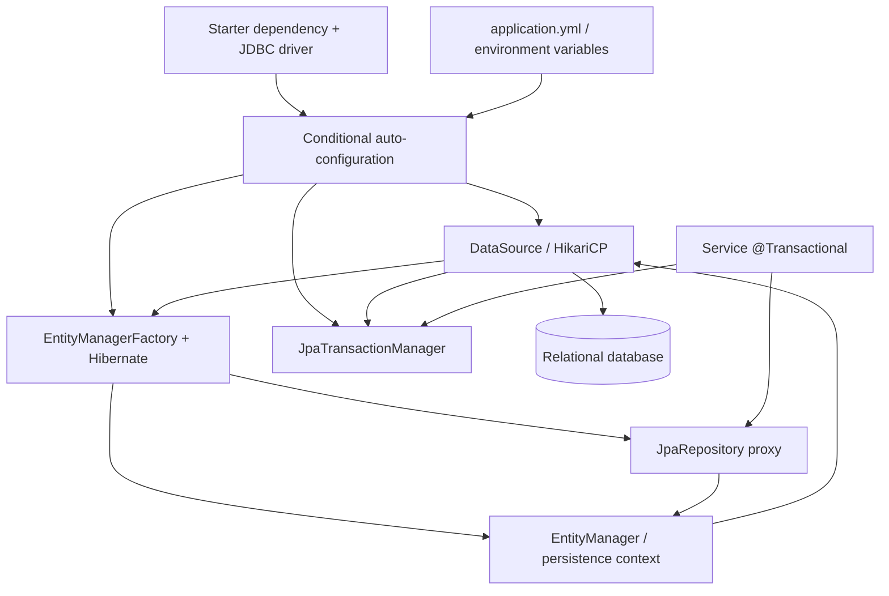

# spring-boot-starter-data-jpa and Auto-Configured Components

> **Chapter:** JPA and Hibernate  
> **Scope:** In the **SPRING_BOOT_INTEGRATION** module, Spring Data JPA is an adapter connecting a Spring Boot application to a relational database. This lesson focuses on the auto-configured components, how they collaborate when reading/writing data, and how to operate them safely across HTTP, database, cache, and message broker integration flows.

## 1. What Problem Does the Starter Solve?

When building an integration service, an application often needs to record processing state, reconcile business keys from external systems, or store deduplication records. Manually configuring a JDBC connection pool, JPA provider, `EntityManagerFactory`, transaction manager, and repositories for every service easily leads to missing or inconsistent configuration.

Adding the **`spring-boot-starter-data-jpa`** dependency enables Spring Boot to detect the relevant libraries and activate *auto-configuration* when conditions are met. This allows developers to focus on defining **entities**, **repositories**, **transaction boundaries**, and business rules.

Four layers of responsibility must be distinguished:

| Component | Role | Are They the Same Thing? |
| --- | --- | --- |
| **JPA / Jakarta Persistence** | Object–relational mapping specification: `@Entity`, `EntityManager`, persistence context, JPQL | An API/specification; does not execute SQL queries by itself |
| **Hibernate ORM** | The JPA provider typically selected by the starter; manages entities, dirty checking, SQL generation, lazy loading | A JPA implementation, with additional provider-specific features |
| **Spring Data JPA** | Generates implementations for repository interfaces; supports `JpaRepository`, derived queries, `@Query`, pagination | Uses the underlying JPA provider |
| **Spring Boot auto-configuration** | Initializes infrastructure based on classpath, properties, and existing beans | A configuration mechanism; does not replace data modeling |

`spring-boot-starter-data-jpa` does **not** provide a database server, decide your business data model, or automatically integrate an HTTP client, Redis, or a message broker. Those parts require their own dependencies, configuration, and contracts.

## 2. Dependencies and Startup Conditions

Example Maven application using PostgreSQL:

```xml
<dependencies>
    <dependency>
        <groupId>org.springframework.boot</groupId>
        <artifactId>spring-boot-starter-data-jpa</artifactId>
    </dependency>
    <dependency>
        <groupId>org.postgresql</groupId>
        <artifactId>postgresql</artifactId>
        <scope>runtime</scope>
    </dependency>
</dependencies>
```

The starter typically brings Spring Data JPA, Hibernate ORM, Spring ORM, Spring Transaction, Spring JDBC, and a JDBC connection pool (usually HikariCP) onto the classpath. Exact submodules may vary between Spring Boot versions; inspect your project's dependency tree to verify when upgrading.

In a typical setup, Spring Boot requires:

1. Relevant libraries present on the classpath.
2. A JDBC driver and connection details, or a recognized embedded database.
3. No custom application beans overriding the beans that auto-configuration intends to create.
4. Packages containing entities and repositories within scan scope, or explicitly declared.

Auto-configuration uses conditions such as `@ConditionalOnClass`, `@ConditionalOnBean`, and `@ConditionalOnMissingBean`. Therefore, **adding the starter does not guarantee every bean in the table below will appear** if its conditions are not satisfied.

## 3. Auto-Configured Components

| Component | Function | Notable Configuration Source / Conditions |
| --- | --- | --- |
| `DataSource` | Provides JDBC connections to the DB | `spring.datasource.*`, driver on classpath; typically uses HikariCP |
| `EntityManagerFactory` | Creates `EntityManager` instances and manages entity mapping metadata | Scanned entities, Hibernate, `spring.jpa.*` properties |
| `JpaVendorAdapter` and Hibernate JPA provider | Connects the JPA mechanism to Hibernate and adapts settings | Hibernate libraries and JPA configuration |
| `JpaTransactionManager` / `PlatformTransactionManager` | Starts, commits, and rolls back JPA transactions; binds `EntityManager` to the execution thread | JPA infrastructure and existing transaction manager beans |
| Spring Data repository proxy | Implements interfaces extending `Repository` / `JpaRepository`; executes CRUD and query methods | Repository scanning, JPA infrastructure |
| `EntityManager` injected via `@PersistenceContext` | Entry point to the Spring-managed persistence context | `EntityManagerFactory`, transaction context |
| Persistence exception translation service | Translates certain data-layer exceptions into Spring's `DataAccessException` hierarchy | Spring ORM / repository layer |
| Open EntityManager in View (if enabled and applicable to a web app) | Keeps the `EntityManager` available during web response rendering | `spring.jpa.open-in-view`; does not extend a single transaction across the request |

Common auto-configuration classes in Spring Boot 3.x include `DataSourceAutoConfiguration`, `HibernateJpaAutoConfiguration`, and `JpaRepositoriesAutoConfiguration`. Configuration class names or slices may change across major versions; what matters is **bean creation conditions and actual runtime behavior**.

### Dependency Flow from Startup to Query Execution



**Runtime execution path:** A controller or message handler calls a service → the `@Transactional` interceptor opens or joins a transaction → the repository proxy uses `EntityManager` → Hibernate prepares SQL → JDBC borrows a connection from `DataSource` → the database executes → the transaction commits or rolls back. Hibernate may defer SQL until *flush* time, so `save()` does not mean all changes are already committed.

## 4. Sample Configuration for an Integration System

Suppose a service receives orders from a partner system and stores a record keyed by `externalId`. It uses PostgreSQL with a schema managed by migrations (Flyway/Liquibase or another chosen migration tool):

```yaml
spring:
  datasource:
    url: ${DB_URL}
    username: ${DB_USER}
    password: ${DB_PASSWORD}
    hikari:
      maximum-pool-size: 10
  jpa:
    open-in-view: false
    hibernate:
      ddl-auto: validate
    properties:
      hibernate:
        jdbc:
          time_zone: UTC
  sql:
    init:
      mode: never
```

- `spring.datasource.*` configures the connection source. Store credentials in environment variables or a secret store; never commit real passwords to source control.
- `spring.datasource.hikari.maximum-pool-size` caps the maximum number of connections in the pool; size it based on concurrency, connection hold time, and DB limits rather than copying numbers blindly across environments.
- `spring.jpa.hibernate.ddl-auto=validate` instructs Hibernate to verify that the schema matches the entities on startup. For production systems, use versioned migrations instead of letting Hibernate `create` or `update` the schema.
- `spring.jpa.open-in-view=false` makes data access boundaries explicit. If a response needs lazy relationships, fetch and map them to a DTO inside the service transaction.
- `spring.sql.init.mode=never` disables `schema.sql` / `data.sql` initialization when using a separate migration pipeline. This is a choice for this example, not a JPA requirement.
- `spring.jpa.properties.hibernate.*` forwards provider properties to Hibernate; avoid overusing vendor-specific settings unless genuinely needed.

For quick experiments, you can use H2 with an appropriate DDL strategy for test environments. Never assume queries running against H2 will behave identically on PostgreSQL, especially regarding data types, locking, isolation, and SQL syntax.

## 5. End-to-End Example: From Entity to Repository and Transaction

**Step 1 — Schema with DB constraints.** Using a PostgreSQL migration:

```sql
CREATE TABLE external_orders (
    id BIGINT GENERATED BY DEFAULT AS IDENTITY PRIMARY KEY,
    external_id VARCHAR(64) NOT NULL,
    status VARCHAR(24) NOT NULL,
    CONSTRAINT uk_external_orders_external_id UNIQUE (external_id)
);
```

The `UNIQUE (external_id)` constraint protects data integrity when two requests arrive concurrently, even across multiple application instances. Checking `existsBy...` before inserting can improve UX, but it **does not replace** a unique constraint because of race conditions.

**Step 2 — Define the entity.** Spring Boot 3.x and later use the `jakarta.persistence` namespace (not the legacy `javax.persistence` from Spring Boot 2.x):

```java
package com.example.integration.order;

import jakarta.persistence.Column;
import jakarta.persistence.Entity;
import jakarta.persistence.GeneratedValue;
import jakarta.persistence.GenerationType;
import jakarta.persistence.Id;
import jakarta.persistence.Table;
import jakarta.persistence.UniqueConstraint;

@Entity
@Table(
    name = "external_orders",
    uniqueConstraints = @UniqueConstraint(
        name = "uk_external_orders_external_id",
        columnNames = "external_id"
    )
)
public class ExternalOrder {
    @Id
    @GeneratedValue(strategy = GenerationType.IDENTITY)
    private Long id;

    @Column(name = "external_id", nullable = false, length = 64)
    private String externalId;

    @Column(nullable = false, length = 24)
    private String status;

    protected ExternalOrder() {
        // JPA requires a no-arg constructor.
    }

    public ExternalOrder(String externalId) {
        this.externalId = externalId;
        this.status = "RECEIVED";
    }

    public Long getId() {
        return id;
    }
}
```

**Step 3 — Define the repository interface.** Spring Data JPA builds a proxy implementing basic operations and parses the method name `findByExternalId` to generate the query:

```java
package com.example.integration.order;

import java.util.Optional;
import org.springframework.data.jpa.repository.JpaRepository;

public interface ExternalOrderRepository
        extends JpaRepository<ExternalOrder, Long> {

    Optional<ExternalOrder> findByExternalId(String externalId);
}
```

**Step 4 — Place transactions on the service.** The goal is a clearly bounded business operation, rather than letting each repository call decide transaction lifecycles individually:

```java
package com.example.integration.order;

import java.util.Optional;
import org.springframework.stereotype.Service;
import org.springframework.transaction.annotation.Transactional;

@Service
public class ExternalOrderService {
    private final ExternalOrderRepository repository;

    public ExternalOrderService(ExternalOrderRepository repository) {
        this.repository = repository;
    }

    @Transactional
    public Long register(String externalId) {
        ExternalOrder saved =
                repository.saveAndFlush(new ExternalOrder(externalId));
        return saved.getId();
    }

    @Transactional(readOnly = true)
    public Optional<Long> lookupId(String externalId) {
        return repository.findByExternalId(externalId)
                .map(ExternalOrder::getId);
    }
}
```

`saveAndFlush()` forces SQL synchronization to the DB before the method exits; **it is not a commit command**. The transaction only commits when the method exits through the transaction interceptor cleanly. If the DB detects a duplicate `external_id`, the operation may throw `DataIntegrityViolationException` (or a translated persistence exception); the API must map this error to an appropriate response, such as HTTP 409 when the contract defines "duplicates are not allowed".

If the contract requires **idempotency** ("resending the same request must return the same result"), design a mechanism to identify equivalent payloads and retrieve the completed result **after the failed transaction has rolled back**; do not keep querying and treat it as transaction recovery inside a transaction already marked rollback-only. The unique business key, response contract, and retry policy must align.

### Package scanning

With `@SpringBootApplication` placed in package `com.example.integration`, entities and repositories under `com.example.integration.order` are typically discovered automatically. If placed outside that package tree, you may need `@EntityScan` and `@EnableJpaRepositories` pointing to the corresponding packages. Only add these two annotations when genuinely needed to avoid accidentally narrowing or widening the scan scope.

## 6. Transactions, Persistence Context, and Boundaries with External Systems

A persistence context tracks managed entities. Hibernate can detect property changes (*dirty checking*) and generate `UPDATE` statements on flush; calling `save()` again for each modified field is usually unnecessary when the entity is already managed in a transaction.

| Case | Behavior / Notes |
| --- | --- |
| `@Transactional` on a public service method called via Spring proxy | Opens/joins a transaction per propagation, defaulting to `REQUIRED` |
| `@Transactional(readOnly = true)` | An optimization hint for the persistence layer; not an authorization mechanism or a guarantee that the DB rejects all writes |
| Runtime exception or `Error` escaping a transaction | Transaction rolls back by default; checked exceptions may require `rollbackFor` |
| A method in the same class calling another `@Transactional` method | *Self-invocation* typically bypasses the proxy, so the annotation on the called method may not take effect as expected |
| Calling an HTTP API or sending a broker message inside a DB transaction | A JPA transaction does not automatically roll back operations on remote systems |
| Processing on another thread or after a message is acked | The transaction and persistence context of the original thread do not propagate automatically to the new thread |

In real integration flows, a message may arrive more than once; design DB-level deduplication using business keys, unique constraints, or an inbox table. For "write DB then publish event" requirements, consider the **transactional outbox**: write both business data and the outbox record within **the same DB transaction**, then have a separate worker publish to the broker and update the status. Publishing can still repeat, so consumers still need idempotency; an outbox does not create a distributed transaction between DB and broker.

Note that Spring's cache (`@Cacheable` / cache manager) and Hibernate's second-level cache are two distinct mechanisms. The JPA starter does not automatically enable a distributed cache layer that guarantees consistency when multiple services modify data concurrently.

## 7. Common Pitfalls and How to Verify

| Symptom | Common Cause | How to Check |
| --- | --- | --- |
| `Failed to configure a DataSource` or missing JDBC driver | Missing driver, invalid URL/credentials, no embedded DB | Check runtime dependencies and `spring.datasource.*` |
| Cannot create `EntityManagerFactory` | DB unreachable, invalid entity mapping, schema validation failure | Read the *root cause* in startup logs and migrations |
| `Not a managed type` | Entity lacks `@Entity` or is outside scan scope | Check Jakarta namespace and `@EntityScan` scope |
| Repository bean not found | Repository outside scan scope, missing JPA infrastructure | Check root package and repository scanning |
| `LazyInitializationException` | Accessing a lazy association after the persistence context closed | Fetch required data inside the service, map to DTO, consider `@EntityGraph` / join fetch |
| Unexpectedly many SQL statements (N+1) | Accessing lazy relationships inside a loop | Trace SQL; use projections, fetch joins, `@EntityGraph`, or appropriate batching |
| `TransactionRequiredException` or writes not committed as expected | Method bypassed proxy or lacked an active transaction | Check service boundaries, self-invocation, transaction manager |
| `DataIntegrityViolationException` | Unique/foreign key/not-null constraint violation | Check data, constraints, and duplicate-handling contract |
| Connection exhaustion or timeouts | Pool too small, long-running transactions, overloaded DB, or connection leaks | Monitor pool metrics, query duration, concurrent transactions |

To determine why auto-configuration took effect or was skipped, inspect the *Condition Evaluation Report* by running the application with debug mode enabled. If using Spring Boot Actuator, the `conditions` and `health` endpoints can help inspect configuration and DB health, though access must be restricted as they can expose operational details.

In development environments you can enable controlled SQL logging; never let logs contain credentials, PII, or sensitive bind parameters. In production, prioritize query latency metrics, transaction metrics, DB errors, connection-pool saturation, and traces linking requests/messages to data operations.

## 8. Testing the Data Integration Layer

**Repository slice tests:** `@DataJpaTest` loads the necessary JPA infrastructure, typically running each test in a transaction that rolls back afterward. It is well-suited for verifying entity mappings, derived queries, unique constraints, and custom queries.

**Integration tests with a real DB:** When the application uses PostgreSQL, test PostgreSQL-dependent behavior using Testcontainers or an equivalent test DB. These tests should run the same migrations as deployment and verify race conditions with constraints/transactions where required by the business logic.

Examples of valuable test cases:

1. Save an order with a new `externalId` and read it back via the repository.
2. Save the same `externalId` again and verify the constraint violation or idempotent response matches the contract.
3. Throw an exception after writing to two tables within the same service transaction; verify both writes roll back.
4. Query multiple records to detect N+1 queries and out-of-transaction association loading.
5. Start the application against a schema missing a column to verify `ddl-auto=validate` detects drift.

Testing business logic with mocked repositories can supplement unit tests, but **does not prove** that mappings, SQL, transactions, and unique constraints work properly against the DB.

## 9. Production Checklist

- **Define responsibilities clearly:** the starter configures the JPA adapter; HTTP contracts, event schemas, retries, and business state still need dedicated design.
- **Versioned schema management:** explicit migrations, `ddl-auto=validate`, alignment between entities and database constraints.
- **Place transactions on services:** keep them short; avoid holding DB connections while calling external APIs or waiting on brokers.
- **Enforce deduplication at the DB:** unique keys or inbox/outbox per contract; handle retries and responses after rollback.
- **Control data access:** disable open-in-view when appropriate, return DTOs, measure N+1, paginate large datasets.
- **Observe and test:** inspect condition reports, pool metrics, commit/rollback errors; run tests against a real DB for vendor-dependent behavior.

### Self-Check Questions

1. Why can adding `spring-boot-starter-data-jpa` still result in a "Failed to configure a DataSource" error?
2. How does `JpaRepository` differ from `EntityManager` and Hibernate?
3. When can data that has already been `flush`ed still be rolled back?
4. Why is calling `findByExternalId` before `save` insufficient to prevent two concurrent requests from creating duplicates?
5. If a DB write succeeds but publishing to the broker fails, what mechanism allows replaying without breaking the DB transaction?

**Key Takeaway:** Spring Boot builds the `DataSource`, JPA/Hibernate infrastructure, repository proxies, and transaction manager when conditions are met. The correctness of an integration flow still depends on your data model, transaction boundaries, DB constraints, duplicate-handling strategy, and observability.
