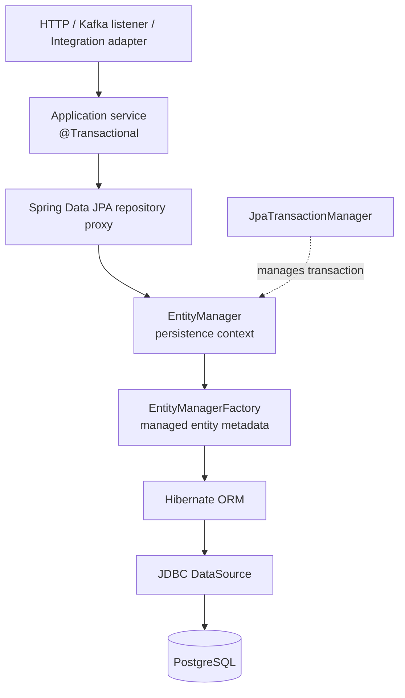
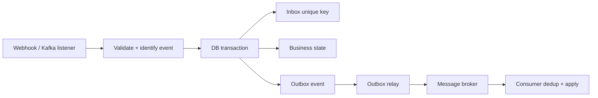

# EntityManagerFactory, Entity Scanning, and Repository Scanning

> **Chapter:** JPA and Hibernate  
> **Module:** `SPRING_BOOT_INTEGRATION` — integrating HTTP clients, databases, caches, message brokers, and Spring Integration adapters in Spring Boot, focusing on configuration, data contracts, transactions, error handling, deduplication, testing, and observability.

## 1. The Problem: Having an Entity and Repository Yet the App Fails to Start

Suppose a Spring Boot service receives webhooks from a payment partner. To avoid recording the same event twice, the system persists the payload and event key into an `integration_inbox` table in PostgreSQL. The team creates an `@Entity` class and an interface extending `JpaRepository`, yet running the application fails with one of two errors:

- `Not a managed type: class ...InboxMessage` — the repository was discovered, but its corresponding entity is not part of the persistence unit it uses.
- `No qualifying bean of type '...InboxRepository' available` — the repository interface was not registered as a bean in the Spring context, or repository configuration failed.

These are two **different** errors. The first involves **entity scanning and EntityManagerFactory**. The second usually involves **repository scanning** or bean configuration. Blindly adding `@ComponentScan` rarely solves the root cause because the three scanning mechanisms have separate responsibilities.

Within the **JPA and Hibernate** chapter, this lesson explains:

1. What `EntityManagerFactory` is and how it relates to `EntityManager`, Hibernate, and transactions.
2. Which packages Spring Boot scans by default for entities and repositories.
3. When to declare `@EntityScan` and `@EnableJpaRepositories`, and their independent effects.
4. How to configure multiple persistence units and datasources without wiring repositories to the wrong target.
5. How to test and diagnose package-scanning errors in a real integration flow.

## 2. Core Components in Spring Data JPA

JPA is the **Jakarta Persistence specification** describing the entity model, persistence context, and how applications work with relational data. **Hibernate ORM** is a popular provider implementing JPA capabilities. **Spring Data JPA** adds a repository abstraction that generates data-access operations from interfaces. **Spring Boot** primarily wires, configures, and manages dependencies for these components.

| Component | Role | Provided By |
|---|---|---|
| `@Entity`, `@Id`, `EntityManager`, `EntityManagerFactory` | Entity model and persistence context management APIs | Jakarta Persistence API |
| Hibernate ORM | Performs mapping, SQL generation, dirty checking, session management | JPA provider |
| `JpaRepository<T, ID>` | Repository interface providing CRUD, paging, and Spring Data features | Spring Data JPA |
| `@Transactional`, `JpaTransactionManager` | Transaction boundaries in a Spring application | Spring Framework |
| `@EntityScan`, JPA auto-configuration | Specifies entity packages and conditionally wires beans | Spring Boot |
| `@EnableJpaRepositories` | Specifies repository scan packages, factory, and transaction manager references | Spring Data JPA |
| `DataSource` | Source of JDBC connections to the database | JDBC; Boot can auto-configure |

Typical relationship diagram:



In practice, repositories operate on a Spring-managed `EntityManager` bound to the transaction when appropriate. The diagram illustrates responsibilities; `EntityManagerFactory` is not the object that executes individual SQL statements on each repository invocation.

## 3. What Is EntityManagerFactory?

`jakarta.persistence.EntityManagerFactory` (**EMF**) is the factory that creates `EntityManager` instances. An EMF represents the configuration and metadata of **one persistence unit**: the set of managed entities, mappings, provider, JPA/Hibernate properties, and database connection.

Key properties to remember:

- **Relatively expensive to initialize:** Hibernate must build metadata, validate mappings, and set up infrastructure; typically one EMF is reused per persistence unit for the entire application lifetime.
- **Manages the set of entities:** if a class is not registered in the persistence unit, JPA cannot perform entity operations on it even if the SQL table exists.
- **Not a connection pool:** EMF uses a `DataSource`/provider to talk to JDBC; connection pooling is managed by the datasource or related infrastructure.
- **Not synonymous with EntityManager:** EMF is a reusable factory; an `EntityManager` is tied to a persistence context for a unit of work and is **not safe to share arbitrarily across threads**.
- **Multiple EMFs are possible:** an application accessing two databases or two independent persistence units may need separate EMFs and transaction managers.

In a Spring application, `LocalContainerEntityManagerFactoryBean` is the factory bean integrating the EMF into the container; Hibernate is typically the configured JPA provider. When auto-configuration conditions are met, Spring Boot creates the relevant beans so you do not have to write a factory class manually for a standard single database.

### 3.1. Persistence Context and Entity States

Entities pass through common lifecycle states:

- **Transient:** newly instantiated object, not yet associated with a persistence context.
- **Managed:** entity tracked by an EntityManager; field changes can be detected and synchronized to the database at flush time.
- **Detached:** object that was once managed but is no longer attached to a persistence context.
- **Removed:** entity marked for deletion in the persistence context.

`EntityManager.persist(...)`, `find(...)`, `merge(...)`, `remove(...)`, and `flush()` operate on the persistence context. Hibernate performs dirty checking on managed entities; **flush is not commit**. SQL may be sent to the DB during flush, yet the transaction can still roll back.

Do not pass a managed entity to an `@Async` worker and rely on the request thread's persistence context. For background tasks or broker consumers, pass IDs or DTOs and start a new transaction matching the work boundary.

### 3.2. EntityManagerFactory vs. EntityManager

| Criterion | `EntityManagerFactory` | `EntityManager` |
|---|---|---|
| Function | Creates EntityManager instances from config/persistence unit | Manages entities and persistence context operations |
| Typical lifecycle | Created at startup, reused until shutdown | Bound to a transaction or unit of work |
| Thread sharing | Factory is designed to be thread-safe and reused | An actual EntityManager must not be used concurrently by multiple threads |
| Managed contents | Mapping metadata and provider configuration | Currently managed entities and pending changes awaiting flush |
| Spring integration | Boot can auto-configure the EMF bean | `@PersistenceContext`/repositories use an appropriate proxy |

Example of accessing `EntityManager` via Spring:

```java
import jakarta.persistence.EntityManager;
import jakarta.persistence.PersistenceContext;
import org.springframework.stereotype.Repository;

@Repository
public class InboxLookupAdapter {

    @PersistenceContext
    private EntityManager entityManager;

    public InboxMessage find(Long id) {
        return entityManager.find(InboxMessage.class, id);
    }
}
```

This example assumes `InboxMessage` is a managed entity. Spring injects an appropriate proxy/reference that coordinates with the transaction's persistence context; avoid creating an `EntityManager` manually and storing it in a singleton for reuse across requests.

## 4. The Three Most Easily Confused Scanning Mechanisms

Spring Boot typically defines the **default base package** from the package of the class annotated with `@SpringBootApplication`. In a standard project layout, placing the startup class in the common root package allows all scanning groups to operate as expected.

The three scopes:

| Mechanism | Targets Discovered | Primary Configuration Source |
|---|---|---|
| **Component scanning** | `@Component`, `@Service`, `@Controller`, `@Configuration`, and other Spring stereotypes | `@SpringBootApplication`/`@ComponentScan` |
| **Entity scanning** | Entities/mapping types managed by the persistence provider, typically `@Entity` | Auto-configuration via default package or `@EntityScan` |
| **Repository scanning** | Spring Data repository interfaces turned into beans/proxies | Repository auto-configuration or `@EnableJpaRepositories` |

**Takeaway:** `@Entity` is not `@Component`. An entity outside component scan can still be managed if it is within entity scan. An interface extending `JpaRepository` can become a repository bean via repository scanning without needing `@Repository` on the interface.

### 4.1. Default Packages in a Standard Project

Example layout:

```text
com.example.integration
├── IntegrationApplication.java            // @SpringBootApplication
├── web
│   └── InboxController.java                // @RestController
├── application
│   └── InboxService.java                   // @Service
└── persistence
    ├── entity
    │   └── InboxMessage.java               // @Entity
    └── repository
        └── InboxRepository.java            // JpaRepository
```

Startup class:

```java
package com.example.integration;

import org.springframework.boot.SpringApplication;
import org.springframework.boot.autoconfigure.SpringBootApplication;

@SpringBootApplication
public class IntegrationApplication {
    public static void main(String[] args) {
        SpringApplication.run(IntegrationApplication.class, args);
    }
}
```

In standard Spring Boot setups with JPA and repository auto-configuration, subpackages of `com.example.integration` are searched by default. With this structure, you usually **do not need** to add `@EntityScan` or `@EnableJpaRepositories`.

Placing the main class in `com.example.integration.web` while entities and repositories live in `com.example.integration.persistence` can prevent default auto-scanning from including sibling packages.

### 4.2. The Root Package Is a Design Convention, Not a Table Name

Entity scanning inspects **classes and packages on the classpath**, not table names in the database. Creating an `integration_inbox` table does not make Hibernate automatically discover `InboxMessage`. Conversely, an entity being scanned when the table does not exist yet can cause schema validation or runtime SQL errors depending on configuration.

Placing `@SpringBootApplication` in the **default package** (no `package` declaration) is bad practice: scanning can expand unexpectedly, become hard to diagnose, and slow down startup.

## 5. Complete Example: PostgreSQL Inbox for Webhook Deduplication

This problem relates directly to Spring Boot integration: partners may retry webhooks on timeout. We need an idempotency constraint on `(partner, message_id)` and transactions.

### 5.1. Dependencies and application.yml

Example Gradle Groovy DSL; the project uses Spring Boot dependency management:

```gradle
dependencies {
    implementation("org.springframework.boot:spring-boot-starter-web")
    implementation("org.springframework.boot:spring-boot-starter-data-jpa")
    implementation("org.springframework.boot:spring-boot-starter-validation")
    runtimeOnly("org.postgresql:postgresql")
    testImplementation("org.springframework.boot:spring-boot-starter-test")
}
```

Illustrative database configuration:

```yaml
spring:
  datasource:
    url: ${DB_JDBC_URL}
    username: ${DB_USERNAME}
    password: ${DB_PASSWORD}
  jpa:
    hibernate:
      ddl-auto: validate
    open-in-view: false
    properties:
      hibernate:
        format_sql: true
```

- `spring.datasource.*` supplies JDBC connection settings.
- `ddl-auto: validate` requires mappings to match the existing schema; it does not create or migrate tables.
- `open-in-view: false` encourages closing the persistence context at the service/transaction boundary, avoiding lazy loads during HTTP response rendering.
- `format_sql` only formats SQL output if SQL logging is enabled; **never log sensitive bind values** in production.

Real environment variables and the appropriate driver must be supplied. In production deployments, use Flyway/Liquibase or a versioned migration process; **do not rely on `ddl-auto: update` to alter production schemas**.

### 5.2. Migration-Managed Schema

```sql
CREATE TABLE integration_inbox (
    id BIGINT GENERATED BY DEFAULT AS IDENTITY PRIMARY KEY,
    partner VARCHAR(80) NOT NULL,
    message_id VARCHAR(160) NOT NULL,
    payload TEXT NOT NULL,
    received_at TIMESTAMPTZ NOT NULL DEFAULT CURRENT_TIMESTAMP,
    CONSTRAINT uq_inbox_partner_message UNIQUE (partner, message_id)
);
```

The UNIQUE constraint guarantees two concurrent requests cannot both successfully insert the same key. Checking `existsByPartnerAndMessageId(...)` then calling `save(...)` is **insufficient** against race conditions if this constraint is omitted.

### 5.3. Hibernate/JPA Entity

```java
package com.example.integration.persistence.entity;

import java.time.Instant;
import jakarta.persistence.Column;
import jakarta.persistence.Entity;
import jakarta.persistence.GeneratedValue;
import jakarta.persistence.GenerationType;
import jakarta.persistence.Id;
import jakarta.persistence.Table;

@Entity
@Table(name = "integration_inbox")
public class InboxMessage {

    @Id
    @GeneratedValue(strategy = GenerationType.IDENTITY)
    private Long id;

    @Column(nullable = false, length = 80)
    private String partner;

    @Column(name = "message_id", nullable = false, length = 160)
    private String messageId;

    @Column(nullable = false, columnDefinition = "text")
    private String payload;

    @Column(name = "received_at", nullable = false,
            insertable = false, updatable = false)
    private Instant receivedAt;

    protected InboxMessage() {
        // No-arg constructor required by the JPA provider.
    }

    public Long getId() {
        return id;
    }

    public String getPartner() {
        return partner;
    }

    public String getMessageId() {
        return messageId;
    }

    public String getPayload() {
        return payload;
    }

    public Instant getReceivedAt() {
        return receivedAt;
    }
}
```

Notes:

- Modern Spring Boot/JPA uses Jakarta Persistence (`jakarta.persistence.*`). Older Spring Boot codebases may still use `javax.persistence.*`; **do not mix the two annotation namespaces across versions**.
- The class must be annotated with `@Entity`, declare an `@Id`, and provide a no-arg constructor as required by JPA. `@Table` specifies the table name; it does not register the entity if the class is excluded from entity scanning.
- The example uses PostgreSQL `TIMESTAMPTZ` and a `TEXT` column; for other databases, adapt the DDL and potentially the mapping.
- The `receivedAt` field is populated by a database default. With the native insert below, JPA may need to refresh or reload a newly inserted entity to observe the database-generated value.

### 5.4. Repository Interface

```java
package com.example.integration.persistence.repository;

import com.example.integration.persistence.entity.InboxMessage;
import org.springframework.data.jpa.repository.JpaRepository;
import org.springframework.data.jpa.repository.Modifying;
import org.springframework.data.jpa.repository.Query;
import org.springframework.data.repository.query.Param;

public interface InboxRepository extends JpaRepository<InboxMessage, Long> {

    @Modifying
    @Query(value = """
        INSERT INTO integration_inbox (partner, message_id, payload)
        VALUES (:partner, :messageId, :payload)
        ON CONFLICT (partner, message_id) DO NOTHING
        """, nativeQuery = true)
    int insertIfAbsent(@Param("partner") String partner,
                       @Param("messageId") String messageId,
                       @Param("payload") String payload);
}
```

Spring Data JPA creates a repository bean from this interface **if its package is within repository scanning** and `InboxMessage` belongs to the set of entities managed by the EMF. You do not need to add `@Repository` to an interface for Spring Data JPA to recognize a repository extending `JpaRepository`.

`INSERT ... ON CONFLICT DO NOTHING` is **PostgreSQL-specific** SQL; other databases require an equivalent dialect variant. `@Modifying` indicates a DML statement, while transaction boundaries are placed on the service.

### 5.5. Service Transaction and HTTP Response

```java
package com.example.integration.application;

import com.example.integration.persistence.repository.InboxRepository;
import org.springframework.stereotype.Service;
import org.springframework.transaction.annotation.Transactional;

@Service
public class InboxService {
    private final InboxRepository inboxRepository;

    public InboxService(InboxRepository inboxRepository) {
        this.inboxRepository = inboxRepository;
    }

    @Transactional
    public boolean acceptOnce(String partner, String messageId, String payload) {
        return inboxRepository.insertIfAbsent(partner, messageId, payload) == 1;
    }
}
```

Example controller:

```java
package com.example.integration.web;

import com.example.integration.application.InboxService;
import jakarta.validation.Valid;
import jakarta.validation.constraints.NotBlank;
import org.springframework.http.HttpStatus;
import org.springframework.http.ResponseEntity;
import org.springframework.web.bind.annotation.PostMapping;
import org.springframework.web.bind.annotation.RequestBody;
import org.springframework.web.bind.annotation.RequestMapping;
import org.springframework.web.bind.annotation.RestController;

record InboxRequest(
    @NotBlank String partner,
    @NotBlank String messageId,
    @NotBlank String payload
) {}

@RestController
@RequestMapping("/integration/inbox")
public class InboxController {
    private final InboxService inboxService;

    public InboxController(InboxService inboxService) {
        this.inboxService = inboxService;
    }

    @PostMapping
    public ResponseEntity<Void> receive(@Valid @RequestBody InboxRequest body) {
        boolean inserted = inboxService.acceptOnce(
            body.partner(), body.messageId(), body.payload());

        return inserted
            ? ResponseEntity.status(HttpStatus.CREATED).build()
            : ResponseEntity.ok().build();
    }
}
```

This example intentionally simplifies webhook authentication and HTTP policies; production systems must enforce signatures/auth, payload size limits, contract versioning, and appropriate response statuses. `201 Created` means the inbox insert succeeded; it does **not** automatically confirm that downstream business processing has completed. Publishing messages to a broker requires its own boundary, such as an outbox.

If you organize packages as shown in Section 4 and let Spring Boot auto-configure JPA, the beans are wired as follows: controller/service via **component scan**, repository via **repository scan**, entity via **entity scan**, and EMF via JPA configuration. Misconfiguring any of these steps can cause application startup to fail.

## 6. @EntityScan: Specifying Where Hibernate/JPA Finds Entities

If entities reside **outside the application's default root package**, use `@EntityScan` to declare the packages to scan.

Example where an entity is extracted into a shared library:

```text
com.example.integration
└── IntegrationApplication.java
com.example.shared.persistence
└── SharedAuditRecord.java             // @Entity
```

Configuration:

```java
package com.example.integration;

import com.example.integration.persistence.entity.InboxMessage;
import com.example.shared.persistence.SharedAuditRecord;
import org.springframework.boot.autoconfigure.SpringBootApplication;
import org.springframework.boot.autoconfigure.domain.EntityScan;

@SpringBootApplication
@EntityScan(basePackageClasses = {
    InboxMessage.class,
    SharedAuditRecord.class
})
public class IntegrationApplication {
}
```

The class body is abbreviated to highlight the annotations; keep the `main` method from Section 4 when running directly.

Why specify **both** classes? `@EntityScan` defines the entity scan packages under this configuration. Do not assume that adding one package via `@EntityScan` will always append to all previous default packages. If an application has multiple entity groups, configure all required packages explicitly.

Notes:

- `@EntityScan(basePackageClasses = ...)` uses **classes as package markers**; it does not register only that single class, rather it scans entities in the corresponding package. For high precision, use a marker class/interface placed in the target package.
- `@EntityScan(basePackages = "...")` accepts package names as strings, which is less refactoring-safe.
- `@EntityScan` does **not** replace `@ComponentScan` and does **not** create repository beans.
- `@EntityScan` is a Spring Boot annotation that can affect packages scanned for other Spring Data mapping contexts depending on the modules in use; avoid adding it casually when using multiple persistence technologies.
- `@Entity` on a class not on the classpath or not loaded by the classloader still cannot be scanned; the annotation does not replace proper dependencies.

### 6.1. Do Not Fix Entity Errors with @ComponentScan

Example error:

```text
Not a managed type: class com.example.shared.persistence.SharedAuditRecord
```

Adding `@ComponentScan("com.example.shared.persistence")` usually does not fix the root cause: entities are managed by the JPA provider, not as regular Spring beans. Verify that the entity belongs to the persistence unit and imports `@Entity` from the correct Jakarta/Javax namespace in use.

## 7. @EnableJpaRepositories: Specifying Where Spring Data Creates Repositories

`@EnableJpaRepositories` is a **Spring Data JPA** annotation. It configures the packages to scan for JPA repository interfaces and can specify the EMF and transaction manager those repositories should use.

Example where a repository lives outside the default package:

```text
com.example.integration
└── IntegrationApplication.java
com.example.shared.persistence.repo
└── SharedAuditRepository.java         // extends JpaRepository
```

Configuration:

```java
import com.example.integration.persistence.repository.InboxRepository;
import com.example.shared.persistence.repo.SharedAuditRepository;
import org.springframework.boot.SpringBootApplication;
import org.springframework.data.jpa.repository.config.EnableJpaRepositories;

@SpringBootApplication
@EnableJpaRepositories(basePackageClasses = {
    InboxRepository.class,
    SharedAuditRepository.class
})
public class IntegrationApplication {
}
```

This annotation instructs Spring Data JPA to create repository proxies in the specified packages. It does **not** add `SharedAuditRecord` to the persistence unit; if the entity is in an external package, handle entity scanning separately.

In the example above, `SharedAuditRepository` also needs the right dependencies on the classpath. A custom `@EnableJpaRepositories` can override the expected automatic repository scan scope; list all repository packages that need to be created.

### 7.1. Distinguishing the Three Configuration Errors

| Symptom | What to Check First |
|---|---|
| `No qualifying bean of type InboxRepository` | Is the repository package inside repository scan, does the interface extend the right base repository, and is the Spring Data JPA module active? |
| `Not a managed type: InboxMessage` | Does the entity belong to the entity scan / persistence unit of the EMF used by the repository? Does it have `@Entity` and the right import version? |
| `No qualifying bean of type InboxService` | Does the class have `@Service`, does component scan cover its package, or was the bean excluded by a condition/profile? |

Adding `@Repository` to an interface does not replace Spring Data JPA's repository factory mechanism; merely widening component scan to include the interface will not cause `JpaRepository` to be implemented automatically.

### 7.2. Repository Base Interfaces and @NoRepositoryBean

A common generic interface like `BaseRepository<T, ID> extends JpaRepository<T, ID>` may exist solely to provide a contract for concrete repositories. In that case, annotate it with `@NoRepositoryBean`:

```java
import org.springframework.data.jpa.repository.JpaRepository;
import org.springframework.data.repository.NoRepositoryBean;

@NoRepositoryBean
public interface BaseRepository<T, ID> extends JpaRepository<T, ID> {
}
```

This prevents Spring Data from trying to instantiate a repository bean for a generic interface without a concrete entity type. Concrete repositories can still extend the shared interface.

## 8. When Does Spring Boot Auto-Create EntityManagerFactory?

For a standard single JPA datasource, Spring Boot can configure the `DataSource`, JPA vendor adapter, EMF, transaction manager, and repository infrastructure when classpath, property, and bean conditions match. EMF initialization occurs during Spring application context construction.

Practical prerequisites:

1. JPA and Hibernate/provider dependencies compatible with the Spring Boot version.
2. JDBC driver and a `DataSource` capable of connecting to the database.
3. Scanned entities with valid mappings.
4. Scanned repositories with valid entity and ID types.
5. Custom EMF or transaction manager beans do not unintentionally disable or override the intended auto-configuration.

Common properties example:

```yaml
spring:
  jpa:
    hibernate:
      ddl-auto: validate
    show-sql: false
    properties:
      hibernate:
        jdbc:
          batch_size: 30
  datasource:
    hikari:
      maximum-pool-size: 20
```

`spring.jpa.properties.*` passes properties to the JPA provider when applicable; for example, `hibernate.jdbc.batch_size` only takes effect with a compatible operation pattern and identifier generation strategy. Never assume higher pool or batch values are always better: multiple instances sharing a database must share the connection budget and SQL load.

### 8.1. Diagnosing EMF Initialization Failures

The message "Failed to initialize JPA EntityManagerFactory" is a **generic symptom**, not a single root cause. Inspect the underlying exception, which typically falls into these categories:

- Database unreachable or incorrect credentials/driver.
- Invalid entity mapping: missing identifier, invalid relationship, mismatched column name.
- Schema validation failure: table, column, or data type differs from the mapping.
- Two entities sharing the same entity name or conflicting persistence unit configurations.
- Overlapping EMF/transaction manager bean definitions or wrong qualifiers.

Read the **cause chain**, bean names, and managed types mentioned in the startup log. Do not fix it with `ddl-auto: update` until you understand the schema mismatch, especially in production.

### 8.2. EntityManagerFactory Is Not One Bean Per Repository

Multiple repositories targeting **the same database/persistence unit** normally share a single EMF. You do not need one EMF per table or repository. Splitting into multiple EMFs only makes sense when you have a clear reason to separate persistence units, datasources, schemas/tenants, or independent provider configurations.

## 9. Multiple DataSources and Multiple EntityManagerFactories

An integration service might store its inbox/outbox in PostgreSQL A while reading accounting data from PostgreSQL B. In that case, the application may need **two datasources**, **two EMFs**, and **two transaction managers**.

One way to structure packages:

```text
com.example.integration
├── inbound
│   ├── entity
│   │   └── InboxMessage.java
│   └── repository
│       └── InboxRepository.java
└── billing
    ├── entity
    │   └── InvoiceSnapshot.java
    └── repository
        └── InvoiceSnapshotRepository.java
```

Each repository set must be bound to the right EMF and transaction manager. Example configuration for **the repository declaration part of one persistence unit**:

```java
import org.springframework.context.annotation.Configuration;
import org.springframework.data.jpa.repository.config.EnableJpaRepositories;

@Configuration
@EnableJpaRepositories(
    basePackages = "com.example.integration.inbound.repository",
    entityManagerFactoryRef = "inboundEntityManagerFactory",
    transactionManagerRef = "inboundTransactionManager"
)
public class InboundJpaRepositoriesConfig {
}
```

A corresponding configuration for `billing.repository` will reference `billingEntityManagerFactory` and `billingTransactionManager`. Each EMF must scan **only the entities** belonging to the database it is responsible for, such as `inbound.entity` and `billing.entity`.

The snippet above only shows **repository mapping**; to run, you must declare the full set of datasource, `LocalContainerEntityManagerFactoryBean`, and `JpaTransactionManager` beans, typically using `@Qualifier` and (when needed) intentional `@Primary` placement. An EMF can be created via `EntityManagerFactoryBuilder` with the appropriate configuration. Do **not** rely on a single application-wide `@EntityScan` assuming every EMF will automatically pick the right subset of entities when multiple persistence units exist.

### 9.1. Limitations to Know

- `@Transactional` selects a transaction manager using Spring's resolution rules by default. When multiple managers exist, specify the name explicitly, e.g. `@Transactional("inboundTransactionManager")`, and ensure the method is invoked through a proxy.
- Two JDBC transactions on **two datasources** do not become a single atomic transaction just because both use `@Transactional`. Design for eventual consistency, sagas/compensation, or an explicitly supported distributed transaction mechanism when genuinely required.
- A repository belonging to EMF A referencing an entity belonging to EMF B typically causes `Not a managed type` even though the entity class is on the classpath.
- Migrations must run against the right database; avoid having Flyway/Liquibase accidentally apply a schema to the wrong datasource.
- If inbox and outbox must share a single database transaction, ensure both tables and repositories participate in **the same transaction manager/database**.

## 10. Transaction Boundaries in Integration Flows

JPA typically uses synchronous JDBC-based transactions. When handling webhooks or broker messages, place transactions on the **application service**, wide enough to cover the database changes that must be atomic, while avoiding holding a transaction open across long network waits.

Example:



With inbox/outbox:

1. Receive the message from the partner, verify signature/contract, and extract a stable `eventId`.
2. Within **one database transaction**, insert the inbox record if absent, update business state, and insert the outbox record.
3. Commit the transaction; on failure, roll back the corresponding DB changes.
4. The relay reads the outbox and publishes to the broker; it may retry and publish duplicates.
5. Consumers use the event ID / unique constraint to prevent duplicate side effects and ACK according to broker semantics.

`@Transactional` does not automatically span databases and Kafka/RabbitMQ or HTTP APIs. If the DB write succeeds and then a network call runs and the process crashes in between, system states can diverge. A transactional outbox shrinks the gap between **database mutation** and **message publication intent**, but it does not eliminate the need for consumer-side deduplication.

### 10.1. @Async and Thread-Bound EntityManager

An `@Async` call executes on a different worker thread and does not automatically inherit the HTTP thread's transaction or persistence context. Do not pass a managed entity with lazy associations to a worker expecting it to traverse those associations after the original transaction has closed.

Pass IDs or immutable DTOs, open an appropriate transaction inside the worker if needed, reload the entity by ID, and persist results in a new transaction. If work must survive a crash, use a job table, outbox, or broker rather than relying solely on in-memory `@Async`.

## 11. Reading Entity Scan and Repository Scan Errors from Stack Traces

### 11.1. Not a managed type

Typical message:

```text
java.lang.IllegalArgumentException:
  Not a managed type: class com.example.shared.persistence.SharedAuditRecord
```

Diagnostic checklist:

1. Is the class annotated with `@Entity`, and does it import `jakarta.persistence.Entity` or `javax.persistence.Entity` matching the libraries in use?
2. Is the entity package scanned by the EMF used by the repository?
3. If `@EntityScan` is present, does the package list include both existing and new entities?
4. If multiple EMFs exist, does the repository point to the right `entityManagerFactoryRef`, and is the entity in that EMF's managed classes?
5. Is the entity class included in a module/JAR on the runtime classpath?
6. If the class is a DTO or `@MappedSuperclass`, was it mistakenly declared as a repository's entity type?

Do not try to fix this error by adding `@Repository` to the entity.

### 11.2. Repository Bean Not Created

Symptom:

```text
No qualifying bean of type 'com.example.integration.persistence.repository.InboxRepository'
```

Checks:

1. Is the package within repository scanning scope?
2. Does the interface extend `JpaRepository` or another supported Spring Data repository type?
3. Did an `@EnableJpaRepositories` annotation accidentally restrict scanning to a different package?
4. Are the Spring Data JPA dependency and repository auto-configuration active?
5. Is a profile, exclusion, or bean name conflict preventing proxy creation?
6. If multiple EMFs exist, do the beans referenced by `entityManagerFactoryRef` and `transactionManagerRef` exist?

Do not confuse this with a service missing from component scan: both report a missing bean, but the target types and registration mechanisms differ.

### 11.3. Missing Table or Column Errors

For example, the database reports `relation "integration_inbox" does not exist` or `column ... does not exist` after the application context initializes. Check whether the connection targets **the right database/schema**, whether migrations have run, and whether the naming strategy and DB user permissions match.

Changing `@EntityScan` does not create tables. Changing `@EnableJpaRepositories` does not fix broken SQL. Diagnose at the right layer.

## 12. Testing the Three Scanning Layers and Transactions

Effective tests should verify at least two levels: the repository/JPA slice and the full application with real wiring.

### 12.1. @DataJpaTest for Mappings and Repositories

```java
import static org.assertj.core.api.Assertions.assertThat;
import org.junit.jupiter.api.Test;
import org.springframework.beans.factory.annotation.Autowired;
import org.springframework.boot.test.autoconfigure.orm.jpa.DataJpaTest;

@DataJpaTest
class InboxRepositoryTest {

    @Autowired
    private InboxRepository repository;

    @Test
    void repositoryBeanExists() {
        assertThat(repository).isNotNull();
    }
}
```

This snippet illustrates verifying a repository bean in a **test slice**. `@DataJpaTest` focuses on the JPA layer, so it does not prove that controllers, full component scanning, or all production beans are wired correctly. Depending on the classpath and configuration, the slice may substitute an embedded database for the real datasource.

### 12.2. Testing Against Real PostgreSQL for Idempotency

SQL `ON CONFLICT DO NOTHING` is PostgreSQL-specific, so test against a PostgreSQL engine matching production, such as Testcontainers:

- Start with a database/schema initialized by migrations.
- Call `insertIfAbsent("partner-a", "evt-1", payload)` once inside a transaction and verify the return value is `1`.
- Resend the same key, verify the return value is `0`, and confirm only one row exists.
- Execute two concurrent requests with the same key to verify the unique constraint eliminates the race condition.
- Verify rollback when a business update or outbox write fails in the same transaction.
- Test with a database/schema and user permissions resembling actual deployment.

When combining `@DataJpaTest` with Testcontainers, ensure the test uses PostgreSQL rather than an embedded DB, e.g., via `@AutoConfigureTestDatabase(replace = AutoConfigureTestDatabase.Replace.NONE)` according to your Spring Boot version. With Boot and Testcontainers, connections can be supplied via `@ServiceConnection` or `@DynamicPropertySource` depending on the project.

### 12.3. @SpringBootTest for Real Wiring

```java
import static org.assertj.core.api.Assertions.assertThat;
import jakarta.persistence.EntityManagerFactory;
import org.junit.jupiter.api.Test;
import org.springframework.beans.factory.annotation.Autowired;
import org.springframework.boot.test.context.SpringBootTest;

@SpringBootTest
class JpaWiringTest {

    @Autowired
    private EntityManagerFactory entityManagerFactory;

    @Autowired
    private InboxRepository inboxRepository;

    @Test
    void entityAndRepositoryAreRegistered() {
        assertThat(inboxRepository).isNotNull();
        assertThat(entityManagerFactory.getMetamodel()
            .entity(InboxMessage.class)).isNotNull();
    }
}
```

Note that this test assumes **one EMF** and that `InboxMessage` is in the default persistence unit. With multiple EMFs, inject the exact beans using qualifiers and verify each repository belongs to the right factory/transaction manager. The test requires a real datasource or appropriate test infrastructure to initialize the context; this example is illustrative and not executed in the current repository.

### 12.4. Testing Failure Modes Outside JPA

For webhook → DB → broker flows, also test: broker temporarily down after DB commit, outbox relay republishing, duplicate consumer delivery, HTTP response already sent when the partner retries, and DTO/schema mapping failures. Testing entity and repository scanning is necessary, but **does not prove the entire integration is reliable**.

## 13. Observability and Performance Once EntityManagerFactory Is Running

Once beans are wired properly, you still need to monitor query quality and resource usage:

| Signal | Meaning |
|---|---|
| EMF startup time / bootstrap errors | Overly broad entity scanning, invalid mappings, database/schema validation errors |
| JDBC pool active/idle/pending | Connection exhaustion, slow queries, transactions holding connections too long |
| SQL duration/count | Slow queries, N+1 queries, ineffective batching |
| Transaction duration/rollback | Long-running or failing transactions |
| Inbox duplicate count | Number of redelivered events from partners or brokers |
| Outbox oldest pending age | Latency propagating data to the broker |
| Deadlock/lock wait | Update contention in the database |
| Trace/correlation/event ID | Correlating webhooks, services, database, relay, and downstream consumers |

Spring Boot Actuator and Micrometer can help observe datasources and related components, depending on enabled dependencies, beans, and instrumentation. Business metrics are not automatic: instrument inbox duplicates, outbox backlog, and external communication outcomes explicitly.

Performance notes:

- **Targeted entity scanning** prevents accidentally managing unintended entities and reduces bootstrap noise, while runtime performance still depends on SQL, indexes, and mappings.
- **N+1 queries** are a querying/mapping issue, not a repository-scanning issue; inspect fetch plans, projections, `JOIN FETCH`, or `@EntityGraph` accordingly.
- **`LazyInitializationException`** typically occurs when accessing a lazy association outside the persistence context. Map DTOs inside the service transaction, design explicit fetch queries, and avoid returning entities directly as JSON.
- **Connection pools** should be sized according to instance count and DB limits, not the number of entities or repositories.
- **SQL logging** helps debugging, but avoid enabling it broadly or logging sensitive production data.

## 14. Configuration Selection Table by Project Structure

| Application Structure | Configuration to Consider |
|---|---|
| Single DB, main class in root package, entities/repos in subpackages | Let Spring Boot auto-configure; usually no extra scanning annotations needed |
| Entities in a JAR/package outside default scope | `@EntityScan(basePackageClasses = ...)` covering all entity groups to scan |
| Repositories in a JAR/package outside default scope | `@EnableJpaRepositories(basePackageClasses = ...)` covering all repository groups to instantiate |
| Only services/controllers outside component scan | Adjust main class package or `@ComponentScan` appropriately; do not confuse with entity scan |
| Two independent DBs/persistence units | Separate DataSource + EMF + transaction manager; split repositories via `entityManagerFactoryRef`/`transactionManagerRef` |
| WebFlux combined with JPA | Remember JDBC/JPA are blocking; isolate bounded blocking work or use R2DBC when architecture requires it |
| Inbox/outbox pattern | Place entities/repos in the right EMF and **the same DB transaction** for atomic updates |

## 15. Checklist When Adding a New Entity or Repository

1. **Right module/dependencies?** Are the entity/repository on the runtime classpath alongside Spring Data JPA and the right JDBC driver?
2. **Right packages?** Is the main class in the root package; if outside, are entity/repository scans declared properly?
3. **Right annotations?** `@Entity`, `@Id`, consistent Jakarta/Javax imports for the version, accurate table/column mappings?
4. **Right EMF?** Does the repository use the persistence unit containing that entity, especially with multiple datasources?
5. **Right transaction manager?** Do transactional services target the right database with proper boundaries?
6. **Right schema?** Have migrations run, and do unique keys/indexes/data types exist in the target database?
7. **Right idempotency?** Are unique constraints and conflict-safe SQL in place for concurrent requests?
8. **Right reliability?** Are outbox, retries, consumer deduplication, and reconciliation designed when integrating with brokers/HTTP?
9. **Right tests?** Repository slice, context startup, real PostgreSQL, rollback/duplicate, and failure injection tests?
10. **Right operations?** Pool/SQL metrics, classified error logs, correlation IDs, and outbox backlog alerts?

### Self-Check Questions

**Q1:** Is an `@Entity` discovered by Spring component scan enough for JPA to manage it?  
**A:** No. The entity must belong to the persistence unit managed by the EMF via entity scanning/configuration.

**Q2:** Does a `JpaRepository` interface need `@Repository` to become a bean?  
**A:** Usually no; Spring Data JPA repository scanning detects matching interfaces and creates proxies automatically.

**Q3:** Does `@EnableJpaRepositories` automatically scan the entities used by those repositories?  
**A:** No. Repository scanning and entity scanning are independent; the EMF must manage the entities referenced by the repositories.

**Q4:** Can two databases share a default `@Transactional` to commit atomically?  
**A:** You cannot assume that by default. Each transaction manager has its own scope; an appropriate consistency strategy is needed when updating across DBs.

**Q5:** When receiving duplicate webhooks concurrently, is `findBy...` followed by `save` enough to prevent duplicates?  
**A:** No. Two transactions can both see no existing row; you must rely on a unique constraint and appropriate conflict handling.

---

In `SPRING_BOOT_INTEGRATION`, **`EntityManagerFactory` determines the set of managed JPA entities**, **entity scanning locates the persistence model**, and **repository scanning creates Spring Data access beans**. Spring Boot simplifies default wiring, yet package architecture, transaction boundaries, consistency with brokers/HTTP, idempotency, and observability still require explicit design and verification.
