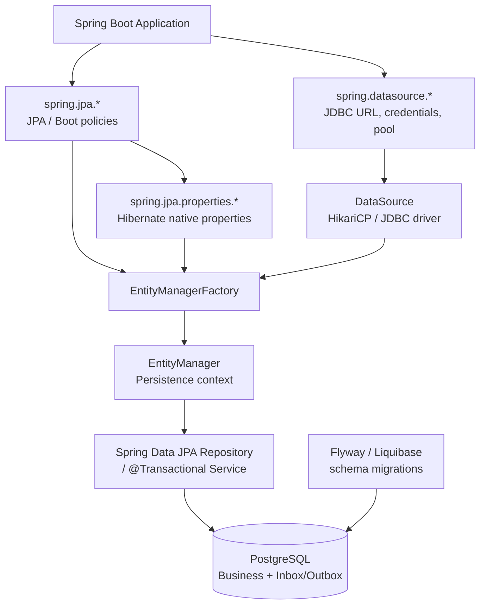
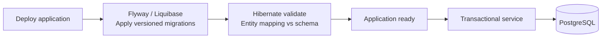
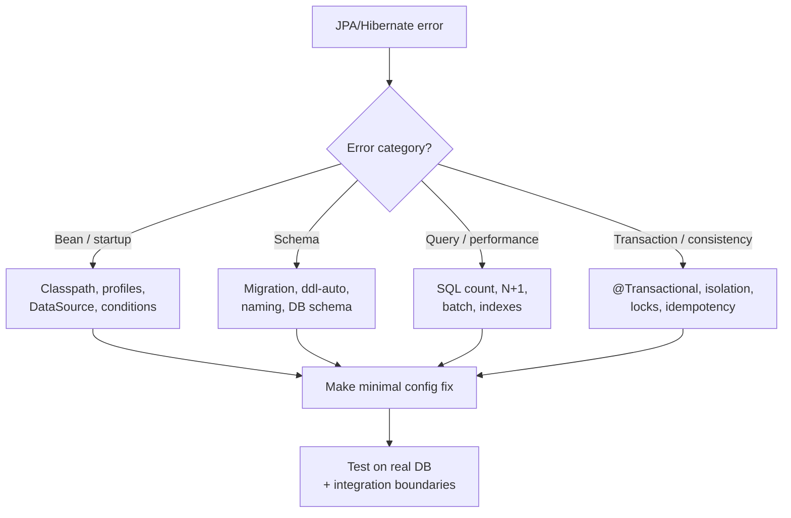

# spring.jpa.* and Hibernate-Specific Configuration

## 1. Why Must We Distinguish Spring Boot, JPA, and Hibernate Configuration?

In the **SPRING_BOOT_INTEGRATION** module, the database stores more than just business data. It can also store **inbox/outbox** state, event deduplication keys, retry metadata, background job checkpoints, and reconciliation records with HTTP clients or message brokers. An unsuitable ORM configuration can slow down integration flows, trigger unexpected queries, or cause transaction failures right when the service needs to recover from an incident.

Three layers are often lumped together as "JPA," yet each has a distinct role:

1. **Jakarta Persistence (JPA)** is the specification and API, including `@Entity`, `EntityManager`, `@PersistenceContext`, JPQL, and persistence context rules.
2. **Hibernate ORM** is a popular JPA provider. Hibernate executes entity mapping, dirty checking, SQL generation, lazy loading, batching, and flushing, and exposes many provider-specific properties prefixed with `hibernate.*`.
3. **Spring Boot + Spring Data JPA** creates and wires the infrastructure: `DataSource`, `EntityManagerFactory`, transaction manager, repositories, auto-configuration, and externalized configuration via `spring.datasource.*` and `spring.jpa.*`.

When you add `spring-boot-starter-data-jpa`, Spring Boot typically selects Hibernate as the persistence provider if classpath and auto-configuration conditions match. However, **Spring Boot configuration is not the same as Hibernate's native property set**.

This lesson dives into **`spring.jpa.*` and Hibernate-specific configuration**: which keys Boot handles directly, which keys are forwarded to the ORM, how to manage schemas with migrations, optimize SQL where appropriate, tighten transaction boundaries, and test integration flows involving HTTP, caching, or brokers.

> Examples target Spring Boot 3.x, Jakarta Persistence 3.x, Hibernate 6, and PostgreSQL. For Spring Boot 4 or other versions, check the documentation and dependency management for your exact version, as starter names, auto-configuration packages, or certain Hibernate keys may change. Performance settings are starting points that require benchmarking.

## 2. Configuration Map from Application to Database



| Group | Primarily Handled By | Purpose | Example |
| --- | --- | --- | --- |
| `spring.datasource.*` | Spring Boot, DataSource/pool, and JDBC driver | URL, credentials, pool sizing, connection timeouts | `spring.datasource.url` |
| `spring.jpa.*` | Spring Boot JPA auto-configuration | Dialect selection, basic SQL logging, Open Session in View, DDL policy | `spring.jpa.open-in-view` |
| `spring.jpa.hibernate.*` | Spring Boot integration for Hibernate | Hibernate options for which Boot provides dedicated keys | `spring.jpa.hibernate.ddl-auto` |
| `spring.jpa.properties.*` | Boot forwards to the persistence provider | Native Hibernate properties lacking dedicated Boot keys | `hibernate.jdbc.batch_size` |
| JPA/Hibernate annotations | JPA provider and mapping metadata | Entities, relationships, fetching, versioning, generators | `@Entity`, `@Version` |
| Flyway/Liquibase | Migration tool | Versioned DDL/DML and upgrade workflows | `V1__create_outbox.sql` |

For example: increasing `spring.datasource.hikari.maximum-pool-size` adjusts connection pool capacity, **not** JDBC batch size; increasing `hibernate.jdbc.batch_size` adjusts Hibernate batching, **not** connection pool size. Likewise, `spring.jpa.show-sql` controls SQL output formatting rather than creating indexes or speeding up queries.

## 3. Dependencies and Auto-Configuration Conditions

### Maven

When Spring Boot parent/BOM manages versions:

```xml
<dependencies>
    <dependency>
        <groupId>org.springframework.boot</groupId>
        <artifactId>spring-boot-starter-data-jpa</artifactId>
    </dependency>

    <dependency>
        <groupId>org.postgresql</groupId>
        <artifactId>postgresql</artifactId>
        <scope>runtime</scope>
    </dependency>

    <dependency>
        <groupId>org.flywaydb</groupId>
        <artifactId>flyway-core</artifactId>
    </dependency>
</dependencies>
```

With newer Flyway generations, PostgreSQL may require a dedicated **database-support module** alongside `flyway-core`. Check the Flyway/BOM documentation for your project version and add any required module; do not assume one dependency suffices across all versions.

### Gradle

```groovy
dependencies {
    implementation 'org.springframework.boot:spring-boot-starter-data-jpa'
    implementation 'org.flywaydb:flyway-core'
    runtimeOnly 'org.postgresql:postgresql'
}
```

The starter supplies Spring Data JPA, Spring ORM, Hibernate, and transaction infrastructure via dependency management. The PostgreSQL JDBC driver is a separate dependency. Flyway is a schema management tool, not part of Hibernate ORM.

For `EntityManagerFactory` to be auto-configured, the application also needs an appropriate `DataSource`, version-compatible JPA/Hibernate classes, discoverable entities, and no custom beans overriding the intended default configuration. If multiple `DataSource` beans exist without a single primary candidate, JPA auto-configuration may fail to determine which `DataSource` to use.

**Distinguishing startup errors:**

- `No qualifying bean of type EntityManagerFactory`: look for missing dependencies/auto-configuration or a missing suitable `DataSource`.
- `Not a managed type`: check entity scanning, `@Entity`, packages, or generic repositories.
- `Unable to determine Dialect`: check JDBC URL, connectivity, driver, and metadata/dialect settings.
- `Schema-validation: missing table`: JPA beans initialized up to validation, but the actual schema differs from expectations.
- `Connection refused`: database/network error, not missing Hibernate classes.

Use `--debug` or a secured `/actuator/conditions` endpoint to inspect auto-configuration conditions; read the deepest root cause of the exception before randomly changing properties.

## 4. Minimal Configuration for PostgreSQL with Migrations

Example `application.yml` for an environment with PostgreSQL and a schema managed by Flyway/Liquibase:

```yaml
spring:
  datasource:
    url: ${DB_URL}
    username: ${DB_USERNAME}
    password: ${DB_PASSWORD}
    hikari:
      maximum-pool-size: 12
      connection-timeout: 5s

  jpa:
    open-in-view: false
    show-sql: false
    hibernate:
      ddl-auto: validate
    properties:
      "[hibernate.jdbc.time_zone]": "UTC"

  flyway:
    enabled: true
```

Meaning:

- **`spring.datasource.*`** points to the real database and configures the connection pool. `DB_URL` is an environment variable, e.g. a JDBC URL like `jdbc:postgresql://db.internal:5432/orders`.
- **`open-in-view: false`** restricts lazy data access outside service/transaction boundaries, preventing the HTTP view layer from silently issuing SQL.
- **`show-sql: false`** avoids printing every SQL statement directly to ORM stdout.
- **`ddl-auto: validate`** instructs Hibernate to verify mappings against the existing schema at startup; do not let Hibernate alter production tables automatically.
- **`hibernate.jdbc.time_zone=UTC`** affects certain JDBC timestamp handling in Hibernate; it does not replace `Instant`/`OffsetDateTime` contracts or database timezone configuration.
- **Flyway** applies versioned migrations before the ORM is used via the appropriate initialization ordering mechanism.

This configuration **does not guarantee production readiness** simply because the context creates beans. The database can lose connectivity after startup, queries can be slow, and migrations can break compatibility with old data. Test and observe real behavior.

## 5. spring.jpa.*: Properties Handled by Spring Boot

Common keys:

| Property | Meaning | Notes |
| --- | --- | --- |
| `spring.jpa.hibernate.ddl-auto` | Hibernate schema management policy | Choose deliberately; production typically uses `validate` or `none` with migrations |
| `spring.jpa.show-sql` | Enables provider SQL printing via Boot config | Useful in dev; prefer structured logging/metrics in production |
| `spring.jpa.open-in-view` | Enables/disables Open EntityManager in View in applicable web apps | Decide intentionally |
| `spring.jpa.database-platform` | Specifies the dialect class for the JPA provider | Usually let Hibernate auto-detect from JDBC metadata |
| `spring.jpa.database` | Hints the database type at Boot's abstraction level | Does not replace JDBC URL/driver |
| `spring.jpa.generate-ddl` | Requests DDL generation at the JPA abstraction level | Avoid conflicting settings alongside `ddl-auto` |
| `spring.jpa.properties.*` | Forwards native provider properties | Hibernate keys must be exact; not Boot-specific flags |
| `spring.jpa.hibernate.naming.physical-strategy` | Selects Hibernate's physical naming strategy | Can change mapped SQL table/column names |
| `spring.jpa.hibernate.naming.implicit-strategy` | Selects the implicit naming strategy | Distinct from physical naming |
| `spring.jpa.defer-datasource-initialization` | Adjusts ordering between JPA init and Boot SQL script init | Do not use as a production migration strategy |

Some properties and defaults change across Spring Boot versions, classpaths, or web environments. Check metadata for your running version. For instance, in servlet web apps with JPA, Open EntityManager in View may be enabled by default in some versions, but **never rely on defaults** when explicit transaction boundaries are required.

### A Common Mistake: Wrong Prefix

```properties
# Wrong: Hibernate does not automatically read this key from Spring Environment.
hibernate.jdbc.batch_size=30

# Right: forwarded from Spring Boot -> Hibernate.
spring.jpa.properties.hibernate.jdbc.batch_size=30

# Right: key managed directly by Spring Boot.
spring.jpa.hibernate.ddl-auto=validate
```

Unless the application manually copies arbitrary properties into Hibernate, placing `hibernate.jdbc.batch_size` at the root of `application.properties` is not the standard way Boot passes it to the JPA provider.

## 6. Passing Hibernate Properties via spring.jpa.properties.*

A key feature of Spring Boot JPA is `spring.jpa.properties.*`. Boot passes key/value pairs in this group to the persistence provider; Hibernate reads the `hibernate.*` keys it supports.

Example `application.properties`:

```properties
spring.jpa.properties.hibernate.format_sql=true
spring.jpa.properties.hibernate.jdbc.batch_size=30
spring.jpa.properties.hibernate.order_inserts=true
spring.jpa.properties.hibernate.order_updates=true
spring.jpa.properties.hibernate.default_batch_fetch_size=32
spring.jpa.properties.hibernate.query.fail_on_pagination_over_collection_fetch=true
spring.jpa.properties.hibernate.generate_statistics=false
```

Native Hibernate properties **do not use Spring Boot's relaxed binding in the same way Boot-defined properties do**. Always write the exact name Hibernate expects, such as `hibernate.jdbc.batch_size`, rather than changing it to `hibernate.jdbc.batch-size` or altering casing.

### Preserving Dots in YAML Keys

An explicit way to declare map properties:

```yaml
spring:
  jpa:
    properties:
      "[hibernate.format_sql]": "true"
      "[hibernate.jdbc.batch_size]": "30"
      "[hibernate.order_inserts]": "true"
      "[hibernate.order_updates]": "true"
      "[hibernate.default_batch_fetch_size]": "32"
      "[hibernate.query.fail_on_pagination_over_collection_fetch]": "true"
```

Bracket notation under `properties` ensures the map key is preserved verbatim, including dots; YAML requires quoting bracketed keys. This is a safe way to express dotted provider keys. Do not set `spring.jpa.properties.hibernate.ddl-auto`: Hibernate uses `hibernate.hbm2ddl.auto` natively; in Spring Boot, prefer `spring.jpa.hibernate.ddl-auto` to avoid conflicts.

**Do not blindly enable all of the above settings for every application.** Batching helps batch writes; batch fetching alters SQL query shapes; the query pagination guard turns warnings into exceptions to surface bugs early. Every setting should be backed by measurements and tests.

## 7. ddl-auto: validate, none, update, create, create-drop

`spring.jpa.hibernate.ddl-auto` is one of the highest-impact properties:

| Value | Primary Behavior | Recommendation |
| --- | --- | --- |
| `none` | Hibernate performs no DDL management or validation via this action | Suitable with migrations when schema checks happen elsewhere |
| `validate` | Validates mappings against the existing schema at startup | Usually suitable after Flyway/Liquibase |
| `update` | Hibernate attempts to alter the schema to match entity mappings | Do not treat as a safe production migration tool |
| `create` | Recreates Hibernate-managed schema objects on bootstrap | Only for environments where data can be discarded |
| `create-drop` | Creates schema on startup and drops it when the session factory closes | Suitable for certain tests/demos, never for important databases |

**Never rely on the default.** Boot may infer a DDL policy based on embedded vs. external databases, the presence of migration tools, and framework version. Production should explicitly set `validate` or `none` according to policy.

### Why Is update Dangerous in Production?

`update` is not a history-tracked migration system. It lacks code review, rollback workflows, and safe data transformations for real-world changes:

- Renaming a column can be interpreted as adding a new column, leaving old column data uncopied.
- Changing `VARCHAR` to a more complex type can fail or lose data.
- Adding a `NOT NULL` constraint can fail because historical rows have no value.
- Adding indexes or constraints on large tables impacts locks and throughput.
- Multiple replicas starting concurrently may attempt simultaneous schema alterations.

For a service storing **outbox** or **processed_event** records, a broken migration can also break event recovery and idempotency keys. Prefer versioned, reviewed migrations executed before serving traffic.

### Validate Does Not Replace Migrations

`validate` catches several important schema/entity mismatches, but **does not replace business verification** of unique indexes, FKs, performance indexes, policies, data conversions, or compatibility across concurrently running application versions. Migrations still must be tested against production-like data.

## 8. Flyway/Liquibase and Initialization Ordering

A safe schema pipeline typically follows:



Example PostgreSQL migration for an outbox table:

```sql
CREATE TABLE outbox_event (
    id BIGINT GENERATED BY DEFAULT AS IDENTITY PRIMARY KEY,
    event_id VARCHAR(120) NOT NULL,
    event_type VARCHAR(80) NOT NULL,
    payload_json TEXT NOT NULL,
    status VARCHAR(24) NOT NULL DEFAULT 'PENDING',
    version BIGINT NOT NULL DEFAULT 0,
    created_at TIMESTAMPTZ NOT NULL DEFAULT CURRENT_TIMESTAMP,
    CONSTRAINT uq_outbox_event_id UNIQUE (event_id)
);

CREATE INDEX idx_outbox_status_created
    ON outbox_event(status, created_at);
```

Actual migration files are discovered by Flyway using conventions such as `db/migration/V1__create_outbox.sql` once the appropriate plugin/dependencies are configured.

This table is **an example for Spring Boot Integration flows**: a stable event ID underpins deduplication, `status` tells the dispatcher which events are pending, and `version` supports optimistic locking when needed. Before production use, add `attempt_count`, `next_attempt_at`, retry metadata, retention, and claim/lease fields if multiple worker replicas run.

### Do Not Mix Schema Creation Mechanisms Unintentionally

When using Flyway/Liquibase:

- Do not let `ddl-auto=create` run after migrations and wipe your schema.
- Do not run `schema.sql` in competition with migration scripts.
- `spring.jpa.defer-datasource-initialization` mainly controls Boot's ordering between SQL script initialization and JPA startup; it is not a general solution for Flyway/Liquibase.
- If a migration changes data types or renames columns, use an **expand-and-contract** plan so old and new versions can coexist during rolling deployments.
- Always verify indexes needed for inbox/outbox queries, not just table existence.

## 9. Illustrative Entity Mapping for the Outbox

An entity mapping to the table above:

```java
import java.time.OffsetDateTime;

import jakarta.persistence.Column;
import jakarta.persistence.Entity;
import jakarta.persistence.GeneratedValue;
import jakarta.persistence.GenerationType;
import jakarta.persistence.Id;
import jakarta.persistence.Table;
import jakarta.persistence.Version;

@Entity
@Table(name = "outbox_event")
public class OutboxEvent {

    @Id
    @GeneratedValue(strategy = GenerationType.IDENTITY)
    private Long id;

    @Column(name = "event_id", length = 120,
            nullable = false, unique = true)
    private String eventId;

    @Column(name = "event_type", length = 80, nullable = false)
    private String eventType;

    @Column(name = "payload_json", nullable = false,
            columnDefinition = "text")
    private String payloadJson;

    @Column(name = "status", length = 24, nullable = false)
    private String status;

    @Version
    @Column(name = "version", nullable = false)
    private long version;

    @Column(name = "created_at", nullable = false,
            insertable = false, updatable = false)
    private OffsetDateTime createdAt;

    protected OutboxEvent() {
        // JPA requires a non-public or public no-arg constructor.
    }

    public OutboxEvent(
            String eventId, String eventType, String payloadJson) {
        this.eventId = eventId;
        this.eventType = eventType;
        this.payloadJson = payloadJson;
        this.status = "PENDING";
    }

    public Long getId() { return id; }
    public String getEventId() { return eventId; }
    public String getStatus() { return status; }
}
```

Notes:

- `GenerationType.IDENTITY` matches PostgreSQL identity columns but can **limit Hibernate's INSERT batching** because it must fetch each generated ID immediately. If batch-write throughput is critical, consider sequence-based IDs with pooled allocation and matching migrations.
- `@Version` detects concurrent updates via optimistic locking; it **does not replace** the unique constraint on `eventId`.
- `payloadJson` is a JSON string produced by the application per contract; `columnDefinition="text"` only fits if the migration actually uses `TEXT`. Switching to `JSONB` requires updating both the Hibernate mapping and the migration.
- `createdAt` receives a database default; `insertable=false, updatable=false` keeps Hibernate from writing it. Seeing the generated value immediately on the entity may require `refresh` or an appropriate generated-value mapping depending on the Hibernate version.
- For SQL schemas using `TIMESTAMPTZ`, reading and writing `OffsetDateTime` must be tested with the real driver, version, and timezone; never assume from the Java type that every database handles timezones identically.

This entity is **illustrative** and does not represent a complete outbox dispatcher. It helps show how DDL, naming, batching, optimistic locking, and schema validation interact when configuring Hibernate.

## 10. Repository, Persistence Context, and Transactions

A repository can be very concise:

```java
import java.util.Optional;
import org.springframework.data.jpa.repository.JpaRepository;

public interface OutboxRepository
        extends JpaRepository<OutboxEvent, Long> {

    Optional<OutboxEvent> findByEventId(String eventId);
}
```

Spring Data JPA creates an implementation backed by the managed `EntityManager`. In a service:

```java
import org.springframework.stereotype.Service;
import org.springframework.transaction.annotation.Transactional;

@Service
public class OutboxWriteService {

    private final OutboxRepository repository;

    public OutboxWriteService(OutboxRepository repository) {
        this.repository = repository;
    }

    @Transactional
    public Long saveEvent(
            String eventId, String type, String payloadJson) {
        OutboxEvent event = repository.save(
            new OutboxEvent(eventId, type, payloadJson)
        );
        return event.getId();
    }
}
```

`@Transactional` creates a transaction using the appropriate transaction manager when invoked through a Spring proxy. Within the same transaction, `EntityManager` tracks managed entities and performs dirty checking. Hibernate may defer SQL until flush, yet **flush is not commit**: SQL already sent to the database can still be rolled back.

In this example using identity IDs, `save` may trigger an early `INSERT` to obtain the ID. Exact SQL timing depends on the ID strategy and persistence context state; do not build contracts around assumed SQL timing.

### Why Not Do Everything Inside Entities?

Entities should model business state and mappings. Logic that calls HTTP clients, publishes to RabbitMQ, invalidates Redis, or sends emails belongs in the **service/adapter layer**. Placing network side effects inside `@PostPersist`/`@PostUpdate` can trigger external effects before the database transaction commits, making retries, testing, and error handling difficult.

## 11. @Transactional and What Hibernate Cannot Solve Alone

A database transaction protects changes **within the same database/resource**. It does not automatically extend to HTTP clients, RabbitMQ, Kafka, Redis, or SMTP.

Dangerous example:

```java
@Transactional
public void createOrder(CreateOrderCommand command) {
    orderRepository.save(command.toEntity());

    rabbitTemplate.convertAndSend(
        "integration.orders.events",
        "order.created",
        command.toJson()
    );
}
```

Note that this example assumes application-defined `CreateOrderCommand`, `orderRepository`, and `rabbitTemplate`. The core point: if the broker receives the message and the SQL transaction then rolls back, consumers see an event contradicting committed data. If the database commits and the process crashes before publishing, the message is lost.

**Transactional outbox** is the standard pattern:

1. Persist the business entity and `OutboxEvent` **in the same database transaction**.
2. A worker polls `PENDING` outbox rows in batches and claims/leases them if multiple instances run.
3. Publish to RabbitMQ/Kafka with a stable `eventId` and monitor confirms/returns.
4. Update outbox rows to `SENT`/`RETRY` based on outcome.
5. Consumers deduplicate using a unique key `(source, eventId)` within their own transaction.

Hibernate helps persist entities and enforce local transactions, but **does not provide exactly-once cross-broker business effects** through `spring.jpa.*` configuration alone.

### Propagation, Rollback, and Exceptions

Points to verify with tests:

- Unchecked exceptions normally trigger rollback per Spring transaction rules; checked exceptions may require `rollbackFor` if business policy demands it.
- Calling a `@Transactional` method via `this.method()` within the same bean typically bypasses the proxy, so transaction advice may not apply as expected.
- `readOnly=true` is a useful hint/configuration, not a security guard blocking all SQL writes.
- Lazy loading must happen within an appropriate persistence context/transaction; keeping a session open just to avoid exceptions does not fix redundant queries.
- With multiple transaction managers, explicitly select the right manager for the target database.

## 12. Open EntityManager in View: spring.jpa.open-in-view

When Open EntityManager in View (OSIV) is enabled for an applicable web application, an `EntityManager` may remain open for the request duration, allowing `LAZY` association access from controllers or serializers to **continue issuing SQL after the service transaction has ended**.

This can hide problems:

```text
GET /orders/501
   |
   +-- Controller calls orderService.findById()
   |      +-- Repository loads Order
   |      +-- Service transaction ends
   |
   +-- Jackson serializes order.items
          +-- Lazy load runs SQL during response rendering
```

Consequences include N+1 queries, erratic latency, prolonged connection/resource retention, or data access outside transaction control. Some environments then hit `LazyInitializationException` once OSIV is turned off and serializers still touch lazy associations.

Explicit configuration:

```yaml
spring:
  jpa:
    open-in-view: false
```

When disabling OSIV, the right fix is **not** turning every association into `FetchType.EAGER`. Design a proper read model instead:

- Transactional services select the exact fields needed by the API.
- Repositories use DTO projections, JPQL projections, or intentional `@EntityGraph`/fetch joins.
- Controllers return DTOs rather than JPA entities carrying uninitialized lazy relations outside the transaction.
- Test query counts and endpoint serialization under the real OSIV configuration.

This keeps business transactions as clear boundaries and reduces unpredictable SQL during response serialization.

## 13. Naming Strategies: Entity Names Do Not Automatically Equal Table Names

Hibernate maps logical names to physical names. Two concepts matter:

- **ImplicitNamingStrategy**: determines the default logical name when annotations omit an explicit name.
- **PhysicalNamingStrategy**: converts logical names into physical SQL names, e.g., converting `orderEvent` to `order_event`.

Spring Boot provides:

```properties
spring.jpa.hibernate.naming.implicit-strategy=...
spring.jpa.hibernate.naming.physical-strategy=...
```

Here `...` represents a **strategy class name chosen by the project**, not a literal runnable value. Default strategy names and package paths depend on the Boot/Hibernate version.

In integration flows with migration-managed databases, the clearest way to eliminate ambiguity is naming explicitly when needed:

```java
@Entity
@Table(name = "outbox_event")
class OutboxEvent {
    @Column(name = "event_id")
    private String eventId;
}
```

This abbreviated snippet illustrates the annotations; the full entity is in Section 9.

Do not change naming strategies wholesale in production without reconciling DDL, as a new strategy can alter hundreds of table, column, and constraint names; the ORM might report missing tables while the underlying data sits untouched. Also watch out for SQL reserved words and dialect-specific case sensitivity or quoted identifiers.

## 14. Hibernate Dialect and Database Selection

The Hibernate dialect governs how SQL is generated and interpreted for a database: pagination, identity/sequences, data types, SQL functions, and syntax. Spring Boot offers:

```properties
# Only illustrative when explicit specification is required:
spring.jpa.database-platform=org.hibernate.dialect.PostgreSQLDialect
```

With modern Hibernate and a JDBC connection providing sufficient metadata, **usually let Hibernate auto-detect the dialect** instead of hardcoding it. If a database requires a specialized dialect, verify the dialect class still exists in your project's Hibernate release.

Avoid configuring conflicting settings simultaneously, such as:

```properties
spring.jpa.database-platform=org.hibernate.dialect.PostgreSQLDialect
spring.jpa.properties.hibernate.dialect=org.hibernate.dialect.MySQLDialect
```

Contradictory settings produce hard-to-reason-about behavior. Never tweak the dialect to "fix" `Connection refused`; fix the JDBC URL, network, credentials, or database availability.

If production uses PostgreSQL while integration tests run on H2, tests can miss SQL `JSONB`, `SKIP LOCKED`, unique indexes, timestamps, isolation levels, and advisory locks. Prefer a PostgreSQL container for those behaviors.

## 15. JDBC Batching: hibernate.jdbc.batch_size and Practical Limits

Hibernate can group identical SQL templates into JDBC batches to reduce round trips:

```yaml
spring:
  jpa:
    properties:
      "[hibernate.jdbc.batch_size]": "30"
      "[hibernate.order_inserts]": "true"
      "[hibernate.order_updates]": "true"
```

- `hibernate.jdbc.batch_size` sets the maximum ORM-level batch size.
- `hibernate.order_inserts` groups structurally similar INSERTs, though reordering can affect insertion order and add sorting overhead.
- `hibernate.order_updates` groups UPDATEs, which can help batch updates and reduce certain lock contentions, subject to load testing.

### Batching Does Not Always Happen

Common reasons:

1. Entities use `GenerationType.IDENTITY`, forcing Hibernate to execute INSERTs individually to retrieve generated IDs.
2. SQL statements vary in shape due to dynamic insert/update or mapping differences.
3. Batches are too small or only a single entity is saved per transaction.
4. Native/JDBC APIs bypass Hibernate's batching settings.
5. Flush/transaction boundaries or driver behavior prevent expected batching.

In the `OutboxEvent` example using `IDENTITY`, do not benchmark and hastily raise `batch_size` to 1000. If high-throughput inserts are required, consider `SEQUENCE` with pooled allocation in an appropriate schema, or direct JDBC batching for dedicated bulk inserts.

### Flush/Clear for Large Batches

```java
import jakarta.persistence.EntityManager;
import org.springframework.stereotype.Service;
import org.springframework.transaction.annotation.Transactional;

import java.util.List;

@Service
public class OutboxBulkImporter {
    private final EntityManager entityManager;

    public OutboxBulkImporter(EntityManager entityManager) {
        this.entityManager = entityManager;
    }

    @Transactional
    public void persistAll(List<OutboxEvent> events) {
        for (int i = 0; i < events.size(); i++) {
            entityManager.persist(events.get(i));

            if ((i + 1) % 50 == 0) {
                entityManager.flush();
                entityManager.clear();
            }
        }
    }
}
```

This example only demonstrates bounding the persistence context size; it does **not** guarantee JDBC INSERT batching while `IDENTITY` is still used. Calling `clear()` detaches all managed entities; do not continue mutating them assuming Hibernate will save changes automatically. The code also assumes the input list is small enough not to require streaming pagination.

Choose batch size based on row count, JDBC driver, network round trips, memory, and contention. **Larger batches do not mean infinitely better performance.**

## 16. N+1 Queries and hibernate.default_batch_fetch_size

Loading 100 orders and then accessing `order.getItems()` can trigger **N+1**: one query for the orders plus many additional queries for each order's items.

```text
SELECT ... FROM orders LIMIT 100;
SELECT ... FROM order_item WHERE order_id = 1;
SELECT ... FROM order_item WHERE order_id = 2;
...
SELECT ... FROM order_item WHERE order_id = 100;
```

There are multiple ways to address this:

| Approach | Best Suited When | Risks to Consider |
| --- | --- | --- |
| DTO projection | The API only needs specific columns or simple aggregates | Requires explicit mappers or queries |
| `@EntityGraph` | Required associations are known upfront for the use case | Over-fetching data or bloated joins |
| JPQL `join fetch` | Fetching a needed graph in an explicit query | Duplicates; collection pagination is error-prone |
| `hibernate.default_batch_fetch_size` | Batching multiple lazy fetches together | Reduces query count but does not eliminate every N+1 |
| `@BatchSize` on mappings | Locally tuning one association or entity | Requires understanding fetch behavior and caching |
| Separate query/read model design | Reports or reading many pages of large datasets | More code, but cost is easier to manage |

Example native property:

```properties
spring.jpa.properties.hibernate.default_batch_fetch_size=32
```

When applied, Hibernate can batch multiple lazy loads into `IN (...)` queries or an equivalent strategy instead of issuing one query per entity. Still, it is no substitute for deciding **what data an endpoint actually needs**.

### Guarding Against Pagination Over Collection Fetches

Fetch-joining a collection alongside `Pageable` can cause in-memory pagination or unexpected performance behavior. To catch this early:

```properties
spring.jpa.properties.hibernate.query.fail_on_pagination_over_collection_fetch=true
```

This setting instructs Hibernate to reject dangerous pagination-over-collection-fetch queries rather than merely logging a warning. The standard alternative is **two-phase fetching**: paginate the order IDs first, then fetch items for the selected IDs while preserving order and avoiding duplicates.

Never set `FetchType.EAGER` across all associations to cure `LazyInitializationException`. EAGER can trigger heavy queries even when an API never uses that data.

## 17. Flush Mode, Dirty Checking, and Bulk Updates

Hibernate tracks managed entities and detects changes automatically. While convenient for CRUD, it poses risks when workers process many events:

- If an entity is modified in the persistence context, Hibernate may flush an `UPDATE` at its discretion (e.g., before certain queries or before commit).
- `flush()` sends pending SQL to the DB but **does not commit the transaction**.
- `clear()` discards current managed state; mutating an entity after `clear()` without merging/persisting will not save changes.
- Bulk JPQL `UPDATE`/`DELETE` statements can bypass dirty checking, lifecycle callbacks, and in-memory persistence context state.
- After a bulk update, previously loaded entities may retain **stale state** in memory; clear, refresh, or design repository APIs accordingly.

Example updating outbox status via a bulk query:

```java
import org.springframework.data.jpa.repository.JpaRepository;
import org.springframework.data.jpa.repository.Modifying;
import org.springframework.data.jpa.repository.Query;
import org.springframework.data.repository.query.Param;

interface OutboxRepository
        extends JpaRepository<OutboxEvent, Long> {

    @Modifying(clearAutomatically = true, flushAutomatically = true)
    @Query("""
        update OutboxEvent e
           set e.status = :status
         where e.id = :id
    """)
    int updateStatus(
        @Param("id") Long id,
        @Param("status") String status
    );
}
```

This shows an additional method for the repository of the same name in Section 10; do not define two separate interfaces when copying into a project. Calling it requires an active transaction, usually on the service. **A bulk JPQL update like this does not automatically increment `@Version`** as normal dirty checking does; if using optimistic locking or concurrent claims, include explicit version conditions/increments or use an intentional locking mechanism.

For multi-replica outbox workers, do not rely solely on an ID-based `updateStatus` method. You need atomic claim/lease logic, locks/versions, and valid state transitions to keep two workers from sending the same event.

## 18. Isolation, Optimistic Locking, and Deduplication

In system integration, the same webhook or message may arrive multiple times. JPA/Hibernate supports transactions and optimistic locking, yet **idempotency** remains a business design responsibility.

Common mechanisms:

| Mechanism | What It Protects | What It Does Not Protect |
| --- | --- | --- |
| `@Version` | Detects concurrent updates to the same versioned entity | Does not recognize two distinct records for the same event |
| Unique constraint `(source, eventId)` | Prevents committing two processing records with the same business key | Does not roll back HTTP/broker side effects already sent outside the DB |
| Pessimistic lock | Coordinates write access to specific rows during a transaction | Does not hold locks past transaction end or across crashes |
| Claim/lease | Distributes outbox work across multiple workers | Expired leases can still cause duplicate processing |
| Transactional outbox | Prevents losing publish intent when business DB commits | Does not stop brokers/consumers from seeing duplicate messages on retry |
| Consumer idempotency | Avoids reapplying business effects when receiving the same event | Requires consistent IDs and commit boundaries |

Example PostgreSQL DDL for a processed-events table:

```sql
CREATE TABLE processed_event (
    source_system VARCHAR(80) NOT NULL,
    event_id VARCHAR(120) NOT NULL,
    processed_at TIMESTAMPTZ NOT NULL DEFAULT CURRENT_TIMESTAMP,
    PRIMARY KEY (source_system, event_id)
);
```

In a RabbitMQ listener, persist the processed marker and business state in **the same database transaction** whenever possible. If the insert hits a unique constraint, classify whether it is an already-processed replay or a genuine data error. Outside the transaction, let the consumer ack or retry based on the outcome; never assume broker ack participates in the SQL transaction.

Spring Data JPA repository `save`/`find` methods do not automatically prevent race conditions. Tests must send two duplicate events **concurrently** against real PostgreSQL to verify unique indexes and transaction behavior.

## 19. Caching: Spring Cache vs. Hibernate Second-Level Cache

An integration module may simultaneously use Redis, Spring Cache, and Hibernate caches. They are not equivalent:

| Mechanism | Location and Scope | Key Considerations |
| --- | --- | --- |
| **Hibernate first-level cache** | Persistence context/`EntityManager` | Lives for the context lifetime; always a core part of JPA |
| **Hibernate second-level cache (L2)** | Cache regions per `SessionFactory` and provider | Requires a cache provider, proper mappings, and invalidation |
| **Hibernate query cache** | Caches query results when explicitly enabled | Easily stale if external systems mutate the data |
| **Spring Cache abstraction** | Method-level caching/`@Cacheable` | Keys, TTLs, and eviction are managed by application code |
| **Redis cache / external state** | Out-of-process store shared across replicas | Not automatically transactional with Hibernate transactions |

Do not set `hibernate.cache.use_second_level_cache=true` assuming the system will automatically share cache safely across all pods. L2 cache needs an **appropriate region factory/provider** and a coherence strategy when multiple nodes access data. If another system writes directly to the same database, Hibernate cache can go stale without invalidation.

For outbox/inbox and rapidly mutating state, indiscriminate caching can prevent workers from seeing new events or cause stale updates. Prefer transactionally consistent queries, proper indexes, and only add caching with a clear justification.

## 20. SQL Logging, Bind Parameters, and Hibernate Statistics

To diagnose generated SQL:

```yaml
spring:
  jpa:
    show-sql: false
    properties:
      "[hibernate.format_sql]": "true"
      "[hibernate.generate_statistics]": "false"

logging:
  level:
    org.hibernate.SQL: DEBUG
    org.hibernate.orm.jdbc.bind: TRACE
```

In Hibernate 6, the `org.hibernate.orm.jdbc.bind` logger is typically used to inspect bind parameters. In Hibernate 5, the bind logger has a different name, such as `org.hibernate.type.descriptor.sql.BasicBinder`. Adjust to match your running release.

**Critical warning:** JDBC bind TRACE logging can record **PII, tokens, sensitive payloads, emails, or payment details**. Only enable it temporarily in approved environments with redaction, restricted access, and an expiration plan. In production, prioritize query duration/slow-query metrics, SQL counts, connection pool saturation, lock waits, and business metrics rather than logging all bind values.

`hibernate.generate_statistics=true` provides ORM statistics for investigation, at the cost of overhead. When enabled, plan how metrics are collected and turn it off when no longer needed. Specific Hibernate/Spring Boot Actuator metric names depend on versions and active instrumentation; do not assume dashboards populate automatically just from enabling the property.

### Measure N+1 Instead of Guessing

A practical measurement workflow:

1. Enable SQL logging/counting in a test environment.
2. Call the endpoint with 1, 10, and 100 linked records.
3. Compare SQL counts and timings; if SQL scales with N, inspect the fetch plan.
4. Apply DTO projections, fetch joins, entity graphs, or batch fetching as appropriate.
5. Re-run tests to compare query counts and payload sizes.
6. Disable bind TRACE before deploying configurations to environments with real data.

## 21. Multi-DataSource, EntityManagerFactory, and Transaction Managers

A **SPRING_BOOT_INTEGRATION** application might use:

- PostgreSQL A for orders and inbox/outbox.
- PostgreSQL B for partner configuration or analytics.
- A separate database for Quartz scheduler.
- Redis as a cache, not a JPA datasource.

With multiple `DataSource`s, repositories cannot magically pick the right database. A multi-datasource setup typically requires explicit declarations for:

1. Names and properties for each `DataSource`.
2. Corresponding `EntityManagerFactory` beans for each entity group (if both use JPA).
3. A `PlatformTransactionManager` for each persistence unit.
4. `@EnableJpaRepositories` specifying `entityManagerFactoryRef` and `transactionManagerRef`.
5. `@Transactional(transactionManager = "...")` or `@Transactional("...")` on services targeting the right manager.
6. Explicit `@Primary`/`@Qualifier` annotations when multiple candidates share a type.

**Never use database A's JPA transaction manager expecting it to commit resource B atomically.** Two separate local transactions do not automatically form a distributed transaction. To synchronize changes across databases or brokers, use sagas, outboxes, or carefully evaluated distributed transaction mechanisms based on actual requirements.

### Customizing with HibernatePropertiesCustomizer

When `spring.jpa.properties.*` is insufficient, Spring Boot offers extension points like `HibernatePropertiesCustomizer` to supply properties or programmatic Hibernate customizations without manually assembling the entire `EntityManagerFactory`. The package of this class can change across Spring Boot generations, so check your version before importing.

A customizer can register a `StatementInspector` for SQL observation or integrate multi-tenancy via the provider API. Never let inspector logic block threads, log sensitive data, or rewrite SQL haphazardly.

If you manually build a `LocalContainerEntityManagerFactoryBean`, you also take responsibility for `packagesToScan`, JPA properties, persistence unit names, `DataSource`, transaction managers, entity listeners, schema validation, and defaults that Boot previously wired for you.

## 22. Testing spring.jpa.* Against a Real Database

Repository tests running on H2 can miss PostgreSQL differences such as SQL `JSONB`, `TIMESTAMPTZ`, identity/sequences, unique constraints, transaction isolation, locking, and `SKIP LOCKED`. For integration flows involving transactions and idempotency, prefer a PostgreSQL test container.

Example test configuration for a Spring Boot version supporting `@ServiceConnection`:

```java
import static org.assertj.core.api.Assertions.assertThat;

import org.junit.jupiter.api.Test;
import org.springframework.beans.factory.annotation.Autowired;
import org.springframework.boot.test.autoconfigure.jdbc.AutoConfigureTestDatabase;
import org.springframework.boot.test.autoconfigure.orm.jpa.DataJpaTest;
import org.springframework.boot.testcontainers.service.connection.ServiceConnection;
import org.testcontainers.containers.PostgreSQLContainer;
import org.testcontainers.junit.jupiter.Container;
import org.testcontainers.junit.jupiter.Testcontainers;

@DataJpaTest(properties = {
    "spring.jpa.hibernate.ddl-auto=validate",
    "spring.jpa.open-in-view=false"
})
@AutoConfigureTestDatabase(
    replace = AutoConfigureTestDatabase.Replace.NONE
)
@Testcontainers
class OutboxRepositoryIT {

    @Container
    @ServiceConnection
    static PostgreSQLContainer<?> postgres =
        new PostgreSQLContainer<>("postgres:16-alpine");

    @Autowired
    OutboxRepository repository;

    @Test
    void savesAndFindsEvent() {
        repository.saveAndFlush(
            new OutboxEvent(
                "evt-001", "order.created", "{\"orderId\":\"ORD-501\"}"
            )
        );

        assertThat(repository.findByEventId("evt-001"))
            .isPresent();
    }
}
```

This example assumes the migration creating the outbox table from Section 8, a Spring Boot version supporting `@ServiceConnection`, and test dependencies such as `spring-boot-testcontainers`, `spring-boot-starter-test`, `org.testcontainers:postgresql`, and Testcontainers JUnit integration. Newer Spring Boot releases may alter annotation packages; verify against your project's version.

### What This Test Proves and Does Not Prove

- **Proves when passing:** entity mappings, repository save/find, JDBC driver, migrations, and basic PostgreSQL connectivity work under test conditions.
- **Does not prove:** batch throughput, multi-replica concurrency, broker publish confirms, cache TTLs, race conditions, or production credential/TLS configuration.
- `@DataJpaTest` normally rolls back the test transaction after each method. That provides test isolation, not proof that an actual transaction commits after an asynchronous flow.
- To verify migrations in tests, ensure Flyway/Liquibase is enabled and actual migration files exist on the classpath.

### Other Important Tests

| Scenario | Desired Evidence |
| --- | --- |
| Schema missing a column compared to entity | `ddl-auto=validate` catches mismatch before serving traffic |
| Adding a new entity in a release | Migration executes cleanly and mappings do not auto-create tables |
| Two events with duplicate IDs | Unique constraint blocks the second record in the real DB |
| Two workers updating a stale version | Optimistic lock conflict is detected and retried with bounds |
| Bulk update after an entity was loaded | `clear`/`refresh` prevents stale state |
| Querying a list of 100 orders | Query count is bounded, with no unintended N+1 |
| Pagination combined with collection fetch | Guard property catches dangerous queries |
| Outbox DB commits, RabbitMQ unavailable | Record stays `PENDING`/`RETRY` for recovery |
| Rolling schema upgrade | Old and new app versions read/write cleanly during the compatibility window |

For performance questions, run benchmarks/load tests with production-like data sizes and cardinalities; a unit test with a handful of rows does not prove `batch_size=30` is optimal.

## 23. Troubleshooting: Common Configuration Errors

| Symptom | Possible Cause | Priority Check |
| --- | --- | --- |
| `EntityManagerFactory` not created | Missing starter, `DataSource`, or auto-config condition | Runtime classpath, conditions report, `DataSource` bean |
| `Not a managed type` | Entity not scanned, missing `@Entity`, wrong package | Main class package, `@EntityScan`, repository generics |
| `Unable to determine Dialect` | JDBC metadata unreachable, wrong URL/driver | JDBC URL, DB connectivity, driver dependency |
| `Schema-validation: missing table` | Flyway did not run, wrong schema search path | Migration history, schema, connection user |
| Hibernate wipes tables after startup | `ddl-auto=create/create-drop` active on a stateful DB | Effective config, profiles, property precedence |
| `LazyInitializationException` | Accessing lazy association outside transaction/context | Service DTO projection, fetch plan, OSIV |
| List endpoint slows down linearly with record count | N+1, uncontrolled fetching | SQL count, DTO/EntityGraph/batch fetch |
| Outbox INSERTs do not batch | `IDENTITY` ID generator, varying SQL shapes, batching disabled | ID strategy, batch properties, Hibernate SQL/batch metrics |
| Connection pool exhausted | Overly long transactions, slow queries, high concurrency | Hikari active/pending, slow SQL, lock waits |
| `OptimisticLockException` | Updating entity with stale version | Retry policy, concurrency, stale data |
| `DataIntegrityViolationException` | Unique/FK/not-null constraint violated | DB constraints, input/event ID, transaction state |
| Wrong SQL column names after upgrade | Naming strategy or quoted identifiers changed | Entity mappings, migrations, effective strategy |
| Wrong timezone | Inconsistent Java/SQL types, JDBC driver, or timezone policy | UTC policy, `Instant`/`OffsetDateTime`, round-trip tests |
| Changing `spring.jpa.*` has no effect | Wrong prefix or native Hibernate key | Effective property sources, typos, Hibernate logs |
| Repository hits wrong DB | Multi-datasource/transaction manager missing qualifier | EMF bean, actual datasource URL, `@EnableJpaRepositories` |

### Short Diagnostic Workflow



Do not switch `ddl-auto` to `update` to mask migration failures in production. Do not raise the Hikari pool size when the root cause is N+1 queries or transactions holding connections too long. And do not enable OSIV merely to stop Jackson from throwing `LazyInitializationException` without controlling the resulting queries.

## 24. What to Check When Upgrading Hibernate or Spring Boot

During major upgrades—especially moving from Spring Boot 2.x/Spring Framework 5.x to Boot 3.x/Framework 6.x—check:

1. **Namespace**: entity/JPA imports change from `javax.persistence.*` to `jakarta.persistence.*`.
2. **Hibernate major version**: dialects, type mappings, SQL generation, function APIs, implicit/physical naming, and older properties may change.
3. **Dependency BOM**: JDBC driver, Spring Data JPA, Hibernate ORM, and migration tools must be mutually compatible.
4. **Schema validation**: run against migrated PostgreSQL tests; never use dev H2 to declare production safe.
5. **Timestamp/JSON/enum mappings**: verify SQL types, Java types, serialization, and existing stored data.
6. **Native properties**: confirm `hibernate.*` keys are still supported in the new version; removed properties may silently stop taking effect.
7. **Logging categories**: SQL bind loggers differ between Hibernate 5 and 6.
8. **Multi-datasource custom beans**: verify auto-configuration packages, extension points, and transaction manager selection.
9. **N+1 / batching benchmarks**: query plans and generated SQL can change across Hibernate upgrades.
10. **Rolling deployments**: migrations must remain compatible while old and new app versions coexist; indexes/constraints must serve both paths.

When migrating imports, never keep incompatible old and new JPA libraries side by side just to silence `ClassNotFoundException`. Fix mapping and type errors against the new API and test thoroughly.

## 25. Operational Configuration Checklist

- [ ] Data JPA starter, JDBC driver, and migration tool align with the active Spring Boot BOM.
- [ ] `spring.datasource.url/username/password` are externalized; pool sizing and timeouts reflect real workload.
- [ ] `spring.jpa.hibernate.ddl-auto` is explicitly set; `create`/`update` are never used on non-disposable production data.
- [ ] Flyway/Liquibase run in the right order; schema validation is enabled and migrations have rollback/forward plans.
- [ ] `spring.jpa.open-in-view` is intentionally set; controllers return DTOs backed by measured fetch plans.
- [ ] Native Hibernate properties are correctly placed under `spring.jpa.properties.*`, not confused with Spring Boot properties.
- [ ] Dialect and naming strategies are verified against real DDL and schema search paths.
- [ ] Batching, N+1, lazy fetching, collection pagination, and indexes are verified via real SQL and metrics.
- [ ] No Java serialization on entities/payloads or provider-specific mappings lacking contracts/versions.
- [ ] Transaction boundaries are clear; HTTP/broker side effects are not treated as part of a DB transaction.
- [ ] Inbox/outbox tables have stable event IDs, unique constraints, replay/retry logic, and safe concurrency handling.
- [ ] SQL bind logging is protected so credentials, tokens, PII, or integration payloads never leak.
- [ ] Testcontainers/real databases verify migrations, transactions, idempotency, query counts, and driver compatibility.
- [ ] Upgrades verify `jakarta.persistence`, Hibernate versions, SQL mappings, and coexistence during rolling upgrades.

## 26. Self-Assessment Scenario

A team builds a Spring Boot service consuming payment events from RabbitMQ and persisting processing state in PostgreSQL using Spring Data JPA. After scaling out to multiple pods, they observe:

- Production startup occasionally alters tables via `ddl-auto=update`, even though the project uses Flyway.
- The order history query endpoint slows down linearly with the number of orders and issues many `SELECT`s on `order_items`.
- Increasing `spring.datasource.hikari.maximum-pool-size` barely helps.
- Even with `hibernate.jdbc.batch_size` enabled, outbox INSERTs still run one by one when using `IDENTITY`.
- Two duplicate messages with the same `eventId` are processed concurrently by two consumers.
- Once, the DB committed successfully while publishing the result message to the broker failed.

Explanation and remediation:

1. **Schema**: use Flyway/Liquibase as the single source of DDL truth; switch `ddl-auto` to `validate` or `none` per policy. Tests and migrations must share the same tables and constraints as production.
2. **N+1**: measure query counts and use intentional projections/fetch plans; `hibernate.default_batch_fetch_size` can help, though it does not solve every case. Raising connection pool size does not fix excessive SQL.
3. **Batching**: verify the native property is passed properly and check whether `IDENTITY` generation blocks batching; if needed, consider sequence-based IDs or direct JDBC batching for that use case.
4. **Concurrency**: add a unique index on `(source, eventId)`, proper transactions, and replay-detection logic. `@Version` does not replace an idempotency key.
5. **Broker and database**: JPA transactions do not commit atomically with RabbitMQ; use an outbox, publisher confirms, retries, and consumer deduplication.
6. **Testing**: use a PostgreSQL container for migrations/locking, a RabbitMQ container for routing/confirms, tests for concurrent duplicate events, and tests simulating a crash between DB commit and publish.
7. **Observability**: track query counts, transaction duration, Hikari pool saturation, outbox backlog, publisher failures, and end-to-end business flow completion times.

**Key Takeaway:** `spring.jpa.*` is Spring Boot's integration configuration layer, while deeper Hibernate options pass through `spring.jpa.properties.hibernate.*` using **exact native key names**. Picking the right properties is only step one; a reliable **SPRING_BOOT_INTEGRATION** system also demands versioned migrations, explicit transaction boundaries, database-level idempotency, broker/HTTP retries, real performance measurement, and integration tests using authentic resources.

## References

- [Spring Boot Reference – SQL Databases](https://docs.spring.io/spring-boot/reference/data/sql.html): Spring Data JPA, Hibernate, DataSource, schema initialization, and migrations.
- [Spring Boot – Common Application Properties](https://docs.spring.io/spring-boot/appendix/application-properties/): check `spring.jpa.*` keys by version.
- [Hibernate ORM User Guide](https://docs.jboss.org/hibernate/orm/current/userguide/html_single/Hibernate_User_Guide.html): native properties, batching, fetch strategies, transactions, caches, and schema tools.
- [Spring Data JPA Reference](https://docs.spring.io/spring-data/jpa/reference/): repositories, projections, `@EntityGraph`, and transactions.
- [Jakarta Persistence Specification](https://jakarta.ee/specifications/persistence/): JPA API and semantics independent of Hibernate.

These reference URLs point to general or current documentation; during implementation, prioritize the exact major/minor versions of Spring Boot and Hibernate used by your project to avoid deprecated properties or incompatible APIs.
