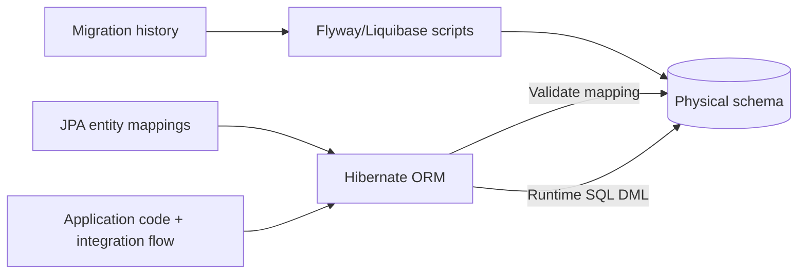
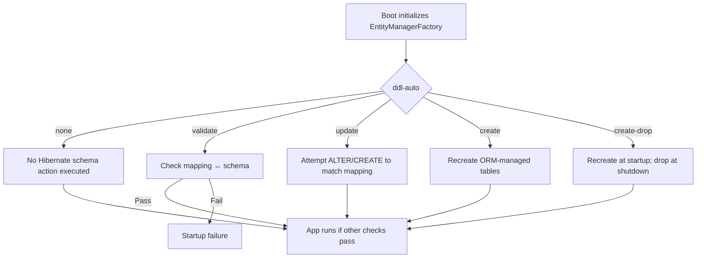
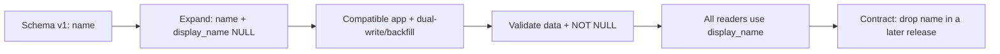
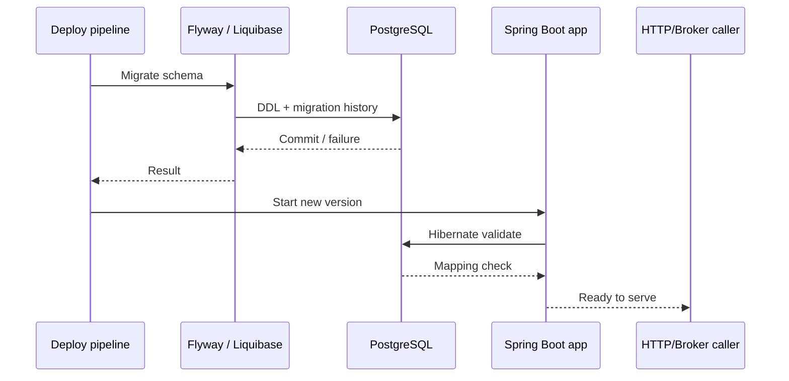
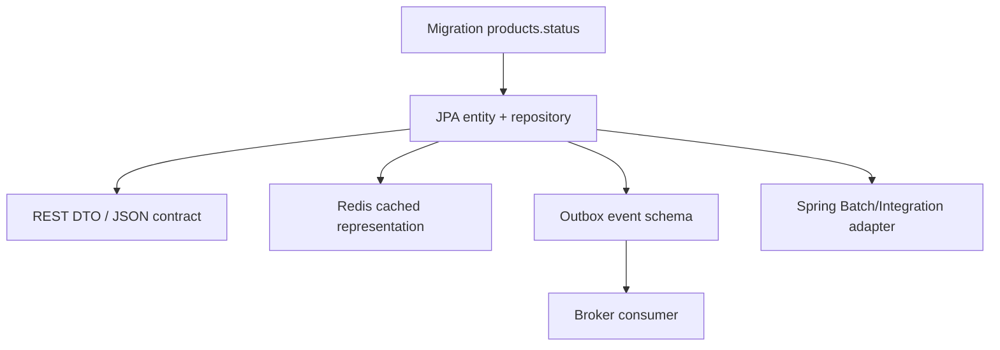
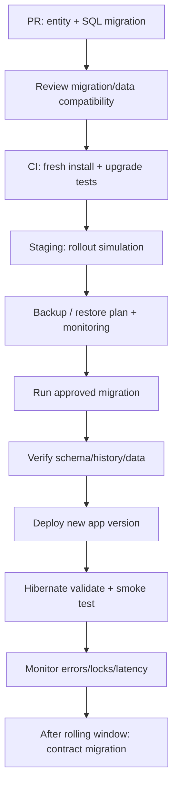
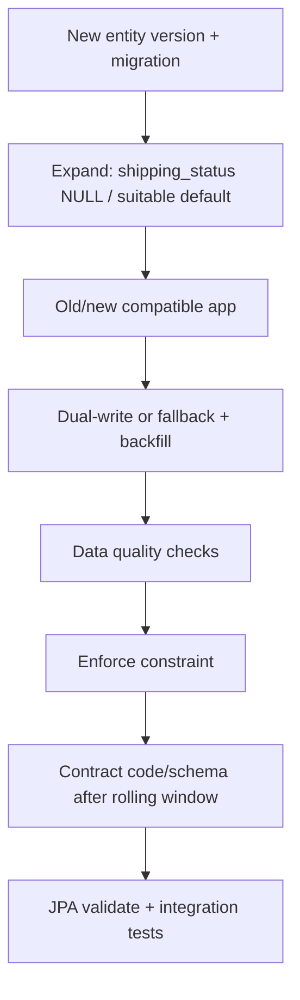

# Choosing a Schema Management Strategy and ddl-auto Limitations

## 1. Why Must the Schema Be Managed Like an Integration Contract?

In **SPRING_BOOT_INTEGRATION**, a Spring Boot application commonly connects HTTP clients, databases, Redis caches, message brokers, and Spring Integration adapters. An order saved through JPA/Hibernate may simultaneously create an outbox event, which another consumer reads and uses to refresh a cache. If the database structure changes without planning, failures surface across multiple layers:

- Hibernate starts up, yet a runtime query fails with `column does not exist`.
- An API begins writing a new field while an older consumer or batch job does not understand it yet.
- A new schema adds a `NOT NULL` constraint while older instances are still writing incomplete rows.
- A migration holds locks too long, causing HTTP request timeouts and surging broker consumer redeliveries.
- A developer enables `ddl-auto=create` against a database with real data, wiping Hibernate-managed tables.
- Tests pass on H2 with auto-generated schemas, while production PostgreSQL lacks indexes, constraints, or uses different column types.

**A database schema is a storage and data-exchange contract shared across application versions, jobs, and integrations**, not merely a shape derived automatically from `@Entity` classes. Choosing who owns the schema determines deployment safety, auditability, rollback options, and overall system reliability.

This lesson focuses on **"Choosing a Schema Management Strategy and ddl-auto Limitations"** in the **JPA and Hibernate** chapter:

1. How each `spring.jpa.hibernate.ddl-auto` mode behaves.
2. When Boot infers defaults, and why H2 defaults differ from PostgreSQL.
3. Why `update`, `create`, and `create-drop` are unsuitable as production migration strategies.
4. How to use Flyway/Liquibase as the source of truth paired with `validate`.
5. Designing compatible schema changes when rolling deployments, batch jobs, and broker consumers run concurrently.
6. Testing and observing migration errors in production-like environments.

Examples use **Spring Boot 3.x, Hibernate 6.x, Jakarta Persistence, and PostgreSQL**. Always verify property names and default behaviors against your project's exact Spring Boot/Hibernate versions; do not extrapolate from another guide without checking your runtime environment.

## 2. Distinguishing Entity Model, Database Schema, and Migration History

Three layers have distinct responsibilities:

| Layer | Representation | Managed By | Example |
| --- | --- | --- | --- |
| **Entity mapping** | Java classes, annotations, relationships, and JPA metadata | Application developers | `@Entity`, `@Table`, `@Column`, `@Version` |
| **Physical schema** | Tables, columns, indexes, constraints, views, triggers, DB privileges | Database + deployment pipeline | `products(id, sku, price)`, unique index |
| **Migration history** | Executed schema changes, ordering, and checksums | Flyway/Liquibase or DBA process | `V1__create_products.sql`, `DATABASECHANGELOG` |



With `ddl-auto=validate`, Hibernate checks part of its mapping against the existing schema. With Flyway/Liquibase, **migrations** create and evolve the schema. The two mechanisms complement each other: migrations **perform changes**, while validation **detects mismatches**.

**An entity does not describe the entire database.** It can omit partial indexes, complex check constraints, triggers, stored procedures, access privileges, partitioning, retention policies, or online indexing strategies. Relying solely on entities to "generate the schema" can miss critical operational constraints.

### 2.1. Example Mapping with Explicit Column Names

```java
package example.integration.catalog;

import java.math.BigDecimal;
import jakarta.persistence.Column;
import jakarta.persistence.Entity;
import jakarta.persistence.GeneratedValue;
import jakarta.persistence.GenerationType;
import jakarta.persistence.Id;
import jakarta.persistence.Table;
import jakarta.persistence.Version;

@Entity
@Table(name = "products")
public class ProductEntity {

    @Id
    @GeneratedValue(strategy = GenerationType.IDENTITY)
    private Long id;

    @Column(name = "sku", nullable = false, length = 64)
    private String sku;

    @Column(name = "display_name", nullable = false, length = 200)
    private String displayName;

    @Column(name = "price", nullable = false, precision = 19, scale = 2)
    private BigDecimal price;

    @Version
    @Column(name = "version", nullable = false)
    private Long version;

    protected ProductEntity() {
        // Constructor for JPA.
    }

    public ProductEntity(
            String sku,
            String displayName,
            BigDecimal price) {
        this.sku = sku;
        this.displayName = displayName;
        this.price = price;
    }

    public Long getId() { return id; }
    public String getSku() { return sku; }
    public String getDisplayName() { return displayName; }
    public BigDecimal getPrice() { return price; }
    public Long getVersion() { return version; }
}
```

This is a Java entity; **it does not prove the table exists or that constraints have been deployed**. `@Column(nullable=false)` expresses mapping metadata, yet with `ddl-auto=none` or `validate`, Hibernate will not add `NOT NULL` to the database. Data rules must be declared in physical migrations.

`@Version` provides ORM-level optimistic locking; it does not replace unique business keys or consumer idempotency controls for redelivered broker events.

## 3. What Does Hibernate ddl-auto Actually Control?

Spring Boot exposes the common property:

```yaml
spring:
  jpa:
    hibernate:
      ddl-auto: validate
```

`spring.jpa.hibernate.ddl-auto` controls **Hibernate's schema management action** when constructing `EntityManagerFactory`. It does not replace Flyway/Liquibase, does not handle business data batches, and does not provide versioned workflows for code review, deployment, or rollback.

Common values in Boot 3.x:

| Value | Core Behavior | Appropriate Use Case |
| --- | --- | --- |
| `none` | Hibernate does not create, update, drop, or validate the schema via DDL actions | Production where schemas are managed by migrations/DBA, or when Hibernate must not touch DDL |
| `validate` | Verifies part of the current schema against entity mappings; fails startup on mismatch | CI, staging, production after schema migrations run |
| `update` | Hibernate attempts to alter the schema toward entity mappings | Very limited local experiments; **never** as production migrations |
| `create` | Rebuilds ORM-managed schema on startup, typically destroying existing data in those tables | Demos/tests using disposable databases |
| `create-drop` | Rebuilds schema on startup and attempts to drop it when `SessionFactory` closes | Ephemeral demos/tests; never with data worth keeping |

**Major warning:** `create` and `create-drop` are destructive options. Never enable them on shared databases or environments containing data to preserve. Do not assume `create-drop` only drops tables after tests finish: it can drop and recreate **immediately at startup**.



The diagram is a logical model. With `update`/`create`, if the database denies privileges or DDL fails, startup can throw an exception; **never assume transitions from E/F/G to H always succeed**.

### 3.1. ddl-auto Is Not Schema Versioning

`ddl-auto` does not record structured history such as "migration V12 ran with valid checksum." Hibernate may infer certain structural diffs from updated entities, but it cannot know your business intent when you:

- Rename column `name` to `display_name`.
- Convert status strings into an enum.
- Split one table into two.
- Merge two columns into one.
- Convert currency formats or time units.
- Need to backfill historical rows using business logic.
- Need backward compatibility with previous app instances during rolling deployments.

That is the job of **engineered migrations**, not "auto-updating mappings."

## 4. Spring Boot's ddl-auto Defaults Can Surprise You

Omitting `ddl-auto` **does not guarantee identical behavior across environments**.

In Spring Boot 3.x, when Hibernate schema management is auto-configured under common conditions:

- If the datasource is a Boot-recognized **embedded database** (such as H2/HSQLDB/Derby) **and no schema manager like Flyway/Liquibase is present**, Boot typically defaults to `create-drop`.
- For non-embedded databases such as PostgreSQL/MySQL, or when a recognized schema manager is present, the usual default is `none`.

As a result, a project running unit/integration tests on H2 may auto-create tables from entities, then fail when deployed to production PostgreSQL because Boot **no longer creates the schema**.

| Environment | Situation | Safe Expectation |
| --- | --- | --- |
| Disposable H2 in-memory demo without migration tool | May default to `create-drop` | Schema is created and dropped; proves nothing about production migrations |
| Local PostgreSQL without Flyway | Usually defaults to `none` | Must create schema via another tool or deliberate dev configuration |
| PostgreSQL with Flyway/Liquibase | Migration tool owns DDL | Explicitly set `validate`/`none` to clarify ownership |
| Multi-replica production | Instances must not independently decide DDL | Run coordinated migrations; app validates |
| CI with Testcontainers PostgreSQL | Runs production migrations | Combine `validate` with contract tests |

**Recommendation:** in real applications, declare `ddl-auto` explicitly per key profile instead of relying on defaults. When upgrading Spring Boot major versions or adding Flyway/Liquibase, inspect the condition report and resolved configuration.

### 4.1. Do Not Infer Database Reality from JPA Flags

`spring.jpa.show-sql=true` merely helps view Hibernate-generated SQL; it neither creates nor updates schemas. `spring.jpa.hibernate.ddl-auto` is distinct from `spring.sql.init.mode` and `spring.flyway.enabled`. Their separate roles are contrasted later.

## 5. Why Is update Especially Dangerous in Production?

`ddl-auto=update` sounds convenient because it can append a new column after editing an entity. Yet in systems requiring durable data and rolling deployments, it is a risky strategy.

### 5.1. Rename Is Not "Drop Old + Add New"

Before editing:

```sql
CREATE TABLE products (
    id BIGINT PRIMARY KEY,
    name VARCHAR(200) NOT NULL
);
```

The new entity version adds `displayName` mapped to `display_name`. Hibernate has no business migration indicating `name` **was renamed** to `display_name`; it can treat it as a brand-new column instead of migrating data.

The outcome may be un-backfilled legacy rows, the application reading `null` from the new column, or DDL failing due to a `NOT NULL` constraint. Exactly how `update` adds, keeps, or drops columns depends on Hibernate version, dialect, and database state; **it cannot serve as a data-safety guarantee**.

### 5.2. No Review Workflow for Data Changes

Risks include:

- Changing column types, lengths, or precision may require controlled data conversion.
- A new unique constraint may fail because legacy rows contain duplicates.
- Large indexes can hold locks or spike I/O during creation.
- Long-running DDL can exhaust connection pools, affecting HTTP callers and broker consumers.
- No versioned history shows which state was applied to which DB.
- No reviewed rollback scripts or forward-fix plans exist.

**Production rule:** never use Hibernate `update` for migrations. Keep entity mappings as the runtime model and manage DDL via a versioned schema pipeline.

## 6. create and create-drop: Only for Disposable Databases

`create` and `create-drop` are convenient for tiny demos or short tests, provided you remember they are destructive.

Example **only inside an ephemeral test profile**:

```yaml
# application-local-ephemeral.yml — disposable DB only, no data to preserve
spring:
  jpa:
    hibernate:
      ddl-auto: create-drop
```

Never make this the default for shared development, staging, or production. A local PostgreSQL container backed by a named volume may hold valuable developer state; running locally **does not automatically mean disposable**.

### 6.1. Hibernate's import.sql Is Another Trap

When Hibernate creates the schema under modes like `create`/`create-drop`, an `import.sql` resource on the classpath may be executed by Hibernate to load data. That suits demos/tests, not versioned production seed data.

If a project accidentally packages an `import.sql` containing sample rows or destructive statements, enabling `create` can cause unintended side effects. For core business reference data, place seed data in versioned migrations or a controlled import process.

### 6.2. Passing Tests via create-drop Do Not Prove Correct Migrations

A test using only:

```yaml
spring:
  datasource:
    url: jdbc:h2:mem:testdb
  jpa:
    hibernate:
      ddl-auto: create-drop
```

can boot cleanly even if the project is **missing every production Flyway/Liquibase file**. When deployed to PostgreSQL, the application will fail with missing tables or constraints.

Keep fast H2 tests for isolated ORM logic where appropriate; use a PostgreSQL container executing real migrations in integration tests to protect the production schema contract.

## 7. Recommended Strategy by Environment

| Environment | Who Owns Schema Changes? | ddl-auto | Explanation |
| --- | --- | --- | --- |
| Unit tests without DB | No real schema | Not applicable | Mock repositories or test domain logic |
| Disposable H2 demo | Hibernate may create temporarily | `create-drop` | Data loss is acceptable |
| Local dev with Flyway | Flyway/Liquibase | `validate` | Maintains prod parity and catches missing migrations |
| Testcontainers integration tests | Runs versioned migrations | `validate` | Tests against real DB engine and version |
| Staging/UAT | Migration pipeline | `validate` | Fails fast if entity and schema drift |
| Production | Pipeline/DBA/schema owner | `validate` or `none` intentionally | Never let the ORM alter DDL |
| Schema owned by external system | DBA/external platform | `validate` if feasible, else `none` | ORM must conform to contract, not modify it |

**`validate` is not a migration tool**, yet it helps prevent new app versions from booting when mappings expect missing tables or columns. In complex systems, validation may not cover every DB object or may be impractical for specialized mappings; when choosing `none`, maintain **alternative schema compatibility checks**.

Illustrative production configuration:

```yaml
spring:
  jpa:
    hibernate:
      ddl-auto: validate
  flyway:
    enabled: true
    locations: classpath:db/migration
```

Set `ddl-auto=validate` after corresponding migrations run. If Hibernate cannot validate an advanced dialect-specific mapping, test the actual queries rather than disabling validation and assuming the problem is solved.

## 8. Flyway: Versioned SQL Migrations as the Source of Truth

**Flyway** is a widely used tool for managing schema evolution through migration files. Instead of letting the ORM infer DDL, the team reviews every SQL change alongside application code.

### 8.1. Adding Dependencies

With Maven and the Spring Boot BOM:

```xml
<dependency>
    <groupId>org.flywaydb</groupId>
    <artifactId>flyway-core</artifactId>
</dependency>
```

For newer Flyway releases that support PostgreSQL via a database-specific module, you may also need:

```xml
<dependency>
    <groupId>org.flywaydb</groupId>
    <artifactId>flyway-database-postgresql</artifactId>
</dependency>
```

Whether the PostgreSQL module is needed depends on your Flyway/Spring Boot version; check dependency resolution and database detection. Spring Boot auto-configures Flyway when dependencies and datasource match, usually running migrations at startup unless migrations are externalized.

### 8.2. Your First SQL File

Place it under application resources:

```text
src/main/resources/
└── db/
    └── migration/
        ├── V1__create_products.sql
        ├── V2__add_product_status.sql
        └── V3__require_product_status.sql
```

Example `V1__create_products.sql` for PostgreSQL, intentionally aligned with `ProductEntity` from Section 2:

```sql
CREATE TABLE products (
    id BIGINT GENERATED BY DEFAULT AS IDENTITY PRIMARY KEY,
    sku VARCHAR(64) NOT NULL,
    display_name VARCHAR(200) NOT NULL,
    price NUMERIC(19, 2) NOT NULL,
    version BIGINT NOT NULL DEFAULT 0,
    CONSTRAINT uq_products_sku UNIQUE (sku),
    CONSTRAINT ck_products_price_non_negative CHECK (price >= 0)
);

CREATE INDEX idx_products_display_name
    ON products (display_name);
```

JPA's `@Column` does not explicitly capture all of these details. Unique/check constraints and indexes are enforced by the **database**, not solely by Java validation annotations.

**Why set a default on version?** The DDL supplies a valid initial value for non-JPA writers adhering to the contract. Hibernate manages `version` during entity persist/update; the schema default does not replace JPA optimistic locking.

### 8.3. Every Migration Must Have Clear Purpose and Audit Trail

Flyway records history in `flyway_schema_history` under default configuration. Each versioned migration records execution status and a checksum to detect whether it ran or was modified after being applied.

Rules:

1. Follow the `V<version>__<description>.sql` naming convention and review migrations like source code.
2. **Never edit a versioned migration already applied in shared environments** to change its outcome. Create a new migration.
3. Run validation/checksum checks and detect schema drift in CI.
4. Avoid re-running non-idempotent migrations manually outside Flyway.
5. Document data backfill conditions, estimated duration, and rollback/forward-fix plans.

Files like `R__refresh_views.sql` can serve as repeatable migrations for tasks like recreating views or functions. Repeatable migrations re-run whenever their checksum changes; **never** misuse them for heavy non-idempotent data backfills.

### 8.4. Flyway Does Not Automatically Guarantee Zero Downtime

History tables and migration locking help prevent concurrent processes from racing on DDL in many cases, yet **they do not ensure migrations are compatible with currently running application versions**. Breaking contract changes can still fail live requests during rolling deployments.

Flyway is an execution and versioning tool; the **expand–migrate–contract** strategy addresses compatibility (Section 12).

## 9. Liquibase: Managed Changelogs and Changesets

**Liquibase** is an alternative to Flyway. It manages **changelogs** made of changesets with unique IDs, authors, preconditions, and support for YAML, XML, JSON, or SQL definitions.

Maven dependency:

```xml
<dependency>
    <groupId>org.liquibase</groupId>
    <artifactId>liquibase-core</artifactId>
</dependency>
```

Example configuration:

```yaml
spring:
  liquibase:
    enabled: true
    change-log: classpath:db/changelog/db.changelog-master.yaml
  jpa:
    hibernate:
      ddl-auto: validate
```

Abbreviated changelog:

```yaml
databaseChangeLog:
  - changeSet:
      id: "001-create-products"
      author: "integration-team"
      changes:
        - createTable:
            tableName: products
            columns:
              - column:
                  name: id
                  type: BIGINT
                  autoIncrement: true
                  constraints:
                    primaryKey: true
                    nullable: false
              - column:
                  name: sku
                  type: VARCHAR(64)
                  constraints:
                    nullable: false
```

This Liquibase example **only illustrates changelog structure**; it does not create the full `products` table matching `ProductEntity` in Section 2. A real migration must add all remaining columns, constraints, and indexes before using `ddl-auto=validate`.

Liquibase normally tracks history in `DATABASECHANGELOG` and `DATABASECHANGELOGLOCK`. Preconditions can verify environment state, though they do not substitute for reviewing data contracts or complex rollbacks.

### 9.1. Flyway or Liquibase?

| Criterion | Flyway | Liquibase |
| --- | --- | --- |
| Where changes are described | Primarily versioned SQL | Changelogs with changesets/SQL |
| Typical strengths | Clear SQL workflow, easy code review | Changelogs, metadata, and preconditions |
| History tracking | `flyway_schema_history` | `DATABASECHANGELOG` |
| Rollback | Depends on edition/tooling/process; often forward-fix | Built-in rollback support for some changesets, still requires review |
| Best fit | Teams preferring direct SQL management | Teams needing DSLs, preconditions, changelog workflows |

**Pick one tool as the source of truth per schema.** Do not let both Flyway and Liquibase execute DDL on the same tables without a strict ownership boundary. Regardless of tool choice, production requires reviewed migration code, reliable history, and a recovery plan.

## 10. Distinguishing ddl-auto, spring.sql.init, and Migration Tools

Spring Boot can also initialize databases from `schema.sql` and `data.sql`. This is a frequent source of deployment confusion.

| Mechanism | Trigger / Property | Intended Use | Risk When Mixed |
| --- | --- | --- | --- |
| Hibernate schema management | `spring.jpa.hibernate.ddl-auto` | Create/update/validate mappings | Conflicts with migrations |
| Spring SQL initialization | `spring.sql.init.mode` and `schema.sql`/`data.sql` | Simple scripts, demo/test seeds, or appropriate environments | Ordering issues and repeated execution |
| Flyway | `spring.flyway.*` | Versioned SQL migrations | Two tools creating/altering the same tables |
| Liquibase | `spring.liquibase.*` | Changelogs/changesets | Overlapping DDL ownership |
| Hibernate `import.sql` | Runs when Hibernate creates schema | Hibernate demo data | Accidentally loading sample rows or unwanted statements |

Example init mode:

```yaml
spring:
  sql:
    init:
      mode: never
```

`spring.sql.init.mode=never` disables Spring Boot's automatic execution of `schema.sql`/`data.sql`; **it does not disable Flyway or Hibernate ddl-auto**.

If a demo needs `data.sql` to run after Hibernate creates the schema, Spring Boot provides `spring.jpa.defer-datasource-initialization=true` to adjust ordering. **Do not rely on that combination as a primary production strategy**; mixing multiple schema/data initializers obscures DDL ownership.

### 10.1. Avoid "Passing Locally" via Dev Profiles

A project might contain:

```yaml
# application-dev.yml
spring:
  jpa:
    hibernate:
      ddl-auto: update
```

If CI only exercises the dev profile, missing SQL migrations go unnoticed. Better: run local integration tests using the same migrations; if you keep a disposable demo profile, name it clearly and isolate it completely from real datasources.

## 11. When Is Hibernate validate Enough, and When Is It Not?

`ddl-auto=validate` typically catches mappings pointing to missing tables/columns or incompatible data types. It is **not a comprehensive certificate of database correctness**.

Things validation may not fully check, depending on dialect and version:

- Which indexes exist (B-tree, GIN, GiST, covering, partial indexes) and query performance.
- `CHECK` constraints, expression uniqueness, deferrable constraints, triggers.
- `SELECT`/`INSERT`/`UPDATE`/`DELETE` privileges of the database user.
- Schema version, migration history, and checksums.
- Whether data backfill finished, or how many rows hold invalid values.
- Replication/failover state, lock contention, and transaction isolation.
- Contracts between API DTOs, outbox events, and older running consumers.

**Combine three levels of verification:**

1. **Migration validation**: Flyway/Liquibase verifies history and checksums.
2. **Mapping validation**: Hibernate `validate` catches relevant ORM drift.
3. **Application/integration tests**: execute queries, inserts/updates, constraints, and business flows on a real DB engine.

For instance, a unique constraint defined in Flyway must be tested by attempting to insert two duplicate `sku`s and verifying the database rejects it, rather than trusting `@Column(unique=true)` in Java alone.

## 12. Expand–Migrate–Contract: Evolving Schemas During Rolling Deployments

When multiple Spring Boot replicas run concurrently, old and new versions share the same database for a period. A migration that is "right for the new entity" can be **broken for the old version still serving traffic**.

The **expand–migrate–contract** pattern splits changes into compatible steps.

### 12.1. Example: Renaming Column name to display_name

Suppose the DB initially has `products.name`. The goal is migrating to `products.display_name` without taking down the Order/Catalog Service.

**Step A – Expand:** add the new nullable column while keeping the old column.

```sql
ALTER TABLE products
    ADD COLUMN display_name VARCHAR(200);
```

During this phase, old app instances still write `name`. New instances can fall back to reading `name` when `display_name` is null, or use contract-safe dual writes. **Do not add `NOT NULL` immediately** while legacy rows or older writers remain.

**Step B – Deploy compatible application code:**

- The new release understands **both columns** and follows a tested transition strategy.
- New write paths update both old and new columns within the same transaction if needed.
- Batch jobs, CDC consumers, imports/exports, and reporting SQL are updated in stages.
- Never allow an old writer to keep updating `name` while the new version only reads `display_name` without sync/fallback; that causes data divergence.

**Step C – Controlled batched backfill:**

```sql
UPDATE products
SET display_name = name
WHERE display_name IS NULL;
```

This SQL illustrates the logic. For large tables, never run a single full-table UPDATE transaction during peak hours; process in keyset chunks, bound transaction sizes, monitor lock/replication lag, and support resumption. Check for null `name` values or lengths exceeding `VARCHAR(200)`.

**Step D – Enforce constraint and switch reads:**

Once all rows are backfilled and all writers populate the new column, apply validation/constraints:

```sql
ALTER TABLE products
    ALTER COLUMN display_name SET NOT NULL;
```

Verify beforehand by counting null rows and scheduling DDL appropriately for DB load. Some databases offer specialized low-lock techniques for constraint enforcement.

**Step E – Contract:** drop `name` only after confirming no old apps, jobs, reports, rollback paths, or consumers still depend on it.

```sql
-- Only in a later release after full verification:
ALTER TABLE products
    DROP COLUMN name;
```

**Never bundle all five steps into one migration right before a rolling deployment.** While application rollback remains possible, the schema must stay compatible with the previous binary throughout the committed rollback window.



### 12.2. Changing Data Types Is Also a Business Migration

For example, changing `price` from `DOUBLE PRECISION` to `NUMERIC(19,2)` requires defining rounding, overflow, currency rules, and malformed data handling. Adding a new column, running a controlled backfill, and cutting over can be safer than `ALTER COLUMN TYPE` on a huge table.

Especially in integrations, JSON DTOs, Redis cached values, Avro/Protobuf schemas, and outbox event versions may still carry the old type. **Database schema compatibility alone does not make the integration system compatible.**

## 13. Data Migrations, Indexes, and Large Table Locks

Column-altering DDL is only part of the work. Existing rows often need transformation or cleanup before adding constraints.

Example adding status to `products` with Flyway:

```sql
-- V2__add_product_status.sql
ALTER TABLE products
    ADD COLUMN status VARCHAR(16);
```

Then backfill according to agreed business logic:

```sql
-- Illustrative logic; use batching/chunking on large tables.
UPDATE products
SET status = 'ACTIVE'
WHERE status IS NULL;
```

Only after verifying no nulls remain and all writers are updated, enforce the constraint:

```sql
-- V3__require_product_status.sql
ALTER TABLE products
    ALTER COLUMN status SET NOT NULL;

ALTER TABLE products
    ADD CONSTRAINT ck_products_status
        CHECK (status IN ('ACTIVE', 'INACTIVE'));
```

**These steps must be coordinated across releases.** If V2 and V3 run together before old instances stop writing, an old instance can still INSERT a product without `status`, causing the new constraint to fail. You may need a temporary default or dual-write phase before enforcing the constraint; decide based on your rolling window and writer contracts.

### 13.1. Index Creation Has Operational Risks Too

A `CREATE INDEX` on a large table can consume heavy I/O and degrade locking/throughput. PostgreSQL supports `CREATE INDEX CONCURRENTLY` to reduce write blocking, yet that statement **cannot run inside a standard transaction block**. With Flyway/Liquibase, configure migration execution accordingly and verify cleanup/rollback steps if index creation fails.

Never assume all DDL is atomic across every database engine:

- PostgreSQL supports transactional DDL in many cases, with exceptions such as concurrent index operations.
- MySQL/MariaDB have different DDL/implicit-commit semantics.
- SQL Server/Oracle carry their own locking and transactional DDL rules.

**Do not copy PostgreSQL migrations to H2/MySQL just because Hibernate entities look similar.** Test migrations on a database engine and version compatible with production.

### 13.2. Writing Monitorable and Resumable Migrations

For backfilling millions of rows, consider:

- Iterating by primary key/keyset rather than expensive full-table `OFFSET`.
- Using small chunked transactions that bound lock duration and connection usage.
- Setting DDL lock timeouts per DBA policy rather than waiting indefinitely on locks.
- Monitoring row counts, replication lag, CPU/I/O, and deadlocks.
- Checkpointing for safe re-execution (idempotent updates).
- Testing with dirty data: duplicates, nulls, Unicode, overflows, orphan FKs.
- Having a pause/recovery path if deployment aborts mid-way.

## 14. Migrations and @Transactional: Two Different Boundaries

`@Transactional` on services governs runtime business transactions, whereas schema migrations normally execute **before the service accepts traffic** during startup or deployment.



This layout has a major advantage: migration failures halt the rollout before the new version handles traffic. Not every system runs migrations in a separate pipeline step: Spring Boot can **run Flyway/Liquibase automatically at startup**. If multiple replicas boot simultaneously, the migration tool uses database history/locking to coordinate, though rollout planning must still account for DDL locks and old-app compatibility.

### 14.1. Never Rely on create-drop Inside Business Transactions

`ddl-auto=create-drop` follows the Hibernate/`EntityManagerFactory` lifecycle, not "roll back when an HTTP request fails." Never treat Hibernate's table creation/dropping as part of an Order Service business transaction.

### 14.2. Migration and JPA Startup Ordering

When using Boot auto-configuration for Flyway/Liquibase and JPA, the framework orders startup dependencies so migrations execute before database-dependent beans in supported setups. However, with **multiple datasources**, custom `EntityManagerFactory` beans, manual Flyway beans, or external migration runners, verify actual startup order.

Never slap `@PostConstruct` calling a repository onto a config bean assuming the schema is guaranteed ready. Test startup ordering against the real application context.

## 15. Multiple DataSources, Schemas, and Database Privileges

An integration platform might include:

- Order Service PostgreSQL database.
- Reporting/analytics database.
- Read-only legacy database.
- Dedicated schema for integration outbox/inbox.
- Multi-tenant schemas.

**Never rely on a single `ddl-auto` setting as proof that every data source is properly configured.** With multiple `DataSource`/`EntityManagerFactory` beans, each factory has its own Hibernate settings and transaction manager; the migration tool must also know which datasource/schema it targets.

### 15.1. Avoiding Running Migrations on the Wrong Database

Verify these configuration groups:

| Configuration | Question |
| --- | --- |
| `spring.datasource.url`/credentials | Which DB is the app pointing to? |
| `spring.flyway.url` or custom Flyway datasource | Is Flyway targeting the same DB as JPA? |
| `spring.flyway.schemas`/`default-schema` | Which schema stores migration history and objects? |
| `spring.jpa.properties.hibernate.default_schema` | Which schema does the ORM resolve table names against? |
| DB user privileges | Does the app only have read/write rights, or accidentally production DDL rights? |
| Tenant routing | Have migrations been applied across all tenants? |

Never set `spring.flyway.url` to one database while leaving JPA on `spring.datasource.url` unintentionally. Flyway can report "migrated successfully" while Hibernate still fails with missing tables because the two components are talking to **two different schemas**.

### 15.2. Separating Privileges

In production, consider separate identities:

- **Migration identity**: controlled DDL privileges, active only during deployment.
- **Application runtime identity**: minimal DML privileges on required tables, no drop/alter rights unless needed.
- **Read-only integration identity**: query-only privileges for reporting systems.

Privilege separation limits the blast radius if a misconfigured `ddl-auto=create` attempts destructive DDL in production. Still, restricting privileges does not replace testing; the app may fail startup if it tries to execute DDL under an unprivileged account.

## 16. How JPA Schema Changes Affect HTTP, Cache, and Brokers

A schema change is internal to the database, yet it can ripple into external integration contracts.



### 16.1. HTTP Clients and Data Contracts

If an entity gains a `status` field, never expose raw JPA entities over REST APIs where the JSON schema shifts unintentionally. Use explicit DTOs with contracts, version/migrate when needed, and validate at controllers and adapters.

An older HTTP consumer might ignore unknown fields, yet never assume every JSON serializer/client tolerates extra fields. Maintain contract tests on both provider and consumer sides.

### 16.2. Redis Cached Values and Schema Versions

A Redis key `products:sku-1` may hold JSON/serialized representations from the previous version. After deployment, the new app might fail deserialization or misinterpret missing fields. Consider:

- Dedicated cache DTOs with schema versions.
- Versioned key prefixes like `catalog:product:v2:sku-1` to avoid reading stale formats.
- TTL/eviction strategies and cache-stampede protection during bulk invalidations.
- Never caching JPA entities with lazy proxies directly unless explicitly designed.

`ddl-auto=validate` **does not validate** data schemas stored in Redis.

### 16.3. Broker Events and Outbox

Outbox rows often store JSON events. A DB column alteration does not automatically migrate historical events already emitted or queued in the outbox. When event schemas evolve, ensure:

- Stable `eventType`, `eventId`, and `schemaVersion`.
- Producer/consumer contracts able to read older event versions.
- `eventId` remains unchanged across retries/replays.
- Consumer inbox/unique constraints prevent duplicate side effects.
- A reprocessing plan if older queued events have incompatible representations.

### 16.4. Batch Jobs and Read Models

Spring Batch and JDBC/jOOQ queries may reference table and column names directly. Hibernate `validate` will not catch hand-written SQL in a job reading `products.name` after that column is dropped. Run query/contract tests, use view compatibility if needed, and schedule the contract phase after all jobs are upgraded.

## 17. Testing Migrations with PostgreSQL and Testcontainers

### 17.1. Why Not Rely on H2 Alone?

H2 is fast for isolated unit tests, yet differs from PostgreSQL in:

- Data types: `NUMERIC`, timestamps/timezones, `JSONB`, enums, identity columns.
- Case sensitivity, identifier quoting, and naming.
- DDL transactions/locks, indexes, unique constraints, and collations.
- SQL dialect, generated SQL, and transaction isolation.
- Specific features like `CREATE INDEX CONCURRENTLY`, partial indexes, constraint validation.

For production migrations, test against PostgreSQL (matching production's major version or equivalent) via Testcontainers or a managed test DB environment.

### 17.2. Minimal Maven Dependencies

```xml
<dependency>
    <groupId>org.springframework.boot</groupId>
    <artifactId>spring-boot-starter-data-jpa</artifactId>
</dependency>
<dependency>
    <groupId>org.postgresql</groupId>
    <artifactId>postgresql</artifactId>
    <scope>runtime</scope>
</dependency>
<dependency>
    <groupId>org.flywaydb</groupId>
    <artifactId>flyway-core</artifactId>
</dependency>
<dependency>
    <groupId>org.flywaydb</groupId>
    <artifactId>flyway-database-postgresql</artifactId>
</dependency>
<dependency>
    <groupId>org.springframework.boot</groupId>
    <artifactId>spring-boot-starter-test</artifactId>
    <scope>test</scope>
</dependency>
<dependency>
    <groupId>org.testcontainers</groupId>
    <artifactId>postgresql</artifactId>
    <scope>test</scope>
</dependency>
<dependency>
    <groupId>org.testcontainers</groupId>
    <artifactId>junit-jupiter</artifactId>
    <scope>test</scope>
</dependency>
```

The project uses the Spring Boot BOM for compatible versions. Some Flyway versions package database support differently; inspect your resolved dependency graph and version guide rather than copying blindly across major versions.

### 17.3. Integration Test: Flyway Migrates First, Hibernate Validates After

```java
package example.integration.catalog;

import static org.assertj.core.api.Assertions.assertThat;

import org.junit.jupiter.api.Test;
import org.springframework.beans.factory.annotation.Autowired;
import org.springframework.boot.test.context.SpringBootTest;
import org.springframework.jdbc.core.JdbcTemplate;
import org.springframework.test.context.DynamicPropertyRegistry;
import org.springframework.test.context.DynamicPropertySource;
import org.testcontainers.containers.PostgreSQLContainer;
import org.testcontainers.junit.jupiter.Container;
import org.testcontainers.junit.jupiter.Testcontainers;

@Testcontainers
@SpringBootTest(properties = {
    "spring.jpa.hibernate.ddl-auto=validate",
    "spring.flyway.enabled=true",
    "spring.sql.init.mode=never"
})
class SchemaMigrationIntegrationTest {

    @Container
    static PostgreSQLContainer<?> postgres =
        new PostgreSQLContainer<>("postgres:16");

    @DynamicPropertySource
    static void databaseProperties(
            DynamicPropertyRegistry registry) {
        registry.add("spring.datasource.url", postgres::getJdbcUrl);
        registry.add(
            "spring.datasource.username", postgres::getUsername
        );
        registry.add(
            "spring.datasource.password", postgres::getPassword
        );
    }

    @Autowired
    JdbcTemplate jdbc;

    @Test
    void migratedProductsTableIsAvailable() {
        Integer count = jdbc.queryForObject(
            "select count(*) from products",
            Integer.class
        );
        assertThat(count).isNotNull();
    }
}
```

This test assumes `src/main/resources/db/migration` holds complete migrations for scanned entities, no custom datasource overrides the context, and a Docker daemon is available. When Boot auto-configures cleanly, migrations execute before Hibernate validation; if a column is missing or a mapping type mismatches, context startup fails immediately.

**This test's coverage is insufficient if it only checks table existence.** Add JPA insert/update tests, unique constraints, nullability checks, index/query-plan checks, and tests running migrations from **a previous version's schema snapshot**, not only from an empty DB.

### 17.4. Three Minimum Migration Test Scenarios

1. **Fresh install:** empty DB → apply all migrations → Hibernate validate → run repository queries.
2. **Upgrade path:** previous version's schema/data → apply new migrations → verify legacy data stays intact and new mappings work.
3. **Rolling compatibility:** after expand, run old and new binaries (or simulated integration tests) reading/writing concurrently to ensure no schema constraint breaks either version.

Also verify that already-applied migrations have unchanged checksums, scripts create all expected indexes/constraints, the runtime app identity needs no extra DDL privileges, and legacy batch jobs keep working during the rolling window.

## 18. Safe Schema Deployment Workflow

A typical pipeline:



### 18.1. Before Deployment

- Inventory all readers/writers: APIs, JPA, JDBC/jOOQ, Spring Batch, outbox publishers, broker consumers, reporting/ETL.
- Determine whether the change is **additive** or contract-breaking.
- Estimate lock duration, table size, backfill row count, and replication lag.
- Dry-run the migration from the previous schema version against production-like data.
- Verify deployment order, application rollback capability, and schema forward-fix paths.
- Take backups and **test restoration** if data impact is significant.
- Agree on a single migration owner in multi-replica/multi-service architectures.

### 18.2. During Deployment

- Monitor migration status/history and logs.
- Watch lock waits, DB CPU/I/O, deadlocks, and connection pool saturation.
- Do not let a long-running migration silently hold transactions while an autoscaler spins up replicas.
- Halt rollout and investigate if schema validation fails; never flip `ddl-auto=update` to "patch" production.
- Ensure the runtime app uses least-privilege credentials post-migration.

### 18.3. After Deployment

- Run smoke tests covering reads and writes.
- Compare HTTP 5xx rates, broker retries/DLQs, batch job failures, and cache deserialization errors.
- Verify backfilled row counts and remaining nulls/duplicates.
- Only contract/drop legacy columns in a subsequent release after confirming no old consumers/workers remain.

## 19. Common Incidents and How to Handle Them

| Symptom | Possible Cause | Check / Resolution |
| --- | --- | --- |
| H2 tests pass, PostgreSQL missing table | H2 `create-drop` masked missing migration | Test Flyway against a PostgreSQL container |
| `Schema-validation: missing table` | Migration didn't run, wrong schema/datasource | Check migration history, URL/schema, startup ordering |
| `Schema-validation: wrong column type` | Entity and SQL migration differ in dialect/precision | Compare mapping/dialect with physical DDL |
| Production tables wiped/recreated | `ddl-auto=create`/`create-drop` accidentally enabled | Block unsafe configs; enforce DB permissions |
| `ddl-auto=update` hangs or runs slow | DDL locks, large tables/indexes, implicit migration | Use reviewed migrations; evaluate lock impact |
| Flyway checksum mismatch | Applied file was modified | Investigate drift, create new migration; do not repair blindly |
| Flyway reports non-empty schema without history | Existing DB lacks Flyway baseline | Plan a verified baseline; do not enable blindly |
| Liquibase lock stuck | Crashed changeset or previous process | Inspect actual running processes and lock table; do not clear locks blindly |
| Old app fails during rollout of new app | Incompatible drop/rename migration | Use expand–contract across multiple releases |
| App fails after adding `NOT NULL` | Un-backfilled rows or old writers still omitting column | Backfill, dual-write, verify zero nulls, then enforce |
| Migration succeeded yet JPA reads old schema | Wrong multi-datasource/`default_schema` | Compare JDBC URL, `current_schema`, and EMF |
| Cache/consumers fail even though schema validation passed | Redis/wire event schema differs from JPA | Check DTOs, serializers, event versions |
| Old batch job fails due to dropped column | Hand-written SQL outside entity validation | Audit dependencies, SQL contracts, and rolling windows |
| DB user lacks DDL privileges | Migration ran under least-privilege runtime identity | Use a separate migration identity |
| Multi-replica deploy slows down migrating together | Concurrent startup DDL/locks and startup load | Separate migration stage; coordinate rollout |

### 19.1. When Is baseline-on-migrate Appropriate?

Flyway's `spring.flyway.baseline-on-migrate` helps when adopting an **existing schema** that has no Flyway history yet. Enabling it blindly in production without verifying the schema can cause an out-of-sync database to be treated as a valid baseline, skipping essential migrations.

Only baseline after:

1. Verifying the existing schema matches an exact known version.
2. Taking a backup and preparing a recovery plan.
3. Selecting a reviewed baseline version.
4. Testing subsequent migrations on a database clone.
5. Documenting the DBA/operations procedure.

### 19.2. Should You Use Flyway repair for Checksum Errors?

`repair` manipulates history metadata; it is **not an automatic fix for broken DDL**. On a checksum mismatch, investigate why the file changed, which DBs applied it, and the real DDL/data state. Only run `repair` after analysis under controlled procedures; otherwise you risk hiding dangerous schema drift.

## 20. Observability for Schema Migrations and ORM

Schema management goes beyond a single startup success log. Signals to track:

- **Migration version**: current schema version in Flyway/Liquibase, timestamp, and duration.
- **Startup failures**: validation errors, migration conflicts, missing tables/columns.
- **Database**: lock waits, deadlocks, session count, connection pool saturation, replication lag.
- **Query behavior**: p95/p99 SQL latency, slow queries, index usage, rows scanned.
- **Data quality**: remaining backfill rows, unexpected nulls/duplicates, constraint violations.
- **Integration effects**: HTTP errors/timeouts, Redis cache deserialization failures, broker redeliveries/DLQs, failed jobs.
- **Deployment compatibility**: ratio of old vs. new instances, readiness window for contract migrations.

A "successful" migration does not guarantee the business flow works. Adding an index may succeed yet be ignored by the query planner; a backfill may complete in SQL yet convert currency units incorrectly; a consumer may still rely on an old column and fail continuously.

**Safe logging:** never dump credentials, personal data, or large table contents into migration logs. For metric labels, avoid high-cardinality row IDs; use migration version, operation type, and environment.

## 21. Capstone Scenario: Order Service Adding Shipping Status

Suppose Order Service uses Spring Boot, JPA/Hibernate, and PostgreSQL. After saving orders, it writes an outbox event published to RabbitMQ; a consumer updates a Redis read model, and a Spring Batch job reconciles orders daily. Product asks to add `shipping_status` to the `orders` table.

**Wrong approach:** add `@Column(nullable=false) shippingStatus` to the entity, enable `ddl-auto=update` in production, and deploy multiple instances concurrently. Inserts from old instances can fail, legacy rows lack values, or DDL can lock the table. Nor does it update Redis caches or event consumers.

**Controlled approach:**



### 21.1. Expand Phase

First add a nullable column:

```sql
-- V12__add_order_shipping_status.sql
ALTER TABLE orders
    ADD COLUMN shipping_status VARCHAR(24);
```

Keep old instances working. If logic cannot tolerate nulls, the new version needs a compatible fallback and a clear source of truth for the status. If shipping status already originates from Shipping Service, backfill from an event log or existing API rather than blindly defaulting every historical order to `PENDING`.

### 21.2. Data and Consumer Phase

- Update JPA DTO/internal mappings while reading/writing normalized values only.
- Update versioned producer/consumer event schemas; consumers must still decode older events.
- Update Spring Batch reconciliation and hand-written JDBC queries.
- Use versioned Redis cache keys or deliberate TTL/invalidation.
- Backfill historical rows in chunks while tracking remaining nulls and mapping errors.

### 21.3. Contract Phase

Once data is clean and all legacy writers/consumers are upgraded:

```sql
-- V13__require_order_shipping_status.sql
ALTER TABLE orders
    ALTER COLUMN shipping_status SET NOT NULL;

ALTER TABLE orders
    ADD CONSTRAINT ck_orders_shipping_status
        CHECK (
            shipping_status IN (
                'PENDING', 'IN_TRANSIT', 'DELIVERED', 'CANCELLED'
            )
        );
```

Do not enforce the constraint merely because a backfill batch ran once; verify data integrity, writer compatibility, and contract rollback. If `shipping_status` may gain new enum values later, ensure your schema/event compatibility process supports expanding the enum/check constraint safely.

### 21.4. Testing and Rollout

1. Run migrations on PostgreSQL Testcontainers from both an empty DB and a previous schema snapshot.
2. Set `spring.jpa.hibernate.ddl-auto=validate`, never `update`.
3. Test order creation, shipping status updates, outbox publishing, and consumer inbox handling.
4. Test both old and new versions of Redis cached DTOs.
5. Test Spring Batch restart/reconciliation against historical data.
6. Simulate a rolling deployment: old and new apps reading/writing concurrently during the expand phase.
7. Monitor DB locks, HTTP latency, consumer errors, and backfill progress.
8. Only drop legacy columns or tighten constraints after the compatibility window closes.

### Schema Management Decision Checklist

- [ ] Is the schema owned by Flyway, Liquibase, a DBA, or Hibernate?
- [ ] Is `ddl-auto` explicitly configured per environment so `create`/`create-drop` cannot hit stateful DBs?
- [ ] Is `update` strictly avoided as a production migration strategy?
- [ ] Does every schema change have a versioned, reviewed file/changelog tested from prior schema versions?
- [ ] Do Hibernate `validate` and the migration tool verify compatibility against real PostgreSQL?
- [ ] Are constraints, indexes, and backfills designed with lock and throughput impact in mind?
- [ ] Is there an expand–migrate–contract plan compatible with rolling deployments?
- [ ] Have API DTOs, Redis caches, outbox events, broker consumers, and Spring Batch jobs been evaluated?
- [ ] Are multi-datasource/schema/tenant setups and DDL privileges properly isolated?
- [ ] Are backup/restore rehearsals, app rollback, and forward-fix migration plans ready?
- [ ] Are schema version, migration duration, DB health, and post-deploy integration errors monitored?

**Conclusion:** `spring.jpa.hibernate.ddl-auto` is a **Hibernate-level schema management option**, not a production migration system. `create`/`create-drop` suit only disposable databases; `update` lacks data transformation intent and rolling-deployment safety. For Spring Boot systems integrating HTTP, databases, caches, and brokers, manage schemas with **versioned Flyway/Liquibase migrations**, use `ddl-auto=validate` to catch ORM drift where appropriate, follow **expand–migrate–contract**, test on the real DB engine, and monitor impacts across every data contract.
