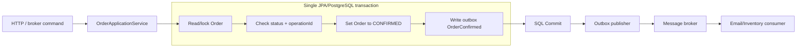
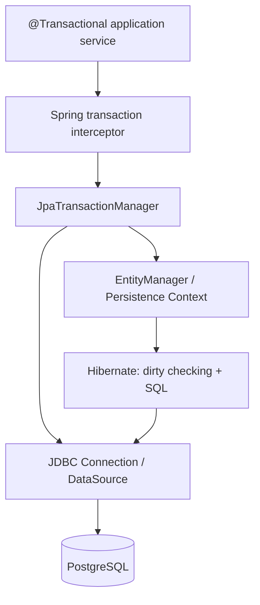
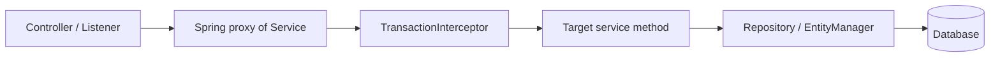
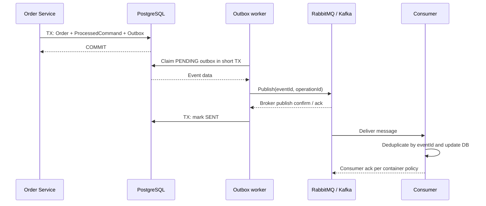

# Transaction Managers and Service-Layer Transaction Boundaries

## 1. The Problem: Where Do Transactions Live in an Integration Flow?

An order confirmation request in Spring Boot often involves multiple steps: validating the order, updating status in PostgreSQL, creating an event record, calling Inventory Service over HTTP or a broker, updating a Redis cache, and sending an email. If one step fails, which changes should roll back? What if the database commits but the broker never receives the message? If the request is retried, will the system record a duplicate order or deduct inventory twice?

**JPA/Hibernate** provides entity mapping and persistence context management; the **Spring transaction manager** coordinates transactions across the resources it manages. The `@Transactional` annotation is typically placed on **service / use-case methods** to define an atomic business operation within database scope. It is not a command to "turn every system in the integration flow into a single distributed transaction."

This lesson belongs to the **JPA and Hibernate** chapter of **SPRING_BOOT_INTEGRATION**: integrating systems via HTTP clients, databases, caches, message brokers, and Spring Integration, emphasizing configuration, data contracts, transactions, error handling, deduplication, testing, and observability. The focus is not just how to write `@Transactional`, but **choosing the right transaction scope, transaction manager, commit point, and strategy for systems outside the transaction**.

After this lesson, you should be able to:

1. Explain how `PlatformTransactionManager`, `JpaTransactionManager`, `EntityManager`/persistence context, and JDBC connections coordinate.
2. Place transaction boundaries on application services without stretching them across HTTP, brokers, email, or cache.
3. Understand `@Transactional` in proxy mode: self-invocation, public methods, exceptions/rollback, and `UnexpectedRollbackException`.
4. Choose `Propagation`, `Isolation`, `readOnly`, `timeout`, locking, and idempotency suited to each use case.
5. Distinguish `flush`, SQL execution, transaction commit, and state visible to other transactions.
6. Work deliberately with multiple transaction managers (JPA/JDBC/R2DBC/JTA), transactional outbox, and post-commit events.
7. Write integration tests proving **real commits, real rollbacks, and concurrency** instead of merely asserting method calls.

> **Version context:** Examples use Java 17+, Spring Boot 3.x, Spring Framework 6.x, Spring Data JPA/Hibernate 6.x, and PostgreSQL. With Spring Boot 3, import JPA types from `jakarta.persistence.*`, not the legacy `javax.persistence.*` from Boot 2.x. `Propagation`, `Isolation`, transaction management, and actual isolation behavior depend on Spring, the JDBC driver, the database, and connection settings; verify against your deployment versions.

### 1.1. End-to-End Business Flow

Suppose **Order Service** receives a command confirming an order whose inventory reservation succeeded:

```json
{
  "schemaVersion": 1,
  "operationId": "confirm-O-1001",
  "orderId": "O-1001",
  "reservationId": "RES-991"
}
```

Requirements:

- The order must exist and be in `PENDING_RESERVATION` status.
- Each `operationId` is processed **idempotently**, never confirming the same command twice.
- Transition the order to `CONFIRMED` and insert an `OrderConfirmed` event into the **outbox** within **the same SQL transaction**.
- After commit, a separate worker publishes the event to RabbitMQ/Kafka, and another worker may generate an email; Redis cache updates must follow an invalidation policy.
- If the HTTP client, broker, or worker fails, the committed order record remains accurate with pending/outbox state ready for continuation.



**Critical boundary:** the transactional region covers operations **on the same managed database**. Branches after commit do not automatically roll back alongside the JPA transaction. If downstream processed the request but the response was lost, the caller must have an operation ID and reconciliation mechanism rather than retrying blindly.

## 2. Distinguishing Transaction Manager, Transaction, and Persistence Context

### 2.1. What Is `PlatformTransactionManager`?

Spring provides the `org.springframework.transaction.PlatformTransactionManager` abstraction for **imperative transactions**. It begins, commits, and rolls back transactions based on `TransactionDefinition` and the managed resource. Common implementations:

| Implementation | Managed Resource | Use Case |
|---|---|---|
| `JpaTransactionManager` | `EntityManager`/JPA transaction for an `EntityManagerFactory` | Spring Data JPA/Hibernate with relational databases |
| `DataSourceTransactionManager` | JDBC `Connection` from a `DataSource` | Plain JDBC / `JdbcTemplate` |
| `JdbcTransactionManager` | JDBC connection; includes appropriate exception translation | JDBC flows in modern Spring Framework |
| `JtaTransactionManager` | JTA transaction from a supported environment/provider | Only when the system is explicitly configured for distributed/XA transactions; not default |
| `R2dbcTransactionManager` | Reactive R2DBC `ConnectionFactory` via `ReactiveTransactionManager` | Reactive repositories/`DatabaseClient`; distinct from imperative transactions |

The manager name is not just a configuration label. The manager must match the **repository/connection factory/`EntityManagerFactory`** used by the method. If a service uses JPA while `@Transactional` selects a transaction manager bound to a different datasource, JPA statements may not run inside the expected transaction.

### 2.2. Who Participates in a JPA Transaction?

In a typical Spring Data JPA application:



- The **transaction interceptor** starts or joins a transaction before invoking service logic according to `@Transactional` metadata.
- **`JpaTransactionManager`** manages the JPA transaction and binds the appropriate `EntityManager` to the execution thread.
- The **persistence context** tracks managed entities and their changes; Hibernate decides when `flush` emits SQL.
- The **database JDBC connection/transaction** commits or rolls back the data.

A persistence context **is not itself a transaction**. An entity can remain managed during a window after the database transaction has ended (for example, with Open EntityManager in View), yet mutations outside a transaction do not become a safe business transaction simply because the object is still accessible.

### 2.3. How Does `@Transactional` Choose a Transaction Manager?

In Spring Boot, when Spring Data JPA and a suitable `DataSource` are present, auto-configuration normally supplies a `JpaTransactionManager`. A simple application with a single manager can write:

```java
@Transactional
public void confirm(...) {
    // JPA read + write
}
```

to use the default manager. In applications with multiple managers, define a **default manager** via Spring configuration, a `@Primary` bean, or transaction management config; never guess the manager from method names. When explicit selection is needed:

```java
@Transactional(transactionManager = "ordersTransactionManager")
public void confirm(...) {
    // ...
}
```

`ordersTransactionManager` must be an **actual bean** defined and wired to the right `EntityManagerFactory`/`DataSource`. `@Transactional("ordersTransactionManager")` is also valid; specifying the bean explicitly with multiple datasources prevents mistakes.

### 2.4. A Transaction Only Covers Enlisted Resources

With the same `DataSource` and an appropriate JPA transaction manager, `JdbcTemplate` can often participate in a connection transaction managed by `JpaTransactionManager`, depending on the datasource, dialect, and configuration. **This must be verified**, and it never means two different `DataSource`s or an `R2dbcConnectionFactory` join automatically.

Redis, RabbitMQ, Kafka, SMTP email, HTTP, and CDN caches are not enlisted into a JPA transaction just because calls happen inside a `@Transactional` method. Distributed/XA transactions (if genuinely used) impose heavy infrastructure and operational costs; in most microservice integrations, design for idempotency, outboxes, and sagas/compensation instead of promising atomic commits across every system.

## 3. Placing Transaction Boundaries on Application Services

### 3.1. A Transaction Should Represent One Use Case

A service method executing an **atomic business unit of work** is the right place for a transaction:

```text
Controller / Message listener / Scheduler
    |
    +--> Application service  @Transactional
           |
           +--> Repository A (Order)
           +--> Repository B (ProcessedCommand)
           +--> Repository C (OutboxEvent)
           |
           +--> COMMIT or ROLLBACK in the same database
```

If `@Transactional` only lives on individual repository methods, calling `save(order)` and `save(outbox)` without an outer service transaction results in **two separate transactions**: one can commit while the other fails. Wrapping both operations in a service boundary achieves atomicity.

**Placing transactions on services does not mean every service gets `@Transactional`:** pure mappers/validators or facades making HTTP calls should not hold open database transactions. Split into two steps:

1. An adapter calls HTTP and inspects external responses, using timeouts and idempotency.
2. A short-lived transactional application service decides and persists database/outbox records using the known outcome.

### 3.2. Domain Model for the Order Example

```java
// OrderStatus.java
public enum OrderStatus {
    PENDING_RESERVATION,
    CONFIRMED,
    CANCELLED
}

// OrderEntity.java — imports omitted
@Entity
@Table(name = "customer_order")
public class OrderEntity {
    @Id
    @Column(length = 80, nullable = false)
    private String id;

    @Enumerated(EnumType.STRING)
    @Column(length = 32, nullable = false)
    private OrderStatus status;

    @Column(name = "reservation_id", length = 100)
    private String reservationId;

    @Version
    private long version;

    protected OrderEntity() {}

    public String getId() { return id; }
    public OrderStatus getStatus() { return status; }
    public long getVersion() { return version; }

    public void confirm(String reservationId) {
        if (status != OrderStatus.PENDING_RESERVATION) {
            throw new IllegalStateException(
                    "Cannot confirm in status " + status);
        }
        if (reservationId == null || reservationId.isBlank()) {
            throw new IllegalArgumentException("Missing reservationId");
        }
        this.status = OrderStatus.CONFIRMED;
        this.reservationId = reservationId;
    }
}
```

`@Version` provides JPA optimistic locking on the entity: for Hibernate-managed updates, the version detects concurrent modifications that would cause stale updates. However, `@Version` **does not prevent duplicate commands automatically**: if two identical requests arrive again, the application still needs an operation ID / unique constraint and a defined idempotent outcome.

### 3.3. Repositories for Order, Outbox, and Processed Command

```java
// OrderRepository.java
public interface OrderRepository
        extends JpaRepository<OrderEntity, String> {
}

// ProcessedCommandRepository.java
public interface ProcessedCommandRepository
        extends JpaRepository<ProcessedCommandEntity, String> {
}

// OutboxRepository.java
public interface OutboxRepository
        extends JpaRepository<OutboxEventEntity, String> {
}
```

`ProcessedCommandEntity` and `OutboxEventEntity` are defined next with stable `operationId` and `eventId` keys. The crucial point is that all three repositories must share **the same EntityManagerFactory and transaction manager** to commit atomically.

### 3.4. Two Tables Supporting Idempotency and Outbox

```java
// ProcessedCommandEntity.java
@Entity
@Table(name = "processed_command")
public class ProcessedCommandEntity {
    @Id
    @Column(name = "operation_id", length = 120)
    private String operationId;

    @Column(name = "order_id", nullable = false, length = 80)
    private String orderId;

    @Column(name = "reservation_id", nullable = false, length = 100)
    private String reservationId;

    protected ProcessedCommandEntity() {}

    public ProcessedCommandEntity(
            String operationId, String orderId, String reservationId) {
        this.operationId = operationId;
        this.orderId = orderId;
        this.reservationId = reservationId;
    }

    public String getOrderId() { return orderId; }
    public String getReservationId() { return reservationId; }
}

// OutboxEventEntity.java
@Entity
@Table(name = "outbox_event")
public class OutboxEventEntity {
    @Id
    @Column(name = "event_id", length = 160)
    private String eventId;

    @Column(name = "order_id", nullable = false, length = 80)
    private String orderId;

    @Column(name = "reservation_id", nullable = false, length = 100)
    private String reservationId;

    @Column(name = "event_type", nullable = false, length = 40)
    private String eventType;

    @Column(nullable = false, length = 30)
    private String status;

    protected OutboxEventEntity() {}

    public OutboxEventEntity(
            String eventId, String orderId, String reservationId) {
        this.eventId = eventId;
        this.orderId = orderId;
        this.reservationId = reservationId;
        this.eventType = "ORDER_CONFIRMED";
        this.status = "PENDING";
    }
}
```

These minimal entities illustrate **a single transaction**; real systems typically add `createdAt`, attempt counts, next attempt timestamps, lease owner, and event contract versions. `operationId`/`eventId` must have a **primary key/unique constraint in the database**; checking `existsById` in Java before writing is insufficient against races.

### 3.5. Application Service Owning the Transaction

```java
// ConfirmOrderCommand.java
public record ConfirmOrderCommand(
        int schemaVersion,
        String operationId,
        String orderId,
        String reservationId
) {}

public enum ConfirmOutcome {
    CONFIRMED,
    ALREADY_PROCESSED
}

// OrderApplicationService.java
@Service
public class OrderApplicationService {
    private final OrderRepository orders;
    private final ProcessedCommandRepository commands;
    private final OutboxRepository outbox;

    public OrderApplicationService(
            OrderRepository orders,
            ProcessedCommandRepository commands,
            OutboxRepository outbox) {
        this.orders = orders;
        this.commands = commands;
        this.outbox = outbox;
    }

    @Transactional
    public ConfirmOutcome confirm(ConfirmOrderCommand cmd) {
        validate(cmd);

        var previous = commands.findById(cmd.operationId());
        if (previous.isPresent()) {
            var processed = previous.get();
            if (!processed.getOrderId().equals(cmd.orderId())
                    || !processed.getReservationId()
                            .equals(cmd.reservationId())) {
                throw new IllegalArgumentException(
                        "operationId was already used with a different payload");
            }
            return ConfirmOutcome.ALREADY_PROCESSED;
        }

        OrderEntity order = orders.findById(cmd.orderId())
                .orElseThrow(() -> new IllegalArgumentException(
                        "Order not found"));

        order.confirm(cmd.reservationId());
        // OrderEntity is managed: Hibernate will dirty-check it.
        commands.save(new ProcessedCommandEntity(
                cmd.operationId(), cmd.orderId(),
                cmd.reservationId()));
        outbox.save(new OutboxEventEntity(
                "order-confirmed:" + cmd.operationId(),
                cmd.orderId(), cmd.reservationId()));

        return ConfirmOutcome.CONFIRMED;
    }

    private static void validate(ConfirmOrderCommand cmd) {
        if (cmd == null || cmd.schemaVersion() != 1
                || cmd.operationId() == null
                || cmd.operationId().isBlank()
                || cmd.orderId() == null
                || cmd.orderId().isBlank()
                || cmd.reservationId() == null
                || cmd.reservationId().isBlank()) {
            throw new IllegalArgumentException(
                    "Invalid ConfirmOrderCommand");
        }
    }
}
```

**What is guaranteed on the happy path?** If all three repositories share the same transaction manager/database and the transaction commits cleanly, order status, processed-command, and outbox rows commit together. If any SQL step fails before commit, the transaction rolls back according to transaction manager rules; no outbox event exists for an uncommitted order.

**What is not yet guaranteed?** Two concurrent requests with the same operation ID may both observe `previous.isEmpty()` before either inserts. The unique constraint causes one transaction to fail; order updates also have optimistic locking. Thus the race loser **does not automatically return `ALREADY_PROCESSED` on its first attempt**. A coordination layer outside the transaction can catch the classified unique/optimistic conflict, open a **new** transaction to read the committed outcome, and decide whether to return idempotently or retry within bounds. Never catch `DataIntegrityViolationException` inside the failed transaction and keep issuing SQL on an aborted PostgreSQL transaction.

### 3.6. Database Tables Must Enforce the Contract

Example PostgreSQL schema:

```sql
CREATE TABLE customer_order (
    id VARCHAR(80) PRIMARY KEY,
    status VARCHAR(32) NOT NULL,
    reservation_id VARCHAR(100),
    version BIGINT NOT NULL
);

CREATE TABLE processed_command (
    operation_id VARCHAR(120) PRIMARY KEY,
    order_id VARCHAR(80) NOT NULL,
    reservation_id VARCHAR(100) NOT NULL
);

CREATE TABLE outbox_event (
    event_id VARCHAR(160) PRIMARY KEY,
    order_id VARCHAR(80) NOT NULL,
    reservation_id VARCHAR(100) NOT NULL,
    event_type VARCHAR(40) NOT NULL,
    status VARCHAR(30) NOT NULL
);

CREATE INDEX idx_outbox_pending
    ON outbox_event (status, event_id);
```

In production, use versioned migrations (Flyway, Liquibase, or equivalent) rather than `hibernate.hbm2ddl.auto=create`/`update` as a schema strategy. If event payloads require schema evolution, the outbox should store `schemaVersion` and an immutable event snapshot captured at commit time rather than reconstructing payloads later from a mutated order.

### 3.7. Who Calls the Transactional Service?

Controllers, AMQP/Kafka/JMS listeners, schedulers, and Spring Integration endpoints can all call the application service's `confirm` method:

```java
@RestController
@RequestMapping("/internal/orders")
public class OrderCommandController {
    private final OrderApplicationService service;

    public OrderCommandController(OrderApplicationService service) {
        this.service = service;
    }

    @PostMapping("/confirm")
    public ConfirmOutcome confirm(
            @RequestBody ConfirmOrderCommand cmd) {
        return service.confirm(cmd);
    }
}
```

`/internal/orders/confirm` merely illustrates the call path. Production endpoints require service-to-service authentication, authorization, signature/operation ID validation, and rate limiting; never let a client confirm another tenant's order. For broker listeners, **message acknowledgment** is handled by the listener container after the service returns; broker ack is not part of the PostgreSQL transaction, and a crash can occur between commit and ack.

## 4. Proxy Mechanism of @Transactional: The Most Common Bugs

### 4.1. Transactions Trigger Through Proxies, Not Arbitrary Java Calls

In standard Spring transaction management, `@Transactional` is implemented via **Spring AOP proxies**. When another component calls a bean's method through the proxy, the interceptor starts a transaction, delegates to the target, and commits or rolls back.



However, calling **one method from another on the same object via `this`** bypasses the proxy in proxy mode. The following example typically **does not start a new transaction** for `persist`:

```java
@Service
public class IncorrectOrderService {
    public void process() {
        persist(); // self-invocation: bypasses the proxy
    }

    @Transactional
    public void persist() {
        // Does not open a transaction from this annotation alone
        // when called directly from process() on the same instance.
    }
}
```

**Preferred fix:** move the transaction boundary to a public method on an application service bean **called by another bean**, or extract the transactional worker into its own bean. Self-injecting a proxy or relying on `AopContext.currentProxy()` just to "trigger" the annotation is discouraged because it obscures design and is error-prone.

### 4.2. Public Methods, Uninterceptable Methods, and Private Methods

With JDK interface proxies or CGLIB class-based proxies, interception depends on visibility, `final` classes/methods, and how the bean is instantiated. The most reliable practice for application services is placing `@Transactional` on **public methods of Spring-managed beans invoked by external callers through the proxy**:

```java
@Service
public class StockApplicationService {
    @Transactional
    public void adjustStock(...) {
        // ...
    }
}
```

Never assume `@Transactional` works on `private` methods, un-overridable `final` methods, or objects created via `new` outside Spring. Newer Spring versions support certain protected/package-private methods with class-based proxies, yet that still does not turn self-invocation into a proxied call. If using AspectJ weaving instead of proxies, semantics differ and require explicit configuration; do not treat that as default behavior.

### 4.3. Method Return Does Not Mean Commit Finished Inside the Body

The interceptor commits **after the target method returns** cleanly and before returning the final result to the caller through the proxy. Thus:

```java
@Transactional
public String saveAndReturn() {
    orders.save(...);
    return "SAVED"; // commit cannot be assumed complete at this line
}
```

If commit fails due to a constraint, deadlock, connection loss, or optimistic lock conflict, the caller still receives an exception **even though the method body returned**. Never send irreversible emails or external confirmations from inside the method before commit. Once a controller calling the service through its proxy receives a normal return, the transaction has generally committed; downstream post-commit failures still need handling.

### 4.4. @Async, New Threads, CompletableFuture, and Reactor

Imperative transactions from `JpaTransactionManager` are bound to the **current thread** via Spring's transaction context. Starting `new Thread(...)`, using another executor, or invoking `@Async` does not automatically propagate the JPA transaction to the new thread.

```java
@Transactional
public void processBad() {
    orderRepository.save(...);
    CompletableFuture.runAsync(() -> {
        // Does not automatically join the calling thread's transaction.
        outboxRepository.save(...);
    });
}
```

The two operations can commit independently; an exception inside `CompletableFuture` does not roll back the initial transaction. For atomic outbox writes, **write synchronously inside the same JPA transaction**. In reactive R2DBC, transaction context typically travels via **Reactor Context**; you cannot use `JpaTransactionManager` to guarantee transactions across a `Mono`/`Flux` pipeline.

## 5. Commit, Rollback, and Exceptions

### 5.1. Default Rollback Rules

In Spring Framework 6.x under standard configuration, `@Transactional` **rolls back by default when a `RuntimeException` or `Error` escapes the method through the proxy**; checked exceptions **do not trigger rollback by default**, unless configured via `rollbackFor` or custom transaction rules.

| Case | Standard `@Transactional` Behavior |
|---|---|
| Method completes normally | Attempts commit; may still fail during flush/commit |
| Throws `RuntimeException` out of proxy | Transaction is marked for / performs rollback |
| Throws `Error` out of proxy | Rolls back by default |
| Throws checked exception | Does not mark rollback by default; may commit |
| Catches exception and returns normally | Interceptor sees no error; may commit |
| Transaction already marked rollback-only | Even if outer code catches the exception, outer commit may fail |

Consequently, the following snippet may **fail to roll back** simply because the exception is checked:

```java
@Transactional
public void importInvoice() throws IOException {
    invoiceRepository.save(...);
    throw new IOException("Cannot read file");
}
```

If business rules require rollback on file errors:

```java
@Transactional(rollbackFor = IOException.class)
public void importInvoice() throws IOException {
    invoiceRepository.save(...);
    throw new IOException("Cannot read file");
}
```

**Version note:** Spring allows framework-wide customization of rollback rules; newer Spring lines may offer configurable default rollback policies. In these examples we assume the standard Spring Framework 6.x rules and declare `rollbackFor` explicitly whenever checked exceptions must roll back.

### 5.2. Swallowing Exceptions Does Not Mean Safe Error Handling

```java
@Transactional
public void confirmBad(ConfirmOrderCommand command) {
    try {
        orders.findById(command.orderId())
                .orElseThrow()
                .confirm(command.reservationId());
        externalInventoryClient.notifyOrder(...);
    } catch (Exception ex) {
        log.warn("Failed yet returning success");
    }
}
```

If the exception is caught and the method returns normally, the interceptor may commit pending JPA changes. Conversely, if a JDBC/JPA exception already marked the transaction rollback-only or aborted the database transaction, catching it **will not save the commit**.

Define an explicit strategy:

- Business error requiring rollback: throw an unchecked domain exception or configure matching rollback rules.
- Downstream error after DB commit: do not attempt to "undo" committed SQL by throwing; rely on outbox/retries.
- Tolerable partial failure: keep it outside an all-or-nothing transaction; split use cases or use savepoints only when verified and appropriate.
- Failure that must persist a `REJECTED` state in the database: **do not** throw an exception that rolls back the whole transaction; record the rejection as a business outcome and commit.

### 5.3. `UnexpectedRollbackException`: Outer Expects Commit, Inner Marked Rollback-Only

Example:

```java
@Service
class PaymentPolicyService {
    @Transactional
    public void validateAndRecord() {
        // Called via bean proxy, joins caller's REQUIRED transaction.
        throw new IllegalStateException("Invalid payment policy");
    }
}

@Service
class CheckoutService {
    private final PaymentPolicyService paymentPolicy;

    @Transactional
    public void checkout() {
        try {
            paymentPolicy.validateAndRecord();
        } catch (IllegalStateException ex) {
            // Caught, yet the inner transaction interceptor
            // may mark the shared transaction rollback-only.
        }
        // When the outer transaction tries to commit, it is no longer allowed.
    }
}
```

With the default `REQUIRED` propagation, both methods participate in **one physical transaction**. The inner interceptor observes the unchecked exception leaving its proxy and marks the transaction rollback-only. The outer method catches the exception and assumes success, but when the outer interceptor attempts to commit, it can throw `UnexpectedRollbackException` signaling that the database rolled back.

The fix is not `catch (UnexpectedRollbackException)` and pretending everything succeeded. Decide **whether that error is allowed to abort the entire use case**. If yes, let the exception propagate. If an independent audit record must commit even when the main transaction rolls back, consider `REQUIRES_NEW` on a separate bean (accounting for pool limits), or offload auditing to a reliable out-of-transaction system under its own contract.

### 5.4. Explicitly Marking Rollback-Only

Spring allows marking rollback-only programmatically in special business cases:

```java
TransactionAspectSupport.currentTransactionStatus()
        .setRollbackOnly();
```

This is only valid while inside an active transaction interceptor. Use it sparingly: the method can still return normally while callers see no obvious failure reason without a clear contract. Usually, throwing an explicit domain exception or returning an intentional outcome is clearer. When a validation failure must persist `REJECTED`, rollback-only contradicts that goal.

### 5.5. Commit Failures After the Service Body Returns

Hibernate may defer SQL until `flush`/commit. Unique constraints, version conflicts, or deadlocks may only surface at method exit:

```java
@Transactional
public void create() {
    repository.save(entity);
    // INSERT is not guaranteed to have run at this line.
}
// The interceptor may fail at flush/commit.
```

Therefore, never send irreversible Kafka/RabbitMQ/SMTP messages or delete Redis keys from **inside the transaction** assuming `save` will definitely commit. When early constraint checking is needed, `saveAndFlush`/`EntityManager.flush` can force SQL earlier, yet **flush is not commit** and later errors can still happen.

## 6. Propagation: How Caller and Callee Transactions Coordinate

`Propagation` defines how a `@Transactional` method handles an **already active** transaction when called via proxy. It does not determine whether another microservice joins the same SQL transaction.

| Propagation | When Caller Has a Transaction | When No Transaction Exists | Appropriate Use Case |
|---|---|---|---|
| `REQUIRED` (default) | Joins current transaction | Creates a new one | Standard application services |
| `REQUIRES_NEW` | Suspends current transaction, starts an independent one | Creates a new one | Special audit/secondary outbox that must commit independently, after assessing consistency |
| `SUPPORTS` | Joins if present | Runs non-transactionally | Methods supporting both modes without requiring a read-only transaction |
| `MANDATORY` | Joins | Throws error | Helpers that must only run inside an existing transaction |
| `NOT_SUPPORTED` | Suspends transaction | Runs non-transactionally | Work that should not hold a DB transaction |
| `NEVER` | Throws error | Runs non-transactionally | Guard against accidental invocation inside a transaction |
| `NESTED` | Uses nested/savepoint if manager supports it | Usually like `REQUIRED` when no outer tx | Partial rollback via savepoint; requires careful manager/driver verification |

### 6.1. `REQUIRED`: One Shared Physical Transaction

```java
@Service
public class OrderWriteService {
    @Transactional
    public void writeOrderAndOutbox() {
        orderRepository.save(...);
        outboxWriteService.writeEvent(...);
    }
}

@Service
public class OutboxWriteService {
    @Transactional(propagation = Propagation.REQUIRED)
    public void writeEvent(...) {
        outboxRepository.save(...);
    }
}
```

Assuming both beans are wired through proxies and share **the same transaction manager**, `OutboxWriteService` joins `OrderWriteService`'s transaction. If both repositories write to the same database, they commit or roll back together. If called outside a transaction, the second method opens its own.

Do not stack many `@Transactional(REQUIRED)` layers thinking each layer gets its own commit point. With nested `REQUIRED`, the **outermost transaction** is the physical commit boundary.

### 6.2. `REQUIRES_NEW`: An Independent Transaction with Costs

```java
@Service
class AuditService {
    @Transactional(propagation = Propagation.REQUIRES_NEW)
    public void recordFailure(String operationId) {
        auditRepository.save(new AuditEvent(...));
    }
}
```

When the caller already holds a JPA transaction, Spring suspends the current resource/transaction (per manager support) and opens a fresh one. The audit transaction can commit even if the outer transaction rolls back. Only do this when it is an **explicit requirement**, because the audit may record "something happened" while business state was rolled back.

**Pool risk:** the outer transaction may be holding one DB connection while the inner `REQUIRES_NEW` needs **a second connection**. If 20 concurrent requests hold outer connections and all wait for inner connections, the pool can starve or deadlock. Size the pool, concurrency, lock ordering, and timeouts carefully; never treat `REQUIRES_NEW` as a generic "rollback fix."

### 6.3. `NESTED` Is Not Equivalent to `REQUIRES_NEW`

`NESTED` uses **savepoints** inside the same physical transaction when supported by manager and driver, allowing partial rollback of the nested scope without necessarily rolling back the outer transaction. However, Spring's `JpaTransactionManager` **does not support nested JPA transactions by default** in the sense of partially rolling back a persistence context. Even if JDBC savepoints are enabled, they do not rewind Hibernate's in-memory managed entity state.

Do not rely on `@Transactional(propagation=NESTED)` as a portable way to roll back a group of JPA entities and keep using them in the same persistence context. If savepoints are genuinely needed, verify database, JDBC driver, transaction manager, `nestedTransactionAllowed`, and entity state management, and write integration tests. Defining clear atomic use cases or separating independent work is usually much simpler.

### 6.4. `MANDATORY` and `NOT_SUPPORTED` to Clarify Contracts

`MANDATORY` makes sense for an audit/outbox helper that **must** execute only when the caller already started a transaction:

```java
@Transactional(propagation = Propagation.MANDATORY)
public void recordOutbox(...) {
    // Fails fast if called without an active transaction.
}
```

Never assume this annotation forces repositories onto the same datasource. It only enforces the transaction context of the selected manager.

`NOT_SUPPORTED` forces a method to run outside a transaction when the caller has one, yet suspending a transaction **does not necessarily release every resource already acquired** by the outer transaction. Do not open a long transaction in a controller and call an HTTP client inside a `NOT_SUPPORTED` method expecting all DB locks/connections to vanish; instead, reorder steps so the SQL transaction opens **only after** HTTP finishes.

## 7. Isolation, readOnly, Timeout, and Concurrency Control

### 7.1. Isolation Addresses Different Anomalies

Isolation determines what changes from concurrent transactions a transaction can observe; it is not an automatic business idempotency lock.

| Isolation | General Meaning | Key Notes |
|---|---|---|
| `READ_UNCOMMITTED` | Allows dirty reads in the general SQL model | PostgreSQL implements behavior equivalent to `READ_COMMITTED`; do not assume dirty reads occur |
| `READ_COMMITTED` | Each SQL statement typically sees data committed at its start per DB rules | Two `SELECT`s in the same transaction can observe different results |
| `REPEATABLE_READ` | Stronger consistency for reads within a transaction | PostgreSQL uses snapshot isolation with its own rules; concurrency/serialization handling still applies |
| `SERIALIZABLE` | Guarantees results equivalent to some serial execution order | Can raise serialization failures requiring **whole-transaction** retries |
| `DEFAULT` | Uses the database/connection default | Does not mean the highest isolation level |

Example:

```java
@Transactional(
        isolation = Isolation.READ_COMMITTED,
        timeout = 5)
public void confirm(...) {
    // ...
}
```

Before choosing a stricter level, ask **which business invariant** needs protection. For example, "issue at most one reservation per operation ID" is usually solved more cleanly with a unique constraint and targeted updates/locks; raising isolation increases contention, deadlocks, and aborts while still requiring message-boundary idempotency.

**Note on `REQUIRED`:** when a method joins an **existing** transaction, isolation or timeout attributes on the inner method do not start a new physical transaction to override the outer scope's settings. You can configure validation on existing transactions to catch mismatches per policy; never assume a method annotated `SERIALIZABLE` actually runs at that level when called from an outer `READ_COMMITTED` transaction.

### 7.2. `readOnly=true` Is an Optimization Hint, Not Security

```java
@Service
class OrderQueryService {
    private final OrderRepository orders;

    @Transactional(readOnly = true)
    public OrderView find(String orderId) {
        OrderEntity order = orders.findById(orderId)
                .orElseThrow();
        return new OrderView(
                order.getId(), order.getStatus());
    }
}

public record OrderView(
        String id, OrderStatus status) {}
```

`@Transactional(readOnly=true)` lets the transaction manager and ORM optimize behaviors like flush mode and JDBC connection hints depending on the environment. It is **not** an authorization mechanism and does not guarantee every SQL write is rejected by the database. In Hibernate/Spring Data JPA, read-only optimizations can alter dirty checking/flushing relative to write transactions; never mutate entities expecting updates to persist inside a read-only transaction.

**Placing it on query services** clarifies boundaries: queries return DTOs or immutable projections instead of managed entities that controllers might mutate. For simple single queries that do not need a service transaction, default repository behavior may suffice; for lazy relations, consistent multi-query reads, or provider-specific behavior, define an explicit transaction boundary rather than relying on Open EntityManager in View.

### 7.3. `timeout` Is Not an Overall HTTP/Broker Deadline

```java
@Transactional(timeout = 3)
public void doWork() {
    // DB work...
}
```

Transaction timeouts are managed by the transaction manager and can propagate to JDBC statements on Spring-managed operations, depending on driver and configuration. **Never assume** a Java thread aborts at second 3 or that a `WebClient`/`RestClient`/SMTP call inside the method will be interrupted. Set separate connect/read/response timeouts and budgets on external clients. On the database side, configure appropriate PostgreSQL `statement_timeout`/`lock_timeout`, transaction timeouts, and pool acquisition timeouts aligned with SLOs.

Long transactions hold connections, row locks, and large persistence contexts, exhausting the pool. Never set `timeout=120` as a default to "fix" slow queries without diagnosing SQL, indexes, locks, or HTTP waits.

### 7.4. Optimistic Locking with @Version

`@Version` works well when concurrent transactions may update the same entity infrequently:

```text
Transaction A: reads Order(version=3)
Transaction B: reads Order(version=3)
B updates CONFIRMED, version becomes 4 and commits
A attempts update from version=3 -> version conflict
=> A must not silently overwrite the newer version.
```

The JPA provider may throw `OptimisticLockException`, which Spring can translate into `ObjectOptimisticLockingFailureException` or a subtype of `OptimisticLockingFailureException`. Never catch it and keep writing in the same failed transaction; retry in a **new transaction**, reload current state, and re-evaluate business invariants from scratch.

Optimistic locking does not replace a unique constraint for **duplicate operation IDs**, because two commands might target different records or a command may be redelivered after several subsequent version increments.

### 7.5. Pessimistic Locking When Decisions Must Be Serialized

Example repository:

```java
public interface OrderRepository
        extends JpaRepository<OrderEntity, String> {

    @Lock(LockModeType.PESSIMISTIC_WRITE)
    @Query("select o from OrderEntity o where o.id = :id")
    Optional<OrderEntity> lockById(@Param("id") String id);
}
```

Call `lockById` inside `@Transactional` so the lock persists until commit or rollback per database semantics. Use it when a decision must inspect current state and update the same row atomically. However:

- Holding locks long reduces concurrency and can cause deadlocks when transactions lock rows in inconsistent orders.
- If no row exists yet, a row lock cannot guard against **concurrent inserts of the same key**; unique constraints are still required.
- Never hold pessimistic locks while waiting on HTTP, SMTP, brokers, Redis, or user actions.
- Across multiple tables or tenants, establish a deterministic lock order and test contention against a real database.

### 7.6. Bulk UPDATE/DELETE Can Bypass the Persistence Context

Spring Data JPA `@Modifying @Query` is frequently used for bulk updates:

```java
@Modifying
@Query("""
    update OrderEntity o
       set o.status = :status
     where o.id = :orderId
       and o.status = :expected
    """)
int updateStatusIfExpected(
        @Param("orderId") String orderId,
        @Param("expected") OrderStatus expected,
        @Param("status") OrderStatus status);
```

A JPQL bulk operation **bypasses normal dirty checking/entity lifecycles and does not update managed entities already in the persistence context**. Nor does it automatically check or increment `@Version` like Hibernate's standard entity updates, unless handled explicitly in the query or strategy. If the service loaded `OrderEntity` earlier and then ran a bulk update on the same row, the in-memory object can go stale.

To use bulk updates safely, verify affected row counts, add explicit version predicates, clear/refresh the persistence context when appropriate, check transaction boundaries, and test concurrency. Do not add `clearAutomatically=true` blindly, as it can discard unflushed managed changes. For small single-entity updates with domain invariants, mutating managed entities is usually clearer.

## 8. Flush, Commit, Lazy Loading, and Open EntityManager in View

### 8.1. `save()`, `flush()`, and `commit()` Are Three Different Things

| Action | What It Typically Does | What Not to Assume |
|---|---|---|
| `repository.save(entity)` | Persists or merges entity in the persistence context depending on new/existing state | That SQL already executed or the transaction committed |
| `entityManager.flush()` / `saveAndFlush` | Synchronizes pending changes to the DB via SQL | That those statements are committed and cannot roll back |
| Transaction commit | Instructs the DB to commit the physical transaction via the manager | That HTTP/broker/cache committed atomically with SQL |
| `entityManager.clear()` | Detaches managed entities from the persistence context | That executed SQL was undone or the transaction rolled back |
| `entityManager.refresh(entity)` | Reloads state from the DB per provider/transaction rules | That it resolves multi-service conflicts |

Hibernate can auto-flush before certain queries or at commit depending on flush mode; never assume every `INSERT` fires on the exact line of `save`. With ID strategies like `IDENTITY`, SQL may execute earlier to obtain the ID; **SQL execution time is still not commit time**.

### 8.2. Lazy Loading and Transaction Boundaries

`@OneToMany(fetch=LAZY)` / `@ManyToOne(fetch=LAZY)` associations may only be queried when accessed. If a controller serializes an entity after the service transaction closes, `LazyInitializationException` can occur when loading the association fails because the persistence context is gone.

**Start from the response contract:** use fetch joins, `@EntityGraph`, DTO projections, or DTO mapping inside a bounded service transaction, fetching only what the endpoint requires.

```java
@Transactional(readOnly = true)
public OrderSummary getSummary(String id) {
    OrderEntity order = orders.findById(id).orElseThrow();
    return new OrderSummary(order.getId(),
            order.getStatus());
}
```

Never "fix" this by changing all relationships to `EAGER` or opening transactions in controllers/web serializers just to hide the error; that invites N+1 queries, unpredictable DB load, and overly long transactions.

### 8.3. Open EntityManager in View (OSIV) Is an Architectural Decision

In many Spring Boot web/JPA apps, `spring.jpa.open-in-view` may be enabled, keeping `EntityManager` open across the HTTP request. It can let lazy loading "still work" outside service transactions, but:

- An open persistence context does not mean a business transaction is active.
- SQL triggered during response rendering is hard to observe and tune.
- Controllers/serializers easily cause N+1 queries, and post-transaction queries can observe data at different points in time.
- It does not place HTTP or brokers inside the JPA transaction.

For integration modules focused on clean transaction boundaries, consider:

```yaml
spring:
  jpa:
    open-in-view: false
```

Then have services/repositories explicitly fetch required data and return DTOs. **Do not mistake this flag for enabling/disabling transactions**; it controls `EntityManager` scope in the web layer, and endpoints/serializers must be re-tested when toggling it.

### 8.4. Short Transactions Also Protect Pools and Resilience

If a request holds a transaction open during a 10-second Pricing API call, it occupies connections and locks orders of magnitude longer than SQL execution takes. Under load, long transactions saturate HikariCP, increase lock waits, and cause timeouts elsewhere.

Hence **read needed data → finish read step → call external service → open a short transaction for conditional update** is generally more effective for HTTP integrations. Remember that if decision inputs could change during the HTTP call, re-check invariants/versions inside the write transaction rather than trusting the earlier snapshot.

## 9. Boundaries with HTTP, Redis, Brokers, SMTP, and Spring Integration

### 9.1. Why Doesn't `@Transactional` Turn an HTTP Call into a SQL Transaction?

Suppose:

```java
@Transactional
public void placeOrderBad(PlaceOrderCommand cmd) {
    orderRepository.save(...);
    inventoryHttpClient.reserveStock(cmd); // HTTP POST
    outboxRepository.save(...);
}
```

There are at least four failure windows:

1. Database hasn't committed yet, HTTP reserves stock in Inventory, then outbox insert fails → Order rolls back while Inventory **does not automatically roll back**.
2. HTTP request times out after Inventory committed but before the response returns → Order **does not know** the true state.
3. The database transaction holds connections and locks throughout HTTP latency.
4. Request retry or broker redelivery → the same operation may fire a second HTTP POST.

**Do not** try to solve this with `@Transactional(rollbackFor=Exception.class)`: the annotation only governs the local transaction manager, not remote HTTP rollback. Define a proper integration contract:

- **Commands with stable idempotency keys** so downstream detects duplicate requests.
- Status-inquiry APIs keyed by `operationId` for timed-out or ambiguous outcomes.
- State machines (`PENDING → RESERVED/REJECTED/CANCELLED`) with expiration and compensation rules.
- Transactional outboxes at the publisher, idempotent consumers, and explicit compensation steps for multi-step sagas.

### 9.2. Transactional Outbox: Storing State Changes and Publish Intent Together

In the `OrderApplicationService.confirm` example, the SQL transaction writes:

```text
BEGIN;
  UPDATE customer_order SET status='CONFIRMED', ...;
  INSERT INTO processed_command(operation_id, ...);
  INSERT INTO outbox_event(event_id, status='PENDING', ...);
COMMIT;
```

A separate worker runs outside that transaction:



**Duplicate window:** the broker accepts the publish, then the worker crashes before `UPDATE outbox SET status='SENT'`. Another worker may republish it. Thus outbox supports **at-least-once publication with proper retries**, not exactly-once consumer side effects. Consumers must enforce unique event/operation IDs and idempotent business updates in their own transactions.

**Remaining window:** if the worker marks `SENT` before receiving an appropriate broker confirmation, messages can be lost when publishing fails. Never mark `SENT` solely because `convertAndSend`/`send` returned without handling confirms, returns, and timeouts per contract.

### 9.3. Broker Ack and JDBC Commit Do Not Share a Transaction

A Spring AMQP/JMS/Kafka listener can invoke a transactional application service:

```java
@Component
class OrderConfirmedListener {
    private final OrderApplicationService service;

    @RabbitListener(queues = "orders.confirm.commands.v1")
    public void handle(ConfirmOrderCommand cmd) {
        service.confirm(cmd);
    }
}
```

Under standard automatic container ack settings, the message is acked **after** the handler returns normally. If the database commits and the process crashes **before ack**, the broker can redeliver and invoke the handler again. `processed_command.operation_id` detects the duplicate; never rely on the broker delivering a message only once.

Do not assume Spring Boot automatically configures exchanges, queues, serializers, retries, and DLQs for that annotation: those are separate AMQP integration responsibilities. With Kafka, consumer offset commits also have a boundary separate from SQL commits; understand Kafka transaction semantics (if enabled) and database idempotency separately rather than expecting JPA `@Transactional` to coordinate everything.

### 9.4. Redis/Cache Invalidation: After Commit Still Has Races

Unsafe example:

```java
@Transactional
public void changeStockBad(String sku) {
    stockRepository.update(...);
    stringRedisTemplate.delete("inventory:v1:stock:" + sku);
    // If SQL rolls back after delete, the cache was already evicted.
}
```

Deleting cache **before commit** mutates Redis outside the SQL transaction; if SQL rolls back, cache misses read old values or add unnecessary load. One option is publishing an event after commit or using an outbox to invalidate:

```java
public record StockChanged(String sku, long revision) {}

@Component
class CacheInvalidationListener {
    private final StringRedisTemplate redis;

    CacheInvalidationListener(StringRedisTemplate redis) {
        this.redis = redis;
    }

    @TransactionalEventListener(
            phase = TransactionPhase.AFTER_COMMIT)
    public void invalidate(StockChanged event) {
        redis.delete("inventory:v1:stock:" + event.sku());
    }
}
```

Inside the service transaction, call `ApplicationEventPublisher.publishEvent(new StockChanged(...))`; by default, the `AFTER_COMMIT` listener runs only after transaction synchronization commits. **However, this callback is not durable**: a JVM crash between SQL commit and callback loses the invalidation. Outboxes plus TTLs/version-aware cache writes survive crashes, and Redis listeners must be idempotent.

**Another race:** a reader may read an old revision before commit, and then write that stale value into the cache after the writer's invalidation runs because the reader finished late. Therefore, "delete cache after commit" **does not guarantee strong consistency**. For sensitive data (inventory reservations, payments), check directly against the database/Inventory service holding strong invariants instead of trusting the cache alone.

### 9.5. `@TransactionalEventListener` Is Not a Message Broker

| Mechanism | When It Runs | Guarantees |
|---|---|---|
| `ApplicationEventPublisher` + `@EventListener` | Dispatched synchronously/in-process with event publication | No persistence or replay by default |
| `@TransactionalEventListener(AFTER_COMMIT)` | Callback triggered at transaction synchronization phase | Only runs if transaction commits and process stays alive; lost on crash |
| Transactional outbox | Event row committed alongside business state | Durable persistence for worker retry and replay |
| Broker consumer | After broker delivery per configuration | Has independent ack, redelivery, retry/DLQ; not part of SQL transaction |

An important Spring nuance: during `AFTER_COMMIT`, transaction resources may not be fully cleaned up yet. If a callback must **perform another DB write** as an independent transaction, call a separate service/proxy using `REQUIRES_NEW` (mindful of pool limits), or better yet, record durable follow-up work in an outbox inside the original transaction. Never assume calling repository `save` directly inside `AFTER_COMMIT` starts a fresh independent committing transaction.

### 9.6. SMTP and Attachments

`JavaMailSender.send(...)` is I/O outside any JPA transaction. Calling SMTP inside `@Transactional` causes:

- JDBC connections held open while waiting on SMTP.
- SMTP accepting mail while SQL later rolls back → recipients receive emails for events that never happened.
- SQL committing while SMTP fails transiently → no durable retry unless recorded in state/outbox.

Use a mail outbox and post-commit worker. If SMTP accepts a message and the worker crashes before marking `SENT`, duplicates can occur; track `mailRequestId`, bound retries, and leverage provider idempotency if available. Never equate "email accepted by SMTP" with "user read the email."

### 9.7. Spring Integration Flows Do Not Open Distributed Transactions Automatically

Spring Integration spans channels, endpoints, gateways, pollers, transaction advice, error channels, and adapters. A flow `HTTP → transformer → JDBC → AMQP` does not commit JDBC and the broker atomically simply because they share one message flow. Always check:

- Which inbound adapter or poller starts a transaction, and with which transaction manager?
- Is the JPA service invoked through a proxy or via self-invocation?
- Do outbound HTTP/AMQP/JMS handlers have retries, acks, and idempotency keys?
- Do errors route to an error channel, DLQ, or roll back the database transaction?
- Is the source message acked before or after the service commits?

Separate **atomic DB business work**, **message send/receive behavior**, and **retry/compensation logic** with observable state. Do not use a single adapter-level annotation to replace proper application service transaction contracts.

## 10. Multiple Transaction Managers and Distinct Transaction Boundaries

### 10.1. What Happens When One Service Has Two DataSources?

Suppose Order Service has:

- `ordersDataSource` / `ordersEntityManagerFactory` / `ordersTransactionManager`.
- `billingDataSource` / `billingEntityManagerFactory` / `billingTransactionManager`.

```java
@Transactional(transactionManager = "ordersTransactionManager")
public void updateOrder(...) {
    ordersRepository.save(...);
    billingRepository.save(...); // uses a different EMF/datasource
}
```

The annotation only governs **the orders manager's transaction**. If the billing repository/manager opens its own transaction per its config, the two databases **do not get a shared atomic commit**. Even without exceptions thrown, one database can commit while the other fails. Establish clear data ownership, use outboxes or sagas, or use properly configured and risk-assessed XA/JTA only when distributed atomicity is mandatory.

### 10.2. Multi-DataSource Requires Wiring the Right Beans

A multi-persistence-unit setup must define clearly:

| Component | Orders | Billing |
|---|---|---|
| `DataSource` | `ordersDataSource` | `billingDataSource` |
| `EntityManagerFactory` | `ordersEntityManagerFactory` | `billingEntityManagerFactory` |
| `PlatformTransactionManager` | `ordersTransactionManager` | `billingTransactionManager` |
| Repository scan | Orders repositories | Billing repositories |
| `@Transactional` | Selects orders manager | Selects billing manager |

`@EnableJpaRepositories(entityManagerFactoryRef=..., transactionManagerRef=...)` binds each repository group to the right beans; bean names and properties must align. Never mark one datasource `@Primary` and expect repositories targeting the other datasource to find their manager automatically.

### 10.3. JPA and R2DBC Do Not Share a Transaction Context

An imperative `@Transactional` method managed by `JpaTransactionManager` does not govern reactive publishers executed by `R2dbcTransactionManager`. R2DBC transactions typically bind to the **Reactor Context upon subscription**; JPA transactions rely on imperative thread-bound resources.

```java
@Transactional("ordersTransactionManager")
public Mono<Void> badHybrid() {
    jpaOrderRepository.save(...);
    return r2dbcRepository.save(...).then();
}
```

This API creates dangerous expectations: subscription happens after the imperative method returns, so the JPA boundary may already be closed before reactive SQL executes. If a project genuinely uses both JPA and R2DBC, design explicit workflows/outboxes with clear boundaries per resource; never treat returning a `Mono` from a JPA method as a shared commit guarantee.

### 10.4. When Are Programmatic Transactions Useful?

`TransactionTemplate` fits when a SQL boundary must wrap a specific block and code needs to sequence external I/O explicitly:

```java
@Service
class ReconciliationCoordinator {
    private final InventoryGateway inventory;
    private final TransactionTemplate transactions;
    private final OrderRepository orders;

    ReconciliationCoordinator(
            InventoryGateway inventory,
            @Qualifier("ordersTransactionManager")
            PlatformTransactionManager manager,
            OrderRepository orders) {
        this.inventory = inventory;
        this.transactions = new TransactionTemplate(manager);
        this.orders = orders;
    }

    public void reconcile(String orderId) {
        // HTTP outside SQL transaction.
        InventoryStatus status = inventory.lookup(orderId);

        // Short JPA transaction for decision + DB write.
        transactions.executeWithoutResult(tx -> {
            OrderEntity order = orders.findById(orderId)
                    .orElseThrow();
            // Check status, revision, idempotency, then
            // update domain state and outbox if appropriate.
        });
    }
}
```

`InventoryGateway`/`InventoryStatus` are illustrative abstractions; implement DTOs/adapters matching your real HTTP contract. When processing callbacks, **re-verify status and version inside the write transaction**, because the order may have changed after the HTTP read. `TransactionTemplate` gives programmatic control over boundaries, though it is not inherently better than `@Transactional`; declarative service methods are usually easier to maintain.

## 11. Testing Real Transaction Boundaries

### 11.1. Unit Tests Do Not Prove Real Transactions

Mockito can verify that `orders.save` and `outbox.save` were called, or that `@Transactional` exists on a method. Yet it **does not prove**:

- Spring AOP proxies actually intercepted the method at runtime.
- `JpaTransactionManager` opened a transaction for the right `EntityManagerFactory`.
- Entity dirty checking flushed to SQL.
- PostgreSQL unique constraints or optimistic locks triggered.
- Commit or rollback occurred at the database.
- The JDBC transaction and outbox persisted atomically.

To verify those behaviors, write integration tests with a **real database** and full Spring context. H2 helps for simple tests, but for PostgreSQL-specific isolation, locking, enums, `ON CONFLICT`, transactions, and deadlocks, use Testcontainers PostgreSQL or an equivalent environment.

### 11.2. Dependencies for PostgreSQL Integration Tests

```xml
<dependencies>
    <dependency>
        <groupId>org.springframework.boot</groupId>
        <artifactId>spring-boot-starter-data-jpa</artifactId>
    </dependency>
    <dependency>
        <groupId>org.postgresql</groupId>
        <artifactId>postgresql</artifactId>
        <scope>runtime</scope>
    </dependency>
    <dependency>
        <groupId>org.springframework.boot</groupId>
        <artifactId>spring-boot-starter-test</artifactId>
        <scope>test</scope>
    </dependency>
    <dependency>
        <groupId>org.springframework.boot</groupId>
        <artifactId>spring-boot-testcontainers</artifactId>
        <scope>test</scope>
    </dependency>
    <dependency>
        <groupId>org.testcontainers</groupId>
        <artifactId>junit-jupiter</artifactId>
        <scope>test</scope>
    </dependency>
    <dependency>
        <groupId>org.testcontainers</groupId>
        <artifactId>postgresql</artifactId>
        <scope>test</scope>
    </dependency>
</dependencies>
```

Test PostgreSQL schemas are initialized from proper migrations, such as the three tables in Section 3.6. `@ServiceConnection` in Spring Boot 3.2+ supplies JDBC connection details from the container to auto-configuration when the supporting module is loaded. If using `@DynamicPropertySource` instead, do not configure both mechanisms for the same datasource unintentionally.

### 11.3. Happy Path Test: All Three Changes Commit Together

```java
// OrderTransactionIT.java — imports/static imports abbreviated
@SpringBootTest(
    properties = {
        "spring.jpa.open-in-view=false",
        "spring.jpa.hibernate.ddl-auto=none"
    }
)
@Testcontainers
class OrderTransactionIT {

    @Container
    @ServiceConnection
    static PostgreSQLContainer<?> postgres =
            new PostgreSQLContainer<>("postgres:16-alpine");

    @Autowired
    OrderApplicationService service;

    @Autowired
    JdbcTemplate jdbc;

    @Test
    void commitsOrderProcessedCommandAndOutboxTogether() {
        String id = "O-" + UUID.randomUUID();
        String op = "confirm-" + id;

        jdbc.update("""
            INSERT INTO customer_order
                (id, status, reservation_id, version)
            VALUES (?, 'PENDING_RESERVATION', NULL, 0)
            """, id);

        ConfirmOutcome outcome = service.confirm(
                new ConfirmOrderCommand(
                        1, op, id, "RES-991"));

        assertEquals(ConfirmOutcome.CONFIRMED, outcome);
        assertEquals("CONFIRMED", jdbc.queryForObject(
                "SELECT status FROM customer_order WHERE id=?",
                String.class, id));
        assertEquals(1, jdbc.queryForObject(
                "SELECT count(*) FROM processed_command "
                + "WHERE operation_id=?",
                Integer.class, op));
        assertEquals(1, jdbc.queryForObject(
                "SELECT count(*) FROM outbox_event "
                + "WHERE event_id=? AND status='PENDING'",
                Integer.class, "order-confirmed:" + op));
    }
}
```

The test requires complete schema/migrations and an `@SpringBootApplication` class to bootstrap the context. Note there is no `@Transactional` on the test method, so `service.confirm` runs through the transaction proxy and **commits before the JDBC assertions execute**; each `JdbcTemplate` query outside the service runs in its own test connection context. For parallel tests, use unique IDs and proper fixture cleanup/migrations; never touch a production database.

A companion test sending the same command a second time should return `ALREADY_PROCESSED`, leave outbox count unchanged, and not increment order version again. That verifies **sequential idempotency**; write a separate concurrency race test to verify behavior when two concurrent requests both find no `processed_command` row.

### 11.4. Rollback Test: Trigger Failure After JPA Changes

To test rollback, a dedicated fixture service can intentionally mutate an entity and then throw an unchecked exception:

```java
// Test-only fixture bean; do not place in production sources.
public class RollbackFixtureService {
    private final OrderRepository orders;

    public RollbackFixtureService(OrderRepository orders) {
        this.orders = orders;
    }

    @Transactional
    public void modifyThenFail(String orderId) {
        OrderEntity order = orders.findById(orderId)
                .orElseThrow();
        order.confirm("RES-FORCED-ROLLBACK");
        throw new IllegalStateException("Simulated failure");
    }
}

@TestConfiguration
class RollbackFixtureConfiguration {
    @Bean
    RollbackFixtureService rollbackFixtureService(
            OrderRepository orders) {
        return new RollbackFixtureService(orders);
    }
}
```

In the integration test, import the fixture configuration, inject the bean via Spring proxy, seed an order in `PENDING_RESERVATION`, invoke `modifyThenFail`, and query via a connection **outside the service transaction** to verify status remains `PENDING_RESERVATION`. Because the method throws before `flush`, seeing no change could simply mean JPA hadn't flushed yet rather than proving rollback; to prove **emitted SQL was rolled back**, call `EntityManager.flush()` in the fixture before throwing, assuming DB constraints are satisfied.

```java
// Assertion snippet in test (given fixture and JdbcTemplate):
assertThrows(IllegalStateException.class,
        () -> rollbackFixtureService.modifyThenFail(id));

assertEquals("PENDING_RESERVATION", jdbc.queryForObject(
        "SELECT status FROM customer_order WHERE id=?",
        String.class, id));
```

Without the fixture bean / `@Import(RollbackFixtureConfiguration.class)` and schema, this snippet is illustrative rather than a standalone suite. Also test rollback when **outbox insert fails**, on optimistic lock conflicts, and on checked exceptions with and without `rollbackFor`.

### 11.5. Why `@DataJpaTest` Can Hide Commit Bugs

`@DataJpaTest` normally opens a transaction per test and **rolls back at test end**. That works well for testing JPA mappings/queries, yet running a service inside an existing test transaction causes `@Transactional(REQUIRED)` to **join the test transaction**, never committing at the boundary you expect.

Ways to test commits and after-commit behavior:

- Use `@SpringBootTest` with test methods **without** `@Transactional`, invoke the service via proxy, and query in a new transaction.
- When intentionally using transactional tests, use `TestTransaction` to end/commit the test transaction where appropriate and start a new one, managing cleanup carefully.
- Query from a separate connection to verify visibility **after commit**, instead of reading from the same persistence context.
- Never treat `repository.saveAndFlush` as proof of commit; flushed work still rolls back when the test ends.

If a `@TransactionalEventListener(AFTER_COMMIT)` listener is tested inside an always-rolling-back `@DataJpaTest`, the callback may **never execute**. Test real commits or controlled fixtures.

### 11.6. Real Concurrency Tests, Not Sequential Calls

A contention test requires at least two independent transactions, two separate connections/threads, and a barrier/latch to force interleaving:

```text
TX A                       TX B
  reads Order v=3            reads Order v=3
  waits at barrier           waits at barrier
  confirm + flush            confirm + flush
  commits?                   commits?

Expected: no two conflicting business outcomes
commit together when exclusivity is required.
```

With `@Version`, one transaction fails with an optimistic lock conflict. With a primary key on processed commands, duplicate inserts are rejected. Tests should allow and classify one legitimate conflict, then open a new transaction to inspect committed state. When retrying, **retry the entire application operation** with bounded attempts and backoff, never retry `save` inside an aborted transaction.

For pessimistic locks, test lock waits, timeouts, and deadlocks against PostgreSQL rather than H2. Use bounded test timeouts to prevent CI from hanging if a thread fails to release a lock.

### 11.7. Testing Downstream Disconnects at the Post-Commit Boundary

For outboxes:

1. Call `OrderApplicationService.confirm`; database commits order + outbox.
2. Make the RabbitMQ/Kafka test broker temporarily unavailable.
3. Verify the order **did not roll back**, the outbox row remains `PENDING`, and the worker retries per policy.
4. Restore the broker; the worker publishes, receives confirm/reconciliation, and marks `SENT`.
5. Simulate a crash after broker accept but before marking `SENT`; duplicate delivery occurs, and the consumer uses the unique event ID to avoid double application.

These tests separate **JPA transaction responsibilities** from **broker retry/ack responsibilities**. Never wrap the entire workflow in a single `@Transactional` just to pass a test.

### 11.8. Minimum Test Matrix

| Scenario | Expected Outcome |
|---|---|
| Valid order, outbox insert succeeds | Order, processed-command, and outbox commit together |
| Domain exception before commit | No partial updates |
| Exception after flush but before commit | Emitted SQL rolls back |
| Default checked exception | Verify commit behavior per configured rollback rules |
| Checked exception + `rollbackFor` | Rolls back per explicit rule |
| Self-invocation | Callee annotation does not open a proxy transaction |
| Inner `REQUIRED` error caught by caller | Outer throws `UnexpectedRollbackException` |
| `REQUIRES_NEW` | Inner commits/rolls back independently; bounded pool usage |
| `@Version` conflict | One transaction fails cleanly; no stale overwrite |
| Two commands with same operation ID | Only one state transition/outbox event takes effect |
| Service commits then broker fails | Outbox remains pending for retry |
| Duplicate message after crash | Consumer is idempotent; no duplicate business effect |
| OSIV disabled | Controller returns DTO; no lazy loads outside service |
| Two DataSources | Each repository uses its manager; no implicit cross-DB atomicity |

## 12. Observing Transactions in Spring Boot

### 12.1. Which Logs and Metrics Reflect Reality?

| Signal | Purpose | Watch Out For |
|---|---|---|
| Application service transaction duration | Spot overly long transactions | Separate DB time from external HTTP latency |
| JDBC connection pool active/idle/pending | Detect connection exhaustion and contention | `REQUIRES_NEW` and concurrency raise connection demand |
| SQL/statement latency | Identify slow queries or missing indexes | Combine with DB query plans, not just ORM logs |
| Lock waits/deadlocks | Investigate contention and lock ordering | PostgreSQL diagnostics require appropriate permissions |
| Transaction commit/rollback outcomes | Track failure rates per use case | Actuator does not emit per-method tx metrics automatically |
| Optimistic lock conflicts | Measure entity update contention | Distinguish expected conflicts from system failures |
| Outbox backlog and oldest pending age | Detect DB commits not yet published | Track publisher confirms, retries, and DLQs |
| Duplicate operation IDs | Observe redeliveries and retries | Do not alert on expected benign duplicates as critical errors |
| Database transaction age | Find transactions open too long | Often caused by holding locks during HTTP waits or idle transactions |

Spring Boot Actuator, Micrometer, JDBC pool metrics, and tracing provide **part** of these signals depending on enabled dependencies and instrumentation. Do not claim `spring-boot-starter-data-jpa` automatically produces all transaction metrics. Use low-cardinality labels like `operation=confirmOrder`, `result=commit/rollback`, `error_class`; avoid high-cardinality `orderId`, user ID, SKU, or `operationId` tags.

### 12.2. Enabling Transaction Logs in Dev/Test

In an internal diagnostic environment:

```yaml
logging:
  level:
    org.springframework.transaction: DEBUG
    org.springframework.orm.jpa: DEBUG
    org.hibernate.SQL: DEBUG
```

Transaction logs reveal begin, join, commit, and rollback boundaries; Hibernate SQL shows generated statements. However:

- Logged SQL **does not prove a transaction committed**.
- DEBUG/TRACE logs can expose sensitive data or bind parameters if enabled carelessly.
- Never keep verbose SQL logging enabled long-term in high-traffic production just to debug a test.
- Correlate connection pool metrics, database logs, and application traces using correlation IDs.

When reading SQL logs, never conclude an `INSERT` committed merely because it appeared before an exception. Check transaction completion and state visible from a fresh connection/transaction.

### 12.3. Using TransactionSynchronizationManager for Diagnostics

In a synchronous method:

```java
boolean active =
        TransactionSynchronizationManager
                .isActualTransactionActive();
boolean readOnly =
        TransactionSynchronizationManager
                .isCurrentTransactionReadOnly();
```

APIs on `org.springframework.transaction.support.TransactionSynchronizationManager` are useful in controlled diagnostics/tests to inspect the current thread's imperative transaction state. They **do not** replace real SQL commit tests and do not prove downstream calls share the same connection. In reactive R2DBC contexts, never use these thread-local checks as substitutes for Reactor transaction context checks.

If `active=false` inside a method expected to be `@Transactional`, verify proxy invocation, method visibility/`final`, Spring bean management, annotation placement, enabled transaction management, and manager existence.

## 13. Common Errors and Root-Cause Diagnosis

| Symptom | Possible Cause | Verification and Fix |
|---|---|---|
| `@Transactional` has no effect | Self-invocation, object created via `new`, uninterceptable method | Inspect call graph/proxy, extract bean, use public method |
| Outer method returns normally yet throws `UnexpectedRollbackException` | Inner `REQUIRED` marked rollback-only; caller caught exception | Inspect root cause; do not swallow blindly; align rollback contract |
| Checked exception still persists writes | Default rollback rules exclude checked exceptions | Add `rollbackFor` or switch domain error contract |
| `save` ran yet data missing outside transaction | Not flushed/committed, test rolled back, querying wrong DB/schema | Check manager, transaction completion, and fresh connection |
| SQL appeared in log then row vanished | SQL executed before rollback | Inspect commit/rollback outcome; verify post-commit |
| `LazyInitializationException` in controller | Lazy entity relation accessed outside transaction/context | Return DTOs / fetch required data in service; review OSIV |
| DataSource pool exhausted saving orders | Transaction held during HTTP call or nested `REQUIRES_NEW` | Shorten transactions; measure pool and concurrency |
| Two requests confirm the same order | Race lacking version/lock/unique operation ID | `@Version`, constraints, bounded locks, retry in new transaction |
| Outbox has event yet consumer hasn't received it | Publisher error, broker unavailable, routing/confirm failure | Monitor pending outbox, retries, confirms, DLQ |
| Broker redelivery causes duplicate work | DB commit happened before broker ack | Consumer idempotency via operation/event ID |
| Cache stale after confirm | Pre-commit invalidation, post-commit crash, or stale repopulation | Outbox/TTL/version-aware cache; verify against source of truth |
| `NESTED` fails in JPA | Savepoints unsupported by manager/driver or out-of-sync entity context | Verify semantics, test on PostgreSQL, redesign if needed |
| `@Transactional(readOnly=true)` still allows writes | Hint is not enforced by every DB/driver | Enforce DB privileges, query layer, and explicit invariants |
| `@Transactional(timeout=...)` fails to abort HTTP | Transaction timeout differs from HTTP client deadline | Configure dedicated HTTP timeouts and boundaries |
| Two repositories commit out of sync | Separate DataSources/transaction managers | Map EMF/repository/manager explicitly; use outbox/saga cross-DB |
| `@DataJpaTest` passes yet runtime commits fail | Test rolls back by default without real commit | Use non-transactional `@SpringBootTest` or `TestTransaction` commit |

### 13.1. Layered Troubleshooting Workflow

**Step 1: identify the invariant.** For example, "Order=CONFIRMED must have an outbox row" is an atomic SQL invariant; "customer receives at most one email" is a cross-system requirement needing realistic delivery guarantees.

**Step 2: identify the real transaction manager.** Spring Boot auto-configuration or manual beans; multiple managers; which `EntityManagerFactory` owns the repository? Verify `@Qualifier`, `@EnableJpaRepositories`, and transaction beans.

**Step 3: verify proxy invocation.** Did the controller/consumer call a Spring bean or a method on `this`, or cross onto another thread/executor?

**Step 4: trace begin → SQL → flush → commit/rollback.** Use logs, traces, and DB queries in dev/test rather than counting `save` lines.

**Step 5: map boundaries outside the transaction.** How can HTTP calls, broker acks, Redis writes, SMTP, and outbox publishers succeed or fail independently?

**Step 6: build a reproducible test.** PostgreSQL Testcontainers with separate connections; simulate concurrency, rollback after flush, unavailable broker, and crash between commit and ack.

**Step 7: fix at the right layer.** Adjust transaction boundaries, add unique constraints/locks/outbox/bounded retries, or fix proxy/config, then add regression tests. Never mask bugs by blindly raising timeouts or isolation levels everywhere.

## 14. Practice Exercises and Knowledge Check

### Exercise A — Move Transactions to the Service Layer

A controller calls:

```java
orderRepository.save(order);
outboxRepository.save(outbox);
```

Both repositories run sequentially with no `@Transactional` on a service. Explain why one statement can commit while the other fails, refactor into a transactional `confirmOrder` application service, and add a test that fails the outbox insert to prove the order rolls back too.

### Exercise B — Self-Invocation and Rollback-Only

Write two tests:

1. A service method calls `this.inner()`, where `inner()` has `@Transactional(REQUIRES_NEW)`; demonstrate why no new transaction is created in proxy mode.
2. An outer `@Transactional(REQUIRED)` bean calls an inner `@Transactional(REQUIRED)` bean; inner throws an unchecked exception and outer catches it; observe `UnexpectedRollbackException` at the outer boundary. Distinguish catching the Java exception from the shared transaction remaining rollback-only.

### Exercise C — Database-Level Deduplication

Two identical broker messages with `operationId=confirm-O-1001` arrive nearly concurrently. Add a primary key/unique constraint on the processed-command table, `@Version` on the order, and write a concurrency test. When one transaction hits a unique/optimistic conflict, the application must open a **new transaction** to read the committed outcome and return an idempotent response; never catch a SQL exception and continue using an aborted PostgreSQL transaction.

### Exercise D — Transactions and HTTP Timeouts

A service currently runs:

```java
@Transactional
public void confirm(...) {
    orderRepository.save(...);
    inventoryClient.reserveStock(...); // HTTP may time out
    outboxRepository.save(...);
}
```

Refactor to a **state machine + operation ID + outbox/reconciliation** model. Explain scenarios where Inventory committed before the HTTP timeout and why rolling back Order SQL does not undo the reservation in Inventory.

### Exercise E — Read-Only Queries and OSIV

Disable `spring.jpa.open-in-view` in a web application with lazy entity relations. Migrate entity-returning endpoints to DTO projections or fetch joins scoped within read-only services. Compare SQL counts, latency, and returned rows to eliminate N+1 and over-fetching.

### Exercise F — Multiple Transaction Managers

An application has `ordersTransactionManager` and `billingTransactionManager`. One use case updates both databases. Explain why `@Transactional("ordersTransactionManager")` does not guarantee an atomic commit across both databases; propose a workflow using an outbox and compensating states, and describe safe crash recovery/replay.

### Self-Check Questions

1. How do `JpaTransactionManager`, `EntityManager`, and JDBC transactions differ in responsibility?
2. Why should transaction boundaries usually sit on application services rather than controllers or individual repositories?
3. How do `save`, `flush`, and `commit` differ?
4. How do Spring proxies affect `@Transactional` during self-invocation or private method calls?
5. When a checked exception escapes a method, does Spring Framework 6.x roll back by default? How can you change it?
6. Why doesn't catching an inner exception always save an outer transaction from `UnexpectedRollbackException`?
7. How do `REQUIRED` and `REQUIRES_NEW` differ when the caller already has a transaction?
8. Is `NESTED` an independent JPA transaction like `REQUIRES_NEW`?
9. Does `readOnly=true` forbid all SQL writes or replace authorization?
10. Does `SERIALIZABLE` isolation eliminate the need for retries or idempotency keys?
11. Which conflicts does `@Version` detect, and why is a unique `operationId` still necessary?
12. Why do `@Modifying` bulk updates require care around persistence context state?
13. Does having OSIV enabled mean controllers run inside a SQL transaction?
14. Why do SMTP/broker/Redis calls inside `@Transactional` not roll back with PostgreSQL?
15. What does a transactional outbox guarantee, and where can duplicate publishes still happen?
16. Why can `@DataJpaTest` fail to catch real commit errors?
17. When two DataSources use two managers, what scope does a single `@Transactional` protect?
18. When an HTTP timeout occurs after downstream may have committed, what strategy should replace blind retries?

### Pre-Deployment Checklist

- [ ] Each application use case has a **short, explainable transaction boundary**.
- [ ] Spring AOP proxies actually intercept public service methods; no `this.transactionalMethod()` self-invocation assumptions.
- [ ] `JpaTransactionManager` matches the repository's `EntityManagerFactory`/`DataSource`; multi-manager selection is explicit.
- [ ] Rollback rules and exception contracts fit business rules; rollback-only/SQL exceptions are never swallowed carelessly.
- [ ] `REQUIRED`/`REQUIRES_NEW` propagation is intentional; nested/savepoints are only used when tested.
- [ ] Isolation/locking aligns with invariants; unique constraints, `@Version`, and fresh-transaction retries handle conflicts.
- [ ] No JPA transactions or row locks are held while waiting on HTTP, Redis, brokers, or SMTP.
- [ ] Cache invalidation, events, and emails run post-commit or via a transactional outbox; no false cross-system atomicity promises.
- [ ] Broker consumers are idempotent by event/operation ID with proper ack, retry, and DLQ handling.
- [ ] Queries return DTOs and fetch needed relations inside services per contract; OSIV is deliberately configured.
- [ ] Real PostgreSQL tests verify commits, rollbacks, concurrency, and post-flush/commit failures.
- [ ] Safe metrics/logs cover transaction latency, pool usage, conflicts, rollbacks, outbox backlog, and duplicates.

**Key Takeaway:** `@Transactional` at the service layer defines an **atomic business unit of work over resources managed by a transaction manager**, typically JPA/Hibernate and one database. Spring proxies, rollback rules, propagation, isolation, dirty checking, and flush/commit timing govern whether transactions actually behave as intended. **HTTP, caches, brokers, SMTP, and other databases do not automatically join** a JPA transaction; safe integration requires explicit state contracts, unique operation IDs, transactional outboxes, retries/reconciliation, and integration tests covering real failure boundaries.
