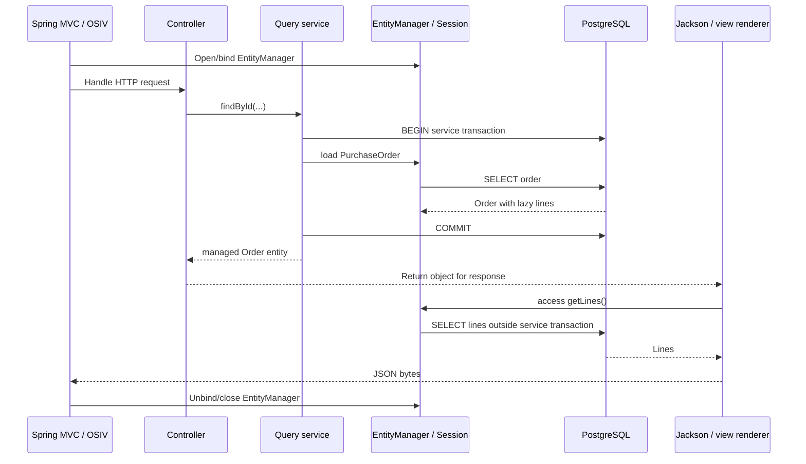
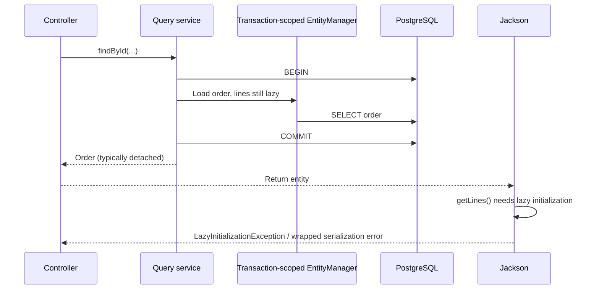
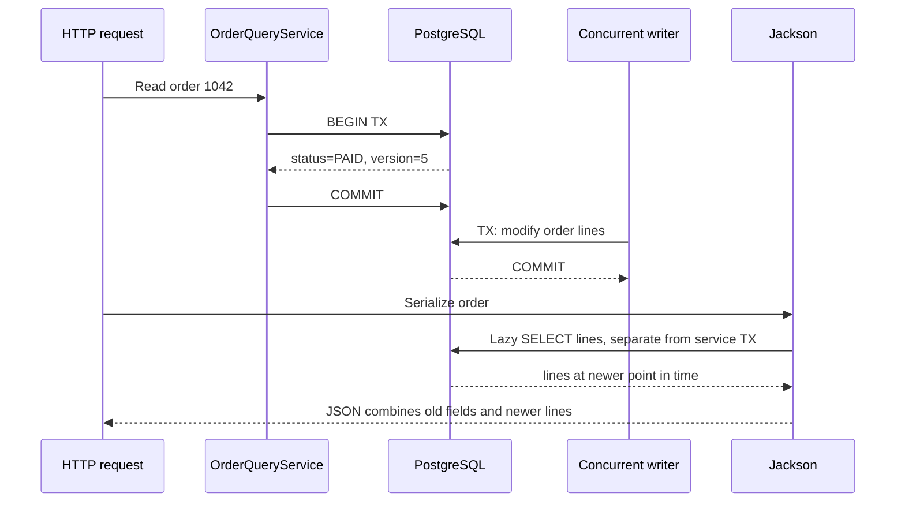
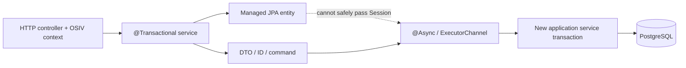
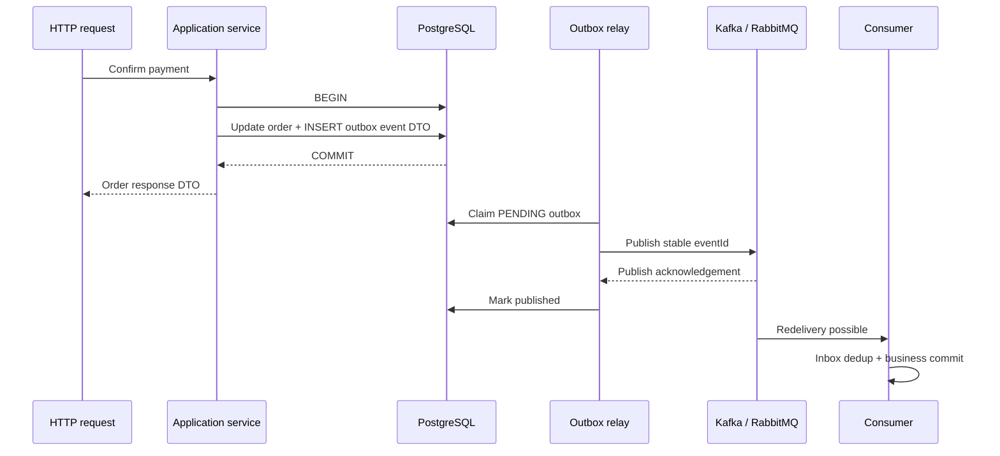
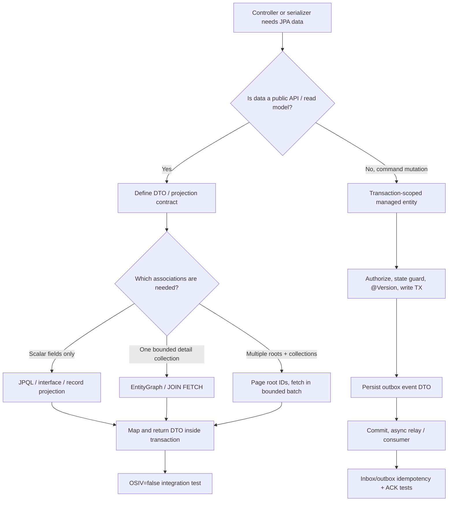

# Open EntityManager in View and Its Impact on Out-of-Transaction Queries

> **Chapter:** JPA and Hibernate  
> **Module:** `SPRING_BOOT_INTEGRATION` — organizing system integration in Spring Boot across HTTP clients, databases, caches, message brokers, and Spring Integration adapters. The focus is managing configuration, data contracts, transactions, errors, deduplication, testing, and observability in real integration flows.
>
> **Context:** Java 17+, Spring Boot 3.x, Jakarta Persistence API (`jakarta.persistence.*`), Spring Data JPA, and Hibernate 6.x; examples primarily target **Spring MVC on the Servlet stack**. Property names and Hibernate details may vary by version. This lesson does not claim a single default applies to WebFlux, asynchronous workers, or every `EntityManagerFactory` setup.

## 1. The Problem: The API Returned Data, Why Is SQL Still Running After the Service?

An Order Service receives partner webhooks, stores orders in PostgreSQL, syncs state to Redis, and publishes events to Kafka. An internal endpoint serves order details:

```text
GET /tenants/shop-a/orders/1042
  -> OrderController
  -> OrderQueryService.findById(...)
  -> OrderRepository
  -> JSON serialization
```

The team places `@Transactional(readOnly = true)` on the service expecting all SQL queries serving the response to execute **inside the service transaction**. However, logs reveal:

```text
10:00:00.010  BEGIN transaction
10:00:00.018  SELECT * FROM purchase_orders WHERE id = 1042
10:00:00.021  COMMIT transaction
10:00:00.024  SELECT * FROM purchase_order_lines WHERE order_id = 1042
10:00:00.031  HTTP response completed
```

The `SELECT purchase_order_lines` statement runs **after COMMIT**, when Jackson accesses the `order.getLines()` association. If the application has **Open EntityManager in View (OSIV)** enabled, this query can succeed without any active business transaction managed by the Spring service.

Key points to note:

- **Having an open EntityManager does not mean a database transaction is open.**
- OSIV can allow lazy loading during view rendering/JSON serialization, yet it also **hides the fact that the web layer is querying the database**.
- Disabling OSIV without fixing response construction can trigger `LazyInitializationException`.
- Keeping OSIV does not automatically solve N+1, transaction isolation, access control, memory usage, or connection pooling.
- Never pick a setting merely by asking "does turning it on or off stop the exception?"; define **data-reading boundaries and API contracts**.

### Learning Objectives

After this lesson, you can:

1. Distinguish `EntityManager`, Hibernate `Session`, persistence context, and database transaction.
2. Explain how OSIV works in Spring MVC and why lazy queries can run after a service transaction ends.
3. Read logs to spot SQL emitted in controllers, Jackson serialization, templates/views, or out-of-transaction mapping layers.
4. Recognize `LazyInitializationException`, N+1 queries, connection pressure, and inconsistent reads.
5. Disable OSIV safely and refactor APIs using DTO projections/`@EntityGraph`/targeted fetch plans.
6. Understand the limits of `@Transactional(readOnly = true)`, `join fetch`, pagination, async tasks, and message listeners.
7. Separate database state, cache, broker publishing, inbox/outbox, and HTTP responses into proper boundaries.
8. Test queries, transactions, serialization, security, and performance without test transactions masking bugs.

## 2. Terminology: EntityManager, Persistence Context, Session, and Transaction

| Term | Role | What **Not** to Infer |
|---|---|---|
| `EntityManager` | JPA API managing entities, queries, and persistence context lifecycle | Does not always imply an active DB transaction |
| Hibernate `Session` | Hibernate implementation backing `EntityManager` | Not thread-safe or safe to share across threads |
| **Persistence context** | Map of currently managed entities and associated state | Not an immutable snapshot across multiple queries outside a transaction |
| **Managed entity** | Entity attached to an active persistence context | Does not mean mutations are always auto-committed |
| **Detached entity** | Entity no longer managed by its original persistence context | Uninitialized lazy proxies may fail to load |
| **Lazy association** | Relationship/collection loaded on demand rather than eagerly | Does not automatically reduce SQL count; can cause N+1 |
| **Spring transaction** | Scope managed by a transaction manager, usually around a service method | Does not automatically encompass Jackson response serialization |
| **OSIV** | Keeps an `EntityManager` available during web request/view lifecycle | Does not hold a single DB transaction open for the entire request |
| **Connection pool** | Allocates and reuses JDBC connections | An open `EntityManager` does not prove a connection is continuously pinned |

### 2.1. Hibernate Session Is Not an Object to Pass Across Threads

A persistence context is normally bound to a Spring-managed execution context. Hibernate `Session` is **not thread-safe**. Never pass a managed entity/session directly to an `@Async` task expecting it to lazy load on another thread; pass stable DTOs/IDs and open a fresh transaction inside the worker if queries are needed.

### 2.2. "Outside a Transaction" Must Be Stated Precisely

When a `@Transactional` service method has committed while OSIV keeps the `EntityManager` open, Hibernate can run a lazy query **without an active Spring-managed service transaction**. At the JDBC/database level, individual SQL statements may run under driver/provider-managed auto-commit or transaction handling. Do not call that "no transaction at any layer"; the critical point is that the query **no longer shares the business transaction and isolation snapshot** of the earlier service query.

## 3. Two Different Lifecycles: Web Request vs. Service Transaction

With OSIV enabled on a Spring MVC Servlet request:



This diagram illustrates one execution path; actual JDBC connection acquisition/release timing depends on Hibernate connection handling, pool configuration, and transaction boundaries. Never claim OSIV **always** pins a connection for the entire request.

**OSIV boundary:** web request / view rendering.  
**`@Transactional` boundary:** the service method wrapped by the Spring transaction proxy.  
These two boundaries are normally **different**, even though they may share a persistence context during a request.

### 3.1. What Happens When OSIV Is Disabled?



Disabling OSIV does not "break Hibernate"; it exposes the fact that **the web layer expected to query the DB after the service transaction ended**. The fix is designing proper fetch plans and response contracts in the service, rather than turning OSIV back on to silence the exception.

## 4. Where Does Spring Boot Configure OSIV?

In Spring Boot **Servlet web + JPA** applications meeting auto-configuration conditions, Boot typically enables OSIV by default unless configured otherwise. It may log a warning that `spring.jpa.open-in-view` is enabled and queries may execute during view rendering.

Recommended configuration to make the policy explicit:

```yaml
spring:
  jpa:
    open-in-view: false
```

Or if an application intentionally opts into OSIV:

```yaml
spring:
  jpa:
    open-in-view: true
```

**No single OSIV default applies identically across Spring WebFlux, console apps, Spring Batch, Kafka consumers, RSocket, or WebSocket.** Spring MVC's familiar OSIV mechanism relies on Servlet requests and binding an `EntityManager` to the request thread/transaction synchronization.

### 4.1. Don't Look Only at application.yml in Git

Properties can be overridden by profiles, environment variables, command-line arguments, or deployment config. In Spring Boot, the typical environment variable name is:

```text
SPRING_JPA_OPEN_IN_VIEW=false
```

Safely verify the effective property on a running instance rather than guessing from local files. If a team manually registers `OpenEntityManagerInViewFilter` or `OpenEntityManagerInViewInterceptor`, auto-configuration properties may not govern that custom bean. Inspect actual bean/filter registrations in the application.

### 4.2. Disabling OSIV Does Not Disable JPA or @Transactional

`spring.jpa.open-in-view=false` does not disable `EntityManagerFactory`, Spring Data JPA repositories, Hibernate lazy associations, or `@Transactional`. It primarily removes Boot's web-view-lifecycle `EntityManager` binding. Repositories and services continue working inside normal managed transactions and persistence contexts.

## 5. How Is OSIV Implemented?

Spring Framework provides two familiar components:

- `OpenEntityManagerInViewFilter`: Servlet filter managing an `EntityManager` bound to eligible requests/dispatches.
- `OpenEntityManagerInViewInterceptor`: Spring MVC interceptor serving the same purpose in MVC workflows.

Their goal is letting view rendering or serialization access lazy associations after a service transaction ends. When a service transaction starts during that request, the Spring transaction manager can participate in the already-bound `EntityManager`; after commit, the `EntityManager` **remains open** for the view.

### 5.1. OSIV Does Not Wrap the Controller in @Transactional

This is the core distinction:

```text
OSIV begins:        [------------------------------------]
Service @TX:                 [-----------]
Controller+JSON:     [--------------][----------------]
SQL in TX:                    SELECT order
SQL outside TX:                               SELECT lines
OSIV ends:                                        |
```

Controllers do not automatically gain a JPA transaction just because OSIV is on. View code can run queries, yet it receives none of the consistency guarantees of the preceding service transaction.

### 5.2. Async Servlets Need Separate Verification

Spring includes async dispatch/context-binding support in OSIV components depending on version, yet never assume an `@Async` worker, arbitrary thread callback, or message broker listener inherits the HTTP request's `EntityManager`. Servlet async lifecycles, executors, context propagation, and session close timing must be **integration-tested** if you rely on them.

## 6. Data Model: PurchaseOrder and OrderLine with Lazy Associations

A minimal PostgreSQL schema:

```sql
CREATE TABLE purchase_orders (
    id BIGINT PRIMARY KEY,
    tenant_id VARCHAR(80) NOT NULL,
    status VARCHAR(32) NOT NULL,
    version BIGINT NOT NULL
);

CREATE TABLE purchase_order_lines (
    id BIGINT PRIMARY KEY,
    order_id BIGINT NOT NULL REFERENCES purchase_orders(id),
    sku VARCHAR(80) NOT NULL,
    quantity INTEGER NOT NULL
);

CREATE INDEX idx_order_lines_order_id
    ON purchase_order_lines(order_id);
```

JPA mapping using `jakarta.persistence.*`:

```java
import jakarta.persistence.*;
import java.util.ArrayList;
import java.util.List;

@Entity
@Table(name = "purchase_orders")
public class PurchaseOrder {

    @Id
    private Long id;

    @Column(name = "tenant_id", nullable = false)
    private String tenantId;

    @Column(nullable = false)
    private String status;

    @Version
    private long version;

    @OneToMany(mappedBy = "order", fetch = FetchType.LAZY)
    private List<PurchaseOrderLine> lines = new ArrayList<>();

    protected PurchaseOrder() {}

    public Long getId() { return id; }
    public String getTenantId() { return tenantId; }
    public String getStatus() { return status; }
    public long getVersion() { return version; }
    public List<PurchaseOrderLine> getLines() { return lines; }
}
```

```java
import jakarta.persistence.*;

@Entity
@Table(name = "purchase_order_lines")
public class PurchaseOrderLine {

    @Id
    private Long id;

    @ManyToOne(fetch = FetchType.LAZY, optional = false)
    @JoinColumn(name = "order_id", nullable = false)
    private PurchaseOrder order;

    @Column(nullable = false)
    private String sku;

    @Column(nullable = false)
    private int quantity;

    protected PurchaseOrderLine() {}

    public Long getId() { return id; }
    public String getSku() { return sku; }
    public int getQuantity() { return quantity; }
}
```

These entities illustrate **reading data**; the example omits aggregate constructors and sequence generators for inserts. `version` supports optimistic locking on business updates, yet **does not guarantee two queries executed at different times see the same snapshot**.

### 6.1. Why Declare LAZY Explicitly?

`@OneToMany` defaults to `LAZY` per JPA; writing it explicitly makes the fetch policy obvious to readers. `@ManyToOne` defaults to `EAGER` per JPA, so the example specifies `fetch = LAZY` to avoid unnecessary fetches. `LAZY` is a fetch strategy hint; actual proxy/bytecode enhancement and execution depend on the provider and association mapping.

### 6.2. Entities Are Not Response DTOs

Entities carry persistence lifecycles, bidirectional associations, proxies, and internal columns. Returning them directly as JSON responses causes:

- Lazy loading outside service transactions.
- Circular object graphs `order → lines → order`.
- Exposing internal fields whenever new getters are added.
- Coupling the DB schema to public APIs.
- Query counts dictated by how the serializer traverses objects.

Even with `@JsonIgnore` to break cycles, returning entities still couples the HTTP representation to the persistence model.

## 7. Anti-Pattern: Controller Returning an Entity Loaded by a Repository

```java
import org.springframework.http.HttpStatus;
import org.springframework.stereotype.Service;
import org.springframework.transaction.annotation.Transactional;
import org.springframework.web.server.ResponseStatusException;

@Service
public class OrderLookupService {

    private final PurchaseOrderRepository orders;

    public OrderLookupService(PurchaseOrderRepository orders) {
        this.orders = orders;
    }

    @Transactional(readOnly = true)
    public PurchaseOrder find(Long id, String tenantId) {
        return orders.findByIdAndTenantId(id, tenantId)
            .orElseThrow(() -> new ResponseStatusException(
                HttpStatus.NOT_FOUND, "Order not found"));
    }
}
```

```java
import org.springframework.web.bind.annotation.*;

@RestController
@RequestMapping("/tenants/{tenantId}/orders")
class OrderEntityController {

    private final OrderLookupService lookup;

    OrderEntityController(OrderLookupService lookup) {
        this.lookup = lookup;
    }

    @GetMapping("/{orderId}")
    PurchaseOrder get(@PathVariable String tenantId,
                      @PathVariable Long orderId) {
        return lookup.find(orderId, tenantId);
    }
}
```

Corresponding repository:

```java
import java.util.Optional;
import org.springframework.data.jpa.repository.JpaRepository;

public interface PurchaseOrderRepository
        extends JpaRepository<PurchaseOrder, Long> {

    Optional<PurchaseOrder> findByIdAndTenantId(Long id, String tenantId);
}
```

This is an **intentional anti-pattern for analysis**: the controller returns an entity, so Jackson may traverse `getLines()`. With bidirectional relationships, JSON cycle errors can also arise alongside lazy failures; this snippet is not a production-ready endpoint.

| Configuration | What Can Happen |
|---|---|
| OSIV **enabled** | Jackson calls getters; Hibernate executes lazy `SELECT` on lines outside the service transaction, risking N+1 |
| OSIV **disabled** | Uninitialized lazy collection, session already closed; triggers Hibernate `LazyInitializationException` |
| Association already fetched | Jackson does not need an extra lazy `SELECT` for that collection |
| Serializer ignores collection | No collection query runs; however the API omits that data, potentially violating the contract |
| Entity graph changes | SQL count and response shape change even though the controller was untouched |

**Caution:** Jackson does not always invoke every getter when ignore/filter/custom serializer settings are present; lazy queries fire **when the active serialization/view path actually touches an uninitialized proxy/collection**, not merely because an entity has a `LAZY` field.

## 8. LazyInitializationException: A Symptom, Not the Root Cause

A familiar error:

```text
org.hibernate.LazyInitializationException:
  failed to lazily initialize a collection of role:
  com.example.PurchaseOrder.lines:
  could not initialize proxy - no Session
```

On the HTTP response path, the framework may wrap this inside `HttpMessageNotWritableException` or a Jackson mapping exception.

### 8.1. When Does This Error Occur?

1. An entity or association has not been loaded yet.
2. Code accesses a lazy proxy/collection requiring a query.
3. The associated persistence context/session is already closed or unavailable.
4. Hibernate cannot fetch the data and throws the exception.

A detached entity **does not always fail immediately**; already-loaded scalar fields or initialized associations can still be read. Failure occurs at the moment **lazy initialization** is needed without a session.

### 8.2. The Wrong Fix: Turning OSIV On to Hide SQL Paths

Re-enabling OSIV may make the exception vanish, yet underneath:

- Data is still queried outside any intended business transaction.
- Query counts can still grow with entity/collection counts.
- HTTP latency depends on database queries during rendering.
- Isolation can differ from the initial query.
- Security/tenant filtering may not apply cleanly to lazy queries.

The real fix starts from response requirements: **which fields and relations are needed**? Fetch the required data and map to a DTO inside the transaction.

## 9. Why Do N+1 Queries Often Explode When OSIV Is Enabled?

Suppose a controller returns a list of 50 orders:

```java
@GetMapping
List<PurchaseOrder> list() {
    return orderRepository.findAll();
}
```

This code also lacks tenant filtering and pagination, so it is **not for production**. In this example, JPA can load 50 orders in one query while Jackson accesses `getLines()` for each order, firing 50 more queries.

```text
SELECT ... FROM purchase_orders;             -- 1 query
SELECT ... FROM purchase_order_lines WHERE order_id=1;
SELECT ... FROM purchase_order_lines WHERE order_id=2;
...
SELECT ... FROM purchase_order_lines WHERE order_id=50;
                                              -- 50 queries
TOTAL ~51 round trips
```

Actual query counts depend on fetch strategy, batch settings, caches, already-initialized associations, and query plans; N+1 is a **common pattern**, not a fixed mathematical formula.

### 9.1. N+1 Does Not Require OSIV to Exist

If DTO mapping inside a transaction iterates 50 orders and calls `getLines()` on each, N+1 still occurs. OSIV **makes the bug harder to spot** because queries fire during serialization after the service method returns. Disabling OSIV alone does not optimize SQL; you still need proper fetch strategies and query budgets.

### 9.2. Impact

- Many network round trips to the DB.
- Increased p95/p99 latency as collections grow.
- Elevated DB connection and pool activity.
- Greater risk of lock contention or unnecessary I/O load.
- Performance degrades with the number of JSON response items.
- Regressions can surface merely from adding a serializer/DTO getter without touching repository code.

## 10. Is SQL Executed After COMMIT Consistent with the Initial Query?

A query loads `status="PAID"` inside a service transaction; after commit, Jackson lazily loads `lines`. In between, a concurrent transaction can add, modify, or delete line items.



This creates **read skew / cross-snapshot inconsistency** across parts of the response. Even when all queries run inside one transaction, isolation levels like `READ COMMITTED` can allow each statement to observe data committed at different moments; never claim `@Transactional(readOnly=true)` automatically guarantees an immutable snapshot.

### 10.1. Choosing the Right Consistency Model

- For typical responses: build the complete DTO inside one service transaction under the chosen isolation level.
- For strict snapshot requirements: configure appropriate isolation, read by version, or use dedicated snapshot queries per business needs; verify DB behavior.
- For versioned aggregates: include `version` in contracts and enforce optimistic locking on writes.
- Across distributed systems: a database snapshot does not cover Redis, brokers, or other HTTP services. Use event versions, reconciliation, and eventual-consistency API contracts.

### 10.2. EntityManager First-Level Cache Is No Substitute for a DB Snapshot

The persistence context can retain previously read scalar fields on a managed entity while an uninitialized lazy association later queries newer data. A JSON response mixing two points in time is consistent with Hibernate's mechanics, yet fails snapshot contracts if the domain requires one.

## 11. Does OSIV Always Pin a JDBC Connection for the Entire HTTP Request?

**No absolute claim can be made.** Some articles describe OSIV as "holding a connection for the whole request," but connection acquisition and release depend on Hibernate version, connection handling mode, JDBC provider, transaction boundaries, and query behavior.

Distinguish:

1. **EntityManager/Session lifetime**: can span from the start to the end of the Servlet request.
2. **JDBC connection acquisition**: can be delayed until the first query executes.
3. **Connection release**: can happen at transaction boundaries or per provider/connection handling strategy.
4. **Transaction lifetime**: `@Transactional` is usually shorter than the HTTP request.
5. **Session state / managed entities**: persist while the session stays open even if a connection temporarily returns to the pool.

Never assert that every request under OSIV holds a single connection until response completion. Still, **OSIV increases DB I/O opportunities during rendering**, and under certain configurations or workloads it contributes to longer connection/pool retention.

### 11.1. What to Measure

| Metric | Indicates |
|---|---|
| Hikari active/idle/pending | Whether connections are held and callers are waiting |
| JDBC connection hold time | How long connections stay leased under workload |
| SQL count/request | Whether view serialization generates extra queries |
| DB CPU/I/O and round trips | Whether lazy queries are straining the database |
| HTTP response latency | Time from controller return to response completion |
| Slow client / streaming responses | Whether slow consumers prolong request/resource retention |

Optimize **based on metrics and traces**, not on assumptions that "OSIV always leaks connections."

## 12. OSIV and Access Control: A Lazy Query Can Bypass Data Design

Example multi-tenant system:

- Request authenticates as tenant `shop-a`.
- Service repository runs `findByIdAndTenantId(orderId, tenantId)`.
- Controller returns the entity.
- Serializer traverses `lines`, `customer`, `paymentRecords`, or `internalNotes`.

Even when the root query checks tenant ownership, **there is no guarantee every lazily traversed association respects the intended authorization boundary**. This depends on schema, foreign keys, mappings, tenant filters, and policies.

### 12.1. DTOs Are the Data-Disclosure Contract

For a customer-facing endpoint, the DTO should include only:

```json
{
  "orderId": 1042,
  "status": "PAID",
  "items": [
    {"sku": "A-101", "quantity": 2}
  ]
}
```

Never expose `billingAddress`, `internalFraudFlag`, or `paymentToken` simply because the entity has getters for them. Enforce authorization in services, scope queries by tenant, and map only approved fields.

### 12.2. @JsonIgnore Is Not a Complete Authorization Boundary

`@JsonIgnore` or Jackson Views hide fields in a specific serializer, yet they do not replace row-level/tenant authorization and may not protect other adapters (message payload mappers, GraphQL resolvers, `toString`/logs). **Never let the entity graph dictate what sensitive data leaves the process**.

## 13. What Should Controllers, Services, and Repositories Own?

A maintainable separation:

| Layer | Responsibilities | Avoid |
|---|---|---|
| HTTP controller | Authenticate/extract tenant identity, validate requests, call service, return DTO/status | Controlling lazy loading or `EntityManager` directly |
| Application service | Transactions, authorization, invoke repositories, map DTOs, enforce consistency | Returning managed entities for serializers to query later |
| Repository/JPA | Authorized queries, fetch graphs/projections, persistence | Defining public API fields |
| Serializer | Encode complete DTOs | Querying the database or deciding fetch behavior |
| Outbox/message adapter | Publish post-commit, retries, ACKs | Depending on an HTTP request's `Session` |
| Metrics/tracing | Observe SQL count, latency, and errors | Logging full entities containing PII |

**The service transaction is the clearest place to decide which data gets loaded.** Serializers should operate purely on DTO snapshots with no Hibernate Session needed.

### 13.1. Why Not Put @Transactional on the Controller?

Annotating a controller with `@Transactional` to keep the DB transaction open until the request finishes does not reliably cover Jackson serialization **after the controller method returns**; the transaction proxy normally completes when the method exits. Moreover, controllers handle HTTP/validation work, inflating transaction length and tying DB locks to network/serialization latency.

Place transactions on application services performing data work. For read endpoints, map DTOs before leaving the service method.

## 14. Building DTOs Inside the Transaction: The Recommended Path

Define response types **free of entities or proxies**:

```java
import java.util.List;

public record OrderLineView(
    Long lineId,
    String sku,
    int quantity
) {}

public record OrderDetailResponse(
    Long orderId,
    String status,
    long version,
    List<OrderLineView> lines
) {}
```

Service:

```java
import java.util.List;
import org.springframework.http.HttpStatus;
import org.springframework.stereotype.Service;
import org.springframework.transaction.annotation.Transactional;
import org.springframework.web.server.ResponseStatusException;

@Service
public class OrderDetailQueryService {

    private final PurchaseOrderRepository orders;

    public OrderDetailQueryService(PurchaseOrderRepository orders) {
        this.orders = orders;
    }

    @Transactional(readOnly = true)
    public OrderDetailResponse get(String tenantId, Long orderId) {
        PurchaseOrder order = orders.findDetailByTenantAndId(tenantId, orderId)
            .orElseThrow(() -> new ResponseStatusException(
                HttpStatus.NOT_FOUND, "Order not found"));

        List<OrderLineView> lines = order.getLines().stream()
            .map(line -> new OrderLineView(
                line.getId(), line.getSku(), line.getQuantity()))
            .toList();

        return new OrderDetailResponse(
            order.getId(),
            order.getStatus(),
            order.getVersion(),
            List.copyOf(lines)
        );
    }
}
```

Controller:

```java
import org.springframework.web.bind.annotation.*;

@RestController
@RequestMapping("/tenants/{tenantId}/orders")
class OrderDtoController {

    private final OrderDetailQueryService service;

    OrderDtoController(OrderDetailQueryService service) {
        this.service = service;
    }

    @GetMapping("/{orderId}")
    OrderDetailResponse get(
            @PathVariable String tenantId,
            @PathVariable Long orderId) {
        return service.get(tenantId, orderId);
    }
}
```

**This keeps any lazy initialization inside the transaction** and returns a record DTO with zero session dependency. Turning OSIV off will not break serialization of this record because it holds no JPA lazy proxies.

### 14.1. TenantId in the URL Is Not Automatically Trusted

The example uses `tenantId` from the path to illustrate query scoping; in production, verify it against the caller's authenticated identity/authorization rather than trusting a user supplying `shop-b` to read shop-b's orders.

### 14.2. Why List.copyOf?

It creates an unmodifiable list, protecting the DTO from accidental mutation. It does **not** make the whole graph deeply immutable if elements are mutable objects; here `OrderLineView` is also a record containing only scalar fields.

## 15. @EntityGraph: Declaring What Must Be Fetched for a Response

The repository exposes a dedicated method for the detail endpoint:

```java
import java.util.Optional;
import org.springframework.data.jpa.repository.EntityGraph;
import org.springframework.data.jpa.repository.JpaRepository;
import org.springframework.data.jpa.repository.Query;
import org.springframework.data.repository.query.Param;

public interface PurchaseOrderRepository
        extends JpaRepository<PurchaseOrder, Long> {

    Optional<PurchaseOrder> findByIdAndTenantId(
        Long id, String tenantId);

    @EntityGraph(attributePaths = {"lines"})
    @Query("""
        select o from PurchaseOrder o
        where o.id = :orderId
          and o.tenantId = :tenantId
        """)
    Optional<PurchaseOrder> findDetailByTenantAndId(
        @Param("tenantId") String tenantId,
        @Param("orderId") Long orderId);
}
```

`@EntityGraph(attributePaths = {"lines"})` tells the provider this endpoint needs the `lines` association loaded. Where supported, Hibernate can issue a join or fetch plan that avoids secondary lazy `SELECT`s when the service maps the DTO.

### 15.1. EntityGraph Does Not Always Mean 1 SQL Statement

Exact SQL depends on mappings, provider, graph depth, collection cardinality, and query planner. An entity graph does not guarantee a single round trip in every case, particularly with nested collections, batch/subselect settings, or query restrictions. **Verify with SQL count tests on realistic datasets.**

### 15.2. Choose Graphs per Use Case

- List endpoint: select only fields needed for the page view.
- Detail endpoint: can fetch a bounded collection.
- Export/report: streaming, projections, or volume-aware batching.
- Command path: load only the aggregate needed for mutation inside the transaction.
- Audit: use dedicated projections/entities and clear transactions, never serializers.

Never switch every association to `EAGER` just so turning OSIV off doesn't throw; that forces unrelated endpoints to fetch unneeded data.

## 16. Direct DTO Projections from the Database: When Entities Aren't Needed

For summary responses, projections can be more efficient than hydrating entities and lazy associations:

```java
public record OrderSummaryRow(
    Long orderId,
    String status,
    long version
) {}
```

Spring Data JPA repository:

```java
import java.util.Optional;
import org.springframework.data.jpa.repository.Query;
import org.springframework.data.repository.query.Param;

public interface OrderSummaryRepository
        extends org.springframework.data.repository.Repository<PurchaseOrder, Long> {

    @Query("""
        select new com.example.orders.OrderSummaryRow(
            o.id, o.status, o.version)
        from PurchaseOrder o
        where o.id = :id and o.tenantId = :tenantId
        """)
    Optional<OrderSummaryRow> findSummary(
        @Param("id") Long id,
        @Param("tenantId") String tenantId);
}
```

**This snippet assumes `OrderSummaryRow` is in package `com.example.orders`**; the path inside the JPQL constructor expression must match the exact fully qualified class name. Projections produce no managed entities needing lazy initialization during serialization.

Other projection queries can select joined scalar fields; verify constructor expression limits, aliases, data types, and native SQL mapping rules per provider version.

### 16.1. DTO Projections Also Aid Data Security

When a query selects only `id/status/version`, sensitive columns are never loaded at all. Still, enforce tenant/authorization predicates in the query; projections **do not prevent data leaks** if query scoping is wrong.

### 16.2. Projections Do Not Fit Every Mutation

In command paths that mutate an aggregate, managed entities and optimistic locking may be a better fit. Choose between loading strategies based on **read use case vs. write use case**, rather than abandoning the ORM solely to disable OSIV.

## 17. What Does @Transactional(readOnly=true) Help With, and What Does It Not?

Example:

```java
@Transactional(readOnly = true)
public OrderDetailResponse getDetail(...) {
    // JPA queries + DTO mapping.
}
```

`readOnly=true` is a **hint/condition for the transaction manager and provider** that can help optimize Hibernate flush/dirty checking depending on version. It does not guarantee:

- That the DB rejects every `UPDATE` across all drivers/dialects.
- That HTTP JSON serialization runs inside the transaction.
- That all associations are initialized.
- That N+1 queries cannot happen.
- That no lazy SQL runs out of transaction if OSIV remains enabled.
- That all reads form a consistent snapshot if isolation is not configured.

### 17.1. Transactions Rely on Spring Proxies

`@Transactional` normally requires calls to pass **through a Spring proxy**, and does not trigger when a method in the same bean calls another `@Transactional` method (`self-invocation`) in proxy mode.

Anti-pattern example:

```java
@Service
class OrderService {
    private final PurchaseOrderRepository orders;

    OrderService(PurchaseOrderRepository orders) {
        this.orders = orders;
    }

    public PurchaseOrder get(Long id) {
        return loadTransactional(id); // Self-invocation; may bypass proxy.
    }

    @Transactional(readOnly = true)
    public PurchaseOrder loadTransactional(Long id) {
        return orders.findById(id).orElseThrow();
    }
}
```

This is an **intentional anti-pattern**: `get()` calls `loadTransactional()` on `this`, so the target annotation may not be intercepted by the Spring proxy; returning the entity also risks out-of-service lazy queries. Fix it by placing the transaction on **an entrypoint called from another bean** or extracting a separate transactional component, mapping to a DTO inside the transaction, and testing that a transaction is actually active during repository/mapping work.

### 17.2. Avoid Long Transactions

Never hold a DB transaction open while waiting on REST APIs, Redis, or broker publishes just to keep an entity attached. External I/O wait times pin connections and locks; a PostgreSQL transaction never covers HTTP/Kafka/Redis side effects anyway.

## 18. Fetch Join, Batch Fetching, and N+1 Optimization

Beyond `@EntityGraph`, Hibernate/JPA offers additional fetch-control tools.

### 18.1. JPQL JOIN FETCH

```java
@Query("""
    select o
    from PurchaseOrder o
    left join fetch o.lines
    where o.id = :id
      and o.tenantId = :tenantId
    """)
Optional<PurchaseOrder> findOneWithLines(
    @Param("id") Long id,
    @Param("tenantId") String tenantId);
```

This queries **one order** with one collection. Do not apply collection fetch joins indiscriminately to paginated list endpoints.

### 18.2. Hibernate Batch Fetching

Spring Boot property forwarded to Hibernate:

```yaml
spring:
  jpa:
    properties:
      hibernate:
        default_batch_fetch_size: 32
```

Hibernate can batch lazy association loads across multiple entities into batched `SELECT`s instead of individual queries. This **reduces round trips**, without replacing explicit response contracts or clear transaction boundaries.

`@BatchSize(size = 32)` is a Hibernate-specific annotation applicable to entities or collections as needed. Batch fetching depends on mappings, ID counts, persistence context state, and Hibernate version; test query counts.

### 18.3. JOIN FETCH Collection + Pagination Trap

Combining a collection fetch join with `Pageable` makes it hard for Hibernate to apply DB limit/offset accurately, resulting in warnings or in-memory pagination depending on config and version. Instead:

1. Paginate **IDs/roots** first with a tenant-scoped query.
2. Load associations for that **bounded set of IDs**.
3. Map DTOs inside the transaction.
4. Preserve page ordering per specification.

You can enable fail-fast behavior for collection-fetch pagination in Hibernate where supported:

```yaml
spring:
  jpa:
    properties:
      hibernate:
        query:
          fail_on_pagination_over_collection_fetch: true
```

This is a Hibernate property; verify exact naming/behavior in your version. It rejects dangerous pagination queries rather than magically optimizing SQL.

### 18.4. Do Not Fetch Multiple Bag Collections Recklessly

Hibernate can throw `MultipleBagFetchException` when join-fetching multiple bag associations in a single query. Even when allowed, joining multiple collections causes **Cartesian multiplication**, creating massive result sets. Use split queries, batch fetching, subselects, or projections; prioritize query budgets and response size.

## 19. Safe Pagination with Collection Fetching

An endpoint returning a list of orders must bound both **root count** and **line-item count**. Never call `findAll()` and let Jackson lazily load unbounded graphs.

A two-step strategy:

1. Query a page of `order IDs` scoped by tenant with a deterministic order.
2. Fetch required details for **only those IDs**, optionally fetching one suitable collection.
3. Re-sort by the original ID page order since SQL `IN (:ids)` does not guarantee row ordering.
4. Map each order to a DTO **before the transaction closes**.
5. Enforce page size caps and total line-item bounds.

Example repository:

```java
import java.util.Collection;
import java.util.List;
import org.springframework.data.domain.Page;
import org.springframework.data.domain.Pageable;
import org.springframework.data.jpa.repository.Query;
import org.springframework.data.repository.query.Param;

public interface OrderPageRepository
        extends org.springframework.data.repository.Repository<PurchaseOrder, Long> {

    @Query(
        value = """
            select o.id from PurchaseOrder o
            where o.tenantId = :tenantId
            order by o.id desc
            """,
        countQuery = """
            select count(o) from PurchaseOrder o
            where o.tenantId = :tenantId
            """
    )
    Page<Long> pageOrderIds(
        @Param("tenantId") String tenantId,
        Pageable pageable);

    @Query("""
        select distinct o from PurchaseOrder o
        left join fetch o.lines
        where o.tenantId = :tenantId
          and o.id in :ids
        """)
    List<PurchaseOrder> findWithLines(
        @Param("tenantId") String tenantId,
        @Param("ids") Collection<Long> ids);
}
```

Mapping inside a `@Transactional(readOnly = true)` service:

```java
Page<Long> pageIds = pageRepository.pageOrderIds(
    tenantId, org.springframework.data.domain.PageRequest.of(page, size));

List<Long> ids = pageIds.getContent();
if (ids.isEmpty()) {
    return List.of();
}

Map<Long, PurchaseOrder> ordersById =
    pageRepository.findWithLines(tenantId, ids).stream()
        .collect(java.util.stream.Collectors.toMap(
            PurchaseOrder::getId, java.util.function.Function.identity()));

return ids.stream()
    .map(ordersById::get)
    .filter(java.util.Objects::nonNull)
    .map(this::toDto)
    .toList();
```

`pageRepository` and `toDto` are fields/methods on the application service, not globals; this is a **service excerpt**. Filtering `nonNull` is only appropriate if the API tolerates a row disappearing between the two queries; if the contract requires a consistent snapshot of all IDs, configure an isolation/version policy instead of silently dropping entries.

### 19.1. Two Queries Can Still Observe Concurrent Changes

If IDs are read at T1 and details at T2, a row may be deleted or reassigned between queries. `@Transactional(readOnly = true)` at default isolation does not guarantee a point-in-time snapshot across statements. If stricter consistency is needed, use a database-supported isolation level, version checks, or a specialized snapshot query.

### 19.2. Large Collections Remain a Risk

Even with only 20 orders, a single order containing 50,000 lines produces a huge fetch graph and JSON response. For multi-line invoice-style details, consider **dedicated line pagination**, batch exports, or quota-bounded streams instead of unbounded fetches.

## 20. View Rendering, Jackson, Template Engines, and ORM Sessions

OSIV is named "in View" because it originally served server-rendered HTML. In JSON APIs, **Jackson is also a response-rendering step**, which typically runs after the controller/service method returns.

Common entity-traversal paths:

- Thymeleaf/JSP expressions like `order.lines.size()`.
- Jackson getter traversal via `@ResponseBody`/`@RestController`.
- Spring HATEOAS assemblers accessing associations.
- GraphQL resolvers calling lazy getters (requiring DataLoaders/dedicated transactions).
- Email templating reading managed entities outside a service.
- Logger `toString()`/`equals()`/`hashCode()` accidentally traversing relationships.
- Mapping libraries traversing associations unchecked.

### 20.1. Hibernate/Jackson Modules Do Not Replace Response Design

Some projects register a Jackson module supporting Hibernate proxies (matching their Hibernate major version). That can prevent forcing proxy initialization or serialize IDs/nulls per policy. Still, that is **serialization behavior**, not a primary solution for:

- Which fields belong in the API contract?
- Are fetch plans and query counts controlled?
- Does the request satisfy tenant authorization?
- Where does the session close?
- Does the response depend on a consistent transaction/snapshot?

Merely hiding uninitialized lazy properties to avoid exceptions can silently drop fields expected by the frontend.

### 20.2. Open EntityManager in View Doesn't Only Fail on Huge JSON

A computed getter can invoke a repository or lazy association, making the controller return quickly while the HTTP response stalls. When adding fields to a JSON contract, inspect **SQL traces all the way until response bytes finish writing**, not only service transaction logs.

## 21. Hibernate.initialize and Checking isInitialized(): Use Deliberately

Hibernate provides:

```java
import org.hibernate.Hibernate;

boolean loaded = Hibernate.isInitialized(order.getLines());
Hibernate.initialize(order.getLines());
```

`Hibernate.initialize(...)` explicitly initializes a lazy collection **while an appropriate session is open**. During incremental migrations, initializing an association inside a transactional service can be a temporary bridge, yet it is Hibernate-specific and rarely an optimal fetch plan.

### 21.1. "Initialize Everything" Is Still N+1

```java
for (PurchaseOrder order : orders) {
    Hibernate.initialize(order.getLines());
}
```

If `orders` holds 100 items without batching/fetch joins, this still fires up to 100 `SELECT`s for lines. You only **moved N+1 from serialization into the service**, without reducing SQL count.

Prefer:

- Query projections for read views.
- `@EntityGraph` for detail use cases.
- `JOIN FETCH` when cardinality is bounded.
- Benchmarked batch/subselect fetching.
- DTO mapping inside the transaction paired with query-count tests.

### 21.2. EntityManager.clear(), detach(), refresh() Are Not Cures

- `clear()` detaches all entities from the current persistence context.
- `detach(entity)` detaches a single entity.
- `refresh(entity)` reloads state per provider/transaction rules.

Each has specific uses; none initializes lazy associations for you. Calling `clear()` and then returning an entity to a controller makes lazy getters fail even sooner when OSIV isn't keeping those entities managed.

## 22. Hibernate's enable_lazy_load_no_trans Flag: Do Not Mask Architectural Debt

Hibernate provides a common vendor-specific setting:

```yaml
# Anti-pattern: never enable just to silence LazyInitializationException.
spring:
  jpa:
    properties:
      hibernate:
        enable_lazy_load_no_trans: true
```

This flag allows Hibernate to initialize lazy data outside the original transaction/persistence context using ad-hoc internal handling. It quickly leads to:

- Implicit sessions, connections, and queries outside service transactions.
- N+1 queries firing wherever code touches an object.
- Read skew / non-snapshot reads.
- Obscure transaction and query ownership.
- Semantic surprises during provider upgrades.

**Never treat `enable_lazy_load_no_trans` as a safe alternative to OSIV.** If your only motivation is eliminating `LazyInitializationException`, fix the fetch plan and DTOs instead of enabling another hidden query mechanism.

### 22.1. This Flag Differs from OSIV

OSIV binds an `EntityManager` to the web request. `enable_lazy_load_no_trans` is Hibernate's special mechanism for lazy loading when no suitable active session/transaction exists. They are **not equivalent** in lifecycle, connection behavior, or identity map semantics; never enable both assuming the issue is solved.

## 23. @Async, ExecutorChannel, and Job Workers Lack Web OSIV

A worker processing an event after an HTTP request completes must never rely on that request's `EntityManager`.



Anti-pattern:

```java
@Async
public void sendReceipt(PurchaseOrder order) {
    // order may already be detached; getLines() can fail.
    emailService.renderAndSend(order.getLines());
}
```

It also risks sending emails before DB commit or duplicating emails on retry. Pass `orderId` and a stable event ID, or a DTO snapshot constructed inside the transaction.

### 23.1. Workers Query the DB in Their Own Transaction

```java
import org.springframework.stereotype.Service;
import org.springframework.transaction.annotation.Transactional;

@Service
class OrderReceiptDataService {
    private final PurchaseOrderRepository orders;

    OrderReceiptDataService(PurchaseOrderRepository orders) {
        this.orders = orders;
    }

    @Transactional(readOnly = true)
    public OrderDetailResponse loadForReceipt(
            String tenantId, Long orderId) {
        PurchaseOrder order = orders
            .findDetailByTenantAndId(tenantId, orderId)
            .orElseThrow(() -> new IllegalArgumentException(
                "Order not found or inaccessible"));
        return OrderDtoMapper.toResponse(order);
    }
}
```

`OrderDtoMapper` is an application-defined pure mapper reading only fetched fields to build a DTO. The worker calls the service through a Spring bean/proxy, receives the DTO, and renders the email after the transaction ends. If the email must reflect **state at the exact moment the order committed**, re-reading current state later may not suffice; store a versioned snapshot in an outbox.

### 23.2. @Async and @Transactional Self-Invocation

If an `@Async`/`@Transactional` method is invoked internally within the same bean, proxy advice may be bypassed in proxy mode. When combining async execution with transactions, separate the worker bean from the transactional service bean and test active threads, active transactions, and error/cancellation paths.

## 24. Spring Integration Channels and Broker Listeners Have Their Own Transaction Boundaries

The `SPRING_BOOT_INTEGRATION` module spans multiple ingress paths:

```text
HTTP controller
  -> Order service @Transactional
  -> Response DTO

Kafka/Rabbit/Pulsar listener
  -> Message adapter
  -> Order processing service @Transactional
  -> Inbox + state + outbox

Spring Integration polling adapter
  -> QueueChannel / DirectChannel
  -> Service activator
  -> Transactional service
```

OSIV applies only to certain **web request contexts**. It **never provides** an `EntityManager` to Kafka consumers, RabbitMQ listeners, Pulsar listeners, scheduled jobs, or Spring Integration pollers.

### 24.1. DirectChannel vs. ExecutorChannel

- `DirectChannel` normally dispatches synchronously on the caller's thread. A call inside a service transaction can share the active context if beans use the same manager.
- `ExecutorChannel` hands execution to another thread; the caller's `ThreadLocal` transaction context does not propagate automatically.
- `QueueChannel` uses a polling consumer reading messages later; handlers/pollers must start their own transactions.
- `PublishSubscribeChannel` can be synchronous or asynchronous depending on its executor; never rely on OSIV to lazy load inside subscribers.

Never "fix" `LazyInitializationException` in a message handler by setting `spring.jpa.open-in-view=true`; a message handler is not an HTTP MVC view and needs transactions and fetch plans at its own processing boundary.

### 24.2. Message Payloads Must Not Carry Managed Entities

Sending a Hibernate-managed `PurchaseOrder` directly through a Spring Integration channel or broker serializer risks:

- Lazy access failures post-transaction.
- Massive or cyclic serialization graphs.
- Side-effect queries inside publishers.
- Tight coupling between producer/consumer and JPA class versions.
- Leaking sensitive attributes onto the broker.

Use explicit event contracts:

```java
import java.time.Instant;

public record OrderPaidEvent(
    String eventId,
    Long orderId,
    String tenantId,
    long aggregateVersion,
    Instant occurredAt
) {}
```

If consumers need extra details, they query within their own permissions and transactions or consume a contracted snapshot DTO. Never use JPA entities as inter-service wire protocols.

## 25. Transactional Outbox: Avoiding Hidden Queries During Event Publishing

Reliable flow:



The outbox must hold an **event contract serializable without a Hibernate Session**. Never stash a reference to a live entity inside an in-memory event hoping the outbox relay will serialize it after the transaction/request finishes.

### 25.1. Example Service Persisting State and Outbox in One Transaction

```java
import org.springframework.stereotype.Service;
import org.springframework.transaction.annotation.Transactional;

@Service
class OrderPaymentCommandService {
    private final OrderPaymentRepository orders;
    private final OutboxRepository outbox;

    OrderPaymentCommandService(
            OrderPaymentRepository orders,
            OutboxRepository outbox) {
        this.orders = orders;
        this.outbox = outbox;
    }

    @Transactional
    public void confirmPayment(PaymentConfirmedCommand command) {
        // Method checks tenant, idempotency, and state.
        OrderPaidEvent event = orders.markPaidIfAllowed(command);
        outbox.insertIfAbsent(event.eventId(), event);
    }
}
```

`OrderPaymentRepository`, `OutboxRepository`, and `PaymentConfirmedCommand` are project-defined adapter/domain types. `orders.markPaidIfAllowed` must return an event DTO built strictly from data resolved **inside the transaction**; the outbox insert must share the same datasource, transaction manager, and unique constraint.

### 25.2. OSIV Does Not Solve Dual Writes

Even if OSIV is enabled and an entity can still serialize post-commit, if a publisher writes to Kafka and the DB transaction then rolls back, the two systems diverge. **OSIV manages web-layer lazy session visibility, not atomic HTTP–DB–broker transactions.**

## 26. From JPA DTOs to Redis Cache: Never Cache Proxies or Managed Entities

Cache-aside example:

```text
GET /orders/{id}
    -> Redis GET order-summary:v2:tenant:id
    -> Miss -> @Transactional(readOnly=true) JPA query
            -> map OrderSummaryDto
            -> Redis SET with TTL
    -> HTTP response DTO
```

Never serialize Hibernate entities or proxies directly into Redis:

- Serializers can hit lazy associations after the transaction closes.
- Entity/proxy classes and Jackson/Hibernate upgrades break cached schema compatibility.
- Caches can expose internal fields or cross-tenant attributes unintentionally.
- Deserialized cached objects lose JPA managed identity and dirty-checking semantics.
- A deserialized detached entity **does not automatically reattach** to an `EntityManager`.

**Recommended pattern:** cache a versioned DTO under a tenant-scoped key with an explicit TTL, keeping the database as the source of truth.

### 26.1. Cache Invalidation After Commit

If an order updates in a transaction and Redis invalidation subsequently fails, OSIV cannot fix that divergence. For durable invalidation, write an outbox event with a retrying worker/consumer or use versioned cache keys.

A common race:

```text
Reader fetches order version 5 from DB (not yet written to cache)
Writer commits version 6 and DELs cache
Reader writes stale version 5 into Redis after DEL
```

TTLs and version checks/reconciliation mitigate this risk; never assume "DB transaction + OSIV" keeps caches consistent.

## 27. Reads vs. Writes: Never Use OSIV as a Transaction Management Mechanism

OSIV keeps an `EntityManager` open across a web request, yet JPA dirty checking, flushing, and commits still require a valid transaction.

### 27.1. Anti-Pattern: Mutating an Entity in a Controller After Service Return

```java
PurchaseOrder order = lookupService.find(orderId, tenantId);
order.getLines().clear(); // Anti-pattern: mutating collection outside write TX.
// No explicit @Transactional write boundary or controlled commit.
```

This illustrates flawed controller logic: `getLines()` may lazy load thanks to OSIV, yet `clear()` does not mean a write transaction is open or that changes will commit safely. Even if OSIV keeps the entity attached, writes outside an explicit write transaction are not guaranteed to flush/commit predictably. Write logic belongs in `@Transactional` application services enforcing authorization, state transitions, and optimistic locking.

### 27.2. @Version Does Not Replace Transactions

`@Version` detects concurrent updates via optimistic locking during provider `UPDATE`s, yet it:

- Does not lock all data read during view rendering.
- Does not ensure lazy collections and root entities come from the same snapshot.
- Does not provide transactional consistency across multiple SQL statements.
- Does not solve Redis/Kafka dual writes.

### 27.3. Read-Only Transactions Do Not Block Accidental Writes Everywhere

Never treat `@Transactional(readOnly=true)` as a "security lock" preventing all `UPDATE`s. Providers and databases implement read-only hints differently. Enforce authorization and write boundaries through service/API policies, database user privileges, and domain invariants.

## 28. Slow HTTP Clients, JSON Streaming, and Resource Lifecycles

An endpoint returning an entity can spend significant time serializing and transmitting the body. Under OSIV, session lifetime follows the web request/dispatch; lazy loading in the view can trigger DB resource usage while the response is streaming.

Risk scenarios:

- Slow client networks prolong request lifetime.
- Responses contain thousands of entities and lazy collections.
- Jackson traverses associations, interleaving SQL queries.
- Connection pools face contention under load spikes.
- A mid-serialization SQL error fails the response after headers/body bytes have already been flushed.

### 28.1. Streaming Responses Need Dedicated Design

A `StreamingResponseBody` or JSON stream using detached entities cannot lazy load relationships post-transaction. When streaming batches:

1. Use explicit cursor/pagination queries with bounded transactions.
2. Map DTO batches within valid scopes.
3. Close `EntityManager`/connections promptly.
4. Bound total bytes, timeouts, and cancellation.
5. Never hold a database transaction open waiting on slow client reads.

A transaction held open across a huge stream ties up connections, snapshots, bloat, and locks; use batched export jobs for heavy workloads.

### 28.2. OSIV Does Not Guarantee Transactions Inside Response Writers

Even with an open `Session`, Jackson hitting the DB outside a service transaction can fail. Once response headers are committed, mapping exceptions can truncate connections or produce partial JSON; error handlers cannot always emit a clean `500 ProblemDetail`.

## 29. Logging and Observability: Finding Out-of-Service-Transaction SQL

A practical diagnostic step is enabling controlled SQL logging in test/staging:

```yaml
logging:
  level:
    org.hibernate.SQL: DEBUG
    # Do not enable TRACE bind values in production when PII/secrets exist.
    # org.hibernate.orm.jdbc.bind: TRACE

spring:
  jpa:
    properties:
      hibernate:
        generate_statistics: true
```

Depending on version, Hibernate uses different logging categories for SQL and bind values. `generate_statistics` carries overhead, so enable purposefully and benchmark its impact.

### 29.1. Measuring Query Counts per Request

Useful tools and strategies:

- Hibernate `Statistics`/`SessionFactory` for aggregate stats and scoped tests.
- Datasource proxies or JDBC instrumentation to count SQL statements.
- Micrometer timers/counters on repositories and services.
- Correlation IDs/distributed tracing linking HTTP requests to query spans.
- Log timestamps marking `controller_returned_at` and `response_completed_at` to spot serialization-phase queries.

**Never look solely at JVM-wide SQL totals** in parallel tests and claim a request has N+1. Isolate tests, reset counters cleanly, or correlate per-request spans.

### 29.2. Never Log Sensitive Bind Values

Bind parameters can contain tenant IDs, emails, payment references, tokens, or personal data. `TRACE` logging of Hibernate bind parameters can leak PII/secrets into logs. Use masked query traces, sampled SQL, and synthetic test datasets.

### 29.3. Useful Metrics

| Metric / Trace | Purpose |
|---|---|
| SQL `SELECT`s per endpoint/request | Detect N+1 and out-of-service lazy queries |
| HTTP controller duration vs. response serialization duration | Spot latency incurred during rendering |
| Hikari active/idle/pending | Detect pool pressure |
| DB query p95/p99 | Surface round trips and query plan regressions |
| Entity/collection fetch counts | Catch unexpected graph loading |
| JSON response size | Catch overly broad graphs |
| `LazyInitializationException` count | Surface broken fetch plans or transaction boundaries |
| Outbox pending / oldest age | Track committed events not yet published |
| Cache hit/miss/stale reads | Assess DB/cache consistency impact |

## 30. Plan to Safely Disable OSIV in a Running Application

Never flip `spring.jpa.open-in-view=false` and just patch whichever endpoints immediately throw, because hidden lazy queries can lurk in controllers, views, exception handlers, and JSON mappers.

Controlled rollout:

1. **Inventory** HTTP endpoints returning JPA entities, entity-bearing projections, HATEOAS assemblers, or templates touching relations.
2. **Enable SQL telemetry** in staging to locate queries firing after service transactions or during view rendering.
3. **Define response contracts**: allowed fields, required associations, and payload bounds.
4. **Migrate controllers** to return immutable DTO snapshots mapped inside service transactions.
5. **Design targeted fetch plans**: projections for lists, entity graphs for details, ID pagination + bounded details for collections.
6. **Add integration tests** with OSIV disabled, without test-method `@Transactional` hiding errors.
7. **Measure SQL counts and latency** across happy paths, empty results, pagination, large collections, and concurrent writes.
8. **Verify tenant authorization** on DTOs without relying on Jackson ignore annotations.
9. **Canary or staging rollout**, checking error rates and pool metrics.
10. **Deploy OSIV false** across reviewed environment profiles with a rollback plan.
11. **Audit workflows** spanning HTTP→DB→Redis→broker so background jobs never touch lazy proxies.
12. **Monitor post-deploy**: `LazyInitializationException`, `HttpMessageNotWritableException`, 5xx, slow responses, SQL counts, Hikari pressure.

### 30.1. Target Configuration

```yaml
spring:
  jpa:
    open-in-view: false
```

When adopting this policy, document **why** in internal READMEs/comments and reference the tests enforcing it. Prevent unintended profile overrides flipping it back to `true` without review.

### 30.2. What If You Cannot Disable It Immediately?

In legacy systems undergoing gradual migration, you may temporarily keep OSIV on while:

- Monitoring SQL triggered during serialization/views.
- Restricting which endpoints/entities remain un-migrated.
- Adding query-budget/performance regression tests.
- Enforcing response size caps and pagination.
- Auditing authorization/tenant filters.
- Setting milestones to complete the DTO/fetch-plan migration.

Treat keeping OSIV as a **technical trade-off with ongoing cost**, not a correctness guarantee.

## 31. Real HTTP Integration Tests with OSIV Disabled

A unit test calling `OrderDetailQueryService.get(...)` directly **does not test JSON serialization**. Test across the HTTP boundary using `MockMvc` or a real HTTP server.

Illustrative test assuming entities, repository/DTO controller from earlier sections, and migrations creating both tables:

```java
import static org.springframework.test.web.servlet.request.MockMvcRequestBuilders.get;
import static org.springframework.test.web.servlet.result.MockMvcResultMatchers.*;

import org.junit.jupiter.api.BeforeEach;
import org.junit.jupiter.api.Test;
import org.springframework.beans.factory.annotation.Autowired;
import org.springframework.boot.test.autoconfigure.web.servlet.AutoConfigureMockMvc;
import org.springframework.boot.test.context.SpringBootTest;
import org.springframework.jdbc.core.JdbcTemplate;
import org.springframework.test.web.servlet.MockMvc;

@SpringBootTest(properties = "spring.jpa.open-in-view=false")
@AutoConfigureMockMvc
class OrderDtoMvcIntegrationTest {

    @Autowired MockMvc mvc;
    @Autowired JdbcTemplate jdbc;

    @BeforeEach
    void seedData() {
        // Use an isolated test DB with production-like schema/migrations.
        jdbc.update(
            "DELETE FROM purchase_order_lines WHERE order_id = ?", 1042L);
        jdbc.update(
            "DELETE FROM purchase_orders WHERE id = ?", 1042L);

        jdbc.update("""
            INSERT INTO purchase_orders(id, tenant_id, status, version)
            VALUES (?, ?, ?, ?)
            """, 1042L, "shop-a", "PAID", 5L);

        jdbc.update("""
            INSERT INTO purchase_order_lines(
                id, order_id, sku, quantity)
            VALUES (?, ?, ?, ?)
            """, 9001L, 1042L, "A-101", 2);
    }

    @Test
    void returnsDetailWithoutLazyLoadingFromView() throws Exception {
        mvc.perform(get("/tenants/shop-a/orders/1042"))
            .andExpect(status().isOk())
            .andExpect(jsonPath("$.orderId").value(1042))
            .andExpect(jsonPath("$.status").value("PAID"))
            .andExpect(jsonPath("$.lines[0].sku").value("A-101"));
    }
}
```

Requirements:

- **Never annotate this test class/method with `@Transactional`**: a test-level transaction can wrap controller execution on the same test thread and mask errors seen in production.
- Isolate the test database; e.g., fixed IDs with cleanup inside a dedicated test container.
- If security is enabled, supply an authenticated test identity authorized for `shop-a` rather than disabling security across all tests.
- If both the anti-pattern `OrderEntityController` and `OrderDtoController` are copied into the same app on identical routes, Spring will fail with ambiguous mapping: they are **two alternatives**, not meant to coexist.
- `@SpringBootTest`/`@AutoConfigureMockMvc` wiring depends on your project's Spring Boot version and dependencies.

### 31.1. Why Can @DataJpaTest Miss These Bugs?

`@DataJpaTest` normally wraps each test method in a rolling-back transaction. When a test calls a repository and then reads a lazy association inside the test method, the `EntityManager` is still open, failing to reproduce **detached entities hitting an HTTP serializer**. Use MVC/HTTP tests with OSIV disabled and no outer test transaction.

### 31.2. Which Test Layer Is Enough?

- Repository tests: verify queries, filters, and fetch graphs.
- Service tests: verify DTO mapping inside transactions.
- MVC tests: verify JSON renders cleanly with OSIV false and leaks no extra fields.
- Production-like integration tests: verify SQL counts, pagination, DB isolation, concurrency, and tracing.

## 32. Testing Failure Cases and Query Budgets

### 32.1. Intentionally Verifying Lazy Failure Boundaries

An educational test can demonstrate that returning an entity with an uninitialized collection fails when OSIV is false. Production regression tests, however, should assert that **the DTO API always succeeds**, rather than coupling to exact Hibernate `LazyInitializationException` message wording.

Key scenarios to test:

| Scenario | Expected Outcome |
|---|---|
| Detail endpoint returns order with lines | Complete JSON; zero queries during view rendering |
| Detail endpoint returns order with no lines | JSON contains `lines: []` per contract |
| Non-existent order ID | 404 without exposing SQL or internal exceptions |
| Tenant A requests tenant B's order | 403/404 per policy; zero leaked relations |
| List 50 orders | Bounded query count; no N+1 scaling with row count |
| Page size exceeds limit | Rejected or clamped per API contract |
| Single order with many line items | Payload quota / child pagination enforced |
| New internal field added to entity | Response DTO does not automatically expose it |
| Controller after service commit | Zero Hibernate lazy calls |
| Outbox relay serializes event | Independent of HTTP `EntityManager` |
| `@Async` worker receives detached entity | Prevented by design/tests; uses IDs/DTOs |
| Concurrent update between root and lines | Consistency matches isolation/version policy |

### 32.2. SQL Count Tests: Measure at the Right Scope

Enabling Hibernate statistics in tests:

```yaml
spring:
  jpa:
    properties:
      hibernate:
        generate_statistics: true
```

You can inspect Hibernate `SessionFactory.getStatistics()`, bearing in mind counters are **scoped per SessionFactory**, not per HTTP request. In parallel tests, `clear()`/`getPrepareStatementCount()` can experience cross-test interference. Use a datasource proxy, correlation-based tracer, or isolated test DB for strict query-budget assertions.

**Never hardcode a brittle SQL count across all Hibernate minor versions** if query plans or fetch strategies intentionally evolve. Instead, verify SQL does not scale linearly with order count and stays within an agreed per-endpoint budget.

### 32.3. Query Budgets Catch Serializer Regressions

Suppose an endpoint previously returned 20 order summaries in 2 queries; later, adding `customerName` causes a serializer to call `order.getCustomer().getName()`, adding 20 extra `SELECT`s. Endpoint query-count tests catch this immediately even when every JSON assertion still passes under OSIV=true.

## 33. Transactions, Security, and Performance Under Concurrency

10 concurrent HTTP requests each returning 100 orders can turn a single expected query into hundreds or thousands of lazy `SELECT`s.

### 33.1. What to Measure Together

- Workload: requests/sec, concurrency, response cardinality.
- Controller/service duration vs. serialization duration.
- SQL statements/request and round trips.
- Database CPU/I/O/locks and Hikari active/pending counts.
- HTTP p95/p99 latency and error rates.
- Failures caused by `LazyInitializationException` or timeouts.
- Message processing/backlog when DB contention comes from HTTP lazy reads.

### 33.2. Impact on Other Integration Flows

When view-layer N+1 consumes DB capacity, the same database often serves:

- Inbox inserts from Kafka/Rabbit/Pulsar consumers.
- Outbox relay claims and updates.
- JDBC scheduled pollers.
- JPA order write transactions.
- Cache-miss refills from Redis.
- Synchronous partner HTTP APIs.

Thus a flaw in a read endpoint can spike **consumer lag, outbox age, and retry storms** across the entire Integration module. Fix it by reducing round trips and enforcing query ownership, not merely enlarging the Hikari pool.

### 33.3. When Does Raising Pool Size Fail to Help?

If the database is already near max connections or CPU/I/O saturation, increasing `maximumPoolSize` on every pod worsens DB overload. Calculate `total replicas × pool size`, connection hold times, and query latency before raising pool limits.

## 34. Troubleshooting: Symptoms and Remediation

| Symptom | Likely Cause | Verification / Fix |
|---|---|---|
| `LazyInitializationException` in response | Lazy association touched after session closed | Map DTO inside transaction; fetch needed data |
| API works with OSIV true, fails with false | Serializer/controller relied on out-of-service lazy load | Trace getters/mappers/views; build fetch plan |
| SQL executes after `COMMIT` | OSIV kept session alive for serialization/view | Correlate SQL with request/transaction lifecycle |
| 1 query becomes 101 for 100 entities | N+1 lazy associations | Projections, entity graphs, batch fetching, count tests |
| High Hikari pending count during slow HTTP responses | View queries, connection holds, or DB bottleneck | Trace pool hold times and serialization |
| Response mixes old status with newer lines | Lazy queries ran outside service snapshot | Build DTO in TX; enforce isolation/version policy |
| Adding `@Transactional` to controller fails to fix it | Transaction proxy completes before serializer runs | Move mapping inside transactional service |
| `@Transactional` self-invocation does nothing | Call bypassed Spring proxy | Extract bean/entrypoint; verify active transaction |
| `@Async` worker fails reading entity | No OSIV or thread-bound session | Pass ID/DTO and open worker TX |
| Kafka publisher JSON serializer fails lazily | Payload is a JPA entity/proxy | Use materialized event DTO |
| Redis cache unreadable post-deploy | Serialized JPA entity/proxy/old schema | Cache versioned DTOs; test migration |
| `enable_lazy_load_no_trans` stops errors yet spikes SQL | Hidden out-of-transaction queries masking bad design | Remove workaround; design proper fetch plans |
| Fetch join + `Pageable` runs slow or OOMs | In-memory collection pagination or Cartesian row explosion | Page root IDs first, then bounded fetch |
| `MultipleBagFetchException` | Join-fetching multiple bag collections | Split, batch, or subselect queries |
| One tenant sees another tenant's data | Wrong query scope or unrestricted serialization graph | Service authorization, tenant predicates, DTO contracts |
| Infinite JSON recursion | Bidirectional JPA relationships | Unidirectional DTOs; never expose raw entities |
| `@DataJpaTest` passes while endpoint fails | Test TX keeps session open | Run MVC tests with OSIV false and no test-level TX |
| Outbox pending grows during DB slowdown | HTTP lazy reads competing for pool/CPU | Enforce query budgets, workload isolation, pool metrics |

Never mask these issues by re-enabling OSIV, flipping every association to `EAGER`, calling `Hibernate.initialize` in loops, or setting `hibernate.enable_lazy_load_no_trans=true`. Those changes only hide queries or shift load onto the DB.

## 35. Anti-Patterns to Recognize

| Anti-Pattern | Consequence | Better Choice |
|---|---|---|
| Returning JPA entities directly over REST JSON | Lazy SQL, overexposure, tight coupling | Immutable DTOs / projections |
| Letting views traverse arbitrary relationships | N+1 and out-of-transaction read skew | Explicit fetch plans in services |
| Treating OSIV as a transaction manager | False belief post-commit queries share isolation | Explicit service transactions |
| Disabling OSIV then marking every field `EAGER` | Huge graphs and wasted DB load | Per-use-case `EntityGraph` / targeted queries |
| Calling `Hibernate.initialize` on every item in a list | Moves N+1 rather than solving it | Batching / entity graphs / projections |
| Enabling `enable_lazy_load_no_trans=true` to silence exceptions | Uncontrolled hidden queries | Map DTOs inside transactions |
| Adding `@Transactional` on test classes to "test real APIs" | Test transactions hide detached-entity bugs | HTTP integration tests without test-level TX |
| Sending managed entities to Kafka or Integration channels | Lazy/proxy/serialization failures and coupling | Versioned event DTOs |
| Caching Hibernate proxies in Redis | Unstable serialization and lifecycle bugs | Cache versioned DTOs |
| Calling email/HTTP/brokers inside DB TX just to keep Session open | Long transactions and dual-write races | Outboxes and post-commit workers |
| Relying on OSIV inside `@Async` workers | Workers have no request-bound session | Dedicated worker transactions |
| Leaving SQL bind `TRACE` enabled long-term in production | Leaks PII and secrets | Masked sampled tracing |
| Fetch-joining collections with `Pageable` untested | In-memory pagination or huge SQL result sets | Two-phase paged IDs + bounded fetch |
| Querying by ID without tenant authorization | Cross-tenant data exposure | Scoped repositories/queries and domain auth |
| Asserting only HTTP 200 | Misses N+1, stale reads, and response leaks | Query, security, and performance tests |

## 36. Solution Decision Diagram



Choose based on **data contracts and reliability**, not whether code happens to throw `LazyInitializationException` today.

### 36.1. Are There Cases Where Keeping OSIV Makes Sense?

A small traditional server-rendered MVC app with no sensitive cross-tenant exposure and thoroughly understood queries might choose to keep OSIV after measuring performance and accepting the trade-offs. Yet for **multi-system REST/microservice integrations** where responses, schemas, and transaction boundaries are strict contracts, mapping DTOs inside services and disabling OSIV makes behavior far easier to observe and trace.

It is an architectural decision, not an absolute right-or-wrong rule for every system.

## 37. Implementation and Code Review Checklist

1. **Endpoints:** do any controllers return JPA entities, proxies, or persistent collections?
2. **OSIV policy:** is `spring.jpa.open-in-view` explicitly configured and verified in effective config?
3. **Transactions:** do all query, mapping, and command services have proper `@Transactional` proxy boundaries?
4. **DTOs:** do response contracts allowlist only permitted fields, free of managed entities and lazy proxies?
5. **Fetch plans:** do summary, detail, list, and export endpoints have dedicated queries/projections/graphs?
6. **N+1:** are SQL counts measured on realistic data without linear scaling?
7. **Pagination:** are unbounded collection fetch joins and in-memory pagination avoided?
8. **Isolation:** is read skew understood when roots and lazy relations are read at different times?
9. **Security:** does tenant authorization live in services/queries rather than Jackson filters alone?
10. **Resources:** are Hikari active/pending counts, DB CPU, and request serialization p95/p99 monitored?
11. **Legacy flags:** is `enable_lazy_load_no_trans` disabled rather than masking flaws?
12. **Async:** do `@Async`/ExecutorChannel/poller/listener flows use their own transactions and `EntityManager`s?
13. **Messaging:** are event payloads versioned DTOs rather than Hibernate entities/proxies?
14. **Cache:** does Redis store versioned DTOs with explicit keys and TTLs instead of JPA proxies?
15. **Outbox:** do business state and event intent commit in the same DB, with retrying relays and deduplicating consumers?
16. **Tests:** do HTTP serialization tests run with `OSIV=false` and without masking test-level transactions?
17. **Failure modes:** are negative paths, large pages, concurrent updates, partial responses, and retries tested?
18. **Upgrades:** are fetch behavior and SQL counts regression-tested across Hibernate/Spring Boot/Jackson upgrades?
19. **Observability:** are SQL/collection fetch counts, root causes, error classes, and query latencies tracked?
20. **Runbooks:** does the team know how to roll back configs, fix fetch graphs, and reconcile data after incidents?

## 38. Self-Check Questions

**Q1:** Does OSIV keep a single database transaction open from start to finish of an HTTP request?  
**A:** No. It keeps an `EntityManager` available during the web request lifecycle; service transactions still define their own scope.

**Q2:** Why can Hibernate run a `SELECT` after `@Transactional(readOnly=true)` has already committed?  
**A:** Under OSIV, the persistence context/session can remain open, and view rendering or Jackson accessing an unloaded lazy association triggers queries outside the service transaction.

**Q3:** Does enabling OSIV fix N+1 queries?  
**A:** No. It allows N+1 queries to run silently during serialization without throwing an exception.

**Q4:** When disabling OSIV triggers `LazyInitializationException`, what is the best fix?  
**A:** Define the response contract, fetch needed data, and map DTOs inside the transaction using projections, `EntityGraph`, or batching as appropriate.

**Q5:** Does OSIV always pin a JDBC connection for the entire HTTP request?  
**A:** Not unconditionally; it depends on connection acquisition/release strategies, Hibernate/driver versions, and transactions. Measure connection hold times and pool metrics.

**Q6:** Why can JSON mix an older `status` with newer `lines` when OSIV is enabled?  
**A:** The root entity was loaded during the service transaction, while the lazy collection was queried later post-commit.

**Q7:** Does `@Transactional(readOnly=true)` cause Jackson serialization to execute inside the transaction?  
**A:** Normally no; serialization runs after the controller returns the object.

**Q8:** When should you choose a DTO projection instead of `@EntityGraph`?  
**A:** When an endpoint only needs a few scalar fields, projections avoid hydrating entities and tightly control returned data. Details needing relations can use graphs and map DTOs inside the transaction.

**Q9:** Can you combine a collection `JOIN FETCH` with `Pageable` without checking anything?  
**A:** No. It risks in-memory pagination or bloated result sets; normally paginate root IDs first.

**Q10:** Does calling `Hibernate.initialize(order.getLines())` inside a loop solve N+1?  
**A:** Not automatically. It may simply move individual `SELECT`s from the view into the service.

**Q11:** Is `hibernate.enable_lazy_load_no_trans=true` equivalent to OSIV?  
**A:** No. It is a Hibernate-specific mechanism for lazy loading without an active initial session/transaction, carrying its own hidden-query risks.

**Q12:** Does OSIV let a Kafka listener lazy load JPA entities after the handler transaction closes?  
**A:** No. Spring MVC OSIV does not provide a transaction/session context for message listeners.

**Q13:** What are the risks of sending a Hibernate entity through Spring Integration or Kafka?  
**A:** Lazy serialization failures, oversized/cyclic graphs, schema coupling, and sensitive data leaks; use versioned DTO events.

**Q14:** Does `@Version` guarantee the JSON root and lazy collections come from the same database snapshot?  
**A:** No. It supports optimistic locking on updates, not transaction snapshot isolation for reads.

**Q15:** Why can `@DataJpaTest` pass while the REST endpoint fails with `OSIV=false`?  
**A:** The test slice wraps each test in a transaction keeping entities managed, whereas real HTTP serialization runs outside the service transaction with no session.

**Q16:** Should you change all associations to `FetchType.EAGER` to turn off OSIV?  
**A:** No. That inflates DB load and object graphs; use per-use-case fetch plans and query budgets.

**Q17:** Does a JPA DB transaction make Redis cache updates and Kafka publishes atomic?  
**A:** No. You need outbox/inbox patterns, idempotency, invalidation, and reconciliation.

**Q18:** When can a migration to `OSIV=false` be considered successful?  
**A:** When HTTP endpoints serialize DTOs cleanly with OSIV false, query counts/latencies meet targets, authorization is intact, and async/broker/cache flows no longer depend on view persistence contexts.

### Version-Specific References

- [Spring Boot — SQL Databases & JPA](https://docs.spring.io/spring-boot/reference/data/sql.html).
- [Spring Framework — OpenEntityManagerInViewFilter](https://docs.spring.io/spring-framework/docs/current/javadoc-api/org/springframework/orm/jpa/support/OpenEntityManagerInViewFilter.html).
- [Spring Framework — OpenEntityManagerInViewInterceptor](https://docs.spring.io/spring-framework/docs/current/javadoc-api/org/springframework/orm/jpa/support/OpenEntityManagerInViewInterceptor.html).
- [Spring Framework — Transaction Management](https://docs.spring.io/spring-framework/reference/data-access/transaction.html).
- [Spring Data JPA — EntityGraph & projections](https://docs.spring.io/spring-data/jpa/reference/repositories/projections.html).
- [Hibernate ORM — User Guide](https://docs.jboss.org/hibernate/orm/current/userguide/html_single/Hibernate_User_Guide.html).
- [Jakarta Persistence Specification](https://jakarta.ee/specifications/persistence/).

These links are for checking **version-specific details** of Spring Boot, Spring Framework, and Hibernate. Never copy provider-specific configurations across major releases without compiling and testing HTTP, JPA, and broker integrations.

---

In the **JPA and Hibernate** chapter of `SPRING_BOOT_INTEGRATION`, remember: **Open EntityManager in View extends persistence context access into web request rendering, but does not extend the service transaction into a consistent transaction through response completion**. Lazy `SELECT`s can fire after `COMMIT`, mask N+1 queries, inflate latency, and mix data from different points in time. Across HTTP–database–cache–broker integration flows, choose API-specific fetch plans, map DTOs inside transactions, decouple events/outbox from managed entities, and test with `spring.jpa.open-in-view=false`.
