# Lazy Loading, N+1 Queries, and Their Impact on HTTP and Messaging Integrations

## 1. Real-World Scenario: Fast Endpoint in Dev, Slow with Real Data

A Spring Boot order service uses PostgreSQL through Spring Data JPA/Hibernate. The endpoint `GET /api/v1/orders?status=PAID` returns a page of 50 orders along with customer names and line items. A developer tests with two orders and everything looks fine; in production, when 50 orders average 5 line items each, the SQL statement count can climb into the hundreds. At 100 requests/second, the JDBC pool saturates; the HTTP endpoint slows down, an upstream caller's `WebClient` hits read timeouts, and another Kafka consumer processing events falls behind.

Another problem emerges when a controller returns a JPA entity directly: Hibernate loads only `PurchaseOrder` inside the transaction, while Jackson accesses `order.getCustomer().getDisplayName()` when serializing JSON. If the persistence context has already closed, the application throws `LazyInitializationException`; if OSIV keeps the `EntityManager` open for the request, serialization can trigger **N+1 SQL queries outside the service transaction**.

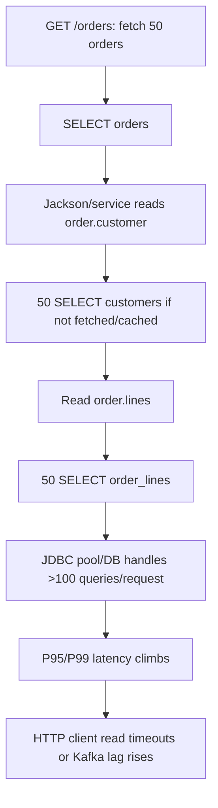

This lesson belongs to the **JPA and Hibernate** chapter of **SPRING_BOOT_INTEGRATION**: structuring system integrations with HTTP clients, databases, caches, message brokers, and Spring Integration, focusing on configuration, data contracts, transactions, error handling, deduplication, testing, and real-world observability.

**Learning Objectives:**

1. Distinguish the persistence context, managed/detached entity states, lazy proxies, and lazy collections.
2. Identify N+1 queries across `@ManyToOne`, `@OneToMany`, and nested associations, without confusing SQL counts with HTTP request counts.
3. Understand why `FetchType.EAGER` is not a universal cure for N+1 and why enlarging the JDBC pool does not fix the root cause.
4. Design per-use-case fetch plans: DTO projections, `@EntityGraph`, `JOIN FETCH`, batch fetching, subselect, and two-phase pagination.
5. Handle `LazyInitializationException` at the transaction boundary; decide deliberately whether to disable Open Session in View (OSIV).
6. Decouple JPA entities from HTTP JSON contracts and Kafka/RabbitMQ/JMS payloads.
7. Avoid holding DB transactions or locks open across remote HTTP calls, Kafka publishes, or long retries.
8. Use transactional outbox/inbox, stable event IDs, and idempotency when messages are redelivered.
9. Measure query counts, JDBC durations, response latency, pool exhaustion, and consumer lag.
10. Test both SQL shape/query counts and failure windows before deploying.

> **Versions:** Examples target Java 17+, Spring Boot 3.x, Spring Data JPA 3.x, Hibernate ORM 6.x, Spring Framework 6.x, and PostgreSQL. When using Spring Boot 4.x/Hibernate 7 or another JPA provider, verify Javadocs/APIs, annotation semantics, and actual query plans. Code samples are self-contained per section; integrating them into an application requires project configuration, migrations, and matching dependency versions.

## 2. Four Concepts to Keep Separate

| Concept | Purpose | Risk If Misunderstood |
| --- | --- | --- |
| **Persistence context / first-level cache** | `EntityManager` tracks entity identity and state within a scope. | Assuming proxies can still query the DB after the scope closes. |
| **Lazy loading** | Defers loading an association or collection until code accesses it. | Assuming `findAll()` already loaded every relationship. |
| **N+1 queries** | One query fetches N parents, followed by many separate SQL queries for related data. | Degrades linearly with record count even though each query looks small. |
| **Transaction boundary** | Scope of DB commit/rollback and where the service completes work. | Assuming HTTP serialization or async listeners share the finished transaction. |

### 2.1. Persistence Context Is Not an HTTP Session

Hibernate `Session` typically backs JPA's `EntityManager`. A persistence context holds managed entities, dirty-checking snapshots, lazy proxies, collection wrappers, and the first-level cache. Within one context, Hibernate generally maintains a single logical instance per entity type and primary key.

```text
EntityManager / Hibernate Session
 ├─ managed PurchaseOrder(id=101)
 │    ├─ customer -> lazy proxy(Customer #21)
 │    └─ lines -> persistent collection (uninitialized)
 ├─ managed PurchaseOrder(id=102)
 └─ first-level cache / change tracking
```

Once the context closes or an entity becomes detached, uninitialized lazy proxies generally have no context left to issue a `SELECT`. Never assume that because a Java object still exists in memory, a database connection or transaction still exists.

### 2.2. Lazy Is a Data-Fetching Strategy, Not a Serialization Strategy

A `@ManyToOne(fetch = FetchType.LAZY)` field may be a proxy holding only the foreign key. Calling `order.getCustomer().getId()` can sometimes resolve the identifier without initializing the full proxy; calling `getDisplayName()`, however, requires row data and triggers SQL. Exact behavior depends on mapping, provider, bytecode enhancement, and entity state.

A `@OneToMany(fetch = FetchType.LAZY)` field uses a Hibernate persistent collection wrapper. Calling `order.getLines().size()`, iterating with a for-loop, or streaming the collection **can** trigger SQL; `EXTRA_LAZY` offers specialized optimizations but should not be relied upon without explicit configuration and measurement.

### 2.3. Managed, Detached, and Transient

```text
transient -> persist() -> managed -> transaction/context closed -> detached
                           |
                           +-- field mutation -> dirty checking at flush

uninitialized detached lazy association
  -> accessed after context closes
  -> can throw LazyInitializationException
```

Reading already-loaded scalar fields (such as `order.getStatus()`) on a detached entity requires no SQL. Accessing an uninitialized collection, however, cannot safely open a new transaction on its own. Nor is `EntityManager.merge(detached)` a magic fix for fetch plans, as it can trigger extra loads/updates and requires careful state management.

## 3. FetchType.LAZY vs. FetchType.EAGER: Defaults and Misconceptions

According to JPA:

- `@ManyToOne` and `@OneToOne` default to **EAGER** unless specified otherwise.
- `@OneToMany` and `@ManyToMany` default to **LAZY**.
- `FetchType.LAZY` is treated as a hint by JPA in some providers/scenarios; exact behavior depends on the implementation.
- `FetchType.EAGER` requires fetching the related data, **without dictating that SQL JOIN must be used**.

Example:

```java
@ManyToOne  // defaults to EAGER per JPA!
private Customer customer;

@OneToMany(mappedBy = "order")  // defaults to LAZY
private List<OrderLine> lines = new ArrayList<>();
```

**EAGER does not guarantee eliminating N+1.** Hibernate can load eagerly mapped entities via secondary `SELECT`s, especially when executing JPQL queries without a matching fetch join. EAGER can also over-fetch data for use cases that only need foreign keys or totals.

**Recommendation:** For many to-one relationships on business entities, declare `LAZY` explicitly and define **per-query** fetch plans. Never flip everything to EAGER just to avoid `LazyInitializationException`; that swaps a loud error for silent SQL and heap overhead.

### 3.1. Factors Affecting Lazy Behavior

- Entities and proxies must be compatible with Hibernate's proxying rules (non-final classes/methods, constructors, access patterns, bytecode enhancement, identifier strategies).
- `@OneToOne` has cases that require bytecode enhancement or specific provider handling for true laziness.
- `optional=false` and schema foreign keys can help optimize existence checks, but do not pre-load fields.
- Second-level caching can cut SQL on subsequent hits, yet does not fix an N+1 design; cache misses or restarts bring the queries back.
- Database indexes lower the cost of each secondary `SELECT`, yet 101 queries still incur far more network round trips and connection hold overhead than a well-designed query plan.

## 4. Order Data Model Used Throughout This Lesson

We model three entities: `Customer`, `PurchaseOrder`, and `OrderLine`. A customer has many orders; an order has many lines.

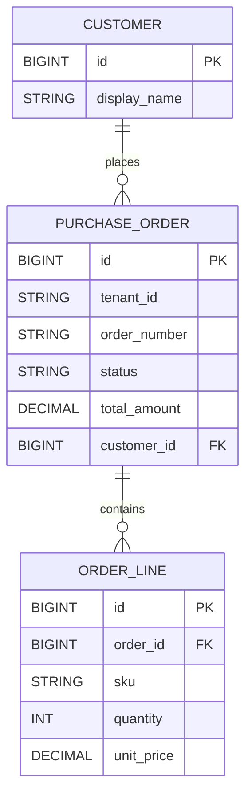

### 4.1. JPA Mapping with LAZY Relationships

```java
// OrderStatus.java
package com.example.integration.orders;

public enum OrderStatus {
    DRAFT, PAID, CANCELLED, FULFILLED
}
```

```java
// Customer.java
package com.example.integration.orders;

import jakarta.persistence.*;

@Entity
@Table(name = "customers")
public class Customer {
    @Id
    private Long id;

    @Column(name = "display_name", nullable = false, length = 200)
    private String displayName;

    protected Customer() {}

    public Long getId() { return id; }
    public String getDisplayName() { return displayName; }
}
```

```java
// PurchaseOrder.java
package com.example.integration.orders;

import java.math.BigDecimal;
import java.util.ArrayList;
import java.util.List;
import jakarta.persistence.*;

@Entity
@Table(name = "purchase_orders")
public class PurchaseOrder {
    @Id
    @GeneratedValue(strategy = GenerationType.IDENTITY)
    private Long id;

    @Column(name = "tenant_id", nullable = false, length = 80)
    private String tenantId;

    @Column(name = "order_number", nullable = false, length = 100)
    private String orderNumber;

    @Enumerated(EnumType.STRING)
    @Column(nullable = false, length = 30)
    private OrderStatus status;

    @Column(name = "total_amount", nullable = false,
            precision = 19, scale = 2)
    private BigDecimal totalAmount;

    @Version
    @Column(nullable = false)
    private long version;

    @ManyToOne(fetch = FetchType.LAZY, optional = false)
    @JoinColumn(name = "customer_id", nullable = false)
    private Customer customer;

    @OneToMany(mappedBy = "order", fetch = FetchType.LAZY)
    private List<OrderLine> lines = new ArrayList<>();

    protected PurchaseOrder() {}

    public Long getId() { return id; }
    public String getTenantId() { return tenantId; }
    public String getOrderNumber() { return orderNumber; }
    public OrderStatus getStatus() { return status; }
    public BigDecimal getTotalAmount() { return totalAmount; }
    public long getVersion() { return version; }
    public Customer getCustomer() { return customer; }
    public List<OrderLine> getLines() { return lines; }
}
```

```java
// OrderLine.java
package com.example.integration.orders;

import java.math.BigDecimal;
import jakarta.persistence.*;

@Entity
@Table(name = "order_lines")
public class OrderLine {
    @Id
    @GeneratedValue(strategy = GenerationType.IDENTITY)
    private Long id;

    @ManyToOne(fetch = FetchType.LAZY, optional = false)
    @JoinColumn(name = "order_id", nullable = false)
    private PurchaseOrder order;

    @Column(nullable = false, length = 100)
    private String sku;

    @Column(nullable = false)
    private int quantity;

    @Column(name = "unit_price", nullable = false,
            precision = 19, scale = 2)
    private BigDecimal unitPrice;

    protected OrderLine() {}

    public Long getId() { return id; }
    public String getSku() { return sku; }
    public int getQuantity() { return quantity; }
    public BigDecimal getUnitPrice() { return unitPrice; }
}
```

These mappings serve the lesson's read flows; to create objects in integration tests, add constructors/factory methods, fixtures, or SQL inserts. In production, use migrations for tables, indexes, tenant-scoped unique constraints, and tenant-aware authorization before returning results. Never let `hibernate.hbm2ddl.auto=update` modify production schemas.

### 4.2. Illustrative SQL Schema

```sql
CREATE TABLE customers (
    id BIGINT PRIMARY KEY,
    display_name VARCHAR(200) NOT NULL
);

CREATE TABLE purchase_orders (
    id BIGINT GENERATED BY DEFAULT AS IDENTITY PRIMARY KEY,
    tenant_id VARCHAR(80) NOT NULL,
    order_number VARCHAR(100) NOT NULL,
    status VARCHAR(30) NOT NULL,
    total_amount NUMERIC(19, 2) NOT NULL,
    version BIGINT NOT NULL DEFAULT 0,
    customer_id BIGINT NOT NULL REFERENCES customers(id),
    UNIQUE (tenant_id, order_number)
);

CREATE INDEX idx_purchase_orders_tenant_status_id
    ON purchase_orders(tenant_id, status, id);

CREATE TABLE order_lines (
    id BIGINT GENERATED BY DEFAULT AS IDENTITY PRIMARY KEY,
    order_id BIGINT NOT NULL REFERENCES purchase_orders(id),
    sku VARCHAR(100) NOT NULL,
    quantity INTEGER NOT NULL CHECK (quantity > 0),
    unit_price NUMERIC(19, 2) NOT NULL
);

CREATE INDEX idx_order_lines_order_id
    ON order_lines(order_id);
```

Indexing `order_lines(order_id)` makes secondary loads cheaper; however, it **does not** reduce round trips when Hibernate loads the collection per order. For pagination, an index on `(tenant_id, status, id)` supports stable ordering, though `EXPLAIN ANALYZE` should always be verified against real data and database statistics.

## 5. How Does N+1 Form?

A repository returns N orders:

```java
// PurchaseOrderRepository.java - basic part
import org.springframework.data.jpa.repository.JpaRepository;

public interface PurchaseOrderRepository
    extends JpaRepository<PurchaseOrder, Long> {
    // findAll() inherited from JpaRepository.
}
```

A service might do:

```java
// Sketch of an anti-pattern executing inside a transaction.
List<PurchaseOrder> orders = repository.findAll();

for (PurchaseOrder order : orders) {
    String customer = order.getCustomer().getDisplayName();
    int lineCount = order.getLines().size();
    // ... build DTO ...
}
```

If `findAll()` returns N orders and both associations are absent from the persistence context/cache:

```sql
SELECT ... FROM purchase_orders;              -- #1
SELECT ... FROM customers WHERE id = ?;       -- #2...
SELECT ... FROM order_lines WHERE order_id=?; -- #3...
SELECT ... FROM customers WHERE id = ?;
SELECT ... FROM order_lines WHERE order_id=?;
-- repeats for each order / distinct foreign key...
```

The term **N+1** comes from 1 root query plus N queries following a single relationship. With two relationships, SQL count approaches `1 + N + N`, though it is **not a rigid formula**:

- Multiple orders sharing **the same Customer ID**: the first-level cache can reduce `SELECT customers` below N.
- If entities/collections are batch-fetched or second-level cached, statement counts drop.
- An `EAGER` association may use a join or secondary selects.
- If code never touches `order.getLines()`, the lazy collection **needs no SELECT**.
- If code traverses deeper nested associations (order → line → product → vendor), queries multiply across levels.

### 5.1. Why Is N+1 Dangerous in HTTP Integrations?

Suppose one request fetches 50 orders and triggers 101 SQL statements. If each statement averages 3 ms of network + DB time, sequential DB work alone takes ~303 ms; concurrent requests compete for JDBC connections, DB CPU, indexes, and network bandwidth. That is an **illustrative example**, not a production prediction; measure real p95/p99 and actual SQL.

If an endpoint returns 200 orders and generates hundreds of SQL queries per request, upstream HTTP callers easily hit read timeouts. **Increasing HTTP client read timeouts does not fix N+1**: it only prolongs waiting, pinning HTTP slots and worker threads longer.

### 5.2. Why Is N+1 Dangerous for Message Consumers?

A Kafka consumer handles `OrderPaid`, loads the order, and touches lines, customer, and product for each line. If 1 event issues 80 `SELECT`s:

```text
Kafka poll -> listener
  -> load order
  -> lazy lines
  -> for each line: lazy product + vendor
  -> 80 SQL
  -> HTTP warehouse
  -> DB commit
  -> offset commit / ACK
```

Rising event rates inflate consumer lag; processing can exceed listener/poller deadlines, triggering rebalances and redeliveries that re-run the same expensive SQL. Fix it with **targeted fetch plans + idempotent handlers + bounded work**, not by endlessly raising Kafka `max.poll.interval.ms`.

### 5.3. LazyInitializationException Is Not the Same as N+1

- `LazyInitializationException` occurs when code tries to initialize a lazy association/collection without an active Hibernate Session/persistence context.
- N+1 occurs when a session **is active** and Hibernate issues many individual `SELECT`s.

Disabling OSIV can expose an N+1 "hidden" in serialization as a `LazyInitializationException`, revealing the broken boundary; **that does not mean OSIV was fixing N+1**. Fix both by picking an explicit query/fetch plan and mapping DTOs inside the transaction.

## 6. Open Session in View (OSIV): Why JSON Serialization Silently Triggers SQL

In Spring MVC/JPA apps, Spring Boot can configure **Open EntityManager in View** to keep the `EntityManager` bound to the request through view rendering/serialization. Depending on Boot configuration and version, leaving `spring.jpa.open-in-view` unset can default it to enabled with a startup warning that queries may run during view rendering.

### 6.1. With OSIV Enabled

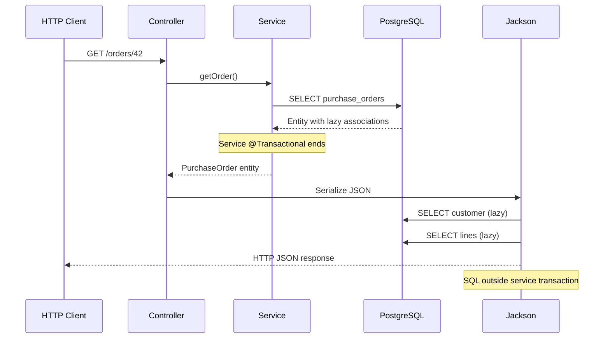

When entity serialization touches lazy fields, DB queries run **after the business transaction**, outside service transaction management. That slows responses, breaks consistency assumptions, adds JDBC pool pressure, and makes SQL harder to trace back to service methods. OSIV does not keep a single transaction open from controller entry through JSON emission.

**OSIV keeps a persistence context** bound to the request, yet **does not always hold a JDBC connection continuously** or extend a local transaction across the whole scope. Connection acquisition/release depends on Hibernate/provider, transaction, and connection handling mode. The core hazard is **SQL firing in an unintended phase**.

### 6.2. With OSIV Disabled

```yaml
spring:
  jpa:
    open-in-view: false
```

The service returns an entity with uninitialized fields, and Jackson touches a lazy association after the transactional method ends:

```text
org.hibernate.LazyInitializationException:
  could not initialize proxy / collection - no Session
```

This signals a **broken boundary**, not a reason to stretch transactions across the whole HTTP request or enable `hibernate.enable_lazy_load_no_trans` so Hibernate runs ad-hoc queries outside transactions.

### 6.3. Recommendation for Integration REST APIs

**Clean pattern:** controller receives request → read-only transactional application service → repository query fetches exact data → map to complete DTO → service returns DTO → Jackson serializes DTO.

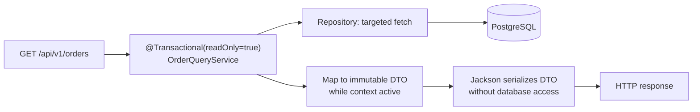

For predictability, many teams set `spring.jpa.open-in-view=false` on REST APIs. This is an **architectural decision to validate against the existing codebase**, not an automatic safe toggle for legacy apps relying on view lazy loading. Before rolling it out, migrate all endpoints to explicit DTO fetching.

### 6.4. Never Use JSON Annotations to Mask Bad Design

Workarounds like:

```java
@JsonIgnore
private List<OrderLine> lines;
```

can prevent serialization from touching one association, yet they **alter the HTTP contract** and easily hide N+1 on other fields. Jackson's Hibernate module offers proxy-aware serialization depending on version, yet does not solve DTO schemas, authorization, or fetch plans. Never expose raw entity graphs to public APIs relying on `@JsonManagedReference`/`@JsonBackReference` just to suppress cycles.

## 7. DTO Design: Boundary Between Persistence Model and Integration Contract

Entities serve DB state mutations; HTTP DTOs and message events are **integration contracts**. They differ in lifecycle, versioning, sensitive fields, and payload shape.

Example DTO carrying only what the client needs:

```java
// OrderLineView.java
package com.example.integration.orders;

import java.math.BigDecimal;

public record OrderLineView(
    Long lineId,
    String sku,
    int quantity,
    BigDecimal unitPrice
) {}
```

```java
// OrderDetailsView.java
package com.example.integration.orders;

import java.math.BigDecimal;
import java.util.List;

public record OrderDetailsView(
    Long orderId,
    String orderNumber,
    String customerName,
    String status,
    BigDecimal totalAmount,
    List<OrderLineView> lines
) {
    public OrderDetailsView {
        lines = List.copyOf(lines);
    }
}
```

A summary list needing less data can use a smaller record:

```java
// OrderSummaryView.java
package com.example.integration.orders;

import java.math.BigDecimal;

public record OrderSummaryView(
    Long orderId,
    String orderNumber,
    String customerName,
    BigDecimal totalAmount
) {}
```

**Never** reuse a detailed DTO everywhere: if listing 1,000 orders only shows totals, fetching 50,000 line items is over-fetching. Create distinct fetch plans for **list/summary**, **details**, **batch export**, and **event construction**.

### 7.1. Entity → DTO Mapping Must Run Only After Needed Data Is Ready

```java
// Use only when the repository explicitly fetched customer and lines.
private static OrderDetailsView toDetails(PurchaseOrder order) {
    return new OrderDetailsView(
        order.getId(),
        order.getOrderNumber(),
        order.getCustomer().getDisplayName(),
        order.getStatus().name(),
        order.getTotalAmount(),
        order.getLines().stream()
            .map(line -> new OrderLineView(
                line.getId(),
                line.getSku(),
                line.getQuantity(),
                line.getUnitPrice()
            ))
            .toList()
    );
}
```

`toDetails` **can still trigger lazy SQL** if called inside a transaction with unfetched associations; it does not prevent N+1 on its own. Pair DTO mapping with **service-owned fetch plans** and catch query-count regressions with tests.

### 7.2. Security Principles

- Never include `customer.email`, credentials, or tenant-private fields in DTOs unless required by the caller.
- Enforce tenant/row authorization in repository queries and services, not by filtering JSON after loading organization-wide data.
- Never use `Hibernate5Module`/serializers to turn proxies into IDs as an authorization substitute; API schemas must be explicit.
- Message events should never contain full entities or lazy collections: events need stable event IDs, schema versions, aggregate keys, and contracted fields.
- Changing an entity mapping or column need not break event schemas or API versions; that is the payoff of DTO boundaries.

## 8. Approach 1 — DTO Projection: Query Exactly Needed Fields

For list endpoints needing only ID, order number, customer name, and total, **DTO projection** is often the most predictable choice. There is no reason to hydrate full entity graphs only to extract a few columns.

### 8.1. JPQL Constructor Projection

```java
// PurchaseOrderRepository.java
package com.example.integration.orders;

import java.util.List;
import org.springframework.data.jpa.repository.JpaRepository;
import org.springframework.data.jpa.repository.Query;
import org.springframework.data.repository.query.Param;

public interface PurchaseOrderRepository
    extends JpaRepository<PurchaseOrder, Long> {

    @Query("""
        select new com.example.integration.orders.OrderSummaryView(
            o.id,
            o.orderNumber,
            c.displayName,
            o.totalAmount
        )
        from PurchaseOrder o
        join o.customer c
        where o.tenantId = :tenantId
          and o.status = :status
        order by o.id asc
        """)
    List<OrderSummaryView> findSummaries(
        @Param("tenantId") String tenantId,
        @Param("status") OrderStatus status
    );
}
```

JPQL projection constructs `OrderSummaryView` directly from selected columns (matching the record's canonical constructor). For simple summaries, Hibernate avoids instantiating 50 `PurchaseOrder` entities and lazy-loading customers. The query joins `customer` for `displayName`, which is **a single joined query, not N secondary SELECTs**.

**Limitation:** this example method returns an unbounded `List`. Production endpoints should use pagination/cursors or contract-enforced caps; even a single SQL query can return millions of rows and cause memory pressure.

### 8.2. Page Projection for Summaries

```java
import org.springframework.data.domain.Page;
import org.springframework.data.domain.Pageable;

@Query(
    value = """
        select new com.example.integration.orders.OrderSummaryView(
            o.id, o.orderNumber, c.displayName, o.totalAmount
        )
        from PurchaseOrder o join o.customer c
        where o.tenantId = :tenantId and o.status = :status
        order by o.id asc
        """,
    countQuery = """
        select count(o)
        from PurchaseOrder o
        where o.tenantId = :tenantId and o.status = :status
        """
)
Page<OrderSummaryView> findSummaryPage(
    String tenantId, OrderStatus status, Pageable pageable
);
```

This is an **additional method inside the repository interface**, not a standalone Java file. `Pageable` should enforce a bounded `pageSize` and deterministic sort per business contract. Spring Data can sometimes skip the `COUNT` query; when needed, `COUNT` is a single separate SQL query and **is not N+1**. On massive tables, `Slice` or keyset pagination avoids expensive total counts.

### 8.3. Projections Do Not Eliminate All N+1 Automatically

Spring Data JPA interface-based projections can reference nested properties; nested association projections can occasionally produce broader joins or full entity materializations than expected. Naming a method `findProjectedBy...` does not guarantee optimal SQL if the projection wraps an entity or invokes lazy getters afterward.

**How to verify:** enable SQL diagnostics in tests, inspect generated queries and query counts with multiple rows, and verify contract fields. Never assume "it returns a record" guarantees any nested collection takes a single query.

## 9. Approach 2 — `@EntityGraph` for Specific Associations

When you need managed entities for an aggregate and DTO mapping, Spring Data JPA supports `@EntityGraph` to customize fetch plans per repository method.

### 9.1. Fetching To-One Customer for a Summary Page

```java
import org.springframework.data.jpa.repository.EntityGraph;
import org.springframework.data.domain.Page;
import org.springframework.data.domain.Pageable;

@EntityGraph(attributePaths = {"customer"})
Page<PurchaseOrder> findByTenantIdAndStatus(
    String tenantId,
    OrderStatus status,
    Pageable pageable
);
```

This method belongs inside `PurchaseOrderRepository`. Since `customer` is **to-one**, fetching it alongside root entities normally does not multiply root rows by cardinality the way a collection join does. Even so, exact SQL depends on entity graph semantics and provider query shape; verify with query-count tests.

The service can then run:

```java
// Inside a @Transactional(readOnly=true) service.
return repository.findByTenantIdAndStatus(
        tenantId, OrderStatus.PAID, pageable
    )
    .map(order -> new OrderSummaryView(
        order.getId(),
        order.getOrderNumber(),
        order.getCustomer().getDisplayName(),
        order.getTotalAmount()
    ));
```

`Page.map(...)` executes immediately inside the service transaction (it is not a lazy Publisher); the resulting DTO retains no JPA proxies. Never return `Page<PurchaseOrder>` to a controller letting Jackson initialize relations.

### 9.2. EntityGraph for One Detailed Order

```java
import java.util.Optional;
import org.springframework.data.jpa.repository.EntityGraph;
import org.springframework.data.jpa.repository.Query;

@EntityGraph(attributePaths = {"customer", "lines"})
@Query("""
    select o from PurchaseOrder o
    where o.id = :id and o.tenantId = :tenantId
    """)
Optional<PurchaseOrder> findDetails(
    Long id,
    String tenantId
);
```

This lookup targets **a single ID**, so fetching one to-one and one collection is usually reasonable when line count has an upper bound. If one order can hold millions of lines, paginate lines separately; an unbounded fetch graph can still trigger OOM.

### 9.3. Do Not Combine To-Many EntityGraphs Indiscriminately with Pageable

```java
// WARNING: collection fetching on a Page can be dangerous.
@EntityGraph(attributePaths = {"lines"})
Page<PurchaseOrder> findByStatus(
    OrderStatus status, Pageable pageable
);
```

A SQL join over 20 parents with 100 lines each produces ~2,000 rows. Applying `LIMIT` directly to the joined SQL would truncate collections; Hibernate may fall back to **in-memory pagination**, warn, or fail depending on configuration and version. That causes performance and correctness bugs rather than solving N+1 cleanly.

**Fix:** paginate **parent IDs** first, then fetch associations for those exact IDs in one or a few queries, map to DTOs, and preserve page ordering.

## 10. Approach 3 — JPQL `JOIN FETCH`: Useful, Yet Requires Understanding Row Multiplication

`JOIN FETCH` tells Hibernate to load an association alongside the root query. Example:

```java
// Inside PurchaseOrderRepository.
@Query("""
    select o from PurchaseOrder o
    join fetch o.customer
    where o.id = :id and o.tenantId = :tenantId
    """)
Optional<PurchaseOrder> findWithCustomer(
    Long id, String tenantId
);
```

Here `join fetch o.customer` normally fetches the to-one association with the root row, avoiding a secondary `SELECT` when reading `getCustomer().getDisplayName()`. If `customer` is optional, use `left join fetch` so orders with NULL customer (`optional=true`) are not dropped; with `optional=false` and valid FKs, an inner join is consistent.

### 10.1. Fetching One Collection via Join

```java
@Query("""
    select distinct o
    from PurchaseOrder o
    left join fetch o.lines
    where o.id = :id and o.tenantId = :tenantId
    """)
Optional<PurchaseOrder> findWithLines(
    Long id, String tenantId
);
```

For an order with 10 lines, SQL returns 10 joined rows repeating the order columns. Hibernate reconstructs 1 parent with its collection. `distinct` / Hibernate 6 Java-side root deduplication **does not eliminate SQL row multiplication**. Across many orders, memory and network overhead can become substantial.

### 10.2. Two Collections Create a Cartesian Product

Suppose an Order has 20 `lines` and 10 `discounts`; fetch-joining both simultaneously yields:

```text
1 order × 20 lines × 10 discounts = 200 SQL rows

50 orders of similar cardinality:
50 × 20 × 10 = 10,000 joined rows
```

Fetching multiple bag collections in Hibernate can also throw `MultipleBagFetchException` or cause duplicates/Cartesian explosion depending on mapping. **Do not "fix" it by blindly turning `List` into `Set`** if domain semantics need ordering or duplicates; split fetches and build DTOs intentionally.

### 10.3. Fetch Joins Do Not Replace Schema Contracts

A fetch join only governs **how Hibernate loads data** for the current use case. It does not replace:

- page size limits,
- tenant isolation,
- API DTO/schema versioning,
- sensitive-field allowlisting,
- transaction boundaries,
- HTTP timeouts,
- Kafka consumer idempotency.

Fetch tuning is one piece of integration design, never a substitute for those controls.

## 11. Approach 4 — Batch Fetching, Subselect, and Second-Level Cache

When logic genuinely must traverse lazy associations across multiple roots, batching reduces secondary `SELECT`s without forcing everything into a Cartesian `JOIN`.

### 11.1. Hibernate Default Batch Fetch Size

```yaml
spring:
  jpa:
    properties:
      hibernate.default_batch_fetch_size: 32
```

In Hibernate 6, this property allows batch initialization of multiple lazy entity proxies or collections via SQL with batched IDs (exact SQL depends on dialect and query strategy):

```sql
SELECT ... FROM order_lines
WHERE order_id IN (?, ?, ?, ...);
```

With 50 uninitialized collections, batch size 32 **can** collapse 50 loads into a small number of batched selects. Exact query count depends on session state, access order, caches, batch fetch style, and provider; **never promise `1 + ceil(50/32)` as an absolute guarantee** without measuring.

### 11.2. `@BatchSize` per Association

```java
// Updated mapping on PurchaseOrder.lines:
@OneToMany(mappedBy = "order", fetch = FetchType.LAZY)
@org.hibernate.annotations.BatchSize(size = 32)
private List<OrderLine> lines = new ArrayList<>();
```

This **replaces** the `lines` declaration from Section 4—never declare two fields with the same name. `@BatchSize` is Hibernate-specific rather than portable JPA; inspect generated SQL and memory. Size it based on database bind-parameter limits, network round trips, rows per collection, and concurrency.

### 11.3. FetchMode.SUBSELECT

```java
// Alternative Hibernate-specific mapping:
@OneToMany(mappedBy = "order", fetch = FetchType.LAZY)
@org.hibernate.annotations.Fetch(
    org.hibernate.annotations.FetchMode.SUBSELECT
)
private List<OrderLine> lines = new ArrayList<>();
```

Hibernate can load collections for all owners in the persistence context using a **subselect** derived from the root query. Depending on the root query, context size, and Hibernate version, subselect may load more parents/collections than the DTO actually needs, particularly when the context holds many entities. Choose only after benchmarking, never as a blanket default.

### 11.4. Second-Level Cache Does Not Cure N+1 Logic

If `Customer` or `OrderLine` is cached by the provider, cache hits can reduce SQL on a given call. However:

- Cold starts and cache evictions still incur many DB lookups.
- Cache invalidation and consistency with business writes remain separate challenges.
- Caches add heap, distributed-store, and network overhead.
- A use case needing 5 fields should still avoid materializing huge entity graphs just because "it's cached."

**Optimize first** via clean query shapes, DTOs, and fetch plans; only layer caching afterward based on workload, never because N+1 "seemed to vanish" on a second query in the same test transaction.

## 12. Two-Phase Pagination: Fetch Parent IDs First, Then Targeted Associations

An endpoint returning a **page of 20 orders with lines** should not combine `Pageable` with a collection fetch join directly. Follow a two-phase plan:

1. Query a deterministically ordered page of parent IDs scoped by tenant/status.
2. Fetch roots + to-one `Customer` for those exact IDs.
3. Fetch `lines` for those exact IDs to initialize collections on the managed roots.
4. Map to DTOs **inside the same persistence context**.
5. Re-sort DTOs to match the step-1 ID order; `WHERE id IN (...)` does not guarantee ordering.
6. Return DTOs, never JPA proxies or `PersistentCollection`s.

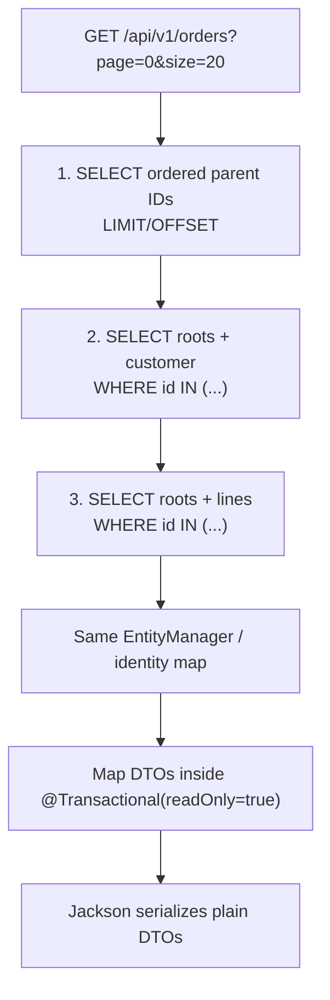

### 12.1. Repository for Two-Phase Association Fetching

Add these methods to the same `PurchaseOrderRepository` defined in Section 8:

```java
// Imports belong in PurchaseOrderRepository.java
import java.util.Collection;
import java.util.List;
import org.springframework.data.domain.Page;
import org.springframework.data.domain.Pageable;
import org.springframework.data.jpa.repository.Query;
import org.springframework.data.repository.query.Param;

@Query(
    value = """
        select o.id
        from PurchaseOrder o
        where o.tenantId = :tenantId
          and o.status = :status
        order by o.id asc
        """,
    countQuery = """
        select count(o)
        from PurchaseOrder o
        where o.tenantId = :tenantId
          and o.status = :status
        """
)
Page<Long> findPageIds(
    @Param("tenantId") String tenantId,
    @Param("status") OrderStatus status,
    Pageable pageable
);

@Query("""
    select o
    from PurchaseOrder o
    join fetch o.customer
    where o.tenantId = :tenantId and o.id in :ids
    """)
List<PurchaseOrder> fetchPageRootsAndCustomers(
    @Param("tenantId") String tenantId,
    @Param("ids") Collection<Long> ids
);

@Query("""
    select distinct o
    from PurchaseOrder o
    left join fetch o.lines
    where o.tenantId = :tenantId and o.id in :ids
    """)
List<PurchaseOrder> initializePageLines(
    @Param("tenantId") String tenantId,
    @Param("ids") Collection<Long> ids
);
```

**Why does the final query fetch orders even though its return value isn't assigned directly?** Because Hibernate's persistence context maintains one managed entity instance per primary key. After `fetchPageRootsAndCustomers`, running `initializePageLines` inside **the same EntityManager** populates `lines` on those exact managed instances. Both queries must run within the same transaction/context with no `entityManager.clear()` in between.

For empty ID lists, never send JPQL `IN ()` since dialects handle empty IN lists inconsistently. Return an empty page immediately if `findPageIds(...).isEmpty()`.

### 12.2. Read-Only Service Transaction and DTO Mapping

```java
// OrderQueryService.java
package com.example.integration.orders;

import java.util.HashMap;
import java.util.Comparator;
import java.util.List;
import java.util.Map;
import java.util.Objects;
import org.springframework.data.domain.Page;
import org.springframework.data.domain.PageImpl;
import org.springframework.data.domain.PageRequest;
import org.springframework.stereotype.Service;
import org.springframework.transaction.annotation.Transactional;

@Service
public class OrderQueryService {
    private final PurchaseOrderRepository repository;

    public OrderQueryService(PurchaseOrderRepository repository) {
        this.repository = repository;
    }

    @Transactional(readOnly = true)
    public Page<OrderDetailsView> listPaid(
        String tenantId, int page, int size
    ) {
        if (tenantId == null || tenantId.isBlank()
            || page < 0 || size < 1 || size > 100) {
            throw new IllegalArgumentException(
                "Invalid tenant/page/size"
            );
        }

        Page<Long> idPage = repository.findPageIds(
            tenantId,
            OrderStatus.PAID,
            PageRequest.of(page, size)
        );

        if (idPage.isEmpty()) {
            return new PageImpl<>(
                List.of(), idPage.getPageable(),
                idPage.getTotalElements()
            );
        }

        List<Long> ids = idPage.getContent();
        List<PurchaseOrder> roots =
            repository.fetchPageRootsAndCustomers(tenantId, ids);

        // This query initializes lines on the managed root entities.
        repository.initializePageLines(tenantId, ids);

        Map<Long, PurchaseOrder> byId = new HashMap<>();
        for (PurchaseOrder order : roots) {
            byId.put(order.getId(), order);
        }

        Map<Long, OrderDetailsView> dtoById = new HashMap<>();
        for (Long id : ids) {
            PurchaseOrder order = Objects.requireNonNull(
                byId.get(id), "Order vanished during page fetch"
            );
            dtoById.put(id, toDetails(order));
        }

        return idPage.map(dtoById::get);
    }

    private static OrderDetailsView toDetails(
        PurchaseOrder order
    ) {
        return new OrderDetailsView(
            order.getId(),
            order.getOrderNumber(),
            order.getCustomer().getDisplayName(),
            order.getStatus().name(),
            order.getTotalAmount(),
            order.getLines().stream()
                .sorted(Comparator.comparing(OrderLine::getId))
                .map(line -> new OrderLineView(
                    line.getId(),
                    line.getSku(),
                    line.getQuantity(),
                    line.getUnitPrice()
                ))
                .toList()
        );
    }
}
```

**Important:** This method relies on a Spring proxy executing `@Transactional` and all repository calls sharing **the same datasource/entity manager**. Never call `listPaid(...)` via `this.listPaid(...)` inside the same class expecting the transaction proxy to run; standard Spring proxy mode ignores self-invocation.

In the empty-page branch, `PageImpl<>(List.of(), idPage.getPageable(), idPage.getTotalElements())` preserves page metadata and totals while avoiding `IN ()`. DTO lines are sorted by ID for deterministic JSON output. If the API requires a long-lived pagination JSON contract, consider a custom response DTO or `PagedModel` rather than coupling directly to `PageImpl`'s serialization shape across Spring Data versions.

### 12.3. Controller Returns Only DTOs

```java
// OrderController.java
package com.example.integration.orders;

import org.springframework.data.domain.Page;
import org.springframework.http.ResponseEntity;
import org.springframework.web.bind.annotation.GetMapping;
import org.springframework.web.bind.annotation.RequestMapping;
import org.springframework.web.bind.annotation.RequestParam;
import org.springframework.web.bind.annotation.RestController;

@RestController
@RequestMapping("/api/v1/orders")
public class OrderController {
    private final OrderQueryService service;

    public OrderController(OrderQueryService service) {
        this.service = service;
    }

    @GetMapping
    public ResponseEntity<Page<OrderDetailsView>> list(
        @RequestParam String tenantId,
        @RequestParam(defaultValue = "0") int page,
        @RequestParam(defaultValue = "20") int size
    ) {
        return ResponseEntity.ok(
            service.listPaid(tenantId, page, size)
        );
    }
}
```

**Security warning:** `@RequestParam String tenantId` keeps the lesson focused on query plans. In production, derive the tenant from the **authenticated principal/token and authorization context**, never trusting an arbitrary caller-supplied `tenantId`. Replace the controller parameter with the verified tenant context to prevent IDOR/cross-tenant data leaks. Keep the tenant predicate in the service/repository for defense in depth.

### 12.4. Expected SQL Count

For 20 parent IDs:

```text
Query 1:  SELECT id ... LIMIT 20 OFFSET ...
Query 1b: SELECT COUNT(*) ...       (when Spring Data needs total)
Query 2:  SELECT orders JOIN customer WHERE id IN (...)
Query 3:  SELECT orders LEFT JOIN lines WHERE id IN (...)
```

Instead of 1 + 20 customers + 20 lines (~41 statements), this typically uses a bounded handful of statements, e.g., 3–4 statements depending on count-query optimization and JPA dialect. **Never** promise 3–4 across all mappings/configs: other associations might still be EAGER, entity listeners might access lazy getters, and count queries may be skipped or added. Verify SQL counts on a representative dataset.

### 12.5. No Consistent Snapshot Guarantee Across Multiple Queries

Between querying IDs and fetching associations, another transaction may update or delete an order:

```text
ID query sees Order 42 is PAID
Concurrent transaction changes status -> CANCELLED
Second details query reads newer data
```

`@Transactional(readOnly=true)` hints read-only intent/flush behavior; **it does not upgrade isolation to repeatable read/snapshot**. PostgreSQL `READ COMMITTED` takes a fresh snapshot per statement. If the API needs cross-statement snapshot consistency, choose appropriate transaction isolation, snapshot versioning, or query shapes, accounting for lock/version retention costs. Never hold transactions open across outbound HTTP just to "preserve consistency."

### 12.6. Bound Collection Sizes

A page of 100 orders averaging 10,000 lines each equals 1 million lines; even in 3–4 SQL queries, payload and heap explode. **Fixing N+1 does not replace capacity caps.** When collections have high cardinality, return a summary page plus a separate paginated endpoint `GET /orders/{id}/lines?cursor=...` or a quota-bounded export stream.

## 13. Proper Pagination: Offset, Keyset, and Stable Ordering

### 13.1. Why Fetch Join + Pagination Demands Caution

If the DB applies `LIMIT 20` after joining rows, those 20 rows might represent just 2 large orders rather than 20 orders. Hibernate may move pagination into memory to preserve correctness, emitting warnings or loading huge datasets. Some Hibernate versions support:

```yaml
spring:
  jpa:
    properties:
      hibernate.query.fail_on_pagination_over_collection_fetch: true
```

This makes invalid collection-fetch pagination **fail fast instead of silently paginating in memory** per Hibernate behavior. It is useful in tests, staging, and many production apps, though existing queries must be audited before enabling it. Never assume `DISTINCT` or minor JPQL tweaks remove row explosion.

### 13.2. Offset Pagination

```sql
SELECT id
FROM purchase_orders
WHERE tenant_id = 'tenant-a' AND status = 'PAID'
ORDER BY id
LIMIT 20 OFFSET 10000;
```

With very large offsets, the DB may still scan and sort many rows. If concurrent inserts or deletes shift positions, clients paging forward can see **duplicates or skipped items** even though each page query was accurate at execution time.

### 13.3. Keyset Pagination

When paging sequentially by increasing ID:

```sql
SELECT id
FROM purchase_orders
WHERE tenant_id = 'tenant-a'
  AND status = 'PAID'
  AND id > :last_seen_id
ORDER BY id
LIMIT 20;
```

`last_seen_id` is the cursor from the previous page. For multi-column sorting, use a stable composite cursor (such as `created_at, id`) with a unique tie-breaker, matching index, and snapshot policy. IDs do not reflect event ordering across statuses, and an order changing status between pages can still shift results; keyset reduces deep-offset scanning cost rather than promising an immutable snapshot.

### 13.4. When to Use `Slice` Instead of `Page`

If the UI only needs "is there a next page?" without a total count, `Slice<T>` or cursor responses avoid expensive `COUNT` queries. Query plans, joined row counts, and transaction boundaries must still be right. Switching return types from `Page` to `Slice` **does not** fix lazy serialization or authorization bugs.

## 14. Choosing a Fetch Strategy via Use-Case Matrix

| Use Case | Preferred Fetch Strategy | What to Avoid |
| --- | --- | --- |
| List 20 orders, 4 fields/order | DTO projection with to-one join. | Fetching all lines/products just to show totals. |
| Single order details, bounded lines | `@EntityGraph(customer, lines)` or bounded fetch join. | Returning the entity for Jackson to lazy-load. |
| Page of 20 orders + lines | Two-phase IDs + targeted fetches inside one service transaction. | `Pageable + JOIN FETCH collection` directly. |
| Export millions of records | Cursor/streaming projections with controlled batches/connections. | `findAll().collectList()` or one unbounded persistence context. |
| Kafka event needing ID/status/version | DTO projection or minimal entity query inside transactional handler. | Serializing the entire entity graph into the event. |
| Scheduled reconciliation of many aggregates | Keyset/batch fetching + periodic `EntityManager.clear()`. | Holding millions of entities in 1 persistence context. |
| Many lazy to-one associations accessed | `EntityGraph`/fetch joins or batch proxies. | Slapping `EAGER` onto mappings globally. |
| Collections that can grow large | Dedicated endpoints/batch queries with bounded rows. | Join-fetching multiple bags / Cartesian explosion. |

**Recommended decision sequence:** Define DTO contract and page/byte bounds → design repository queries → measure SQL statements and row counts → consider caching/batching → load-test under concurrency → tune further if needed.

## 15. Transaction Boundaries: Do Not Leak Managed Entities Beyond the Service

In standard imperative Spring Boot apps, `@Transactional` via Spring AOP/proxies coordinates the `EntityManager` and JDBC transaction around the intercepted method. Clean pattern:

```text
HTTP Controller
   -> OrderQueryService (@Transactional(readOnly=true))
      -> repository query
      -> targeted association fetches
      -> map to detached *value DTO*
   <- return DTO; transaction ends
   -> Jackson serialization (no lazy SQL)
```

**Never** return JPA entities to async callbacks, HTTP response serializers, or message brokers assuming the prior method's `@Transactional` stays alive.

### 15.1. Proxy / Self-Invocation Pitfall

```java
@Service
public class WrongOrderService {

    public OrderDetailsView outer(Long id) {
        return this.innerTransactional(id);
    }

    @Transactional(readOnly = true)
    public OrderDetailsView innerTransactional(Long id) {
        // In standard Spring AOP proxy mode,
        // "this." self-invocation bypasses the proxy.
        return /* repository fetch + map DTO */ null;
    }
}
```

This is an **illustrative anti-pattern** (`null` is not a valid business return). If repository methods carry their own transactions, individual calls may work, yet they **no longer share a service-level persistence context or transaction**. Two-phase fetching can break because the second query fails to populate the entities loaded by the first.

Fix it with a dedicated `OrderQueryService` bean whose public transactional method is called through the Spring proxy; never rely on `this.method()` self-calls to trigger transactions. AspectJ weaving or reactive transactions behave differently and must be verified explicitly.

### 15.2. What Does `@Transactional(readOnly=true)` Actually Mean?

- Expresses read-only intent and can influence flush modes or driver transaction hints depending on manager/provider.
- **Does not** automatically fetch lazy associations.
- **Does not** portably forbid every SQL `UPDATE` if code issues writes.
- **Does not** provide snapshot isolation when the DB runs `READ COMMITTED`.
- **Does not** keep transactions alive when `CompletableFuture`/`@Async` callbacks run after the method returns.
- **Does not** make Hibernate entities thread-safe.

For HTTP read endpoints, finish DTO mapping before returning. When calling external HTTP APIs, fetch stable IDs/snapshots in a short transaction, exit the transaction, and then perform network I/O.

### 15.3. Thread Boundaries with `@Async` and CompletableFuture

```java
// ANTI-PATTERN: passing a managed entity to an async worker.
@Transactional(readOnly = true)
public void enqueueExport(Long orderId) {
    PurchaseOrder order = repository.findById(orderId)
        .orElseThrow();
    exportWorker.exportAsync(order); // @Async background method
}
```

Workers executing on another thread do not inherit the caller's `ThreadLocal` transaction or `EntityManager`. If `exportAsync` accesses `order.getLines()` after the caller's transaction closes, it risks `LazyInitializationException`; even while the context is open, entities/`Session` **must not be accessed concurrently across threads**.

Fix:

```java
// Pass an immutable reference; the worker opens its own transaction to fetch DTOs.
exportWorker.exportAsync(new OrderExportJob(
    tenantId, orderId, exportRequestId
));
```

Inside the worker, invoke a transactional query service to fetch a DTO snapshot, close the DB transaction, and stream to file/object storage. If jobs must survive process crashes, **do not rely solely on `@Async`**; persist jobs to a DB/outbox/queue with acknowledgment and replay.

### 15.4. Reactive WebFlux Does Not Make JPA Non-Blocking

Standard JPA/Hibernate ORM uses blocking JDBC APIs and thread-bound persistence contexts/transactions from the imperative model. Returning a `Mono` from `WebClient` does not turn a JPA call into a reactive database operation.

```java
// RISK: blocking JPA query runs directly on the Netty event-loop.
public Mono<OrderDetailsView> wrong(Long orderId) {
    return Mono.just(
        blockingOrderService.fetchDetails(orderId)
    );
}
```

`Mono.just(...)` evaluates its argument **eagerly**, blocking the event loop before the Publisher is even created. If you must combine JPA with WebFlux, isolate blocking work:

```java
import reactor.core.publisher.Mono;
import reactor.core.scheduler.Schedulers;

public Mono<OrderDetailsView> findDetailsAsync(
    Long orderId
) {
    return Mono.fromCallable(
            () -> blockingOrderService.fetchDetails(orderId)
        )
        .subscribeOn(Schedulers.boundedElastic());
}
```

`blockingOrderService` is a **separate Spring-managed bean** with `@Transactional(readOnly=true)` that finishes DTO mapping internally. Bound concurrency so `boundedElastic` does not swamp the DB with unbounded JDBC calls; align Hikari max pool, downstream backpressure, overall HTTP deadlines, and cancellation semantics. For fully reactive end-to-end stacks with suitable throughput needs, consider R2DBC rather than pretending JPA is non-blocking.

## 16. HTTP Integration: N+1 SQL Easily Multiplies into N+1 Remote Calls

If an API needs live inventory availability per line item, a developer might write:

```java
// WARNING: demonstrates N+1 DB + N HTTP calls.
@Transactional(readOnly = true)
public List<OrderWithStock> loadAndCallWarehouse() {
    List<PurchaseOrder> orders = repository.findAll();
    return orders.stream().map(order -> {
        var lines = order.getLines(); // potentially 1 SQL/order
        return new OrderWithStock(
            order.getId(),
            lines.stream().map(line -> {
                StockView stock =
                    warehouseRestClient.getStock(line.getSku()); // HTTP/line
                return new StockLine(line.getSku(), stock.available());
            }).toList()
        );
    }).toList();
}
```

`OrderWithStock`, `StockLine`, and `StockView` are illustrative DTOs, and `warehouseRestClient` is an application-defined adapter. This method is an **anti-pattern**, not production code:

- The JPA query can trigger N+1 SQL.
- Every line fires a remote HTTP call, causing **N HTTP calls** (50 orders × 5 lines = 250 HTTP calls).
- The read-only DB transaction can hold persistence context/DB resources open across remote network latencies, stressing Hikari depending on connection handling.
- HTTP client pools can exhaust, causing pool-acquisition timeouts; retries amplify fanout further.
- If a remote call times out, the entire request fails after already fetching substantial DB data.

### 16.1. Two-Phase Split Design

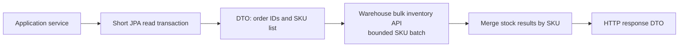

1. Query the target page of orders and needed line/SKU DTOs **inside a short local DB transaction**.
2. Close the transaction and release database resources.
3. Deduplicate SKUs into bounded batches per provider contract, calling a bulk endpoint if upstream provides one.
4. Configure dedicated HTTP pools, concurrency limits, and deadlines; never fan out unbounded per-SKU calls in parallel.
5. Merge by stable SKU and tenant context; handle missing stock via explicit business error or degraded value rules.
6. Never pass raw JPA entities through HTTP adapters.

**Trade-off:** stock levels can change between the DB snapshot and the warehouse response. If checkout requires transactional inventory reservation, use command IDs, provider idempotency, and an explicit workflow rather than treating a post-JPA `GET` stock check as an atomic lock.

### 16.2. HTTP DTOs and Caches with Independent TTLs

If list views only need approximate availability, use a Redis cache or read-model snapshot with a TTL. Cache invalidation, accuracy, and tenant isolation must follow business contracts. Caching **will not fix** Hibernate N+1 if mappers still dereference 50 lazy associations before checking the cache.

### 16.3. N+1 and Timeouts Can Form an Outage Feedback Loop

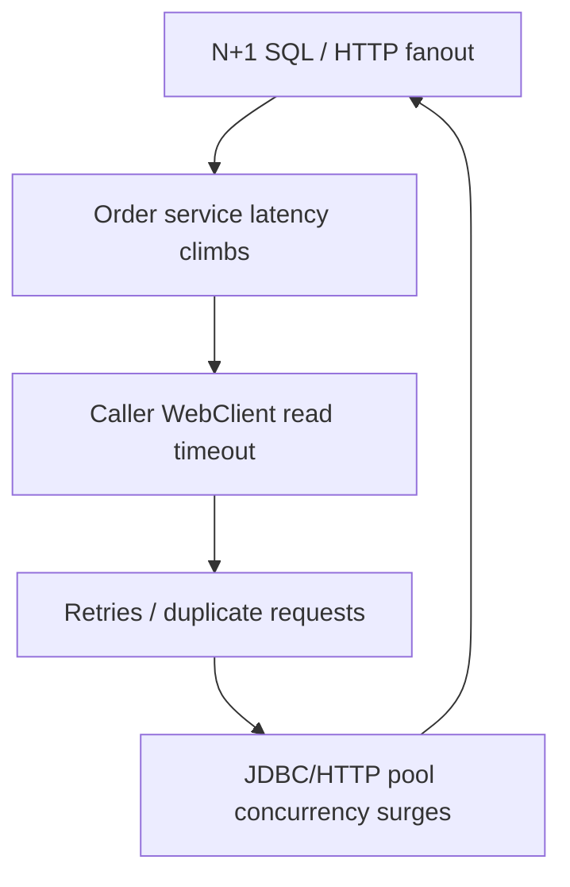

Raising timeouts only delays failure; enlarging both JDBC and HTTP pools piles even more work onto overloaded DBs and upstreams. Break the loop with clean query plans, bulk APIs, concurrency bulkheads, targeted caching, and intentional deadlines/retry budgets.

## 17. Never Serialize JPA Entities into Messages

A dangerous way to publish events:

```java
// ANTI-PATTERN: JPA objects carry lazy associations/proxies.
kafkaTemplate.send(
    "orders.events",
    order.getId().toString(),
    objectMapper.writeValueAsString(order)
);
```

At least five issues arise:

1. Jackson can touch lazy `order.getCustomer()` and `order.getLines()`, causing N+1 SQL.
2. If the transaction already ended, `LazyInitializationException` can occur.
3. The entity graph can contain circular references `order → lines → order`.
4. Event schemas accidentally couple to JPA mappings, field names, and Hibernate proxies, breaking consumer compatibility.
5. Events may leak sensitive attributes (email, address, internal IDs, audit columns).

### 17.1. Explicit Message Contracts

```java
// OrderPaidEvent.java
package com.example.integration.orders;

import java.math.BigDecimal;
import java.time.Instant;

public record OrderPaidEvent(
    String eventId,
    int schemaVersion,
    String tenantId,
    Long orderId,
    String orderNumber,
    long aggregateVersion,
    BigDecimal totalAmount,
    Instant occurredAt
) {}
```

Zero Hibernate entities or collections exist in the event. Consumers either receive a self-contained snapshot or receive a reference ID and fetch further details per contract; each approach carries trade-offs.

### 17.2. Event-Carried State Transfer vs. ID-Only Notification

| Event Style | Pros | Cons |
| --- | --- | --- |
| **Reference event**: only `orderId/version` | Small payload, minimal PII, independent of lazy entities. | Consumers may call HTTP/DB to fetch details, risking chatty integration / N+1 remote calls. |
| **Event-carried state**: needed fields, versioned snapshot | Consumers act autonomously, reducing GET fanout. | Must version contracts; risks stale/sensitive data or larger payloads. |
| **Batch events / cursor-based export** | Lower per-record overhead at high volume. | Needs bounds, checkpoints, retries, and partial-success handling. |

In Kafka, keying records by `tenantId:orderId` preserves per-aggregate ordering within the partition strategy; `eventId` identifies logical events for deduplication. Never use Hibernate object identity or proxy class names as Kafka keys. If a consumer receives 100 IDs and fires 100 REST calls, that becomes an **N+1 HTTP pattern**; consider batch endpoints or including needed fields in the event.

### 17.3. Why Doesn't a JPA Transaction Guarantee Kafka Event Publication?

```text
BEGIN PostgreSQL
  UPDATE purchase_orders
COMMIT PostgreSQL   <-- succeeds
Application crash
Kafka SEND           <-- never happens
```

Reversing the order (publishing before DB commit) lets consumers observe events for uncommitted orders or orders whose DB transaction later rolls back. Spring transaction synchronization can sequence callbacks, yet two local commits never form an atomic distributed transaction with Kafka.

When reliable post-commit event emission is required, use a **transactional outbox**.

## 18. Transactional Outbox: Capture Events from Known Data, Not Lazy Entities in the Relay

**Principle:** within the same transaction that mutates the order, insert the **event payload or immutable snapshot** into an outbox table. After commit, a relay worker reads the outbox and publishes to the broker with retries; never leave a managed JPA entity dangling for the relay to serialize later.

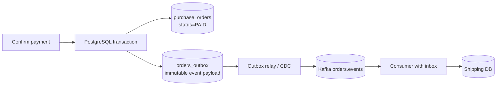

### 18.1. Minimal Outbox Schema

```sql
CREATE TABLE orders_outbox (
    event_id VARCHAR(160) PRIMARY KEY,
    tenant_id VARCHAR(80) NOT NULL,
    aggregate_id BIGINT NOT NULL,
    aggregate_version BIGINT NOT NULL,
    event_type VARCHAR(80) NOT NULL,
    schema_version INTEGER NOT NULL,
    payload_json TEXT NOT NULL,
    state VARCHAR(20) NOT NULL DEFAULT 'PENDING',
    created_at TIMESTAMPTZ NOT NULL DEFAULT CURRENT_TIMESTAMP,
    published_at TIMESTAMPTZ,
    CHECK (state IN ('PENDING','CLAIMED','PUBLISHED','FAILED'))
);

CREATE INDEX idx_orders_outbox_state_created
    ON orders_outbox(state, created_at);
```

This is a minimal outbox schema; production relays often add lease/claim columns, attempt counters, `next_attempt_at`, payload fingerprints, and retention/archiving. Event payloads should be constructed during the write transaction from explicitly loaded data, not lazily serialized later from a detached `PurchaseOrder`.

### 18.2. Transactional Update + Outbox Insert

```java
// OrderPaymentWriter.java
package com.example.integration.orders;

import java.util.UUID;
import org.springframework.jdbc.core.JdbcTemplate;
import org.springframework.stereotype.Service;
import org.springframework.transaction.annotation.Transactional;

@Service
public class OrderPaymentWriter {
    private final JdbcTemplate jdbc;
    private final OrderEventSerializer serializer;

    public OrderPaymentWriter(
        JdbcTemplate jdbc,
        OrderEventSerializer serializer
    ) {
        this.jdbc = jdbc;
        this.serializer = serializer;
    }

    @Transactional
    public void markPaid(
        String tenantId, long orderId, long expectedVersion
    ) {
        int rows = jdbc.update("""
            UPDATE purchase_orders
            SET status = 'PAID', version = version + 1
            WHERE id = ? AND tenant_id = ?
              AND status = 'DRAFT' AND version = ?
            """, orderId, tenantId, expectedVersion);

        if (rows != 1) {
            throw new IllegalStateException(
                "Order not eligible for PAID transition"
            );
        }

        // expectedVersion is enforced by the optimistic guard in UPDATE.
        String eventId = UUID.randomUUID().toString();
        String json = serializer.toJson(
            tenantId, orderId, expectedVersion + 1, eventId
        );

        jdbc.update("""
            INSERT INTO orders_outbox(
                event_id, tenant_id, aggregate_id,
                aggregate_version, event_type,
                schema_version, payload_json
            ) VALUES (?, ?, ?, ?, 'OrderPaid', 1, ?)
            """,
            eventId, tenantId, orderId,
            expectedVersion + 1, json
        );
    }
}
```

```java
// OrderEventSerializer.java — application-provided port
package com.example.integration.orders;

public interface OrderEventSerializer {
    String toJson(
        String tenantId,
        long orderId,
        long aggregateVersion,
        String eventId
    );
}
```

**Important note on this example:** The method uses JDBC to highlight **one local PostgreSQL transaction** covering both the state change and the outbox insert. The `version = expectedVersion` predicate and increment form an optimistic guard matching a schema/entity with a `version` column. When updating the same aggregate via JPA, avoid mixing JDBC updates and Hibernate dirty checking in the same persistence context without an explicit `refresh`/flush strategy. Also add a stable business command ID / idempotency ledger if upstream HTTP calls retry on timeout: generating `UUID.randomUUID()` per invocation **does not deduplicate a retried logical command**.

**In JPA-based services:** you can update a managed `PurchaseOrder` inside `@Transactional`, persist an outbox entity/repository sharing **the same DataSource/EntityManager**, and flush/commit together. Still build the event payload from explicitly loaded fields rather than feeding a lazy entity to Jackson. If mixing JDBC and JPA in the same transaction, verify they share the transaction manager/datasource and respect flush ordering; independent transaction managers never yield an atomic local commit.

### 18.3. Never Hold a Managed Entity for Post-Commit Relay Serialization

```java
// WRONG: entity passed into async callback and serialized later.
afterCommit(() -> kafkaTemplate.send(
    "orders.events",
    objectMapper.writeValueAsString(purchaseOrder)
));
```

By the time the callback executes, the persistence context may no longer be in the expected state. Serialization can trigger lazy loads in the wrong phase or fail. Worse, if the process crashes after DB commit and before the `afterCommit` callback runs, the event intent is **lost**. Callbacks suit best-effort side effects where loss is acceptable; critical events require a durable outbox.

### 18.4. Outboxes Can Still Publish Duplicates

If the relay publishes to Kafka, receives a broker ACK, and crashes before marking the row `PUBLISHED`, the next run can republish **the same event ID** at a new offset. Outboxes normally deliver **at-least-once** semantics; consumers need an inbox or unique business keys. Kafka's idempotent producer **does not eliminate** application-level republishes after process restarts.

## 19. Kafka Consumers: Lazy Loading, DB Commits, and Acknowledgments

When a Spring Kafka consumer receives `OrderPaid`, it typically:

1. Deserializes the event DTO.
2. Validates schema version, tenant, and stable event ID.
3. Inside a local DB transaction: deduplicates via inbox, loads only needed data via a fetch plan, and updates the local read model.
4. Commits/closes the transaction.
5. Acknowledges/commits the Kafka offset per listener container policy.

**Never** grab a JPA entity inside the handler and pass it to another thread or Reactor Publisher expecting lazy associations to work. Never ACK a record merely because work was placed onto a volatile in-memory queue.

### 19.1. Example Inbox and Read-Model Schema

```sql
CREATE TABLE processed_events (
    consumer_name VARCHAR(80) NOT NULL,
    event_id VARCHAR(160) NOT NULL,
    payload_hash CHAR(64),
    processed_at TIMESTAMPTZ NOT NULL DEFAULT CURRENT_TIMESTAMP,
    PRIMARY KEY (consumer_name, event_id)
);

CREATE TABLE shipping_orders (
    tenant_id VARCHAR(80) NOT NULL,
    order_id BIGINT NOT NULL,
    last_event_version BIGINT NOT NULL,
    status VARCHAR(30) NOT NULL,
    PRIMARY KEY (tenant_id, order_id)
);
```

The `processed_events` marker and read-model update must **commit atomically in the same PostgreSQL transaction**. If the marker commits first and the DB update fails, redeliveries would be wrongly skipped. If the DB update commits without the marker, a crash allows duplicate business effects.

### 19.2. Consumer Updating the Read Model from Event DTO

```java
// ShippingProjectionWriter.java
package com.example.integration.orders;

import org.springframework.jdbc.core.JdbcTemplate;
import org.springframework.stereotype.Service;
import org.springframework.transaction.annotation.Transactional;

@Service
public class ShippingProjectionWriter {
    private final JdbcTemplate jdbc;

    public ShippingProjectionWriter(JdbcTemplate jdbc) {
        this.jdbc = jdbc;
    }

    @Transactional
    public void apply(OrderPaidEvent event) {
        if (event.eventId() == null || event.eventId().isBlank()
            || event.tenantId() == null || event.tenantId().isBlank()
            || event.orderId() == null
            || event.aggregateVersion() <= 0
            || event.schemaVersion() != 1) {
            throw new IllegalArgumentException(
                "Invalid OrderPaid contract"
            );
        }

        int inserted = jdbc.update("""
            INSERT INTO processed_events(
                consumer_name, event_id
            ) VALUES ('shipping-projection', ?)
            ON CONFLICT (consumer_name, event_id) DO NOTHING
            """, event.eventId());

        if (inserted == 0) {
            // A prior transaction already committed this eventId.
            return;
        }

        jdbc.update("""
            INSERT INTO shipping_orders(
                tenant_id, order_id,
                last_event_version, status
            ) VALUES (?, ?, ?, 'PAID')
            ON CONFLICT (tenant_id, order_id)
            DO UPDATE SET
                last_event_version =
                    EXCLUDED.last_event_version,
                status = EXCLUDED.status
            WHERE shipping_orders.last_event_version
                < EXCLUDED.last_event_version
            """,
            event.tenantId(),
            event.orderId(),
            event.aggregateVersion()
        );
    }
}
```

This example uses an **absolute state** (`PAID`) and monotonic `aggregateVersion`. With richer state machines (`PAID`, `CANCELLED`, `FULFILLED`), validate transitions explicitly; rejecting an older version simply because a newer one arrived does not always undo or subsume an older event's side effect. For delta events like `inventory.decrement(5)`, skipping an older version because a newer version arrived would **lose a business mutation**; enforce strict ordering or version-gap handling.

This snippet also illustrates event-ID deduplication only. Production code should store a payload fingerprint and flag **same `eventId` / different payload** as a contract violation rather than a benign duplicate.

### 19.3. Listener: ACK After the Service Transaction

```java
// ShippingKafkaListener.java
package com.example.integration.orders;

import com.fasterxml.jackson.databind.ObjectMapper;
import org.apache.kafka.clients.consumer.ConsumerRecord;
import org.springframework.kafka.annotation.KafkaListener;
import org.springframework.kafka.support.Acknowledgment;
import org.springframework.stereotype.Component;

@Component
public class ShippingKafkaListener {
    private final ObjectMapper mapper;
    private final ShippingProjectionWriter writer;

    public ShippingKafkaListener(
        ObjectMapper mapper,
        ShippingProjectionWriter writer
    ) {
        this.mapper = mapper;
        this.writer = writer;
    }

    @KafkaListener(
        topics = "orders.events.v1",
        groupId = "shipping-projection"
    )
    public void onMessage(
        ConsumerRecord<String, String> record,
        Acknowledgment ack
    ) throws Exception {
        OrderPaidEvent event = mapper.readValue(
            record.value(), OrderPaidEvent.class
        );

        // Finish local PostgreSQL transaction before ACK.
        writer.apply(event);

        ack.acknowledge();
    }
}
```

```yaml
spring:
  kafka:
    consumer:
      group-id: shipping-projection
      properties:
        enable.auto.commit: false
        isolation.level: read_committed
    listener:
      ack-mode: manual_immediate
```

This illustrates **manual ACK mode without container-managed Kafka transactions**. For Kafka consume-transform-produce EOS, container transactions and offset commits follow distinct semantics; do not mix the two patterns assuming ACKs work identically. With manual listeners, if the DB commits and the process crashes before ACK, Kafka redelivers and the inbox protects business state.

**Never** place `@Transactional` on the listener method and call `ack.acknowledge()` before the method returns: the transaction interceptor has not committed yet at ACK time. Extracting the transactional writer into a separate Spring bean keeps the commit → ACK order clear during code review. Also remember ACK does not mean offset commits are instantly durable across all failure windows; redelivery must always be handled.

### 19.4. When a Consumer Still Needs to Load a JPA Entity from the DB

Some events carry only `orderId`, requiring the consumer to fetch details. Prefer:

```java
@Transactional(readOnly = true)
public OrderDetailsView loadForEvent(
    long orderId, String tenantId
) {
    PurchaseOrder order = repository
        .findDetails(orderId, tenantId)
        .orElseThrow();
    return toDetails(order); // DTO before transaction ends
}
```

This method sketch uses `repository.findDetails(...)` from Section 9 and `toDetails(...)` from Section 12 inside a Spring service bean with matching dependencies. Never touch JPA lazy associations after ACKing an event and offloading work to volatile async queues.

**Performance implication:** At 500 messages/sec, one targeted root+children query per event may be sustainable; if each event triggers N+1 hundreds of SQL queries, the consumer falls behind. Fix by enriching event payloads or fetch plans, batching IDs within a poll where semantics allow, or maintaining a dedicated read model—never by raising concurrency endlessly (which starves JDBC pools).

### 19.5. Poison Messages, Retries, and DLT

Unparseable JSON events or references to missing entities can retry endlessly and stall partitions. Distinguish:

- **Transient DB failures:** deadlocks or dropped connections; retry with bounded attempts/backoff in a fresh transaction.
- **Permanent contract errors:** unknown schema versions, missing required fields; send to DLT/quarantine with audit context.
- **Missing related entity due to ordering:** park/reschedule or trigger reconciliation instead of ACKing as success.
- **Unknown remote HTTP side effects:** run inquiry/idempotency checks using the same command ID, never retry with a new ID.

When sending events to a DLT, ensure durable DLT writes succeed before committing the source offset per error-handler/container policy. A DLT without an owner and retention policy **does not mean business processing succeeded**.

### 19.6. Keep JPA/DTO Projections Concise in Listeners

If an event only needs customer or amount verification, avoid calling `findById(...)` and iterating all lines to recompute unused data. Use scalar/DTO projections for checks, unique/event ID guards, and short transactions.

| What the Event Needs | Minimal Query / Data |
| --- | --- |
| Mark shipping projection `PAID` | Event ID/order ID/version/status from event; may need no JPA root load. |
| Recalculate amount | Filtered SQL aggregate or bounded line DTOs, without loading customer address. |
| Produce read-model card | Projection of selected columns. |
| Validate order version | `SELECT id/version` in local transaction or optimistic guard `UPDATE`. |
| Full fulfillment plan | Explicit fetch graph for one aggregate and bounded lines. |

## 20. RabbitMQ, JMS, and Spring Integration: Equivalent Boundaries

Message adapters change how messages arrive and get ACKed, yet **JPA entity lifecycles and N+1 rules stay identical**.

### 20.1. RabbitMQ Manual Acknowledgment

```text
Rabbit message delivery
 -> deserialize immutable event DTO
 -> transactional DB service fetch/update (bounded query plan)
 -> local DB COMMIT
 -> basicAck

Crash after DB COMMIT but before basicAck:
 -> RabbitMQ redelivery
 -> inbox/unique constraint blocks duplicate side effect
```

When using `@RabbitListener` with `Channel.basicAck(...)`, understand container `acknowledge-mode=manual`, NACK/requeue/DLX behavior, prefetch, and error handlers. Never pass a JPA entity into an async task and call `basicAck` before that task commits.

If `prefetch=50` and every message runs 100 N+1 queries, a single consumer holds many unacked messages and causes redelivery bursts on crash. Tune prefetch, concurrency, JDBC pool size, and fetch plans together.

### 20.2. JMS Transacted Sessions Do Not Span JDBC or HTTP

A JMS transacted session commits or rolls back message receives/sends **within the JMS provider's scope**. A PostgreSQL JPA transaction does not automatically join a JMS transaction; XA/2PC requires a transaction coordinator and XA-capable resources with distinct operational costs. In typical architectures, use idempotent consumers and outbox/inbox instead of assuming "JMS transaction = DB transaction."

### 20.3. Spring Integration DirectChannel and ExecutorChannel

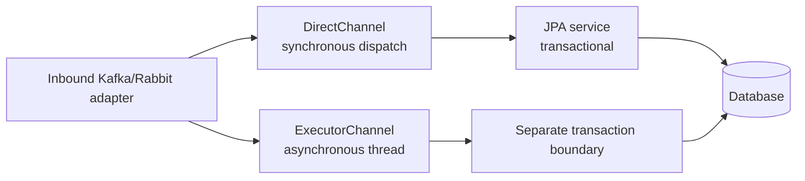

`DirectChannel` normally dispatches synchronously on the sender thread, allowing an active transaction to span a synchronous handler if wired accordingly. `ExecutorChannel` switches threads; imperative `ThreadLocal` transaction context does not travel with it. Default in-memory `QueueChannel`s can lose pending messages on process crash.

**Hazard:** an inbound adapter ACKs immediately after enqueuing onto `ExecutorChannel`/`QueueChannel` before the DB service finishes. Events can then be lost even when the async handler has `@Transactional`. Tie acknowledgments to durable completion or a durable handoff/outbox.

### 20.4. Retry Advice and Repeated Lazy Queries

`RequestHandlerRetryAdvice` retries handlers when exceptions occur. If a handler executes:

```text
1 SELECT orders
50 secondary SELECT lines
HTTP POST warehouse
read timeout
retry handler
1 SELECT orders
50 secondary SELECT lines
HTTP POST warehouse again
```

N+1 makes each attempt slower and retries can duplicate external side effects. Refactor into a short DB transaction + DTO snapshot/bulk query + idempotent remote command; assign a single retry owner with bounded attempts and deadlines.

## 21. `@TransactionalEventListener`, `AFTER_COMMIT`, and Lazy Loading

Spring supports application events with `@TransactionalEventListener(phase=AFTER_COMMIT)`. It is handy for **best-effort** callbacks, provided you understand timing:

```java
// WRONG if the event holds a JPA entity with a lazy graph:
public record OrderPaidInternalEvent(PurchaseOrder entity) {}

@TransactionalEventListener(
    phase = TransactionPhase.AFTER_COMMIT
)
public void publish(OrderPaidInternalEvent internal) {
    // Do not serialize raw entities/proxies here.
    kafkaTemplate.send("orders.events",
        internal.entity().getId().toString(),
        objectMapper.writeValueAsString(internal.entity()));
}
```

Imports, wiring, and checked exception handling are omitted because this is an **anti-pattern**. Never assume an `AFTER_COMMIT` listener has a fresh transaction or durable entity context; resources may remain bound across phases while the main transaction has already committed, and lazy SQL behaves inconsistently depending on OSIV and provider rules. Async listeners also switch threads.

### 21.1. Right: Internal Events Carry Values and IDs

```java
public record OrderPaidInternalEvent(
    String eventId,
    String tenantId,
    long orderId,
    long aggregateVersion
) {}
```

A post-commit listener can emit a small best-effort notification per contract. Yet if the process dies **after DB commit and before the listener runs**, the in-memory callback is lost. For critical events, write a durable outbox in the same transaction and let a relay publish with retries. Never promise at-least-once delivery based solely on `AFTER_COMMIT` callbacks.

### 21.2. DB Writes Inside an AFTER_COMMIT Listener

If an `AFTER_COMMIT` listener must write a follow-up DB record, the synchronization resource context may linger after the original transaction committed. You must start a fresh transaction explicitly (e.g., via a separate bean method with `@Transactional(propagation=REQUIRES_NEW)`) when the workflow demands it; even then, it is **a separate transaction**, leaving a crash window between the first and follow-up commits. Outboxes close this lost-intent gap for durable workflows.

### 21.3. Never Carry Lazy Entities Across a Reactor Pipeline

```java
// Error-prone if service returns an entity mapped on another thread:
Mono.fromCallable(() -> repository.findById(id).orElseThrow())
    .subscribeOn(Schedulers.boundedElastic())
    .publishOn(Schedulers.parallel())
    .map(order -> order.getCustomer().getDisplayName());
```

Each repository call may end its transaction/context before `map(...)`, leaving the entity detached. Fix with `Mono.fromCallable(() -> transactionalQueryService.fetchSummaryDto(id))` where a Spring transactional bean returns the completed DTO without passing managed entities across schedulers.

## 22. Batch Jobs and Exports: Avoid Both N+1 and Bloated Persistence Contexts

A scheduler needs to export 2 million orders to object storage. A developer writes:

```java
// ANTI-PATTERN: loads all entities and collections onto the heap.
List<PurchaseOrder> orders = repository.findAll();
List<OrderDetailsView> export = orders.stream()
    .map(this::toDetails)
    .toList();
```

At scale, N+1 is only half the danger. Hibernate's persistence context retains **managed entities, dirty-check snapshots, and lazy wrappers**; Java `List`s retain references/DTOs; the JDBC driver buffers rows; and CSV/JSON serializers assemble huge byte buffers.

### 22.1. Split Work into Checkpointed Batches

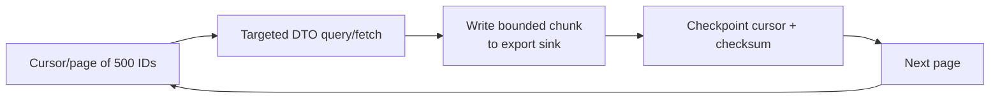

Each batch should have:

- A deterministically ordered ID range (keyset), avoiding deep offsets when possible.
- Bounded row counts and payload sizes per batch.
- Targeted DTO queries or fetch graphs, avoiding huge collections.
- Short read-only transactions for reading/mapping, closed before long network uploads when feasible.
- A checkpoint/continuation token; if a batch retries, the sink needs idempotent keys or chunk identities.
- Handling for concurrent mutations during export: snapshot watermarks/versions or documented best-effort consistency.
- Cleanup for partial files or multipart uploads on errors, cancellation, or crashes.

### 22.2. `flush()/clear()` in JPA Write Batches

When an import job persists hundreds of thousands of entities in one transaction/context, use periodic flush/clear per policy:

```java
// Sketch inside an appropriate chunk transaction.
int batchSize = 100;
for (int i = 0; i < entities.size(); i++) {
    entityManager.persist(entities.get(i));

    if ((i + 1) % batchSize == 0) {
        entityManager.flush();
        entityManager.clear();
    }
}
entityManager.flush();
entityManager.clear();
```

This illustrates memory management **for batch entity writes**, not fixing N+1 on read queries. Caution: `clear()` detaches entities, preventing uninitialized lazy proxies from loading via the old persistence context; never call it between fetching roots and fetching lines in two-phase pagination. With `GenerationType.IDENTITY`, Hibernate JDBC insert batching has limitations because generated IDs must be read immediately; never assume `hibernate.jdbc.batch_size=100` batches every `INSERT` into one round trip.

### 22.3. Streaming Database Results Still Holds Resources

Spring Data JPA supports `Stream<T>` query returns in appropriate setups, yet **this does not mean "infinite streaming with no connection or transaction."** The database cursor, Hibernate session, and JDBC connection stay alive while the stream is consumed. Always close streams, manage transactions and fetch sizes, and never return `Stream<PurchaseOrder>` to a controller for Jackson to consume after the transaction.

```java
// Skeleton repository streaming method (never return streams over HTTP).
@Query("""
    select o.id
    from PurchaseOrder o
    where o.tenantId = :tenantId and o.id > :cursor
    order by o.id
    """)
Stream<Long> streamIdsAfter(
    String tenantId, Long cursor
);
```

When using this method, callers must run inside an active transaction with try-with-resources, and note this query **has no limit**, so it can still pull millions of IDs. For typical batch exports, explicitly limited keyset pages with short transactions are easier to recover and monitor.

### 22.4. Long Exports Should Not Block Critical HTTP Endpoints

For large exports, use durable job IDs, `PENDING/RUNNING/COMPLETED/FAILED` status tracking, object storage keys, retries/checkpoints, and cleanup. `POST /exports` returns `202 Accepted` with the job ID instead of pinning an HTTP connection and PostgreSQL transaction for minutes. When the async job runs, it fetches DTOs in batches through a transactional service rather than reusing JPA proxies from the originating HTTP request.

## 23. Measuring N+1: SQL Logs, Hibernate Statistics, and Common Pitfalls

**Measure before optimizing.** Request query counts must be evaluated alongside returned row counts, byte sizes, latencies, and DB CPU. A `JOIN FETCH` that cuts query count while returning 50,000 joined rows can perform worse than a few well-indexed batched `SELECT`s.

### 23.1. Enabling SQL Logging in Test Environments

```yaml
spring:
  jpa:
    open-in-view: false
    properties:
      hibernate.generate_statistics: true
      hibernate.format_sql: true

logging:
  level:
    org.hibernate.SQL: DEBUG
    org.hibernate.orm.jdbc.bind: TRACE
```

**Warning:** Hibernate bind-parameter `TRACE` logging can record PII, access tokens, or sensitive business values. Restrict it to isolated test/staging setups with synthetic data; never leave it on by default in production. `generate_statistics=true` also incurs overhead; use scoped test instrumentation and load-tested metrics.

`spring.jpa.show-sql=true` prints SQL to stdout, which is insufficient on its own and lacks timings/parameters. Combine DB slow-query logs, normalized SQL fingerprints, and `EXPLAIN (ANALYZE, BUFFERS)` in suitable environments to diagnose slow queries.

### 23.2. Hibernate Statistics API

```java
import jakarta.persistence.EntityManagerFactory;
import org.hibernate.SessionFactory;
import org.hibernate.stat.Statistics;

SessionFactory sessionFactory =
    entityManagerFactory.unwrap(SessionFactory.class);

Statistics stats = sessionFactory.getStatistics();
stats.clear();

// Execute the exact operation under measurement...

long statements = stats.getPrepareStatementCount();
long entitiesLoaded = stats.getEntityLoadCount();
long collectionsFetched = stats.getCollectionFetchCount();
```

This snippet belongs in a test body with `entityManagerFactory` injected. `getPrepareStatementCount()` counts prepared statements tracked by SessionFactory-scoped Statistics, **not all SQL from every library or driver**; exact figures depend on Hibernate/provider instrumentation. If tests run in parallel sharing one `SessionFactory`, stats are **shared/global** and will see cross-talk. Isolate tests or use a thread-scoped statement inspector / query counter.

### 23.3. SQL Count Is Not JDBC Connection Lease Count

One transaction can reuse a single JDBC connection to run 100 sequential `SELECT`s; Hibernate Statistics sees high prepared statement counts while Hikari sees only **one active connection** over that span. Never use `Hikari connectionTimeout` as an N+1 detector. N+1 inflates **connection hold time**, eventually forcing concurrent requests into Hikari pool waits.

### 23.4. Counting Statements Alone Is Not Enough

Compare:

```text
Plan A:
  101 small SELECT queries
  total 250 ms, 150 KB rows

Plan B:
  1 SELECT with 4 collection joins
  total 900 ms, 25 MB duplicated joined rows

Plan C:
  4 bounded SELECT queries
  total 40 ms, 300 KB rows
```

These numbers are illustrative. Plan B has the fewest queries yet performs worst. Evaluate fetch strategies by **DB duration, execution plans, rows read, network bytes, ORM allocations, p95/p99 latency, concurrency**, and pagination accuracy.

### 23.5. Avoid First-Level Cache Masking N+1 in Tests

If a test creates 50 orders via `EntityManager` and then calls the query service **in the same persistence context**, those entities/customers are already managed and collections may already be initialized from setup; the test sees artificially low SQL counts. Before measuring:

1. Flush fixture writes if needed.
2. Call `entityManager.clear()` to evict managed entities from the first-level cache.
3. Reset Hibernate statistics counters after fixture setup.
4. Execute the operation on at least 20–50 parent records with varied associations.
5. Assert both DTO contents **and** statement-count bounds.
6. Repeat with cold and warm second-level cache if L2 is enabled in production.

**Never** rely on `Thread.sleep()` or regex log-line counting as primary assertions. If registering a custom Hibernate `StatementInspector`, scope it cleanly to the SessionFactory/test and keep it thread-safe.

## 24. Integration Tests: Proving Queries Do Not Scale Linearly with N

Example JUnit 5 / Spring Data JPA test using our repository and service. Tests can use H2 to catch query-count regressions; for dialect- or pagination-sensitive SQL, prefer real PostgreSQL via Testcontainers.

### 24.1. Test Dependencies

```xml
<dependency>
    <groupId>org.springframework.boot</groupId>
    <artifactId>spring-boot-starter-data-jpa</artifactId>
</dependency>
<dependency>
    <groupId>org.postgresql</groupId>
    <artifactId>postgresql</artifactId>
    <scope>runtime</scope>
</dependency>
<dependency>
    <groupId>org.springframework.boot</groupId>
    <artifactId>spring-boot-starter-test</artifactId>
    <scope>test</scope>
</dependency>
<dependency>
    <groupId>org.testcontainers</groupId>
    <artifactId>postgresql</artifactId>
    <scope>test</scope>
</dependency>
<dependency>
    <groupId>org.testcontainers</groupId>
    <artifactId>junit-jupiter</artifactId>
    <scope>test</scope>
</dependency>
```

Pick Testcontainers 1.x/2.x artifacts and APIs matching your project's BOM/version; the snippet below uses familiar Testcontainers 1.x APIs. Production migrations/schemas still require testing against real PostgreSQL; auto-creating test schemas can hide index or dialect issues.

### 24.2. Test Class Using the Repository and Service

```java
// OrderQueryCountTest.java
package com.example.integration.orders;

import static org.junit.jupiter.api.Assertions.*;

import jakarta.persistence.EntityManager;
import jakarta.persistence.EntityManagerFactory;
import org.hibernate.SessionFactory;
import org.hibernate.stat.Statistics;
import org.junit.jupiter.api.BeforeEach;
import org.junit.jupiter.api.Test;
import org.springframework.beans.factory.annotation.Autowired;
import org.springframework.boot.test.autoconfigure.orm.jpa.DataJpaTest;
import org.springframework.context.annotation.Import;
import org.springframework.data.domain.Page;
import org.springframework.jdbc.core.JdbcTemplate;

@DataJpaTest(properties = {
    "spring.jpa.open-in-view=false",
    "spring.jpa.properties.hibernate.generate_statistics=true"
})
@Import(OrderQueryService.class)
class OrderQueryCountTest {
    @Autowired JdbcTemplate jdbc;
    @Autowired EntityManager em;
    @Autowired EntityManagerFactory emf;
    @Autowired PurchaseOrderRepository repository;
    @Autowired OrderQueryService queryService;

    private Statistics stats;

    @BeforeEach
    void setUp() {
        stats = emf.unwrap(SessionFactory.class).getStatistics();

        // SQL fixture assumes tables exist via migrations
        // or @DataJpaTest schema setup.
        for (int id = 1; id <= 30; id++) {
            jdbc.update("""
                INSERT INTO customers(id, display_name)
                VALUES (?, ?)
                """, (long) id, "Customer " + id);

            jdbc.update("""
                INSERT INTO purchase_orders(
                    id, tenant_id, order_number,
                    status, total_amount, version, customer_id
                ) VALUES (?, 'tenant-a', ?, 'PAID', 100.00, 0, ?)
                """, (long) id, "ORD-" + id, (long) id);

            for (int line = 1; line <= 3; line++) {
                jdbc.update("""
                    INSERT INTO order_lines(
                        order_id, sku, quantity, unit_price
                    ) VALUES (?, ?, 1, 10.00)
                    """, (long) id, "SKU-" + line);
            }
        }
        em.flush();
        em.clear();
        stats.clear();
    }

    @Test
    void naiveLazyTraversalCanProduceNPlusOne() {
        var orders = repository.findAll();

        for (PurchaseOrder order : orders) {
            assertNotNull(
                order.getCustomer().getDisplayName()
            );
            assertEquals(3, order.getLines().size());
        }

        long statements = stats.getPrepareStatementCount();
        assertTrue(
            statements > 10,
            "Naive traversal should expose multiple selects"
        );
    }

    @Test
    void twoPhaseDtoPageHasBoundedSqlStatements() {
        Page<OrderDetailsView> page =
            queryService.listPaid("tenant-a", 0, 20);

        assertEquals(20, page.getContent().size());
        assertEquals(3, page.getContent().get(0).lines().size());
        assertNotNull(page.getContent().get(0).customerName());

        long statements = stats.getPrepareStatementCount();
        assertTrue(
            statements <= 5,
            "A page should not add one SELECT per order"
        );
    }
}
```

**Notes for running in a real environment:**

- `@DataJpaTest` typically runs each test inside a rolling-back transaction, with `@BeforeEach` fixtures in the same test transaction. It works for measuring SQL within the test scope, yet **does not prove an HTTP request closes the `EntityManager` before serialization**; see the HTTP test in the next section.
- This sketch requires matching **schema migrations**. With in-memory H2, identity columns and SQL dialects can differ from PostgreSQL; for high confidence, use Testcontainers PostgreSQL with `@ServiceConnection` or `@DynamicPropertySource`.
- `naiveLazyTraversalCanProduceNPlusOne` assumes batch fetching and L2 caching are off in the test profile; if production enables batching or L2 cache, baseline SQL counts may be lower. The test is meant to demonstrate and catch regressions, not force CI to maintain a permanent "naive must be slow" test.
- SQL fixture inserts with explicit IDs require identity/schema support; `GENERATED BY DEFAULT AS IDENTITY` in our PostgreSQL schema allows explicit IDs, though sequence synchronization/cleanup must be managed in tests and avoided in production.
- Hibernate Statistics spans the `SessionFactory`, requiring test isolation to avoid interference from parallel tests.
- The `<= 5` threshold applies specifically to **this fetch plan, schema, and fixture**, not as a universal cap across all queries in the module. When adding new queries with valid business needs, update tests alongside benchmarks and SQL reviews.

### 24.3. Using PostgreSQL Testcontainers for Real Dialect Verification

A Testcontainers variant:

```java
// Companion to OrderQueryCountTest using Testcontainers 1.x API.
@Testcontainers
@DataJpaTest(properties = {
    "spring.jpa.open-in-view=false",
    "spring.jpa.properties.hibernate.generate_statistics=true"
})
@Import(OrderQueryService.class)
class OrderQueryCountPostgresTest {
    @Container
    static PostgreSQLContainer<?> postgres =
        new PostgreSQLContainer<>("postgres:16-alpine");

    @DynamicPropertySource
    static void postgresProperties(
        DynamicPropertyRegistry registry
    ) {
        registry.add(
            "spring.datasource.url",
            postgres::getJdbcUrl
        );
        registry.add(
            "spring.datasource.username",
            postgres::getUsername
        );
        registry.add(
            "spring.datasource.password",
            postgres::getPassword
        );
    }

    // Tests and fixtures structured as in section 24.2.
}
```

This is a **separate variant** illustrating annotations and connection wiring rather than a complete file; supply Testcontainers/JUnit imports, fields, methods, and `@AutoConfigureTestDatabase(replace = NONE)` if needed by your Spring Boot/test slice so Boot does not swap in an embedded DB. Keep Flyway/Liquibase active in the test profile if the project uses them, avoiding Hibernate auto-DDL masking schema drift.

## 25. HTTP Testing: Ensuring Zero Lazy SQL During Serialization

A repository query-count test alone does not prove a JSON API won't throw `LazyInitializationException`. Exercise the full **controller + HTTP serialization** path with production-like OSIV settings.

### 25.1. Test Configuration

```yaml
spring:
  jpa:
    open-in-view: false
    properties:
      hibernate.generate_statistics: true
```

Using `@SpringBootTest` + `@AutoConfigureMockMvc` or an HTTP integration test server, seed orders with lines and call the endpoint:

```http
GET /api/v1/orders?page=0&size=20 HTTP/1.1
Accept: application/json
```

Expectations:

- `200` response with 20 DTOs and fixture line counts.
- No `customer.passwordHash`, raw entity metadata, or Hibernate proxy fields in JSON.
- No `LazyInitializationException` during Jackson serialization.
- Moving from 10 to 20 orders keeps SQL bounded by **phases/batches**, not growing ~1 query per order.
- When the controller returns DTOs from a closed service transaction, serialization **emits zero SQL**.

### 25.2. MockMvc Test Sketch

```java
// OrderHttpSerializationTest.java
package com.example.integration.orders;

import static org.springframework.test.web.servlet.request
    .MockMvcRequestBuilders.get;
import static org.springframework.test.web.servlet.result
    .MockMvcResultMatchers.jsonPath;
import static org.springframework.test.web.servlet.result
    .MockMvcResultMatchers.status;

import org.junit.jupiter.api.Test;
import org.springframework.beans.factory.annotation.Autowired;
import org.springframework.boot.test.autoconfigure.web.servlet.AutoConfigureMockMvc;
import org.springframework.boot.test.context.SpringBootTest;
import org.springframework.test.web.servlet.MockMvc;

@SpringBootTest(properties = {
    "spring.jpa.open-in-view=false"
})
@AutoConfigureMockMvc
class OrderHttpSerializationTest {
    @Autowired MockMvc mvc;

    @Test
    void returnsDtoWhenOsivIsDisabled() throws Exception {
        // Requires separate @Sql/Testcontainers fixture seeding tenant-a.
        mvc.perform(get("/api/v1/orders")
            .param("tenantId", "tenant-a")
            .param("page", "0")
            .param("size", "20"))
            .andExpect(status().isOk())
            .andExpect(jsonPath("$.content").isArray())
            .andExpect(jsonPath("$.content[0].orderId").exists())
            .andExpect(jsonPath("$.content[0].lines").isArray());
    }
}
```

This test assumes fixtures are provisioned beforehand via migrations and SQL/Testcontainers. In production, controllers extract the tenant from the authenticated principal, so tests should supply a verified principal/token; using a query parameter here simply focuses on the data-fetch boundary.

**Never claim "SQL after service is 0" solely because HTTP returned 200.** Verify with a `StatementInspector`, SQL tracing, or a service-boundary hook checking Hibernate statistics/logs during serialization. If security filters or validation execute their own queries, classify SQL by subsystem rather than lumping everything into one number.

### 25.3. Verifying Failure When Returning an Entity Directly

In an isolated experimental test, an endpoint returning `PurchaseOrder` with uninitialized lazy `lines` under `spring.jpa.open-in-view=false` demonstrates `LazyInitializationException` when Jackson accesses the collection. This lesson does not recommend keeping such a broken endpoint; the test simply proves **entity serialization depends on an open persistence context**.

Avoid asserting exact exception message strings because Hibernate and Jackson wrap exceptions differently across versions. Assert the error category or root cause and never silently turn OSIV back on in test profiles.

### 25.4. Contract Tests Also Verify Privacy

A DTO copying excessive entity fields violates data minimization. Test an explicit JSON schema field allowlist:

```text
Expected: orderId, orderNumber, customerName,
          status, totalAmount, lines[]

Forbidden: tenant internal ACL, customer password/recovery,
           hibernateLazyInitializer, handler, bytecode proxies
```

Apply the same check to Kafka/RabbitMQ serialized payloads; never "fix" proxy serialization by setting `FAIL_ON_EMPTY_BEANS=false` and declaring the contract sound.

## 26. Testing Message Redelivery and Expensive ORM Query Plans

### 26.1. Scenario: DB Commits, Then Consumer Crashes Before ACK

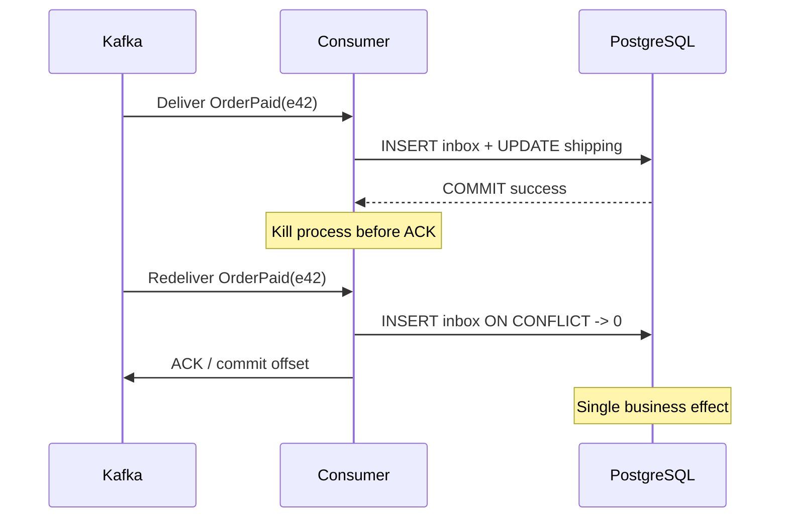

Tests against a real broker should:

1. Publish an event with `eventId=e42` and a valid aggregate version.
2. Inject a crash at the boundary **after DB commit, before ACK**.
3. Restart the consumer in the same consumer group.
4. Assert `inbox` marker count is 1 and the read model shows no duplicate business effect.
5. Assert the consumer offset eventually advances after redelivery.
6. Measure SQL count on the duplicate path; optimize **inbox check before loading expensive aggregate graphs**, whenever business semantics permit.

### 26.2. Why Deduplicating Before ORM Loading Matters

Bad path:

```text
Redelivery e42
  -> load order with 50 lines via N+1 (51 SQL)
  -> parse business graph
  -> check processed_events e42 -> already processed
  -> ACK
```

Good path:

```text
Redelivery e42
  -> attempt atomic inbox claim in local transaction
  -> conflict -> already processed -> ACK
  -> no expensive ORM aggregate load
```

On first delivery, the claim marker and business update execute in **the same transaction**, so failures roll back the marker. If an incoming payload differs while reusing the same ID, validate its fingerprint before treating it as a duplicate. If processing involves external side effects, also use provider idempotency keys/status inquiries; a local inbox marker cannot roll back an external payment or email.

### 26.3. Concurrent Duplicate Processing

If two consumer instances process the same event ID nearly simultaneously (due to rebalance or relay republish), checking `SELECT processed_events WHERE event_id=?` before `INSERT` is insufficient. Use a unique constraint / atomic claim; in PostgreSQL, `INSERT ... ON CONFLICT DO NOTHING` in the same transaction prevents multiple consumers from applying the DB effect when designed cleanly. Test concurrency with barriers and a real database; mocking `Repository.existsById` never simulates locking or race conditions.

### 26.4. Message Payload References a Deleted Entity

A Kafka event contains `orderId`, yet when the consumer queries, the order was deleted or soft-deleted:

- If events carry sufficient snapshot fields, the consumer can process independently of the live order row.
- If the command must verify authoritative current state, enforce version guards and a clear not-found policy.
- If events arrive out of order, park or reconcile instead of ACKing as success.
- If a record belongs to another tenant, never look it up by ID alone; always include the tenant predicate.

Never swallow `EntityNotFoundException` into a generic `onErrorResume(e -> Mono.empty())` and commit the Kafka offset; that silently drops inconsistent state.

### 26.5. JPA + Broker Integration Fault Matrix

| Crash / Failure | JPA / DB State | Broker State | Recovery |
| --- | --- | --- | --- |
| Before source DB commit | Order + outbox roll back. | Nothing published. | Retry command idempotently. |
| After source DB commit, before publish | Order/outbox committed. | No event yet. | Relay publishes outbox after restart. |
| After broker ACK, before marking outbox published | Outbox still pending. | Event may exist in broker. | Relay may republish duplicate; consumer inbox handles it. |
| Consumer crashes before starting DB TX | No DB effect. | Record unACKed. | Redelivery processes normally. |
| Consumer DB commits, ACK lost | Read model + inbox committed. | Record may redeliver. | Duplicate no-op, re-ACK. |
| Consumer triggers N+1 then DB timeout/rollback | Transaction rolls back. | Record unACKed. | Bounded retry after cutting query cost; never ACK failure. |
| Consumer HTTP side effect commits, DB rolls back | External effect happened. | Record redelivers. | Provider idempotency/inquiry + durable workflow. |
| Invalid event JSON | No business state committed. | Poison record. | DLT/parking with schema-aware replay. |
| Detached entity serialized after TX | JSON/event serialization fails. | Publish may never occur. | DTO snapshot before boundary; outbox. |
| Collection fetch join with unbounded page | DB/heap pressure. | Consumer lag or HTTP timeouts. | Two-phase queries, page caps, slow-query diagnostics. |

**Remember:** Kafka exactly-once consume-process-produce semantics apply within a properly configured Kafka transaction scope; they **do not** coordinate atomic commits with PostgreSQL, Redis, remote HTTP APIs, or file systems.

## 27. Observability: Measuring N+1 per Request and per Message

| Metric | Signal | Action |
| --- | --- | --- |
| SQL statements per HTTP operation | Query count scales with page size. | DTO projections/fetch plans; inspect SQL logs. |
| Hibernate entity/collection load counts | Loaded graph exceeds required fields. | Audit eager/lazy mappings and access paths. |
| JDBC connection active/idle/pending | Hikari pool pinned too long. | Reduce N+1, shrink transaction scope, fix leaks. |
| DB p95/p99 query latency | Expensive indexes, joins, sorts, or batches. | `EXPLAIN`/`ANALYZE`, index and cardinality review. |
| HTTP endpoint latency p95/p99 | N+1 inflating response time. | Correlate DB query counts and latencies. |
| WebClient pending acquire / read timeouts | Downstream callers timing out. | Fix endpoint N+1 and capacity/budgets, not just timeouts. |
| Kafka consumer lag by partition | Message handler falling behind. | Check consumer N+1, retries, poison pills, concurrency. |
| RabbitMQ ready / unacked | Broker backlog or slow handlers holding deliveries. | Tune prefetch, ack timing, and DB query plans. |
| Outbox pending / oldest age | Relay lagging behind DB commits. | Scale relay capacity, check broker publish/errors. |
| Inbox duplicates prevented | Safe handling of redeliveries/republishes. | Classify overload, rebalances, or retry storms. |
| Heap/GC and ORM allocations | Queries hydrating too many entities/collections. | DTO projections, page/batch caps. |
| Rows examined/returned per SQL | Join row multiplication despite low SQL count. | Split fetches; avoid multi-collection joins. |

### 27.1. Where Should Query Counts Be Measured?

Tag query counts with **bounded operation names** like `GET_orders_page`, `shipping_consume_OrderPaid`, or `export_orders_batch`. Never use high-cardinality `orderId` or `tenantId` values as metric labels; for ID-level correlation, use access-controlled traces and logs.

SessionFactory-scoped Hibernate Statistics are global aggregates, not request-local by default. To measure per operation, use JDBC proxy/tracing instrumentation, scoped contexts, SQL fingerprint aggregators, or test-only `StatementInspector`s with proper thread/reactive context propagation. Never take global stats deltas in multi-threaded production and claim they represent a single request's query count.

### 27.2. Be Careful with SQL Logging in Production

Prefer normalized SQL fingerprints, latency histograms, and controlled sampling. Bind parameters can contain customer IDs, token hashes, shipping addresses, or payment references. Leaving `TRACE` parameter logging on in production creates serious privacy/security exposure and huge log volumes.

Monitoring and JPA stats never replace API contracts and DB constraints. Clean query counts that leak cross-tenant rows are still a critical bug.

### 27.3. Alerts Should Track Trends and SLOs

Illustrative alert design:

```text
http_order_list_sql_statements_p95
    > (baseline_per_page + tolerance)

AND http_order_list_page_size <= 50

OR kafka_shipping_consumer_lag_age
    > integration_freshness_slo

OR outbox_oldest_unpublished_age
    > expected_publish_window
```

This is **not copy-pasteable PromQL**. Exact metric names and baselines depend on your instrumentation. Distinguish pagination `COUNT` queries from N+1 association queries, and monitor query durations, rows, and heap alongside statement counts.

### 27.4. "Just Add an Index" Is Usually Wrong

Indexes speed up each individual `SELECT` during N+1, yet the round-trip count still climbs. An endpoint whose tables are indexed yet still issues 101 queries for 50 orders needs a fetch plan/DTO refactor. Conversely, replacing N+1 with a joined query lacking proper indexes can run even slower. **Evaluate SQL query plans and application code together.**

## 28. Runbook: When Endpoints Slow Down or Consumers Lag Due to JPA

### 28.1. If `GET /orders` p99 Spikes

1. Check recent releases, page sizes, and real data volumes; is a request building an unusually large detail DTO?
2. Enable scoped SQL tracing and count **statements per request** on a safe sample.
3. Look for repeated `SELECT`s by `customer_id`, `order_id`, or `product_id`; separate root/count queries from secondary lazy loads.
4. Locate JPA entity traversal inside services or Jackson serialization; verify `spring.jpa.open-in-view`.
5. If N+1 is confirmed, apply DTO projections, to-one `EntityGraph`, targeted fetches, batch/subselect fetching, or two-phase pagination based on the use case.
6. Check SQL row multiplication after cutting query count; avoid reckless multi-collection fetch joins.
7. Verify tenant filters, DTO field allowlists, pagination ordering, and request byte bounds.
8. Run SQL count and HTTP tests with OSIV false, scaling fixtures to 20/50/100 orders/lines.
9. Compare endpoint p50/p95/p99, Hikari wait times, DB CPU, heap/GC, and caller WebClient timeouts before and after.
10. Roll out with observability and a rollback plan; never enable global `EAGER` as a "quick fix."

### 28.2. If `LazyInitializationException` Occurs

1. Read the root stack trace: which field, entity, proxy, or collection was initialized after the Session closed?
2. Identify the boundary: controller serialization, async method, `AFTER_COMMIT` event listener, Kafka serializer, Reactor `map`, or scheduler?
3. Trace back to the service method that loaded the entity; did it map to a DTO before returning?
4. If the association is required, add the right fetch plan/query or intentional initialization **inside the transaction**.
5. If unneeded, remove the field from the DTO contract—never serialize whole entities.
6. Check `spring.jpa.open-in-view` and `@Transactional` self-invocation/proxy wiring.
7. Never enable `hibernate.enable_lazy_load_no_trans` or turn everything `EAGER` to hide the error.
8. Add an HTTP/event regression test with OSIV false and serialization after service return.

### 28.3. If Kafka Consumer Lag Climbs

1. Inspect per-partition lag and handler durations; is a retrying poison event blocking a partition?
2. Count SQL per event; spot repeated loading of aggregates, lines, and products.
3. Verify inbox deduplication runs **before expensive ORM fetches** on duplicate events.
4. Inspect Hikari connection pool metrics, transaction durations, DB locks, and query plans.
5. Check whether the listener makes remote HTTP calls inside a DB transaction.
6. Balance consumer concurrency, poll intervals, batch sizes, and JDBC max pool (raising one side can bottleneck the other).
7. Move events to self-contained DTOs or targeted fetches; enforce bounded retries/DLT and idempotent replays.
8. Test crashing after DB commit and before ACK to verify duplicate safety and redelivery query cost.

### 28.4. If the Hikari Pool Exhausts

A pool of 20 JDBC connections held by an endpoint issuing 200 `SELECT`s each can push concurrent requests into `Hikari connectionTimeout`. Exhaustion can also stem from DB locks, unclosed streams, long transactions, or genuine connection leaks.

Check:

- Active/idle/pending connections and lease hold durations.
- Transaction durations and queries executed per transaction.
- N+1 `SELECT`s, row counts, slow SQL, and missing indexes.
- Outbound HTTP calls sitting inside `@Transactional`.
- Unclosed JDBC `ResultSet`, `Stream`, or `EntityManager` resources.
- Whether streaming/serialization keeps DB contexts open too long.
- Only raise `maximumPoolSize` if DB capacity and workload justify it; never throw 200 connections at an already saturated DB.

### 28.5. If Incidents Appear After Changing a JSON DTO or Event Schema

1. Check if serializers started accessing a new association.
2. Check whether a new DTO mapper or callback runs outside a transaction.
3. Compare SQL counts, payload bytes, and nesting depth.
4. Audit PII exposure and tenant filtering across newly fetched graphs.
5. For Kafka, check schema evolution compatibility and consumer deserializer failures/DLTs.
6. For remote HTTP, check whether larger payloads or extra DB round trips increased timeouts.
7. Only roll out once contract tests and query-count regression tests pass.

## 29. Common Mistakes and How to Fix Them

| Mistake | Consequence in HTTP / Messaging Integration | Right Approach |
| --- | --- | --- |
| Returning `Page<PurchaseOrder>` directly from a controller | Jackson dereferences lazy associations, exposing internal data/mappings. | Return HTTP DTOs with fetch plans and field allowlists. |
| Enabling OSIV to "fix" lazy serialization | SQL fires during JSON rendering outside service transactions. | Map DTOs inside transactions; set OSIV policy explicitly. |
| Disabling OSIV and ignoring `LazyInitializationException` | HTTP 500s or event serializer crashes. | Fetch needed associations before the transaction closes. |
| Enabling `hibernate.enable_lazy_load_no_trans` globally | Hidden out-of-transaction queries masking bad design. | Explicit fetch plans and transaction boundaries. |
| Switching all `@ManyToOne` to EAGER | Over-fetching and potential N+1 secondary `SELECT`s. | `LAZY` + per-use-case projections/`EntityGraph`. |
| Assuming `FetchType.EAGER` = SQL `JOIN` | Providers may still issue secondary `SELECT`s. | Inspect generated SQL and Hibernate Statistics. |
| Calling `findAll()` and reading `getLines()` per order | N+1 lazy collection queries. | Page IDs + targeted fetching/batching. |
| Calling `getLines().size()` just to check if lines exist | Initializes the entire collection unnecessarily. | Use `exists`/`count` queries or projections. |
| Using `Pageable + JOIN FETCH lines` | In-memory pagination, row truncation, or warnings. | Two-phase pagination + `fail_on_pagination_over_collection_fetch`. |
| Join-fetching two `List` collections at once | Cartesian product / `MultipleBagFetchException`. | Split fetches and bounded DTO mapping. |
| Thinking `DISTINCT` removes row explosion | Network/DB can still transfer huge joined row sets. | Measure SQL rows/bytes and split collections. |
| Setting batch size to 1,000 without measuring DB limits | Huge `IN` clauses, heap spikes, and query-planner pressure. | Benchmark 16/32/64/... against workload and dialect. |
| Relying solely on L2 cache to hide N+1 | Cache misses and cold starts bring the problem back. | Fix query shapes first; layer caching deliberately. |
| Testing N+1 in the same persistence context that seeded fixtures | First-level cache hides secondary `SELECT`s. | Flush/clear and reset Statistics before testing. |
| Asserting only HTTP 200 without measuring SQL/row counts | Performance regressions slip past CI. | Add query-count, query-plan, and latency regression tests. |
| Raising Hikari `maximumPoolSize` to cure N+1 | Pushes more concurrent connections/SQL onto an overloaded DB. | Cut SQL/request and transaction duration first. |
| Wrapping long remote HTTP calls in `@Transactional` | Pins JDBC resources/locks and inflates latency. | Short DB transaction for snapshot DTO, then remote call. |
| Mapping DTOs in Reactor `map` after repository tx closes | Detached proxies and `LazyInitializationException`. | Return DTO from transactional bean; isolate blocking calls. |
| Calling `Mono.just(repository.findById(...))` on the event loop | Executes blocking SQL eagerly before creating `Mono`. | `Mono.fromCallable(...).subscribeOn(boundedElastic)` with bounded concurrency. |
| Passing JPA entities into `@Async` | Sessions are not thread-safe and do not cross threads. | Pass IDs or immutable DTOs. |
| Serializing raw JPA entities into Kafka | N+1, unstable schemas, circular graphs, PII leaks. | Explicit versioned event DTOs. |
| Treating `@TransactionalEventListener(AFTER_COMMIT)` as a durable outbox | Crashes before callback drop events. | Write outbox rows in the same DB transaction. |
| Relay publishes and marks outbox before ACK | Events are lost if send futures fail. | Wait for broker ACK; accept republishes and deduplicate. |
| Relying only on Kafka idempotent producer without consumer inbox | Relays can republish after restarts. | Stable event IDs + DB unique keys / business idempotency. |
| Consumer commits Kafka offsets before DB commit | Crashes drop business work. | Commit DB then ACK; handle redelivery via inbox. |
| Consumer loads full JPA graph before checking duplicates | Redeliveries still incur pointless N+1 SQL. | Atomic inbox claim before expensive work. |
| ACKing after enqueuing onto an in-memory `ExecutorChannel` | Crashes drop uncommitted tasks. | Durable handoff and post-commit checkpointing. |
| Retrying `OrderPaid` with a brand-new event ID | Inbox treats it as new, duplicating effects. | Stable event/command IDs and payload fingerprints. |
| Retrying payment POST after read timeout without inquiry | Remote side effect may already have committed. | Provider idempotency keys and `UNKNOWN_OUTCOME` handling. |
| Treating `@Transactional(readOnly=true)` as snapshot/serializable guarantee | Multiple `SELECT`s in one tx can see different commits. | Configure isolation/snapshot contracts when actually required. |
| Dropping the tenant filter from the second query of two-phase fetch | Cross-tenant data exposure risk on code bugs. | Tenant predicates on every query + principal-based auth. |
| Returning unbounded `Stream<PurchaseOrder>` over HTTP | Connections/`EntityManager` stay open through serialization; leaks. | Stream DTOs/bounded chunks, close resources, use durable export jobs. |
| Checking only SQL count without measuring rows | A single multi-collection join can still crawl. | Track query count, row count, DB time, and memory together. |
| Concluding "N+1 is gone" from warm-cache local tests | Returns on cold caches and scale-out. | Test cold/warm caches with production-like cardinalities. |
| Raising HTTP client read timeouts to mask slow SQL endpoints | Extends pending pools and remote resource holds. | Fix N+1 and enforce SLO-backed deadlines. |

## 30. JPA/Hibernate Integration Design Checklist

### 30.1. Before Writing Repositories

1. **Define exact data needed:** list/summary/details/event/export; field allowlists and size bounds.
2. **Map entities/relations:** to-one/to-many, EAGER/LAZY defaults, nested associations.
3. **Separate DTO contracts:** never return entities/proxies directly to HTTP, Kafka, RabbitMQ, or async jobs.
4. **Select fetch strategies:** projections, `EntityGraph`, single-collection fetch joins, batch/subselect, or two-phase pagination.
5. **Design pagination:** stable sorts, parent ID pages, `count`/`Slice`/keyset; never combine collection fetch joins with `Pageable` unverified.
6. **Enforce tenant authorization:** derive tenant ID from authenticated context; apply repository predicates across every phase.
7. **Cap data volume:** max page sizes, per-order line limits, export batch/byte caps, and time budgets.

### 30.2. Inside Services and Transactions

8. **Set clear transaction boundaries:** public Spring bean methods called via proxy; services perform DTO mapping.
9. **Disable OSIV deliberately:** test HTTP serialization with `spring.jpa.open-in-view=false`.
10. **Never rely on lazy loading outside transactions:** never pass managed entities through `@Async`, Reactor, or Kafka serializers.
11. **Never hold DB transactions across remote HTTP:** take a short DTO snapshot first, then call external providers.
12. **Avoid self-invocation:** understand `@Transactional` proxy and thread-local boundaries.
13. **Read-only is not isolation:** evaluate multi-query pagination consistency explicitly.
14. **Manage resource lifecycles:** close streaming repositories/`EntityManager`/JDBC handles; flush/clear write batches at boundaries.
15. **Respect ORM concurrency:** never share Hibernate `Session` or persistent collections across threads.

### 30.3. At Messaging / Outbox Boundaries

16. **Event DTO identity/version:** `eventId`, aggregate key/version, `tenantId`, and `schemaVersion`.
17. **Outbox:** commit business DB state and event intent in the same local transaction.
18. **Relay:** await broker ACK before marking published; preserve `eventId` on retries.
19. **Inbox:** unique event ID + fingerprint and business update in the same DB transaction.
20. **ACK:** commit broker offsets/ACKs only after durable business commit or durable parking.
21. **Retries:** prevent poison/retry storms, avoid duplicating remote side effects, handle `UNKNOWN_OUTCOME`.
22. **Ordering:** key/partition/aggregate version, retry topics, and version-gap policies.
23. **No async entities:** jobs and events carry IDs or immutable DTOs and re-fetch inside dedicated transactions.

### 30.4. Testing and Operations

24. **SQL regressions:** seed 20–50 roots, clear first-level cache, assert query-count upper bounds.
25. **Row-count/performance:** check for Cartesian multiplication, SQL `EXPLAIN`, and p95/p99.
26. **HTTP contracts:** MockMvc/HTTP integration with `OSIV=false` and JSON schema field allowlists.
27. **Message recovery:** crash between DB commit and ACK, concurrent duplicates, outbox republishing.
28. **Cache effects:** cold/warm L1/L2, distinct customer IDs, varying child cardinalities.
29. **Instrumentation:** Hibernate stats/SQL tracing, Hikari, HTTP p99/timeouts, Kafka lag, outbox/inbox metrics.
30. **Runbooks:** distinguish `LazyInitializationException`, N+1, pool saturation, missing events, and duplicate side effects.

## 31. Practice Exercises

### Exercise A — Detecting N+1 via Query Counts

Seed 30 orders for the same tenant, each with its own customer and 3 lines. Inside a read-only transaction:

1. Call `repository.findAll()` and read `order.getCustomer().getDisplayName()` and `order.getLines().size()`.
2. Clear the persistence context before the test so the first-level cache does not interfere.
3. Use `Statistics.getPrepareStatementCount()` or a `StatementInspector` to count SQL statements.
4. Explain why statement counts vary with unique Customer IDs, batch fetching, and L2 cache.
5. Add an `EntityGraph` for the to-one `customer` and compare.
6. Switch to a DTO projection for a summary view and compare.

**Deliverable:** before/after SQL counts, generated SQL, latencies, and why fewer SQL statements do not guarantee fewer rows.

### Exercise B — Disabling OSIV Cleanly

Starting from a controller returning `PurchaseOrder`:

1. Set `spring.jpa.open-in-view=false` in an integration test.
2. Reproduce the lazy serialization failure on an uninitialized collection.
3. Create an `OrderDetailsView` record and an explicit fetch-plan query.
4. Map the DTO inside a `@Transactional(readOnly=true)` service.
5. Verify the JSON response contains all lines without Hibernate proxy properties.
6. Verify zero DB queries run during serialization and no PII leaks outside the contract.

**Deliverable:** transaction boundary diagram, endpoint test, and explanation of why enabling OSIV is not the optimal fix.

### Exercise C — Two-Phase Pagination

Given 1,000 orders averaging 10 lines/order:

1. Try `Pageable + @EntityGraph(lines)` and observe the warning/failure or in-memory pagination.
2. Enable `hibernate.query.fail_on_pagination_over_collection_fetch=true` in tests.
3. Refactor to page IDs → fetch roots+customer → fetch lines for those IDs.
4. Map DTOs and restore ordering from the ID page.
5. Test empty pages, last pages, page-size caps, and missing/nullable customers per schema.
6. Evaluate snapshot consistency under `READ COMMITTED` and propose solutions if snapshot isolation is required.

**Deliverable:** SQL counts, row counts, memory footprint, and output ordering verification.

### Exercise D — Batch Fetching and Cartesian Products

Create an entity with two collections: `lines` (20 elements) and `discounts` (10 elements). Attempt to join-fetch both, observing `MultipleBagFetchException` or row multiplication depending on mapping. Then:

1. Split the fetches.
2. Test `@BatchSize(size=16/32/64)` on one association.
3. Test `@Fetch(SUBSELECT)` in a test environment.
4. Compare SQL counts, returned rows, p95 latency, and heap usage.
5. Explain when splitting endpoints/paginating collections beats further ORM fetch tuning.

### Exercise E — Kafka Consumer with N+1 and Duplicate Delivery

Using PostgreSQL + Kafka test infrastructure:

1. Have a consumer receive `OrderPaid(e42)` via an event DTO.
2. Inside a local transaction, claim the inbox marker and update the read model.
3. Inject a fault after DB commit and before Kafka ACK.
4. Restart the consumer so the broker redelivers `e42`.
5. Assert a single inbox marker and a single business effect.
6. Measure SQL count on the duplicate path: verify inbox check precedes expensive aggregate fetches.
7. On first delivery, fetch only needed fields instead of traversing lazy customer+lines unboundedly.

**Deliverable:** test report covering crash windows, SQL/event counts, Kafka lag, and idempotency scope.

### Exercise F — Outbox and Remote HTTP Side Effects

An HTTP POST marks an order `PAID` and must emit an event:

1. Implement status/version update and outbox insert in one local DB transaction.
2. Have the relay publish to Kafka and crash after ACK before marking `PUBLISHED`.
3. Demonstrate that the relay can send a duplicate with the same `eventId`.
4. Use a consumer inbox to ensure one business effect.
5. Add a Warehouse HTTP reservation step and simulate a lost response after remote commit.
6. Design a stable idempotency key + inquiry flow instead of retrying with a new command ID.

**Deliverable:** failure matrix explaining why Kafka EOS does not guarantee atomic commits across JDBC or remote APIs.

### Exercise G — Batch Export and Resource Limits

Export 1 million orders to object storage with at most 500 parent IDs per batch. Design:

- Keyset cursor or snapshot watermark.
- DTO projections without holding all JPA entities.
- Short transaction/read scopes.
- Bounded concurrent uploads, multipart cleanup, and checksums.
- Durable job status and idempotent chunk IDs.
- Retry handling when the process crashes between batches.
- Tests for query counts, memory, query duration, and connection lease times.

Explain why `findAll()` and `collectList()` fail at scale even after reducing N+1 to one `JOIN`.

### Exercise H — Data-Driven Production Tuning

An API's p99 latency jumps from 300 ms to 5 seconds after adding `product.vendor.name` to the response. Collect:

1. Diffs of the DTO mapper and entity graph.
2. Hibernate statement counts per request.
3. Repeated generated SQL by product/vendor FK.
4. DB query times, row counts, and indexes.
5. Hikari pool wait times and HTTP client read timeouts.
6. Kafka lag if the same query code runs in a listener.

Propose at least two fixes (projection vs. targeted fetch + batching) and compare them against tests/SLOs instead of blindly raising `readTimeout` or the JDBC pool.

## 32. Self-Check Questions

1. How does Hibernate's `PersistenceContext` differ from an HTTP session or a database connection?
2. When is a `PurchaseOrder` managed, detached, or transient?
3. Can a Hibernate lazy proxy still query the database after `EntityManager` closes?
4. What are JPA's default fetch types for `@ManyToOne` and `@OneToMany`?
5. Does `FetchType.EAGER` mean Hibernate always uses a SQL `JOIN`?
6. Why can `getCustomer().getDisplayName()` trigger a `SELECT` while `getCustomer().getId()` might not?
7. How is N+1 spotted from SQL counts? If 50 orders share 1 customer, is the query count necessarily 51?
8. How do the conditions causing N+1 differ from `LazyInitializationException`?
9. Why can enabling OSIV hide N+1 until Jackson serialization?
10. Why doesn't OSIV keep all SQL in a request inside a single database transaction?
11. Why doesn't `spring.jpa.open-in-view=false` automatically fix all lazy loading issues?
12. What advantages do DTO projections have over returning entities and mapping in controllers?
13. When is `@EntityGraph(attributePaths={"customer"})` appropriate?
14. When is fetch-joining a to-many collection reasonable?
15. Why can fetch-joining two collections trigger a Cartesian product or `MultipleBagFetchException`?
16. Why doesn't `select distinct o` eliminate duplicated SQL rows?
17. Why shouldn't you combine collection fetch joins directly with `Pageable`?
18. What are the steps of two-phase pagination, and why must they share one persistence context?
19. When using `WHERE id IN (...)`, why must you restore ordering from the original ID page?
20. Why should you never send JPQL `IN ()` with an empty ID list?
21. By what mechanism can `hibernate.default_batch_fetch_size` reduce N+1?
22. Are `@BatchSize` and `@Fetch(SUBSELECT)` portable JPA annotations?
23. If second-level cache hits reduce SQL count, can you declare N+1 completely solved?
24. Why can a low query count with a SQL `JOIN` returning too many rows still be slow?
25. Does `@Transactional(readOnly=true)` provide snapshot isolation in PostgreSQL `READ COMMITTED`?
26. Why can Spring AOP self-invocation prevent transaction annotations from taking effect?
27. Why shouldn't you pass managed entities to `@Async` or `CompletableFuture` callbacks?
28. How does `Mono.just(repository.findById(...))` differ from `Mono.fromCallable(...).subscribeOn(boundedElastic())`?
29. Why doesn't JPA/Hibernate ORM become non-blocking just because the controller uses WebFlux?
30. If 50 orders have 5 lines each, how many remote calls does calling the Warehouse REST API once per line generate?
31. Why shouldn't a PostgreSQL transaction stay open while waiting on 250 HTTP calls?
32. If inventory `GET` data changes between DB fetch and HTTP response, does the aggregated DTO guarantee a consistent snapshot?
33. What are the risks of passing a `PurchaseOrder` entity directly to a Jackson Kafka serializer?
34. What are the pros and cons of ID-only reference events versus event-carried state snapshots?
35. Why can't `@TransactionalEventListener(AFTER_COMMIT)` replace a transactional outbox?
36. Why can a relay still publish duplicates after a crash even after publishing completes?
37. When a Kafka consumer commits to the DB and dies before ACK, what happens on restart?
38. Why must the inbox marker and business update commit in the same transaction?
39. Why does checking duplicates **before** expensive JPA graph fetches save substantial SQL on redelivery?
40. When the same event ID arrives with a different payload, how should the consumer react?
41. Why doesn't an HTTP payment POST timeout prove the provider did not commit?
42. Why doesn't Kafka exactly-once semantics automatically roll back a PostgreSQL transaction?
43. How does Spring Integration's `ExecutorChannel` alter transaction/thread boundaries?
44. Is an in-memory `QueueChannel` a durable message queue for critical work?
45. Why should a batch export use keyset cursors, DTOs, and checkpoints rather than a massive `findAll()`?
46. What must you do before measuring N+1 so the first-level cache doesn't hide SQL counts?
47. Does Hibernate's `getPrepareStatementCount()` equal SQL count per HTTP request in concurrent production traffic?
48. Why must SQL count, DB row count, p99 latency, Hikari metrics, and memory all be inspected together?
49. Which test proves Jackson triggers zero lazy SQL when OSIV is disabled?
50. When raising Hibernate batch size or altering fetch joins, which additional failure and performance modes must be tested?

## 33. References

- [Spring Boot — SQL Databases and JPA](https://docs.spring.io/spring-boot/reference/data/sql.html): DataSource, JPA auto-configuration, OSIV, and Hibernate customizations.
- [Spring Data JPA — Reference](https://docs.spring.io/spring-data/jpa/reference/): repositories, pagination, projections, entity graphs, and transactionality.
- [Spring Data JPA — Projections](https://docs.spring.io/spring-data/jpa/reference/repositories/projections.html): interface/class/record projections, query derivation, and nested projections.
- [Spring Data JPA — Fetching/EntityGraph](https://docs.spring.io/spring-data/jpa/reference/jpa/query-methods.html#jpa.entity-graph): dynamic/named entity graphs on repository methods.
- [Hibernate ORM 6 — User Guide](https://docs.jboss.org/hibernate/orm/6.6/userguide/html_single/Hibernate_User_Guide.html): lazy fetching, proxies, entity graphs, fetch joins, batch fetching, and Hibernate statistics. Versioned URL is a reference branch; verify against your project's exact Hibernate version.
- [Hibernate ORM — Performance Tuning](https://docs.hibernate.org/orm/current/userguide/html_single/Hibernate_User_Guide.html#best-practices-fetching): fetch plans, batch/subselect, and performance guidance; adapt per version/provider.
- [Hibernate ORM — Javadocs](https://docs.hibernate.org/orm/current/javadocs/): `@BatchSize`, `@Fetch`, `SessionFactory`, and `Statistics` APIs.
- [Jakarta Persistence 3.1 — Specification](https://jakarta.ee/specifications/persistence/3.1/): entity mappings, persistence contexts, transaction scopes, and fetch types.
- [Spring Framework — Transaction Management](https://docs.spring.io/spring-framework/reference/data-access/transaction.html): JDBC/JPA transaction managers, propagation, and boundaries.
- [Spring Framework — Declarative Transaction Management](https://docs.spring.io/spring-framework/reference/data-access/transaction/declarative.html): `@Transactional`, Spring AOP proxies, and self-invocation.
- [Spring Framework — Transaction-bound Events](https://docs.spring.io/spring-framework/reference/data-access/transaction/event.html): `@TransactionalEventListener` and `AFTER_COMMIT` semantics.
- [Spring Framework — Web MVC](https://docs.spring.io/spring-framework/reference/web/webmvc.html): controller response and serialization lifecycles.
- [Spring Framework — WebFlux](https://docs.spring.io/spring-framework/reference/web/webflux.html): reactive execution, blocking-call considerations, and data-access boundaries.
- [Spring for Apache Kafka — Reference](https://docs.spring.io/spring-kafka/reference/): listener acknowledgments, error handling, transactions, and exactly-once scope.
- [Spring for Apache Kafka — Exactly Once Semantics](https://docs.spring.io/spring-kafka/reference/kafka/exactly-once.html): consume-transform-produce atomicity in Kafka and guarantee scope.
- [Spring AMQP — Reference](https://docs.spring.io/spring-amqp/reference/): Rabbit listener containers, manual ACK/NACK, transactions, and error handling.
- [Spring Integration — Transactions](https://docs.spring.io/spring-integration/reference/transactions.html): transaction boundaries across pollers, channels, and handlers.
- [Spring Integration — Channels](https://docs.spring.io/spring-integration/reference/channel.html): `DirectChannel`, `ExecutorChannel`, and `QueueChannel` semantics.
- [Testcontainers — PostgreSQL Module](https://java.testcontainers.org/modules/databases/postgres/): testing SQL, dialects, locking, and transactions against real PostgreSQL.
- [Testcontainers — Kafka Module](https://java.testcontainers.org/modules/kafka/): testing broker redelivery, offset commits, and failure windows.
- [PostgreSQL — Transaction Isolation](https://www.postgresql.org/docs/current/transaction-iso.html): `READ COMMITTED`, `REPEATABLE READ`, and snapshot behavior.
- [PostgreSQL — EXPLAIN](https://www.postgresql.org/docs/current/sql-explain.html): analyzing execution plans, row counts, and query costs.
- [Microservices.io — Transactional Outbox Pattern](https://microservices.io/patterns/data/transactional-outbox.html): local DB commit with event intent and relay.
- [Microservices.io — Idempotent Consumer Pattern](https://microservices.io/patterns/communication-style/idempotent-consumer.html): deduplication and repeated delivery semantics.

**Core Takeaway:** Lazy loading is a tool for deferring queries, **not a promise of cheap queries or data availability across every boundary**. N+1 arises whenever code iterates over lazy associations that were not intentionally fetched. Across HTTP and messaging integrations, the fallout extends far beyond query speed: broken JSON serialization, timeouts/JDBC pool exhaustion, Kafka lag, retry amplification, and lost or duplicated side effects when transactions and ACKs are misplaced. Proper design combines **explicit DTOs + targeted fetch plans + short transactions + SQL measurement + outbox/inbox/idempotency where no shared transaction exists**.
