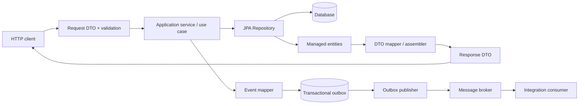

# Mapping the Persistence Model to DTOs Before External Exchange

A Spring Boot application typically uses JPA/Hibernate to map relational tables to `@Entity` classes, manage the persistence context, perform dirty checking, and traverse table relationships. However, an entity object is not a suitable data contract to send directly over HTTP, message brokers, shared caches, or Spring Integration adapters. It carries storage metadata, association-loading state, and sometimes internal fields that external consumers have no business seeing.

In the **JPA and Hibernate** chapter of `SPRING_BOOT_INTEGRATION`, this lesson explains how to translate the persistence model into **Data Transfer Objects (DTOs)** at the integration boundary. This is an essential skill when integrating Spring Boot with HTTP clients, databases, caches, message brokers, and Spring Integration adapters: explicit data contracts help control schema evolution, transactions, field-level security, retries, deduplication, and testing.

Lesson objectives:

- Distinguish `Entity`, domain/business models, REST DTOs, message DTOs, and cached representations.
- Determine where to query and map entities into DTOs before the transaction closes.
- Choose data-fetching strategies that avoid `LazyInitializationException`, N+1 queries, and over-fetching.
- Design DTOs suited to integration contracts, versioning, and protecting sensitive data.
- Verify boundaries using unit, integration, and contract tests.

## 1. Why Should You Never Return JPA Entities Directly?

Suppose `GET /api/v1/orders/{id}` returns a `PurchaseOrder` entity directly. When Jackson serializes an entity to JSON, multiple problems arise:

| Problem | Symptom | Consequence |
| --- | --- | --- |
| Persistence details leaked | JSON exposes `internalNote`, `costPrice`, internal keys | Data leakage; tight coupling between API and schema. |
| Lazy relationships | Serializer calls `getLines()` after persistence context closes | `LazyInitializationException` or HTTP 500 response. |
| N+1 queries | Serializer traverses associations across a list of orders | One request fires dozens or hundreds of unexpected SQL queries. |
| Bidirectional relationships | `order.lines[].order.lines[]...` | Infinite recursion/cycles, bloated payloads, or serialization crashes. |
| Hibernate proxies | Jackson encounters proxies/bytecode enhancement instead of plain POJOs | JSON output depends on Hibernate Jackson modules or proxy behavior. |
| Schema changes | Renaming a property, adding a relation, adding persistence fields | API or event contracts silently break. |
| Entity lifecycle | Entity remains managed by the persistence context | Risk of accidental mutations via setters/dirty checking inside a transaction. |
| Hard to version | Same entity sent to multiple consumers | Difficult to maintain REST v1 and event v2 simultaneously. |

Sprinkling `@JsonIgnore` onto a few entity fields hides some symptoms, yet still couples external contracts to persistence code, lazy loading, and relationship mappings. **Entities are the application's persistence model; DTOs are the deliberate payload allowed to cross boundaries.**

## 2. Distinguishing Model Types

| Type | Purpose | Example | Crosses Process Boundary? |
| --- | --- | --- | --- |
| JPA entity | Persisted/queried by Hibernate; models relations and persistence state | `PurchaseOrder`, `OrderLine` | Do not send directly. |
| Command / use-case input | Validated and interpreted business intent | `PlaceOrderCommand` | Mostly internal to the application. |
| API request DTO | Inbound client contract | `CreateOrderRequestV1` | Yes; contains only client-allowed fields. |
| API response DTO | Outbound server contract | `OrderResponseV1` | Yes; stable, public fields. |
| Event / message DTO | Asynchronous consumer contract | `OrderPlacedV1` | Yes; typically includes `eventId` and `schemaVersion`. |
| Query projection / read model | Selects only columns needed for a view or query | `OrderSummaryRow` | Usually internal, optionally mapped to an API DTO. |
| Cache value DTO | Selected data snapshot stored in cache | `CachedOrderSummaryV1` | Shared via Redis/cache; needs version and TTL. |

One entity can map into **multiple distinct DTOs** depending on the consumer: REST order details, an order-placed event, a report export, or a shipping-partner payload. Each contract has its own lifecycle and access rules, so never share one "catch-all" DTO everywhere just because the data comes from the same entity.

## 3. Recommended Boundaries in a Spring Boot Integration



Key takeaways:

1. **Request DTO → command:** validate syntax and input contracts, then convert to a business command. Never bind HTTP requests directly onto entities.
2. **Repository → entity:** JPA uses entities to manage persistence and transactions. Repositories do not define external HTTP contracts.
3. **Entity → response DTO:** mapping runs once needed data is loaded, typically inside a read-only application service transaction.
4. **Entity/domain result → event DTO:** build the event snapshot from confirmed values; write to the outbox in the same transaction as business mutations.
5. **DTO → JSON/AMQP/Kafka/cache:** transport layers serialize plain objects detached from Hibernate persistence contexts and proxies.

The diagram shows the logical flow; real applications may use domain aggregates, projections, or multiple repositories. The invariant is that **each boundary adapter exposes its own DTO contract** instead of leaking raw entities.

## 4. Example Persistence Model: Orders and Order Lines

Suppose the service persists orders in PostgreSQL. The entity contains business fields, internal columns, and a one-to-many relationship with order lines.

```java
package com.example.orders.persistence;

import jakarta.persistence.*;
import java.time.Instant;
import java.util.ArrayList;
import java.util.List;
import java.util.UUID;

@Entity
@Table(name = "purchase_orders")
public class PurchaseOrder {
    @Id
    private UUID id;

    @Enumerated(EnumType.STRING)
    @Column(nullable = false)
    private OrderStatus status;

    @Column(name = "total_minor", nullable = false)
    private long totalMinor;

    @Column(name = "customer_ref", nullable = false)
    private String customerReference;

    @Column(name = "internal_note")
    private String internalNote;

    @Column(name = "created_at", nullable = false)
    private Instant createdAt;

    @Version
    private long version;

    @OneToMany(mappedBy = "order", fetch = FetchType.LAZY)
    private List<OrderLine> lines = new ArrayList<>();

    protected PurchaseOrder() { }

    public UUID getId() { return id; }
    public OrderStatus getStatus() { return status; }
    public long getTotalMinor() { return totalMinor; }
    public Instant getCreatedAt() { return createdAt; }
    public List<OrderLine> getLines() { return lines; }
}
```

```java
package com.example.orders.persistence;

import jakarta.persistence.*;

@Entity
@Table(name = "order_lines")
public class OrderLine {
    @Id
    private Long id;

    @ManyToOne(fetch = FetchType.LAZY)
    @JoinColumn(name = "order_id", nullable = false)
    private PurchaseOrder order;

    @Column(nullable = false)
    private String sku;

    @Column(nullable = false)
    private int quantity;

    @Column(name = "unit_price_minor", nullable = false)
    private long unitPriceMinor;

    protected OrderLine() { }

    public String getSku() { return sku; }
    public int getQuantity() { return quantity; }
    public long getUnitPriceMinor() { return unitPriceMinor; }
}
```

This example shows only fields needed for the lesson: `OrderStatus`, creation constructors, domain invariants, and update methods are defined separately in a full project. To persist a new aggregate with `OrderLine` items, configure cascading or save lines via their repository; do not assume `@OneToMany` here automatically cascades inserts.

Not wanting to expose `internalNote`, `customerReference`, or `version` publicly does not mean deleting them from the entity: persistence needs them for processing, while DTOs dictate **what gets transmitted**.

## 5. Designing DTOs with Clear Contracts

With Java 17+ and Spring Boot 3.x, `record` types fit many read-only DTOs cleanly because fields are explicit and immutable:

```java
package com.example.orders.api.dto;

import java.time.Instant;
import java.util.List;
import java.util.UUID;

public record OrderLineResponseV1(
        String sku,
        int quantity,
        long unitPriceMinor) {
}

public record OrderResponseV1(
        UUID id,
        String status,
        long totalMinor,
        String currency,
        Instant createdAt,
        List<OrderLineResponseV1> lines) {
    public OrderResponseV1 {
        lines = List.copyOf(lines);
    }
}
```

Here the response **omits** `internalNote`, `customerReference`, optimistic `version`, and internal `OrderLine` primary keys. New fields can be added to the API contract later only when intentionally exposed after reviewing access control and consumer compatibility.

`totalMinor`/`unitPriceMinor` store integer minor currency units to avoid floating-point `double` rounding errors in monetary exchange. Contracts must document minor-unit scaling for `VND` versus currencies with different decimal places; `currency` must come from domain data, **never hardcoded as `"VND"` in a mapper if the database supports multiple currencies**. This example assumes a single-currency VND service; multi-currency systems must persist currency in the domain model and map it per order.

`List.copyOf()` prevents callers from mutating the DTO list and rejects `null` elements; line records contain only immutable values. If a DTO wraps nested mutable objects, implement deeper defensive copying.

### When Do You Need Separate DTOs?

Endpoints and channels sharing order data:

| Endpoint / Message | DTO | Why Separate? |
| --- | --- | --- |
| `GET /api/v1/orders/{id}` | `OrderResponseV1` | Needs line items, status, and total amount. |
| `GET /api/v1/orders` | `OrderSummaryResponseV1` | Needs summary columns without loading all line items. |
| `POST /api/v1/orders` | `CreateOrderRequestV1` | Inbound input must be validated and omit server-owned fields. |
| Event `order.placed.v1` | `OrderPlacedV1` | Consumers need `eventId`, version, and a stable snapshot. |
| Outbound shipping partner request | `ShipmentRequestV2` | Follows partner contract and data scope independently of REST APIs. |

Embedding versions in DTO class names is an organizational choice, not a JPA requirement. Versioning can live in namespaces, event types, or API paths instead; what matters is preventing entity edits from silently mutating external contracts.

## 6. Writing Manual Mappers to Control Every Field

Explicit mappers make it effortless for reviewers to see exactly which fields leave the persistence layer.

```java
package com.example.orders.application;

import com.example.orders.api.dto.OrderLineResponseV1;
import com.example.orders.api.dto.OrderResponseV1;
import com.example.orders.persistence.PurchaseOrder;
import java.util.List;
import org.springframework.stereotype.Component;

@Component
public class OrderResponseMapper {

    public OrderResponseV1 toResponse(PurchaseOrder order) {
        List<OrderLineResponseV1> lines = order.getLines().stream()
                .map(line -> new OrderLineResponseV1(
                        line.getSku(),
                        line.getQuantity(),
                        line.getUnitPriceMinor()))
                .toList();

        return new OrderResponseV1(
                order.getId(),
                order.getStatus().name(),
                order.getTotalMinor(),
                "VND", // Single-currency example; multi-currency apps map from domain.
                order.getCreatedAt(),
                lines);
    }
}
```

This mapper calls `order.getLines()`, so the collection must already be loaded or inside an active persistence context. Manual mappers do not magically eliminate lazy loading or N+1 queries; query design and when the mapper runs determine SQL counts.

In larger projects, MapStruct generates compile-time mapping code and catches field mismatches earlier than reflection mappers. Example configuration:

```java
import org.mapstruct.Mapper;
import org.mapstruct.Mapping;
import org.mapstruct.ReportingPolicy;

@Mapper(
        componentModel = "spring",
        unmappedTargetPolicy = ReportingPolicy.ERROR)
public interface OrderResponseMapStructMapper {
    @Mapping(target = "currency", constant = "VND")
    OrderResponseV1 toResponse(PurchaseOrder order);
}
```

This MapStruct example **only works cleanly once source and DTO types/fields align**: MapStruct also needs instructions for `OrderLine → OrderLineResponseV1` and `OrderStatus → String`, such as an explicit `OrderLineResponseV1 toLineResponse(OrderLine line)` method and enum conversion. For the example code above, the manual mapper is less ambiguous. `ReportingPolicy.ERROR` forces review of unmapped target properties, yet it still cannot detect if a sensitive source field happens to match a valid target field name.

Never blindly copy all properties with `BeanUtils.copyProperties(entity, response)` or generic reflection mappers on sensitive public contracts. For DTOs, **the outbound field allowlist** must be controlled explicitly in code or mapping rules.

## 7. Executing Mapping Inside a Read-Only Transaction

Standard pattern:

```java
package com.example.orders.application;

import com.example.orders.api.dto.OrderResponseV1;
import com.example.orders.persistence.PurchaseOrder;
import com.example.orders.persistence.PurchaseOrderRepository;
import java.util.UUID;
import org.springframework.stereotype.Service;
import org.springframework.transaction.annotation.Transactional;

@Service
public class OrderQueryService {
    private final PurchaseOrderRepository repository;
    private final OrderResponseMapper mapper;

    public OrderQueryService(
            PurchaseOrderRepository repository,
            OrderResponseMapper mapper) {
        this.repository = repository;
        this.mapper = mapper;
    }

    @Transactional(readOnly = true)
    public OrderResponseV1 getOrder(UUID id) {
        PurchaseOrder order = repository.findDetailedById(id)
                .orElseThrow(() -> new OrderNotFoundException(id));
        return mapper.toResponse(order);
    }
}
```

`OrderNotFoundException` is an application exception mapped to HTTP 404. The controller receives a **DTO completely detached from JPA**:

```java
@RestController
@RequestMapping("/api/v1/orders")
public class OrderController {
    private final OrderQueryService service;

    public OrderController(OrderQueryService service) {
        this.service = service;
    }

    @GetMapping("/{id}")
    public OrderResponseV1 get(@PathVariable UUID id) {
        return service.getOrder(id);
    }
}
```

Once the service method returns, the transaction and persistence context for that query can close. Jackson serializes only materialized DTO fields and never triggers Hibernate lazy loads through an entity.

### Why Place Mapping in the Service?

- The service defines the transaction boundary and query strategy for the use case.
- Repositories focus on reading/writing entities or projections; controllers focus on HTTP request/response handling.
- You can reuse application logic while producing tailored DTOs per outbound adapter.
- When Open Session in View is disabled, responses still serialize cleanly because all required values were already fetched.

Recommended setting for REST APIs:

```yaml
spring:
  jpa:
    open-in-view: false
```

`open-in-view: false` surfaces hidden lazy-loading dependencies in controllers or serializers early. It **does not fix** queries by itself; required associations must still be fetched in the service. In applications with multiple `EntityManagerFactory` beans, verify the active transaction manager and Open Session in View settings for each persistence context.

## 8. Fetching Needed Data via EntityGraph, Join Fetch, or Projections

Calling plain `findById(id)` when `lines` is lazy still makes the mapper issue extra SQL inside the transaction. For a single detailed order, a query with an explicit fetch plan fits well:

```java
package com.example.orders.persistence;

import java.util.Optional;
import java.util.UUID;
import org.springframework.data.jpa.repository.EntityGraph;
import org.springframework.data.jpa.repository.JpaRepository;
import org.springframework.data.jpa.repository.Query;
import org.springframework.data.repository.query.Param;

public interface PurchaseOrderRepository
        extends JpaRepository<PurchaseOrder, UUID> {

    @EntityGraph(attributePaths = "lines")
    @Query("select o from PurchaseOrder o where o.id = :id")
    Optional<PurchaseOrder> findDetailedById(@Param("id") UUID id);
}
```

`@EntityGraph(attributePaths = "lines")` instructs the provider to load the line-items collection for the DTO. For **one** order with a bounded line count, this cuts secondary queries. Never apply to-many fetch joins indiscriminately to paginated queries over many orders: SQL joins duplicate parent rows per child row, distorting limits/offsets or forcing Hibernate into in-memory pagination.

### DTOs for List Views: Projections Instead of Heavy Aggregates

When a list page only needs `id`, status, total, and timestamp, skip loading `lines` altogether:

```java
package com.example.orders.query;

import com.example.orders.persistence.OrderStatus;
import java.time.Instant;
import java.util.UUID;

public interface OrderSummaryRow {
    UUID getId();
    OrderStatus getStatus();
    long getTotalMinor();
    Instant getCreatedAt();
}
```

```java
Page<OrderSummaryRow> findByCustomerReference(
        String customerReference, Pageable pageable);
```

Declare this method inside `PurchaseOrderRepository`; Spring Data JPA generates an interface-based projection matching the getter names. The application layer maps `OrderSummaryRow` to the public `OrderSummaryResponseV1` API DTO:

```java
public record OrderSummaryResponseV1(
        UUID id, String status, long totalMinor, Instant createdAt) {
}

@Transactional(readOnly = true)
public Page<OrderSummaryResponseV1> listOrders(
        String customerReference, Pageable pageable) {
    return repository.findByCustomerReference(customerReference, pageable)
            .map(row -> new OrderSummaryResponseV1(
                    row.getId(),
                    row.getStatus().name(),
                    row.getTotalMinor(),
                    row.getCreatedAt()));
}
```

These snippets are abbreviated service/repository fragments; add `Page`, `Pageable`, annotations, and packages in real code. If `customerReference` identifies a customer, never let callers supply an arbitrary `customerReference` to read another user's orders; derive scope from the authenticated identity and authorize in the application service.

For queries returning many rows, projections shrink data transferred and lower N+1 risk. Whether using interface projections or constructor projections, verify the SQL Hibernate actually generates; nested getters or associations can affect joins.

### Which Strategy Should You Pick?

| Need | Recommended Strategy | Watch Out For |
| --- | --- | --- |
| Single order details with a few lines | `@EntityGraph`/fetch join + map in transaction | Large payloads, multiple collections, SQL join duplicates. |
| Paginated order list | Projection selecting only needed columns | To-many fetch joins with paging, expensive count queries. |
| Summary view across multiple aggregates | Dedicated DTO query / read model | Slow wide joins; consider preaggregation/read models. |
| Emit event with data already in command/domain result | Build event DTO from confirmed business data | Avoid pointless re-queries or serializing lazy entities. |
| Large bulk exports | Batched/streamed DTOs or JDBC projections | Memory usage, long transactions, cursors, and backpressure. |

## 9. N+1 and LazyInitializationException Must Be Fixed at the Query Layer

Anti-pattern example:

```java
List<PurchaseOrder> orders = repository.findAll();
return orders.stream().map(mapper::toResponse).toList();
```

If each order has lazy `lines`, 1 SQL query for the list triggers 1 SQL query per order's `lines`: **1 + N queries**. Even inside an open transaction without exceptions, response latency climbs rapidly.

Diagnose with SQL logs, Hibernate statistics, JDBC tracing, or profilers. In test environments you can enable:

```yaml
spring:
  jpa:
    properties:
      hibernate:
        generate_statistics: true
logging:
  level:
    org.hibernate.SQL: DEBUG
```

Avoid logging bind parameters containing sensitive values. Query count is a helpful signal, yet the real goals are bounded latency, transferred bytes, and connection utilization.

Remediation options:

1. Use projections for list views needing only a few columns.
2. Use targeted fetch graphs for a small single aggregate, avoiding simultaneous multi-collection joins.
3. For larger lists, use two steps: fetch a page of IDs/summaries, then fetch lines for those IDs in one query and group into DTOs.
4. Consider batch fetching (`hibernate.default_batch_fetch_size` or `@BatchSize`) where suitable and after measuring SQL.
5. Do not rely on Jackson's Hibernate module to "solve" laziness; that is a serialization choice, not a fetch-plan design.

`LazyInitializationException` usually indicates code accessed an unloaded relation after the session closed. Fix it by deciding what the DTO needs and loading it **before leaving the transaction**, not by turning on Open Session in View to mask the issue.

## 10. Convert Request DTOs to Commands—Never Accept Entities from Clients

An order-creation request must never accept server-controlled fields like `status`, `internalNote`, `version`, or `totalMinor`. Input DTOs declare only accepted fields:

```java
package com.example.orders.api.dto;

import jakarta.validation.Valid;
import jakarta.validation.constraints.Min;
import jakarta.validation.constraints.NotBlank;
import jakarta.validation.constraints.NotEmpty;
import java.util.List;

public record CreateOrderItemV1(
        @NotBlank String sku,
        @Min(1) int quantity) {
}

public record CreateOrderRequestV1(
        @NotEmpty List<@Valid CreateOrderItemV1> items) {
}
```

The controller validates the request and maps it to a command:

```java
@PostMapping
public ResponseEntity<OrderResponseV1> create(
        @Valid @RequestBody CreateOrderRequestV1 request) {

    PlaceOrderCommand command = new PlaceOrderCommand(
            request.items().stream()
                    .map(i -> new PlaceOrderItem(i.sku(), i.quantity()))
                    .toList());

    OrderResponseV1 created = applicationService.placeOrder(command);
    return ResponseEntity
            .created(URI.create("/api/v1/orders/" + created.id()))
            .body(created);
}
```

Here `PlaceOrderCommand` and `PlaceOrderItem` are internal application records; `applicationService.placeOrder()` verifies SKUs, permissions, authoritative prices, and inventory before creating the entity. Request DTOs **never let clients dictate unit prices**, preventing mass assignment / overposting vulnerabilities.

Bean Validation (`@NotEmpty`, `@Min`) validates input shape, while business validation (valid SKUs, order limits, customer status, ownership) belongs in the use case. `@Valid` requires the Spring Validation starter and is placed on the controller parameter as shown.

For HTTP `PATCH`/`PUT`, define explicit semantics: omitted fields vs. `null`, partial updates vs. full replacement, and version/ETag checks to prevent lost updates. Never write `repository.save(objectMapper.convertValue(request, Entity.class))` on public endpoints; that lets callers overwrite restricted columns or wipe relationships.

## 11. Creating Event DTOs for Broker Publishing

In flows using RabbitMQ, Kafka, or Spring Integration outbound adapters, **events are asynchronous contracts**. Consumers have no access to the producer's persistence context, making Hibernate entities or proxies completely unsuitable.

Example order-placed event:

```java
package com.example.orders.events;

import java.time.Instant;
import java.util.List;
import java.util.UUID;

public record OrderPlacedV1(
        UUID eventId,
        int schemaVersion,
        UUID orderId,
        Instant occurredAt,
        long totalMinor,
        String currency,
        List<OrderItemSnapshotV1> items) {
    public OrderPlacedV1 {
        items = List.copyOf(items);
    }
}

public record OrderItemSnapshotV1(
        String sku,
        int quantity) {
}
```

Place each `public` record in its own `.java` file in a real project. `eventId` is generated once per **logical event** and preserved across retries/republishes; `orderId` identifies the aggregate; `schemaVersion` helps consumers parse payloads. Include only fields consumers need rather than dumping the whole `purchase_orders` row or sensitive attributes.

### Mapping and Outbox Inside the Same Transaction

```java
@Transactional
public UUID placeOrder(PlaceOrderCommand command) {
    PurchaseOrder order = orderFactory.create(command);
    orderRepository.save(order);

    OrderPlacedV1 event = eventMapper.toOrderPlaced(
            order, UUID.randomUUID(), clock.instant());

    outboxWriter.append(event); // INSERT into the same database/transaction.
    return order.getId();
}
```

This snippet illustrates orchestration: `orderFactory`, `eventMapper`, `outboxWriter`, and `clock` are application service dependencies implemented in the project. Assuming `orderFactory` assigns a UUID before `save`, all values needed for the event exist and mapping executes within the transaction. If using database-generated IDs, ensure the ID is assigned before constructing the event without unnecessary extra flushes.

`outboxWriter.append(event)` must persist **a serialized JSON/Avro/Protobuf snapshot or structured representation of the event DTO** into the outbox table in the *same local transaction* as the order. A separate publisher polls the outbox post-commit, sends to the broker, and marks rows published upon confirmation. Since crashes between publish and marking can trigger duplicates, consumers must be idempotent by `eventId`.

```mermaid
sequenceDiagram
    participant API as Order API
    participant DB as PostgreSQL
    participant Pub as Outbox publisher
    participant MQ as Broker
    participant Con as Consumer
    API->>DB: BEGIN; save order + insert OrderPlacedV1 snapshot
    DB-->>API: COMMIT
    Pub->>DB: Poll committed outbox rows
    DB-->>Pub: Event DTO snapshot
    Pub->>MQ: Publish event
    MQ-->>Pub: Broker confirm
    Pub->>DB: Mark event as published
    MQ->>Con: Deliver OrderPlacedV1
    Con->>Con: Deduplicate eventId + handle
```

**Never** call `rabbitTemplate.convertAndSend(entity)` inside the transaction assuming broker send and DB commit are atomic. If the DB rolls back after the broker delivers the message, consumers process an order that never existed. DTOs establish the data boundary, while the transactional outbox aligns DB persistence with event emission intent.

### Why Shouldn't Events Reuse OrderResponseV1?

REST responses evolve for UI presentation; events announce domain facts and require `eventId`, `occurredAt`, `schemaVersion`, correlation IDs, or async-processing metadata. Sharing one class risks breaking downstream consumers whenever a UI field changes. When both share domain values, mappers can reuse internal value-object helpers while keeping **target contracts independent**.

## 12. DTOs in Spring Integration Flows and Caches

In Spring Integration, `Message<?>` carries both payload and headers. Before outbound HTTP/Kafka/AMQP serialization, normalize payloads into DTOs:

```java
@Bean
IntegrationFlow orderNotificationFlow(
        OrderNotificationMapper mapper,
        MessageHandler outboundHandler) {

    return IntegrationFlow.from("ordersForNotification")
            .transform(PurchaseOrder.class, mapper::toNotificationDto)
            .handle(outboundHandler)
            .get();
}
```

This is an **illustrative DSL sketch**: `OrderNotificationMapper` and `MessageHandler` are application beans, and `ordersForNotification` is a channel name. Ensure entity mapping runs inside an active transaction with the right fetch plan. If an asynchronous channel moves the entity onto another thread before `.transform(...)` runs, lazy loading can fail. A safer approach is **mapping the DTO inside the application service before calling `send()` on an async channel**:

```java
OrderNotificationV1 notification =
        notificationMapper.fromOrder(order); // transaction active
messageChannel.send(
        MessageBuilder.withPayload(notification)
                .setHeader("eventType", "order.notification.v1")
                .build());
```

If channel dispatch executes downstream synchronously, calling external APIs inside the transaction holds locks/connections open; for high-reliability flows, use an outbox or post-commit dispatch. This avoids coupling correctness to `DirectChannel` vs. `ExecutorChannel` threading behavior.

For shared Redis caches, never serialize Hibernate entities into the cache. Store explicit DTO snapshots such as `CachedOrderSummaryV1` containing `id`, `status`, `totalMinor`, `updatedAt`, and `schemaVersion`. Design cache keys, TTLs, post-commit invalidation, and backward-compatible deserialization across deploys. Cached DTOs never guarantee instant freshness; if contracts require strict consistency, define how stale reads are handled or bypassed.

## 13. Data Contract Rules for Versioning

Entities and DB schemas may evolve weekly, yet APIs and events must stay compatible with older running clients and consumers.

| Change | Impact If Serializing Entities | How DTOs Keep Control |
| --- | --- | --- |
| Rename column `customer_ref` | Risks accidentally renaming JSON field | Keep contract field unchanged; update mapper source. |
| Split `order_lines` into new tables | Entity associations change | Keep `OrderLineResponseV1` semantics; update query/mapper. |
| Add `internalNote` to entity | Risks leaking into JSON automatically | DTO stays unchanged until intentionally updated. |
| Add optional property to response/event | Can break strict clients unexpectedly | Agree on defaults/compatibility rules; update contract tests. |
| Change `totalMinor` from number to string | Breaks JSON consumers | Version contract explicitly; never change types silently. |
| Alter meaning of `status` values | Misleads consumers even though JSON parses | Version contract and provide migration/adapters as needed. |
| Change `@Enumerated(ORDINAL)` to `STRING` | Changes DB storage without breaking APIs | Map enums to stable public strings, never ordinals. |

Guidelines:

- Standardize serialization of timestamps (`Instant` ISO-8601 UTC), money, large numbers, `null`s, empty collections, and public enums.
- Never assume **adding a field** is always backward-compatible: strict consumers may reject unknown properties.
- With Jackson and `record`s, verify serialized JSON via contract tests; use annotations like `@JsonProperty` when wire names differ from Java names.
- For events, define schema evolution rules, event types/versions, and legacy consumer deprecation; consider a schema registry (Avro/Protobuf/JSON Schema) if your platform uses one.
- When changing semantics or removing required fields, introduce a new contract version and run old and new versions side by side during migration.

DTOs **decouple release cadences** across databases, producers, and consumers. Still, DTOs alone do not guarantee backward compatibility without release discipline and contract tests.

## 14. Controlling Sensitive Data and Access Control

An entity may hold `email`, phone numbers, tokens, cost prices, dispute notes, fraud flags, or tenant foreign keys. Never expose those across channels by default.

Recommended process:

1. Identify each DTO's audience (customers, staff, partners, internal consumers) and their permissions.
2. Build an explicit **field allowlist** per contract; add sensitive fields only with clear business justification and authorization.
3. Enforce authorization based on the authenticated principal and business rules before mapping. DTOs do not replace authorization checks.
4. Apply masking in the recipient-specific mapper; avoid mutating managed entities just to hide values.
5. Never place secrets, tokens, or raw entities into message headers, logs, traces, DLQs, or caches.
6. Write negative contract tests asserting exact JSON fields, not merely `status=200`.

Negative assertions are vital: API responses **must not contain** `internalNote`, `version`, `customerReference`, or nested `order` back-references. Omitting fields from DTOs provides structural defense, yet authorization is still mandatory so a caller cannot read another account's `id`.

## 15. Common Pitfalls and Fixes

| Symptom | Cause | Fix |
| --- | --- | --- |
| `LazyInitializationException` returning JSON | Controller/serializer touched relation after transaction closed | Load needed relations in service; map to DTO before returning. |
| Listing orders takes multiple seconds | Mapper lazily loads `lines` per order (N+1) | Use list projections, batching, or targeted fetch-plan queries. |
| JSON changed silently after adding DB column | Endpoint returned entity or used generic serialization | Define explicit DTOs and JSON schema/snapshot contract tests. |
| Response leaked internal notes | Entity serialized directly | Map allowlisted DTOs; assert absence of sensitive fields. |
| StackOverflowError from bidirectional relations | `OrderLine.order` points back to `PurchaseOrder.lines` | Use unidirectional DTOs with needed fields only; never serialize entity graphs. |
| Post-commit event lacks data | Mapper ran asynchronously outside persistence context | Build DTO snapshot inside the transaction before enqueue/outbox. |
| Kafka/RabbitMQ consumer receives Hibernate proxy | Producer published entity instead of event DTO | Map to event DTO/primitives prior to publishing. |
| Partner systems coupled to DB column names | Same class used for entity and wire model | Separate DTOs per contract with mapping tests. |
| Incorrect totals or currency units | Inconsistent mapper recalculation or hardcoded currency | Read authoritative domain values; standardize units and rounding. |
| Client mutates `status` or `version` | Request bound directly onto entity | Allowlisted request DTO → command → domain validation. |
| DTO nests an entity inside | `OrderResponse` holds `List<OrderLine>` entity | Map entire nested graph to nested DTOs. |
| DTO maps fine yet duplicates occur | Event retries generated fresh `eventId`s | Outbox snapshots + stable `eventId` + consumer deduplication. |
| Tests pass while real REST fails | `@Transactional` tests kept persistence context open | Test endpoints with OSIV disabled and no outer test transaction. |

## 16. Testing Mappings and Integration Boundaries

Simple getters do not need exhaustive unit tests, yet data contracts, transformations, and transaction/fetch boundaries must be verified.

### 16.1. Unit Testing Mappers

When mapping involves enum translation, currency units, rounding, masking, or field allowlisting, write concrete data tests:

```java
@Test
void responseDoesNotExposePersistenceFields() throws Exception {
    OrderResponseV1 dto = new OrderResponseV1(
            UUID.fromString("7cc3b197-2b38-4832-a0ed-805344e9e672"),
            "CONFIRMED",
            125_000L,
            "VND",
            Instant.parse("2026-11-20T08:30:00Z"),
            List.of(new OrderLineResponseV1("SKU-42", 2, 62_500L)));

    String json = objectMapper.writeValueAsString(dto);

    assertThat(json).contains("\"totalMinor\":125000");
    assertThat(json).doesNotContain(
            "internalNote", "version", "customerReference");
}
```

Here `objectMapper` is a configured Jackson `ObjectMapper` and `assertThat` is AssertJ. This test proves the DTO shape is safe; pair it with tests verifying the **mapper populates fields accurately** from entities and enforces exposure rules.

### 16.2. JPA + Out-of-Transaction DTO Integration Tests

The highest-value test seeds test data in PostgreSQL/Testcontainers (or an integration DB with matching behavior), then:

1. Loads the entity and maps to DTO inside a `@Transactional(readOnly = true)` application service.
2. Lets the service return and close its transaction; **never** wrap the test method itself in `@Transactional`.
3. Serializes the DTO via Jackson outside the transaction, asserting `lines`, monetary values, and zero SQL fired by serialization.
4. Sets `spring.jpa.open-in-view=false`; when testing with `@SpringBootTest` + MockMvc, verify across the real HTTP boundary.
5. Where appropriate, count SQL statements or inspect Hibernate statistics to catch N+1 on paginated lists.

Example test skeleton:

```java
@SpringBootTest(properties = "spring.jpa.open-in-view=false")
@AutoConfigureMockMvc
class OrderApiIT {
    @Autowired MockMvc mvc;

    @Test
    void getOrderReturnsDtoWithoutHibernateProxy() throws Exception {
        UUID orderId = seedOrderInCommittedTransaction();

        mvc.perform(get("/api/v1/orders/{id}", orderId))
                .andExpect(status().isOk())
                .andExpect(jsonPath("$.id").value(orderId.toString()))
                .andExpect(jsonPath("$.lines[0].sku").value("SKU-42"))
                .andExpect(jsonPath("$.internalNote").doesNotExist())
                .andExpect(jsonPath("$.version").doesNotExist());
    }
}
```

`seedOrderInCommittedTransaction()` is a project test helper that **commits fixture data before the HTTP request runs**, using a separate `TransactionTemplate`, fixture repository, or SQL setup. If the test keeps an outer transaction active, the request may observe different persistence context state and miss lazy-loading bugs.

### 16.3. Contract Tests and Consumer Tests

For APIs:

- Verify field names, types, timestamp formats, enum values, `null`/empty lists, status codes, and error payloads.
- Verify **forbidden fields do not appear**, especially sensitive data.
- Verify authorization: User A cannot fetch User B's order even if they know its UUID.
- Run v1 contract tests after entity/schema changes to catch regressions.

For messages:

- Producer serializes the v1 event DTO matching the published schema; compatible consumers deserialize it.
- `eventId` stays unchanged across outbox retries; duplicate deliveries cause no duplicate side effects.
- Payloads contain zero Hibernate class names, proxies, exceptions, or full entity graphs.
- Crashes between DB commit and broker publish do not lose events; crashes after publish before marking outbox can republish, handled by consumer deduplication.
- Old and new versions coexist cleanly during rolling deployments per compatibility rules.

### 16.4. Performance Testing Mappings

Seed 20–100 test orders with multiple line items, call the paginated list endpoint with `Pageable`, and count SQL statements and returned rows. The goal is not one universal magic query count for all apps, but ensuring **SQL does not grow linearly with order count because a mapper touches a lazy collection**. Measure response latency, payload caps, active connections, and memory during batch exports too.

## 17. Adoption Checklist

Before an `@Entity` crosses any API, broker, shared cache, or thread/process-crossing Spring Integration channel, check:

- [ ] Dedicated request/response/event DTOs are defined for each actual contract.
- [ ] Requests accept only client-permitted fields; validation and authorization run before mutating entities.
- [ ] Response/event DTOs use field allowlists; internal and sensitive fields never leak to JSON, logs, caches, or DLQs.
- [ ] Mapping executes after needed data is fetched and before the active persistence context closes.
- [ ] `spring.jpa.open-in-view=false` is verified on REST APIs with zero reliance on Jackson lazy loading.
- [ ] Detail queries use explicit fetch plans; list queries use projections/pagination free of N+1.
- [ ] DTOs contain no entities, Hibernate proxies, `PersistentCollection`s, or references to managed objects.
- [ ] Event DTOs carry required metadata (`eventId`, timestamps, version) and stable payloads sent via outboxes or well-designed consistency strategies.
- [ ] Conventions for currency, timestamps, enums, optional fields, nulls, and schema evolution are documented.
- [ ] Mapping tests, HTTP contract tests, out-of-transaction JPA integration tests, and consumer compatibility tests are in place.
- [ ] Entity/schema changes do not unintentionally shift DTOs; rolling deployments are tested.

**Hands-on exercise:** Build `PurchaseOrder` and `OrderLine` entities plus `GET /api/v1/orders/{id}` and paginated `GET /api/v1/orders`. First try returning the entity directly with `open-in-view=false` to observe lazy-loading errors or broken payloads. Next introduce `OrderResponseV1`, `OrderSummaryResponseV1`, mappers, and `@EntityGraph`/projection queries. Write a MockMvc test proving `internalNote` and `version` are absent, and an integration test confirming listing 50 orders does not trigger 51 queries to load `lines`. Finally, add `OrderPlacedV1` and an outbox table to verify message JSON remains readable after the persistence context closes and events can republish with the same `eventId`.

When persistence stays encapsulated behind DTOs, Hibernate schema changes no longer force external contracts to break. This makes Spring Boot integrations easier to contract-test, optimize, authorize, evolve across multiple consumer versions, and recover reliably across retries and crashes.
