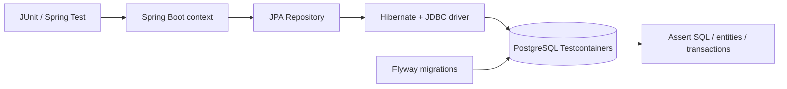

# Testing Repositories, Transactions, and Queries Against the Real Database

A Spring Data JPA repository can pass dozens of unit tests and still break on real PostgreSQL: a JPQL query generates unexpected SQL, a unique constraint fails only at `flush`, a query hits N+1, a transaction commit fails, or two concurrent requests overwrite the same order. These bugs live at the **boundary between Hibernate, the JDBC driver, the database engine, and the transaction manager**. Consequently, mocking repositories or running an embedded database of a different vendor is insufficient to verify production behavior.

Within the **JPA and Hibernate** chapter of `SPRING_BOOT_INTEGRATION`, this lesson covers how to **test repositories, transactions, and queries against the exact database engine** used in deployment. This module wires Spring Boot integrations across HTTP clients, databases, caches, message brokers, and Spring Integration adapters; persistence correctness governs state tracking, message deduplication, outbox writes, and crash recovery. Examples target **Spring Boot 3.2–3.5, Java 17+, Spring Data JPA, Hibernate 6, PostgreSQL, and Testcontainers**. When using other Boot/Hibernate/Testcontainers versions, verify APIs and coordinates against your project's BOM.

## 1. What Needs Testing in the Persistence Layer?

Do not mistake `when(repository.save(...)).thenReturn(...)` for a repository test. Mocking only proves a service **called** a Java method; it exercises no queries, entity mappings, table constraints, or transactions.

| Boundary | Question to Answer | Appropriate Test |
| --- | --- | --- |
| Entity mapping | Do `@Column`, `@Enumerated`, relations, cascades, and primary keys match the real table? | JPA integration test on PostgreSQL with migrated schema. |
| Repository queries | Do JPQL/native SQL queries return the right rows, filter by tenant, sort, and paginate cleanly? | `@DataJpaTest`, control fixtures, assert both positive and negative cases. |
| DB constraints | Do unique, FK, `NOT NULL`, and `CHECK` constraints actually block bad data? | `saveAndFlush`/`flush`, assert DB-level exceptions, verify rollback. |
| Transactions | Do multiple writes commit/roll back together? Does `@Transactional` trigger via proxy? | Integration tests invoking real services outside test-level transactions. |
| Concurrency | Do concurrent transactions updating one row lose updates, deadlock, or time out? | Two concurrent connections and transactions on the real DB. |
| Query performance | Are there N+1s, exploding joins, or unused indexes? | Hibernate statistics, SQL logs, and query plans on representative datasets. |
| System integration | Are business writes and outbox/inbox inserts atomic? | DB transaction tests + broker integration tests at the next layer. |

**Rule of thumb:** choose the lowest test level that still exercises the behavior you need to prove. String normalization fits unit tests; `@Version`, isolation, `FOR UPDATE`, `jsonb`, unique indexes, and transaction commits require the real database.

## 2. Why Match the Production Database Engine?

Tests running on H2 are fast, yet H2 is not PostgreSQL, MySQL, or Oracle. Turning on "PostgreSQL compatibility mode" does not turn H2 into PostgreSQL.

| Difference | Risk of Testing on Another Database |
| --- | --- |
| SQL dialect | `ON CONFLICT`, `RETURNING`, `ILIKE`, CTEs, window functions, or locking clauses behave differently. |
| Data types | `UUID`, `JSONB`, `TIMESTAMPTZ`, arrays, enums, and precision/scale differ in support. |
| Constraints and indexes | Uniqueness with `NULL`s, partial indexes, expression indexes, FKs, and check constraints have different semantics. |
| Transactions / isolation | Default isolation, row locks, deadlock detection, and serialization failures differ. |
| Collations and timezones | Unicode sorting, case sensitivity, and timestamp comparisons can change results. |
| Schema migrations | Flyway/Liquibase run real DDL; Hibernate `ddl-auto=create-drop` can hide missing migrations. |
| Query planner | Logically valid SQL can still crawl on PostgreSQL with realistic data volumes. |

Prefer Testcontainers to run **the same engine and major version** as production. Pin a specific PostgreSQL minor image for reproducibility, upgrading intentionally alongside infrastructure upgrades. A PostgreSQL container approximates production far better than mocks or H2, though it still does not replicate everything: network partitions, production data volumes, extensions, custom collations, replica lag, and hardware limits need dedicated tests where relevant.



## 3. Setting Up Test Dependencies

Maven example for Spring Boot 3.x. The Spring Boot BOM/parent manages compatible versions; check your project's resolved dependency tree:

```xml
<dependencies>
    <dependency>
        <groupId>org.springframework.boot</groupId>
        <artifactId>spring-boot-starter-data-jpa</artifactId>
    </dependency>
    <dependency>
        <groupId>org.postgresql</groupId>
        <artifactId>postgresql</artifactId>
        <scope>runtime</scope>
    </dependency>
    <dependency>
        <groupId>org.flywaydb</groupId>
        <artifactId>flyway-core</artifactId>
    </dependency>
    <!-- For Flyway versions requiring a separate PostgreSQL module: -->
    <dependency>
        <groupId>org.flywaydb</groupId>
        <artifactId>flyway-database-postgresql</artifactId>
    </dependency>

    <dependency>
        <groupId>org.springframework.boot</groupId>
        <artifactId>spring-boot-starter-test</artifactId>
        <scope>test</scope>
    </dependency>
    <dependency>
        <groupId>org.springframework.boot</groupId>
        <artifactId>spring-boot-testcontainers</artifactId>
        <scope>test</scope>
    </dependency>
    <dependency>
        <groupId>org.testcontainers</groupId>
        <artifactId>junit-jupiter</artifactId>
        <scope>test</scope>
    </dependency>
    <dependency>
        <groupId>org.testcontainers</groupId>
        <artifactId>postgresql</artifactId>
        <scope>test</scope>
    </dependency>
</dependencies>
```

The `org.testcontainers:postgresql` coordinate reflects **Testcontainers 1.x**, common in Spring Boot 3.x; newer Testcontainers lines alter certain module artifact names. When using Testcontainers 2.x, check exact coordinates from your BOM/docs rather than mixing versions. Testcontainers requires an active container runtime on developer machines and CI runners.

`@ServiceConnection` (introduced in Spring Boot 3.1) lets Spring Boot derive JDBC URL, username, and password directly from recognized containers. If unavailable or when explicit config is preferred, use `@DynamicPropertySource` for `spring.datasource.url`, `username`, and `password`.

## 4. Using Real Schema Migrations as the Source of Truth

Production normally evolves schemas via Flyway/Liquibase. Tests should run the **exact same migration scripts** as the application rather than letting Hibernate auto-generate tables and only testing queries.

Example `src/main/resources/db/migration/V1__create_order_tables.sql`:

```sql
CREATE TABLE customer_orders (
    id           BIGINT GENERATED BY DEFAULT AS IDENTITY PRIMARY KEY,
    tenant_id    VARCHAR(64) NOT NULL,
    external_ref VARCHAR(80) NOT NULL,
    status       VARCHAR(24) NOT NULL,
    amount_minor BIGINT NOT NULL CHECK (amount_minor >= 0),
    version      BIGINT NOT NULL,
    CONSTRAINT uk_order_tenant_external UNIQUE (tenant_id, external_ref)
);

CREATE INDEX idx_order_tenant_status_id
    ON customer_orders (tenant_id, status, id);

CREATE TABLE order_lines (
    id          BIGINT GENERATED BY DEFAULT AS IDENTITY PRIMARY KEY,
    order_id    BIGINT NOT NULL REFERENCES customer_orders(id),
    sku         VARCHAR(80) NOT NULL,
    quantity    INTEGER NOT NULL CHECK (quantity > 0)
);

CREATE INDEX idx_order_lines_order_id ON order_lines(order_id);
```

In `application-test.yml` or equivalent test configuration:

```yaml
spring:
  jpa:
    hibernate:
      ddl-auto: validate
    open-in-view: false
  flyway:
    enabled: true
```

`validate` makes Hibernate verify entity mappings against the migrated schema; it **does not replace Flyway in creating tables**. If migrations fail, tests should fail fast. Never use `ddl-auto=create`, `create-drop`, or `update` in tests meant to validate real schema migrations, because they silently create objects missing from production scripts.

In Spring Boot, default JPA and DB initialization behavior depends on database type and migration tool presence. Set migration/DDL policies explicitly in test profiles so moving from H2 to PostgreSQL never relies on guesswork.

## 5. End-to-End Entity and Repository Model

### 5.1. Entity with Unique Key, Status, and Optimistic Version

```java
package com.example.orders.persistence;

import jakarta.persistence.*;
import java.util.ArrayList;
import java.util.List;

@Entity
@Table(name = "customer_orders")
public class CustomerOrder {

    @Id
    @GeneratedValue(strategy = GenerationType.IDENTITY)
    private Long id;

    @Column(name = "tenant_id", nullable = false)
    private String tenantId;

    @Column(name = "external_ref", nullable = false)
    private String externalRef;

    @Enumerated(EnumType.STRING)
    @Column(nullable = false)
    private OrderStatus status;

    @Column(name = "amount_minor", nullable = false)
    private long amountMinor;

    @Version
    private Long version;

    @OneToMany(mappedBy = "order", cascade = CascadeType.PERSIST)
    private List<OrderLine> lines = new ArrayList<>();

    protected CustomerOrder() {}

    public CustomerOrder(String tenantId, String externalRef,
                         long amountMinor) {
        this.tenantId = tenantId;
        this.externalRef = externalRef;
        this.amountMinor = amountMinor;
        this.status = OrderStatus.PENDING;
    }

    public void confirm() { this.status = OrderStatus.CONFIRMED; }
    public void cancel() { this.status = OrderStatus.CANCELLED; }
    public void addLine(String sku, int quantity) {
        lines.add(new OrderLine(this, sku, quantity));
    }
    public Long getId() { return id; }
    public String getTenantId() { return tenantId; }
    public String getExternalRef() { return externalRef; }
    public OrderStatus getStatus() { return status; }
    public long getAmountMinor() { return amountMinor; }
    public Long getVersion() { return version; }
    public List<OrderLine> getLines() { return lines; }
}
```

```java
package com.example.orders.persistence;

import jakarta.persistence.*;

public enum OrderStatus { PENDING, CONFIRMED, CANCELLED }

@Entity
@Table(name = "order_lines")
public class OrderLine {
    @Id
    @GeneratedValue(strategy = GenerationType.IDENTITY)
    private Long id;

    @ManyToOne(fetch = FetchType.LAZY, optional = false)
    @JoinColumn(name = "order_id", nullable = false)
    private CustomerOrder order;

    @Column(nullable = false)
    private String sku;

    @Column(nullable = false)
    private int quantity;

    protected OrderLine() {}
    OrderLine(CustomerOrder order, String sku, int quantity) {
        this.order = order;
        this.sku = sku;
        this.quantity = quantity;
    }
    public String getSku() { return sku; }
    public int getQuantity() { return quantity; }
}
```

In Java, `public` top-level types belong in **separate `.java` files**; they are combined here for readability. This minimal code omits full business invariants, input validation, and DTO mapping. Using boxed `Long` for `@Version` lets the provider distinguish unsaved null versions on new entities; version values must be managed by JPA/Hibernate, never accepted from clients.

### 5.2. Repository with Business Queries

```java
package com.example.orders.persistence;

import java.util.Optional;
import org.springframework.data.domain.Page;
import org.springframework.data.domain.Pageable;
import org.springframework.data.jpa.repository.*;
import org.springframework.data.repository.query.Param;
import jakarta.persistence.LockModeType;

public interface CustomerOrderRepository
        extends JpaRepository<CustomerOrder, Long> {

    Optional<CustomerOrder> findByTenantIdAndExternalRef(
            String tenantId, String externalRef);

    long countByTenantIdAndStatus(String tenantId, OrderStatus status);

    @Query("""
           select o from CustomerOrder o
           where o.tenantId = :tenant and o.status = :status
           order by o.id desc
           """)
    Page<CustomerOrder> findPage(
            @Param("tenant") String tenant,
            @Param("status") OrderStatus status,
            Pageable pageable);

    @EntityGraph(attributePaths = "lines")
    @Query("select o from CustomerOrder o where o.id = :id")
    Optional<CustomerOrder> findDetailedById(@Param("id") Long id);

    @Lock(LockModeType.PESSIMISTIC_WRITE)
    @Query("select o from CustomerOrder o where o.id = :id")
    Optional<CustomerOrder> lockById(@Param("id") Long id);
}
```

Repositories only declare read/write operations. Decisions like "who is allowed to read orders for a tenant," "when to confirm," and "when to emit events" belong in services/use cases with dedicated tests. Even with an exposed `findById`, the application layer must still enforce authorization.

## 6. `@DataJpaTest` with PostgreSQL Testcontainers

`@DataJpaTest` loads a focused **slice** covering JPA entities, repositories, transactions, JDBC, and relevant auto-configuration without booting controllers, broker clients, or consumers. This fits verifying mappings, queries, and constraints in a persistence module.

```java
package com.example.orders.persistence;

import static org.junit.jupiter.api.Assertions.*;

import org.junit.jupiter.api.Test;
import org.springframework.beans.factory.annotation.Autowired;
import org.springframework.boot.test.autoconfigure.jdbc.AutoConfigureTestDatabase;
import org.springframework.boot.test.autoconfigure.orm.jpa.DataJpaTest;
import org.springframework.boot.test.autoconfigure.orm.jpa.TestEntityManager;
import org.springframework.boot.testcontainers.service.connection.ServiceConnection;
import org.testcontainers.containers.PostgreSQLContainer;
import org.testcontainers.junit.jupiter.Container;
import org.testcontainers.junit.jupiter.Testcontainers;

@DataJpaTest(properties = {
    "spring.jpa.hibernate.ddl-auto=validate",
    "spring.jpa.open-in-view=false"
})
@AutoConfigureTestDatabase(replace = AutoConfigureTestDatabase.Replace.NONE)
@Testcontainers
class CustomerOrderRepositoryIT {

    @Container
    @ServiceConnection
    static PostgreSQLContainer<?> postgres =
            new PostgreSQLContainer<>("postgres:16-alpine");

    @Autowired TestEntityManager entityManager;
    @Autowired CustomerOrderRepository repository;

    @Test
    void findsOrderWithinItsTenant() {
        CustomerOrder order =
                new CustomerOrder("tenant-a", "checkout-1001", 125_000);
        order.addLine("SKU-42", 2);
        entityManager.persistAndFlush(order);
        entityManager.clear();

        var found = repository.findByTenantIdAndExternalRef(
                "tenant-a", "checkout-1001");

        assertTrue(found.isPresent());
        assertEquals(order.getId(), found.orElseThrow().getId());
        assertTrue(repository.findByTenantIdAndExternalRef(
                "tenant-b", "checkout-1001").isEmpty());
    }
}
```

`@ServiceConnection` wires connection settings from the PostgreSQL container on supported Boot versions; `@AutoConfigureTestDatabase(replace = NONE)` stops Spring Test from replacing it with an embedded database inside the JPA slice. `@Testcontainers` and static `@Container` manage container lifecycle. A real project also requires `flyway-core`/the PostgreSQL module and migration resources to create the tables as shown earlier.

`@DataJpaTest` runs each test inside a transaction that rolls back when the test finishes. That is ideal for isolated query/constraint tests, yet **does not prove service logic actually commits**. Use separate integration tests when verifying real commits, rollbacks on exceptions, multithreading, or broker reactions.

### 6.1. Without `@ServiceConnection`

Replace `@ServiceConnection` with explicit property binding:

```java
@DynamicPropertySource
static void configureDatabase(DynamicPropertyRegistry properties) {
    properties.add("spring.datasource.url", postgres::getJdbcUrl);
    properties.add("spring.datasource.username", postgres::getUsername);
    properties.add("spring.datasource.password", postgres::getPassword);
}
```

Import `DynamicPropertySource` and `DynamicPropertyRegistry` from `org.springframework.test.context`. This is an **alternative**—do not combine both approaches for the same PostgreSQL container. Keep configuration strict so CI fails loudly if Docker is unavailable rather than silently falling back to H2.

## 7. `persist`, `flush`, `clear`, and `commit` Are Distinct

Inside a JPA transaction:

```text
repository.save(entity)
        |
        v
Entity becomes managed in the persistence context
        |
        v
entityManager.flush()
        |
        v
SQL is sent to PostgreSQL within the CURRENT transaction
        |
        v
entityManager.clear() / detach(entity)
        |
        v
Entity is no longer managed; subsequent queries hit JPA/JDBC again
        |
        v
COMMIT or ROLLBACK by the transaction manager
```

**`flush` is not `commit`.** After `flush`, SQL has executed yet the transaction can still roll back. `clear` does not delete DB rows; it clears managed state from the persistence context. Both operations are indispensable in tests so assertions hit the real database instead of passing solely because Hibernate served an entity from the first-level cache.

| Operation | Meaning | When to Use in Tests |
| --- | --- | --- |
| `save(entity)` | Persists or merges entity; may issue immediate SQL under `IDENTITY` | Standard fixture setup. |
| `saveAndFlush(entity)` | Saves and forces flush | Verifying constraints, subsequent updates, current version. |
| `entityManager.flush()` | Synchronizes managed changes to the DB within the transaction | Forcing DB SQL execution prior to assertions. |
| `entityManager.clear()` | Evicts all managed entities | Forcing fresh reads from the DB via queries. |
| `entityManager.refresh(entity)` | Reloads state from the DB into a managed entity | Verifying out-of-context updates depending on scenario. |
| Transaction commit | Persists changes durably once transaction completes | Real service tests verified from a fresh connection. |
| Transaction rollback | Discards uncommitted changes | Testing exceptions, constraint failures, and atomicity. |

With `GenerationType.IDENTITY`, Hibernate may execute `INSERT` immediately upon `persist`/`save` to retrieve the generated ID, so never assume "no flush means no SQL." Even then, `flush` remains useful to ensure all pending changes reached the DB before asserting.

## 8. Testing Queries: Results, Tenant Isolation, and Pagination

A worthwhile query test seeds **confounding rows**, not just one matching row. For example:

| Tenant | External Ref | Status | Amount |
| --- | --- | --- | --- |
| `tenant-a` | `ord-a-01` | `PENDING` | 10,000 |
| `tenant-a` | `ord-a-02` | `CONFIRMED` | 20,000 |
| `tenant-a` | `ord-a-03` | `CONFIRMED` | 30,000 |
| `tenant-b` | `ord-b-01` | `CONFIRMED` | 40,000 |

After saving these rows and calling `flush`/`clear`, testing `findPage("tenant-a", CONFIRMED, PageRequest.of(0, 1))` must verify:

- `totalElements == 2`, independent of page size.
- Page 0 returns one `tenant-a` row with status `CONFIRMED`.
- `order by id desc` matches the database-assigned ID order.
- Page 1 contains the remaining row, with zero `tenant-b` leakage.
- Non-matching filters return an empty page with `totalElements == 0`.

Example:

```java
@Test
void pagesOnlyMatchingTenantOrders() {
    repository.save(new CustomerOrder("tenant-a", "ord-a-01", 10_000));
    CustomerOrder second =
            repository.save(new CustomerOrder("tenant-a", "ord-a-02", 20_000));
    second.confirm();
    CustomerOrder third =
            repository.save(new CustomerOrder("tenant-a", "ord-a-03", 30_000));
    third.confirm();
    CustomerOrder other =
            repository.save(new CustomerOrder("tenant-b", "ord-b-01", 40_000));
    other.confirm();

    repository.flush();
    entityManager.clear();

    Page<CustomerOrder> first = repository.findPage(
            "tenant-a", OrderStatus.CONFIRMED, PageRequest.of(0, 1));

    assertEquals(2, first.getTotalElements());
    assertEquals(1, first.getContent().size());
    assertEquals("ord-a-03", first.getContent().get(0).getExternalRef());

    Page<CustomerOrder> next = repository.findPage(
            "tenant-a", OrderStatus.CONFIRMED, PageRequest.of(1, 1));
    assertEquals("ord-a-02", next.getContent().get(0).getExternalRef());
}
```

This test sits inside `CustomerOrderRepositoryIT` above; import `Page` and `PageRequest`. Never rely on natural DB ordering without an `ORDER BY` clause: PostgreSQL makes no row-order guarantee without explicit sorting.

### JPQL vs. Native SQL Queries

JPQL references **Java entity and property names** such as `o.tenantId`; native SQL references **physical tables and columns** such as `customer_orders.tenant_id`. Whenever testing native queries using `jsonb`, `ILIKE`, upserts, or `FOR UPDATE SKIP LOCKED`, run on a production-compatible DB engine because H2 masks dialect differences.

Also test `NULL`s, empty strings, multiple tenants, Unicode, timezones, boundary numbers (`BIGINT`, precision), and DTO projections if exposed by APIs. A query that looks right on 3 rows can still break on duplicate joins or pagination.

## 9. Testing Database Constraints and Exceptions

Constraints must live in the database, especially with concurrent instances or consumers. Java validation improves error messages, yet two requests can both pass an "already exists?" check and insert simultaneously.

Example unique constraint `(tenant_id, external_ref)`:

```java
@Test
void databaseRejectsDuplicateExternalReference() {
    repository.saveAndFlush(
            new CustomerOrder("tenant-a", "checkout-dup", 10_000));
    entityManager.clear();

    assertThrows(DataIntegrityViolationException.class, () -> {
        repository.save(
                new CustomerOrder("tenant-a", "checkout-dup", 20_000));
        repository.flush();
    });
}
```

Import `org.springframework.dao.DataIntegrityViolationException`. Once PostgreSQL raises a constraint error, the current transaction enters an **aborted state**. Never run follow-up queries in **the same transaction** after asserting the exception expecting valid reads. To inspect state after rollback, open a fresh transaction outside the failed one.

Other important constraints:

```sql
-- CHECK: rejects negative amount
INSERT INTO customer_orders
    (tenant_id, external_ref, status, amount_minor, version)
VALUES ('tenant-a', 'negative', 'PENDING', -1, 0);

-- FK: rejects non-existent order_id
INSERT INTO order_lines (order_id, sku, quantity)
VALUES (999999, 'SKU-1', 1);
```

These statements are **expected to fail** on the schema in Section 4; execute them in separate transactions/tests and assert SQLState/constraint violations as required. In PostgreSQL, unique violations use SQLState `23505`, FKs `23503`, check constraints `23514`, and not-null `23502`. If application code maps these exceptions to HTTP 409/422 or non-retryable broker errors, test that error-translation policy at the service/adapter layer too.

Note that constraints can be checked at different times, especially `DEFERRABLE` constraints; `flush` alone may not prove **commit** succeeds. Write dedicated commit tests for any deferred constraints.

## 10. Testing Real Transactions: Don't Let Test Transactions Mask Bugs

A common misconception:

```java
@DataJpaTest
class RepositoryTest {
    @Test
    void test() {
        repository.save(...);
        // Test runs by default inside a transaction rolled back at test end.
    }
}
```

This suits repository tests, yet **does not prove** a use case commits data when invoked through a Spring proxy. Commit-time failures, `@TransactionalEventListener(phase = AFTER_COMMIT)`, and visibility to other connections can all be masked.

To test service transactions, use `@SpringBootTest` with PostgreSQL Testcontainers and **do not put `@Transactional` on the test method or class**. The real service holds `@Transactional`, so the database commits when the service method returns cleanly. Example:

```java
@Service
public class OrderWriteService {
    private final CustomerOrderRepository repository;

    public OrderWriteService(CustomerOrderRepository repository) {
        this.repository = repository;
    }

    @Transactional
    public Long create(String tenant, String ref, long amountMinor) {
        CustomerOrder order =
                repository.save(new CustomerOrder(tenant, ref, amountMinor));
        return order.getId();
    }

    @Transactional
    public void createThenFail(String tenant, String ref) {
        repository.save(new CustomerOrder(tenant, ref, 10_000));
        repository.flush(); // SQL executed; still uncommitted.
        throw new IllegalStateException("Simulated application failure");
    }
}
```

And an application-level test:

```java
@SpringBootTest(properties = "spring.jpa.hibernate.ddl-auto=validate")
@Testcontainers
class OrderTransactionIT {
    @Container
    @ServiceConnection
    static PostgreSQLContainer<?> postgres =
            new PostgreSQLContainer<>("postgres:16-alpine");

    @Autowired OrderWriteService service;
    @Autowired CustomerOrderRepository repository;

    @Test
    void createCommitsAndCanBeReadAfterReturn() {
        Long id = service.create("tenant-a", "committed-01", 10_000);

        assertTrue(repository.findById(id).isPresent());
    }

    @Test
    void failureRollsBackEvenAfterFlush() {
        assertThrows(IllegalStateException.class, () ->
                service.createThenFail("tenant-a", "rolled-back-01"));

        assertTrue(repository.findByTenantIdAndExternalRef(
                "tenant-a", "rolled-back-01").isEmpty());
    }
}
```

Place these classes in separate `.java` files with appropriate imports; use `@AutoConfigureTestDatabase(replace = NONE)` if building a JPA slice instead of full `@SpringBootTest`. With full `@SpringBootTest`, `@ServiceConnection` configures the connection automatically for supported Boot stacks.

Each test here should use a unique `externalRef` and controlled cleanup (isolated schema/container or explicit fixture cleanup) to avoid cross-test interference. Calling `findById` after `service.create` returns runs outside the service transaction, proving commit at the DB level. Make sure no base test class injects an inherited `@Transactional` wrapping the test.

### Easily Overlooked Transaction Edge Cases

| Scenario | What to Verify |
| --- | --- |
| Internal call `this.saveInTransaction()` | Self-invocation normally bypasses the Spring AOP proxy; callee `@Transactional` may not apply. |
| `@Transactional` on a `private` method | Proxies do not manage transactions as expected. |
| Checked exceptions | Under Spring defaults, not all checked exceptions roll back; use `rollbackFor` when needed. |
| `@Transactional(readOnly = true)` | An optimization hint for transaction/provider, not a security mechanism blocking writes on every DB. |
| `@Transactional(propagation = REQUIRES_NEW)` | Can commit an independent transaction even if the outer transaction rolls back; test separately. |
| Multiple `PlatformTransactionManager`s | Must select the right manager by name/qualifier; one local transaction never spans two independent DBs. |
| Post-commit / async callbacks | Callbacks can run outside the original transaction; use an outbox if side effects must survive crashes. |

## 11. Testing Optimistic Locking and Lost Updates

`@Version` lets Hibernate detect when an entity loaded at an older version was updated concurrently by another transaction. For standard updates, Hibernate emits `UPDATE ... WHERE id=? AND version=?`; zero affected rows signals an optimistic lock conflict.

Example scenario:

```text
T1 reads order-1, version=2
T2 reads order-1, version=2
T1 updates status=CONFIRMED, commits -> version=3
T2 attempts update status=CANCELLED from version=2
  -> Hibernate detects stale version; T2 must roll back / retry in business logic
```

A test can load two **detached entity copies** at the initial version, update and commit one, then try merging the stale copy. To prove real production concurrency, however, write an integration test with **two threads and two independent transactions** reading the same version and racing to commit. Assertions:

- Exactly one update commits for the same starting version.
- The stale update raises `OptimisticLockException` or Spring's `OptimisticLockingFailureException`.
- Any retry logic **reloads fresh state and re-checks business invariants** instead of blindly calling `save()` again with stale state.
- Final state and `version` are accurate, with no silent "last writer wins."

Avoid asserting a hyper-specific exception class if framework translation differs between `flush` and commit. Assert the optimistic-locking exception family and inspect committed state in a fresh transaction.

### Pessimistic Locking and `FOR UPDATE`

The repository method `lockById(...)` uses `@Lock(PESSIMISTIC_WRITE)` and must run inside an active transaction. While T1 holds the row lock, T2 must wait, time out, or fail according to PostgreSQL/JPA lock timeout policies. Only a test using two real connections proves this behavior.

Structure the test with `CountDownLatch`/barriers:

1. T1 starts a transaction, calls `lockById(orderId)`, and holds the transaction open.
2. T2 starts a separate transaction and calls `lockById(orderId)` or a competing `UPDATE`.
3. Verify T2 blocks while T1 holds the lock; once T1 commits, T2 proceeds or fails per configured timeout/rules.
4. Verify final DB state and lock-wait/deadlock logs if needed.

Avoid timing tests around fixed `Thread.sleep` durations; use latches and bounded test timeouts. When testing `NOWAIT`, `SKIP LOCKED`, or isolation levels, use native SQL on real PostgreSQL. You can set `SET LOCAL lock_timeout = '...'` inside test transactions so tests never hang indefinitely.

## 12. Transaction Isolation and Two-Connection Tests

Isolation levels govern visibility between concurrent transactions. PostgreSQL defaults to `READ COMMITTED`; stricter levels follow distinct rules and can raise serialization errors requiring full-transaction retries.

| Anomaly | Example | Suggested Test |
| --- | --- | --- |
| Lost update | Two workers read the same count and write new values | `@Version` / conditional update prevents overwrite; assert version. |
| Non-repeatable read | T1 reads a row twice while T2 commits an update in between | Compare `READ COMMITTED` vs. stricter levels when required. |
| Phantom / aggregate invariant | Two transactions both check an aggregate cap before inserting | Use unique/exclusion constraints, locking, or serializable; test concurrency. |
| Deadlock | T1 locks A then B; T2 locks B then A | Enforce deterministic lock ordering, timeouts, and bounded retries. |
| Serialization failure | Two `SERIALIZABLE` transactions conflict | Verify one rolls back cleanly and the use case safely retries the whole transaction. |

In PostgreSQL, SQLState `40001` signals a serialization failure and `40P01` signals a deadlock. Retries must run after rollback inside a **fresh transaction**, with bounded attempts, backoff, and idempotent side effects. Never catch the error and issue more SQL on a PostgreSQL transaction already marked failed.

**Note:** never run isolation tests inside an outer `@DataJpaTest` transaction and spin up two `CompletableFuture` tasks assuming they behave properly. Spring transactions are normally thread-bound; each worker thread must start its own real transaction via a service proxy or `TransactionTemplate` with the right transaction manager.

## 13. Testing N+1, Fetch Plans, and Query Counts

A repository can return accurate results while crawling because `LAZY` associations are queried row by row.

```java
List<CustomerOrder> orders = repository.findAll();
for (CustomerOrder order : orders) {
    System.out.println(order.getLines().size());
}
```

With N orders where each `lines` access triggers a query, Hibernate issues **1 query for orders + N queries for lines**. In integration tests, count SQL only after `flush` and `clear` on setup fixtures; otherwise the first-level cache can falsely make N+1 disappear.

Example using Hibernate statistics:

```java
EntityManagerFactory emf = entityManager.getEntityManager()
        .getEntityManagerFactory();
SessionFactory sessionFactory = emf.unwrap(SessionFactory.class);
Statistics statistics = sessionFactory.getStatistics();
statistics.setStatisticsEnabled(true);

entityManager.flush();
entityManager.clear();
statistics.clear();

CustomerOrder detailed =
        repository.findDetailedById(orderId).orElseThrow();
int lineCount = detailed.getLines().size();

long preparedStatements = statistics.getPrepareStatementCount();
assertEquals(expectedLineCount, lineCount);
assertTrue(preparedStatements <= 2);
```

This snippet runs inside a configured JPA test with `EntityManagerFactory`, `SessionFactory`, `Statistics`, `orderId`, and `expectedLineCount` defined. The `<= 2` bound is a **test-chosen threshold for one detailed order**, not a guarantee across every Hibernate version. Since Hibernate statistics belong to the `SessionFactory`, parallel tests can interfere with counters; isolate tests or use a scoped datasource query counter for strict assertions.

For paginated order lists, **never** unconditionally join-fetch to-many collections. Joined SQL multiplies rows and forces Hibernate to warn or paginate in memory. Better options:

1. Use DTO projections selecting only list columns.
2. Fetch a page of order IDs, then fetch lines for those IDs.
3. Use targeted `@EntityGraph` for single-aggregate details.
4. Evaluate batch fetching while verifying real SQL, row counts, and memory.

Never assert query counts alone; measure execution time, bytes read, result sizes, connection utilization, and latency on larger datasets too.

## 14. Query Plans, Indexes, and Representative Test Data

Hibernate translates JPQL into SQL. SQL that flies on 10 rows can stall on millions of rows. When a repository drives polling, deduplication, or high-traffic APIs, query plans become part of operational readiness.

Example query:

```sql
SELECT id, external_ref, amount_minor
FROM customer_orders
WHERE tenant_id = 'tenant-a'
  AND status = 'CONFIRMED'
ORDER BY id DESC
LIMIT 20;
```

Test on a **test database** with a representative dataset:

```sql
EXPLAIN (ANALYZE, BUFFERS)
SELECT id, external_ref, amount_minor
FROM customer_orders
WHERE tenant_id = 'tenant-a'
  AND status = 'CONFIRMED'
ORDER BY id DESC
LIMIT 20;
```

`EXPLAIN ANALYZE` **executes** the query to measure it, so run it only in safe environments and take care with write statements. Inspect index `idx_order_tenant_status_id`, scanned rows, sorts, buffers, and actual execution time. On tiny tables the planner rightly chooses sequential scans; tests should not fail just because `Index Scan` didn't appear on 10 rows.

More reliable performance checks:

- Seed thousands of rows with realistic tenant/status distributions and run `ANALYZE`.
- Use generous time thresholds in CI, or run benchmarks/query-plan checks in a dedicated periodic pipeline.
- Compare regressions when adding fetch graphs or changing indexes/migrations.
- Verify `tenant_id` predicates appear in every tenant-isolated query.

Avoid making **tight millisecond** timings mandatory assertions on shared CI runners where hardware and noisy neighbors vary. Use plans/logs for diagnosis and functional tests for deterministic correctness.

## 15. Temporal Types, Money, and Native Database Types

Persistence bugs frequently hide at data-type boundaries:

| Data | What to Test on the Real DB |
| --- | --- |
| `Instant`/`TIMESTAMPTZ` | The same instant round-trips consistently across differing JVM and DB session timezones. |
| `LocalDate` | Dates do not shift across timezones or wrong type mappings. |
| `BigDecimal`/`NUMERIC(p,s)` | Precision, scale, rounding, and overflow match monetary contracts. |
| `long` minor-unit amounts | `BIGINT` bounds, nonnegative checks, controlled unit conversions. |
| `UUID` | Indexes, queries, and serialization use native types without relying on H2 implicit casts. |
| `JSONB` | Missing keys, `null`s, arrays, and PostgreSQL operators work in native queries. |
| Collations / casing | `LIKE`, `ILIKE`, Unicode, and unique keys obey intended matching rules. |

For example, when an API accepts offset timestamps and stores `Instant`, test inputs across multiple timezones representing **the exact same UTC instant**. Never compare `LocalDateTime` assuming UTC unless the contract specifies it.

## 16. With Multiple DataSources, Tests Must Verify the Target Database

A Spring Boot integration may write orders to `orders_db` while writing audit/inbox/outbox records to another database or schema. `@Primary` only picks a default bean for injection; it does not ensure every repository binds to the right `EntityManagerFactory`.

In multi-persistence-unit configs, repositories are typically bound explicitly:

```java
@EnableJpaRepositories(
    basePackages = "com.example.orders.persistence",
    entityManagerFactoryRef = "ordersEntityManagerFactory",
    transactionManagerRef = "ordersTransactionManager")
class OrdersJpaRepositoriesConfig {
    // DataSource, EntityManagerFactory, and transaction manager
    // beans are explicitly declared in the full configuration.
}
```

When testing:

- Spin up PostgreSQL containers/schemas matching each production target; confirm each target's migrations run in the right place.
- Verify the actual JDBC URL, schema, and account privileges used by each repository so nothing accidentally hits H2 or the wrong database.
- Specify `@Transactional("ordersTransactionManager")` when targeting orders, and the audit manager explicitly when targeting audit.
- Never assume one local `@Transactional` commits or rolls back `orders_db` and `audit_db` atomically. When cross-DB/broker consistency is needed, build outboxes, sagas, or explicit coordination and test failure windows.

`@DataJpaTest` is designed for a single persistence slice; with multiple `DataSource`/`EntityManagerFactory` beans, configure selective test slices or use `@SpringBootTest` mirroring production wiring. Throwing every repository into one test context backed by a single H2 datasource can hide cross-wiring bugs.

## 17. Inbox, Outbox, and Transactions in Integration Flows

Suppose a consumer receives `OrderConfirmed(eventId=evt-19)`, updates `customer_orders`, and inserts an inbox marker into `processed_event`. If both run in **the same PostgreSQL transaction**, either failure rolls back both.

```sql
CREATE TABLE processed_event (
    consumer_name VARCHAR(80) NOT NULL,
    event_id      VARCHAR(100) NOT NULL,
    processed_at  TIMESTAMPTZ NOT NULL DEFAULT CURRENT_TIMESTAMP,
    PRIMARY KEY (consumer_name, event_id)
);
```

Logical flow:

```text
BEGIN transaction
  INSERT INTO processed_event(consumer_name, event_id)
  VALUES ('order-projection-v1', 'evt-19')
  ON CONFLICT DO NOTHING
  -> affected rows = 0: already processed; skip side effect
  -> affected rows = 1: UPDATE customer_orders ... with state/version guard
COMMIT
ACK broker after transaction completes
```

Note: if `UPDATE customer_orders` fails a state-transition guard, the service must decide whether to roll back or record a meaningful rejection. Never mark the inbox "done" and silently drop an unprocessed event. If the broker redelivers after DB commit and before ACK, the consumer sees the existing inbox entry and can ACK without repeating side effects.

Similarly, when a producer updates an order and needs to emit an event, persist an **outbox** record in the same transaction; a separate publisher sends to the broker and records publish status. DB-level transaction tests prove `order row + outbox row` commit/roll back together; broker-level tests prove redelivery/idempotency. A standalone JPA test **does not prove end-to-end exactly-once delivery** across database and broker.

## 18. Organizing a Fast, Accurate, Easy-to-Diagnose Test Suite

| Test Suite | Tooling / Context | Scope |
| --- | --- | --- |
| Domain / unit | Plain JUnit without Spring | Invariants, calculations, exception classification. |
| Repository integration | `@DataJpaTest` + PostgreSQL Testcontainers | Entities, JPQL, native SQL, constraints, fetch plans. |
| Service transaction integration | `@SpringBootTest` or selective context + real DB | Commits, rollbacks, propagation, transaction managers. |
| Concurrency integration | Real DB + two connections/transactions | Locks, deadlocks, optimistic versions, isolation. |
| Adapter / broker integration | DB + RabbitMQ/Kafka/Pulsar container | ACK after commit, redelivery, inbox/outbox. |
| Query performance | PostgreSQL with representative data | Query plans, indexes, N+1, pagination, throughput. |

Keep fixtures small and purposeful. Use `TestEntityManager` or repositories to seed via real mappings; use JDBC or `@Sql` when verifying independent migration DDL/constraints. Never manually build schemas in tests whose goal is validating production Flyway/Liquibase migrations.

### Keeping Tests Independent

- Give each test its own `tenant` / `externalRef` so unique constraints never collide across tests.
- Repository tests usually roll back; commit-verifying tests need explicit schema/database/fixture cleanup.
- When reusing a singleton container across contexts, state persists across tests; manage lifecycle and cleanup carefully.
- Do not slap `@DirtiesContext` onto every test just to clear rows: restarting contexts wastes time and does not substitute for data isolation.
- Concurrency tests need explicit timeouts and `finally` cleanup for latches/threads even when assertions fail.
- Don't require Docker for tests that pure Java unit tests can verify; run DB integration suites in CI with container support ready.

## 19. Common Failures and Diagnostics

| Symptom | Possible Cause | Resolution |
| --- | --- | --- |
| H2 passes, production PostgreSQL throws syntax error | Dialect-specific native query | Testcontainers with the real DB, driver, and SQL. |
| Hibernate creates tables yet Flyway missed a table | `ddl-auto=create` in tests | Run real migrations + `ddl-auto=validate`. |
| Duplicate fails to throw in test | Missing flush or missing unique constraint | Call `saveAndFlush`/`flush`; verify DDL constraint. |
| Test passes even though query should hit DB | Entity served from persistence context | Call `flush` then `clear`, then re-query. |
| Test treats `flush` as `commit` | Confusing flush with commit | Assert in a new transaction after service returns. |
| `@Transactional` service fails to roll back | Self-invocation, checked exception, wrong manager | Invoke via bean proxy; verify rollback rules. |
| Subsequent query fails after unique violation | PostgreSQL transaction already aborted | Roll back and start a fresh transaction before querying again. |
| N+1 appears on order list | Mapper accesses lazy collection | Use projections, entity graphs/fetch plans, and count SQL. |
| Slow pagination or in-memory pagination warnings | To-many join fetch combined with paging | Two-phase queries or projections; inspect plan and row counts. |
| `OptimisticLockException` in prod, never seen in tests | Test used a single transaction/managed entity | Test with two independent transactions using stale version. |
| `PessimisticLockException` / timeout | Row-lock contention or inconsistent lock order | Log wait times, configure timeouts, standardize lock order. |
| Passes in isolation, fails in full suite | Shared container state, test order, concurrent fixtures | Isolate test data and make cleanup deterministic. |
| Message ACKed despite DB rollback | Wrong boundary between ACK and commit | Run broker integration tests; commit before ACK. |
| Audit persisted while order rolled back | Two DBs with separate transaction managers | Define consistency requirements; use outbox/saga as appropriate. |

## 20. Checklist and Practice Exercise

Before considering a repository and persistence flow production-ready, verify:

- [ ] Tests match production's database engine/major version, driver, schema, collation, and key extensions.
- [ ] Flyway/Liquibase runs real migrations; Hibernate uses `validate` rather than generating schemas for those tests.
- [ ] Tests cover tenant-scoped queries, empty results, pagination/sorting, projections, and edge inputs.
- [ ] Tests exercise unique/FK/check constraints, including `flush` and rollback behavior.
- [ ] Tests verify real service **commits** and **rollbacks** outside default test transactions.
- [ ] `@Transactional` executes through Spring bean proxies with the right transaction manager, propagation, and rollback rules.
- [ ] Concurrency tests cover optimistic/pessimistic locking across two independent transactions when concurrent writes apply.
- [ ] N+1, fetch plans, and query plans are inspected on suitably sized datasets.
- [ ] Native queries and PostgreSQL-specific types run against real PostgreSQL.
- [ ] Inbox/outbox, checkpoints, and business state transitions have atomic commit/rollback tests.
- [ ] Tests are isolated with deterministic cleanup, and CI has capacity for container-based tests.

**Exercise:** Build `CustomerOrder`, `OrderLine`, `CustomerOrderRepository`, and the PostgreSQL migration from the examples. Write a `@DataJpaTest` using Testcontainers proving: (1) querying by `tenantId + externalRef` isolates tenants; (2) the unique constraint blocks duplicate external refs within the same tenant while allowing the same ref in another tenant; (3) `CONFIRMED` pagination returns exact counts and ordering; (4) `findDetailedById` loads `lines` with bounded SQL. Next, write a `@SpringBootTest` without an outer test transaction verifying `OrderWriteService` commits and rolls back after `flush`. Finally, create two transactions reading the same stale version to prove optimistic locking rejects one writer, and pass a message with a fixed `eventId` twice through an inbox handler to prove redelivery never applies the business mutation twice.

When tests genuinely flow through Hibernate, JDBC, database migrations, and the transaction manager on the real database engine, you catch mismatches that mocks or substitute databases miss. That foundation enables Spring Boot integration flows to store state accurately, handle concurrency safely, and recover reliably from retries, crashes, and redelivered messages.
