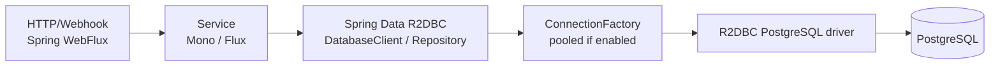

# R2DBC, ConnectionFactory, and How It Differs from JDBC DataSource

> **Chapter:** Reactive Data  
> **Scope:** System integration in Spring Boot (Spring Boot Integration).

## 1. The problem: accessing a relational database in a reactive integration flow

Suppose a Spring Boot system receives webhooks from a partner, stores events in PostgreSQL, checks whether an event has already been received, and then continues processing or forwards it to a broker. An HTTP flow using Spring WebFlux can represent incoming data as a `Mono` or `Flux`. However, if the persistence layer executes synchronous JDBC calls directly on the event-loop thread, database wait time can hold that thread for too long and degrade the application's ability to serve other requests.

**R2DBC (Reactive Relational Database Connectivity)** provides a reactive interface for accessing relational databases. In Spring Boot, `ConnectionFactory` is the entry point for obtaining R2DBC connections, corresponding in *connection-creation role* to JDBC's `DataSource`, but differing completely in API and execution model.

After completing this lesson, you should be able to:

- Explain the execution flow across Spring WebFlux, Spring Data R2DBC, the R2DBC driver, and the database.
- Distinguish `io.r2dbc.spi.ConnectionFactory` from `javax.sql.DataSource`, as well as their accompanying transaction managers.
- Configure and use R2DBC in Spring Boot to persist integration data with deduplication protection.
- Identify limitations around transactions, connection pools, migrations, retries, and observability.
- Choose R2DBC or JDBC based on real architectural needs rather than assuming reactive is always faster.

## 2. What is R2DBC?

R2DBC is an **SPI (Service Provider Interface)** for relational databases, designed so that drivers can perform I/O without blocking the calling thread (non-blocking) and emit results via `org.reactivestreams.Publisher`. It applies to SQL and relational databases; R2DBC **does not turn** PostgreSQL/MySQL into a non-relational database and **is not** an ORM replacement for Hibernate/JPA.

Components to distinguish:

| Component | Responsibility |
|---|---|
| `ConnectionFactory` | Provides publishers that create `Connection` instances and connection metadata; the central abstraction of the R2DBC SPI. |
| R2DBC driver | Implements the protocol and specific characteristics of a given database, such as PostgreSQL. |
| `Connection`, `Statement`, `Result` | Low-level SPI for executing SQL, binding parameters, and reading results. |
| Spring `DatabaseClient` | Fluent SQL API returning `Mono`/`Flux` that manages acquiring and releasing connections for standard operations. |
| Spring Data R2DBC | Entity mapping, `R2dbcEntityTemplate`, reactive repositories; does not provide the full ORM feature set of JPA. |
| `R2dbcTransactionManager` | Manages reactive transactions via a `ConnectionFactory`, binding the connection to the Reactor Context. |
| Connection pool (optional) | Reuses physical connections and limits concurrent connections to the database. |

### 2.1. When is data actually queried?

A `Mono` or `Flux` from `DatabaseClient` typically describes work that happens upon **subscription**. Simply creating a publisher without anything subscribing to it does not execute the query. In a WebFlux application, the framework normally subscribes to the publisher returned by a controller; in tests, `StepVerifier` can subscribe.

```java
Mono<Long> count = databaseClient.sql("SELECT COUNT(*) AS total FROM integration_inbox")
    .map((row, metadata) -> row.get("total", Long.class))
    .one();

// block() or subscribe() is not called here.
// WebFlux can subscribe if this publisher is returned from an appropriate handler.
```

Reactive prevents application threads from sitting idle waiting on I/O in the traditional JDBC style. Even so, **SQL queries still consume resources and time on the database**. Backpressure helps coordinate data flow between publishers and subscribers; it does not automatically make queries cheaper, guarantee response times, or eliminate the need to bound the number of connections.

### 2.2. A typical execution flow



When using `DatabaseClient` or repositories, let Spring manage the connection lifecycle. If you use the `ConnectionFactory.create()` SPI directly, the developer must handle the full connection lifecycle, closing connections, errors, and transactions; opening a connection manually and forgetting to close it will exhaust the pool.

## 3. Comparing R2DBC ConnectionFactory and JDBC DataSource

Both abstractions provide database connectivity, but they are **not directly interchangeable**.

| Criterion | R2DBC `ConnectionFactory` | JDBC `DataSource` |
|---|---|---|
| API type | `io.r2dbc.spi.ConnectionFactory` | `javax.sql.DataSource` |
| Acquiring a connection | `create()` returns `Publisher<? extends Connection>` | `getConnection()` returns `java.sql.Connection` |
| I/O model | Reactive, non-blocking oriented depending on driver | Synchronous API; SQL calls typically block the executing thread |
| Result handling | `Publisher`, via `Mono`/`Flux` in Spring | `ResultSet`, collections, or synchronous objects |
| Common access layer | `DatabaseClient`, `R2dbcEntityTemplate`, `ReactiveCrudRepository` | `JdbcTemplate`, Spring Data JDBC, JPA/Hibernate |
| Transaction manager | `R2dbcTransactionManager` (Reactor Context) | `DataSourceTransactionManager`/`JdbcTransactionManager` (thread-bound); JPA commonly uses `JpaTransactionManager` |
| Spring Boot configuration | `spring.r2dbc.*`, URL starts with `r2dbc:` | `spring.datasource.*`, URL starts with `jdbc:` |
| Ecosystem | Requires a matching R2DBC driver; not all driver/JPA features exist | Mature JDBC/JPA ecosystem, migration tools, and wide driver support |
| Best fit | End-to-end reactive I/O pipelines, high concurrency, and compatible drivers | Spring MVC/JPA applications, synchronous logic, or integration with JDBC-only libraries |

Illustrative notation for both access styles:

```java
// JDBC: acquire Connection via a synchronous call.
try (java.sql.Connection connection = dataSource.getConnection()) {
    // Create PreparedStatement, executeQuery / executeUpdate ...
}

// R2DBC: create a publisher for the connection (SPI illustration).
org.reactivestreams.Publisher<? extends io.r2dbc.spi.Connection> connections =
    connectionFactory.create();
// Must subscribe and close Connection properly when handling the SPI directly.
```

**Common misconception:** `spring-boot-starter-data-r2dbc` does not make `JpaRepository` reactive. Similarly, simply swapping `DataSource` for `ConnectionFactory` will not convert a `JdbcTemplate` or `EntityManager` to R2DBC. Migrating requires reviewing data access APIs, repositories, transactions, and every blocking call along the execution path.

## 4. Configuring R2DBC in Spring Boot

The example below uses **PostgreSQL**, Spring WebFlux, and Spring Data R2DBC. Dependencies should use versions managed by the active Spring Boot BOM; the driver must be compatible with the project's Spring Boot/R2DBC SPI and PostgreSQL versions.

### 4.1. Dependencies

```gradle
dependencies {
    implementation("org.springframework.boot:spring-boot-starter-webflux")
    implementation("org.springframework.boot:spring-boot-starter-data-r2dbc")
    runtimeOnly("org.postgresql:r2dbc-postgresql")
    implementation("org.springframework.boot:spring-boot-starter-actuator")
}
```

The dependencies above use Gradle Groovy DSL syntax. If the application does not serve HTTP via WebFlux, you do not need the WebFlux starter just to run R2DBC. When using pooling, verify that `r2dbc-pool` is on the classpath and supported by your Spring Boot version.

### 4.2. application.yml

```yaml
spring:
  r2dbc:
    url: r2dbc:postgresql://localhost:5432/integration_db
    username: ${DB_USER}
    password: ${DB_PASSWORD}
    pool:
      enabled: true
      initial-size: 5
      max-size: 20
      max-idle-time: 30m
```

`spring.r2dbc.url` specifies the protocol and database, while `spring.r2dbc.username/password` are read from environment variables. Do not embed real passwords in the repository or configuration logs. Set `max-size` based on the database's connection budget **shared across all instances**, not by the number of HTTP requests.

When a `ConnectionFactory` is present, Spring Boot may prioritize R2DBC auto-configuration and prevent the standard JDBC `DataSource` auto-configuration from activating. If the application needs **both**, configure each connection source explicitly, define separate transaction managers, and verify the auto-configuration conditions for your version. Do not assume that declaring both `spring.r2dbc.*` and `spring.datasource.*` will always create both beans automatically.

### 4.3. Illustrative schema for deduplication

Suppose each partner webhook carries a stable event ID. The inbox table has a unique constraint on `(partner, message_id)`:

```sql
CREATE TABLE integration_inbox (
    id BIGSERIAL PRIMARY KEY,
    partner VARCHAR(80) NOT NULL,
    message_id VARCHAR(160) NOT NULL,
    payload TEXT NOT NULL,
    received_at TIMESTAMPTZ NOT NULL DEFAULT NOW(),
    CONSTRAINT uq_inbox_partner_message UNIQUE (partner, message_id)
);
```

This constraint is the **data-level deduplication mechanism**: two concurrent requests with the same key cannot both insert a record. Performing a `SELECT` check followed by an `INSERT` without a unique constraint still leaves a race condition.

For production environments, manage schemas using versioned migrations (Flyway/Liquibase or an equivalent process). Many migration tools use **JDBC**, so you must configure a separate migration driver/connection if the main application only uses R2DBC. Startup schema initialization can be handy for demos, but it does not replace a migration and rollback strategy.

## 5. End-to-end example: recording a webhook once with DatabaseClient

In PostgreSQL, `INSERT ... ON CONFLICT DO NOTHING` combined with a unique constraint provides an idempotent write at the inbox level. This example intentionally uses `DatabaseClient` to make the SQL, parameter binding, and publisher result explicit.

```java
import org.springframework.r2dbc.core.DatabaseClient;
import org.springframework.stereotype.Service;
import reactor.core.publisher.Mono;

@Service
public class InboxService {
    private final DatabaseClient databaseClient;

    public InboxService(DatabaseClient databaseClient) {
        this.databaseClient = databaseClient;
    }

    public Mono<Boolean> storeOnce(String partner, String messageId, String payload) {
        return databaseClient.sql("""
                INSERT INTO integration_inbox (partner, message_id, payload)
                VALUES (:partner, :messageId, :payload)
                ON CONFLICT (partner, message_id) DO NOTHING
                """)
            .bind("partner", partner)
            .bind("messageId", messageId)
            .bind("payload", payload)
            .fetch()
            .rowsUpdated()
            .map(rows -> rows > 0);
    }
}
```

Key takeaways:

1. `DatabaseClient` is configured on top of Spring Boot's `ConnectionFactory`; you do not call `ConnectionFactory.create()` manually per request.
2. `.bind(...)` passes parameters safely instead of concatenating partner data into the SQL string, preventing SQL injection.
3. `.rowsUpdated()` emits the number of rows written; with this SQL, `true` means a record was inserted and `false` means it was skipped due to a key conflict.
4. `Mono<Boolean>` keeps the entire path asynchronous. Upstream controllers/services must **return or compose the publisher** for the operation to actually run.
5. `ON CONFLICT` is **PostgreSQL-specific syntax**; other databases require their own corresponding upsert/unique-conflict mechanism.

Sample WebFlux controller:

```java
import org.springframework.http.HttpStatus;
import org.springframework.http.ResponseEntity;
import org.springframework.web.bind.annotation.PostMapping;
import org.springframework.web.bind.annotation.RequestBody;
import org.springframework.web.bind.annotation.RequestMapping;
import org.springframework.web.bind.annotation.RestController;
import reactor.core.publisher.Mono;

record IncomingEvent(String partner, String messageId, String payload) {}

@RestController
@RequestMapping("/integration/inbox")
public class InboxController {
    private final InboxService inboxService;

    public InboxController(InboxService inboxService) {
        this.inboxService = inboxService;
    }

    @PostMapping
    public Mono<ResponseEntity<Void>> receive(@RequestBody Mono<IncomingEvent> body) {
        return body
            .flatMap(event -> inboxService.storeOnce(
                event.partner(), event.messageId(), event.payload()))
            .map(inserted -> inserted
                ? ResponseEntity.status(HttpStatus.CREATED).<Void>build()
                : ResponseEntity.ok().<Void>build());
    }
}
```

This example only illustrates **writing to the inbox**. In a real implementation, you must authenticate the webhook source, enforce payload size limits, validate inputs, handle errors, and run a downstream process to forward unprocessed records to business logic or a broker. HTTP `201 Created` here indicates the inbox record was created, not that all downstream processing has finished. If the HTTP contract requires `202 Accepted`, adjust the response status to accurately reflect asynchronous semantics.

Do not call `block()` in the controller to extract the `Boolean`, or manually call `subscribe()` in the service. Calling `block()` can stall the event loop; manual `subscribe()` creates detached work whose lifecycle, errors, context, and transaction are hard to manage, and may return HTTP success before the database write completes.

## 6. Reactive transactions and limits when integrating multiple systems

### 6.1. Transactions in R2DBC

`R2dbcTransactionManager` manages transactions via a `ConnectionFactory`. Spring associates the transactional connection with the publisher chain's **Reactor Context**, unlike traditional JDBC transactions that commonly rely on `ThreadLocal`. Therefore, a reactive transaction must be established within the reactive chain and composed using operators such as `flatMap`, `then`, and `zipWhen`.

```java
import org.springframework.transaction.reactive.TransactionalOperator;
import reactor.core.publisher.Mono;

// Both writeInbox() and writeAudit() return Mono<?> and access the same
// ConnectionFactory / database under a reactive transaction.
Mono<Void> work = writeInbox()
    .then(writeAudit())
    .then()
    .as(transactionalOperator::transactional);
```

Here `TransactionalOperator` marks the transaction boundary for the publisher. You can also use `@Transactional` on methods that **return `Mono`/`Flux`** when a compatible reactive transaction manager is configured. For proxy-based methods, standard Spring AOP caveats such as self-invocation still apply.

Rules to keep in mind:

- Two R2DBC operations that need to share a transaction must normally use the **same** `ConnectionFactory`/database and run within the same transactional Reactor Context.
- Do not mix blocking JDBC/JPA work into an R2DBC chain assuming `R2dbcTransactionManager` will cover it. JDBC and R2DBC use different transaction managers, connections, and contexts.
- Handling errors with `onErrorResume` **inside** a transaction can turn an error into normal completion and cause a commit; clearly define which cases trigger a rollback and which are acceptable.
- Retries can re-execute SQL; only retry after verifying the error is recoverable and the operation is idempotent. If a client loses connection after the database has committed, the client cannot safely assume the transaction did not occur.
- Timeouts or cancellations do not guarantee the database has halted all work; the level of support depends on the driver, server, and where the failure occurred.

### 6.2. Database transactions do not span HTTP or brokers

For instance, `saveInbox().then(kafkaSender.send(...))` does not become a single atomic transaction just because of R2DBC `@Transactional`. The database write can succeed while publishing the message fails, or vice versa. For critical integration flows, consider:

1. **Inbox + unique constraint:** reject duplicate processing when a partner retries the same event.
2. **Transactional outbox:** write business changes and the outbox record **within the same single-database transaction**; an independent process delivers the outbox record to the broker and updates its status.
3. **Idempotent consumer:** the receiver checks the event key before applying side effects; propagate correlation IDs to link traces.
4. **Bounded retries, backoff, and dead-lettering:** only for appropriate errors, paired with alerting for stuck records.

These mechanisms make *at-least-once* processing safer. You should not claim an entire HTTP -> database -> broker flow has *exactly-once* semantics simply because one component uses a transaction.

## 7. Using JDBC and R2DBC in the same system: design decisions

Some integration systems expose WebFlux APIs while still running legacy batch jobs via JPA. Coexistence of both technologies is feasible, provided boundaries are kept strict:

| Scenario | Recommended approach |
|---|---|
| Read/write-heavy reactive API that must keep I/O non-blocking | Use an R2DBC driver and reactive repositories/`DatabaseClient` end-to-end. |
| Primarily Spring MVC + JPA app needing lazy relationships, JPA cache, Hibernate | Keep JDBC/JPA; migrate to R2DBC only with clear architectural demand and after evaluating missing features. |
| WebFlux app forced to call a legacy JDBC library | Isolate blocking calls on an appropriate executor (e.g. `Schedulers.boundedElastic()`) and bound concurrency; treat this as a compatibility bridge, not a way to make JDBC non-blocking. |
| R2DBC for runtime business logic, Flyway/Liquibase for schema management | Provision a JDBC connection/driver for the migration tool, avoiding mixing migration transactions with business logic. |
| A single feature writes to both data sources | Design explicit consistency and compensation; do not assume automatic distributed transactions. |

Example isolating an unavoidable JDBC call inside a reactive application:

```java
Mono<LegacyResult> legacyCall = Mono.fromCallable(() -> legacyJdbcClient.load(id))
    .subscribeOn(reactor.core.scheduler.Schedulers.boundedElastic());
```

You must bound the number of queued operations, response times, JDBC pool resources, and overload behavior; `boundedElastic` merely offloads blocking execution to an appropriate thread pool. It does not turn a JDBC driver into R2DBC, nor does it unify transactions across the two paths.

## 8. Connection pools, performance, and backpressure

**Non-blocking does not mean infinite connections.** Each query consumes database time and can hold a pooled connection until completion. With multiple application instances, the total connection budget is roughly:

```text
number of instances × max-size per instance + connections from migrations, batch jobs, and other services
```

This total must fit within the database's connection limit and actual processing capacity. Load-test before raising `max-size`; an oversized pool can increase CPU, I/O, and lock contention on the database.

In webhook ingestion or data sync flows:

- Bound concurrency when using `flatMap(mapper, concurrency)`, especially when each element opens a query. Size concurrency based on pool capacity and database latency.
- Use appropriate pagination or streaming instead of calling `collectList()` on large result sets into RAM.
- Intentionally configure timeouts on the HTTP client, pipeline, and database; distinguish application timeouts from database statement timeouts.
- Avoid N+1 queries; batch or consolidate queries where possible, and measure before optimizing.
- When pool exhaustion errors occur, investigate slow queries, long-lived transactions holding connections, concurrency levels, and unreleased connections.

For HTTP client adapters in Spring Integration/WebFlux, use `WebClient` when non-blocking behavior is required. However, using `WebClient` for the HTTP step does not automatically make a downstream JDBC step reactive.

## 9. Testing and observing R2DBC flows

### 9.1. Scenarios to test

| Scenario | What to verify |
|---|---|
| New event | One inbox row is inserted; the API returns the response defined by the contract. |
| Same event sent twice | Unique constraint blocks duplicate insertion; no duplicate side effects are created. |
| Two concurrent duplicate requests | Result still contains only one row; does not rely solely on "check-then-insert" logic. |
| SQL error between two operations in the same transaction | Changes roll back together within the database boundary. |
| Small pool, high request volume, slow database | System enforces bounded wait times, timeouts, connection limits, and appropriate overload signals. |
| External broker/API fails after DB write | Record can be retried via outbox/inbox; does not falsely report business success. |

With repositories or `DatabaseClient`, you can use `StepVerifier` to subscribe and assert completion or error signals. Behaviors such as unique constraints, isolation levels, SQL dialects, and transactions should be integration-tested against a **real database or matching container**, because in-memory fakes do not always faithfully mirror PostgreSQL. Performance tests must measure both the database and pool, not just how fast a `Mono` is assembled.

Example verifying the `storeOnce` publisher:

```java
StepVerifier.create(inboxService.storeOnce("partner-a", "evt-42", "{}"))
    .expectNext(true)
    .verifyComplete();

StepVerifier.create(inboxService.storeOnce("partner-a", "evt-42", "{}"))
    .expectNext(false)
    .verifyComplete();
```

The snippet above assumes the table already exists and the test initialized clean database state; import `reactor.test.StepVerifier` and include `reactor-test` in test scope.

### 9.2. Operational observability

For production integrations, monitor the following signals with clear alerting thresholds:

- **Pool:** active/idle connection counts, connection acquisition wait time, pending requests, and timeouts.
- **SQL:** query latency, error rates, deadlocks, conflicts, lock waits, and slow queries; track by SQL operation rather than logging sensitive full payloads.
- **Business flow:** webhook ingestion rate, duplicate records, inbox/outbox processing lag, retry counts, and dead-lettered items.
- **Tracing:** trace/correlation IDs across HTTP, services, databases, and brokers; log event keys for reconciliation while avoiding logging secrets or connection credentials.
- **Categorized errors:** distinguish network/connection failures, SQL constraints, serialization errors, timeouts, and invalid data before deciding whether to retry.

Spring Boot Actuator, Micrometer, and existing tracing/logging setups help build this observability foundation; the exact metrics emitted depend on the driver, connection pool, and configuration version. Track metrics reflecting *query execution*, not merely publisher creation.

## 10. Common design mistakes

| Symptom | Common cause | Remedy |
|---|---|---|
| `Mono` is created but no row is inserted | Publisher is never subscribed to or dropped from the chain | Return the publisher from the controller; compose with `flatMap`/`then` and test with `StepVerifier`. |
| WebFlux is slow despite using R2DBC | Another step is blocking, SQL is slow, or DB/pool is saturated | Trace from HTTP to DB; check for `block()`, legacy JDBC, locks, query plans, and pool sizing. |
| `@Transactional` does not roll back as expected | Wrong transaction manager, synchronous return type, detached context, or swallowed error | Verify reactive manager, return a publisher, and place transaction boundaries properly. |
| Missing `DataSource` bean after adding R2DBC | JDBC auto-configuration backed off in favor of `ConnectionFactory` | Explicitly configure both beans if truly needed and select matching transaction managers. |
| Webhook processed twice | Retries or concurrent races; missing deduplication key | Use unique constraints, inbox/outbox, and idempotent consumers. |
| Database reports too many connections | Multiple instances × oversized pool, or queries/transactions holding connections too long | Tune concurrency/pool limits, release connections promptly, and optimize queries. |
| Migrations do not run even though R2DBC works | Migration tool requires a separate JDBC driver or connection | Configure a dedicated migration connection and verify schema deployment ordering. |

## 11. Technology selection criteria for integration workloads

**Consider R2DBC** when the service already uses an end-to-end reactive pipeline, handles high I/O wait concurrency, uses a database well supported by an R2DBC driver, and the team can operate reactive transactions, error handling, pooling, and tracing.

**Keep JDBC** when business logic relies heavily on JPA/Hibernate or synchronous libraries, load fits the current architecture, and the empirical gains of switching do not justify rewriting the persistence layer. Using both in the same system remains viable as long as boundaries are explicit.

Key takeaway when building the **Spring Boot Integration** module: `ConnectionFactory` is the R2DBC connection source for reactive paths, whereas `DataSource` is the JDBC connection source for blocking paths. Choosing either drives changes in query APIs, transaction models, migration tooling, and error handling. Regardless of choice, **data contracts, idempotency, load bounds, observability, and consistency boundaries across HTTP–database–broker** remain core requirements for a reliable integration flow.
