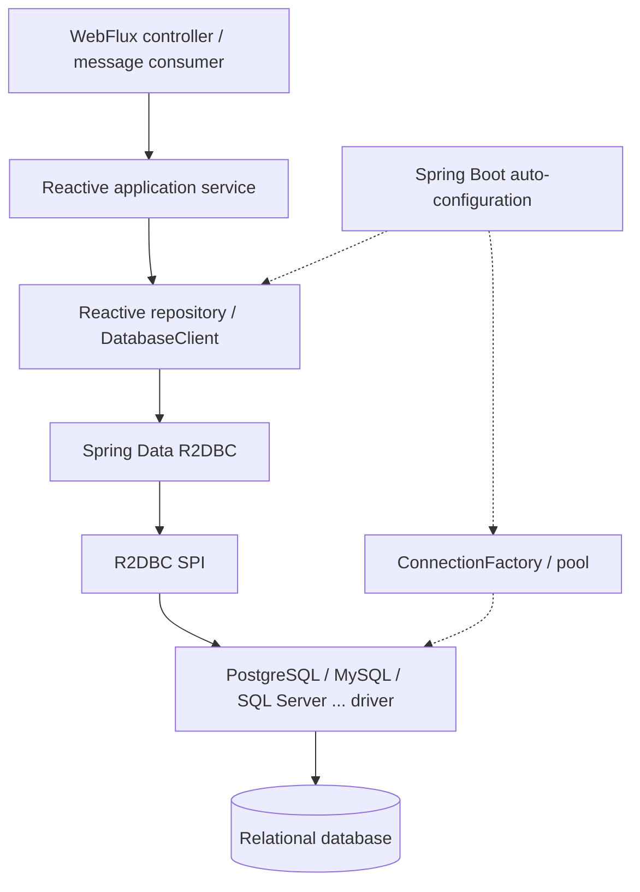

# Setting Up spring-boot-starter-data-r2dbc and the Right Driver

## 1. Why must you choose the right starter and driver?

In a Spring Boot application handling high concurrency, waiting for data from the database often accounts for most of a request's duration. JDBC is a familiar model, yet query calls typically **block the executing thread** until a result arrives. **R2DBC (Reactive Relational Database Connectivity)** is a specification for connecting to relational databases reactively, allowing the application to keep processing other tasks instead of tying up a thread waiting on I/O during queries.

However, declaring the `spring-boot-starter-data-r2dbc` dependency **is not enough**: you also need an **R2DBC driver** supporting your actual database (PostgreSQL, MySQL, SQL Server, H2, etc.), a driver-compatible URL, and connection configuration. The driver is what translates R2DBC SPI operations into a specific database's wire protocol.

This lesson belongs to the **Reactive Data** chapter of the **SPRING_BOOT_INTEGRATION** module: organizing system integration across HTTP clients, databases, caches, message brokers, and Spring Integration adapters. The goal is not merely "connecting to a database", but managing **configuration, data contracts, transactions, errors, duplicates, testing, and observability** in real integration flows.

After this lesson, you will be able to:

- Distinguish **Spring Data R2DBC**, **R2DBC SPI**, **drivers**, **`ConnectionFactory`**, and connection pools.
- Add the starter, pick the right driver artifact, and configure database-specific URLs and credentials.
- Build a Spring Boot example using `ReactiveCrudRepository` and an endpoint returning `Mono`.
- Configure connection pools, TLS, schema initialization/migrations, transactions, and timeouts within proper boundaries.
- Test against a production-equivalent database and diagnose common configuration issues.

> **Version baseline:** Examples target **Java 17+ and Spring Boot 3.2+**, with dependencies managed by the BOM/parent of that same Spring Boot release. Artifact names, driver capabilities, and configuration options may vary across versions. If you use a newer Spring Boot release, check driver compatibility with that Boot release's R2DBC SPI and Spring Data R2DBC before pinning custom versions.

## 2. Where does R2DBC sit in the architecture?



| Component | Responsibility |
|---|---|
| `spring-boot-starter-data-r2dbc` | Brings in Spring Data R2DBC, required dependencies, and Spring Boot integration auto-configuration |
| R2DBC SPI | Standard contract for `ConnectionFactory`, `Connection`, `Statement`, `Result`, and Reactive Streams signaling |
| R2DBC driver | Implements the SPI for a specific protocol/database; **not** a JDBC driver |
| `ConnectionFactory` | Creates R2DBC connections; analogous in purpose to JDBC's `DataSource`, but a different API type |
| `r2dbc-pool` | Wraps `ConnectionFactory` to reuse connections and cap load when enabled |
| `ReactiveCrudRepository` | Provides reactive CRUD operations following the repository model |
| `R2dbcEntityTemplate` / `DatabaseClient` | Flexible SQL APIs suited for queries beyond basic CRUD |

When a WebFlux controller returns `Mono<T>` or `Flux<T>`, the framework handles subscription at the HTTP boundary. Spring Data R2DBC returns the corresponding Publisher; you **do not manually call `.subscribe()` or `.block()` inside a reactive flow**. This is fundamentally different from wrapping a blocking JDBC call in `Mono.just(...)`: the JDBC call has already executed and blocked before the Publisher is even constructed.

**Choose R2DBC when** the application is reactive end-to-end, has heavy concurrent I/O, and the database has a stable reactive driver. **JDBC/JPA may be a better fit** when business workflows are synchronous, require complex ORM features, or the database's R2DBC driver lacks required capabilities. R2DBC does not inherently make SQL faster, remove database limits, or replace proper indexing, query design, and transaction design.

## 3. Installing dependencies: starter first, driver second

### 3.1. Maven example for PostgreSQL

Suppose an Inventory Service application uses PostgreSQL. When the project already inherits from the Spring Boot parent or BOM:

```xml
<dependencies>
    <dependency>
        <groupId>org.springframework.boot</groupId>
        <artifactId>spring-boot-starter-data-r2dbc</artifactId>
    </dependency>

    <!-- Dedicated R2DBC driver for PostgreSQL -->
    <dependency>
        <groupId>org.postgresql</groupId>
        <artifactId>r2dbc-postgresql</artifactId>
        <scope>runtime</scope>
    </dependency>

    <!-- Only needed if the project exposes reactive HTTP endpoints -->
    <dependency>
        <groupId>org.springframework.boot</groupId>
        <artifactId>spring-boot-starter-webflux</artifactId>
    </dependency>

    <dependency>
        <groupId>org.springframework.boot</groupId>
        <artifactId>spring-boot-starter-test</artifactId>
        <scope>test</scope>
    </dependency>
    <dependency>
        <groupId>io.projectreactor</groupId>
        <artifactId>reactor-test</artifactId>
        <scope>test</scope>
    </dependency>
</dependencies>
```

Each dependency has a distinct job:

1. The R2DBC starter provides mapping infrastructure, repositories, and Spring integration.
2. `r2dbc-postgresql` actually communicates with PostgreSQL. Without a compatible driver, Spring cannot open connections from `r2dbc:postgresql:...`.
3. WebFlux is needed when building reactive web APIs. If you only run reactive batch jobs or message consumers, you do not necessarily need the web starter.
4. `reactor-test` provides `StepVerifier` for testing `Mono`/`Flux` streams.

You do not need `spring-boot-starter-data-jpa` just to access a database via R2DBC. JPA uses JDBC and a blocking model; adding both increases complexity and can cause confusion between `DataSource` and `ConnectionFactory`. An application **can** use both JDBC and R2DBC when genuinely needed, but you must configure and manage transactions separately for each technology.

### 3.2. Gradle (Kotlin DSL) example

```kotlin
dependencies {
    implementation("org.springframework.boot:spring-boot-starter-data-r2dbc")
    runtimeOnly("org.postgresql:r2dbc-postgresql")

    implementation("org.springframework.boot:spring-boot-starter-webflux")

    testImplementation("org.springframework.boot:spring-boot-starter-test")
    testImplementation("io.projectreactor:reactor-test")
}
```

Do not mix mismatched versions of Spring Data, Reactor, and R2DBC SPI arbitrarily. Prefer Spring Boot's dependency management; any community driver outside the BOM must declare a separately verified version.

### 3.3. Choosing a driver for your actual database

| Database | Common R2DBC driver | Typical URL format | Notes |
|---|---|---|---|
| PostgreSQL | `org.postgresql:r2dbc-postgresql` | `r2dbc:postgresql://host:5432/inventory` | Widely used; specific feature support depends on driver version |
| H2 | `io.r2dbc:r2dbc-h2` | `r2dbc:h2:mem:///testdb` | Convenient for small experiments; differs from PostgreSQL in SQL/types/transactions |
| MySQL | `io.asyncer:r2dbc-mysql` | `r2dbc:mysql://host:3306/inventory` | Driver from a separate ecosystem; verify version and support before adopting |
| Microsoft SQL Server | `io.r2dbc:r2dbc-mssql` | `r2dbc:mssql://host:1433/inventory` | Verify R2DBC SPI and SQL Server version compatibility |

These are **common choices**, not an exhaustive catalog or compatibility guarantee at all times. For MariaDB, Oracle, or other databases, consult the official driver documentation for exact artifacts, versions, protocols, TLS options, and feature limitations.

**Distinguishing URLs:**

```text
JDBC:   jdbc:postgresql://localhost:5432/inventory
R2DBC:  r2dbc:postgresql://localhost:5432/inventory
```

`org.postgresql:postgresql` is the PostgreSQL **JDBC driver**. It cannot substitute for `org.postgresql:r2dbc-postgresql` when using `spring.r2dbc.url`. Likewise, having an R2DBC driver does not automatically create a JDBC `DataSource`.

## 4. Configuring PostgreSQL connectivity in Spring Boot

### 4.1. Basic application.yml

```yaml
spring:
  r2dbc:
    url: ${R2DBC_URL:r2dbc:postgresql://localhost:5432/inventory}
    username: ${R2DBC_USERNAME}
    password: ${R2DBC_PASSWORD}
    pool:
      enabled: true
      initial-size: 2
      max-size: 20
      max-idle-time: 30m
      max-acquire-time: 2s
```

In this example, the default URL is for local execution only; username/password must still come from environment variables or a secret manager. In production, require `R2DBC_URL` explicitly and verify the database name and host match the target environment.

Key properties:

| Property | Role |
|---|---|
| `spring.r2dbc.url` | Selects the driver by protocol and specifies the database |
| `spring.r2dbc.username` / `password` | Database credentials; grant only necessary permissions |
| `spring.r2dbc.pool.enabled` | Enables pooling when a pooling library is on the classpath |
| `initial-size` | Initial connections; setting it too high can cause spikes when many instances start |
| `max-size` | Connection limit per instance; must be accounted for across all pods/replicas |
| `max-idle-time` | Shrinks idle connections according to pool policy |
| `max-acquire-time` | Maximum time to wait when borrowing a connection from the pool, not total query time |

Spring Boot can auto-configure a pooled `ConnectionFactory` when `r2dbc-pool` is present. Modern starters often pull in the required components transitively, but **inspect your dependency tree** if the project uses exclusions or custom setups. If the pooling library is missing, setting `enabled: true` cannot conjure a pooling implementation out of thin air.

**Calculating connection budget:** With 6 Inventory Service instances each configured at `max-size=20`, theoretical application connections can reach **120**, excluding migration tools, jobs, other services, and admin sessions. Pool sizing must fit within PostgreSQL's `max_connections` and measured query load, not be maxed out blindly to "fix" slow SQL.

### 4.2. Which beans does Boot create?

When dependencies, URL, and credentials are valid, Spring Boot typically auto-configures:

- An R2DBC `ConnectionFactory` (optionally wrapped by a pool).
- `DatabaseClient` and Spring Data R2DBC infrastructure such as `R2dbcEntityTemplate`.
- Reactive repositories within scanned packages.
- A reactive transaction manager matching the `ConnectionFactory`.

Therefore, for straightforward setups, **you do not need to write `@Bean ConnectionFactory` manually**. Defining a custom bean of that type can cause auto-configuration to back off; in that case, you become responsible for properly wiring properties, pooling, TLS, metrics, and transactions.

### 4.3. When is TLS needed?

For production, database connections from other nodes or pods should use encryption and server identity verification per infrastructure policy. The PostgreSQL R2DBC driver exposes version-specific SSL/TLS options, such as CA/hostname verification modes. Illustrative URL format:

```text
r2dbc:postgresql://db.internal.example:5432/inventory?sslMode=VERIFY_FULL
```

This URL expresses the intent to **fully verify certificates and hostnames**; to work in practice, you must distribute CA/trust material via the driver's supported mechanism, ensure the certificate has a SAN matching the hostname, and enable TLS on the server. Verify option names, trust-material loading, and `VERIFY_FULL` support for **your exact driver version**. Never disable certificate verification or enable `trust-all` modes to "fix" production connectivity.

Distinguish **transport TLS**, **SQL privileges**, and **secret management**: TLS does not grant table permissions; database accounts still require least privilege, password rotation, and auditing as needed.

### 4.4. Pool timeout, network timeout, and query timeout are different

A query may wait for a pooled connection, TCP/TLS setup, PostgreSQL statement execution, and result streaming. These limits are not synonymous:

| Stage | Purpose of limit | Where configured |
|---|---|---|
| Pool acquire | Avoid waiting indefinitely for a connection when the pool is full | `spring.r2dbc.pool.max-acquire-time` |
| TCP connection | Bound time spent opening a connection | R2DBC driver-specific options |
| Statement execution | Prevent runaway queries | Driver- or database-supported query/statement timeout |
| Entire operation | Total budget for HTTP response or event processing | Application/service-level deadline |

You can attach `.timeout(Duration.ofSeconds(3))` to a `Mono` in a business operation; however, that is a **Publisher-level limit** and should not automatically be assumed to have aborted SQL running on the database. Statement cancellation behavior depends on the driver and server. Always verify timeouts, connection recovery, and query cancellation via real integration tests.

## 5. Creating the schema for the Inventory application

Our inventory reservation example uses a small table:

```sql
CREATE TABLE stock_item (
    sku VARCHAR(80) PRIMARY KEY,
    available BIGINT NOT NULL CHECK (available >= 0),
    version BIGINT NOT NULL DEFAULT 0
);
```

During local development, you can use `src/main/resources/schema.sql` together with:

```yaml
# application-local.yml
spring:
  sql:
    init:
      mode: always
```

Spring Boot supports SQL schema initialization when a compatible `ConnectionFactory` is present. **Do not use `schema.sql` as a production migration tool**: repeated deployments or table alterations will fail or become unsafe. In production, use a versioned schema management tool such as Flyway or Liquibase with a proper approval and rollback/forward-fix workflow.

### 5.1. Flyway still typically uses a JDBC connection for migrations

Even though the application queries data using R2DBC, many migration tools execute over **JDBC**. Conceptual configuration example:

```yaml
spring:
  r2dbc:
    url: ${R2DBC_URL}
    username: ${R2DBC_USERNAME}
    password: ${R2DBC_PASSWORD}
  flyway:
    enabled: true
    url: ${FLYWAY_JDBC_URL}
    user: ${FLYWAY_USER}
    password: ${FLYWAY_PASSWORD}
    locations: classpath:db/migration
```

If you choose Flyway, you must add the Flyway dependency, the **matching JDBC driver**, and potentially the database-specific Flyway module for your Flyway version. The Flyway URL must be `jdbc:postgresql://...`, not an R2DBC URL. This independent setup lets the application **keep using R2DBC at runtime**, though you should never assume JDBC migrations and R2DBC transactions share a connection or transaction.

In multi-instance deployments, establish a clear single-execution migration process, schema baseline, and traffic readiness gate. Never allow one instance to assume a new schema while older instances still run incompatible assumptions without a compatibility plan.

## 6. Writing reactive entities, repositories, and APIs

### 6.1. Entities in Spring Data R2DBC

```java
// StockItem.java
import org.springframework.data.annotation.Id;
import org.springframework.data.annotation.Version;
import org.springframework.data.relational.core.mapping.Table;

@Table("stock_item")
public record StockItem(
        @Id String sku,
        long available,
        @Version Long version
) {}
```

`@Table` maps to the SQL table; `@Id` identifies the record; `@Version` enables optimistic locking during version-aware save/update operations. Here, `version` is `Long` so it can be `null` upon creation. For entities with application-assigned IDs, Spring Data can use a `null` version to detect a new entity; when saving, the framework manages the version value according to its mapping rules.

Notes:

- Spring Data R2DBC **is not reactive JPA**. Do not use `@Entity`, `@ManyToOne`, or expect lazy-loaded JPA associations.
- Relationships and aggregates must be modeled explicitly via keys, queries/joins, DTOs, or `R2dbcEntityTemplate`.
- For hand-written SQL updates, **`@Version` does not automatically append version checks or increments**; custom queries must handle the relevant columns and predicates explicitly if required by the contract.

### 6.2. Repositories and safe conditional update queries

```java
// StockRepository.java
import org.springframework.data.r2dbc.repository.Query;
import org.springframework.data.r2dbc.repository.Modifying;
import org.springframework.data.repository.query.Param;
import org.springframework.data.repository.reactive.ReactiveCrudRepository;
import reactor.core.publisher.Mono;

public interface StockRepository
        extends ReactiveCrudRepository<StockItem, String> {

    @Modifying
    @Query("""
        UPDATE stock_item
           SET available = available - :quantity,
               version = version + 1
         WHERE sku = :sku
           AND available >= :quantity
        """)
    Mono<Integer> reserveIfAvailable(
            @Param("sku") String sku,
            @Param("quantity") long quantity
    );
}
```

A single `UPDATE ... WHERE available >= :quantity` performs both the stock check and decrement **within one SQL statement**, avoiding races between "read availability" and "decrement stock". When the update affects `0` rows, there is more than one possible cause: the SKU may not exist, or stock may be insufficient. If the caller needs to distinguish these cases, add an appropriate lookup or error-code design while still handling concurrency races.

This example illustrates updating stock in a single table. To **reserve inventory reliably** across retried requests, you also need a `reservation` table with a unique key per operation ID and an appropriately designed transaction; updating `available` alone does not guarantee idempotency across repeated calls.

### 6.3. Non-blocking service

```java
// StockService.java
import org.springframework.stereotype.Service;
import reactor.core.publisher.Mono;

@Service
public class StockService {
    private final StockRepository stockRepository;

    public StockService(StockRepository stockRepository) {
        this.stockRepository = stockRepository;
    }

    public Mono<StockItem> getStock(String sku) {
        return stockRepository.findById(sku);
    }

    public Mono<Boolean> reserveStock(String sku, long quantity) {
        if (sku == null || sku.isBlank() || quantity <= 0) {
            return Mono.error(
                    new IllegalArgumentException("Invalid SKU and quantity"));
        }
        return stockRepository.reserveIfAvailable(sku, quantity)
                .map(affectedRows -> affectedRows == 1);
    }
}
```

With `Mono<Boolean>`, `false` means "no row was updated", **not** "the database service is unavailable". Connectivity, SQL, pool, or timeout errors should propagate as error signals and map to appropriate integration exceptions at the application boundary.

### 6.4. WebFlux endpoint

```java
// StockController.java
import org.springframework.http.ResponseEntity;
import org.springframework.web.bind.annotation.GetMapping;
import org.springframework.web.bind.annotation.PathVariable;
import org.springframework.web.bind.annotation.RequestMapping;
import org.springframework.web.bind.annotation.RestController;
import reactor.core.publisher.Mono;

@RestController
@RequestMapping("/stocks")
public class StockController {
    private final StockService stockService;

    public StockController(StockService stockService) {
        this.stockService = stockService;
    }

    @GetMapping("/{sku}")
    public Mono<ResponseEntity<StockItem>> getStock(
            @PathVariable String sku
    ) {
        return stockService.getStock(sku)
                .map(ResponseEntity::ok)
                .defaultIfEmpty(ResponseEntity.notFound().build());
    }
}
```

Notice that the controller returns `Mono<ResponseEntity<StockItem>>` instead of calling `.block()` to unwrap `StockItem`. When no data is found, the repository returns `Mono.empty()` and the endpoint translates it to `404`. When a database error occurs, the Publisher emits an error signal; centralized handlers determine HTTP status, logging, and retry policies.

If you only add `spring-boot-starter-data-r2dbc` while the application still runs servlet/Spring MVC controllers and blocking dependencies, returning `Mono` from a repository will not magically make the whole request pipeline non-blocking. Evaluate the entire path from HTTP/consumer, cache, and database down to downstream clients.

## 7. Reactive transactions and integration boundaries

R2DBC supports transactions on compatible connections and databases. In Spring, reactive transactions bind to the subscription's **Reactor Context**, unlike traditional JDBC apps that bind transactions to threads. Consequently:

- Reactive methods using `@Transactional` must typically return `Mono`/`Flux` so database operations execute inside the same reactive transaction when subscribed properly.
- To combine multiple operations into one transaction, use `@Transactional` or `TransactionalOperator` with a `ReactiveTransactionManager`.
- Do not manually call `.subscribe()` inside a transactional service; separate subscriptions can detach operations from the transaction context.
- Avoid switching a step to blocking JDBC and expecting it to share the R2DBC connection or transaction.
- A single-database transaction **does not cover** HTTP calls, Redis caches, or Kafka/RabbitMQ brokers; use outbox, idempotency, sagas/compensation, or reconciliation when workflows span multiple systems.

Example combining inventory decrement with writing a reservation record (design sketch; requires defining `ReservationRepository` and a matching entity in the application):

```java
@Transactional
public Mono<Reservation> reserveAndRecord(Reservation request) {
    return stockRepository
            .reserveIfAvailable(request.sku(), request.quantity())
            .flatMap(rows -> {
                if (rows != 1) {
                    return Mono.error(
                            new InsufficientStockException(request.sku()));
                }
                return reservationRepository.save(request);
            });
}
```

Both R2DBC operations can participate in the same transaction when sharing the same transaction manager, database, and unbroken subscription. However, this snippet **does not yet protect against duplicate commands**: you need a unique constraint on operation ID, duplicate-key handling, and logic to return the prior result on replay. `OptimisticLockingFailureException` from `@Version`-checked saves also requires bounded retry/reconciliation policies rather than unconditional write retries.

### Handling events from a broker

Suppose Inventory consumes `ReserveRequested(orderId, sku, quantity, operationId)`. A consumer may receive the message again after a crash or timeout even though the first database write committed. Database transactions cannot stop a broker from redelivering. A typical design includes:

1. Storing `operationId` in the reservation table with a unique constraint.
2. Updating stock and inserting the reservation in the same database transaction.
3. Writing an outbox event in the same transaction if `ReservationCompleted` must be emitted.
4. On duplicate delivery, reading the operation ID's stored status and returning the determined outcome without decrementing stock a second time.
5. An outbox relay worker may also redeliver events; downstream consumers must likewise be idempotent.

This is where R2DBC intersects with HTTP clients, caches, brokers, and Spring Integration adapters within the module's scope: picking the right driver is just step one; end-to-end flow consistency must be designed at the application level.

## 8. Testing: from dependencies to a real database

### 8.1. Testing configuration and repositories

Unit tests using mocked repositories cannot verify the driver, SQL schema, PostgreSQL types, connection pool, or transactions. For R2DBC repositories, maintain integration tests running against the **same database family as production**, such as PostgreSQL via Testcontainers.

Example test dependencies (Maven, with Spring Boot managing versions):

```xml
<dependency>
    <groupId>org.springframework.boot</groupId>
    <artifactId>spring-boot-testcontainers</artifactId>
    <scope>test</scope>
</dependency>
<dependency>
    <groupId>org.testcontainers</groupId>
    <artifactId>junit-jupiter</artifactId>
    <scope>test</scope>
</dependency>
<dependency>
    <groupId>org.testcontainers</groupId>
    <artifactId>postgresql</artifactId>
    <scope>test</scope>
</dependency>
```

With Spring Boot 3.2+, `@ServiceConnection` can feed container connection details into auto-configuration:

```java
// StockRepositoryTest.java (abbreviated imports)
@DataR2dbcTest
@Testcontainers
@TestPropertySource(properties = "spring.sql.init.mode=always")
class StockRepositoryTest {

    @Container
    @ServiceConnection
    static PostgreSQLContainer<?> postgres =
            new PostgreSQLContainer<>("postgres:16-alpine");

    @Autowired
    StockRepository repository;

    @Test
    void reserveUpdatesStockAtomically() {
        Mono<String> operation = repository
                .save(new StockItem("SKU-TEST-1", 3, null))
                .then(repository.reserveIfAvailable("SKU-TEST-1", 2))
                .flatMap(rows -> repository.findById("SKU-TEST-1")
                        .map(item -> rows + ":" + item.available()));

        StepVerifier.create(operation)
                .expectNext("1:1")
                .verifyComplete();
    }
}
```

In this test, `schema.sql` in test or main resources must create the `stock_item` table; if the container lacks a schema, enable test initialization as shown or run migrations. `@DataR2dbcTest` loads only R2DBC-related beans, making it suitable for testing repositories and mapping. Your Testcontainers/Boot versions must support `@ServiceConnection` creating `R2dbcConnectionDetails`; otherwise, supply `spring.r2dbc.url` and credentials via `@DynamicPropertySource`.

Running this test requires Docker/Testcontainers to be available; this is a **test-writing guide**, not a pre-executed lesson output. When multiple test cases share tables, guarantee isolation via fresh containers, transactional test rollback, or controlled data cleanup.

### 8.2. Essential test cases

| Test | Objective |
|---|---|
| Successful PostgreSQL connection | Driver loads; URL, credentials, and schema are valid |
| Missing R2DBC driver | Application reports a clear configuration error instead of falling back to JDBC |
| `GET` existing and non-existing SKU | Correct payload and HTTP `404` behavior |
| Decrement within available stock | Affected rows `1`, quantity decremented accurately |
| Decrement exceeding available stock | Affected rows `0`, stock never goes negative |
| Concurrent requests | No lost updates; verifies conditional SQL and transactions |
| Saving entity with stale `@Version` | Optimistic locking detected on version-aware save operations |
| Pool reaches `max-size` | Bounded acquire wait; observable timeout error |
| Connection loss / invalid CA TLS | Fails to access database rather than silently succeeding |
| SQL error or timeout | Meaningful error propagated; transaction rolled back when expected |
| Duplicate event with same operation ID | Stock is not decremented a second time |
| Migrations | Actual schema applies cleanly and matches entity mappings |

When testing with H2, do not treat passing tests as proof that production PostgreSQL will behave identically: SQL syntax, `JSONB` types, locks/transactions, and update statements can differ.

## 9. Troubleshooting and operations

### 9.1. Common configuration errors

| Symptom | Likely cause | Resolution |
|---|---|---|
| Cannot create `ConnectionFactory` | Missing R2DBC driver, wrong URL scheme, incompatible driver | Inspect dependency tree, `spring.r2dbc.url`, and actual provider |
| JDBC driver present but R2DBC fails to connect | Confused `org.postgresql:postgresql` with `r2dbc-postgresql` | Add the proper R2DBC driver |
| Password authentication failed | Wrong secret, role, or database | Check secrets, grants, and environment; never log passwords |
| Connection refused / name resolution | Host, port, network, or service DNS issue | Verify network connectivity and configured hostname |
| TLS handshake / certificate failure | Wrong CA, SAN, verification mode, or expired cert | Fix trust material/certificates; keep TLS verification enabled |
| Pool acquire timeout | Pool exhausted, slow queries, or connection leak | Measure query times, concurrency, and pool usage; optimize SQL and sizing |
| Relation `stock_item` does not exist | Schema/migrations not run or wrong schema | Verify migrations, search path, and database permissions |
| `No property...` / mapping exception | Mismatch in entity, column, or type mapping | Check table/column names, converters, and schema |
| `Blocking call!` / abnormal latency | Calling `.block()` or blocking JDBC libraries inside reactive flow | Remove blocking calls or isolate an imperative branch cleanly |
| Transaction does not roll back as expected | Manual `subscribe()`, mixed transaction managers, or swallowed errors | Maintain a single reactive chain and let errors propagate |

In multi-database environments, verify that each R2DBC driver supports your required types and protocol; never assume PostgreSQL URL syntax or TLS options can be copied verbatim to MySQL or SQL Server.

### 9.2. Observability and security

In real systems, monitor at minimum:

- Query latency and p95/p99 distributions, plus connection/SQL/timeout errors grouped by operation type (not per individual SKU).
- Connection acquisition rate, active/idle/waiting counts (if exposed by the pool), and acquire timeouts.
- Transaction commit/rollback rates, optimistic lock conflicts, deadlocks, and serialization failures.
- Correlation/trace IDs linking HTTP requests, message consumers, and database calls; proper tracing/instrumentation must be configured to emit complete spans.
- Migration status, schema version, and schema compatibility across running instances.

Never log connection URLs containing passwords, credentials, tokens, PII, or raw SQL containing sensitive parameters. Avoid putting `sku`, `orderId`, `operationId`, or raw SQL statements into metric labels with unbounded cardinality. When queries touch financial or HR data, enforce least-privilege database access at the table and schema levels.

### 9.3. Recommended rollout sequence

1. Finalize the target database, server version, and TLS requirements.
2. Add the Spring Data R2DBC starter and exact driver while preserving BOM compatibility.
3. Configure URLs, credentials, and connection pools via environment variables and secret managers.
4. Set up schema and migrations under a controlled workflow.
5. Implement reactive entities, repositories, services, and endpoints without blocking threads.
6. Integration-test repositories against a real database, covering errors, transactions, and concurrency races.
7. Measure pool behavior, queries, and timeouts, and assign realistic time budgets across the whole integration flow.

## 10. Self-check

1. What does `spring-boot-starter-data-r2dbc` provide, and why is a separate driver still required?
2. Why can't `jdbc:postgresql://...` be used in place of `r2dbc:postgresql://...`?
3. How does `ConnectionFactory` differ from `DataSource`? Can they automatically share a transaction?
4. When should you choose R2DBC over JDBC/JPA? Does R2DBC make SQL run faster?
5. Why must you calculate the total connection pool across all instances instead of looking only at one pod's `max-size`?
6. How do pool acquire timeout and statement timeout differ?
7. When decrementing inventory, why is a single `UPDATE ... WHERE available >= quantity` safer than reading first and writing separately?
8. Does `@Version` automatically protect custom SQL statements written with `@Query`?
9. Why doesn't an R2DBC transaction cover HTTP, Redis, and brokers, and what mechanisms handle duplicate messages?
10. Why do you need integration tests against real PostgreSQL if production runs PostgreSQL?

**Key takeaway:** Setting up Spring Data R2DBC requires **the starter, a compatible driver, an `r2dbc:...` URL, a `ConnectionFactory`, and proper connection configuration**. Once connected, integration quality depends on SQL/transaction design, pooling and timeouts, TLS/secret hygiene, migrations, testing against a real database, and end-to-end observability of the reactive pipeline.
