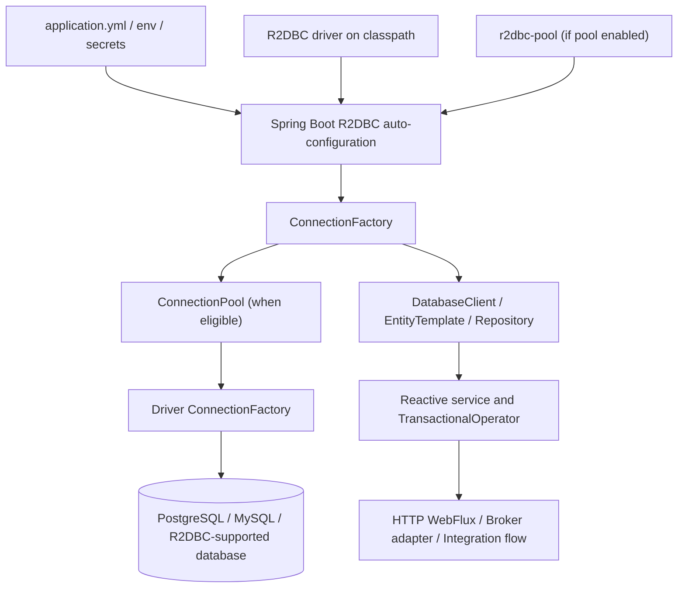
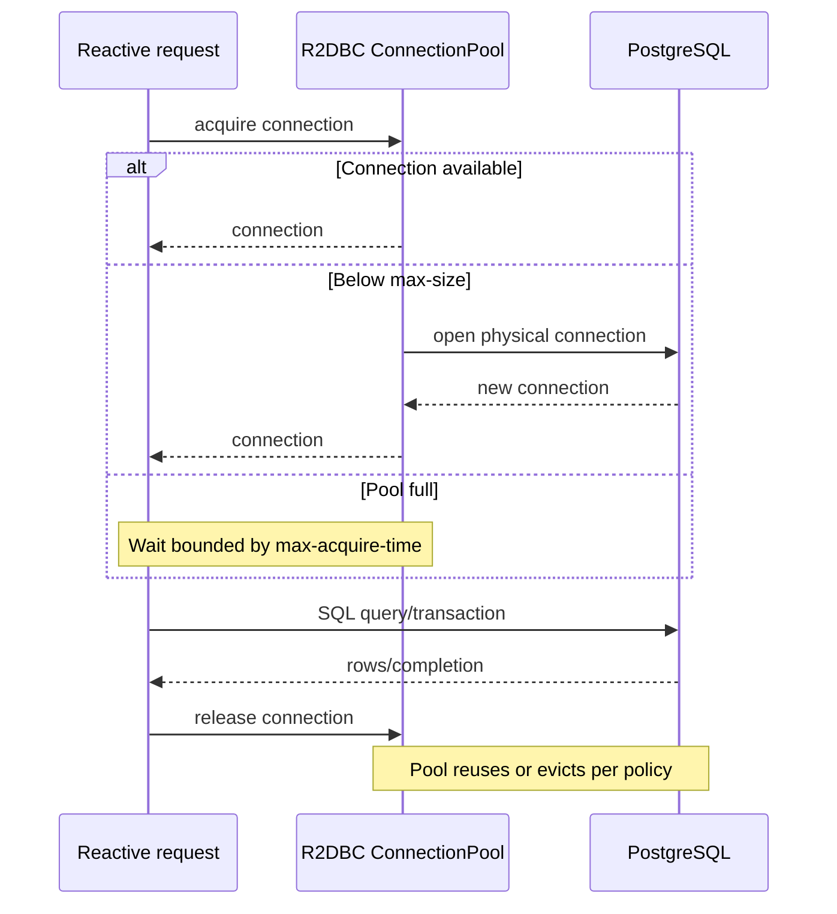
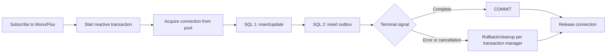
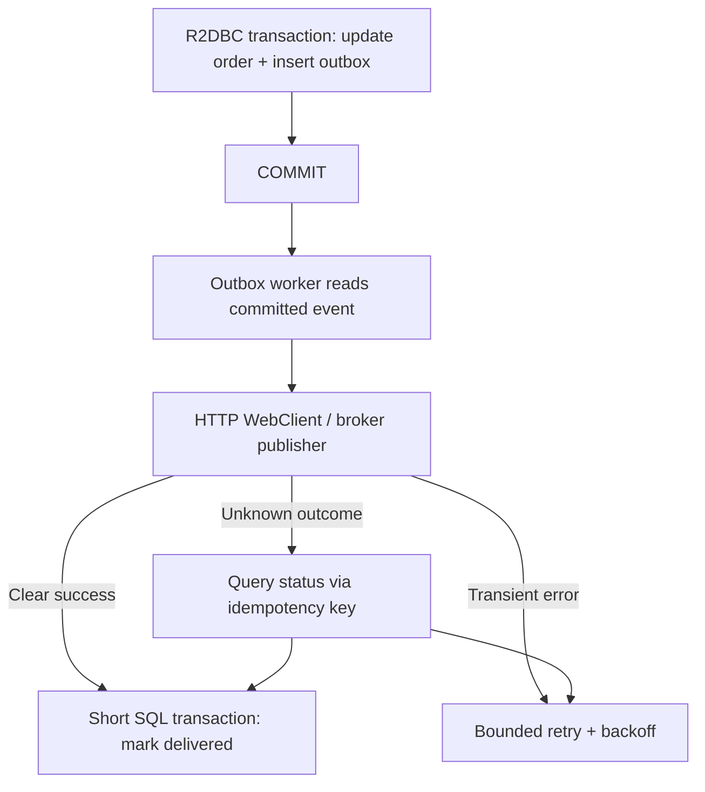

# Configuring spring.r2dbc.* and Connection Pools

> **Chapter:** Reactive Data  
> **Scope:** Within the **SPRING_BOOT_INTEGRATION** module, Spring Boot applications exchange data through HTTP clients, SQL databases, caches, message brokers, and Spring Integration adapters. This lesson dives into **R2DBC** configuration, how Spring Boot creates `ConnectionFactory`, how **connection pools** work for reactive SQL, and the implications for data contracts, transactions, errors, deduplication, testing, and observability.

## 1. Why does reactive SQL connectivity need dedicated configuration?

Suppose a service consumes order events from a broker, writes status updates to PostgreSQL, and exposes a WebFlux lookup endpoint. Each request may require a SQL connection, yet the application cannot open a fresh physical connection per query or keep connections open indefinitely.

In JDBC/JPA, database operations typically **block the executing thread**. **R2DBC** (*Reactive Relational Database Connectivity*) provides a Reactive Streams database access API that avoids tying up an application thread synchronously per query. Spring Data R2DBC, `DatabaseClient`, and `R2dbcEntityTemplate` can use R2DBC connections to execute operations as `Mono`/`Flux`.

However, **reactive does not mean unlimited resources**:

- The database still limits connections, transactions, CPU, memory, and I/O.
- Each query or transaction must acquire a connection from the connection source.
- Too many concurrent subscribers can exhaust the pool and inflate wait times.
- Too few connections can slow down the service even though the event loop is not blocked.
- A long-lived reactive transaction can hold onto a connection for a long time, starving the pool.

You must therefore understand **three distinct concepts**: `ConnectionFactory` creates connections, `ConnectionPool` reuses and bounds connections, and the application's concurrency/timeout policies determine the actual load hitting the pool.

## 2. Relevant layers in Spring Boot

| Layer | Component | Responsibility |
| --- | --- | --- |
| **R2DBC SPI** | `io.r2dbc.spi.ConnectionFactory`, `Connection` | Contract for reactive SQL access |
| **R2DBC driver** | `r2dbc-postgresql` or database-compatible driver | Implements wire protocol, TLS, authentication, and database I/O |
| **R2DBC Pool** | `io.r2dbc.pool.ConnectionPool` | Caps connection count, handles borrowing/returning, timeouts, validation, and eviction |
| **Spring Data R2DBC** | `DatabaseClient`, `R2dbcEntityTemplate`, `ReactiveCrudRepository` | SQL binding, data mapping, repositories, and Reactor integration |
| **Spring transaction** | `R2dbcTransactionManager`, `TransactionalOperator` | Manages reactive transactions via Reactor context |
| **Spring Boot** | R2DBC auto-configuration, `spring.r2dbc.*` | Binds properties and registers beans when classpath/conditions match |

`spring.r2dbc.*` is Spring Boot's property group for **R2DBC** SQL connections, distinct from JDBC's `spring.datasource.*`. Both can appear together if an application genuinely uses both connection types, but you must never assume the two pools or transaction managers are unified.



This diagram illustrates roles, **not exact bean dependency order**: when pooling is active, the `ConnectionFactory` injected into Spring Data is normally the pool wrapping the driver factory. Without pooling, `ConnectionFactory` points directly to the driver.

## 3. Dependencies and environment requirements

Example for a **Spring Boot 3.x**, Java 17+, PostgreSQL application:

```xml
<dependencies>
    <dependency>
        <groupId>org.springframework.boot</groupId>
        <artifactId>spring-boot-starter-data-r2dbc</artifactId>
    </dependency>
    <dependency>
        <groupId>org.postgresql</groupId>
        <artifactId>r2dbc-postgresql</artifactId>
        <scope>runtime</scope>
    </dependency>
</dependencies>
```

Spring Boot manages versions of libraries included in its BOM; avoid randomly overriding versions of Spring Data, Reactor, SPI, drivers, or pools. To use pooling, **`io.r2dbc:r2dbc-pool` must be on the runtime classpath** (typically pulled in via the reactive data starter). If it is absent from your dependency tree, add:

```xml
<!-- Only needed explicitly if not already pulled in transitively -->
<dependency>
    <groupId>io.r2dbc</groupId>
    <artifactId>r2dbc-pool</artifactId>
</dependency>
```

Another application might also include `spring-boot-starter-webflux` for reactive HTTP endpoints, yet **WebFlux is not a prerequisite for using R2DBC** in workers or message consumers. Conversely, adding WebFlux while still querying via JDBC/JPA does not automatically make SQL non-blocking.

**Reality check:** You need the proper R2DBC driver for your database, valid connection settings, and a running database. Successfully creating a `ConnectionFactory` does not prove a connection has been tested: many drivers and pools open physical connections lazily upon first use.

## 4. Basic `spring.r2dbc.*` configuration

Example PostgreSQL configuration for Spring Boot 3.x:

```yaml
spring:
  r2dbc:
    url: ${R2DBC_URL:r2dbc:postgresql://localhost:5432/orderdb}
    username: ${DB_USER:order_app}
    password: ${DB_PASSWORD}

    pool:
      enabled: true
      initial-size: 3
      max-size: 20
      max-idle-time: 15m
      max-life-time: 60m
      max-acquire-time: 2s
      max-create-connection-time: 3s
      validation-query: SELECT 1
```

These are **illustrative values**, not optimal defaults for every environment. The database must have enough connection capacity for all application instances plus other workloads. In production, never hardcode passwords; use a secret manager or environment variables. If traffic traverses untrusted networks, configure TLS and certificate verification per your database and driver security requirements.

Core properties:

| Property | Role | Caveats |
| --- | --- | --- |
| `spring.r2dbc.url` | R2DBC address and protocol | Must start with `r2dbc:`, not `jdbc:` |
| `spring.r2dbc.username` | SQL user | Should follow least-privilege permissions |
| `spring.r2dbc.password` | SQL password | Inject from secrets; avoid logging or committing to source control |
| `spring.r2dbc.pool.enabled` | Enables connection pooling when library and conditions are met | Do not assume flipping the flag works without `r2dbc-pool` |
| `spring.r2dbc.pool.initial-size` | Target initial connections in the pool | Initializing too many connections across many instances can cause startup spikes |
| `spring.r2dbc.pool.max-size` | Max pooled connections per instance/factory | Must be sized against total instances and DB limits |
| `spring.r2dbc.pool.max-idle-time` | Max idle time before a connection may be evicted | Not a query execution deadline |
| `spring.r2dbc.pool.max-life-time` | Maximum connection lifetime | Differs from HTTP/transaction timeouts; depends on pool mechanics |
| `spring.r2dbc.pool.max-acquire-time` | Wait limit when acquiring a connection | Fails fast when the pool is exhausted instead of hanging forever |
| `spring.r2dbc.pool.max-create-connection-time` | Time limit to establish a physical connection | Does not replace driver-level connect/command timeouts |
| `spring.r2dbc.pool.validation-query` | Query used to validate connections when enabled by pool | Adds overhead; verify dialect compatibility |

Not all property groups or driver options are identical across Spring Boot/R2DBC releases. Before copying settings to production, check the **configuration metadata and dependency tree of the exact Boot version you run**.

### 4.1. Distinguishing R2DBC and JDBC URLs

```properties
# URL used by R2DBC ConnectionFactory
spring.r2dbc.url=r2dbc:postgresql://localhost:5432/orderdb

# JDBC URL, used by DataSource if the application configures JDBC
spring.datasource.url=jdbc:postgresql://localhost:5432/orderdb
```

Do not substitute `jdbc:postgresql` for `r2dbc:postgresql` when creating a `ConnectionFactory`; a JDBC driver does not implement the R2DBC SPI. Other driver options such as SSL mode, socket timeout, and driver connect timeout are passed via URL parameters or `spring.r2dbc.properties.*` **according to driver documentation**. Do not blindly apply JDBC property names to R2DBC.

### 4.2. Alternative pooling option: `r2dbc:pool:...` driver URL

R2DBC Pool also supports creating pools via `ConnectionFactoryOptions`/URLs using the `pool` provider. When relying on Spring Boot to auto-configure `spring.r2dbc.pool.*`, the cleanest approach is usually keeping the **plain driver URL** `r2dbc:postgresql://...` and configuring the pool through Boot properties.

Avoid accidentally **double-wrapping pools** by combining a `pool`-scheme URL with an outer pooling layer. If you customize `ConnectionFactory` manually, write tests verifying which factory is actually injected, the max connection count, and shutdown lifecycle.

## 5. What beans does Spring Boot auto-create?

When the classpath, driver, URL, and auto-configuration conditions align, Boot can register beans such as:

| Bean/API | Purpose | Conditions/notes |
| --- | --- | --- |
| `ConnectionFactory` | R2DBC connection source | Driver + valid config present; may be a `ConnectionPool` |
| `DatabaseClient` | Executes SQL with reactive binding and mapping | Configured from `ConnectionFactory` in the Spring Data R2DBC stack |
| `R2dbcEntityTemplate` | CRUD, queries, and entity mapping | When Spring Data R2DBC components are present |
| Reactive repositories | Repository interfaces with `Mono`/`Flux` | Requires valid Spring Data R2DBC repository scanning |
| `R2dbcTransactionManager` | Reactive transaction manager for one connection factory | Does not manage HTTP APIs, brokers, or other JDBC transactions |

Exact beans depend on version, dependencies, user-defined beans, and `@ConditionalOn...` rules. For example, declaring a custom `ConnectionFactory` can cause auto-configuration to **back off**. If you configure multiple connection factories, you may need explicit bean names, `@Qualifier`, and dedicated transaction managers for each factory.

### 5.1. Verifying auto-configuration output

- Enable condition evaluation logging with `debug=true` in development when needed.
- Inspect the Actuator `conditions` endpoint in environments with restricted access.
- Verify whether the injected bean is a `ConnectionPool` or raw driver factory; assert expected settings in integration tests.
- Test against a live database with `SELECT 1` or a simple domain query rather than relying solely on startup logs.

**When R2DBC and JDBC coexist:** Spring Boot may skip JDBC `DataSource` auto-configuration if an R2DBC `ConnectionFactory` exists, depending on conditions and version. If you need both, explicitly configure each data source, driver, transaction manager, and migration tool; never assume Boot creates both just because both starters are on the classpath.

## 6. How does the connection pool operate?

`ConnectionPool` holds a bounded number of connections and reuses them. When a reactive operation requests a connection:

1. The pool lends an available connection or creates a new one if below capacity.
2. If `max-size` is reached, the operation waits for a connection to be returned, bounded by `max-acquire-time`.
3. When the publisher completes, errors, or cancels and resources close properly, the connection is returned to the pool or evicted per policy.
4. The pool can validate connections or evict connections that exceed max age or idle time.



The pool **does not throttle incoming requests** at HTTP endpoints or broker consumers. If clients spawn thousands of publishers concurrently, calls will still queue waiting to acquire, time out, and trigger retry storms. You must pair pool sizing with concurrency limits in upstream layers.

### 6.1. Calculating the connection budget

Suppose PostgreSQL allows 120 connections for this application group, and there are 4 Spring Boot instances each with `max-size=20`:

```text
Max R2DBC connections from app = 4 instances × 20 = 80
Remaining budget = 120 - 80 = 40
```

The remaining 40 connections must cover admin tasks, migrations, other apps, and burst/incident headroom. If a rolling deployment temporarily runs 8 instances in parallel, peak usage can reach **160 connections**, blowing the budget even when a single instance's config looks reasonable.

A rough rule of thumb:

```text
Max concurrent instances × max-size per instance
  + connections from all other apps and processes
  + reserve headroom
  <= actual DB / proxy connection limit
```

This is a **connection-capacity budget**, not a throughput guarantee. Increasing pool size does not always increase throughput because the database may saturate on CPU, locks, I/O, or query contention. Measure P95/P99 latency, active concurrent queries, lock waits, and saturation.

### 6.2. Sizing by connection hold time

Connection hold time covers acquisition, SQL execution, and open transaction duration. If each request holds a connection for 200 ms, a 20-connection pool can ideally serve far more work than one holding connections for 5 seconds; however, queueing, locks, network latency, and overhead make real numbers deviate sharply from naive division.

**Optimize first:** shorten transactions, eliminate N+1 queries, add proper indexes, bound row counts, and never perform HTTP/network side effects while holding an SQL connection. Only then tune pool size and concurrency using load tests.

## 7. How do reactive transactions hold connections?

Spring uses `R2dbcTransactionManager` and the Reactor context to bind a connection to a reactive transaction. For `DatabaseClient` calls within the same managed reactive chain, SQL operations can share the corresponding connection and transaction.



**Warning:** cancellation semantics can vary by version and operator usage, and cancellation never guarantees external side effects outside the database are undone. Do not rely on cancellation as a business rollback mechanism across HTTP or brokers.

### 7.1. Reactive SQL example with DatabaseClient

Suppose the PostgreSQL schema defines:

```sql
CREATE TABLE orders (
    id UUID PRIMARY KEY,
    tenant_id VARCHAR(64) NOT NULL,
    status VARCHAR(30) NOT NULL,
    amount_minor BIGINT NOT NULL CHECK (amount_minor >= 0)
);

CREATE TABLE outbound_events (
    event_id UUID PRIMARY KEY,
    order_id UUID NOT NULL REFERENCES orders(id),
    event_type VARCHAR(60) NOT NULL,
    created_at TIMESTAMPTZ NOT NULL DEFAULT CURRENT_TIMESTAMP
);
```

The service must update order status and insert an outbox row **within the same SQL transaction**, without calling partner APIs inside the transaction:

```java
package com.example.integration.reactive;

import java.util.UUID;
import org.springframework.r2dbc.core.DatabaseClient;
import org.springframework.stereotype.Service;
import org.springframework.transaction.reactive.TransactionalOperator;
import reactor.core.publisher.Mono;

@Service
public class ReactiveOrderService {
    private final DatabaseClient database;
    private final TransactionalOperator tx;

    public ReactiveOrderService(
            DatabaseClient database,
            TransactionalOperator tx) {
        this.database = database;
        this.tx = tx;
    }

    public Mono<UUID> confirmAndEnqueue(UUID orderId, UUID eventId) {
        return database.sql("""
                UPDATE orders SET status = 'CONFIRMED'
                 WHERE id = :orderId AND status = 'NEW'
                """)
                .bind("orderId", orderId)
                .fetch()
                .rowsUpdated()
                .flatMap(count -> {
                    if (count != 1) {
                        return Mono.error(new IllegalStateException(
                                "Order missing or no longer NEW"));
                    }
                    return database.sql("""
                            INSERT INTO outbound_events
                                (event_id, order_id, event_type)
                            VALUES
                                (:eventId, :orderId, 'order.confirmed')
                            """)
                            .bind("eventId", eventId)
                            .bind("orderId", orderId)
                            .fetch()
                            .rowsUpdated()
                            .thenReturn(eventId);
                })
                .as(tx::transactional);
    }
}
```

Here `TransactionalOperator` is injected, requiring a bean configured from a `ReactiveTransactionManager` (which the application can declare explicitly if auto-configuration does not supply the right bean). One configuration example:

```java
import org.springframework.context.annotation.Bean;
import org.springframework.context.annotation.Configuration;
import org.springframework.r2dbc.connection.R2dbcTransactionManager;
import org.springframework.transaction.ReactiveTransactionManager;
import org.springframework.transaction.reactive.TransactionalOperator;
import io.r2dbc.spi.ConnectionFactory;

@Configuration
class ReactiveTxConfiguration {
    @Bean
    TransactionalOperator transactionalOperator(
            ReactiveTransactionManager transactionManager) {
        return TransactionalOperator.create(transactionManager);
    }
}
```

`R2dbcTransactionManager` is typically auto-configured by Boot when conditions are met for `ConnectionFactory`. If a `ReactiveTransactionManager` bean already exists, **do not create a duplicate bean** just because an example shows class imports. The snippet imports `R2dbcTransactionManager` to highlight its role; the method signature only needs the `ReactiveTransactionManager` interface.

**Reading the code accurately:** `rowsUpdated()` returns a publisher, and SQL executes upon subscription; the transactional operator wraps the entire order update + outbox insert chain. If the outbox insert fails, the transaction rolls back the order update as well. SQL must run against the same `ConnectionFactory` with the transaction context preserved; creating a detached subscription inside a handler breaks the "same transaction" assumption.

### 7.2. What to strictly avoid

```java
// Wrong example: holding an SQL transaction open while waiting on external HTTP.
return database.sql("UPDATE orders SET status = 'CONFIRMED' ...")
        .fetch().rowsUpdated()
        .then(webClient.post()
                .uri("/partner/orders")
                .retrieve()
                .bodyToMono(Void.class))
        .as(tx::transactional);
```

This is an *anti-pattern*; the `...` in the SQL is illustrative only. HTTP calls can stall or time out while the transaction pins a database connection. Worse, if HTTP succeeds and the SQL transaction rolls back, the partner still has a committed side effect. Solution: write only the business record + outbox inside the R2DBC transaction, commit, and have a separate worker perform the HTTP call and record delivery status in a subsequent transaction.

## 8. Integration with HTTP clients, brokers, and Spring Integration

### 8.1. Calling HTTP after the transaction completes

An integration flow may span three phases:



Chaining reactive publishers is convenient, yet **having `then(webClient...)` in the same chain does not by itself mean the transaction has ended** unless scoped properly. Close `as(tx::transactional)` strictly around the SQL portion before chaining HTTP outside when that fits your contract, or use an independent outbox worker for crash resilience.

### 8.2. Broker consumers and idempotency

The R2DBC pool does not solve duplicate message delivery. When Kafka/RabbitMQ redelivers after an ack failure or consumer restart:

- Use a stable `eventId`, business key, and **unique constraint/inbox** in the database.
- Write the inbox record and business update in one short R2DBC transaction.
- Ack/commit offsets only under policies consistent with committed database state.
- If a partner response is lost, query status before retrying side effects; the outbox provides a durable record of send intent.

If a broker adapter uses an imperative API, **do not assume the whole message flow is reactive** just because downstream uses R2DBC. Conversely, using R2DBC does not make JPA/JDBC, blocking serializers, blocking HTTP clients, or other transaction managers non-blocking.

## 9. Pools and timeouts: distinguishing the levels

| Timeout level | Meaning | Failure example |
| --- | --- | --- |
| **Connection acquisition** | Waiting to borrow a connection from the pool | Pool saturated, no idle connection within `max-acquire-time` |
| **Connection creation** | Opening a new physical connection | DB unreachable, slow handshake |
| **Driver command/network timeout** | Waiting for SQL execution at driver/DB | Query or I/O too slow; driver-specific config |
| **Reactive operator timeout** | Deadline on `Mono`/`Flux` at service level | `timeout(Duration.ofSeconds(3))` terminates publisher with error |
| **Database statement/lock timeout** | Execution/lock wait cap enforced by DB | PostgreSQL `statement_timeout`/`lock_timeout` |
| **HTTP/broker timeout** | Waiting on external system | Does not directly affect R2DBC pool if DB transaction already committed |

**A timeout does not prove the DB did not apply the change.** SQL may have committed right before the caller timed out, just like HTTP side effects. For critical writes, rely on unique constraints and status lookup by idempotency key rather than blindly re-sending commands with fresh identifiers.

### 9.1. Preventing retry storms

When a pool is already saturated, immediate retries usually worsen the outage. Design for resilience:

1. Enforce timeouts and concurrency bounds at inbound endpoints and workers.
2. Apply bounded retries with exponential backoff and jitter only for classified transient errors.
3. Add circuit breakers/bulkheads when the downstream database loses availability.
4. Distinguish configuration errors (bad password/URL/schema) from transient network blips; never retry indefinitely.
5. Keep queues/buffers bounded or apply backpressure to broker consumption rates based on downstream capacity.

## 10. Tuning concurrency in an R2DBC pipeline

Example processing multiple jobs via `Flux`:

```java
Flux<Job> jobs = loadPendingJobs();

Flux<Result> results = jobs.flatMap(
        job -> processJob(job).timeout(Duration.ofSeconds(5)),
        8 // Limit to at most 8 concurrent jobs within this chain
);
```

This is an **illustrative snippet**: `loadPendingJobs` and `processJob` are application-supplied methods. `flatMap`'s concurrency limit applies only to **this pipeline**, not process-wide across multiple subscribers. If `processJob` holds multiple connections or long transactions, concurrency 8 might still mismatch a pool of 20.

If ordering matters, consider `concatMap` or `flatMapSequential` with their respective semantics; sequential processing trades off throughput. Never pull millions of rows into memory via unbounded `collectList()`. For database reads, use controlled paging/streaming and ensure connections are released on completion or cancellation.

### 10.1. Long-lived streams can pin connections

A `Flux<Row>` streaming query can hold a database cursor and connection open for the entire consumption window; if the client reads slowly, the pool remains occupied. Measure connection hold duration, row counts, and cancellation rates; for large datasets, consider pagination, chunking, or dedicated batch jobs.

Never wrap `Flux.interval(...)` or an hour-long subscription inside a reactive transaction just to flush periodic DB writes. Each batch update should use its own short, independent transaction.

## 11. JDBC/JPA and R2DBC in the same application

Key characteristics to remember:

| Concern | R2DBC | JDBC/JPA |
| --- | --- | --- |
| API style | Reactive `Mono`/`Flux` | Imperative/blocking |
| Connection source | `ConnectionFactory` / R2DBC pool | `DataSource` / HikariCP pool |
| Transaction manager | `R2dbcTransactionManager` | `DataSourceTransactionManager` or `JpaTransactionManager` |
| Transaction context | Reactor context | Thread-bound context |
| Migration libraries | Often require a separate JDBC URL or migration pipeline | Commonly integrate cleanly with JDBC `DataSource` |
| Main limitations | Driver/SQL/ORM features differ from JPA; requires careful publisher management | Blocking; concurrency requires appropriately sized thread pools |

If you use R2DBC for WebFlux APIs alongside Flyway/Liquibase for migrations, **migrations usually require a JDBC driver and separate connection**. You can run migrations in a deployment pipeline or declare dedicated JDBC settings for the migration tool instead of keeping a Boot auto-configured `DataSource` solely to match `spring.r2dbc.*`.

Conceptual configuration example:

```properties
# Runtime application
spring.r2dbc.url=r2dbc:postgresql://db:5432/orderdb

# If Flyway is configured to run via JDBC, its URL uses JDBC.
spring.flyway.url=jdbc:postgresql://db:5432/orderdb
```

When choosing Flyway, include the PostgreSQL JDBC driver dependency, any Flyway database-support module required for your version, migration privileges, and dedicated credentials. Avoid mixing DDL privileges from the migration tool into the runtime application account unless explicitly required.

**Do not share transaction managers:** a reactive `@Transactional` does not cover JDBC/JPA side effects by default. If the application uses both data sources, define clear boundaries and choose the right transaction manager per path; workflows spanning both systems typically require an outbox or reconciliation mechanism rather than expecting joint ACID guarantees.

## 12. Security and multi-environment operations

### 12.1. Configuration principles

- **URLs and credentials:** inject from environment variables/secrets, apply least privilege, and rotate passwords systematically.
- **TLS:** configure per driver and server requirements; verify certificates and auth modes. Never assume `r2dbc:postgresql` is encrypted by default.
- **Connection limits:** factor in rolling deployments, batch workers, migration tools, monitoring, and other applications.
- **Workload isolation:** if slow reporting queries share a pool with realtime APIs, long queries can starve connections; consider separate pools/datasources or concurrency limits, backed by measurement.
- **Failover:** validate DNS, load balancers/proxies, reconnects, pool validation, and recovery delays; pools cannot transparently resume every in-flight transaction across failover.
- **Prepared statements and bind parameters:** use `DatabaseClient.bind(...)` rather than concatenating user input into SQL. Never build table or column names directly from external requests.

### 12.2. Metrics worth observing

| Category | Recommended metrics / signals |
| --- | --- |
| **Pool utilization** | Acquired/allocated/idle connections, pending acquires, acquire timeout count |
| **Latency** | P50/P95/P99 for acquisition, SQL execution, and overall latency |
| **Database** | Active sessions, lock waits, query duration, errors, deadlocks |
| **Service** | In-flight requests/consumers, queue depth, timeouts, retry rates |
| **Transactions** | Commit/rollback counts, transaction hold duration, finalization errors |
| **Integration** | Outbox backlog, inbox duplicate rate, HTTP/broker retries, reconciliation counts |

Exact metric names depend on Spring Boot, Micrometer, R2DBC Pool versions, and enabled instrumentation; do not assume fixed meter names exist across every project. Never attach `tenantId`, `orderId`, raw SQL, or high-cardinality keys as metric tags; logs should carry correlation IDs with sensitive data masked.

**Database health checks** alone do not prove the pool can serve real load. A lightweight probe can pass even when business requests are piling up on locks or pool exhaustion.

## 13. Testing connection pools and transaction boundaries

Tests should use **real PostgreSQL** (e.g., via Testcontainers) to verify pooling, data types, unique constraints, rollbacks, locks, and timeouts. Mocking `DatabaseClient` cannot reproduce critical concurrency behaviors.

| Test case | What to assert |
| --- | --- |
| Context startup with valid R2DBC URL | `ConnectionFactory` and reactive template/client initialize |
| Wrong host, password, or certificate | Connection/health error is reported clearly; no infinite retry |
| Low `max-size` pool under concurrent load | Acquisitions wait within bounds or time out; connections never exceed cap |
| Cancelled query/transaction | Resources are released per driver/pool semantics and data state is verified |
| Transaction updating order + inserting outbox | Both commit together or both roll back together |
| Timeout after DB write | Retrying with the same business key creates no duplicate record |
| Slow partner HTTP call | SQL transaction is not held open during network wait |
| Broker redelivery | Unique constraint/inbox prevents duplicate side effects |
| Pool failover/reconnect | Service recovers according to policy without duplicating business effects |
| Multi-instance rolling deployment | Total connections remain within DB budget |
| Serializer/schema change | Read/write contracts remain valid without hanging publishers |

Example integration test skeleton using Reactor `StepVerifier`:

```java
import java.util.UUID;
import org.junit.jupiter.api.Test;
import reactor.test.StepVerifier;

@Test
void confirmsOrderAndWritesOutboxInOneTransaction() {
    UUID orderId = seedNewOrder();
    UUID eventId = UUID.randomUUID();

    StepVerifier.create(service.confirmAndEnqueue(orderId, eventId))
            .expectNext(eventId)
            .verifyComplete();

    // Verify via an independent query that both order.status
    // and outbound_events committed; also add an insert-failure case
    // to verify the update rolls back as well.
}
```

This is a test skeleton: `seedNewOrder()`, `service`, and DB verification helpers belong to your test fixture. Include `reactor-test` in test scope and an R2DBC PostgreSQL Testcontainer/instance. For pool exhaustion tests, set finite deadlines and avoid flaky long `Thread.sleep()` calls.

### 13.1. Effective transaction testing

Some tests accidentally call a method without subscribing; in that case, SQL inside the publisher **never executes**. Always subscribe via `StepVerifier` or an appropriate test harness.

When verifying rollbacks, deliberately fail the outbox insert via a unique constraint, then use **a separate transaction/query** to verify the order status remained unchanged. Do not merely assert that the publisher emitted an error: a failing chain can still leave committed side effects if operations escaped the intended transaction.

## 14. Common misconceptions

1. **“R2DBC is just JDBC written with Mono.”** False: R2DBC uses its own SPI/drivers and does not magically make JDBC/JPA non-blocking.
2. **“spring.r2dbc.url can take jdbc:postgresql:...”** False: it requires a driver-supported R2DBC URL.
3. **“Adding the R2DBC starter automatically gives an optimal pool.”** False: you must verify `r2dbc-pool`, configuration, DB limits, and real load.
4. **“Larger max-size always means faster.”** False: the database can bottleneck on CPU, locks, or I/O, and total connections scale by instance count.
5. **“WebFlux never blocks the event loop.”** False: blocking JDBC or HTTP calls inside handlers still block if not isolated.
6. **“@Transactional rolls back both SQL and HTTP.”** False: R2DBC transactions protect only resources managed by their transaction manager; HTTP/brokers have separate side effects.
7. **“If a Mono times out, the DB did not write.”** False: it may have committed or left an ambiguous outcome requiring lookup.
8. **“The pool automatically retries all errors.”** False: connection errors, SQL exceptions, duplicate keys, and domain errors require distinct handling.
9. **“Streaming a million rows via Flux holds no connection.”** False: streaming queries can pin cursors/connections until completion or cancellation.
10. **“Using R2DBC means you can't use Flyway.”** False: migrations normally use a separate JDBC URL and migration setup.

## 15. Production configuration checklist

1. **Versions:** align compatible Spring Boot, Java, R2DBC driver, and pool versions.
2. **Connectivity:** `r2dbc:...` URL, user, secrets, TLS, and least-privilege SQL grants.
3. **Pool:** decide whether pooling is enabled; tune `initial-size`, `max-size`, and idle/life/acquire timeouts under load.
4. **Budget:** multiply pool `max-size` by **peak instance count during rollouts**, plus all other DB clients.
5. **Transactions:** keep strictly to bounded SQL work; never hold connections across HTTP calls, delays, or long streams.
6. **Concurrency:** cap in-flight work across HTTP/broker workers, `flatMap`, and queues.
7. **Errors & duplicates:** unique constraints/inbox/outbox, bounded retries, and status reconciliation.
8. **Migrations:** versioned SQL schemas; explicit JDBC migration connection if using Flyway/Liquibase.
9. **Observability:** pending acquires, active connections, error rates, transaction duration, outbox backlog.
10. **Testing:** real PostgreSQL, pool saturation, failover, transaction rollback, and broker redelivery.

### Self-check questions

1. How do `ConnectionFactory`, `ConnectionPool`, and `DatabaseClient` differ?
2. Why does `spring.r2dbc.url` not accept a JDBC URL?
3. What is the difference between `max-acquire-time` and `max-create-connection-time`?
4. If a service rolls out from 3 to 6 instances, how does the database connection budget change?
5. What pool issues arise when a reactive transaction awaits an HTTP call inside `then(...)`?
6. When can a `Flux<Row>` hold a connection longer than expected?
7. If an SQL update succeeds but inserting into the outbox fails, what state must the transaction end in?
8. Why might JDBC Flyway migrations and R2DBC runtime require two separate URLs?
9. Does a query timeout prove no side effect occurred? How should retries be designed?
10. Which metrics help distinguish pool starvation from slow SQL queries?

**Key takeaway:** `spring.r2dbc.*` governs reactive SQL connectivity and pooling configuration in Spring Boot, while `ConnectionFactory`/`ConnectionPool` controls actual connection allocation. Reactive design organizes asynchronous I/O but does not erase database or transactional limits. Sound systems combine cluster-wide pool sizing, bounded timeouts and concurrency, short SQL transactions, inbox/outbox patterns across HTTP/brokers, and testing and observability on real databases.
