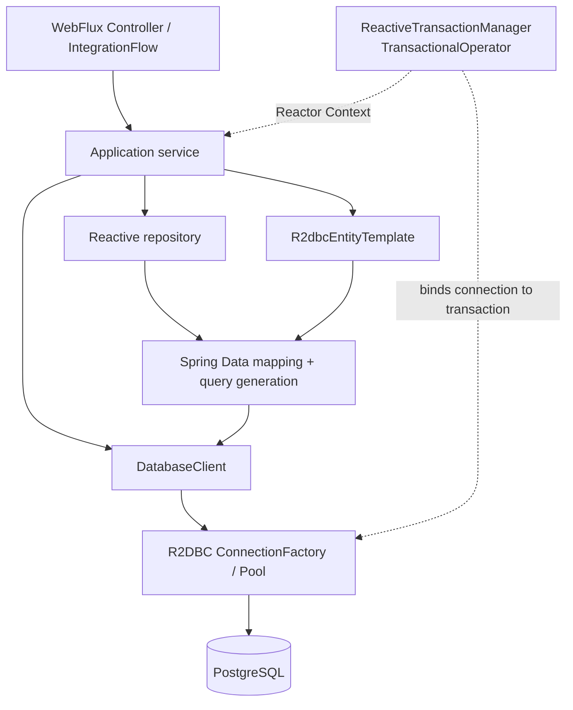
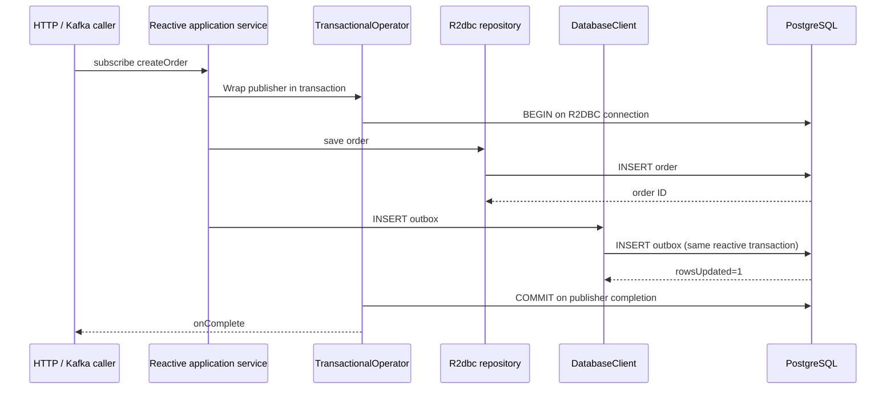
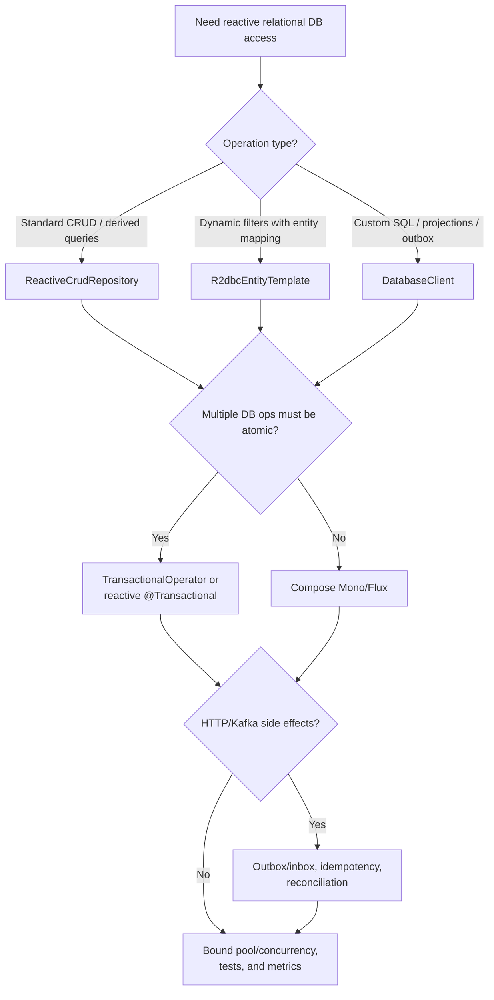

# DatabaseClient, R2dbcEntityTemplate, and Reactive Repositories

## 1. Context: accessing relational data in a reactive flow

In a Spring Boot system, an integration task may span WebFlux, PostgreSQL, HTTP clients, Kafka, and caches. For instance, `order-service` receives an order creation command, saves data in PostgreSQL, writes an event to a **transactional outbox**, and another worker publishes that event to Kafka. When adopting the reactive model, you need a database access mechanism that composes with `Mono`/`Flux` without tying up a thread waiting on JDBC I/O for each query.

**R2DBC (Reactive Relational Database Connectivity)** is an SPI/driver suite for accessing relational databases asynchronously in alignment with Reactive Streams. Spring Framework provides `DatabaseClient`; Spring Data R2DBC builds `R2dbcEntityTemplate` and reactive repositories on top. All three can share the same `ConnectionFactory` and database, yet their **abstraction levels and responsibilities differ**.

This lesson belongs to the **Reactive Data** chapter of the **SPRING_BOOT_INTEGRATION** module, so it goes beyond running a single SQL statement. We also examine transactions, errors, data contracts, connection pools, deduplication, database-broker consistency, testing, backpressure, and observability in real integration flows.

**Learning objectives**

1. Distinguish `DatabaseClient`, `R2dbcEntityTemplate`, and `ReactiveCrudRepository`/`R2dbcRepository`.
2. Select the right API based on querying, mapping, CRUD, and performance needs.
3. Write queries with parameter binding, row mapping, and understand `one()`, `first()`, and `all()`.
4. Use entity mapping, criteria/query/update, and derived repository methods within their limits.
5. Understand when a Publisher executes, how reactive transactions bind to Reactor Context, and connection lifecycles.
6. Design database + outbox writes without relying on nonexistent distributed transactions.
7. Bound concurrency, result sizes, and connection pools; test with `StepVerifier` and Testcontainers.

> **Scope:** Examples use Java 17+, Spring Boot 3.x, Spring Framework 6.x, Spring Data R2DBC 3.x, PostgreSQL, and Reactor. Spring Boot 4.x/Spring Framework 7.x may change some classes, dependencies, or auto-configuration; always verify against your exact BOM and documentation. Code examples are structured to explain each API layer; full production readiness still depends on schemas, migrations, consistency requirements, and target infrastructure.

## 2. Three API levels over the same `ConnectionFactory`



| API | Characteristics | Best fit when | What you handle yourself |
| --- | --- | --- | --- |
| `DatabaseClient` | SQL-oriented, parameter binding, row-level result mapping. | Custom SQL, complex projections, outbox inserts, fine-grained statement control. | Writing SQL, row/result mapping, and keeping up with schema changes. |
| `R2dbcEntityTemplate` | Entity mapping and fluent CRUD/query API. | Dynamic criteria queries, mapped inserts/updates/deletes. | Building queries, understanding mapping/versioning and SQL limits. |
| `ReactiveCrudRepository`/`R2dbcRepository` | Repository interfaces, standard CRUD, and derived query methods. | Common CRUD, concise business code, and stable queries. | Defining methods and writing `@Query` when derivation falls short. |

These three layers **are not three database drivers**. They typically share the same R2DBC driver and transactional context when configured consistently. You can use a repository for orders, a template for dynamic search queries, and `DatabaseClient` for outbox inserts inside **the same application service**.

### 2.1. Why not use reactive JPA repositories?

Standard `JpaRepository`/Hibernate ORM runs on JDBC and is a blocking API; wrapping it in `Mono.just(...)` **does not make JDBC access non-blocking**. Spring Data R2DBC is a separate stack: it does not provide JPA's full ORM model, such as a persistence context, dirty checking, and Hibernate-style lazy relationships.

If your application relies heavily on JPA and does not require non-blocking I/O, JDBC/JPA can be simpler. Do not choose reactive just because the stack sounds modern; evaluate concurrent I/O demand, team expertise, driver maturity, transactions, operations, and surrounding libraries.

## 3. Preparing Spring Boot and PostgreSQL

### 3.1. Dependencies

With Maven and the Spring Boot BOM:

```xml
<dependencies>
    <dependency>
        <groupId>org.springframework.boot</groupId>
        <artifactId>spring-boot-starter-data-r2dbc</artifactId>
    </dependency>
    <dependency>
        <groupId>org.postgresql</groupId>
        <artifactId>r2dbc-postgresql</artifactId>
        <scope>runtime</scope>
    </dependency>

    <dependency>
        <groupId>org.springframework.boot</groupId>
        <artifactId>spring-boot-starter-test</artifactId>
        <scope>test</scope>
    </dependency>
    <dependency>
        <groupId>io.projectreactor</groupId>
        <artifactId>reactor-test</artifactId>
        <scope>test</scope>
    </dependency>
</dependencies>
```

If the project exposes WebFlux Controllers, add `spring-boot-starter-webflux` at the HTTP layer. For schema management with Flyway/Liquibase, configure migrations appropriately; traditional Flyway uses a separate **JDBC connection** and does not run through an R2DBC `ConnectionFactory` by default.

### 3.2. Configuring `spring.r2dbc.*`

```yaml
# application.yml
spring:
  r2dbc:
    url: ${R2DBC_URL:r2dbc:postgresql://localhost:5432/order_db}
    username: ${R2DBC_USERNAME:order_app}
    password: ${R2DBC_PASSWORD}
    pool:
      enabled: true
      initial-size: 5
      max-size: 20
      max-idle-time: 30m
```

In production, **never put real passwords in source code** and do not let a localhost default pass as a production endpoint. R2DBC URLs use the `r2dbc:postgresql://` prefix, not the JDBC URL `jdbc:postgresql://`, for `spring.r2dbc.url`.

Pool properties apply when `r2dbc-pool` is on the classpath and Boot auto-configuration is active. Verify your exact version, acquisition timeouts, idle/lifetime settings, and pool metrics. `max-size: 20` is an **illustrative per-instance limit**, not a universal recommendation for all workloads.

A 30-pod deployment with up to 20 connections per pod can push database pressure past 600 connections when pools run near capacity—on top of JDBC migrations, monitoring, workers, and other services. Size pools based on database max connections, throughput, query latency, and shared resource budgets.

### 3.3. Illustrative SQL schema

We use an orders table and an outbox table to connect this topic to real integration flows:

```sql
CREATE TABLE integration_orders (
    id            BIGSERIAL PRIMARY KEY,
    command_id    VARCHAR(100) NOT NULL UNIQUE,
    customer_id   VARCHAR(80)  NOT NULL,
    status        VARCHAR(30)  NOT NULL,
    total_cents   BIGINT       NOT NULL CHECK (total_cents >= 0),
    created_at    TIMESTAMPTZ  NOT NULL,
    version       BIGINT       NOT NULL DEFAULT 0
);

CREATE INDEX idx_orders_customer_status
    ON integration_orders(customer_id, status);

CREATE TABLE integration_outbox (
    event_id      VARCHAR(160) PRIMARY KEY,
    order_id      BIGINT       NOT NULL
                  REFERENCES integration_orders(id),
    event_type    VARCHAR(80)  NOT NULL,
    payload       TEXT         NOT NULL,
    published     BOOLEAN      NOT NULL DEFAULT FALSE,
    created_at    TIMESTAMPTZ  NOT NULL
);

CREATE INDEX idx_outbox_unpublished_created
    ON integration_outbox(published, created_at);
```

This schema is simplified for demonstration and omits partitioning, retention, worker lease state, and indexes tuned for every access pattern. Schema migrations should be versioned and rolled out using an expand–migrate–contract plan to avoid breaking running consumers.

### 3.4. Controlling automatic schema creation

Do not allow production code to arbitrarily create or drop tables on startup if your organization uses a migration tool. PostgreSQL DDL, indexes, constraints, data types, and database grants are part of your **storage contract**; repository code can compile yet still fail at runtime if migrations were skipped or column names diverge from mappings.

## 4. Reactive nature: a Publisher is only a job description

`Mono<T>` represents zero or one result, while `Flux<T>` can emit multiple results. With R2DBC, an operator chain is a **lazy execution plan**: queries execute only when subscribed to, following Publisher semantics.

```java
Mono<Long> count = databaseClient
    .sql("SELECT COUNT(*) FROM integration_orders")
    .map((row, metadata) ->
        row.get(0, Long.class))
    .one();

// subscribe has not been called yet: only assembling the Publisher.
// In a WebFlux app, the framework subscribes for the HTTP response.
// In tests, StepVerifier subscribes.
```

Never write:

```java
// WRONG: manual subscribe, returning before DB execution completes.
public Mono<Void> saveOrderBad(IntegrationOrder order) {
    repository.save(order).subscribe();
    return Mono.empty();
}
```

Flaws in the code above:

- The subscription runs detached from the caller's success or failure signals.
- Transaction context and correlation context may be lost.
- The caller may return HTTP 201 or ack Kafka **before the DB commits**.
- Upstream retries and timeouts no longer control the detached work.

Instead, **return the Publisher chain**:

```java
public Mono<IntegrationOrder> saveOrder(
    IntegrationOrder order
) {
    return repository.save(order);
}
```

Subscribing twice to a cold Publisher usually causes **side effects to run twice**. If you keep a database-writing `Mono` and pass it to multiple subscribers, understand repeatability, caching, and idempotency; never slap `.cache()` onto Publishers representing side-effecting commands.

## 5. `DatabaseClient`: writing SQL and binding parameters

`org.springframework.r2dbc.core.DatabaseClient` lives in Spring Framework, working directly with SQL and the R2DBC driver without full entity mapping like Spring Data repositories.

### 5.1. A SELECT statement with named parameters

```java
// OrderSqlGateway.java
import java.time.Instant;
import org.springframework.r2dbc.core.DatabaseClient;
import reactor.core.publisher.Flux;
import reactor.core.publisher.Mono;

public final class OrderSqlGateway {
    private final DatabaseClient db;

    public OrderSqlGateway(DatabaseClient db) {
        this.db = db;
    }

    public Flux<OrderSummary> findByStatus(String status) {
        return db.sql("""
                SELECT id, command_id, status, total_cents, created_at
                FROM integration_orders
                WHERE status = :status
                ORDER BY created_at DESC
                LIMIT 100
                """)
            .bind("status", status)
            .map((row, metadata) -> new OrderSummary(
                row.get("id", Long.class),
                row.get("command_id", String.class),
                row.get("status", String.class),
                row.get("total_cents", Long.class),
                row.get("created_at", Instant.class)
            ))
            .all();
    }

    public Mono<Long> countByStatus(String status) {
        return db.sql("""
                SELECT COUNT(*) AS total
                FROM integration_orders
                WHERE status = :status
                """)
            .bind("status", status)
            .map((row, metadata) -> row.get("total", Long.class))
            .one();
    }
}
```

Where:

```java
// OrderSummary.java
import java.time.Instant;

public record OrderSummary(
    Long id,
    String commandId,
    String status,
    Long totalCents,
    Instant createdAt
) {}
```

`DatabaseClient.sql(...)` accepts the SQL string, `bind("status", value)` passes values safely via parameter binding, `map(...)` constructs the Java object, and `all()` returns `Flux<OrderSummary>`.

**Row mapping warning:** `row.get("created_at", Instant.class)` depends on driver/dialect conversion support; with the PostgreSQL driver, `TIMESTAMPTZ` columns may come back as `OffsetDateTime` and require conversion to `Instant` depending on driver version. If direct conversion is unsupported, map explicitly:

```java
// An explicit-type option for PostgreSQL TIMESTAMPTZ.
java.time.OffsetDateTime timestamp =
    row.get("created_at", java.time.OffsetDateTime.class);
java.time.Instant instant =
    timestamp == null ? null : timestamp.toInstant();
```

Test mappers against the actual database and driver instead of guessing Java type compatibility.

### 5.2. `one()`, `first()`, and `all()`

| Terminal operation | Publisher | When to use |
| --- | --- | --- |
| `.one()` | `Mono<T>` | Expects at most one row; multiple rows indicate a query contract violation. |
| `.first()` | `Mono<T>` | Only needs the first row, e.g. already ordered/limited in SQL. |
| `.all()` | `Flux<T>` | Multiple rows; should be bounded by paging or batch size. |
| `.fetch().rowsUpdated()` | `Mono<Long>` | Returns affected row count for UPDATE/DELETE/INSERT per driver API. |

Never use `first()` to hide uniqueness bugs on a business query that should return at most one row. For "order by commandId", enforce a unique constraint in the DB and use `one()` or repository `findByCommandId`.

### 5.3. INSERT/UPDATE/DELETE and affected row counts

```java
import org.springframework.r2dbc.core.DatabaseClient;
import reactor.core.publisher.Mono;

public Mono<Long> markOrderPaid(long orderId) {
    return db.sql("""
            UPDATE integration_orders
            SET status = :status
            WHERE id = :id AND status = :expected
            """)
        .bind("status", "PAID")
        .bind("id", orderId)
        .bind("expected", "PENDING")
        .fetch()
        .rowsUpdated();
}
```

A result of `0` rows could mean the order does not exist, was already processed, or is in another status. Never assume `rowsUpdated() == 0` implies success. For idempotent commands, inspect the current state to distinguish "already completed for this same command" from "state conflict".

Example conditional check:

```java
return markOrderPaid(orderId).flatMap(updated -> {
    if (updated == 1L) {
        return Mono.empty();
    }
    return Mono.error(
        new IllegalStateException("Order is not in PENDING status")
    );
});
```

This snippet demonstrates **checking the affected count**; a real application would raise a domain-specific exception and coordinate transactions/outbox rather than assuming this standalone call published an event.

### 5.4. Binding `null` properly

R2DBC does not permit `bind("note", null)` the way some JDBC APIs do. Use `bindNull(...)` with the target Java type:

```java
var query = db.sql("""
    UPDATE integration_orders SET status = :status
    WHERE id = :id
    """)
    .bind("status", "CANCELLED")
    .bind("id", orderId);

return query.fetch().rowsUpdated();

// For a NULLABLE column:
// db.sql("UPDATE ... SET note = :note WHERE id = :id")
//   .bindNull("note", String.class)
//   .bind("id", orderId)
//   .fetch().rowsUpdated();
```

Never build SQL by concatenating strings with user input:

```java
// WRONG: SQL injection and unescaped quotes can break SQL.
db.sql("SELECT * FROM integration_orders WHERE status = '" + status + "'");

// RIGHT: bind parameter values.
db.sql("SELECT * FROM integration_orders WHERE status = :status")
  .bind("status", status);
```

**Bind parameters are strictly for values.** You cannot bind table names, column names, or `ORDER BY` directions as ordinary bound strings; any dynamic identifiers must be selected from an application-defined allowlist.

### 5.5. When does `DatabaseClient` truly shine?

- Multi-table joins producing compact reporting DTOs without full entity mapping.
- PostgreSQL-specific SQL: `ON CONFLICT`, `RETURNING`, CTEs, window functions.
- Writing outbox rows within a shared transaction alongside repository writes.
- Conditional compare-and-set updates in a single SQL statement.
- Controlling affected row counts and handling conflicts explicitly.

Tradeoff: with hand-written SQL, you are responsible for table/column names, SQL dialect, and mapping. If the schema changes, the Java compiler will not catch mismatched column names; migration discipline and integration tests are essential.

## 6. Entity mapping shared across templates and repositories

Spring Data R2DBC maps relational tables to Java objects using annotations:

```java
// IntegrationOrder.java
import java.time.Instant;
import org.springframework.data.annotation.Id;
import org.springframework.data.annotation.Version;
import org.springframework.data.relational.core.mapping.Column;
import org.springframework.data.relational.core.mapping.Table;

@Table("integration_orders")
public record IntegrationOrder(
    @Id Long id,
    @Column("command_id") String commandId,
    @Column("customer_id") String customerId,
    String status,
    @Column("total_cents") long totalCents,
    @Column("created_at") Instant createdAt,
    @Version Long version
) {}
```

| Annotation | Meaning |
| --- | --- |
| `@Table` | Table name (and optional schema configuration). |
| `@Id` | Primary key; used by Spring Data to identify the entity. |
| `@Column` | Actual column name when it differs from the Java property name. |
| `@Version` | Enables optimistic locking in compatible entity-aware operations. |

Because Java records are immutable, saving returns **a new record instance** carrying the database/mapping-updated ID and version; always use the instance returned by `save`/`insert` rather than expecting the original object to mutate in place.

### 6.1. The "new entity" rule is critical

An entity with a `null` `@Id Long id` is typically treated as new. For application-assigned IDs (non-null UUID/String), Spring Data needs a signal to decide between INSERT and UPDATE: `@Version`, `Persistable`, or appropriate new-state configuration.

With the wrong strategy, `save(...)` may attempt an UPDATE on a nonexistent row or throw an optimistic locking failure. Here, we use `BIGSERIAL` with `id = null` on creation, then read the generated ID from the returned entity.

### 6.2. Do not confuse `@Version` with event ordering

`@Version` protects certain entity-level updates from concurrent overwrites via version checks. It **does not automatically** solve:

- Older Kafka events arriving after newer events.
- Raw `DatabaseClient` SQL UPDATE statements that omit the version column.
- Two services writing the same state through APIs without preconditions.
- Distributed transactions across PostgreSQL and Kafka/HTTP.

For message processing, include an `aggregateVersion`/sequence number in the event contract and enforce conditional updates explicitly; never treat every optimistic locking failure as unconditionally retryable.

## 7. `R2dbcEntityTemplate`: CRUD and criteria queries

`org.springframework.data.r2dbc.core.R2dbcEntityTemplate` performs queries and updates using Spring Data's mapping context, reducing boilerplate SQL for common operations.

### 7.1. Inserting an entity

```java
// OrderTemplateGateway.java
import java.time.Instant;
import org.springframework.data.r2dbc.core.R2dbcEntityTemplate;
import reactor.core.publisher.Mono;

public final class OrderTemplateGateway {
    private final R2dbcEntityTemplate template;

    public OrderTemplateGateway(R2dbcEntityTemplate template) {
        this.template = template;
    }

    public Mono<IntegrationOrder> insertPending(
        String commandId, String customerId, long totalCents
    ) {
        var row = new IntegrationOrder(
            null, commandId, customerId,
            "PENDING", totalCents, Instant.now(), null
        );

        return template.insert(IntegrationOrder.class).using(row);
    }
}
```

The template generates the insert SQL from entity mapping, including table and column names. Yet business invariants still live in the database: `command_id UNIQUE`, `total_cents >= 0`, and domain rules. Inserting a duplicate `commandId` triggers a duplicate key error; the application must map that into an idempotent result or controlled conflict.

### 7.2. Selecting with Criteria, Sort, and Limit

```java
import org.springframework.data.domain.Sort;
import org.springframework.data.relational.core.query.Criteria;
import org.springframework.data.relational.core.query.Query;
import reactor.core.publisher.Flux;

public Flux<IntegrationOrder> findPendingForCustomer(
    String customerId, int limit
) {
    if (limit < 1 || limit > 100) {
        return Flux.error(new IllegalArgumentException(
            "limit must be between 1 and 100"
        ));
    }

    Query query = Query.query(
            Criteria.where("customerId").is(customerId)
                .and("status").is("PENDING")
        )
        .sort(Sort.by(Sort.Direction.DESC, "createdAt"))
        .limit(limit);

    return template.select(IntegrationOrder.class)
        .matching(query)
        .all();
}
```

In `Criteria`, use **entity property names** such as `customerId` and `createdAt`; Spring Data mapping translates them to `customer_id` and `created_at`. With raw SQL in `DatabaseClient`, use actual SQL column names.

For real pagination, design a deterministic tie-breaker sort order (e.g., adding `id` when `createdAt` ties). For large datasets, prefer keyset/cursor pagination to avoid expensive deep `OFFSET` scans and drift when data changes.

### 7.3. Updating by criteria

```java
import org.springframework.data.relational.core.query.Criteria;
import org.springframework.data.relational.core.query.Query;
import org.springframework.data.relational.core.query.Update;
import reactor.core.publisher.Mono;

public Mono<Long> markCancelled(long id) {
    Query query = Query.query(
        Criteria.where("id").is(id)
            .and("status").is("PENDING")
    );

    return template.update(IntegrationOrder.class)
        .matching(query)
        .apply(Update.update("status", "CANCELLED"));
}
```

Criteria updates concisely modify only specified columns. **However, they do not automatically provide `@Version` optimistic locking the way entity-level saves do**: if version checking is required, include `version = :expectedVersion` in the criteria and increment it explicitly, or use Spring Data's entity-aware update path and test its behavior.

When `markCancelled(...)` returns `0`, the application must check whether the order was already `CANCELLED` or is now `PAID`. The same state may justify an idempotent response; another state is a business conflict.

### 7.4. Deletes and the risks of hard deletion

```java
public Mono<Long> deletePending(long id) {
    return template.delete(IntegrationOrder.class)
        .matching(Query.query(
            Criteria.where("id").is(id)
                .and("status").is("PENDING")
        ))
        .all();
}
```

Physical deletion can break audit trails, outbox rows, or foreign key references. Order systems typically prefer `CANCELLED`/`DELETED` states or retention policies over immediate row deletion. The template is merely a data manipulation tool; it does not enforce domain lifecycle rules.

### 7.5. Choosing templates over monstrous repository methods

If a search query has 8 optional filters, writing `findByStatusAndCustomerIdAndCreatedAtBetween...` makes repository interfaces unreadable. `R2dbcEntityTemplate` + `Criteria` fits much better, provided you still:

- Validate sort fields against an allowlist.
- Bound result counts and query timeouts.
- Inspect execution plans and indexes; clean criteria APIs do not automatically make queries fast.
- Test nullable/optional filter combinations and pagination.

## 8. Reactive repositories: concise CRUD and expressive queries

Spring Data R2DBC lets you define repository interfaces:

```java
// IntegrationOrderRepository.java
import org.springframework.data.repository.reactive.ReactiveCrudRepository;
import reactor.core.publisher.Flux;
import reactor.core.publisher.Mono;

public interface IntegrationOrderRepository
    extends ReactiveCrudRepository<IntegrationOrder, Long> {

    Mono<IntegrationOrder> findByCommandId(String commandId);

    Flux<IntegrationOrder> findByCustomerIdAndStatus(
        String customerId, String status
    );

    Mono<Boolean> existsByCommandId(String commandId);
}
```

Common methods on `ReactiveCrudRepository`:

| Method | Result | Notes |
| --- | --- | --- |
| `save(entity)` | `Mono<T>` | Inserts or updates based on entity state and mapping. |
| `findById(id)` | `Mono<T>` | Empty publisher if not found. |
| `findAll()` | `Flux<T>` | Avoid unbounded calls on large tables. |
| `existsById(id)` | `Mono<Boolean>` | Only a point-in-time existence check. |
| `count()` | `Mono<Long>` | Full DB counts can be expensive depending on indexes/table size. |
| `deleteById(id)` | `Mono<Void>` | Does not guarantee a row was deleted unless checked separately. |
| `findByCommandId(...)` | `Mono<IntegrationOrder>` | Derived query generated from method name and mapping. |

Spring Data R2DBC also offers `R2dbcRepository` for R2DBC/relational-specific repository features depending on version. Not every JPA repository feature exists here: there are no default entity graphs, `@OneToMany` lazy loading, JPQL, or persistence contexts.

### 8.1. `@Query` for SQL requiring explicit control

```java
import org.springframework.data.r2dbc.repository.Query;

@Query("""
    SELECT *
    FROM integration_orders
    WHERE customer_id = :customerId
    ORDER BY created_at DESC, id DESC
    LIMIT :limit
    """)
Flux<IntegrationOrder> findLatestForCustomer(
    String customerId, int limit
);
```

This annotation goes **inside the repository interface**. With `@Query`, the query string is database-dialect SQL, not JPQL. Dynamic elements that cannot be bound—like column names or sort directions—must be controlled via a template/gateway backed by an allowlist.

### 8.2. Projections and avoiding over-fetching

If an API only needs a summary, avoid fetching full entities with wide columns or large payloads. Use projections or `DatabaseClient` mapped straight to a DTO. Pick the cleanest tool for the query:

- Repository: stable derived queries and simple projections.
- Template: dynamic queries with entity mapping.
- DatabaseClient: custom SQL projections, specialized joins, and tight column control.

### 8.3. Repositories do not replace database invariants

With a workflow like:

```text
if (!repository.existsByCommandId(cmdId)) {
    repository.save(order);
}
```

two concurrent requests can both observe `false` and then both INSERT. Always rely on a **unique constraint** as the final safeguard and handle duplicate conflicts intentionally. Never treat `existsBy...` before `save` as concurrency-safe deduplication.

## 9. Choosing the right API in an application

| Need | Primary recommendation | When to switch |
| --- | --- | --- |
| Basic order CRUD | Reactive repository. | When custom SQL, mapping, or projections are needed. |
| Search with multiple optional filters | `R2dbcEntityTemplate` + Criteria. | If dialect-specific query tuning is hard to express. |
| Reporting joins and aggregations | `DatabaseClient`. | If repository projections/`@Query` are already clear and maintainable. |
| Outbox INSERT with explicit SQL | `DatabaseClient`. | When outbox has a mapped entity fitting repository/template cleanly. |
| `@Version` optimistic locking | Entity-aware repository/template. | Raw SQL must check and increment version manually. |
| Large bulk ingestion | Controlled SQL/driver batching or dedicated bulk tooling. | Sequential repository saves only for small, simple datasets. |
| Dialect-independent SQL | Entities/repositories provide partial portability. | There is no magic portability across every SQL dialect/feature. |

Avoid creating extra abstraction layers purely for "clean architecture" dogma: one application service can inject a repository alongside an outbox gateway built on `DatabaseClient`. What matters are **business boundaries, transactions, error handling, and testability**.

## 10. Reactive transactions: not ThreadLocal

Blocking JDBC/JPA transactions typically rely on thread-bound transaction state. R2DBC reactive transactions use **Reactor Context** to propagate transaction state and the bound connection along the Publisher chain.



### 10.1. Using `TransactionalOperator`

When Boot registers an appropriate `ReactiveTransactionManager` for `ConnectionFactory`, you can expose a `TransactionalOperator` bean:

```java
// ReactiveTransactionConfiguration.java
import org.springframework.context.annotation.Bean;
import org.springframework.context.annotation.Configuration;
import org.springframework.transaction.ReactiveTransactionManager;
import org.springframework.transaction.reactive.TransactionalOperator;

@Configuration(proxyBeanMethods = false)
public class ReactiveTransactionConfiguration {
    @Bean
    TransactionalOperator transactionalOperator(
        ReactiveTransactionManager manager
    ) {
        return TransactionalOperator.create(manager);
    }
}
```

Do not instantiate a second transaction manager on a separate `ConnectionFactory` if you want the repository and `DatabaseClient` to share a transaction. Both must use the same connection/transaction infrastructure, or an explicitly scoped multi-DB configuration.

### 10.2. Writing order and outbox in a single local transaction

Example order creation command:

```java
// CreateOrderCommand.java
public record CreateOrderCommand(
    String commandId,
    String customerId,
    long totalCents
) {}
```

Service combining a repository and `DatabaseClient`:

```java
// CreateOrderService.java
import java.time.Instant;
import org.springframework.r2dbc.core.DatabaseClient;
import org.springframework.stereotype.Service;
import org.springframework.transaction.reactive.TransactionalOperator;
import reactor.core.publisher.Mono;

@Service
public class CreateOrderService {
    private final IntegrationOrderRepository orders;
    private final DatabaseClient db;
    private final TransactionalOperator tx;

    public CreateOrderService(
        IntegrationOrderRepository orders,
        DatabaseClient db,
        TransactionalOperator tx
    ) {
        this.orders = orders;
        this.db = db;
        this.tx = tx;
    }

    public Mono<IntegrationOrder> create(CreateOrderCommand cmd) {
        return Mono.defer(() -> {
            if (cmd.commandId() == null || cmd.commandId().isBlank()
                || cmd.totalCents() < 0) {
                return Mono.error(new IllegalArgumentException(
                    "Invalid create-order command"
                ));
            }

            Instant now = Instant.now();
            IntegrationOrder candidate = new IntegrationOrder(
                null,
                cmd.commandId(),
                cmd.customerId(),
                "PENDING",
                cmd.totalCents(),
                now,
                null
            );

            return orders.save(candidate)
                .flatMap(saved -> db.sql("""
                        INSERT INTO integration_outbox
                        (event_id, order_id, event_type, payload,
                         published, created_at)
                        VALUES (:eventId, :orderId, :eventType, :payload,
                                FALSE, :createdAt)
                        """)
                    .bind("eventId", "order-created:" + cmd.commandId())
                    .bind("orderId", saved.id())
                    .bind("eventType", "OrderCreated")
                    .bind("payload", """
                        {"commandId":"illustrative"}
                        """)
                    .bind("createdAt", now)
                    .fetch()
                    .rowsUpdated()
                    .flatMap(rows -> rows == 1L
                        ? Mono.just(saved)
                        : Mono.error(new IllegalStateException(
                            "Failed to create outbox event"
                        ))
                    )
                );
        }).as(tx::transactional);
    }
}
```

**This is a transaction-scope illustration, not a complete production command handler.** The `payload` uses static JSON only for readability; real applications must serialize a validated event DTO matching the schema with actual `commandId`/`orderId` using a proper serializer. Never assemble JSON by concatenating untrusted user strings. Prefer a JSON serializer and contract tests.

What is guaranteed: if both writes execute in the **same R2DBC transaction** and the outbox insert fails, the local transaction rolls back both the order and the outbox. What is **not** guaranteed: that the event reached Kafka, an external HTTP request succeeded, or another consumer processed the event.

### 10.3. Idempotency and duplicate keys

`command_id UNIQUE` on orders and `event_id PRIMARY KEY` on outbox guard local storage. However, `create(cmd)` above still throws a duplicate-key error on command retry; to make it idempotent, the service must:

1. Catch the `command_id` uniqueness exception **outside** the failed transaction.
2. Read the existing row via `findByCommandId` in a fresh transaction or read operation.
3. Compare the full command payload/contract against the stored row; if it matches, return the stored result.
4. If the same `commandId` carries a different payload, return a business conflict rather than treating it as success.
5. Guard downstream side effects using stable event IDs in a consumer inbox; do not rely solely on a generic `DuplicateKeyException` class, which might originate from another constraint.

**Never issue recovery queries on a PostgreSQL transaction already in an aborted state after a unique violation and expect valid results.** Retries and reconciliation must happen in a fresh boundary after rollback.

### 10.4. `@Transactional` on reactive methods

You can write:

```java
import org.springframework.transaction.annotation.Transactional;

@Transactional
public Mono<IntegrationOrder> createTransactional(CreateOrderCommand cmd) {
    return orders.save(toEntity(cmd))
        .flatMap(saved -> insertOutbox(saved).thenReturn(saved));
}
```

This is a **structural sketch**: `toEntity` and `insertOutbox` are service helper methods. For the annotation to take effect, the method must be invoked through a Spring proxy and return a reactive Publisher; self-invoking `this.createTransactional(...)` within the same class bypasses the proxy interceptor. Never call `subscribe()` or `block()` inside the method to "trigger the transaction".

For complex logic, `TransactionalOperator` expresses transaction scope more explicitly. For functions composed across layers, `@Transactional` remains viable as long as proxy and bean boundaries are respected.

### 10.5. Never mix JDBC transactions with R2DBC transactions

`@Transactional` does not combine a `JpaTransactionManager` and an `R2dbcTransactionManager` into a single ACID transaction. Nor can an annotation make a database commit atomic with HTTP or Kafka calls.

If an application runs JPA/JDBC alongside R2DBC, clearly assign which transaction manager owns each method or Publisher, and avoid expecting joint transactions across both. When synchronizing events, transactional outbox + inbox/replay is the practical pattern.

## 11. Ordering, concurrency, and transactional connections

In Reactor, `flatMap` can run multiple inner publishers concurrently. This helps independent I/O work, yet is **not safe by default when operations share a single connection inside a transaction**.

### 11.1. Explicit sequencing for dependent write steps

```java
return orders.save(order)
    .flatMap(saved -> outboxGateway.save(saved)
        .thenReturn(saved))
    .as(tx::transactional);
```

`outboxGateway.save` must return `Mono<?>` and share the same R2DBC infrastructure; database operations chain sequentially after `save` emits rather than running concurrently. Within a single-connection transaction, predictable ordering prevents concurrent statement access unsupported by the driver.

### 11.2. Caution with high `flatMap` concurrency

```java
Flux.fromIterable(commands)
    .flatMap(command -> createOrderService.create(command), 8);
```

`concurrency=8` limits active inner publishers in that operator, **not** total commands in flight across the entire system or whether the DB actually has 8 connections free. If `create(...)` opens a transaction per subscription, up to 8 transactions can hit the pool in parallel. That increases throughput, but also lock contention, duplicate races, and database load.

When business ordering matters, use `concatMap` or partition by key and serialize within each partition. Never assume raising concurrency improves performance if the real bottleneck is locks, indexes, or DB max connections.

### 11.3. `zip` inside a transaction is not always ideal

`Mono.zip(dbOperation1, dbOperation2)` subscribes to both sources together, potentially issuing concurrent SQL statements on the same transaction-bound connection. When operations depend on each other or the driver permits only one active statement per connection, use sequential `then`/`flatMap`; evaluate transaction topology and driver capabilities before running queries in parallel.

## 12. Backpressure and connection pools: reactive does not mean unbounded

A flow returning `Flux<Order>` supports downstream demand, yet not every driver or SQL operation streams row-by-row without buffering. Drivers and queries may buffer rows or be governed by fetch size and cursor behavior.

### 12.1. Never call `collectList()` on unbounded result sets

```java
// RISK: if the table holds millions of rows, the entire result loads onto the heap.
Mono<java.util.List<IntegrationOrder>> all =
    repository.findAll().collectList();
```

Replace with a bounded query:

```java
Flux<IntegrationOrder> pending = template
    .select(IntegrationOrder.class)
    .matching(
        Query.query(Criteria.where("status").is("PENDING"))
            .sort(Sort.by("id"))
            .limit(100)
    )
    .all();
```

To process across many pages, use keyset/cursor pagination plus checkpoints rather than iterating `findAll()`. Bounding row counts, bytes, and query duration protects both the database and the JVM.

### 12.2. Hidden queues to keep visible

```text
HTTP pending requests
  -> Reactor operators (flatMap concurrency/prefetch)
  -> R2DBC pool pending acquisition
  -> database active sessions / locks / disk I/O
  -> downstream Kafka/HTTP
```

When the pool is full, spawning 1,000 more publishers does not open 1,000 connections: they **queue waiting to acquire**, consuming memory and spiking latency. Measure active/idle/pending connections alongside p95/p99 SQL latency, DB lock wait time, and API/broker queues.

Set realistic limits:

1. `spring.r2dbc.pool.max-size` aligned with DB limits and pod count.
2. Acquire/read/query timeouts matched to SLAs (per driver/pool/database).
3. `flatMap(..., concurrency)` or semaphores/bulkheads per use case.
4. Pagination/chunking to avoid materializing huge responses.
5. End-to-end request/command timeouts, not just individual connection timeouts.
6. Retries with backoff/jitter **only** for transient errors and safe/idempotent operations.

### 12.3. Never block the event loop

Do not write:

```java
// WRONG inside a WebFlux handler or reactive flow:
IntegrationOrder row = repository.findById(id).block();
```

If you must invoke a legacy blocking library, isolate it explicitly:

```java
Mono<String> legacyValue = Mono.fromCallable(
        () -> blockingLegacyClient.fetchValue()
    )
    .subscribeOn(
        reactor.core.scheduler.Schedulers.boundedElastic()
    );
```

This is a **temporary integration bridge** for a blocking component; it does not make that component reactive, nor does it enroll JDBC/JPA into an R2DBC transaction. `boundedElastic` also has thread and queue caps that must be measured under load. Prefer genuinely non-blocking drivers and clients whenever the architecture calls for it.

## 13. Layer-appropriate error handling

R2DBC surfaces several categories of exceptions:

| Error category | Examples | Handling approach |
| --- | --- | --- |
| Data integrity | Duplicate `command_id`, NOT NULL/CHECK/FK violations. | Distinguish idempotent duplicates from conflicts/validation errors; never retry blindly. |
| Optimistic lock | `@Version` mismatch. | Reload current state and recompute the command if allowed by contract. |
| Connection/timeout | DB unavailable, connection acquisition timeout. | Bounded retry with idempotency; monitor pool and DB health. |
| Serialization/type | Java type incompatible with column or driver. | Fix mapper/schema; never retry the same broken payload forever. |
| Query syntax | Wrong column name or SQL dialect error. | Fix code/migration; never retry. |
| Deadlock/lock conflict | Transaction rolled back; DB signals transient conflict. | Retry **the entire fresh transaction**, not a single statement inside an aborted one. |
| Entity mapping | Wrong `@Column`, broken ID/new-state detection. | Fix mapping and add integration tests. |

Spring may translate certain errors into `DataAccessException` subclasses (such as `DuplicateKeyException`) depending on layer, dialect, and driver. Never attach a blanket "retry every `DataAccessException`" policy: many of them are permanent failures.

### 13.1. `onErrorResume` is not for swallowing errors

```java
// DANGEROUS: turns a database outage into "no order found".
return repository.findById(id)
    .onErrorResume(ex -> Mono.empty());
```

This prevents callers from distinguishing "not found" from "database broken". Instead:

```java
return repository.findById(id)
    .switchIfEmpty(
        Mono.error(new OrderNotFoundException(id))
    );
```

`OrderNotFoundException` is an application-defined exception. Only use `onErrorResume` when a safe recovery path exists for a specifically classified exception:

```java
return repository.findById(id)
    .onErrorMap(
        org.springframework.dao.DataAccessResourceFailureException.class,
        ex -> new OrderStorageUnavailableException(ex)
    );
```

Whether a specific exception subtype is thrown depends on the driver/translator; test real failure scenarios. Never hide the root cause or correlation ID from logs and metrics.

### 13.2. Retries must wrap outside the failed transaction

In PostgreSQL, an SQL error inside a transaction puts that transaction into an aborted state; subsequent statements in the same transaction will fail. For transient errors (such as deadlocks), **roll back, start a fresh transaction, and replay the entire unit of work**.

Placing Reactor `retryWhen(...)` in the wrong spot can resubscribe inside a polluted transaction or repeat external HTTP/Kafka side effects. Verify the operator order:

```java
// Conceptual pattern, not a complete handler:
Mono.defer(() -> createOrderUnitOfWork(command))
    .as(tx::transactional)
    .retryWhen(transientRetrySpec);
```

Here `transientRetrySpec` must be configured with error filtering, max attempts, and backoff, and `createOrderUnitOfWork` must be safe to re-run. Especially, never retry an entire command after an un-idempotent payment API call has already fired.

## 14. Integrating with HTTP, Kafka, and caches

### 14.1. Never emit Kafka events before the DB commits

```java
// WRONG for consistency if expecting atomic side effects:
return repository.save(order)
    .flatMap(saved ->
        reactiveKafkaProducer.send(eventFor(saved))
            .thenReturn(saved)
    );
```

If Kafka publishes successfully and the DB transaction later rolls back, downstream sees an event for uncommitted data. If the DB commits and Kafka fails, the event vanishes. No single R2DBC `@Transactional` annotation provides distributed atomicity across both.

**Standard solution:** persist the order and outbox row in the same PostgreSQL transaction; an independent relay reads committed outbox rows and publishes them. Because the relay might redeliver after crashing between publish and marking published, consumers must be idempotent by event ID.

### 14.2. Kafka consumers and acknowledgment

When Spring Kafka or a Spring Integration inbound adapter invokes a reactive database service:

- An imperative listener must not call `reactiveService.process(message).subscribe()` and immediately ack.
- Define how completion/failure signals bridge to the listener's ack mechanism, threading model, and error handler.
- If your listener adapter supports asynchronous result handling per its version and contract, use that native integration rather than assuming the broker waits for a `Mono`.
- Between DB commit and Kafka offset commit, redelivery can still occur. Enforce unique inbox markers and business idempotency.

A reactive repository **does not** upgrade Kafka delivery from at-least-once to exactly-once business effects.

### 14.3. Caches are secondary state

Suppose you save an order and then update Redis:

```text
PostgreSQL COMMIT -> Redis SET
```

If Redis fails after DB commit, the business command succeeded even though the cache is stale. Choose an explicit strategy: cache-aside/post-commit invalidation, outbox-driven invalidation, TTLs, and stale-read policies. Do not attempt a fictitious DB rollback solely because a cache write failed; likewise, never populate the cache before DB commit where other clients could observe uncommitted state.

## 15. Testing with `StepVerifier`

Reactive code requires asserting **terminal signals** (next/complete/error), not just checking the return value of a method before subscription.

### 15.1. Unit testing a service with a mocked repository

Conceptual example using Mockito and Reactor:

```java
import static org.mockito.Mockito.*;
import static org.junit.jupiter.api.Assertions.*;

import java.time.Instant;
import org.junit.jupiter.api.Test;
import reactor.core.publisher.Mono;
import reactor.test.StepVerifier;

class FindOrderServiceTest {

    @Test
    void emitsOrderFromRepository() {
        IntegrationOrderRepository repository =
            mock(IntegrationOrderRepository.class);

        IntegrationOrder row = new IntegrationOrder(
            42L, "cmd-42", "customer-A", "PENDING",
            125000L, Instant.parse("2026-11-21T00:00:00Z"), 0L
        );
        when(repository.findById(42L))
            .thenReturn(Mono.just(row));

        StepVerifier.create(repository.findById(42L))
            .assertNext(actual ->
                assertEquals("cmd-42", actual.commandId())
            )
            .verifyComplete();

        verify(repository).findById(42L);
    }
}
```

This only tests a **mocked repository**—it does not validate SQL, named parameters, `TIMESTAMPTZ` mapping, or real transactions. Never treat mock tests as proof of schema or driver compatibility.

### 15.2. Proving a Publisher does not execute before subscription

```java
import java.util.concurrent.atomic.AtomicInteger;
import reactor.core.publisher.Mono;
import reactor.test.StepVerifier;

AtomicInteger subscriptions = new AtomicInteger();
Mono<String> operation = Mono.defer(() -> {
    subscriptions.incrementAndGet();
    return Mono.just("OK");
});

// Before subscribe: subscriptions == 0.
StepVerifier.create(operation)
    .expectNext("OK")
    .verifyComplete();
// After subscribe: subscriptions == 1.
```

This is pure Reactor illustrating laziness, not an R2DBC integration test. In WebFlux controllers, the framework subscribes; in tests, `StepVerifier` subscribes and verifies signals.

### 15.3. Testing cancellation and connection release

For long streaming queries, cancellation tests (simulating HTTP client disconnects) must verify connections are not leaked:

```java
StepVerifier.create(
        repository.findAll()
            .take(2)
    )
    .expectNextCount(2)
    .verifyComplete();
```

`take(2)` cancels upstream after two items; however, this alone does not replace measuring active/pending pool connections under cancellation. Against a real database driver, test resource cleanup when clients cancel mid-query, mid-transaction, or mid-stream.

## 16. PostgreSQL Testcontainers: verifying mappings and transactions

R2DBC requires integration tests with a real database and driver. Using Testcontainers PostgreSQL, configure the R2DBC URL dynamically from the container's host and mapped port:

```xml
<dependency>
    <groupId>org.testcontainers</groupId>
    <artifactId>postgresql</artifactId>
    <scope>test</scope>
</dependency>
<dependency>
    <groupId>org.testcontainers</groupId>
    <artifactId>junit-jupiter</artifactId>
    <scope>test</scope>
</dependency>
```

In newer Testcontainers versions, package and artifact names may vary; follow your Spring Boot BOM. Configuration example:

```java
// OrderRepositoryIntegrationTest.java
import static org.assertj.core.api.Assertions.assertThat;

import java.time.Instant;
import org.junit.jupiter.api.Test;
import org.springframework.beans.factory.annotation.Autowired;
import org.springframework.boot.test.autoconfigure.data.r2dbc.DataR2dbcTest;
import org.springframework.r2dbc.core.DatabaseClient;
import org.springframework.test.context.DynamicPropertyRegistry;
import org.springframework.test.context.DynamicPropertySource;
import org.testcontainers.containers.PostgreSQLContainer;
import org.testcontainers.junit.jupiter.Container;
import org.testcontainers.junit.jupiter.Testcontainers;
import reactor.core.publisher.Mono;
import reactor.test.StepVerifier;

@DataR2dbcTest
@Testcontainers
class OrderRepositoryIntegrationTest {
    @Container
    static final PostgreSQLContainer<?> POSTGRES =
        new PostgreSQLContainer<>("postgres:16-alpine");

    @DynamicPropertySource
    static void r2dbcProperties(DynamicPropertyRegistry registry) {
        registry.add("spring.r2dbc.url", () ->
            "r2dbc:postgresql://" + POSTGRES.getHost()
                + ":" + POSTGRES.getMappedPort(5432)
                + "/" + POSTGRES.getDatabaseName()
        );
        registry.add("spring.r2dbc.username", POSTGRES::getUsername);
        registry.add("spring.r2dbc.password", POSTGRES::getPassword);
    }

    @Autowired DatabaseClient db;
    @Autowired IntegrationOrderRepository orders;

    @Test
    void insertsAndReadsMappedRecord() {
        Mono<IntegrationOrder> scenario =
            db.sql("""
                CREATE TABLE IF NOT EXISTS integration_orders (
                  id BIGSERIAL PRIMARY KEY,
                  command_id VARCHAR(100) NOT NULL UNIQUE,
                  customer_id VARCHAR(80) NOT NULL,
                  status VARCHAR(30) NOT NULL,
                  total_cents BIGINT NOT NULL,
                  created_at TIMESTAMPTZ NOT NULL,
                  version BIGINT NOT NULL DEFAULT 0
                )
                """)
            .then()
            .then(orders.save(
                new IntegrationOrder(
                    null, "it-cmd-42", "customer-A", "PENDING",
                    125000L, Instant.parse("2026-11-21T00:00:00Z"), null
                )
            ))
            .flatMap(saved -> orders.findById(saved.id()));

        StepVerifier.create(scenario)
            .assertNext(saved -> {
                assertThat(saved.id()).isNotNull();
                assertThat(saved.commandId()).isEqualTo("it-cmd-42");
                assertThat(saved.totalCents()).isEqualTo(125000L);
            })
            .verifyComplete();
    }
}
```

This is a **test structure template**, running inline DDL only to remain self-contained. Production tests should run official schema migrations and use isolated fixtures; if tests share a database, truncate/clean rows or use unique `commandId` values to avoid conflicts. Some setups also need a JDBC driver in test scope for Testcontainers or migration tools; select dependencies per your Testcontainers version.

### 16.1. Testing transaction rollback

Add a test using `TransactionalOperator`:

1. Inside a transaction, INSERT into `integration_orders`.
2. Follow with an INSERT into outbox using a deliberately colliding `event_id` to trigger a unique violation.
3. Assert that the `Mono` emits an error.
4. After rollback completes, query the orders table and assert **no new row** exists.

This verifies both writes shared one local transaction. Always query the DB after the transactional publisher finishes; avoid reading from another connection before commit/rollback settles.

### 16.2. Testing concurrent duplicates

Launch two subscribers sending `CreateOrderCommand` with the same `commandId`; assert:

- The database contains at most one order for that unique key.
- One invocation may hit a duplicate-key failure; if the application service implements idempotent recovery, it must return the previously persisted result.
- Same ID with a different payload must raise a conflict rather than silently overwriting.
- The outbox holds only one logical event, even if the relay later republishes during recovery.

This tests a true **race condition** that sequential `existsByCommandId()` + `save()` tests cannot catch.

### 16.3. Additional test cases to cover

| Scenario | Expected behavior |
| --- | --- |
| Named SQL binding | No SQL injection; query returns expected rows. |
| `bindNull` | Nullable columns accept null without binding errors. |
| `one()` with multiple rows | Contract failure rather than silently picking the first row. |
| Entity insert with generated ID | Generated ID and version map accurately. |
| Optimistic locking | Two competing updates do not blindly overwrite each other. |
| Criteria + Sort + Limit | Queries target correct columns, sort order, and limits. |
| `TIMESTAMPTZ` mapping | No timezone or Java type conversion failures. |
| Duplicate command | Unique constraint and idempotent handling work properly. |
| Outbox insert failure | Order write rolls back in the same transaction. |
| Connection acquisition timeout | Errors propagate rather than being swallowed as empty results. |
| DB unavailable | Bounded retries and observable metrics. |
| Cancelled Flux | Connection/transaction closes and rolls back properly. |
| Large query results | Row limits enforced; no unbounded `collectList()`. |
| Kafka redelivery | Business side effects are never duplicated. |

## 17. Observability and operations

### 17.1. Signals to monitor

| Area | Metrics |
| --- | --- |
| R2DBC pool | Active/idle/pending connections, acquisition wait times, timeouts. |
| Database | Query latency p50/p95/p99, locks, deadlocks, slow SQL, CPU/disk. |
| Reactor | In-flight publishers, timeouts/cancellations, operator errors, scheduler saturation. |
| Transactions | Commit/rollback counts, transaction durations, retry attempts, conflict counts. |
| Integration | Outbox backlog, oldest unpublished event age, Kafka lag, DLT age. |
| Data | Duplicate keys, validation/mapping errors, schema migration mismatches. |
| SLOs | Time from HTTP 202/201 until order persistence, event publication, and consumer projection update. |

Spring Boot Actuator/Micrometer can expose a subset of driver, pool, and request metrics when properly instrumented. **Do not assume every metric above comes out of the box**; outbox age, idempotency conflicts, and business latencies often require custom instrumentation. Never use `orderId`, `customerId`, or raw SQL containing sensitive data as metric tags.

### 17.2. Tracing reactive context

Reactive transactions, tracing, and correlation typically rely on context propagation; plain `ThreadLocal` is unreliable across thread hops. Configure observations cleanly across WebFlux, database, and messaging boundaries; never put credentials, customer PII, or sensitive SQL bodies into span attributes.

### 17.3. Production checklist

1. Define schemas/migrations, unique constraints, and indexes to match contracts.
2. Externalize `spring.r2dbc.url`, credentials, and TLS per environment; protect secrets.
3. Size pools and in-flight concurrency against DB max connections.
4. Choose repositories, templates, or `DatabaseClient` based on query needs.
5. Never call `block()` or detached `subscribe()` in reactive handlers; return Publishers to callers.
6. Use reactive transactions for **local DB operations that require atomicity**.
7. Enforce unique IDs, idempotency, and outbox for Kafka/HTTP commands.
8. Bound query result sizes, timeouts, and retry budgets.
9. Test with the real R2DBC driver and database across rollbacks, concurrency, and cancellations.
10. Build dashboards and alerts for pending pool waits, slow SQL, outbox backlog, and mapping failures.

## 18. Common mistakes

| Mistake | Consequence | Fix |
| --- | --- | --- |
| Wrapping `Mono.just(jpaRepository.save(...))` | JDBC still blocks before the Publisher is created. | Use true R2DBC or isolate blocking calls explicitly. |
| Calling `subscribe()` in a service and returning `Mono.empty()` | Caller and transaction lose error and completion tracking. | Return the composed Publisher chain to the caller. |
| Calling `block()` on a WebFlux event loop | Drops throughput; risks deadlock or thread starvation. | Compose asynchronously with `flatMap`/`then`. |
| Believing reactive eliminates OOM | Large result sets, queues, and pools still exhaust memory. | Limit query rows, bound bytes, and cap concurrency. |
| Calling `bind("note", null)` | Null binding throws an error. | Use `bindNull("note", String.class)`. |
| Concatenating strings into SQL | SQL injection vulnerability. | Bind values and allowlist dynamic identifiers. |
| Using `one()` on queries that can return multiple rows | Runtime error violating contract. | Enforce unique constraints or intentionally use `all()`/`first()`. |
| Calling `findAll().collectList()` on big tables | Heap spikes and slow queries. | Paginate, stream, or chunk. |
| Assuming non-null `@Id` objects are always treated as new | `save` may issue an UPDATE instead. | Configure new-state detection/`@Version`/`Persistable`. |
| Assuming raw SQL UPDATE gets `@Version` protection | Lost updates. | Check and increment version in SQL or use entity-aware updates. |
| Using `existsBy...` before `save` for deduplication | Race condition between concurrent subscribers. | Enforce unique keys + idempotent recovery. |
| Issuing queries after an error in a PostgreSQL transaction | Transaction is aborted; subsequent statements fail. | Roll back and recover in a new transaction. |
| `@Transactional` on a `void` method that calls `subscribe()` | Transaction misses the async execution. | Return a reactive Publisher via proxy or `TransactionalOperator`. |
| Combining JDBC/JPA and R2DBC under one annotation | No shared ACID guarantee across both. | Keep transaction boundaries separate. |
| Writing DB then calling Kafka expecting atomicity | Missing or phantom events on partial failure. | Use transactional outbox + inbox/idempotency. |
| Unbounded `flatMap` concurrency on commands | Pool and DB saturation, lock contention. | Cap concurrency and apply backpressure. |
| Replacing driver integration tests with mocked repositories | Broken SQL, mappings, or schemas hit production. | Use Testcontainers and real migrations/schemas. |

## 19. Tool selection workflow



**Self-check questions**

1. At what mapping level do `DatabaseClient`, `R2dbcEntityTemplate`, and `ReactiveCrudRepository` differ?
2. Why doesn't `Mono.just(jdbcCall())` make a JDBC call non-blocking?
3. When should you pick `.one()`, `.first()`, and `.all()`?
4. How do you bind `null` in R2DBC? Can a table name be bound like a value?
5. Why shouldn't an application service call `subscribe()` directly after receiving a command?
6. Which operations does `@Version` protect, and why can raw SQL updates bypass it?
7. Do reactive transactions rely on Reactor Context or `ThreadLocal` alone?
8. If an outbox insert fails, what conditions are required for the order insert to roll back with it?
9. Why is `existsByCommandId()` before `save()` insufficient to prevent duplicates?
10. When Kafka redelivers after a DB commit, why doesn't a reactive repository prevent duplicate side effects automatically?
11. What happens with `flatMap(..., 100)` when the R2DBC connection pool only has 20 connections?
12. Why is Testcontainers better suited for verifying mappings and transactions than mocked repositories?

## 20. References

- [Spring Framework — R2DBC](https://docs.spring.io/spring-framework/reference/data-access/r2dbc.html): `DatabaseClient`, parameter binding, result mapping, and transactions.
- [Spring Data R2DBC — Reference Documentation](https://docs.spring.io/spring-data/relational/reference/r2dbc.html): mapping, `R2dbcEntityTemplate`, queries, repositories, and optimistic locking.
- [Spring Boot — R2DBC](https://docs.spring.io/spring-boot/reference/data/sql.html#data.sql.r2dbc): `spring.r2dbc.*` configuration, drivers, and connection pooling.
- [Spring Framework — Programmatic Reactive Transactions](https://docs.spring.io/spring-framework/reference/data-access/transaction/programmatic.html#tx-prog-reactive): `TransactionalOperator` and scoping.
- [Project Reactor — Reference Guide](https://projectreactor.io/docs/core/release/reference/): `Mono`, `Flux`, backpressure, cancellation, and context.
- [R2DBC Specification](https://r2dbc.io/spec/1.0.0.RELEASE/spec/html/): `ConnectionFactory`, statements, and reactive interactions.
- [R2DBC PostgreSQL Driver](https://github.com/pgjdbc/r2dbc-postgresql): PostgreSQL driver, type binding, and configuration.
- [Testcontainers — PostgreSQL Module](https://java.testcontainers.org/modules/databases/postgres/): ephemeral databases for integration tests.
- [Spring for Apache Kafka — Reference](https://docs.spring.io/spring-kafka/reference/): acknowledgments, listener errors, and delivery semantics.
