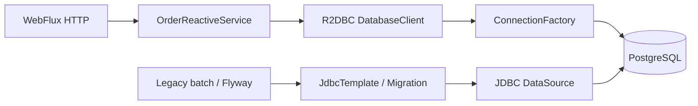
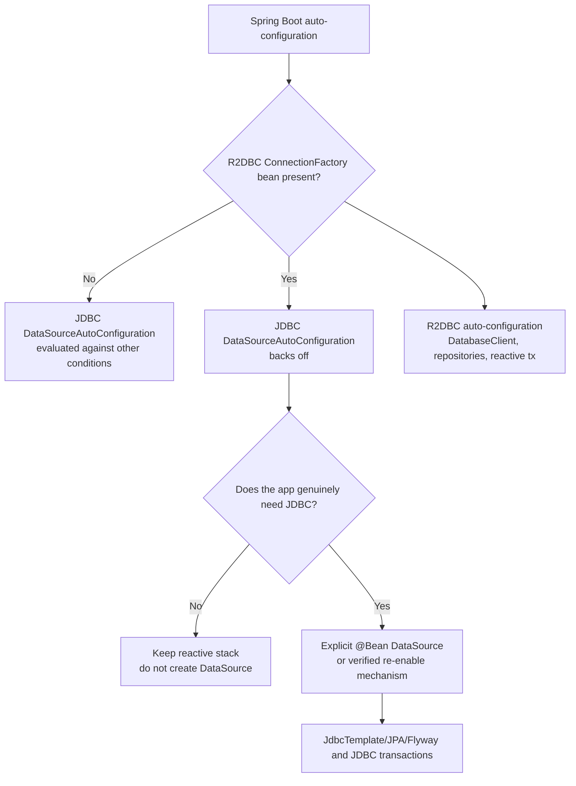
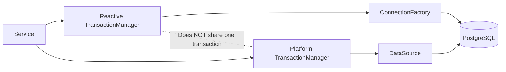
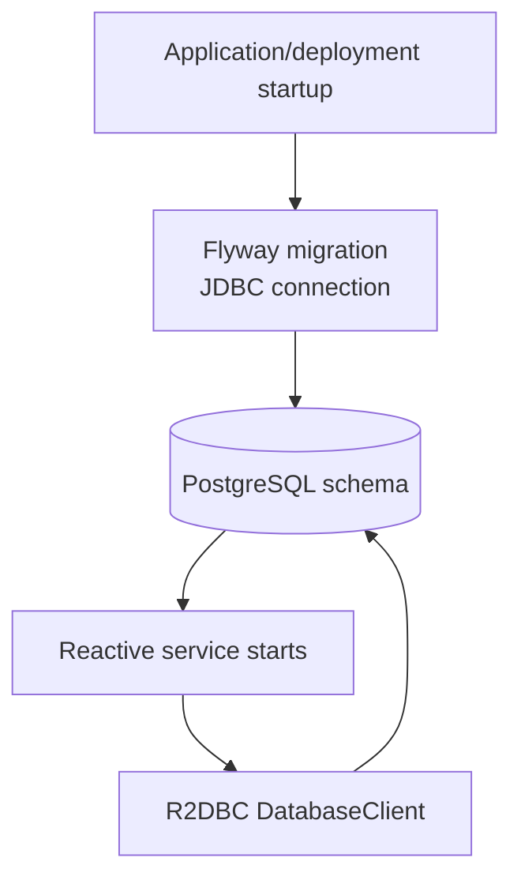
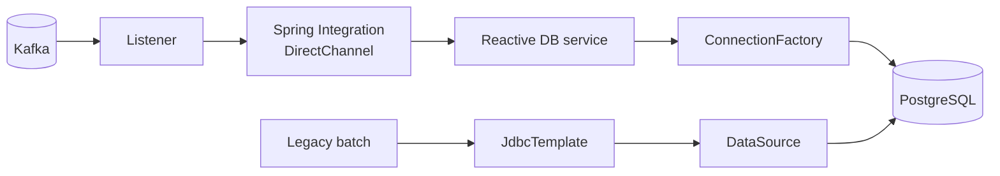
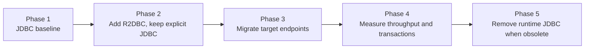

# Auto-Configuration When Both ConnectionFactory and DataSource Are Present

## 1. The problem: an application needs both reactive SQL and JDBC access

A Spring Boot service may serve WebFlux HTTP requests and query data via Spring Data R2DBC, yet still require a JDBC component:

- **Flyway/Liquibase** running SQL migrations at deployment.
- A legacy **batch job** or reporting library supporting only `JdbcTemplate`, JPA/Hibernate, or JDBC-backed jOOQ.
- Spring Batch/Quartz or a Spring Integration adapter with a dedicated JDBC requirement.
- A new reactive business path alongside a legacy path still running on JDBC.

Suppose `order-service` ingests JSON over HTTP, writes `orders` with R2DBC without blocking the event loop, while a background JDBC job writes reporting data:



`ConnectionFactory` and `DataSource` are **two separate connection mechanisms**:

- `io.r2dbc.spi.ConnectionFactory`: creates **R2DBC connections** for reactive APIs; typically used by `DatabaseClient`, `R2dbcEntityTemplate`, and Spring Data R2DBC repositories.
- `javax.sql.DataSource`: creates **JDBC connections** for blocking APIs; typically used by `JdbcTemplate`, JPA/Hibernate, Flyway, and JDBC libraries.

**Critical issue:** In Spring Boot 3.5, when a `ConnectionFactory` bean is present in the context, normal JDBC `DataSource` auto-configuration **backs off**. Declaring both `spring.r2dbc.*` and `spring.datasource.*` properties **does not automatically guarantee both beans exist**.

In the **SPRING_BOOT_INTEGRATION** module, this is more than bean wiring. A misconfiguration impacts transactions, pool capacity, HTTP/broker flows, schema migrations, timeouts, idempotency, and operational observability.

### Learning objectives

After this lesson, you will be able to:

1. Explain why `DataSourceAutoConfiguration` backs off when an R2DBC `ConnectionFactory` exists, and what Boot still auto-configures.
2. Distinguish **classpath**, **properties**, **bean conditions**, and **explicit user-defined beans**.
3. Intentionally re-enable JDBC auto-configuration or declare an explicit `DataSource` alongside R2DBC.
4. Use `DatabaseClient`/R2DBC repositories and `JdbcTemplate`/JPA without confusing the two access paths.
5. Select `ReactiveTransactionManager` and `PlatformTransactionManager` per layer without assuming a transaction spans both.
6. Configure migrations, connection pools, security, resource ownership, and blocking boundaries.
7. Read the condition evaluation report, write tests, and plan a safe JDBC -> R2DBC migration path.

> **Version note:** Content focuses on **Spring Boot 3.5.x, Spring Framework 6.x, Spring Data R2DBC versions aligned via Boot BOM, and Java 17+**. Some APIs and auto-configurations differ in Boot 2.x or 4.x. PostgreSQL examples require both the JDBC driver and the R2DBC driver; URLs, usernames, and secrets are illustrative only.

## 2. Why does Spring Boot prioritize R2DBC when it sees a ConnectionFactory?

Spring Boot uses **conditional auto-configuration**, activating automatic configuration only when classes, beans, properties, and other conditions match.

`DataSourceAutoConfiguration` in Boot 3.5 carries this primary class-level condition (abbreviated for clarity):

```java
@AutoConfiguration(before = SqlInitializationAutoConfiguration.class)
@ConditionalOnClass({
        javax.sql.DataSource.class,
        org.springframework.jdbc.datasource.embedded.EmbeddedDatabaseType.class
})
@ConditionalOnMissingBean(type = "io.r2dbc.spi.ConnectionFactory")
public class DataSourceAutoConfiguration {
    // configures JDBC DataSource when conditions allow
}
```

The **`@ConditionalOnMissingBean(type = "io.r2dbc.spi.ConnectionFactory")`** condition is the key:

- If an R2DBC `ConnectionFactory` is registered, standard `DataSource` auto-configuration **does not create a JDBC DataSource**.
- This prevents silently spinning up a blocking JDBC stack alongside reactive connections when the author did not intentionally ask for both.
- Having the PostgreSQL JDBC driver or `spring.datasource.url` **does not override this missing-bean condition**.
- You **still retain the right to declare an explicit `DataSource` bean** when required; conditional auto-configuration never forbids user-defined beans.

This is a **bean-creation precedence rule**, not a rule saying "Spring Boot only permits one database stack". The same application context can host both `ConnectionFactory` and `DataSource` when configured intentionally.

### 2.1. Four signals to distinguish

| Signal | What it means | What it does NOT mean |
| --- | --- | --- |
| R2DBC driver on classpath | Boot can create a `ConnectionFactory` if conditions/URL match | A `ConnectionFactory` bean definitely exists |
| JDBC driver + Hikari on classpath | Can create a `DataSource` when conditions match | `DataSource` gets created when R2DBC is present |
| `spring.datasource.url` configured | A JDBC URL is configured | Auto-configuration will always create a `DataSource` |
| `@Bean DataSource` defined | The application author explicitly requested a JDBC bean | Calls automatically become non-blocking |

**Inspect the bean graph instead of guessing from `pom.xml` or `application.yml`.** When you encounter `No qualifying bean of type 'javax.sql.DataSource'`, check the condition report to see whether a `ConnectionFactory` caused `DataSourceAutoConfiguration` to back off.

### 2.2. Decision flowchart



This flowchart depicts **standard auto-configuration**. R2DBC auto-configuration has its own conditions; custom manual factories, multiple factories, or bean overrides can alter the outcome. Always verify the live application context.

## 3. Matrix of common scenarios

| Classpath and beans | R2DBC ConnectionFactory | JDBC DataSource | Interpretation |
| --- | --- | --- | --- |
| Only JDBC starter/driver, `spring.datasource` configured | None | Boot usually auto-configures if eligible | Standard JDBC stack |
| Only R2DBC starter/driver, `spring.r2dbc` configured | Boot usually creates | None by default | Reactive stack |
| Both starters/drivers, R2DBC ConnectionFactory present | Present | **Usually NOT auto-created** | DataSource auto-config backed off |
| Both present, explicit `@Bean DataSource` declared | Present | **Present** | Application explicitly owns both connections |
| R2DBC + explicit DataSource auto-config re-enable | Present | Present when conditions/bindings match | Verify Boot version and condition report |
| Only JDBC properties without valid JDBC driver/pool | Depends | May fail or skip creation | Properties do not substitute for dependencies |
| Multiple `DataSource` or `ConnectionFactory` beans | Potentially multiple | Potentially multiple | Requires `@Primary`/`@Qualifier` and explicit template/tx disambiguation |

Do not mistake adding `spring-boot-starter-data-jpa` for forcing a `DataSource` into existence. A new dependency may bring `JpaRepository`, `JdbcTemplate`, or transaction manager classes onto the classpath, yet beans still depend on auto-configuration conditions.

## 4. Minimal dependencies for R2DBC + PostgreSQL JDBC

Maven example using Spring Boot parent/BOM version management:

```xml
<dependencies>
    <!-- Reactive SQL access / R2DBC repositories -->
    <dependency>
        <groupId>org.springframework.boot</groupId>
        <artifactId>spring-boot-starter-data-r2dbc</artifactId>
    </dependency>

    <!-- R2DBC PostgreSQL driver -->
    <dependency>
        <groupId>org.postgresql</groupId>
        <artifactId>r2dbc-postgresql</artifactId>
        <scope>runtime</scope>
    </dependency>

    <!-- JDBC clients and HikariCP -->
    <dependency>
        <groupId>org.springframework.boot</groupId>
        <artifactId>spring-boot-starter-jdbc</artifactId>
    </dependency>

    <!-- JDBC PostgreSQL driver -->
    <dependency>
        <groupId>org.postgresql</groupId>
        <artifactId>postgresql</artifactId>
        <scope>runtime</scope>
    </dependency>
</dependencies>
```

If the app serves reactive HTTP endpoints, add `spring-boot-starter-webflux`. If using JPA/Hibernate for a legacy domain model, add `spring-boot-starter-data-jpa` **rather than forcing JPA onto every simple JDBC operation**.

### 4.1. The two drivers are not interchangeable

- `org.postgresql:r2dbc-postgresql` is the R2DBC driver, used by `r2dbc:postgresql://...` and `ConnectionFactory`.
- `org.postgresql:postgresql` is the JDBC driver, used by `jdbc:postgresql://...` and `DataSource`.
- Adding the JDBC driver does not give `DatabaseClient` a backend.
- Adding the R2DBC driver does not make Flyway use R2DBC for migrations; Flyway SQL migrations normally require **JDBC**.

Some database vendors publish drivers under different coordinates; always use the artifact officially supported by your Spring Boot version and vendor.

### 4.2. Gradle equivalent

```groovy
dependencies {
    implementation 'org.springframework.boot:spring-boot-starter-data-r2dbc'
    runtimeOnly 'org.postgresql:r2dbc-postgresql'

    implementation 'org.springframework.boot:spring-boot-starter-jdbc'
    runtimeOnly 'org.postgresql:postgresql'
}
```

Do not manually pin Hikari, R2DBC SPI, or Spring Data versions away from the Boot BOM unless you have thoroughly verified compatibility.

## 5. Configuring two separate URLs

An `application.yml` file can declare:

```yaml
spring:
  r2dbc:
    url: r2dbc:postgresql://db.internal.example:5432/orders
    username: ${R2DBC_USERNAME}
    password: ${R2DBC_PASSWORD}
    pool:
      enabled: true
      initial-size: 5
      max-size: 15
      max-acquire-time: 3s

  datasource:
    url: jdbc:postgresql://db.internal.example:5432/orders
    username: ${JDBC_USERNAME}
    password: ${JDBC_PASSWORD}
    hikari:
      maximum-pool-size: 5
      connection-timeout: 3s
```

**Important:** this YAML merely supplies **both sets of properties**. When an R2DBC `ConnectionFactory` exists, Boot 3.5 normally **does not create a `DataSource` just because `spring.datasource` is defined**. You must apply one of the strategies in the next sections.

`spring.r2dbc.*` and `spring.datasource.*` are **two separate configuration namespaces**:

| Property | Applies to | Does NOT apply to |
| --- | --- | --- |
| `spring.r2dbc.url` | R2DBC ConnectionFactory | JDBC DataSource |
| `spring.r2dbc.username/password` | R2DBC connection login | JDBC login |
| `spring.r2dbc.pool.max-size` | R2DBC pool if `r2dbc-pool` is present | Hikari |
| `spring.datasource.url` | JDBC DataSource if created | R2DBC |
| `spring.datasource.hikari.maximum-pool-size` | Properly bound Hikari DataSource | R2DBC pool |
| `spring.flyway.url/user/password` | Migration JDBC connection when Flyway builds its own datasource | R2DBC ConnectionFactory |

### 5.1. R2DBC pooling is not mandatory in the SPI

`ConnectionFactory` is the R2DBC connection-creation API, and **not every instance is pooled by default**. Spring Boot can wire `r2dbc-pool` when the dependency and conditions align. For the pool:

- `max-size` caps connections managed by the R2DBC pool.
- `max-acquire-time` limits waiting for a connection.
- `initial-size` affects startup pre-allocation, not peak throughput.
- Driver options in the URL may have precedence relative to properties; verify whenever embedding options in the URL.

Never set `spring.r2dbc.pool.max-size=20` and assume the database will only ever see 20 connections from the application: JDBC Hikari, Flyway, other pods, and admin tools open connections of their own.

### 5.2. JDBC Hikari is a separate pool

When both are active:

```text
R2DBC pool max 15 connections
      +
Hikari JDBC max 5 connections
      +
Migration/CLI/admin connections
      +
Total pod replicas
```

With 6 replicas, the two application pools alone can reach around `6 × (15 + 5) = 120` connections when saturated—before counting Flyway, background jobs, and auxiliary connections. Database `max_connections` must accommodate the whole cluster plus a safety margin.

## 6. Strategy A: re-enabling JDBC via Spring Boot `@Import`

Spring Boot 3.5's **Using R2DBC** documentation notes that you can re-enable JDBC `DataSource` auto-configuration by importing `DataSourceAutoConfiguration` on a `@Configuration` class when the application truly requires both.

```java
package example.integration.config;

import org.springframework.boot.autoconfigure.jdbc.DataSourceAutoConfiguration;
import org.springframework.context.annotation.Configuration;
import org.springframework.context.annotation.Import;

@Configuration(proxyBeanMethods = false)
@Import(DataSourceAutoConfiguration.class)
public class JdbcAlongsideR2dbcConfiguration {
}
```

Then supply **valid** `spring.datasource.url/username/password` along with a compatible JDBC driver and HikariCP. While this approach is **mentioned in the Spring Boot 3.5 docs**, keep several caveats in mind:

1. `@Import` **does not make JDBC non-blocking**; JDBC still performs blocking calls.
2. Condition evaluation and bean definition ordering can vary across Boot versions, custom factories, or auto-configuration exclusions.
3. **Verify at runtime** that both `ConnectionFactory` and `DataSource` exist and that the JDBC pool binds its properties.
4. If `DataSourceAutoConfiguration` is excluded, multiple `DataSource`s exist, or custom configs exist, this minimal snippet will not suffice.
5. `@Import` does not automatically guarantee `JdbcTransactionManager`, `EntityManagerFactory`, or Flyway picks the right `DataSource` in all setups.

Because conditional nuances can be subtle in code reviews, never treat `@Import` as magic without integration tests. If you need full control and explicit wiring, prefer Strategy B.

### 6.1. When is Strategy A a good fit?

Suitable when:

- The project primarily uses R2DBC but retains one standard-configured JDBC branch.
- There is exactly one JDBC `DataSource`.
- You want Boot's standard pool, metrics, and `JdbcTemplate` setup and have verified behavior on your Boot version.
- You do not need separate property prefixes, custom drivers, or multiple pools.

If the application needs two JDBC `DataSource`s or separate JDBC credentials/pools for batch vs. migration, explicit bean registration is clearer.

## 7. Strategy B: explicitly declaring the DataSource bean

The most direct approach is declaring the `DataSource` bean explicitly, **without relying on the backed-off JDBC auto-configuration**:

```java
package example.integration.config;

import com.zaxxer.hikari.HikariDataSource;
import javax.sql.DataSource;

import org.springframework.boot.autoconfigure.jdbc.DataSourceProperties;
import org.springframework.boot.context.properties.ConfigurationProperties;
import org.springframework.boot.context.properties.EnableConfigurationProperties;
import org.springframework.context.annotation.Bean;
import org.springframework.context.annotation.Configuration;

@Configuration(proxyBeanMethods = false)
@EnableConfigurationProperties(DataSourceProperties.class)
public class ExplicitJdbcConfiguration {

    @Bean(name = "jdbcDataSource")
    @ConfigurationProperties("spring.datasource.hikari")
    HikariDataSource jdbcDataSource(DataSourceProperties properties) {
        return properties.initializeDataSourceBuilder()
                .type(HikariDataSource.class)
                .build();
    }
}
```

**Why is this so clear?**

- `DataSourceProperties` binds standard JDBC settings under `spring.datasource.*`.
- `initializeDataSourceBuilder()` transfers URL, username, and password to the pool builder.
- `@ConfigurationProperties("spring.datasource.hikari")` applies Hikari-specific properties—such as `maximum-pool-size` and `connection-timeout`—onto the created bean.
- `@EnableConfigurationProperties` ensures the properties bean is registered even if `DataSourceAutoConfiguration` did not run.
- An explicit `@Bean` guarantees the JDBC `DataSource` does not depend on Boot's `ConnectionFactory` back-off condition.

**Note:** Boot can still auto-configure `JdbcTemplate` from a single `DataSource` if `JdbcTemplateAutoConfiguration` conditions match. However, in multi-datasource systems, declare `JdbcTemplate` and transaction managers with explicit `@Qualifier` annotations instead of guessing which bean gets injected.

### 7.1. Explicitly declaring JdbcTemplate to lock down the connection path

```java
package example.integration.config;

import javax.sql.DataSource;
import org.springframework.beans.factory.annotation.Qualifier;
import org.springframework.context.annotation.Bean;
import org.springframework.context.annotation.Configuration;
import org.springframework.jdbc.core.JdbcTemplate;

@Configuration(proxyBeanMethods = false)
public class ExplicitJdbcClientConfiguration {

    @Bean(name = "ordersJdbcTemplate")
    JdbcTemplate ordersJdbcTemplate(
            @Qualifier("jdbcDataSource") DataSource dataSource) {
        return new JdbcTemplate(dataSource);
    }
}
```

When only one JDBC `DataSource` exists, you can let Boot auto-configure `JdbcTemplate` if conditions match. The explicit example above is for when you must **guarantee exactly** which JDBC adapter is wired; note that defining your own `JdbcTemplate` bean may cause Boot's `JdbcTemplateAutoConfiguration` to back off. Avoid creating redundant templates that cause injection ambiguity.

### 7.2. R2DBC continues using its own factory

As long as you do not manually replace `ConnectionFactory`, Spring Boot continues creating the R2DBC connection factory from `spring.r2dbc.*`, supplying `DatabaseClient`, `R2dbcEntityTemplate`, and reactive repositories under standard Spring Data conditions.

```text
Spring context
 ├── ConnectionFactory (R2DBC)
 │    ├── DatabaseClient
 │    ├── R2dbcEntityTemplate
 │    └── Reactive repositories
 └── jdbcDataSource (JDBC / Hikari)
      ├── JdbcTemplate / JdbcClient
      ├── JDBC TransactionManager
      └── Flyway / legacy JDBC integrations
```

Coexistence **does not turn R2DBC transactions into JDBC transactions**. Treat them as two separate access paths with separate transaction managers.

## 8. Verifying the bean graph after configuration

An application may start up cleanly yet wire the wrong connection or pool. Before writing business logic, verify the registered beans in a test:

```java
package example.integration.config;

import io.r2dbc.spi.ConnectionFactory;
import javax.sql.DataSource;

import org.junit.jupiter.api.Test;
import org.springframework.beans.factory.annotation.Autowired;
import org.springframework.boot.test.context.SpringBootTest;
import org.springframework.context.ApplicationContext;

import static org.assertj.core.api.Assertions.assertThat;

@SpringBootTest
class BothConnectionTypesTest {

    @Autowired
    ApplicationContext context;

    @Test
    void contextContainsBothR2dbcAndJdbcConnections() {
        assertThat(context.getBeansOfType(ConnectionFactory.class))
                .isNotEmpty();

        assertThat(context.getBeansOfType(DataSource.class))
                .containsKey("jdbcDataSource");
    }
}
```

This test corresponds to **Strategy B**, where the JDBC bean is named `jdbcDataSource`. With Strategy A, `DataSource` typically receives the default name `dataSource`; adjust assertions accordingly.

**Not sufficient on its own:** verifying the bean graph does not prove JDBC and R2DBC can reach a live database or target the same database and schema. You still need integration tests running queries from both clients and validating migration and transaction semantics.

### 8.1. Using the Condition Evaluation Report

Run locally or in tests with:

```bash
java -jar orders-service.jar --debug
```

Or enable debug logging:

```yaml
logging:
  level:
    org.springframework.boot.autoconfigure: DEBUG
```

In the startup condition report, inspect `DataSourceAutoConfiguration`, `R2dbcAutoConfiguration`, `JdbcTemplateAutoConfiguration`, and any conditions referencing `ConnectionFactory`. A report might look like:

```text
DataSourceAutoConfiguration:
  Did not match:
    @ConditionalOnMissingBean found bean of type
    'io.r2dbc.spi.ConnectionFactory'
```

This is **illustrative**; exact log phrasing varies across Boot versions. Never leave `--debug` enabled permanently in production because logs become noisy and expose configuration metadata; restrict access to startup logs.

### 8.2. Actuator does not replace integration tests

Actuator's `/actuator/conditions` helps inspect condition evaluations when properly enabled and secured. `/actuator/health` may show DB/JDBC/R2DBC health indicators depending on auto-configuration. However:

- An indicator existing does not prove business endpoints use the intended bean.
- DB readiness does not validate transactions, schemas, or tenant/key isolation.
- Never expose `conditions` or `env` publicly on the Internet; they leak internal configuration.
- Tests must execute real queries and independently verify results from both JDBC and R2DBC.

## 9. A truly reactive DatabaseClient

Spring Data R2DBC typically uses `DatabaseClient` with methods returning `Mono`/`Flux`:

```java
package example.integration.orders;

import org.springframework.r2dbc.core.DatabaseClient;
import org.springframework.stereotype.Repository;
import reactor.core.publisher.Mono;

@Repository
public class ReactiveOrderStore {

    private final DatabaseClient client;

    public ReactiveOrderStore(DatabaseClient client) {
        this.client = client;
    }

    public Mono<Long> insert(String orderId, String status) {
        return client.sql(
                "INSERT INTO orders (order_id, order_status) " +
                "VALUES (:orderId, :status)")
                .bind("orderId", orderId)
                .bind("status", status)
                .fetch()
                .rowsUpdated();
    }
}
```

In recent Spring Framework 6.x releases, `rowsUpdated()` returns `Mono<Long>`; verify the exact signature if targeting an older Spring Framework version. SQL and column names must match actual Flyway migrations; this snippet is illustrative only.

Key points:

- The method returns `Mono<Long>`; **SQL normally runs upon subscription**, not when assembling the publisher.
- The reactive chain supports composition, cancellation, and backpressure within the limits of the driver and operators.
- An `insert` method returning `Mono` **must never** secretly call `block()` and wrap the result in `Mono.just(...)`.
- With a unique constraint on `order_id`, retries from broker redelivery must follow idempotency semantics rather than retrying SQL errors indefinitely.

### 9.1. Reactive repositories differ from JPA repositories

```java
// OrderRow.java
package example.integration.orders;

import org.springframework.data.relational.core.mapping.Table;
import org.springframework.data.annotation.Id;

@Table("orders")
public record OrderRow(
        @Id String orderId,
        String orderStatus) {
}
```

```java
// ReactiveOrderRepository.java
package example.integration.orders;

import org.springframework.data.repository.reactive.ReactiveCrudRepository;

public interface ReactiveOrderRepository
        extends ReactiveCrudRepository<OrderRow, String> {
}
```

This is the **Spring Data R2DBC model**, using Spring Data Relational mapping annotations rather than Hibernate/JPA's `jakarta.persistence.Entity`. Separate packages for R2DBC entities/repositories from JPA entities/repositories to avoid accidental cross-scanning and mapping conflicts.

**Never use `JpaRepository` expecting non-blocking `Mono` execution**; Hibernate/JPA performs database access over blocking JDBC.

## 10. JdbcTemplate: still blocking inside a WebFlux app

A JDBC client:

```java
package example.integration.reporting;

import org.springframework.beans.factory.annotation.Qualifier;
import org.springframework.jdbc.core.JdbcTemplate;
import org.springframework.stereotype.Repository;

@Repository
public class LegacyReportDao {

    private final JdbcTemplate jdbc;

    public LegacyReportDao(
            @Qualifier("ordersJdbcTemplate") JdbcTemplate jdbc) {
        this.jdbc = jdbc;
    }

    public int countOrders() {
        Integer count = jdbc.queryForObject(
                "SELECT COUNT(*) FROM orders", Integer.class);
        return count == null ? 0 : count;
    }
}
```

`countOrders()` executes **synchronously and blocks** the calling thread. Never invoke it directly on a Netty event loop inside a high-concurrency WebFlux handler:

```java
// Anti-pattern: lambda runs blocking JDBC on the subscribing thread
public Mono<Integer> countOrdersWrong() {
    return Mono.fromSupplier(legacyReportDao::countOrders);
}
```

Wrapping in `Mono` does not make JDBC non-blocking. If the subscriber executes on the event loop, it blocks that event-loop thread while waiting on the database.

### 10.1. Bridging blocking code onto boundedElastic

When forced to invoke JDBC from a reactive pipeline:

```java
package example.integration.reporting;

import org.springframework.stereotype.Service;
import reactor.core.publisher.Mono;
import reactor.core.scheduler.Schedulers;

@Service
public class ReportingBridge {

    private final LegacyReportDao dao;

    public ReportingBridge(LegacyReportDao dao) {
        this.dao = dao;
    }

    public Mono<Integer> countOrders() {
        return Mono.fromCallable(dao::countOrders)
                .subscribeOn(Schedulers.boundedElastic());
    }
}
```

`subscribeOn(Schedulers.boundedElastic())` **isolates the blocking call off the event loop**, but does not make the JDBC driver non-blocking. Under heavy load, you still need:

- Explicit Hikari pool size and connection acquire timeouts.
- Concurrency limits/reactive operator caps (`flatMap(..., concurrency)`, bulkheads).
- Query and transaction timeouts.
- Monitoring of `boundedElastic` queues and threads; avoid dumping every blocking workload onto an unbounded shared pool.
- Dedicated `Scheduler` instances with proper disposal lifecycles for substantial workloads.

### 10.2. Never call `block()` inside a reactive chain

```java
// Anti-pattern
public OrderRow loadOrder(String id) {
    return reactiveRepository.findById(id).block();
}
```

`block()` converts reactive execution into synchronous waiting; on non-blocking event-loop threads it can throw `block()/blockFirst()/blockLast() are blocking` errors or cause thread starvation. At controlled imperative boundaries, blocking waits may be an explicit choice, provided timeouts, bounded concurrency, and non-event-loop threads are enforced.

## 11. Two transaction managers are not equivalent

When both connection stacks coexist:

- **JDBC:** `PlatformTransactionManager` (e.g., `JdbcTransactionManager` or `JpaTransactionManager`) coordinates transactions over JDBC connections using thread-bound state.
- **R2DBC:** `ReactiveTransactionManager` (e.g., `R2dbcTransactionManager`) coordinates reactive transactions by binding context to the **Reactor Context** of the reactive pipeline.

Putting `@Transactional` on a method does not magically merge both into a distributed transaction:



Having both JDBC and R2DBC point to the same database **does not make them share a session, connection, or transaction**. One side committing while the other rolls back is completely possible if you run both paths as separate transactions.

### 11.1. Declaring clearly named transaction managers

```java
package example.integration.config;

import javax.sql.DataSource;
import io.r2dbc.spi.ConnectionFactory;

import org.springframework.beans.factory.annotation.Qualifier;
import org.springframework.context.annotation.Bean;
import org.springframework.context.annotation.Configuration;
import org.springframework.jdbc.support.JdbcTransactionManager;
import org.springframework.r2dbc.connection.R2dbcTransactionManager;
import org.springframework.transaction.PlatformTransactionManager;
import org.springframework.transaction.ReactiveTransactionManager;

@Configuration(proxyBeanMethods = false)
public class ExplicitTransactionManagers {

    @Bean("jdbcTransactionManager")
    PlatformTransactionManager jdbcTransactionManager(
            @Qualifier("jdbcDataSource") DataSource dataSource) {
        return new JdbcTransactionManager(dataSource);
    }

    @Bean("r2dbcTransactionManager")
    ReactiveTransactionManager r2dbcTransactionManager(
            ConnectionFactory connectionFactory) {
        return new R2dbcTransactionManager(connectionFactory);
    }
}
```

This is **explicit configuration** for Spring JDBC. If your project uses JPA via Hibernate, use a `JpaTransactionManager` wired to the `EntityManagerFactory` rather than blindly substituting `JdbcTransactionManager`.

Spring Boot may auto-configure transaction managers based on conditions; if you declare them explicitly, confirm there are no duplicate bean names or unexpected framework manager selections. Always specify `@Transactional` or `TransactionalOperator` manager names/qualifiers to eliminate ambiguity.

### 11.2. Keeping each transaction within its own access path

A JDBC service:

```java
package example.integration.reporting;

import org.springframework.stereotype.Service;
import org.springframework.transaction.annotation.Transactional;

@Service
public class LegacyJdbcService {

    private final LegacyReportDao dao;

    public LegacyJdbcService(LegacyReportDao dao) {
        this.dao = dao;
    }

    @Transactional(transactionManager = "jdbcTransactionManager")
    public int countOrders() {
        return dao.countOrders();
    }
}
```

A reactive service:

```java
package example.integration.orders;

import org.springframework.stereotype.Service;
import org.springframework.transaction.annotation.Transactional;
import reactor.core.publisher.Mono;

@Service
public class ReactiveOrderService {

    private final ReactiveOrderStore store;

    public ReactiveOrderService(ReactiveOrderStore store) {
        this.store = store;
    }

    @Transactional(transactionManager = "r2dbcTransactionManager")
    public Mono<Void> create(String id) {
        return store.insert(id, "NEW").then();
    }
}
```

Reactive `@Transactional` requires a reactive return type and runs upon subscription, managed via Reactor context. Calling `legacyJdbcService.countOrders()` from inside a reactive pipeline will not join the R2DBC transaction, even against the exact same database.

### 11.3. Using `TransactionalOperator` for reactive pipelines

```java
package example.integration.orders;

import org.springframework.stereotype.Service;
import org.springframework.transaction.reactive.TransactionalOperator;
import reactor.core.publisher.Mono;

@Service
public class ReactiveOrderWorkflow {

    private final ReactiveOrderStore orders;
    private final TransactionalOperator reactiveTx;

    public ReactiveOrderWorkflow(
            ReactiveOrderStore orders,
            TransactionalOperator reactiveTx) {
        this.orders = orders;
        this.reactiveTx = reactiveTx;
    }

    public Mono<Void> create(String id) {
        return orders.insert(id, "NEW")
                .then()
                .as(reactiveTx::transactional);
    }
}
```

When multiple reactive transaction managers exist, inject/create `TransactionalOperator` from the right bean; the snippet above assumes a matching operator bean is available. You can define:

```java
@Bean("ordersReactiveOperator")
TransactionalOperator ordersReactiveOperator(
        @Qualifier("r2dbcTransactionManager")
        ReactiveTransactionManager manager) {
    return TransactionalOperator.create(manager);
}
```

With both `@Transactional` and `TransactionalOperator`, external calls like Kafka or HTTP remain outside database transaction atomicity unless separate coordination mechanisms are built. **Reactive** does not mean **distributed transaction**.

## 12. What if a single business flow calls both R2DBC and JDBC?

Suppose an order service performs two writes:

```text
R2DBC: INSERT orders
JDBC:  INSERT legacy_audit
```

Even when both point to the `orders` database, they run over **two separate connections**. Chaining them in a reactive pipeline gives zero atomic commit guarantees:

```java
// Anti-pattern: expecting one transaction to cover both JDBC and R2DBC:
return reactiveOrders.create(id)
        .then(Mono.fromCallable(() -> legacyAuditDao.writeAudit(id))
                .subscribeOn(Schedulers.boundedElastic()))
        .then();
```

If R2DBC commits and the JDBC insert fails, the order exists without an audit record. If JDBC commits first and R2DBC rolls back, the reverse happens. Moving blocking work to a scheduler to protect the event loop **does not solve atomicity**.

### 12.1. Three architectural options

| Option | How it works | When appropriate |
| --- | --- | --- |
| **Single transaction owner** | Write all related tables through **one** connection technology and transaction manager | Order + outbox in the same DB requiring atomic commit |
| **Compensating workflow** | Commit each transaction independently, track state, and retry/reconcile | Multiple distinct systems or stacks must coordinate |
| **Transactional outbox/inbox** | Primary DB transaction stores durable events; separate worker executes next step | HTTP/broker integration or isolated legacy JDBC steps |

Within the same PostgreSQL instance, if `orders` and `integration_outbox` must commit atomically together, write both inside **one R2DBC transaction** or **one JDBC transaction**—never split one statement onto R2DBC and the other onto JDBC expecting `@Transactional` to unify them.

### 12.2. R2DBC transaction example: writing orders and outbox

```java
package example.integration.orders;

import org.springframework.r2dbc.core.DatabaseClient;
import org.springframework.stereotype.Repository;
import reactor.core.publisher.Mono;

@Repository
public class ReactiveOrderWriter {

    private final DatabaseClient client;

    public ReactiveOrderWriter(DatabaseClient client) {
        this.client = client;
    }

    public Mono<Void> writeOrderAndOutbox(
            String orderId, String eventId, String payloadJson) {

        Mono<Long> orderInsert = client.sql(
                "INSERT INTO orders(order_id, order_status) " +
                "VALUES (:orderId, :status)")
                .bind("orderId", orderId)
                .bind("status", "NEW")
                .fetch().rowsUpdated();

        Mono<Long> outboxInsert = client.sql(
                "INSERT INTO integration_outbox(event_id, aggregate_id, " +
                "payload_json) VALUES (:eventId, :orderId, " +
                "CAST(:payload AS jsonb))")
                .bind("eventId", eventId)
                .bind("orderId", orderId)
                .bind("payload", payloadJson)
                .fetch().rowsUpdated();

        return orderInsert
                .then(outboxInsert)
                .then();
    }
}
```

A service invokes this method **under a single reactive `TransactionalOperator`**:

```java
return writer.writeOrderAndOutbox(orderId, eventId, eventJson)
        .as(ordersReactiveOperator::transactional);
```

This illustrative SQL assumes the schema has the listed columns; any additional `NOT NULL` columns must also be populated. Use stable `eventId` values, ensure the transaction manager uses the same `ConnectionFactory` as `DatabaseClient`, and enforce unique constraints against duplicates.

**Important:** the two `Mono`s share a reactive transaction only when subscribed inside the **same Reactor context** with an active `R2dbcTransactionManager`. Never call `.subscribe()` inside the repository; that creates an independent execution that loses transaction context and error propagation.

## 13. Flyway/Liquibase: JDBC migrations when runtime is mostly R2DBC

This is one of the most common reasons both connection technologies coexist. Flyway SQL migrations run over **JDBC**, whereas runtime business queries can be purely R2DBC.



### 13.1. No need to keep a JDBC DataSource for every request

A pure R2DBC system has two clean choices:

1. **Dedicated migration job:** run Flyway CLI/Gradle/Maven/container in CI/CD with a JDBC connection and DDL credentials; the runtime service only holds an R2DBC `ConnectionFactory`.
2. **Flyway on Spring Boot startup:** add Flyway + JDBC driver dependencies and configure **Flyway-native JDBC URL/credentials** without exposing a general-purpose application `DataSource`.

Example startup Flyway configuration with its own connection:

```yaml
spring:
  r2dbc:
    url: r2dbc:postgresql://db.internal.example:5432/orders
    username: ${DB_RUNTIME_USER}
    password: ${DB_RUNTIME_PASSWORD}

  flyway:
    enabled: true
    locations: classpath:db/migration
    url: jdbc:postgresql://db.internal.example:5432/orders
    user: ${DB_MIGRATION_USER}
    password: ${DB_MIGRATION_PASSWORD}
    validate-on-migrate: true
    clean-disabled: true

  sql:
    init:
      mode: never
```

Per Spring Boot documentation, when `spring.flyway.url` or `spring.flyway.user` is set, Flyway creates **its own dedicated `DataSource`** from those properties. This setup does not require exposing a shared `DataSource` bean to every JDBC service.

**Dependencies:** you need `flyway-core`, the database-specific Flyway module (e.g. `flyway-database-postgresql` on newer Flyway releases), and the PostgreSQL JDBC driver. The R2DBC PostgreSQL driver **cannot** replace the JDBC driver for Flyway connections.

```xml
<dependency>
    <groupId>org.flywaydb</groupId>
    <artifactId>flyway-core</artifactId>
</dependency>
<dependency>
    <groupId>org.flywaydb</groupId>
    <artifactId>flyway-database-postgresql</artifactId>
</dependency>
```

Versions are managed by the Boot BOM. If using `spring-boot-starter-flyway` on Boot versions that provide it, avoid redundant declarations; check BOM and Flyway database support for your exact version.

### 13.2. Already have an application DataSource: which one will Flyway pick?

If you explicitly created `jdbcDataSource`:

- Flyway may auto-configure against the primary/`@Primary` `DataSource` if no separate Flyway connection is specified.
- You can use `@FlywayDataSource` to designate a migration-only `DataSource`, paired with `@Bean(defaultCandidate=false)` where supported by your Boot API when preserving another runtime `DataSource`.
- Or provide `spring.flyway.url/user/password` so Flyway opens its own migration connection.

**Avoid** letting Flyway accidentally use a runtime JDBC user lacking DDL privileges, or targeting a different schema than the R2DBC runtime URL. When production separates migration and runtime credentials, an out-of-band migration job keeps DDL secrets completely out of the runtime container.

### 13.3. Pick one schema-management mechanism

```yaml
spring:
  sql:
    init:
      mode: never
  jpa:
    hibernate:
      ddl-auto: validate
```

The `spring.jpa` block applies only if the project uses JPA. Never let Hibernate `ddl-auto=update`, `schema.sql`/`data.sql`, and Flyway all mutate the production schema. A startup with both R2DBC and JDBC may also trigger **R2DBC SQL script initialization**; set `spring.sql.init.mode: never` to disable script initialization when Flyway owns the schema.

### 13.4. Migration completion differs from reactive subscription

Running Flyway on startup performs blocking JDBC DDL. That is **acceptable during the deployment/startup phase**, unlike blocking the Netty event loop on every HTTP request. Still plan for:

- Startup readiness waiting for migrations to finish.
- DDL locks impacting older running instances.
- Multiple replicas booting simultaneously and racing on migrations.
- An expand/contract migration strategy so older running code is not broken.

In multi-instance production environments, a standalone migration job usually makes credentials, logs, and rollout timing cleaner to control.

## 14. Dual repository systems need clear package boundaries

When both Spring Data R2DBC repositories and Spring Data JPA repositories exist in one app, Boot/Spring Data may engage **strict repository configuration mode**. Each framework has distinct repository interfaces and entity annotations; placing a repository in the wrong package or extending the wrong base interface can break candidate detection.

Example source package layout:

```text
example.integration
├── config
│   ├── ReactiveDatabaseConfiguration.java
│   └── ExplicitJdbcConfiguration.java
├── reactive
│   ├── model/OrderRow.java
│   ├── repository/ReactiveOrderRepository.java
│   └── service/ReactiveOrderService.java
├── legacy
│   ├── entity/LegacyInvoiceEntity.java
│   ├── repository/LegacyInvoiceJpaRepository.java
│   └── service/LegacyBillingService.java
└── api
    └── OrdersController.java
```

Recommendations:

- Spring Data R2DBC uses `org.springframework.data.relational.core.mapping.Table` and `org.springframework.data.annotation.Id`.
- JPA uses `jakarta.persistence.Entity` and `jakarta.persistence.Id`.
- Repository interfaces should extend `ReactiveCrudRepository` or `JpaRepository` cleanly; never make one interface act as both a JPA and R2DBC repository.
- When auto-scanning becomes ambiguous, configure `@EnableR2dbcRepositories(basePackages=...)` and `@EnableJpaRepositories(basePackages=...)` per your version, along with `@EntityScan` as needed.
- Ensure R2DBC entity/table mappings do not accidentally rely on JPA annotations; R2DBC is not a drop-in reactive Hibernate.

### 14.1. Returning `Mono<T>` from a repository does not prove the stack is non-blocking

If an implementation runs JDBC/JPA and wraps the output in `Mono.just(result)`, it is merely a reactive wrapper around a blocking call that already executed. Inspect **the actual driver and `DataSource`/`ConnectionFactory` behind the repository**.

Spring Data R2DBC provides reactive relational persistence without Hibernate features like lazy-loaded JPA associations and dirty checking. Migrating entities and repositories requires design adjustments, not just swapping interface return types.

## 15. WebFlux, MVC, and DataSource presence do not dictate the web stack

These are independent axes:

| Axis | Options | What it determines |
| --- | --- | --- |
| Web layer | Spring MVC or Spring WebFlux | HTTP server request-processing model |
| Database layer | JDBC or R2DBC | Blocking vs. reactive SQL connection API |
| Messaging | Kafka/Rabbit/Pulsar listeners/adapters | Delivery/ack semantics and broker threading |
| Transactions | JDBC/JPA or R2DBC | Connection participation and transaction context |

Having a `ConnectionFactory` does not turn a `spring-boot-starter-web` application into WebFlux. When both Spring MVC and WebFlux starters sit on the classpath, Spring Boot conventionally defaults to Spring MVC unless explicitly configured otherwise.

Nor is there any rule restricting R2DBC to WebFlux: a CLI worker or Kafka consumer can use reactive `DatabaseClient` without serving HTTP. Conversely, a WebFlux app can call JDBC as long as blocking work is isolated off the event loop with bounded concurrency.

### 15.1. Red flags for blocking inside a reactive pipeline

- Calling `JdbcTemplate.query...` directly inside `flatMap`, `map`, or `doOnNext`.
- Calling `JpaRepository.save(...)` inside an HTTP handler on a Netty event-loop thread.
- Calling `.block()` or `.blockOptional()` inside a request pipeline.
- Using `Thread.sleep(...)`, blocking file I/O, or heavily contended Java `synchronized` blocks on the event loop.
- Calling `Mono.just(legacyService.runBlocking())`: the legacy call runs **eagerly when constructing the Mono**, before subscription or scheduling.

When bridging is unavoidable, wrap with `Mono.fromCallable(...).subscribeOn(boundedElastic())` and bound resources. Reactive APIs do not eliminate database bottlenecks, SSL handshake overhead, broker consumer limits, or downstream network latency.

## 16. Pool budgets: two access paths competing for DB resources

Each pool manages its own acquisition, idle eviction, validation, and timeouts. Against a single PostgreSQL server:

```text
                     PostgreSQL max_connections
                         /           \
              R2DBC pool(s)       JDBC Hikari pool(s)
                 /     \             /      \
               API   Worker        JPA     Legacy batch
```

With `spring.r2dbc.pool.max-size=15` and `spring.datasource.hikari.maximum-pool-size=5`, a single pod can open ~20 application connections under load. Across 8 pods, that reaches ~160—plus Flyway, monitoring, admin, and auxiliary connections. **Never treat a single pod's pool size as the total database load.**

### 16.1. Example capacity budget by workload

| Workload | Pool / limit | Risk if sized too high |
| --- | --- | --- |
| WebFlux orders | R2DBC max 15 | High concurrent queries saturate DB CPU/locks/I/O |
| JDBC reporting | Hikari max 5 | Blocking batch scans large tables and starves pool |
| Flyway migration | Dedicated job connection | DDL locks/backfills impact both runtime pools |
| Kafka outbox publisher | Selected reactive or JDBC owner | High consumer parallelism spikes SQL concurrency |
| Partner API | HTTP pool + concurrency cap | Excess concurrent requests trigger 429s/timeouts |

Larger pools add zero throughput once the DB or locks are saturated. For R2DBC, prevent unbounded queue growth with acquire timeouts; for Hikari, watch pending threads and transaction hold times.

### 16.2. Timeouts have no single global setting

| Situation | Which timeout applies? |
| --- | --- |
| R2DBC pool exhausted | R2DBC pool acquire timeout |
| Hikari pool exhausted | `spring.datasource.hikari.connection-timeout` |
| Long-running SQL query | Matching driver/query/statement timeout |
| JDBC transaction waiting on lock | Database lock timeout and transaction deadline |
| Reactive request waiting on partner HTTP | WebClient response timeout and overall request budget |
| Slow Kafka listener processing | Poll interval/consumer settings and business timeout |

Setting `spring.r2dbc.pool.max-acquire-time=3s` does not configure JDBC `statement_timeout` to 3 seconds. Likewise, Hikari's `connection-timeout` caps **waiting to borrow a connection from the pool**, not total SQL execution duration.

## 17. TLS, secrets, and dual drivers

With two connection paths, both require proper security settings:

- `r2dbc:postgresql://...` uses driver-specific R2DBC connection options.
- `jdbc:postgresql://...` uses PostgreSQL JDBC driver options such as `sslmode=verify-full`, trust cert paths, and hostname verification.
- `spring.r2dbc.username/password` and `spring.datasource.username/password` can use **two distinct credentials**—often advantageous for least-privilege separation.
- Flyway's migration account requires DDL rights for schema changes; runtime R2DBC/JDBC accounts should hold only required operational privileges.
- Never log passwords in code, logs, tracing spans, or broker metadata.

Example JDBC URL enforcing certificate chain and hostname checks under PostgreSQL JDBC rules:

```yaml
spring:
  datasource:
    url: "jdbc:postgresql://db.internal.example:5432/orders?sslmode=verify-full&sslrootcert=/etc/tls/postgresql-ca.pem"
```

For R2DBC PostgreSQL, check TLS option names and behavior against **your exact R2DBC driver version**; never copy JDBC query parameters onto an R2DBC URL assuming they behave identically. Enforce proper trusted CA and hostname checks; never enable `trust-all` flags to silence certificate errors.

### 17.1. Matching URLs do not guarantee matching schemas

A JDBC URL and R2DBC URL can point to the same host and database yet still differ in:

- Default schema/`search_path` due to connection options or user defaults.
- Table permissions across the two database accounts.
- Session timezone or `statement_timeout`.
- Default transaction isolation or auto-commit settings.
- SQL dialect or driver conversions for `JSONB`, timestamps, and UUIDs.

Verify `current_database()`, `current_schema()`, session settings, user grants, and target tables from **both clients** when debugging.

## 18. Database initialization: prevent two tools from fighting over schema

Running both R2DBC and JDBC introduces multiple possible initialization paths:

```text
Flyway / Liquibase  (JDBC migration)
Hibernate ddl-auto (JPA/JDBC)
Spring SQL init    (can target JDBC or R2DBC)
Testfixtures        (data.sql or test scripts)
```

**Rule:** one tool must own the schema. If using Flyway, disable Hibernate `update`/`create` schema mutation in production and disable overlapping `schema.sql` initialization.

When runtime uses R2DBC and migrations run via JDBC, ensure:

1. Migrations finish **before** reactive repositories execute schema-dependent queries.
2. Custom startup beans do not issue queries before the schema is ready.
3. Existing data under older schemas stays compatible with new code during rolling deployments.
4. Migrations do not race or run twice across replicas or competing initializers.

### 18.1. Database initialization ordering dependencies

Spring Boot detects standard database initializers such as Flyway, Liquibase, and JDBC/R2DBC script initializers along with beans that depend on DB initialization. However, custom startup listeners or `@PostConstruct` hooks querying the DB may need explicit ordering.

When genuinely needed, use Spring Boot's annotation:

```java
package example.integration.init;

import org.springframework.boot.sql.init.dependson.DependsOnDatabaseInitialization;
import org.springframework.context.annotation.Bean;
import org.springframework.context.annotation.Configuration;

@Configuration(proxyBeanMethods = false)
public class WarmupConfiguration {

    @Bean
    @DependsOnDatabaseInitialization
    WarmupTask warmupTask() {
        return new WarmupTask();
    }
}
```

`WarmupTask` is an application-defined class; the annotation declares bean initialization ordering—it **does not auto-subscribe reactive publishers or make blocking calls in constructors safe**. In production, avoid startup warmup tasks that full-scan databases across multiple booting instances.

### 18.2. Flyway migrations are not meant to run reactively

Flyway running blocking JDBC during the migration stage is appropriate; **never invoke `Flyway.migrate()` inside a WebFlux request handler** as a runtime business step. That blocks event-loop threads and introduces DDL execution and DDL credentials into the request path.

Apply schema changes via controlled deployment jobs or startup phases with backups and rollback plans while runtime queries continue over R2DBC.

## 19. Using R2DBC and JDBC with Kafka/Rabbit/Pulsar: choosing the commit point

A Spring Boot integration flow might look like:



If a Kafka listener invokes a reactive service like this:

```java
@KafkaListener(topics = "orders.events.v1")
public void onOrder(OrderCreatedV1 event) {
    reactiveOrderService.create(event.orderId()).subscribe();
}
```

this is an **anti-pattern** whenever the container relies on method return/completion to ACK: the listener returns immediately upon subscribing, likely **before the DB commits**. If the process crashes after ACK but before DB commit, the event is lost.

### 19.1. Safer acknowledgment strategies

- Use a listener container/adapter supporting **asynchronous acknowledgment** matching your Spring Kafka version and method signature, triggering ACK only once the reactive publisher reaches durable completion.
- Or persist incoming events into a durable inbox within a single transaction before ACK, letting a reactive worker process them asynchronously.
- Or use an imperative listener whose JDBC transaction finishes before ACK when load/latency profiles allow.

Never call `.subscribe()` inside a listener to "fire and forget" expecting the broker to magically wait for the reactive transaction. The same applies to RabbitMQ ACK/NACK and Pulsar acknowledgments: listener lifecycle and acking belong to the framework/broker contract, **not to returning void after subscribing to a Mono**.

### 19.2. Reactive streams do not automatically grant exactly-once

A `Mono<Void>` models a computation; it does not stop producers from sending duplicates, brokers from redelivering, or JDBC batches from re-running. When an event can arrive multiple times:

```sql
CREATE TABLE processed_event (
    consumer_name VARCHAR(100) NOT NULL,
    event_id VARCHAR(80) NOT NULL,
    processed_at TIMESTAMPTZ NOT NULL,
    PRIMARY KEY (consumer_name, event_id)
);
```

Persist the inbox marker and business effect within **one transaction of a single DB access stack**, handling unique conflicts and races intentionally. Never mix a JDBC inbox insert with an R2DBC business write and claim atomicity just because both hit the same schema.

## 20. Testing both connection paths against a real database

Unit tests mocking `DatabaseClient` or `DataSource` do not verify that Boot wires both beans, targets the same database, or executes real transactions. Integration tests can use PostgreSQL Testcontainers.

### 20.1. Test dependencies

```xml
<dependency>
    <groupId>org.springframework.boot</groupId>
    <artifactId>spring-boot-starter-test</artifactId>
    <scope>test</scope>
</dependency>
<dependency>
    <groupId>org.springframework.boot</groupId>
    <artifactId>spring-boot-testcontainers</artifactId>
    <scope>test</scope>
</dependency>
<dependency>
    <groupId>org.testcontainers</groupId>
    <artifactId>junit-jupiter</artifactId>
    <scope>test</scope>
</dependency>
<dependency>
    <groupId>org.testcontainers</groupId>
    <artifactId>postgresql</artifactId>
    <scope>test</scope>
</dependency>
```

With Spring Boot Testcontainers, `@ServiceConnection` can supply connection details for matching stacks based on container and driver presence. However, when **both JDBC and R2DBC connection details** are needed in one context, tests must verify that **both clients** actually reach the container rather than assuming the annotation configures both automatically.

A transparent approach using `@DynamicPropertySource`:

```java
package example.integration.test;

import io.r2dbc.spi.ConnectionFactory;
import javax.sql.DataSource;
import org.junit.jupiter.api.Test;
import org.springframework.beans.factory.annotation.Autowired;
import org.springframework.boot.test.context.SpringBootTest;
import org.springframework.r2dbc.core.DatabaseClient;
import org.springframework.jdbc.core.JdbcTemplate;
import org.springframework.test.context.DynamicPropertyRegistry;
import org.springframework.test.context.DynamicPropertySource;
import org.testcontainers.containers.PostgreSQLContainer;
import org.testcontainers.junit.jupiter.Container;
import org.testcontainers.junit.jupiter.Testcontainers;

import static org.assertj.core.api.Assertions.assertThat;

@SpringBootTest
@Testcontainers
class JdbcAndR2dbcIT {

    @Container
    static PostgreSQLContainer<?> postgres =
            new PostgreSQLContainer<>("postgres:16-alpine");

    @DynamicPropertySource
    static void databaseProperties(DynamicPropertyRegistry registry) {
        registry.add("spring.datasource.url", postgres::getJdbcUrl);
        registry.add("spring.datasource.username", postgres::getUsername);
        registry.add("spring.datasource.password", postgres::getPassword);

        registry.add("spring.r2dbc.url", () ->
                "r2dbc:postgresql://" + postgres.getHost() + ":" +
                postgres.getMappedPort(5432) + "/" +
                postgres.getDatabaseName());
        registry.add("spring.r2dbc.username", postgres::getUsername);
        registry.add("spring.r2dbc.password", postgres::getPassword);
    }

    @Autowired
    DataSource jdbcDataSource;

    @Autowired
    ConnectionFactory connectionFactory;

    @Autowired
    JdbcTemplate jdbc;

    @Autowired
    DatabaseClient r2dbc;

    @Test
    void bothConnectionsReachTheSameDatabase() {
        String databaseFromJdbc = jdbc.queryForObject(
                "SELECT current_database()", String.class);

        String databaseFromR2dbc = r2dbc
                .sql("SELECT current_database() AS db_name")
                .map((row, metadata) -> row.get("db_name", String.class))
                .one()
                .block(java.time.Duration.ofSeconds(5));

        assertThat(connectionFactory).isNotNull();
        assertThat(jdbcDataSource).isNotNull();
        assertThat(databaseFromR2dbc)
                .isEqualTo(databaseFromJdbc);
    }
}
```

Inside a JUnit test (a blocking thread controlled by the test runner), calling `.block(Duration)` is acceptable to assert results; **never copy `.block()` into WebFlux HTTP handlers**. This test assumes the project declared an explicit `DataSource` or re-enabled it per Sections 6/7 and includes both drivers.

If Flyway runs on test startup, migrations must succeed before queries execute; checking `current_database()` alone works on an empty DB. To verify business schemas, add tests exercising tables, constraints, transactions, and repositories.

## 21. Contract and failure tests must go beyond "bean exists"

When both client types access PostgreSQL, verify these critical boundaries:

| Scenario | What to verify |
| --- | --- |
| R2DBC starter only, no JDBC | Context contains `ConnectionFactory`, does not require `DataSource` |
| Both starters, no explicit DataSource | Condition report shows JDBC auto-configuration backed off |
| Explicit `@Bean DataSource` present | Context holds both `ConnectionFactory` and `DataSource` with expected bean names |
| `@Import(DataSourceAutoConfiguration.class)` used | Auto-config creates `DataSource` when target Boot version conditions hold |
| Invalid JDBC URL | JDBC query fails clearly while R2DBC continues if its URL is independent |
| Invalid R2DBC URL | Reactive query fails while JDBC continues |
| Two URLs pointing to different DBs/schemas | Integration test catches mismatch via `current_database()`/`current_schema()` |
| One user lacks permissions | Path fails with authorization error without silently falling back to the other credential |
| Hikari pool exhausted | Blocking acquire times out; WebFlux event loop is not blocked waiting directly |
| R2DBC pool exhausted | Reactive acquire times out / applies backpressure without infinite queues |
| JDBC commits, R2DBC rolls back | Two independent transactions; test proves they are non-atomic |
| Reactive transaction cancelled | Rollback/cleanup per driver/operator semantics; no connection leak |
| Kafka redelivery after DB commit | Inbox/outbox + `eventId` prevents applying business effects twice |
| Flyway runs with migration user | Schema builds cleanly, runtime users can read/write, no DDL credentials in request path |

### 21.1. Unit testing configuration conditions

For a library or starter built with `@AutoConfiguration` and `@ConditionalOnMissingBean`, use `ApplicationContextRunner` to test combinations:

```text
Test A: only jdbc auto-config + driver
    → expect JDBC DataSource (when other conditions are met)

Test B: r2dbc ConnectionFactory bean + jdbc auto-config
    → expect DataSource auto-config backs off

Test C: r2dbc factory + explicit jdbcDataSource bean
    → expect both beans

Test D: custom transaction managers added
    → expect @Transactional resolves the named manager accurately
```

When verifying real auto-configuration, register all relevant auto-config classes, driver dependencies, user beans, and properties. An overly stripped-down runner missing Hikari or a driver may omit `DataSource` for **unrelated reasons** having nothing to do with R2DBC.

### 21.2. Testing transactional correctness

Example sequence:

1. Create `orders` and `integration_outbox` tables via Flyway.
2. Call the reactive service using `R2dbcTransactionManager` to write order + outbox.
3. Force the outbox insert to fail on a unique constraint -> assert both writes roll back.
4. Read via the legacy JDBC reporting DAO and confirm the rolled-back order is absent.
5. Test a workflow mixing JDBC and R2DBC in two independent transactions, asserting that one side can commit while the other fails.
6. Verify mappings for `BigDecimal`, `Instant`, UUID, and JSONB across both JDBC and R2DBC to prevent contract drift.

**Do not expect step 5 to roll back atomically**: its goal is exposing the real transaction boundary. Whenever inconsistency is unacceptable, consolidate under one transaction owner or use outbox.

### 21.3. Testing blocking detection

In WebFlux integration tests, send real requests triggering controlled slow JDBC queries. Observe:

- Is the Netty event loop blocked?
- Do `boundedElastic` active/pending tasks and Hikari pending counts behave as expected?
- Under 20 concurrent requests with a 5-connection JDBC pool, do APIs enforce bounded timeouts and backpressure?
- Does HTTP request cancellation stop the JDBC query? **Never assume it does**; JDBC cancellation and statement timeouts depend on the driver and execution path.

BlockHound can detect certain blocking calls on reactive threads when configured cleanly with your runtime, though it never replaces load testing, query timeouts, or real transaction testing.

## 22. Diagnosing: auto-configuration error vs. SQL error

| Symptom | Common cause | Remedy |
| --- | --- | --- |
| `No qualifying bean of type DataSource` | Presence of R2DBC `ConnectionFactory` caused JDBC auto-config to back off | Inspect conditions; add explicit `DataSource` or documented `@Import` |
| `Failed to configure a DataSource` | Missing/invalid JDBC driver, URL, or embedded DB when JDBC path is active | Check drivers, URLs, active profiles, and auto-config |
| `No qualifying bean of type ConnectionFactory` | Missing R2DBC driver, URL, starter, or broken custom factory | Inspect R2DBC auto-config conditions |
| `spring.datasource.url` set but no Hikari bean | Properties exist, but bean condition suppressed auto-creation | Do not infer from YAML; inspect bean graph |
| JPA repository fails to initialize | Missing `DataSource`/`EntityManagerFactory` or wrong package scan | Audit JPA starter, entities, JDBC path, and repositories |
| R2DBC repository fails to initialize | Wrong mapping/scan/driver/config | Audit `ReactiveCrudRepository`, `@Table`, and `R2dbcDataAutoConfiguration` |
| `NoUniqueBeanDefinitionException` on DataSource/manager | Multiple beans of the same type | Add `@Qualifier`/`@Primary` and explicit manager names |
| `@Transactional` seemingly fails to roll back | Wrong manager selected or detached `subscribe()` created separate flow | Name manager explicitly, preserve one Reactor context, test rollback |
| Flyway fails to find JDBC connection | Only R2DBC driver present or missing Flyway JDBC URL/DataSource | Add JDBC driver and migration connection config |
| Flyway creates tables yet reactive queries fail | Two URLs target different DBs/schemas, or SQL mapping mismatch | Compare hosts, databases, schemas, users, and migrations |
| WebFlux latency spikes sharply | Blocking JDBC running on event loop | Use `fromCallable + subscribeOn`, bound concurrency and timeouts |
| Pool timeouts despite idle CPU | Small JDBC/R2DBC pool or queries holding connections too long | Measure active/pending counts, transaction durations, and query plans |
| `block()` disallowed on event loop | Blocking Reactor wait on a non-blocking thread | Remove `block()` from reactive handlers |
| Kafka ACK sent yet DB lacks row | `.subscribe()` inside listener returned prematurely | Use proper async ack API or durable inbox |
| Duplicate orders after consumer restart | At-least-once redelivery without idempotency | Enforce unique `eventId`/inbox within a single transaction |
| PostgreSQL hits connection limit | Combined R2DBC + Hikari + replicas + migrations exceed DB capacity | Compute cluster-wide connection budget |
| TLS fails on only one path | JDBC and R2DBC drivers use different TLS options | Verify CA, hostname/SAN, and driver-specific TLS configs |

### 22.1. Step-by-step triage procedure

1. **Identify the failing stack:** R2DBC `ConnectionFactory`, JDBC `DataSource`, JPA, or Flyway?
2. **Check the classpath:** are both drivers and starters present and aligned with the BOM?
3. **Inspect properties:** which namespace owns each URL, profile, user, TLS, and driver option?
4. **Read the condition evaluation report:** did `DataSourceAutoConfiguration` match or back off due to `ConnectionFactory`?
5. **Inspect the bean graph:** bean names, counts of factories, templates, transaction managers, and qualifiers.
6. **Query the live DB:** compare `current_database()`, `current_schema()`, grants, and migration versions from both stacks.
7. **Trace threads/schedulers:** is any blocking JDBC executing on the event loop?
8. **Verify transaction/ACK boundaries:** when the handler returns, did the DB commit or only construct a `Mono`?
9. **Test failures/replays:** verify rollback, duplicate events, pool saturation, and graceful shutdown.

Never "fix" a missing `DataSource` by removing R2DBC if the architecture genuinely requires both. Understand the bean conditions and wire each owner cleanly.

## 23. Realistic scenario: incrementally migrating a JDBC service to reactive

Suppose `billing-service` currently uses:

- Spring MVC REST, `JdbcTemplate`, PostgreSQL Hikari.
- A `@KafkaListener` consuming `InvoiceCreated` and writing `invoice` transactionally.
- Flyway managing schema migrations on deployment.

The team wants to migrate a high-concurrency HTTP reporting endpoint to WebFlux + R2DBC without rewriting all legacy JPA/JDBC code upfront.

### 23.1. The breaking change

They add:

```xml
<dependency>
    <groupId>org.springframework.boot</groupId>
    <artifactId>spring-boot-starter-data-r2dbc</artifactId>
</dependency>
```

along with the PostgreSQL R2DBC driver and `spring.r2dbc.url`. On deployment, Boot creates the R2DBC `ConnectionFactory` and **stops auto-creating the JDBC `DataSource`**, causing `JdbcTemplate` and legacy repositories to fail on startup.

**Root cause:** PostgreSQL data did not vanish; `@ConditionalOnMissingBean(ConnectionFactory)` on JDBC `DataSourceAutoConfiguration` caused JDBC auto-configuration to back off.

### 23.2. Phased rollout plan



**Phase 1 — Baseline:** capture schemas, metrics, Hikari pool usage, transaction boundaries, HTTP latencies, and consumer ack policies.

**Phase 2 — Add R2DBC:** retain an explicit `DataSource` via Strategy B; confirm both clients reach the exact same DB/schema without breaking Flyway migrations or `JdbcTransactionManager`.

**Phase 3 — Migrate one workflow:** build R2DBC repositories using `DatabaseClient`/reactive repositories and the reactive transaction manager; **do not mix** JDBC statements into the new reactive transaction.

**Phase 4 — Verify:** compare business outputs, throughput, and DB connections; check Kafka listener ACKs and idempotency; isolate any unavoidable legacy JDBC calls from WebFlux.

**Phase 5 — Simplify:** once runtime JDBC code is gone, remove the runtime `DataSource` and legacy beans. Flyway can run via a dedicated JDBC migration job, so removing the app's runtime `DataSource` **does not necessarily** mean dropping the JDBC driver from deployment tooling if pipelines still run Flyway.

### 23.3. Do not switch the whole app to WebFlux just because of R2DBC

If existing endpoints rely primarily on blocking JPA/HTTP libraries, switching the web server to WebFlux without migrating blocking calls can make latency **worse** by stalling event loops. Adopt R2DBC and WebFlux where they provide measurable gains rather than converting everything blindly.

## 24. Production architecture: clear ownership boundaries

A well-structured layout:

```text
                    SPRING_BOOT_INTEGRATION
        ┌────────────────────────────────────────┐
HTTP    │ Orders WebFlux Controller              │
request │  → Reactive Domain Service             │
        │  → DatabaseClient / ConnectionFactory  │
        │            PostgreSQL                  │
        │                                        │
Legacy  │ Legacy Report/Batch Service            │
job     │  → JdbcTemplate / Hikari DataSource    │
        │            PostgreSQL                  │
        │                                        │
Events  │ Kafka/Rabbit/Pulsar listener           │
        │  → durable Inbox / Outbox              │
        │  → chosen transaction owner            │
        └────────────────────────────────────────┘

Deploy migration job:
  Flyway (JDBC URL + restricted DDL credentials)
  → schema version gate before serving traffic
```

Operational rules:

- Each business workflow has one **transaction owner**.
- JDBC and R2DBC connection pools have independent budgets, metrics, and shutdown lifecycles.
- Never pass `ConnectionFactory` to JDBC libraries; they require `DataSource`.
- Never pass a Hikari `DataSource` to reactive R2DBC repositories expecting reactive I/O.
- Migrations must target the exact database and schema used at runtime.
- For Spring Integration adapters, verify whether each adapter uses `JdbcTemplate`, `R2dbcEntityTemplate`, a broker client, or an HTTP client and configure accordingly.
- Transactional outbox/inbox and idempotency protect outcomes across broker/HTTP failures regardless of JDBC or R2DBC.

### 24.1. Monitoring and alerting

| Metric / signal | What it reveals |
| --- | --- |
| Hikari active/idle/pending | Whether JDBC workloads are exhausting connections |
| R2DBC pool allocated/acquired/pending | Whether reactive workloads are queueing or saturated |
| Database connections by user/application | Combined load across both pools and all pods |
| SQL p95/p99, lock waits | Query bottlenecks and long transactions |
| WebFlux event-loop blocked warnings | Blocking code leaking onto the event loop |
| Flyway schema version / startup time | Whether new app pods see the expected schema |
| Kafka consumer lag, DLT | Message processing health and recovery |
| Outbox/inbox pending age | Whether business work is committing and relaying cleanly |
| Transaction rollback / validation errors | Misconfigured managers, mappings, or contract mismatches |

Actual metric names depend on Spring Boot, Micrometer, Hikari, and `r2dbc-pool` versions. Verify meter names in Actuator/`MeterRegistry` rather than guessing. Never tag metrics with raw order IDs or event payloads that create unbounded cardinality.

### 24.2. Graceful shutdown and resource lifecycle

An app running both JDBC and R2DBC must stop HTTP/broker listeners, pollers, and background jobs before tearing down connection pools:

```text
Quiesce HTTP / Kafka / Spring Integration pollers
  → Drain business work & pending reactive publishers
  → Commit/ack or persist recovery state
  → Stop outbound publishers
  → Close R2DBC pool + JDBC Hikari pool
  → Flush observability
```

Reactive publishers are **lazy**; a constructed `Mono` that has not been subscribed to is not completed work. With `@Async`/schedulers, track in-flight work until durable completion before acknowledging upstream sources.

## 25. Checklist when both ConnectionFactory and DataSource coexist

1. **Clarify need:** is JDBC still needed for JPA/batch/Flyway, or just an accidental transitive dependency?
2. **Understand Boot 3.5 conditions:** `DataSourceAutoConfiguration` backs off when an R2DBC `ConnectionFactory` bean is present.
3. **Classpath:** both R2DBC and JDBC drivers present and aligned with the BOM.
4. **Properties:** both URLs use exact `r2dbc:` and `jdbc:` schemes, with isolated credentials/profiles.
5. **Bean strategy:** use documented `@Import` or an explicit `@Bean DataSource` backed by tests.
6. **Hikari binding:** when declaring a manual bean, bind `spring.datasource.hikari.*` explicitly.
7. **R2DBC pool:** verify `r2dbc-pool`, `max-size`/acquire timeouts, and cluster connection budgets.
8. **Templates/repositories:** keep `DatabaseClient` vs. `JdbcTemplate` and entity packages strictly separated.
9. **Transactions:** select `ReactiveTransactionManager` vs. `PlatformTransactionManager` explicitly.
10. **Atomicity:** a single business transaction never spans JDBC and R2DBC automatically.
11. **Blocking isolation:** keep JDBC/JPA off the WebFlux event loop; use `boundedElastic`/bulkheads when bridging.
12. **Migrations:** Flyway/Liquibase have valid JDBC paths/credentials matching the R2DBC runtime schema.
13. **Schema ownership:** prevent Flyway, Hibernate `update`, and SQL initializers from competing.
14. **Integration:** broker ACK happens only after DB commit/durable inbox; outbox and idempotency handle redeliveries.
15. **TLS/secrets:** driver-specific CA/hostname verification and least-privilege accounts.
16. **Observability:** condition reports, bean graphs, pool metrics, query latencies, consumer lag.
17. **Testing:** Testcontainers exercising both connections, rollbacks, failures, concurrency, and schema checks.
18. **Rollout:** expand schemas compatibly for old/new versions without blocking traffic via long migrations.
19. **Shutdown:** drain listeners/pollers before closing Hikari and R2DBC pools.
20. **Post-migration cleanup:** drop the runtime JDBC `DataSource` once obsolete; keep standalone JDBC tooling for Flyway if needed.

### Self-check questions

**1.** Why can an app define `spring.datasource.url` and include a JDBC driver yet still lack a `DataSource` bean when an R2DBC `ConnectionFactory` exists?

**2.** Which condition on `DataSourceAutoConfiguration` in Boot 3.5 directly interacts with R2DBC?

**3.** What is the difference between the documented `@Import(DataSourceAutoConfiguration.class)` and declaring an explicit `@Bean DataSource`? When should you inspect the condition report?

**4.** Does `spring.r2dbc.pool.max-size` bound JDBC Hikari connections? Why calculate a cluster-wide connection budget?

**5.** Will `@Transactional("r2dbcTransactionManager")` cover a `JdbcTemplate.update(...)` running on another thread?

**6.** Why does `Mono.fromCallable(jdbcDao::load).subscribeOn(boundedElastic())` still execute a blocking database API?

**7.** Can Flyway use an R2DBC `ConnectionFactory` instead of a JDBC driver just by changing its URL to `r2dbc:`?

**8.** Why must JPA `@Entity` and R2DBC `@Table` not be treated as interchangeable annotations on the same repository?

**9.** A Kafka listener calls `reactiveService.save(...).subscribe()` and returns. When might the listener commit its offset, and what risk arises on crash?

**10.** Two database clients target the same PostgreSQL instance yet read different `current_schema()` values. What test detects this?

**11.** Why is running blocking Flyway JDBC during a startup migration job acceptable, whereas running blocking JDBC inside the WebFlux event loop is dangerous?

**12.** If a JDBC transaction commits while an R2DBC transaction fails, what mechanism preserves business consistency?

## References

- [Spring Boot 3.5 — SQL Databases (Using R2DBC)](https://docs.spring.io/spring-boot/3.5/reference/data/sql.html): explains how `ConnectionFactory` causes JDBC `DataSource` auto-configuration to back off and how `@Import` keeps JDBC active.
- [Spring Boot 3.5 — DataSourceAutoConfiguration API](https://docs.spring.io/spring-boot/3.5/api/java/org/springframework/boot/autoconfigure/jdbc/DataSourceAutoConfiguration.html): `@ConditionalOnMissingBean(type = "io.r2dbc.spi.ConnectionFactory")`.
- [Spring Boot 3.5 — Common Application Properties](https://docs.spring.io/spring-boot/3.5/appendix/application-properties/index.html): `spring.r2dbc.*`, `spring.datasource.*`, Hikari, and pool settings.
- [Spring Boot 3.5 — Database Initialization](https://docs.spring.io/spring-boot/3.5/how-to/data-initialization.html): Flyway/Liquibase, JDBC/R2DBC SQL initialization, and migration data sources.
- [Spring Boot 3.5 — Configure a Custom DataSource](https://docs.spring.io/spring-boot/3.5/how-to/data-access.html): `@Bean DataSource` and explicit property binding.
- [Spring Framework 6 — Data Access with R2DBC](https://docs.spring.io/spring-framework/reference/data-access/r2dbc.html): `ConnectionFactory`, `DatabaseClient`, `R2dbcTransactionManager`.
- [Spring Framework — Transaction Management](https://docs.spring.io/spring-framework/reference/data-access/transaction.html): imperative vs. reactive transaction context and declarative/programmatic transactions.
- [Spring Data R2DBC — Reference](https://docs.spring.io/spring-data/relational/reference/r2dbc.html): reactive repositories, mapping, and transactions.
- [Project Reactor — Schedulers](https://projectreactor.io/docs/core/release/reference/coreFeatures/schedulers.html): `boundedElastic`, `subscribeOn`, and blocking wrapper patterns.
- [Testcontainers PostgreSQL](https://java.testcontainers.org/modules/databases/postgres/): integration tests against a real database.

## Conclusion

In Spring Boot 3.5, **having an R2DBC `ConnectionFactory` bean causes standard JDBC `DataSourceAutoConfiguration` to back off**. Consequently, putting both `spring.r2dbc.*` and `spring.datasource.*` in YAML is not enough to guarantee both connection types exist. When JDBC is genuinely needed alongside R2DBC, proactively **re-enable it per Boot documentation or declare an explicit `DataSource`**, then verify the bean graph, URLs, pools, transaction managers, and migration paths with integration tests. R2DBC enables reactive SQL, while JDBC/JPA remains blocking; offloading blocking calls away from the event loop does not make the two transaction types atomic. Across HTTP, database, cache, broker, and Spring Integration flows, correctness depends on **a single clear transaction owner, inbox/outbox, idempotency, schema governance, timeouts, and observability**—not merely starting the app with both beans present.
