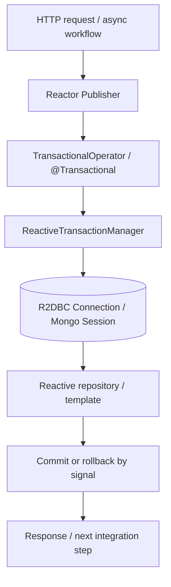
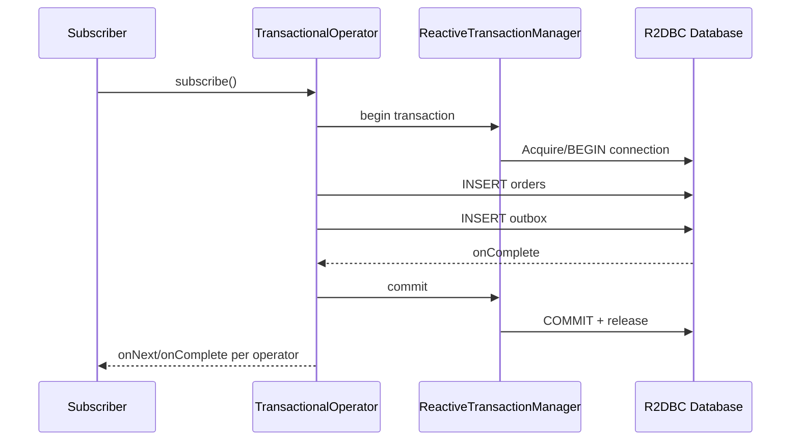
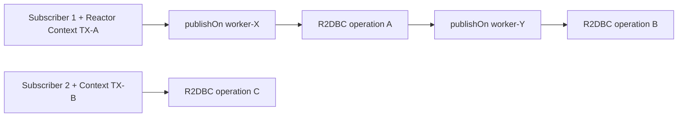
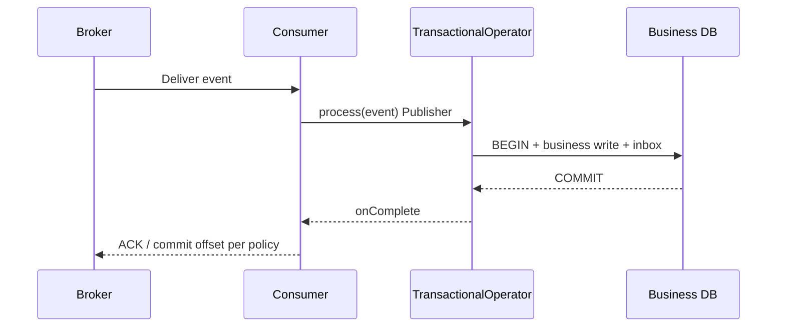
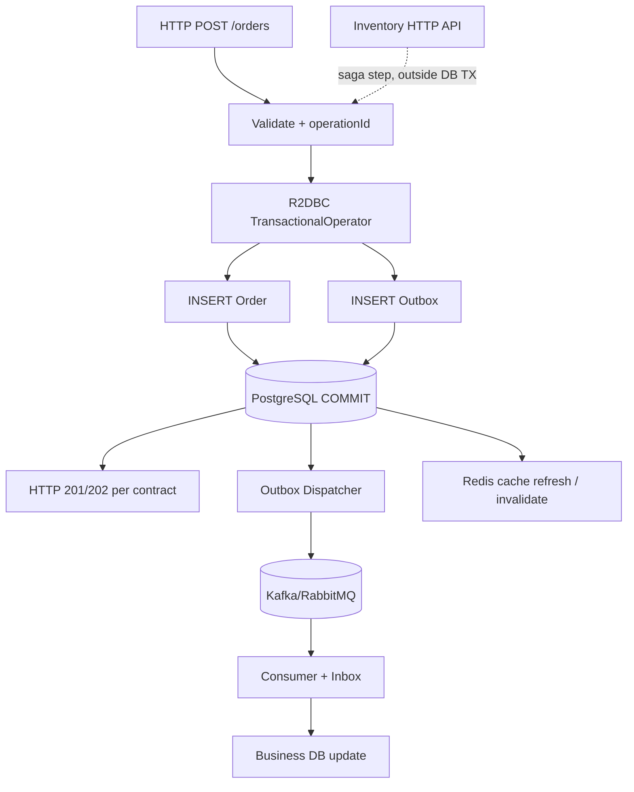

# ReactiveTransactionManager and TransactionalOperator

## 1. What is a reactive transaction, and why understand its boundaries?

In the **SPRING_BOOT_INTEGRATION** module, a Spring Boot application may combine HTTP clients, SQL or MongoDB, Redis, message brokers, and Spring Integration adapters to build both synchronous and asynchronous data flows. When using **Spring WebFlux, Reactor, Spring Data R2DBC**, or **Reactive MongoDB**, data operations are typically expressed as `Mono<T>` and `Flux<T>` rather than executing immediately when the method is invoked.

A typical scenario:

```text
HTTP POST /orders
       |
       v
Reactive service
       |
       +-- INSERT orders ------------------+
       |                                   | one local
       +-- INSERT integration_outbox ------+ transaction
       |
       v
Commit DB transaction
       |
       v
Outbox dispatcher -> broker -> consumers
```

We want **both SQL writes to commit together**: either both the order and the outbox event persist, or both roll back. Yet we must still distinguish:

- A **reactive transaction** protects data operations that properly participate within the same transaction manager, resource, and reactive subscription.
- It **does not** automatically turn HTTP requests, Redis operations, Kafka/RabbitMQ publishes, or another database into a distributed transaction.
- It **does not** mean every operation inside a Java method runs on the same thread, and **does not** rely on `ThreadLocal` like imperative transactions.
- It **does not** begin when a `Mono` object is constructed; for lazy publishers, the lifecycle starts upon subscription.
- A publisher completion signal alone does not guarantee that side effects outside the DB succeeded.

This lesson focuses on **“ReactiveTransactionManager and TransactionalOperator”** in the **Reactive Data** chapter. Content uses concepts and APIs from **Spring Framework 6.x, Spring Boot 3.x, Spring Data R2DBC, and Spring Data MongoDB** on Java 17+. Manager classes vary by datastore, and actual propagation/isolation behavior depends on driver and server support.



## 2. How do imperative transactions differ from reactive transactions?

Spring manages transactions under two models:

| Aspect | Imperative | Reactive |
| --- | --- | --- |
| Core interface | `PlatformTransactionManager` | `ReactiveTransactionManager` |
| Typical context | Thread-bound via imperative `TransactionSynchronizationManager` | Subscriber-bound via **Reactor Context** |
| Operation style | Blocking JDBC/JPA | Non-blocking R2DBC/Reactive Mongo |
| When active | Synchronous method/scope invocation | Over the reactive subscription lifecycle |
| Programmatic API | `TransactionTemplate` | `TransactionalOperator` |
| Declarative API | `@Transactional` on blocking methods | `@Transactional` on methods returning compatible reactive `Publisher`s |
| Signals driving outcome | Normal return or exception from synchronous code | `onComplete`, `onError`, and `cancel` handling |
| Connection/session | Bound per thread | Bound per transaction's reactive context |
| Composing steps | Sequential Java statements | `flatMap`, `then`, `concatMap`, reactive composition |

With JDBC:

```java
@Transactional
public OrderEntity placeOrder(CreateOrderCommand command) {
    OrderEntity saved = repository.save(toEntity(command));
    outboxRepository.save(toOutbox(command));
    return saved;
}
```

With R2DBC, the proper approach is **returning a publisher describing the entire operation**:

```java
@Transactional
public Mono<OrderRow> placeOrder(CreateOrderCommand command) {
    return orders.insert(command)
        .flatMap(saved ->
            outbox.insert(command)
                .thenReturn(saved)
        );
}
```

In the reactive snippet, `orders` and `outbox` are illustrative reactive abstractions; all operations must be chained into the returned publisher and share the same manager. Calling `subscribe()` inside the method or invoking blocking JDBC arbitrarily can escape the transaction scope.

### 2.1. Why isn't ThreadLocal enough?

Reactive pipelines may hop across threads via `publishOn`/`subscribeOn`, network events, and asynchronous driver callbacks. A transaction bound solely to the current thread cannot follow those callbacks.

Spring reactive transactions use **Reactor Context**, propagating with the subscription through compliant operators. Never manage transactions manually with `ThreadLocal<Connection>`, and never treat MDC values or Java thread IDs as proof that two database operations share a transaction.

### 2.2. Reactive does not mean everything is non-blocking

If a method returns `Mono.fromCallable(() -> jdbcTemplate.queryForObject(...))` and executes blocking JDBC on the event loop, it is still **blocking**. Attaching `subscribeOn(boundedElastic())` merely offloads blocking onto a worker thread; it **does not** enroll JDBC into `R2dbcTransactionManager`.

Conversely, a non-blocking `WebClient` call to a partner API remains a **remote side effect** that an R2DBC transaction cannot roll back.

## 3. ReactiveTransactionManager: contract coordinating transaction lifecycle

`ReactiveTransactionManager` resides in `org.springframework.transaction`. Conceptually, its reactive API looks like:

```java
public interface ReactiveTransactionManager
        extends org.springframework.transaction.TransactionManager {

    reactor.core.publisher.Mono<ReactiveTransaction>
        getReactiveTransaction(TransactionDefinition definition);

    reactor.core.publisher.Mono<Void>
        commit(ReactiveTransaction transaction);

    reactor.core.publisher.Mono<Void>
        rollback(ReactiveTransaction transaction);
}
```

This snippet shows the key signatures; it is not a file you write in your application. `ReactiveTransaction` represents an active transaction's state. Normally you **never call** these three methods directly in business code, because context cleanup, rollback-on-error, and resource lifecycles are subtler than the interface implies.

Key implementations:

- `R2dbcTransactionManager` (`org.springframework.r2dbc.connection`): manages transactions over an R2DBC `ConnectionFactory`.
- `ReactiveMongoTransactionManager` (`org.springframework.data.mongodb`): manages reactive MongoDB client sessions and transactions when supported by topology.
- Other system-specific managers may implement this interface, though that does not mean they provide distributed XA transactions.

### 3.1. A manager must know which resource it owns

An `R2dbcTransactionManager` is constructed with **one `ConnectionFactory`**. It binds the transactional R2DBC connection into Reactor Context so compatible Spring Data R2DBC/`DatabaseClient` operations reuse that connection.

A `ReactiveMongoTransactionManager` manages MongoDB sessions and transactions via `ReactiveMongoDatabaseFactory`. It never acquires PostgreSQL connections.

If both managers exist in one app, explicitly pick the right manager per transaction boundary; never assume a single `@Transactional` pulls both datastores into one atomic commit.

### 3.2. When to use @Transactional vs. TransactionalOperator?

- **`@Transactional`** fits public service methods with a clear transaction boundary, invoked via a Spring-managed proxy and returning a Publisher.
- **`TransactionalOperator`** fits when scoping **a specific segment of a reactive pipeline**, separating pre/post-commit steps, applying explicit `TransactionDefinition`s, or avoiding proxy/self-invocation pitfalls.
- Both can coexist in a system, while avoiding unnecessary nested transactions or mismatched manager selection.

## 4. Setting up an R2DBC transaction manager in Spring Boot

Maven dependencies for an imperative-free R2DBC app with PostgreSQL:

```xml
<dependency>
    <groupId>org.springframework.boot</groupId>
    <artifactId>spring-boot-starter-data-r2dbc</artifactId>
</dependency>

<dependency>
    <groupId>org.postgresql</groupId>
    <artifactId>r2dbc-postgresql</artifactId>
    <scope>runtime</scope>
</dependency>
```

Illustrative connection configuration:

```yaml
spring:
  r2dbc:
    url: ${R2DBC_URL:r2dbc:postgresql://localhost:5432/orderdb}
    username: ${R2DBC_USER:order_service}
    password: ${R2DBC_PASSWORD}
```

Never commit real credentials. In production, configure connection pooling, TLS, server authentication, acquisition timeouts, and client/network deadlines appropriately. `spring.r2dbc.url` is **not** a JDBC URL (`jdbc:postgresql://...`).

Given a `ConnectionFactory` and matching auto-configuration conditions, Spring Boot can auto-configure `R2dbcTransactionManager`. To make ownership explicit in this lesson, we can declare:

```java
package example.orders.config;

import io.r2dbc.spi.ConnectionFactory;

import org.springframework.context.annotation.Bean;
import org.springframework.context.annotation.Configuration;
import org.springframework.r2dbc.connection.R2dbcTransactionManager;
import org.springframework.transaction.ReactiveTransactionManager;
import org.springframework.transaction.reactive.TransactionalOperator;

@Configuration
public class OrderTransactionsConfiguration {

    @Bean("orderTransactionManager")
    ReactiveTransactionManager orderTransactionManager(
            ConnectionFactory connectionFactory) {
        return new R2dbcTransactionManager(connectionFactory);
    }

    @Bean("orderTransactionalOperator")
    TransactionalOperator orderTransactionalOperator(
            ReactiveTransactionManager orderTransactionManager) {
        return TransactionalOperator.create(
            orderTransactionManager
        );
    }
}
```

**Injection note:** this code assumes only one `ReactiveTransactionManager` needs injection. If the application has both R2DBC and Mongo managers, add `@Qualifier("orderTransactionManager")` at the parameter or injection point to avoid ambiguity. Do not create a duplicate manager if Boot/project config already registers a suitable one and you do not intend to override it.

A more explicit operator definition:

```java
@Bean("orderTransactionalOperator")
TransactionalOperator orderTransactionalOperator(
        @org.springframework.beans.factory.annotation.Qualifier(
            "orderTransactionManager"
        )
        ReactiveTransactionManager transactionManager) {

    return TransactionalOperator.create(transactionManager);
}
```

In real code, keep **only one** of the bean definitions above rather than declaring the same bean twice. Test configuration must use the same `ConnectionFactory` so the transaction manager and `R2dbcEntityTemplate`/repositories share the same DB.

### 4.1. Why use R2dbcEntityTemplate or DatabaseClient?

Spring Data R2DBC offers abstractions such as:

- `R2dbcEntityTemplate` for entity mapping and reactive CRUD.
- `ReactiveCrudRepository`/`R2dbcRepository` for reactive repositories.
- `DatabaseClient` for parameterized SQL and manual mapping when needed.

When built against the same configured connection factory with transaction context support, operations join the active transaction. By contrast, calling raw `connectionFactory.create()` and managing a fresh connection yourself bypasses the context-bound connection, causing "one operation commits even though the outer operator rolled back".

## 5. TransactionalOperator: scoping a transaction onto a Publisher

`TransactionalOperator` (in `org.springframework.transaction.reactive`) is the programmatic API backed by a `ReactiveTransactionManager`.

Two styles:

```java
Mono<OrderRow> chain = writeOrderAndOutbox(command);

// Operator wrapping a Mono/Flux directly:
Mono<OrderRow> result =
    transactionalOperator.transactional(chain);

// Or Reactor .as(...) to decorate a pipeline:
Mono<OrderRow> equivalent =
    chain.as(transactionalOperator::transactional);
```

With default `REQUIRED` propagation, the transaction starts upon subscribing to the transactional publisher, commits when the source completes normally, rolls back on `onError`, and handles cancellation per Spring Framework's reactive transaction operator rules. Both snippets above are equivalent alternatives—do not call both on the same publisher.



### 5.1. Creating the pipeline does not mean SQL ran

```java
Mono<OrderRow> operation =
    transactionOperator.transactional(
        template.insert(OrderRow.class).using(order)
    );

// No subscriber yet: the operation has not executed.
```

When a WebFlux handler returns `operation`, the framework subscribes. In tests, `StepVerifier.create(operation)` subscribes and verifies outcomes. **Never call `subscribe()` manually just to "kick off the transaction" inside a business service**, because callers lose cancellation, backpressure, error propagation, and outcome visibility.

### 5.2. Prefer Mono.defer for logic that must run per subscription

```java
Mono<OrderRow> operation = Mono.defer(() -> {
    OrderRow row = createRowForCurrentCommand();
    return template.insert(OrderRow.class).using(row);
}).as(transactionalOperator::transactional);
```

Code inside `defer` runs for every subscription. If a generator inside `defer` mints a fresh `orderId`/`eventId`, a retry via resubscription creates new IDs and breaks idempotency. Therefore, **logical business IDs must remain stable across retries**, even though row assembly is deferred.

### 5.3. Never leave writes outside the reactive chain

Wrong:

```java
Mono<OrderRow> save = template.insert(OrderRow.class)
    .using(order);

save.subscribe(); // Detached write: NOT in the same transaction!

return template.insert(OutboxRow.class)
    .using(outbox)
    .as(transactionalOperator::transactional);
```

Right—always **compose**:

```java
return template.insert(OrderRow.class)
    .using(order)
    .flatMap(saved ->
        template.insert(OutboxRow.class)
            .using(outbox)
            .thenReturn(saved)
    )
    .as(transactionalOperator::transactional);
```

## 6. Practical example: writing order and transactional outbox with R2DBC

Let's build a **local transaction** covering `orders` and `integration_outbox`. After commit, an independent dispatcher publishes events to RabbitMQ/Kafka. This closes the event-loss gap between DB commit and broker publish.

### 6.1. PostgreSQL schema

```sql
CREATE TABLE orders (
    id VARCHAR(64) PRIMARY KEY,
    tenant_id VARCHAR(64) NOT NULL,
    status VARCHAR(24) NOT NULL,
    total_amount NUMERIC(18,2) NOT NULL
);

CREATE TABLE integration_outbox (
    event_id VARCHAR(64) PRIMARY KEY,
    aggregate_id VARCHAR(64) NOT NULL,
    event_type VARCHAR(80) NOT NULL,
    schema_version INTEGER NOT NULL,
    payload_json TEXT NOT NULL,
    status VARCHAR(24) NOT NULL
);
```

`payload_json` and `schema_version` represent the **serialized event contract**, not a raw Java entity automatically pushed onto the broker. When JSON querying is needed, you can use PostgreSQL `JSONB` with matching codecs and schema policies; this example uses `TEXT` to avoid unrelated distractions.

### 6.2. Persistence records

```java
package example.orders.data;

import java.math.BigDecimal;

import org.springframework.data.annotation.Id;
import org.springframework.data.relational.core.mapping.Column;
import org.springframework.data.relational.core.mapping.Table;

@Table("orders")
public record OrderRow(
    @Id String id,
    @Column("tenant_id") String tenantId,
    String status,
    @Column("total_amount") BigDecimal totalAmount
) {}
```

```java
package example.orders.data;

import org.springframework.data.annotation.Id;
import org.springframework.data.relational.core.mapping.Column;
import org.springframework.data.relational.core.mapping.Table;

@Table("integration_outbox")
public record OutboxRow(
    @Id @Column("event_id") String eventId,
    @Column("aggregate_id") String aggregateId,
    @Column("event_type") String eventType,
    @Column("schema_version") int schemaVersion,
    @Column("payload_json") String payloadJson,
    String status
) {}
```

### 6.3. Application command and service

```java
package example.orders.application;

import java.math.BigDecimal;

public record CreateOrderCommand(
    String orderId,
    String eventId,
    String tenantId,
    BigDecimal amount,
    String eventJson
) {}
```

`eventJson` is assumed to come from a **validated, versioned business event DTO** serialized before entering the service. Never accept unvalidated raw JSON straight from an HTTP client and store it as a trusted domain event. `orderId` and `eventId` must remain stable across retries of the same logical operation.

```java
package example.orders.application;

import example.orders.data.OrderRow;
import example.orders.data.OutboxRow;

import java.math.BigDecimal;

import org.springframework.beans.factory.annotation.Qualifier;
import org.springframework.data.r2dbc.core.R2dbcEntityTemplate;
import org.springframework.stereotype.Service;
import org.springframework.transaction.reactive.TransactionalOperator;

import reactor.core.publisher.Mono;

@Service
public class OrderCommandService {

    private final R2dbcEntityTemplate template;
    private final TransactionalOperator transaction;

    public OrderCommandService(
            R2dbcEntityTemplate template,
            @Qualifier("orderTransactionalOperator")
            TransactionalOperator transaction) {
        this.template = template;
        this.transaction = transaction;
    }

    public Mono<OrderRow> createOrder(CreateOrderCommand command) {

        return Mono.defer(() -> {
            validate(command);

            OrderRow order = new OrderRow(
                command.orderId(),
                command.tenantId(),
                "PENDING",
                command.amount()
            );

            OutboxRow event = new OutboxRow(
                command.eventId(),
                command.orderId(),
                "OrderCreated",
                1,
                command.eventJson(),
                "PENDING"
            );

            return template.insert(OrderRow.class)
                .using(order)
                .flatMap(saved ->
                    template.insert(OutboxRow.class)
                        .using(event)
                        .thenReturn(saved)
                );
        }).as(transaction::transactional);
    }

    private static void validate(CreateOrderCommand command) {
        if (command == null
                || command.orderId() == null
                || command.orderId().isBlank()
                || command.eventId() == null
                || command.eventId().isBlank()
                || command.tenantId() == null
                || command.tenantId().isBlank()
                || command.amount() == null
                || command.amount().signum() < 0
                || command.eventJson() == null
                || command.eventJson().isBlank()) {
            throw new IllegalArgumentException(
                "Invalid create-order command"
            );
        }
    }
}
```

Because `R2dbcEntityTemplate.insert(...)` is called explicitly, application-assigned business IDs are not misclassified by repository `save(...)` new-state detection (a common pitfall with non-null IDs). `flatMap` ensures the outbox insert runs only after the order insert emits; `thenReturn(saved)` returns the order only after the outbox insert finishes.

**Atomicity:** both inserts use the same `R2dbcEntityTemplate`/connection factory under one `R2dbcTransactionManager`. If the outbox insert fails (e.g., duplicate `event_id`), the transaction rolls back the order insert too.

**Limitations:** this service does not yet implement idempotent replay lookup (retrying the same `orderId` triggers duplicate key errors), an optimistic state machine, or the outbox dispatcher. Its purpose is demonstrating transaction scope; production requires lookup/reconciliation to return the prior operation's result on retry.

### 6.4. Why not publish to the broker inside the transaction?

Common mistake:

```java
return template.insert(OrderRow.class)
    .using(order)
    .flatMap(saved -> rabbitPublisher.send(event).thenReturn(saved))
    .as(transaction::transactional);
```

Publishing may succeed while the database subsequently rolls back, or the database may commit while the broker publish response is lost. `TransactionalOperator` **does not coordinate distributed transactions between R2DBC and a broker**. An outbox worker with retries, publisher confirms, and stable `eventId`s is far safer for critical business events.

## 7. @Transactional on a method returning Mono/Flux

Spring supports declarative transactions via `@Transactional` when invocations flow through a **Spring AOP proxy** and a reactive transaction manager is chosen for the reactive return type.

```java
package example.orders.application;

import example.orders.data.OrderRow;
import example.orders.data.OutboxRow;

import org.springframework.data.r2dbc.core.R2dbcEntityTemplate;
import org.springframework.stereotype.Service;
import org.springframework.transaction.annotation.Transactional;

import reactor.core.publisher.Mono;

@Service
public class DeclarativeOrderService {

    private final R2dbcEntityTemplate template;

    public DeclarativeOrderService(
            R2dbcEntityTemplate template) {
        this.template = template;
    }

    @Transactional(transactionManager = "orderTransactionManager")
    public Mono<OrderRow> saveOrderAndEvent(
            OrderRow order, OutboxRow event) {

        return template.insert(OrderRow.class)
            .using(order)
            .flatMap(saved ->
                template.insert(OutboxRow.class)
                    .using(event)
                    .thenReturn(saved)
            );
    }
}
```

When called from **another bean through the proxy** with Spring's reactive transaction infrastructure configured, the transaction wraps the returned Publisher. It does not execute queries merely because the method was called.

### 7.1. Self-invocation is a proxy trap

```java
@Service
class ExampleService {

    public Mono<Void> outer() {
        return inner(); // Calling this.inner() bypasses the proxy.
    }

    @Transactional
    public Mono<Void> inner() {
        return reactiveWork();
    }
}
```

In standard proxy mode, calling `this.inner()` bypasses the AOP proxy, so `@Transactional` advice is skipped. Fix this by placing the transaction boundary on a public method called through a bean proxy, splitting into a separate service, or using `TransactionalOperator` explicitly.

### 7.2. Annotations do not pull blocking code into an R2DBC transaction

An annotated method returning an imperative type (not a Publisher) may be routed to a different transaction manager or fail expectations; never assume it executes as a reactive flow. When both imperative and reactive managers exist, specify the manager explicitly and verify with real transaction tests. JDBC/JPA calls inside a reactive publisher are also unprotected by R2DBC transactions.

### 7.3. Transaction scope must encompass all required Publishers

Wrong:

```java
@Transactional
public Mono<Void> update() {
    Mono<Void> first = repository.updateStatus();
    Mono<Void> second = outboxRepository.insertEvent();

    // second is never composed or subscribed to.
    return first;
}
```

Right:

```java
@Transactional
public Mono<Void> update() {
    return repository.updateStatus()
        .then(outboxRepository.insertEvent());
}
```

Never call nested `subscribe()`, pass connections through `ThreadLocal`, or return before all critical Publishers are chained in.

## 8. Reactor Context: transactions follow subscribers, not Java threads

**Reactor Context** is a key/value structure attached to each subscription. Spring stores and looks up transaction context here so operators and Spring Data reactive operations share the same transaction across thread switches.



Two subscribers to the same cold publisher create **two distinct executions and two separate transaction scopes**. Never cache or reuse write-performing Publishers without understanding resubscription, `share`/`replay`, and hot publisher semantics.

### 8.1. publishOn/subscribeOn do not break transactions on their own

When operators are properly composed, Reactor Context travels with the subscription, so switching threads does not strip the transaction. However, actions **outside the chain**—such as manual `subscribe()`, dispatching to an unpropagated `CompletableFuture`, or opening a raw DB connection—escape the transaction.

### 8.2. Reactor Context is not logging MDC

Logging MDC typically relies on `ThreadLocal`. You may need Micrometer context propagation or tracing instrumentation to carry correlation/span IDs into logs across async boundaries. Never inspect MDC for `transactionId` to verify Spring reactive transactions; verify using transaction-aware APIs and integration tests.

### 8.3. Transactional resources must share the same ConnectionFactory

If an app talks to two Postgres clusters, a transaction on `orderConnectionFactory` does not span `auditConnectionFactory`. Two repositories both returning `Mono` do not automatically share a transaction. Verify repository/template -> `ConnectionFactory` -> transaction manager wiring. When atomicity across clusters is needed, use integration patterns such as outbox/events/reconciliation instead of claiming a local R2DBC transaction spans all of them.

## 9. onComplete, onError, and cancel determine commit/rollback

A reactive transaction responds to the Publisher's **terminal signals**.

| Signal from transactional source | Typically expected outcome |
| --- | --- |
| Normal `onComplete` | Commit |
| Unrecovered `onError` reaching boundary | Rollback |
| `cancel` before completion | Modern Spring reactive transactions perform rollback-on-cancel |
| Network drop during commit | Can produce an **unknown outcome**; requires reconciliation |
| Inner exception turned into success by `onErrorResume` before boundary | Transaction may commit |

**Cancellation matters.** Since Spring Framework 5.3, Spring reactive transaction infrastructure treats cancellation as rollback. However, if a DB commit had just completed when the client cancelled or disconnected, the application cannot infer from an HTTP disconnect that the DB definitely did not commit; distinguish caller-observed failure from actual database state.

### 9.1. The trap of placing onErrorResume inside a transaction

```java
return writeOrderThenOutbox()
    .onErrorResume(error -> {
        // Error is converted into completion inside the TX.
        return Mono.empty();
    })
    .as(transaction::transactional);
```

The transaction sees the pipeline complete normally and may **commit writes executed prior to the error**. This causes "partial business success" when developers assume every exception automatically triggers rollback.

If errors must trigger rollback, recover **outside** the operator:

```java
return writeOrderThenOutbox()
    .as(transaction::transactional)
    .onErrorResume(error ->
        mapToExplicitBusinessFailure(error)
    );
```

Here, the source sends `onError` to the operator before fallback applies, letting the transaction roll back. `mapToExplicitBusinessFailure` must match the return Publisher's type and convey a clear failure outcome—never silently map all errors to "no order".

### 9.2. Rethrowing and error mapping

```java
return writeOrderThenOutbox()
    .onErrorMap(
        org.springframework.dao.DuplicateKeyException.class,
        ex -> new OrderAlreadyExistsException(
            "Order identity already exists", ex
        )
    )
    .as(transaction::transactional);
```

`onErrorMap` preserves `onError`, so the transaction rolls back. `OrderAlreadyExistsException` is an application-defined domain exception; this snippet illustrates mapping, not a built-in Spring class.

### 9.3. Using setRollbackOnly when business logic does not throw

Inside a programmatic callback, you can mark rollback explicitly:

```java
transactionalOperator.execute(status ->
    validateAndWrite()
        .doOnNext(result -> {
            if (result.mustAbort()) {
                status.setRollbackOnly();
            }
        })
);
```

This returns a `Flux` from `execute(...)`; `validateAndWrite()` and `result.mustAbort()` are application abstractions. **Never use rollback-only to hide a failure and still return HTTP 201 Created**: callers need an outcome distinguishing an aborted operation from a committed one.

## 10. execute(callback) style vs. operator style

`TransactionalOperator` offers two stylistic forms:

- **Operator style:** `transactional(publisher)` wraps the entire Publisher.
- **Callback style:** `execute(status -> publisher)` exposes `ReactiveTransaction` and scopes the executed block explicitly.

Callback style example:

```java
public reactor.core.publisher.Mono<OrderRow> writeOne(
        OrderRow row) {

    return transactionalOperator
        .execute(status ->
            template.insert(OrderRow.class).using(row)
        )
        .single();
}
```

Here `execute` returns `Flux<OrderRow>`; `.single()` is safe **only when the callback guarantees emitting exactly one item before completing**. Do not use `.single()` on a multi-row `Flux` just to grab the first item, as `single()` errors if the count differs from one.

### 10.1. Never use take(1) on a multi-row write transaction

```java
return transactionalOperator.execute(status ->
    repository.findAll()
        .flatMap(this::updateSomething)
).take(1);
```

`take(1)` can **cancel upstream** after the first element. In a reactive transaction, cancellation triggers rollback, meaning earlier writes that signaled completion may not actually commit. To process all rows, wait for full completion—using `then()` or `collectList()` over an appropriately bounded dataset.

### 10.2. Never wrap an unbounded stream in one long transaction

A `Flux` tailing a MongoDB change stream or Kafka topic can run indefinitely. Wrapping the whole stream in one transaction holds resources, cursors, and sessions open indefinitely and never commits while the stream stays alive.

Instead of:

```java
// Wrong scope when events is an unbounded stream:
return events.as(transactionalOperator::transactional);
```

scope a transaction **per logical unit or bounded batch**:

```java
return events
    .concatMap(event ->
        processOneEvent(event)
            .as(transactionalOperator::transactional)
    );
```

`concatMap` preserves order and serializes processing in this example; throughput may be lower than `flatMap`. Choose concurrency based on backpressure, pool capacity, and ordering rules. When consuming from a broker, coordinate ACK/offset commits with transaction outcomes.

## 11. TransactionDefinition: propagation, isolation, timeout, and readOnly

An operator can be configured with a custom `TransactionDefinition`:

```java
import org.springframework.transaction.TransactionDefinition;
import org.springframework.transaction.support.DefaultTransactionDefinition;
import org.springframework.transaction.reactive.TransactionalOperator;

DefaultTransactionDefinition definition =
    new DefaultTransactionDefinition();

definition.setName("order.create");
definition.setPropagationBehavior(
    TransactionDefinition.PROPAGATION_REQUIRED
);
definition.setIsolationLevel(
    TransactionDefinition.ISOLATION_READ_COMMITTED
);
definition.setTimeout(5);

TransactionalOperator orderTx =
    TransactionalOperator.create(manager, definition);
```

`manager` here is an injected `ReactiveTransactionManager`; this code does not imply every datastore supports every isolation level or timeout. Naming the definition aids tracing and diagnostics, though never embed `orderId` into transaction names (high cardinality).

| Property | Meaning | Caveats |
| --- | --- | --- |
| `PROPAGATION_REQUIRED` | Join existing transaction or start a new one | Typically the default |
| `REQUIRES_NEW` | Start an independent transaction via the manager | Can require an extra connection and pressure pool capacity |
| `NESTED` | Uses nested/savepoint semantics if manager/driver supports it | Not as portable as the default |
| `ISOLATION_READ_COMMITTED` | Prevents reading uncommitted data per DB semantics | Varies across database engines |
| `ISOLATION_SERIALIZABLE` | Stronger isolation, higher conflict/retry rates | Does not protect external HTTP side effects |
| Timeout | Transaction timeout enforced by the manager | Not an end-to-end workflow business deadline |
| `readOnly` | Hint/constraint depending on manager/driver/database | Does not replace database authorization |

### 11.1. Nested and REQUIRES_NEW must be verified

`REQUIRES_NEW` can suspend the outer transaction and acquire a second connection; if pool max size matches concurrent requests holding outer transactions, pool deadlock/exhaustion becomes likely. `NESTED` usually relies on database savepoints if supported. Pick propagation based on real requirements and verify independent rollback/savepoint semantics via integration tests on your driver.

### 11.2. ReadOnly is not a security policy

`@Transactional(readOnly = true)` or a read-only definition may be passed by the R2DBC manager/driver as a connection hint, but never rely on it as your sole security control. Database roles, grants, and query validation remain mandatory enforcement layers.

### 11.3. Timeouts must account for work outside the DB

An HTTP request with a 2-second end-to-end SLA must not open a DB transaction and wait 10 seconds on a partner API. Allocate budgets across connect/response, DB transaction, retries/backoff, and commit. Transaction timeouts do not control WebClient, broker publish, or batch job timeouts.

## 12. SQL isolation and concurrency: transactions do not eliminate all races

Even when every write is wrapped in a transaction, two concurrent requests can still collide.

Example:

```text
Tx A: SELECT stock available = 5
Tx B: SELECT stock available = 5
Tx A: reserve 4
Tx B: reserve 4
```

Without conditional predicates, a naive read–modify–write lets both believe they reserved 4 units. Transactions at default isolation levels do not automatically prevent lost updates or write skew.

### 12.1. Atomic conditional updates

When the database owns stock state, use an SQL update with a predicate and inspect affected row counts:

```sql
UPDATE inventory
SET available_quantity = available_quantity - :quantity
WHERE sku = :sku
  AND available_quantity >= :quantity;
```

Via `DatabaseClient`:

```java
public Mono<Boolean> reserve(
        String sku, int quantity) {

    return databaseClient.sql("""
        UPDATE inventory
           SET available_quantity =
               available_quantity - :quantity
         WHERE sku = :sku
           AND available_quantity >= :quantity
        """)
        .bind("sku", sku)
        .bind("quantity", quantity)
        .fetch()
        .rowsUpdated()
        .map(rows -> rows == 1L);
}
```

`DatabaseClient` is injected; the snippet assumes matching columns and SQL syntax. Across versions, check the exact numeric return type of `rowsUpdated()`. This is an atomic conditional update within **one database**, not cross-service reservation from Order Service to Inventory Service.

### 12.2. Unique constraints against duplicates on retry

In HTTP/broker integrations, a stable operation ID and unique index block concurrent duplicate writes. A `SELECT` followed by `INSERT` has a race window. When the DB rejects a duplicate, the app must distinguish **"valid retry with identical payload"** from **"key collision with a different payload"** rather than blindly returning success.

### 12.3. Never execute multiple statements concurrently on one connection

A reactive transaction typically binds a single connection to the context. `Mono.zip(writeA, writeB)` or concurrent `flatMap` may issue overlapping SQL operations on that single connection; not all R2DBC drivers support multiplexing like that. For dependent writes inside a transaction, chain sequentially with `then`/`flatMap`; use batching if higher throughput is needed.

## 13. Reactive MongoDB: same interface, different manager

For reactive MongoDB, Spring Data provides `ReactiveMongoTransactionManager`. It manages reactive MongoDB client sessions and transactions, requiring a **MongoDB deployment topology that supports transactions**, such as a replica set or sharded cluster depending on server/driver version.

Maven dependency:

```xml
<dependency>
    <groupId>org.springframework.boot</groupId>
    <artifactId>spring-boot-starter-data-mongodb-reactive</artifactId>
</dependency>
```

Basic configuration:

```yaml
spring:
  data:
    mongodb:
      uri: ${MONGODB_URI:mongodb://localhost:27017/orders_db}
```

A local **standalone** MongoDB instance supports reactive reads/writes normally yet does not support multi-document transactions. Never assume MongoDB transactions work just because `ReactiveMongoRepository.save(...)` returns `Mono`.

### 13.1. Declaring manager and operator for MongoDB

```java
package example.orders.mongo;

import org.springframework.context.annotation.Bean;
import org.springframework.context.annotation.Configuration;
import org.springframework.data.mongodb.ReactiveMongoDatabaseFactory;
import org.springframework.data.mongodb.ReactiveMongoTransactionManager;
import org.springframework.transaction.ReactiveTransactionManager;
import org.springframework.transaction.reactive.TransactionalOperator;

@Configuration
class ReactiveMongoTransactionsConfiguration {

    @Bean("mongoTransactionManager")
    ReactiveTransactionManager mongoTransactionManager(
            ReactiveMongoDatabaseFactory factory) {
        return new ReactiveMongoTransactionManager(factory);
    }

    @Bean("mongoTransactionalOperator")
    TransactionalOperator mongoTransactionalOperator(
            @org.springframework.beans.factory.annotation.Qualifier(
                "mongoTransactionManager"
            )
            ReactiveTransactionManager manager) {
        return TransactionalOperator.create(manager);
    }
}
```

This manager/operator is **exclusively for MongoDB**. It does not replace R2DBC configuration in dual-store apps. Use explicit bean names and `@Qualifier`/`@Transactional(transactionManager="...")`.

### 13.2. Two documents in one MongoDB transaction

Assuming `ReactiveMongoTemplate` and document classes `OrderDocument`/`OutboxDocument` exist:

```java
public Mono<OrderDocument> saveOrderAndOutbox(
        OrderDocument order,
        OutboxDocument outbox) {

    return mongoTemplate.insert(order)
        .flatMap(saved ->
            mongoTemplate.insert(outbox)
                .thenReturn(saved)
        )
        .as(mongoTransactionalOperator::transactional);
}
```

This illustrates operator scoping without showing full document definitions; both operations must share the same reactive factory/manager, session, and transaction-capable topology. With sharded MongoDB, write concern, transaction lifetime, cross-shard behavior, and commit retry semantics depend on topology and server settings.

### 13.3. Do not confuse single-document atomicity with multi-document transactions

MongoDB guarantees atomicity for **single-document writes** natively. If updating one document, you may not need a multi-document transaction. When writing `orders` and `outbox` across **two separate documents**, atomicity requires explicit transaction support.

If transactions are unsupported, let integration tests fail loudly rather than silently falling back to "write two records without a transaction and report success". When access patterns allow, embedding the outbox event inside the same document is one option; otherwise run on a transaction-capable topology.

## 14. Multiple managers or databases: draw deliberate boundaries

An app using both PostgreSQL R2DBC and Reactive MongoDB:

```text
Order Service
  ├── R2dbcEntityTemplate -> Order R2DBC ConnectionFactory
  │                           -> orderTransactionManager
  └── ReactiveMongoTemplate -> MongoDB ReactiveDatabaseFactory
                              -> mongoTransactionManager
```

Even though **both are reactive**, writing:

```java
@Transactional
public Mono<Void> writeBoth() {
    return sqlWrite().then(mongoWrite());
}
```

**does not** create a distributed transaction. With multiple managers, an unqualified `@Transactional` can resolve unpredictably or fail with ambiguity. Specify the manager explicitly and assign clear ownership per operation.

### 14.1. Two local transactions do not equal one atomic transaction

```java
return sqlWrite()
    .as(orderTx::transactional)
    .then(mongoWrite().as(mongoTx::transactional));
```

This runs **two sequential independent transactions**. If SQL commits and the Mongo write fails, SQL does not roll back. Flipping the order merely shifts the failure window.

In integration architecture, choose:

- One source of truth publishing events via transactional outbox.
- An eventually consistent Mongo projection consumer with retries and idempotency.
- Reconciliation jobs to detect delayed or missing events/projections.
- A workflow/saga with state tracking and compensation when both systems perform independent business side effects.

Do not claim two-phase commit unless your infrastructure and resource managers genuinely support it and you have analyzed its failure windows. `ReactiveTransactionManager` is not an XA coordinator.

### 14.2. JDBC and R2DBC TransactionManagers share Spring, not context

For example:

```text
DataSource/JPA:
  DataSourceTransactionManager / JpaTransactionManager
  -> ThreadLocal transaction context

R2DBC:
  R2dbcTransactionManager
  -> Reactor Context transaction context
```

Calling `entityManager.persist(...)` from a reactive chain running an R2DBC transaction does not include the JPA write in that commit. When bridging imperative legacy APIs, use a dedicated boundary, manage scheduling and resource ownership explicitly, and treat them as **two separately committed steps**.

## 15. Transaction lifetime, cancellation, and retries

Reactive composition makes chaining easy, yet long transactions hold **an R2DBC connection** or **Mongo client session** open for too long. This hurts quickly when pools are small and HTTP traffic spikes.

### 15.1. Never call partner HTTP inside a long transaction

Example to avoid when seeking local DB atomicity:

```java
return databaseClient.sql("UPDATE orders ...")
    .fetch()
    .rowsUpdated()
    .then(webClient.post()
        .uri("/payments")
        .retrieve()
        .bodyToMono(PaymentReply.class))
    .as(orderTransaction::transactional);
```

While waiting 10 seconds on Payment, the DB transaction pins connections and locks. Worse, if the provider processes payment and the DB rolls back, the HTTP side effect is never undone.

Better workflow:

1. Transaction A: write order intent + outbox, commit fast.
2. Worker/saga calls Payment over HTTP **outside DB transactions** using an idempotency key.
3. Transaction B: record payment outcome and emit a new outbox event.
4. On lost/unknown responses, a reconciliation job queries the provider.
5. Notifications and analytics update eventually consistently over the message bus.

### 15.2. Retry scopes must be idempotent

```java
return writeOrderAndOutbox()
    .as(orderTransaction::transactional)
    .retryWhen(
        reactor.util.retry.Retry.backoff(
            2, java.time.Duration.ofMillis(100)
        ).filter(this::isTransientDatabaseError)
    );
```

When retry wraps **outside the operator**, each resubscription starts a fresh transaction after the prior attempt rolled back or failed. Keep in mind:

- `isTransientDatabaseError` is an application policy that must classify database/driver errors carefully.
- Never blindly retry duplicate keys, invalid schemas, or auth failures.
- Commit/network outcomes can be ambiguous; re-running the entire operation requires stable business IDs and idempotency.
- Cap max attempts and overall deadlines to avoid retry storms.
- If `Mono.defer` generates a fresh event ID per subscription, retries create divergent IDs and corrupt logical identity.

### 15.3. Reactor timeouts can cancel transactions

```java
return writeOrderAndOutbox()
    .as(orderTransaction::transactional)
    .timeout(java.time.Duration.ofSeconds(2));
```

When a downstream timeout cancels the subscription to the operator, Spring reactive transactions normally perform rollback-on-cancel. Still, **never infer from `TimeoutException` that the database definitely did not commit**, especially if the timeout raced with a `COMMIT` already reaching the server. That is why retryable APIs require idempotency and reconciliation.

### 15.4. Do not infer commit status from client disconnects

A closed browser tab or gateway timeout can cancel the HTTP response after the business operation already committed. For `202 Accepted` APIs, provide a durable job status lookup by operation ID; for `201 Created`, lost responses still demand safe lookup and retry semantics.

## 16. onErrorResume, empty Publishers, and rollback policies

In reactive pipelines, business outcomes can appear as `Mono.empty()`, `Mono.just(result)`, or `Mono.error(...)`. Spring transactions do not know business failure intent if you convert errors into completions.

### 16.1. Empty does not automatically mean failure

```java
return repository.findById(orderId)
    .flatMap(this::update)
    .as(orderTx::transactional);
```

If `findById` returns `Mono.empty()`, the pipeline completes normally and the transaction commits (typically having made no update). If "missing order" must fail, emit an explicit error:

```java
return repository.findById(orderId)
    .switchIfEmpty(
        Mono.error(
            new IllegalArgumentException(
                "Order not found"
            )
        )
    )
    .flatMap(this::update)
    .as(orderTx::transactional);
```

### 16.2. onErrorContinue is not a rollback policy

`onErrorContinue` has subtle semantics and lets pipelines keep running after element failures. Avoid putting it inside transactional write flows just to "keep processing remaining items" without strict atomicity rules. When items must succeed or fail independently, run **a small transaction per record** using bounded-concurrency `concatMap`/`flatMap` and record per-item outcomes.

### 16.3. Mono.zip risks with empty signals and side effects

`Mono.zip(writeA(), writeB())` completes empty if either publisher emits nothing, and may cancel the sibling source in some cases. If `writeB` is a side effect depending on `writeA`, use `then`/`flatMap` rather than `zip` just to "run both".

### 16.4. SQL errors and rollback-only

A DB constraint error emits `onError` and the operator rolls back. To translate into a domain exception, use `onErrorMap`/`doOnError`. If you recover **inside the transaction**, recognize that you converted the error into normal completion; if rollback is still required, rethrow, explicitly mark rollback-only, or move recovery outside the operator.

### 16.5. Never lump timeouts, validation, and connectivity together

| Signal | Risk | Suggested policy |
| --- | --- | --- |
| `DuplicateKeyException` | Duplicate business ID or valid retry | Look up prior operation and compare payload fingerprint |
| `DataIntegrityViolationException` | Unique/foreign/check constraint failure | Do not hot-retry; fix input or schema |
| R2DBC transient connection error | Database temporarily unreachable | Bounded retry when operation is safe |
| Serialization/deadlock conflict | Transaction needs replay | Retry entire unit of work with stable IDs |
| `TimeoutException` | Unclear whether DB committed | Reconcile using operation ID |
| `CancellationException`/cancel | Transaction likely rolled back | Verify downstream state; never guess |
| Remote HTTP 503 | Outside DB transaction | Retry/backoff or saga |
| Invalid event JSON | Permanent contract failure | Route to DLQ/quarantine; never retry forever |

## 17. Transaction scope for broker consumers and Spring Integration

A Kafka/RabbitMQ consumer may use reactive data access to update a database. You must align **when the broker ACKs/commits offsets** with **when the DB transaction finishes**.



### 17.1. Only ACK after the publisher finishes

If a consumer receives a message and runs:

```java
service.process(event).subscribe();
return; // listener may ACK prematurely.
```

the DB write runs detached, and the listener container can treat the method as finished before commit. This is a serious bug. Use **listener adapters supporting reactive completion** or an approved bridge policy: await durable completion via framework-supported mechanics without arbitrarily blocking event loops or ACKing early.

In Spring Kafka/AMQP, how containers handle asynchronous/reactive returns, acknowledgments, and error channels **depends on version and configuration**. Never assume merely returning `Mono<Void>` automatically waits in every version. Verify lifecycle behavior against a real broker.

### 17.2. Inbox inside the same transaction as business writes

When a consumer handles `OrderConfirmed(eventId=evt-6e0f)`:

```text
BEGIN R2DBC transaction
  INSERT inbox(consumer, eventId) with unique constraint
  IF new event:
    UPDATE projection / business state
COMMIT
ACK broker
```

If ACK fails after commit, the broker redelivers. The unique inbox blocks duplicate DB side effects. For external email or payment calls, add an outbox or durable job state, because an inbox commit **does not make an email provider idempotent**.

### 17.3. Spring Integration message flows

Spring Integration offers `DirectChannel`, `ExecutorChannel`, `QueueChannel`, reactive/imperative adapters, and diverse endpoints. Passing a `Message<?>` with payloads and headers **does not mean** a Reactor Context transaction automatically travels across every channel and thread.

- A reactive flow composed within one subscription can preserve transaction context.
- Dispatching onto another thread/executor without reactive context propagation escapes the transaction.
- A broker adapter is a **transport boundary**, outside SQL transaction managers.
- Spring Integration error channels and Reactor `onError` must be mapped deliberately.
- For long async workflows, commit business state + outbox/job state rather than holding a DB transaction open across the whole flow.

### 17.4. ACKs/offsets and duplicates

RabbitMQ ACKs confirm delivery, and Kafka committed offsets record consumer group progress. Neither **proves business outcomes finished** if the listener commits before side effects persist. Combine an inbox, durable state, and reconciliation, while monitoring consumer lag and unacked counts separately from successful DB commits.

## 18. WebFlux controllers and the HTTP response boundary

A WebFlux endpoint can return a transactional Publisher directly:

```java
package example.orders.api;

import example.orders.application.CreateOrderCommand;
import example.orders.application.OrderCommandService;
import example.orders.data.OrderRow;

import org.springframework.http.HttpStatus;
import org.springframework.web.bind.annotation.*;

import reactor.core.publisher.Mono;

@RestController
@RequestMapping("/orders")
public class OrderController {

    private final OrderCommandService orders;

    public OrderController(OrderCommandService orders) {
        this.orders = orders;
    }

    @PostMapping
    @ResponseStatus(HttpStatus.CREATED)
    public Mono<OrderCreatedResponse> create(
            @RequestBody Mono<CreateOrderRequest> body) {

        return body
            .map(request ->
                new CreateOrderCommand(
                    request.orderId(),
                    request.eventId(),
                    request.tenantId(),
                    request.totalAmount(),
                    request.eventJson()
                )
            )
            .flatMap(orders::createOrder)
            .map(saved ->
                new OrderCreatedResponse(
                    saved.id(), saved.status()
                )
            );
    }
}

record CreateOrderRequest(
    String orderId,
    String eventId,
    String tenantId,
    java.math.BigDecimal totalAmount,
    String eventJson
) {}

record OrderCreatedResponse(
    String orderId,
    String status
) {}
```

**This API example is purely mechanical to show the subscription boundary**, not a production security or contract design. In real systems, `eventId` and `eventJson` must be produced by a trusted application layer from validated commands rather than trusting arbitrary payloads/event IDs sent by HTTP clients. Authentication, tenant authorization, idempotency, and error mapping must be implemented separately.

### 18.1. Never return 201 before the transaction commits

When an endpoint returns `Mono<OrderCreatedResponse>` from a transactional service, response mapping happens only after transaction completion per publisher contract. Never spawn a detached side effect and return `Mono.just(...)` early. For workflows requiring downstream Payment/Inventory steps later, return `202 Accepted` with a durable order/job state rather than implying downstream work is finished.

### 18.2. Keep HTTP body deserialization outside DB transactions where possible

`@RequestBody Mono<CreateOrderRequest>` decodes the payload; validate inputs before opening the DB transaction whenever feasible. Keep transactions short. Validations requiring DB reads belong inside the transaction, while structural and security checks belong upfront at the boundary.

### 18.3. HTTP disconnects and durable operation IDs

If the client closes the socket right as the server commits, callbacks may receive cancellation. The final outcome cannot be deduced from the dropped HTTP socket alone. Rely on stable `operationId`s, unique constraints, and status lookup endpoints so retrying clients do not create duplicate orders.

## 19. TransactionalOperator and StepVerifier: unit tests verifying signals

`StepVerifier` (from Reactor Test) subscribes and asserts emitted signals. Tests using mocked reactive repositories can prove code **does not swallow errors**, but cannot prove real SQL rollback.

Mocking `R2dbcEntityTemplate` is also awkward because of its fluent multi-stage API. It is cleaner to unit-test pure domain/helper logic separately and use integration tests for transactions.

### 19.1. Testing that no subscription means no write

```java
import static org.assertj.core.api.Assertions.assertThat;
import java.util.concurrent.atomic.AtomicInteger;
import org.junit.jupiter.api.Test;
import reactor.core.publisher.Mono;
import reactor.test.StepVerifier;

class ReactiveLazinessTest {

    @Test
    void workStartsOnSubscription() {
        AtomicInteger writes = new AtomicInteger();

        Mono<String> operation = Mono.defer(() -> {
            writes.incrementAndGet();
            return Mono.just("saved");
        });

        assertThat(writes.get()).isZero();

        StepVerifier.create(operation)
            .expectNext("saved")
            .verifyComplete();

        assertThat(writes.get()).isEqualTo(1);
    }
}
```

This tests Reactor laziness without a real transaction. It highlights a common mistake where developers invoke a reactive method and forget to return or subscribe to it.

### 19.2. Testing error operator placement

With a test transaction manager or Postgres container, run one succeeding write followed by a failing write:

```text
write A succeeds
write B emits database constraint error
expected: transaction rolls back A and B
```

Then place `onErrorResume` **inside** vs. **outside** the transaction boundary in separate tests. Never assume fallback placement is harmless; assert final database state to confirm commit/rollback behavior.

## 20. Integration testing R2DBC transactions with PostgreSQL Testcontainers

To prove atomicity, you need a real database and real Spring transaction infrastructure. Spin up Testcontainers PostgreSQL, initialize the schema, invoke the service, and query the database directly.

Maven test dependencies:

```xml
<dependency>
    <groupId>org.springframework.boot</groupId>
    <artifactId>spring-boot-starter-test</artifactId>
    <scope>test</scope>
</dependency>

<dependency>
    <groupId>io.projectreactor</groupId>
    <artifactId>reactor-test</artifactId>
    <scope>test</scope>
</dependency>

<dependency>
    <groupId>org.testcontainers</groupId>
    <artifactId>postgresql</artifactId>
    <scope>test</scope>
</dependency>

<dependency>
    <groupId>org.testcontainers</groupId>
    <artifactId>junit-jupiter</artifactId>
    <scope>test</scope>
</dependency>
```

In tests, Testcontainers PostgreSQL uses a JDBC driver internally for container metadata/health checks, while the app under test connects via an **R2DBC URL**. Your project may need a compatible JDBC driver in test scope for Testcontainers. To keep focus on transactions, this example uses `postgres:16-alpine` and `@DynamicPropertySource`.

### 20.1. Creating dynamic R2DBC connectivity

```java
package example.orders;

import org.junit.jupiter.api.Test;
import org.springframework.beans.factory.annotation.Autowired;
import org.springframework.boot.test.context.SpringBootTest;
import org.springframework.test.context.DynamicPropertyRegistry;
import org.springframework.test.context.DynamicPropertySource;
import org.testcontainers.containers.PostgreSQLContainer;
import org.testcontainers.junit.jupiter.Container;
import org.testcontainers.junit.jupiter.Testcontainers;

import org.springframework.r2dbc.core.DatabaseClient;
import org.springframework.data.r2dbc.core.R2dbcEntityTemplate;

import reactor.test.StepVerifier;

@SpringBootTest
@Testcontainers
class ReactiveOrderTransactionIT {

    @Container
    static PostgreSQLContainer<?> postgres =
        new PostgreSQLContainer<>("postgres:16-alpine");

    @DynamicPropertySource
    static void registerDatabase(DynamicPropertyRegistry registry) {
        registry.add("spring.r2dbc.url", () ->
            "r2dbc:postgresql://"
                + postgres.getHost() + ":"
                + postgres.getMappedPort(5432) + "/"
                + postgres.getDatabaseName()
        );
        registry.add("spring.r2dbc.username",
            postgres::getUsername);
        registry.add("spring.r2dbc.password",
            postgres::getPassword);
    }

    @Autowired DatabaseClient databaseClient;
    @Autowired R2dbcEntityTemplate template;
    @Autowired example.orders.application.OrderCommandService orders;

    // Test methods follow in the sections below.
}
```

This is a **test class skeleton**; combine it with the `@BeforeEach` and `@Test` methods below, and ensure your app registers `orderTransactionManager`/`orderTransactionalOperator` as shown in Section 4. In CI, Docker images must be accessible, ports/networking must work, and the R2DBC driver must match the PostgreSQL version.

### 20.2. Preparing schema in @BeforeEach

Place the following methods **inside `ReactiveOrderTransactionIT`**:

```java
@org.junit.jupiter.api.BeforeEach
void createSchemaAndClearRows() {

    reactor.core.publisher.Mono<Void> schema =
        databaseClient.sql("""
            CREATE TABLE IF NOT EXISTS orders (
                id VARCHAR(64) PRIMARY KEY,
                tenant_id VARCHAR(64) NOT NULL,
                status VARCHAR(24) NOT NULL,
                total_amount NUMERIC(18,2) NOT NULL
            )
            """).then()
        .then(databaseClient.sql("""
            CREATE TABLE IF NOT EXISTS integration_outbox (
                event_id VARCHAR(64) PRIMARY KEY,
                aggregate_id VARCHAR(64) NOT NULL,
                event_type VARCHAR(80) NOT NULL,
                schema_version INTEGER NOT NULL,
                payload_json TEXT NOT NULL,
                status VARCHAR(24) NOT NULL
            )
            """).then())
        .then(databaseClient.sql(
            "DELETE FROM integration_outbox"
        ).then())
        .then(databaseClient.sql(
            "DELETE FROM orders"
        ).then());

    StepVerifier.create(schema).verifyComplete();
}
```

This is **test setup**, not production request-handler code. `StepVerifier` subscribes to the DDL/DML steps. For parallel test suites, isolate schemas or databases so tests do not wipe each other's tables.

### 20.3. Happy path: both records commit together

```java
@Test
void commitsOrderAndOutboxTogether() {

    var command =
        new example.orders.application.CreateOrderCommand(
            "ord-happy",
            "evt-happy",
            "tenant-17",
            new java.math.BigDecimal("49.90"),
            "{\"eventId\":\"evt-happy\",\"schemaVersion\":1}"
        );

    StepVerifier.create(orders.createOrder(command))
        .expectNextMatches(row ->
            "ord-happy".equals(row.id())
        )
        .verifyComplete();

    StepVerifier.create(
        databaseClient.sql("""
            SELECT COUNT(*) AS total
            FROM integration_outbox
            WHERE event_id = 'evt-happy'
            """)
            .map((row, metadata) ->
                row.get("total", Long.class))
            .one()
    )
    .expectNext(1L)
    .verifyComplete();
}
```

Never interpolate external string parameters directly into SQL; this example uses a hardcoded literal purely for test brevity. Production queries must always bind parameters.

### 20.4. Rollback path: duplicate outbox ID

```java
@Test
void rollsBackOrderWhenOutboxInsertFails() {

    var existing =
        new example.orders.data.OutboxRow(
            "evt-duplicate",
            "ord-old",
            "OrderCreated",
            1,
            "{\"eventId\":\"evt-duplicate\"}",
            "PENDING"
        );

    StepVerifier.create(
        template.insert(example.orders.data.OutboxRow.class)
            .using(existing)
    ).expectNextCount(1).verifyComplete();

    var command =
        new example.orders.application.CreateOrderCommand(
            "ord-must-rollback",
            "evt-duplicate",
            "tenant-17",
            new java.math.BigDecimal("10.00"),
            "{\"eventId\":\"evt-duplicate\"}"
        );

    StepVerifier.create(orders.createOrder(command))
        .expectError()
        .verify();

    StepVerifier.create(
        databaseClient.sql("""
            SELECT COUNT(*) AS total
            FROM orders WHERE id = :orderId
            """)
            .bind("orderId", "ord-must-rollback")
            .map((row, metadata) ->
                row.get("total", Long.class))
            .one()
    ).expectNext(0L).verifyComplete();
}
```

Because `event_id` already exists in outbox, the second insert fails. When transactions are wired properly, the earlier order insert rolls back and the count is `0`. Depending on your Spring R2DBC driver and exception translator, you can assert `DuplicateKeyException`, though this test emphasizes verifying **actual rollback** without coupling tightly to driver-specific exception translation.

### 20.5. What this integration test does not prove yet

The test above does not verify:

- Kafka/RabbitMQ publishing or consumer ACKs;
- Payment HTTP side effects;
- Recovery when `COMMIT` outcomes are ambiguous;
- Concurrent transactions and isolation conflicts;
- Connection pool saturation or timeouts;
- Multiple R2DBC `ConnectionFactory` beans;
- MongoDB transaction support;
- API status mapping, authorization, and full idempotency workflows.

Each of these requires dedicated tests at its own boundary.

## 21. Additional tests for transaction boundaries

Basic rollback tests are insufficient under load or continuous WebFlux/broker traffic. Add tests covering the scenarios below as needed.

### 21.1. Multiple subscriptions

```java
Mono<OrderRow> command =
    orderService.createOrder(createOrderCommand);

StepVerifier.create(command)
    .expectNextCount(1)
    .verifyComplete();

StepVerifier.create(command)
    .expectError()
    .verify();
```

If the command uses the same `orderId` with a unique constraint, the second subscription hits a duplicate key error. This proves **a cold Publisher re-executes side effects** per subscription. The example does not mandate a specific exception type; with full domain idempotency, the second call might return the prior result instead of throwing.

**Never slap `.cache()` onto a write-performing Publisher and call it durable idempotency.** In-memory caching lives only in one process and Publisher instance and offers zero protection across restarts, replicas, or client retries.

### 21.2. Cancellation and rollback

Tests like:

```java
StepVerifier.create(
    service.longRunningWrite()
        .as(orderTx::transactional)
)
    .thenCancel()
    .verify();
```

are **not enough** to prove rollback unless you also inspect the database. Use controlled synchronization: wait until write A has executed and write B is blocked, cancel the subscription, then query the database to confirm A is gone. Seeing a cancel signal alone does not prove DB commit/rollback races behave as expected.

Use deterministic synchronization primitives or controlled test Publishers rather than flaky `Thread.sleep` delays.

### 21.3. Transaction context across scheduler switches

```java
return writeA()
    .publishOn(reactor.core.scheduler.Schedulers.boundedElastic())
    .then(writeB())
    .as(orderTx::transactional);
```

In standard Reactor composition, context propagates across scheduler hops. A test is only meaningful if both writes hit **the same DB transaction** and you verify rollback when B fails. Never assert imperative `ThreadLocal` transaction markers, as that is not how reactive transactions work.

### 21.4. Dependency failures outside the transaction

Simulate:

```text
R2DBC transaction commits order + outbox
Outbox worker sends to RabbitMQ
Broker connection fails
Expected:
  order remains persisted,
  outbox stays PENDING,
  retry keeps the same eventId,
  no duplicate business effect
```

Do not expect the Order DB transaction to roll back when RabbitMQ fails, because broker publishing happens **outside** the local transaction in the outbox design.

### 21.5. Multiple managers and partial commits

In an R2DBC + MongoDB app, write an integration test forcing the Mongo insert to fail after SQL commits. Confirm SQL state does not roll back automatically, mark the workflow `RECONCILE_PENDING`, and repair the projection via events/retries. The goal is **preventing developers from mistaking two `TransactionalOperator`s for distributed atomicity**.

## 22. Observability: tracking transactions, pools, and business outcomes

Transaction problems often surface as rising latency or falling throughput before turning into HTTP errors. Monitor:

| Signal | Diagnostic value | Notes |
| --- | --- | --- |
| R2DBC pool acquired/pending | Connection exhaustion, slow acquisition | Metrics depend on pool/instrumentation |
| SQL query latency/errors | Slow queries or constraint failures | Never log raw PII or SQL params |
| Transaction duration | Time from begin to commit/rollback | Not every meter is auto-created by default |
| Commit/rollback errors | Ambiguous commit outcomes, rollback failures | Separate from query execution errors |
| HTTP request duration | How long clients wait | Does not equal end-to-end business completion |
| Outbox oldest pending age | Events sitting unpublished too long | Catches failures after DB commit |
| Consumer inbox duplicates | Redelivery/retry duplicate rate | Do not count as new business events |
| Business completion latency | From accepted operation to final state | Pair with pending age to spot stuck jobs |
| Reactive cancellations | Client disconnects, timeouts, operator truncation | Classify who triggered the cancel |
| Downstream HTTP/Redis/broker metrics | External dependencies outside the TX | Do not conflate with DB transaction latency |

**Avoid putting order IDs or event IDs into metric tags.** A metric like `transaction.duration{orderId="ord-1024"}` explodes into millions of time series. Use bounded tags like `operation=create_order`, `database=orders`, `outcome=commit/rollback/unknown`, leaving detailed IDs in access-controlled logs and traces.

### 22.1. Measuring transaction duration at the right scope

Starting a `Timer` before invoking a method returning `Mono` and stopping it on method return measures only **Publisher assembly time**, not the DB transaction.

Wrong:

```java
long start = System.nanoTime();
Mono<OrderRow> publisher = service.createOrder(command);
long elapsed = System.nanoTime() - start;
// This is NOT query or transaction latency.
```

Measure from subscription start through terminal completion:

```java
return Mono.defer(() -> {
    io.micrometer.core.instrument.Timer.Sample sample =
        io.micrometer.core.instrument.Timer.start(meters);

    return service.createOrder(command)
        .doFinally(signal ->
            sample.stop(
                meters.timer(
                    "integration.order.create.duration",
                    "signal", signal.name()
                )
            )
        );
});
```

This measures **subscription-to-terminal-signal duration of the wrapped Publisher**, not pure manager begin/commit timing. `doFinally` fires on complete/error/cancel, and where the instrumentation sits relative to the transaction operator determines whether commit falls inside the window. To distinguish real commits vs. rollbacks, use manager-compatible transaction instrumentation and reconcile DB/outbox state rather than relying solely on `signal=ON_COMPLETE`.

### 22.2. Trace propagation and Reactor Context

Micrometer Tracing/Observation can correlate HTTP, R2DBC, and messaging spans when properly wired. Still, tracing context, transaction context, and business `operationId` are **three distinct pieces of metadata**. Callbacks running on another scheduler may keep transaction context while MDC fails to propagate, or tracing may record a span while a DB call escapes the transaction via a raw connection.

Verify each independently:

1. Is the Reactor transaction context active when accessing R2DBC resources?
2. Do correlation/trace headers propagate across HTTP and messaging boundaries?
3. Is there a stable business operation ID for reconciling lost responses?
4. Do logs and traces mask secrets, tenant PII, and sensitive SQL parameters?

### 22.3. Meaningful alert signals

- Rising pending pool connections + rising p99 transaction duration -> transactions held too long, slow queries, or capacity shortfall.
- Rising rollback rate after a deploy -> check schema migrations, constraints, isolation conflicts, and exception mapping.
- Rising commit errors + client retries -> investigate unknown outcomes and idempotency; never blindly delete records.
- Rising outbox oldest age while DB commits look healthy -> dispatcher/broker boundary is jammed, not necessarily DB transactions.
- Low consumer DB commits paired with high broker redeliveries -> check inbox duplicates, deadlocks, downstream saturation, and ACK policy.

## 23. Runbook: troubleshooting common reactive transaction issues

| Symptom | Possible causes | Action |
| --- | --- | --- |
| Method runs yet DB has no rows | Publisher was never subscribed to or not returned in chain | Check WebFlux/StepVerifier subscription |
| First row commits even when second insert fails | Detached `subscribe()`, wrong manager/connection, or `onErrorResume` inside operator | Recompose chain and run rollback integration test |
| `@Transactional` seems ignored | Self-invocation, non-Spring bean, or incompatible manager | Call through Spring proxy or use `TransactionalOperator` |
| Reactive threads blocking | JDBC/JPA or `.block()` on event loop | Move boundary off event loop or use R2DBC |
| Connection pool exhausted | DB transaction wraps WebClient or long `Flux` | Keep transactions short, bound concurrency, apply backpressure |
| Transactions unsupported | Standalone MongoDB or missing driver support | Switch to supported topology/driver |
| `NESTED`/`REQUIRES_NEW` behaves unexpectedly | Driver/savepoint support, pool starvation, or unsupported propagation | Test against real database |
| Swallowed error leads to partial commit | `onErrorResume`/`onErrorComplete` placed inside operator | Move fallback outside or rethrow error |
| `take(1)` causes rollback | Early cancellation of transactional `Flux` | Wait for full Publisher completion |
| Transaction misses raw driver SQL | Connection acquired outside Spring context | Use transaction-aware client/template |
| HTTP response lost yet DB has row | Commit finished before disconnect | Use stable operation ID for lookup/reconciliation |
| Duplicate orders on retry | Fresh business ID generated per subscription | Enforce unique key + idempotent workflow |
| SQL + Mongo out of sync | Two independent local transactions | Use outbox/events/compensation/reconciliation |
| Kafka offset committed yet DB missed write | Listener ACKed before reactive completion | Bind completion signal to ACK policy |
| Mongo session timeouts | Long transactions or topology/server limits | Narrow transaction scope and tune limits |
| Latency metrics show microseconds | Measured `Mono` assembly instead of subscription | Wrap timer around subscription and terminal signals |

### 23.1. Checklist when a transaction appears skipped

**Step 1 — Check return type:** does the method return `Mono`/`Flux`, or an imperative type? Are there any manual `subscribe()` or `block()` calls?

**Step 2 — Check transaction boundary:** does `@Transactional` execute via a Spring proxy? Does `TransactionalOperator` wrap the entire write Publisher?

**Step 3 — Check the manager:** R2DBC or reactive Mongo? Multiple managers? Are qualifiers and `ConnectionFactory`/factory bindings aligned?

**Step 4 — Check error operators:** are `onErrorResume`, `onErrorComplete`, `take`, `timeout`, and `retryWhen` inside or outside the transaction boundary? Does any source emit empty instead of an error?

**Step 5 — Query database state after failure:** use raw SQL/BSON queries to confirm committed state instead of trusting exception types or "rollback requested" logs.

**Step 6 — Inspect resources/failover:** connection pools, network drops, commit timeouts, DB constraints, driver warnings, and topology. On unknown outcomes, use operation IDs and reconciliation instead of blindly retrying side effects.

### 23.2. Never "fix" rollback bugs by swallowing exceptions

Example:

```java
return performCriticalWrites()
    .onErrorReturn(defaultSuccess())
    .as(transaction::transactional);
```

This can commit partial writes prior to the error and return a fake business success. Error handling must surface **typed failures**, let the transaction roll back before fallback, and never mark workflows complete until consistency is restored.

## 24. Comprehensive scenario: Reactive Order Service + R2DBC + Kafka/RabbitMQ

Suppose Order Service is a WebFlux app using PostgreSQL R2DBC as **source of truth**, Redis for read caching, Inventory Service via HTTP API, and Kafka/RabbitMQ for event distribution. Requirements: accept orders, persist order + outbox durably, publish events post-commit, and make consumers idempotent.



### 24.1. A request crosses four distinct boundaries

| Step | Boundary | Guarantee you can make |
| --- | --- | --- |
| Inbound HTTP | Client <-> Order Service | Operation validated and accepted per contract |
| R2DBC local transaction | Order Service <-> PostgreSQL | Order + outbox commit or roll back atomically |
| Outbox -> broker | Publisher <-> Kafka/RabbitMQ | Published/ACKed per broker policy with retries |
| Broker -> consumer | Message delivery <-> consumer DB | Consumer processes idempotently, ACKs after durable outcome |

**Never collapse all four guarantees into one `success=true` flag.** Returning HTTP 202 after DB commit proves the user has a durable order intent; it does not mean Inventory, Payment, or Notification has finished.

### 24.2. Step-by-step execution

1. **API boundary:** validate request and tenant authorization; create or reuse stable `operationId` and `orderId`.
2. **Reactive transaction:** `TransactionalOperator` inserts `PENDING` Order and `OrderCreated` Outbox on one R2DBC connection, committing only when both succeed.
3. **Response:** return Order ID + durable status; if the caller times out, they query by ID before retrying.
4. **Publisher:** claim outbox rows via lease/locking, publish events, await broker ACK per transport, mark `SENT`, or retry with the same event ID.
5. **Consumer:** parse/validate event schema version, write inbox marker + business update in a local transaction, and ACK/commit offset after durable completion.
6. **Cache/read model:** refresh/invalidate Redis after source-of-truth commit, with clear stale policies and TTLs.
7. **Observability:** track HTTP latency, DB transaction outcomes, oldest outbox age, broker lag/unacked counts, consumer duplicates, and end-to-end completion.
8. **Reconciliation:** handle lost broker ACKs, lost HTTP responses, worker crashes, stuck outbox rows, and consumer DLQs.

### 24.3. Failure windows

| Failure point | Consequence | Recovery design |
| --- | --- | --- |
| After Order insert, before Outbox insert | Transaction incomplete | Roll back Order |
| Duplicate outbox `event_id` | Constraint failure | Roll back both Order and Outbox writes |
| Client times out right at DB commit | Unclear if caller got response | Operation ID + status lookup |
| DB commits, then dispatcher crashes | Order saved, event unpublished | Outbox `PENDING` + retry |
| Broker receives event, publisher loses confirm | Same event may be republished | Consumer deduplicates by `eventId` |
| Consumer DB commits, then ACK lost | Redelivery | Inbox unique primary key |
| Redis update fails after Order commits | Stale cache | TTL + invalidation retry |
| Inventory HTTP times out after reservation | Reservation outcome `UNKNOWN` | Idempotency/status query/compensation |
| Consumer encounters unknown new schema version | Deserialization/validation error | DLQ/quarantine + backward compatibility |

### 24.4. Why not keep one transaction open across all steps?

Holding an R2DBC transaction open while waiting on Inventory, Payment, or brokers pins database connections, increases lock contention, and still **fails to deliver distributed atomicity**. Short local transactions paired with durable workflow state, retries, and outbox for external steps are far easier to recover and observe.

### 24.5. When should multiple reactive steps share one transaction?

When they fall within **one resource transaction boundary** and business rules demand all-or-nothing atomicity, such as:

- Writing an order and outbox row in PostgreSQL on the same R2DBC connection.
- Updating multiple related rows and enforcing constraints in the same database.
- Writing multiple MongoDB documents in a reactive Mongo transaction on a supported topology.
- Reading state to make a decision and writing in the same transaction when isolation/locking fit and scope stays brief.

Never wrap a transaction around an endless `Flux`, a million-record unbatched import, or a cross-service saga.

## 25. Checklist, exercises, and conclusion

### 25.1. Pre-merge checklist for reactive transaction flows

- [ ] Selected the right `ReactiveTransactionManager` for the datastore and connection/session factory?
- [ ] Do the operations truly require all-or-nothing atomicity on **the same resource**?
- [ ] Are data operations composed via `then`/`flatMap` with no internal `subscribe()` calls?
- [ ] Does the pipeline return a lazy Publisher subscribed to by the framework or test harness?
- [ ] If using `@Transactional`, do calls go through a Spring proxy and return a compatible reactive type?
- [ ] If using `TransactionalOperator`, does it wrap every step that must commit or roll back together?
- [ ] Are there no `onErrorResume`/`onErrorComplete` operators silently committing partial writes?
- [ ] Are cancellation/timeout behaviors tested without inferring commit outcomes solely from HTTP status?
- [ ] Are timeout, propagation, and isolation settings supported by the driver and DB topology?
- [ ] Are connections never held open during remote HTTP calls or infinite `Flux` streams?
- [ ] Is blocking JDBC/JPA kept out of reactive transactions rather than expected to share commits?
- [ ] Are unique keys and optimistic locking in place for concurrency and idempotency?
- [ ] Is real R2DBC DB rollback verified using Testcontainers and `StepVerifier`?
- [ ] For reactive MongoDB, does the topology support multi-document transactions?
- [ ] Across multiple datastores, do you avoid claiming local transactions give distributed atomicity?
- [ ] Do broker ACKs/offset commits align with durable consumer completion policies?
- [ ] Do outbox/inbox tables use stable event IDs, retry budgets, and reconciliation?
- [ ] Do metrics and traces track subscription/terminal signals rather than assembly time?
- [ ] Are credentials, sensitive SQL params, and high-cardinality IDs scrubbed from logs and metric tags?

### 25.2. Self-study exercises

**Exercise 1 — Rollback:** build a service inserting two rows inside one R2DBC transaction. Force the second row to violate a unique constraint and verify the first row does not exist afterward.

**Exercise 2 — Fallback placement:** place `onErrorResume` inside vs. outside `TransactionalOperator` in two separate tests and compare persisted DB state after identical failures.

**Exercise 3 — Context propagation:** insert `publishOn` between two writes without opening a raw connection; verify both still roll back together when step two fails.

**Exercise 4 — Transaction scope:** simulate a slow `WebClient` call. Compare connection pool wait times when wrapping HTTP inside a long transaction vs. decoupling via outbox/job state.

**Exercise 5 — Reactive Mongo:** run the same multi-document test on standalone MongoDB vs. a replica set; observe the difference and ensure there is no silent fallback when transactions are unsupported.

**Exercise 6 — Broker retry:** simulate a crash after DB commit but before broker ACK, and verify the inbox/operation ID prevents duplicate business effects.

### 25.3. Conclusion

**`ReactiveTransactionManager` is the foundation coordinating commit and rollback in reactive transactions**, binding resources into **Reactor Context** per subscription rather than using JDBC/JPA's `ThreadLocal`. **`TransactionalOperator`** declares explicit transaction boundaries around a `Mono`/`Flux`, while **`@Transactional`** works cleanly for proxy-invoked reactive service methods.

Correct usage goes far beyond appending `.as(tx::transactional)`: you must **compose every Publisher into the same chain**, understand `onComplete`/`onError`/`cancel`, place `onErrorResume` carefully, keep transaction lifetimes short, pick the right manager/`ConnectionFactory`, and test against a real database.

In Spring Boot integration systems spanning HTTP, SQL/MongoDB, Redis, and Kafka/RabbitMQ, **a local reactive transaction guarantees atomicity only within the resource it owns**. Cross-boundary side effects require outbox/inbox, idempotency, workflow state, bounded retries, and reconciliation. When boundaries are clean and observed by business outcome, reactive data flows remain both non-blocking and resilient against timeouts, redeliveries, and partial failures.
