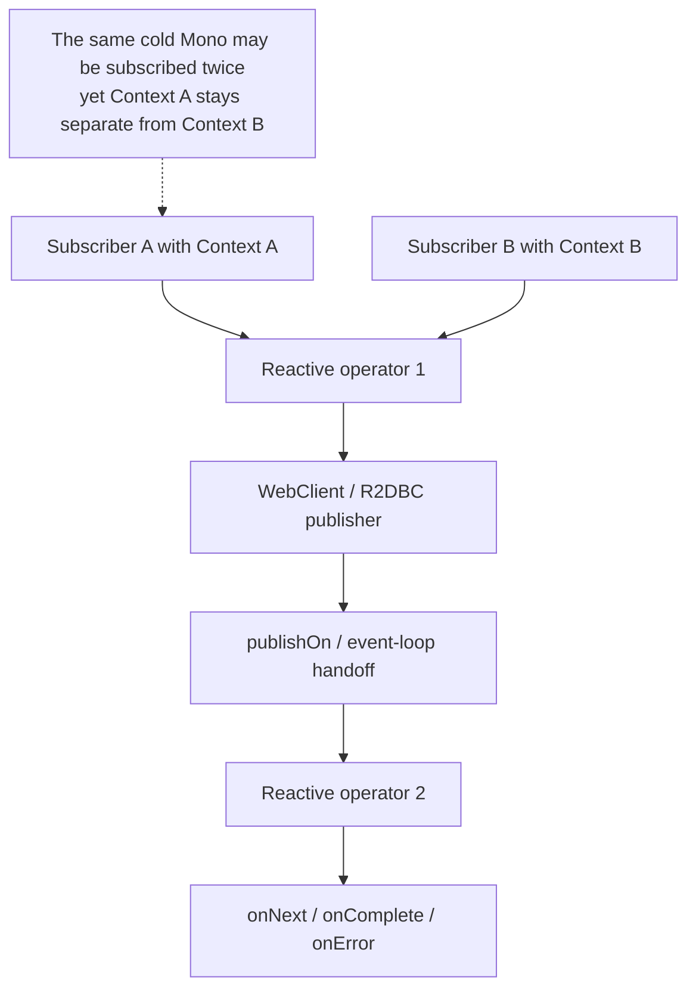
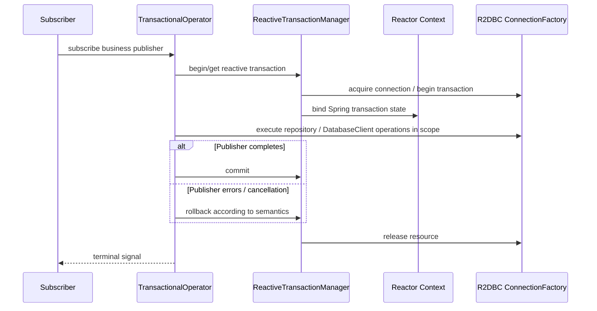
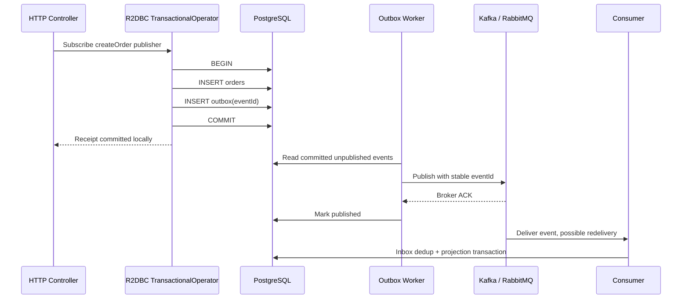
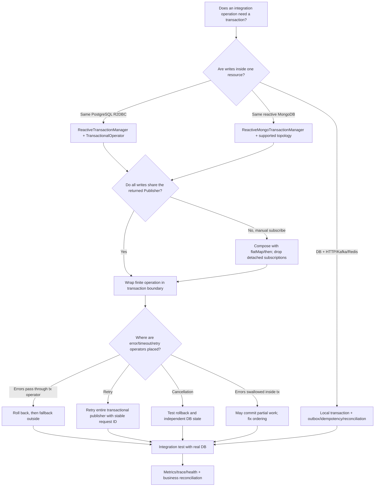

# Reactor Context Scope in Reactive Transactions

> **Chapter:** Reactive Data  
> **Module:** SPRING_BOOT_INTEGRATION — system integration in Spring Boot via HTTP clients, databases, caches, message brokers, and Spring Integration adapters; emphasizing configuration, data contracts, transactions, error handling, deduplication, testing, and observability in real integration flows.

## 1. Why can a reactive call "lose its transaction"?

A Spring Boot service accepts an order request, inserts the order into PostgreSQL using R2DBC, writes an event intent into an outbox table, and returns a result. The author expects both SQL writes to commit or roll back together:

```text
HTTP request
   ↓
Reactive order service
   ├─ INSERT orders
   └─ INSERT outbox
   ↓
HTTP response
```

In the familiar imperative model, `@Transactional` with JDBC/JPA typically binds transaction state to the **current thread** via `ThreadLocal` and imperative Spring `TransactionSynchronizationManager`.

In the reactive model:

- `Mono`/`Flux` may be subscribed on one thread and execute callbacks on another.
- Operations run asynchronously across `publishOn`, `subscribeOn`, drivers, and event loops.
- You cannot infer the active transaction from thread names.
- Spring reactive transaction infrastructure propagates **transaction context via Reactor subscriber context** with matching connection/resource binding.

If you break subscription boundaries, manually subscribe to a side branch, misplace transaction operators, swallow errors before the transaction sees them, or mix blocking JDBC into an R2DBC pipeline, your program may **commit differently than expected** even when every SQL statement and `Mono` "runs without errors".

### 1.1. A common pitfall

```java
// Wrong: side branch is subscribed separately, outside the returned publisher.
Mono<OrderReceipt> createOrder(CreateOrderRequest request) {
    orderRepository.save(mapOrder(request))
            .subscribe(saved -> auditRepository.save(
                    auditOf(saved)).subscribe());

    return Mono.just(new OrderReceipt("ACCEPTED"));
}
```

This is an **illustrative anti-pattern**, not a standalone runnable method: `OrderReceipt`, repositories, and helpers represent application components. Calling `subscribe()` twice spawns detached subscriptions; callers receive `ACCEPTED` immediately without waiting for SQL commits, error propagation disappears from the main chain, and there is no basis to claim both writes share a reactive transaction.

Instead of side-subscribing, compose publishers **in the same pipeline** and wrap only the steps requiring atomicity.

### 1.2. Learning objectives

After this lesson, you will be able to:

1. Explain `reactor.util.context.Context`, `ContextView`, and their **subscriber-bound** (not thread-bound) nature.
2. Distinguish `contextWrite(...)`, `deferContextual(...)`, `publishOn(...)`, `subscribeOn(...)`, and launching a new subscription.
3. Describe how Spring's reactive transaction manager uses Reactor Context to bind transaction/resource state.
4. Configure `R2dbcTransactionManager`/`ReactiveTransactionManager`, `TransactionalOperator`, and reactive `@Transactional`.
5. Design commit/rollback boundaries across `flatMap`, `then`, `onErrorResume`, `retryWhen`, `timeout`, and cancellation.
6. Avoid manual `subscribe()`, `block()`, eager `Mono.just(...)` side effects, detached publishers, and mixing JDBC/JPA with R2DBC.
7. Separate local database transactions from HTTP, Redis, Kafka, RabbitMQ, MongoDB, and outbox/inbox flows.
8. Write integration tests with PostgreSQL Testcontainers and `StepVerifier`, verifying commit/rollback against **real database state**.
9. Troubleshoot transaction context issues safely via logs and observability without mutating Spring internal keys.

### 1.3. Version scope

Examples use **Java 17+, Spring Boot 3.x, Spring Framework 6.x, Spring Data R2DBC, Reactor 3.5–3.7**, and a PostgreSQL R2DBC driver aligned via the application BOM. Spring Boot 4.x, Reactor 3.8+, or newer drivers may vary in auto-configuration, context propagation, and APIs; verify against documentation for your exact runtime version.

**Do not assume:** this lesson covers **Spring-managed reactive transactions**; it does not promise every `Publisher`-returning library is transaction-aware, nor that Reactor Context crosses HTTP/Kafka networks or arbitrary non-Reactor async APIs automatically.

## 2. What is Reactor Context?

`Reactor Context` is an **immutable-style key/value map** (each `put`/`delete` produces a new context view or copy-on-write instance depending on implementation). It travels along the **subscription chain**, letting operators at appropriate points access metadata without threading extra parameters through every method signature.

For instance, a context may carry:

```text
Subscriber Context:
  request.correlationId = "req-71e"
  tenantId = "tenant-blue"
  Spring transaction context = managed internally by framework
```

These values differ from `onNext` payloads:

- `OrderDto` is **business data** emitted downstream.
- `Context` is **subscription-scoped metadata** (never emitted like normal data items).
- Reactor Context is not itself a database transaction object or connection pool.
- Spring stores internal keys/objects in context to locate active transaction state, while applications may attach correlation metadata under separate keys.

### 2.1. Immutable context and ContextView

```java
import reactor.util.context.Context;
import reactor.util.context.ContextView;

Context original = Context.of("traceId", "trace-A");
Context modified = original.put("tenantId", "tenant-blue");

// original is unmodified.
String traceId = original.get("traceId");
boolean hasTenant = original.hasKey("tenantId"); // false

ContextView view = modified;
String tenantId = view.get("tenantId");
```

This is plain Java. `Context` provides mutation-like builders returning updated instances, whereas `ContextView` is read-only. For custom context values, use clear key types (dedicated key constants or classes) to prevent collisions, and avoid storing credentials or large raw PII inside context.

### 2.2. Context binds to the subscriber, not the thread



Subscribing to a cold publisher twice can execute it **twice with two distinct Contexts**:

```java
Mono<String> flow = Mono.deferContextual(context ->
        Mono.just(context.getOrDefault("correlationId", "missing")));

flow.contextWrite(context ->
        context.put("correlationId", "req-A"))
    .subscribe(value -> System.out.println(value)); // req-A

flow.contextWrite(context ->
        context.put("correlationId", "req-B"))
    .subscribe(value -> System.out.println(value)); // req-B
```

`subscribe()` here **only demonstrates independent Contexts**; do not call manual `subscribe()` inside business services.

### 2.3. Context does not cross process boundaries

Suppose a publisher holds `tenantId` in Reactor Context and makes an HTTP call to a partner:

```text
Reactor Context in service A
    ↓
WebClient request sent over network
    ↓
Service B receives new HTTP request / new subscription
```

Service B **does not automatically inherit Service A's Context object**. To pass trace, correlation, or tenant IDs (where authorized), use **explicit wire contracts**: HTTP headers, Kafka message headers, AMQP properties, or event payload fields; the receiver validates/authorizes them and constructs its own context. Never serialize a raw Context or transaction state onto the wire.

## 3. Context propagation direction: read upstream, write downstream

A frequent point of confusion: `contextWrite(...)` applies to **operators upstream of it in the same subscription path**. It does not mutate a global variable and does not affect downstream operators.

### 3.1. Basic contextWrite example

```java
import reactor.core.publisher.Mono;
import reactor.util.context.Context;

Mono<String> result =
        Mono.deferContextual(ctx ->
                Mono.just("request=" + ctx.get("requestId")))
            .contextWrite(Context.of("requestId", "req-42"));

// On subscription, result emits "request=req-42".
```

Tracing subscription direction: the subscriber at the end of the chain initiates Context; `contextWrite` enriches Context for **the source above it**. `Mono.deferContextual` reads Context upon subscription, seeing `requestId`.

### 3.2. Operators below contextWrite do not see the key

```java
Mono<String> example =
        Mono.deferContextual(ctx ->
                Mono.just("upstream=" + ctx.get("requestId")))
            .contextWrite(ctx -> ctx.put("requestId", "req-42"))
            .flatMap(value ->
                    Mono.deferContextual(ctx ->
                            Mono.just(value + ", downstream="
                                    + ctx.getOrDefault(
                                            "requestId", "missing"))));
```

When subscribed **without an external context**, the upstream source sees `req-42`, while `deferContextual` inside `flatMap`—sitting downstream of `contextWrite`—sees `missing`. This follows **operator positioning and subscription flow**, not random thread-switching bugs.

For the whole chain to see the key, place `contextWrite` at the **bottom of the target segment**:

```java
Mono<String> fixed =
        Mono.deferContextual(ctx ->
                Mono.just("upstream=" + ctx.get("requestId")))
            .flatMap(value ->
                    Mono.deferContextual(ctx ->
                            Mono.just(value + ", downstream="
                                    + ctx.get("requestId"))))
            .contextWrite(ctx ->
                    ctx.put("requestId", "req-42"));
```

### 3.3. contextWrite never mutates another subscriber's Context

```java
Mono<String> first = Mono.deferContextual(ctx ->
        Mono.just(ctx.getOrDefault("scope", "none")));

Mono<String> scoped = first.contextWrite(ctx ->
        ctx.put("scope", "first-only"));

Mono<String> other = Mono.deferContextual(ctx ->
        Mono.just(ctx.getOrDefault("scope", "none")));
```

`scoped` receives `scope` upstream; `other` is completely unaffected even if executed on the same event loop or thread. This isolation prevents **concurrent HTTP requests or Kafka messages from leaking transaction or tenant context across requests**.

### 3.4. Overriding keys and defaults

```java
Mono<String> read = Mono.deferContextual(ctx ->
        Mono.just(ctx.getOrDefault("traceId", "unset")));

Mono<String> chain = read
        .contextWrite(ctx -> ctx.put("traceId", "inner"))
        .contextWrite(ctx -> ctx.put("traceId", "outer"));
```

Here the `contextWrite` closer to the source writes `inner` on top of `outer` passed from downstream, so the source sees `inner`. Do not memorize "inner/outer" labels blindly; **sketch the operator positions** and verify your actual chain with `StepVerifier`.

### 3.5. ContextWrite at a request boundary

WebFlux controller example:

```java
import org.springframework.web.bind.annotation.GetMapping;
import org.springframework.web.bind.annotation.PathVariable;
import org.springframework.web.bind.annotation.RestController;
import reactor.core.publisher.Mono;

@RestController
class OrderQueryController {
    private final ReactiveOrderQueryService service;

    OrderQueryController(ReactiveOrderQueryService service) {
        this.service = service;
    }

    @GetMapping("/api/orders/{orderId}")
    Mono<OrderDto> get(@PathVariable String orderId) {
        return service.find(orderId)
                .contextWrite(ctx ->
                        ctx.put("requestKind", "query"));
    }
}
```

`ReactiveOrderQueryService` and `OrderDto` are illustrative application types. WebFlux subscribes to the returned publisher for the HTTP request lifecycle; never call `subscribe()` in the controller. The `requestKind` key is visible upstream inside `service.find(orderId)`, but **does not** touch Spring reactive transaction state or automatically attach HTTP headers outbound.

## 4. Where does Spring reactive transaction context live?

Spring reactive transaction management uses the **subscription's Reactor Context** to propagate transaction metadata and resource bindings (such as an R2DBC `Connection` bound to the active transaction).



This is a conceptual diagram; internally, Spring maintains transaction context state and reactive resource bindings. **Applications must never fabricate fake Context keys or raw connection bindings to "open a transaction"**; always use `ReactiveTransactionManager`/`TransactionalOperator` or Spring proxy-managed `@Transactional`.

### 4.1. ReactiveTransactionManager vs. JDBC managers

| Environment | Transaction manager | Typical scoping mechanism |
| --- | --- | --- |
| Imperative JDBC/JPA | `DataSourceTransactionManager`/`JpaTransactionManager` (`PlatformTransactionManager`) | Thread-bound transaction resources |
| Reactive R2DBC | `R2dbcTransactionManager` (`ReactiveTransactionManager`) | Subscriber/Reactive Context + connection binding |
| Reactive MongoDB | `ReactiveMongoTransactionManager` | Reactive subscriber context + Mongo session |
| Kafka producer transactions | Kafka producer/transactional APIs | Dedicated Kafka mechanism; not auto-synced with R2DBC |
| HTTP clients | No local ACID transaction manager | Network calls; independent remote side effects |

Placing `@Transactional` on a `Mono<T>` method when only an imperative transaction manager exists **will not start an R2DBC transaction**. Conversely, imperative JPA repositories do not participate in R2DBC transaction context.

### 4.2. Who can see transaction state?

Transaction-aware components like `DatabaseClient` and Spring Data R2DBC repositories use Spring's resource management to retrieve the connection bound in Reactor Context. Calling raw `ConnectionFactory.create()` outside Spring's transactional connection lookup acquires **a separate connection outside the active transaction**.

Spring Framework contains:

```java
org.springframework.transaction.reactive.TransactionSynchronizationManager
```

distinct from:

```java
org.springframework.transaction.support.TransactionSynchronizationManager
```

The first is **reactive transaction synchronization**, whereas the second is **imperative `ThreadLocal`-based infrastructure**. Importing the wrong one makes diagnostic checks read misleading state.

### 4.3. Inspecting active transaction status safely

```java
import org.springframework.transaction.reactive.TransactionSynchronizationManager;
import reactor.core.publisher.Mono;

Mono<Boolean> activeTransaction() {
    return TransactionSynchronizationManager
            .forCurrentTransaction()
            .map(TransactionSynchronizationManager::isActualTransactionActive);
}
```

Inside a **Spring-managed reactive transaction**, this emits `true`; outside any valid transaction context, `forCurrentTransaction()` can emit `NoTransactionException`. This is a diagnostic API, **not a way to start transactions**. Never mutate internal resource maps or hijack internal Spring transaction keys as application context keys.

### 4.4. Two subscribers never share one transaction

```text
Subscriber A
  └─ Transaction A / R2DBC connection A

Subscriber B
  └─ Transaction B / R2DBC connection B
```

Subscribing to the same cold Publisher **twice** makes the transactional operator open **two separate transactions**. Be cautious with retries, caching, hot publishers, or WebFlux resubscriptions: never silently assume two subscriptions share a single transaction.

### 4.5. Keep Context and resources strictly separate

Reactor Context is not a bag for passing an open connection to an HTTP client. Putting an `io.r2dbc.spi.Connection` under a custom `"connection"` key does **not** make Spring Data repositories recognize an active transaction, and risks concurrent access bugs, leaks, and broken commit/rollback handling.

Spring's transaction manager must own resource lifecycles. Applications define **transaction boundaries and policies**; custom metadata like `correlationId` belongs under separate keys and must never impersonate Spring transaction resources.

## 5. Configuring Spring Boot, PostgreSQL, and R2DBC

### 5.1. Dependencies for a reactive data application

```groovy
// build.gradle — project applies Spring Boot plugin/BOM.
dependencies {
    implementation 'org.springframework.boot:spring-boot-starter-webflux'
    implementation 'org.springframework.boot:spring-boot-starter-data-r2dbc'
    implementation 'org.springframework.boot:spring-boot-starter-validation'
    runtimeOnly 'org.postgresql:r2dbc-postgresql'

    // Add explicitly when R2DBC pooling is needed if not already provided by starter/BOM.
    runtimeOnly 'io.r2dbc:r2dbc-pool'

    testImplementation 'org.springframework.boot:spring-boot-starter-test'
    testImplementation 'io.projectreactor:reactor-test'
    testImplementation 'org.springframework.boot:spring-boot-testcontainers'
    testImplementation 'org.testcontainers:junit-jupiter'
    testImplementation 'org.testcontainers:postgresql'
}
```

Verify actual versions resolved by the Spring Boot BOM: avoid forcing `r2dbc-spi`, PostgreSQL driver, or Reactor versions inconsistent with Spring Data R2DBC. If using Flyway/Liquibase migrations on PostgreSQL, those tools normally need **a separate JDBC driver/connection** even when business logic runs on R2DBC. Never assume `spring.r2dbc.url` works as a JDBC URL.

### 5.2. Externalized configuration in application.yml

```yaml
spring:
  r2dbc:
    url: r2dbc:postgresql://${PG_HOST:localhost}:${PG_PORT:5432}/orders
    username: ${PG_USER:orders}
    password: ${PG_PASSWORD}
    pool:
      enabled: true
      initial-size: 2
      max-size: 20
      max-idle-time: 20m

logging:
  level:
    org.springframework.transaction: INFO
    org.springframework.r2dbc: INFO
```

Values here are illustrative, not production sizing guidelines. `spring.r2dbc.pool.*` configures the **R2DBC connection pool**, **not** Reactor Netty WebClient's `ConnectionProvider`. Having 20 DB connections does not imply 20 HTTP sockets or vice versa.

`PG_HOST`/`PG_PORT` must reflect where PostgreSQL runs relative to the JVM (localhost, Docker Compose, Testcontainers dynamic port). In tests, prefer `@ServiceConnection` over hardcoding ports. In production, supply passwords via a secret provider—never commit real secrets to source control.

### 5.3. Database schema for the order and outbox example

```sql
CREATE TABLE orders (
    order_id VARCHAR(120) PRIMARY KEY,
    request_key VARCHAR(120) NOT NULL UNIQUE,
    total_amount NUMERIC(18,2) NOT NULL
        CHECK (total_amount > 0),
    state VARCHAR(40) NOT NULL,
    created_at TIMESTAMPTZ NOT NULL DEFAULT CURRENT_TIMESTAMP
);

CREATE TABLE outbox (
    event_id VARCHAR(120) PRIMARY KEY,
    aggregate_id VARCHAR(120) NOT NULL,
    event_type VARCHAR(120) NOT NULL,
    payload JSONB NOT NULL,
    created_at TIMESTAMPTZ NOT NULL DEFAULT CURRENT_TIMESTAMP,
    published_at TIMESTAMPTZ NULL
);

CREATE INDEX outbox_unpublished_idx
    ON outbox (created_at)
    WHERE published_at IS NULL;
```

This schema is intentionally minimal to illustrate **two SQL writes in one transaction**. Production systems require versioned migrations, least-privilege permissions, retention, retries, outbox claim/locking, schema evolution, and payload size limits. `event_id`/`request_key` maintain stable logical identity across retries.

### 5.4. Default ReactiveTransactionManager and R2dbcTransactionManager

Spring Boot auto-configures `R2dbcTransactionManager` when a compatible `ConnectionFactory` exists and no conflicting transaction manager blocks conditions. With **one R2DBC ConnectionFactory and one reactive transaction manager**, most apps simply inject:

```java
import org.springframework.context.annotation.Bean;
import org.springframework.context.annotation.Configuration;
import org.springframework.transaction.ReactiveTransactionManager;
import org.springframework.transaction.reactive.TransactionalOperator;

@Configuration(proxyBeanMethods = false)
class ReactiveTransactionConfiguration {

    @Bean
    TransactionalOperator ordersTx(
            ReactiveTransactionManager manager) {
        return TransactionalOperator.create(manager);
    }
}
```

When **multiple transaction managers** exist (JDBC, R2DBC, MongoDB), explicitly match each operation using `@Qualifier` or dedicated named `TransactionalOperator` beans. Never execute SQL against PostgreSQL A under a transaction manager bound to PostgreSQL B.

### 5.5. Spring-aware data access

Inside a reactive transaction, use:

- Spring-managed `DatabaseClient` or `R2dbcEntityTemplate`.
- Spring Data R2DBC `ReactiveCrudRepository`/`R2dbcRepository`.
- A `ConnectionFactory` matching your `R2dbcTransactionManager`.

Instantiating another `ConnectionFactory` manually or calling low-level `create()` outside Spring transaction infrastructure runs operations **outside the bound connection** even within the same Reactor Context. Reactor Context transports transaction/resource state; the data-access library must still be **transaction-aware**.

## 6. TransactionalOperator: programmatic transaction boundaries

`TransactionalOperator` wraps a publisher so Spring begins a transaction upon subscription, commits on normal completion, and rolls back on errors per manager semantics.

### 6.1. DTOs for the example

```java
// PlaceOrderCommand.java
import java.math.BigDecimal;

public record PlaceOrderCommand(
        String orderId,
        String requestKey,
        BigDecimal totalAmount) {
}
```

```java
// OrderReceipt.java
public record OrderReceipt(
        String orderId, String state) {
}
```

A valid command requires non-blank `orderId` and `requestKey`, and `totalAmount > 0`. In production, validate inputs before persistence, derive stable request keys from caller/idempotency contracts, and never mint a new UUID per retry.

### 6.2. Two SQL operations in one reactive transaction

```java
// ReactiveOrderWriter.java
import java.math.BigDecimal;
import org.springframework.r2dbc.core.DatabaseClient;
import org.springframework.stereotype.Service;
import org.springframework.transaction.reactive.TransactionalOperator;
import reactor.core.publisher.Mono;

@Service
public class ReactiveOrderWriter {
    private final DatabaseClient db;
    private final TransactionalOperator tx;

    public ReactiveOrderWriter(
            DatabaseClient db,
            TransactionalOperator ordersTx) {
        this.db = db;
        this.tx = ordersTx;
    }

    public Mono<OrderReceipt> placeOrder(
            PlaceOrderCommand command) {

        return Mono.defer(() -> {
            validate(command);

            Mono<Void> insertOrder = db.sql("""
                    INSERT INTO orders
                        (order_id, request_key, total_amount, state)
                    VALUES (:orderId, :requestKey, :amount, 'NEW')
                    """)
                    .bind("orderId", command.orderId())
                    .bind("requestKey", command.requestKey())
                    .bind("amount", command.totalAmount())
                    .fetch()
                    .rowsUpdated()
                    .then();

            // Demonstrates a valid JSONB literal; real systems
            // serialize payloads per event contract/version.
            Mono<Void> insertOutbox = db.sql("""
                    INSERT INTO outbox
                        (event_id, aggregate_id, event_type, payload)
                    VALUES (:eventId, :orderId, 'OrderCreated',
                            CAST(:payload AS jsonb))
                    """)
                    .bind("eventId", command.requestKey())
                    .bind("orderId", command.orderId())
                    .bind("payload", "{\"state\":\"NEW\"}")
                    .fetch()
                    .rowsUpdated()
                    .then();

            return insertOrder
                    .then(insertOutbox)
                    .thenReturn(
                            new OrderReceipt(command.orderId(), "NEW"));
        }).as(tx::transactional);
    }

    private void validate(PlaceOrderCommand command) {
        if (command == null
                || command.orderId() == null
                || command.orderId().isBlank()
                || command.requestKey() == null
                || command.requestKey().isBlank()
                || command.totalAmount() == null
                || command.totalAmount()
                        .compareTo(BigDecimal.ZERO) <= 0) {
            throw new IllegalArgumentException(
                    "Invalid create order command");
        }
    }
}
```

**Key points in this example:**

1. `Mono.defer(...)` defers validation and SQL publisher assembly until **subscription**, emitting validation failures as `onError` rather than throwing during assembly.
2. `insertOrder.then(insertOutbox)` executes **sequentially**: outbox insertion starts only after order insertion finishes cleanly.
3. `.as(tx::transactional)` places a **single transaction boundary around both writes** per subscription.
4. If the outbox insert fails (e.g., `event_id` primary key collision), the transaction rolls back and **the new `orders` row does not commit**.
5. `tx` is a Spring-managed reactive operator bound to the right `ReactiveTransactionManager`/`ConnectionFactory`.
6. A successful DB write **does not mean Kafka/RabbitMQ delivered the event**; an outbox worker relays it post-commit.

**Idempotency:** while unique constraints prevent duplicate rows, resending the same command still raises a duplicate-key error on `INSERT orders` rather than returning the previous receipt. Production code must look up by `request_key`, verify payload fingerprints match, and return the prior receipt or an explicit conflict—**never** blindly swallow every duplicate-key error.

### 6.3. Transactions start on subscription, not method invocation

```java
Mono<OrderReceipt> deferred =
        writer.placeOrder(command);

// No DB transaction is open yet just from holding deferred.

// A WebFlux controller returns deferred for the framework to subscribe.
// Tests can use StepVerifier.create(deferred).
```

With typical cold publishers, subscribing a second time re-runs the SQL inside a **second separate transaction**, likely hitting unique constraints. When adding `retryWhen`, decide whether retries sit inside or outside the operator and keep `requestKey` stable. Never mint new business IDs per subscription for the same logical operation.

### 6.4. Operator style vs. callback style

Two idioms:

```java
// Operator style: preserves Mono<T> or Flux<T> return type.
Mono<OrderReceipt> result =
        writePublisher.as(tx::transactional);

// Callback style: execute exposes ReactiveTransaction status.
Flux<OrderReceipt> resultFlux = tx.execute(status ->
        writePublisher.flux());
```

`writePublisher` represents any valid composed publisher. In callback style, `TransactionalOperator.execute(...)` returns a **`Flux`**, useful when inspecting or marking `ReactiveTransaction` rollback programmatically. For a transactional `Mono`, operator style is cleaner.

### 6.5. Programmatic rollback-only

```java
Flux<OrderReceipt> flow = tx.execute(status ->
        verifyBusinessPrecondition()
            .flatMap(valid -> {
                if (!valid) {
                    status.setRollbackOnly();
                    return Mono.empty();
                }
                return writeOrderAndOutbox();
            }));
```

This is a **fragment**: `verifyBusinessPrecondition()` returns `Mono<Boolean>` and `writeOrderAndOutbox()` returns the receipt publisher. Marking `rollbackOnly` makes the transaction manager roll back per transaction semantics; never return HTTP success claiming "order created" when taking the empty rollback branch. Prefer emitting an explicit domain error so callers unambiguously observe failure.

### 6.6. Never call subscribe() inside a transaction

```java
// Wrong: outbox write becomes an untracked, detached subscription.
Mono<OrderReceipt> wrong(PlaceOrderCommand command) {
    return insertOrder(command)
            .doOnSuccess(order ->
                    insertOutbox(order).subscribe())
            .thenReturn(new OrderReceipt(command.orderId(), "NEW"))
            .as(tx::transactional);
}
```

`insertOrder` and `insertOutbox` are assumed helper publishers. Even though `.as(tx::transactional)` sits at the bottom, the subscription started inside `doOnSuccess` **does not naturally inherit transaction context** and is not awaited before commit. Side-effect hooks like `doOnSuccess` do not guarantee correctness; compose with `flatMap`/`then` and let Spring manage the chain.

## 7. @Transactional on methods returning Mono/Flux

### 7.1. Declarative reactive transactions

```java
// AnnotatedOrderService.java
import org.springframework.r2dbc.core.DatabaseClient;
import org.springframework.stereotype.Service;
import org.springframework.transaction.annotation.Transactional;
import reactor.core.publisher.Mono;

@Service
public class AnnotatedOrderService {
    private final DatabaseClient db;

    public AnnotatedOrderService(DatabaseClient db) {
        this.db = db;
    }

    @Transactional
    public Mono<Void> createMetadata(String orderId, String eventId) {
        return db.sql("""
                    INSERT INTO orders
                        (order_id, request_key, total_amount, state)
                    VALUES (:orderId, :eventId, 1.00, 'NEW')
                    """)
                .bind("orderId", orderId)
                .bind("eventId", eventId)
                .fetch().rowsUpdated().then()
                .then(db.sql("""
                    INSERT INTO outbox
                        (event_id, aggregate_id, event_type, payload)
                    VALUES (:eventId, :orderId,
                            'OrderCreated', '{}'::jsonb)
                    """)
                    .bind("eventId", eventId)
                    .bind("orderId", orderId)
                    .fetch().rowsUpdated().then());
    }
}
```

When invoked **from another bean via a Spring AOP proxy**, returning a Publisher with a compatible reactive transaction manager, Spring opens/binds the transaction upon subscription, committing on completion or rolling back on error.

**Never place `@Transactional` on a `void` method calling `subscribe()` internally** expecting the transaction to wrap async callbacks; interception requires a reactive return type and unified subscriber chain.

### 7.2. Self-invocation bypasses the proxy

```java
@Service
class BadSelfInvocation {
    public Mono<Void> start() {
        return saveInsideTransaction(); // calls this.method directly
    }

    @Transactional
    public Mono<Void> saveInsideTransaction() {
        return someReactiveDatabaseWrite();
    }
}
```

This is a skeleton; `someReactiveDatabaseWrite()` is a placeholder helper. In standard Spring AOP proxy mode, internal `this.saveInsideTransaction()` **bypasses the transactional proxy**, silently skipping the annotation.

Fix this by extracting the transactional method to another bean invoked through its proxy, or using `TransactionalOperator` directly in the service. Never try to "fix" it by calling `subscribe()` in the caller.

### 7.3. Selecting the right manager when multiple resources exist

If an app combines R2DBC, reactive MongoDB, and JDBC:

```java
// Fragment — bean name must match your application configuration.
@Transactional(transactionManager = "ordersR2dbcTransactionManager")
public Mono<OrderReceipt> placeOrderReactive(...) {
    // Reactive R2DBC operations.
}
```

This fragment uses an **assumed** bean name; you must actually define `ordersR2dbcTransactionManager` if referenced. Never copy the name blindly assuming Boot generates it. When only one reactive manager exists, omitting the qualifier keeps things simpler.

### 7.4. Differences between R2DBC and JPA under @Transactional

| Pattern | Requirements for valid transaction | Common mistake |
| --- | --- | --- |
| `@Transactional Mono<T>` with R2DBC | Reactive manager + Spring proxy + subscribed chain | Manual `subscribe()`, proxy bypassed |
| `TransactionalOperator Mono<T>` | Operator wraps full target scope | Wrapping only one SQL step instead of whole unit of work |
| `@Transactional void` with JPA | Imperative manager, synchronous thread-bound call | Assuming transaction spans async reactive callbacks |
| `@Transactional Mono<T>` with JdbcTemplate | Blocking JDBC, manager mismatch | Blocking event loop; resource escapes reactive TX |
| Reactive Mongo transaction | `ReactiveMongoTransactionManager` + transaction-capable topology | Running on standalone MongoDB or missing manager |

A broken `@Transactional` method can still look successful on happy paths because individual SQL statements auto-commit without a transaction—meaning happy-path tests **fail to detect missing transactions**. Always test **deliberate failure in step two to prove step one rolls back**.

## 8. Operator placement decides commit vs. rollback

Reactive transactions inspect **terminal signals** reaching the transaction operator. If an error gets converted into success or empty **before reaching the transaction boundary**, the transaction may commit earlier writes.

### 8.1. Let errors cross the transaction boundary before handling them

```java
Mono<OrderReceipt> safeFallback =
        writeOrderThenOutbox()
            .as(tx::transactional)
            .onErrorResume(PartnerBusinessException.class,
                    error -> Mono.just(
                            new OrderReceipt("unknown", "REJECTED")));
```

In this fragment, `writeOrderThenOutbox()` is a two-step publisher and `PartnerBusinessException` is a custom exception. When the source fails, `TransactionalOperator` sees the error and rolls back before the outer fallback builds `REJECTED` (per transaction completion rules). Callers must clearly distinguish **REJECTED** from **committed to DB**; never emit a fake `"NEW"` receipt after rollback.

### 8.2. Swallowing errors inside a transaction can cause partial commits

```java
Mono<Void> dangerous =
        insertOrder()
            .then(insertOutbox())
            .onErrorResume(error -> {
                log.warn("Ignoring outbox error", error);
                return Mono.empty();
            })
            .as(tx::transactional);
```

This is an anti-pattern: `onErrorResume(...)` sits **inside the transactional boundary**. If `insertOrder()` succeeds, `insertOutbox()` fails, and the error turns into `Mono.empty()`, the transaction operator sees **`onComplete`** and proceeds to commit.

**PostgreSQL note:** if a constraint error places the PostgreSQL transaction into an aborted state, attempting to commit may still error or roll back; **never rely on that behavior as a safety net**. For Java-side errors raised after the first INSERT (leaving the DB transaction unaborted), this pattern will genuinely commit the order without its outbox row. Golden rule: **never swallow errors that must trigger rollback**.

### 8.3. doOnError preserves terminal errors

```java
Mono<Void> audited =
        insertOrder()
            .then(insertOutbox())
            .doOnError(error ->
                    log.warn("Order transaction failed", error))
            .as(tx::transactional);
```

`doOnError` performs side-effect logging **without turning `onError` into `onComplete`**, so the transaction still sees the failure. However, never log sensitive raw SQL parameters or customer PII, and never fire HTTP/Kafka side effects inside `doOnError` treating it as a durable rollback handler.

### 8.4. onErrorMap classifies without swallowing

```java
Mono<OrderReceipt> mapped =
        writeOrderThenOutbox()
            .onErrorMap(
                    org.springframework.dao.DuplicateKeyException.class,
                    original -> new DuplicateOrderRequestException(
                            "Order already exists", original))
            .as(tx::transactional);
```

`DuplicateOrderRequestException` is an application exception. `onErrorMap` keeps the terminal signal as an error, ensuring rollback. Still, a duplicate key on `orders` alone does not prove a replay is valid: read the existing row and verify payload/`requestKey` per idempotency rules.

### 8.5. setRollbackOnly when business rules avoid throwing

Validation might return `Mono<Decision>` instead of throwing. To abort the transaction while emitting a signal, use `TransactionalOperator.execute(status -> ...)` and call `status.setRollbackOnly()`. Clearly indicate in the return type/value that no DB commit occurred, and verify manager behavior with integration tests.

**Never** use `onErrorContinue` to skip SQL errors arbitrarily in financial or order flows. Its operator support varies and makes side effects and rollback unpredictable; for transactional data, fail fast and handle errors outside the boundary.

## 9. retryWhen: does every retry open a new transaction?

Where retry sits **relative to** the transactional operator makes a critical difference.

### 9.1. Retry outside the transaction

```java
Mono<OrderReceipt> withFreshTransactionPerAttempt =
        writeOrderThenOutbox()
            .as(tx::transactional)
            .retryWhen(Retry.backoff(2,
                    Duration.ofMillis(100))
                .filter(this::isRetryableDatabaseFailure));
```

Because retry sits **after the transaction boundary**, an `onError` rolls back and finishes that transactional subscription, and retry **resubscribes**, creating a **fresh transaction** on the next attempt. This is normally the right placement for recovering deadlocks or serialization failures after rollback.

Still ensure:

- Stable `requestKey`/`eventId` across attempts.
- Bounded retries/backoff and an overall deadline.
- Clear classification of transient errors (deadlocks, serialization failures, transient disconnects) vs. permanent ones (invalid payloads, unique key mismatches, schema drift).
- Verification of final DB state and post-crash retries, not just exception classes.
- Caution regarding any **external side effects** executed in an earlier attempt.

### 9.2. Retry inside the transaction

```java
Mono<OrderReceipt> risky =
        writeOrderThenOutbox()
            .retryWhen(Retry.backoff(2,
                    Duration.ofMillis(100)))
            .as(tx::transactional);
```

Here the operator wraps **one transaction across the entire retry loop**. If an SQL failure aborts a PostgreSQL transaction, subsequent retries inside the same transaction keep failing until rollback. Worse, earlier statements in that transaction may remain partially applied unless explicitly rolled back to savepoints.

**Recommendation:** when retrying database transaction failures, wrap **each attempt in its own fresh transaction** rather than retrying SQL steps inside a broken transaction. If you intentionally want intra-transaction retries with savepoints, enforce explicit savepoint policies and test against the real driver and DB.

### 9.3. Imports for retry examples

```java
import java.time.Duration;
import reactor.core.publisher.Mono;
import reactor.util.retry.Retry;
```

`isRetryableDatabaseFailure(...)` is a hypothetical application predicate, not a built-in Spring method. Never treat every `RuntimeException` as retryable. On network timeouts after an **external HTTP POST**, do not blindly retry under R2DBC rules since remote effects do not roll back with DB transactions.

### 9.4. Retries preserve laziness yet can duplicate side effects

```java
Mono<OrderReceipt> commandFlow = writer.placeOrder(command);

// One normal subscription => one attempt.
// retryWhen => potentially multiple subscriptions/transactions.
// cache()/share() => alters actual subscription count.
```

Calling `cache()` or `share()` turns a cold transactional publisher into shared/hot-like behavior; later subscribers may receive **cached results** without opening a new transaction. That is not inherently wrong, but requires explicit design if each subscriber expects fresh execution.

**Never cache transaction-bound publishers in a singleton service thinking it "keeps a transaction open".** Transactions exist only for the duration of a specific subscription/operation.

## 10. timeout, cancellation, and reactive transactions

### 10.1. Outer timeouts cancel the subscription

```java
Mono<OrderReceipt> bounded =
        writeOrderThenOutbox()
            .as(tx::transactional)
            .timeout(Duration.ofSeconds(3));
```

If the transaction misses the deadline, `timeout` **cancels the upstream subscription**; modern Spring reactive transaction infrastructure handles cancellation by rolling back per its semantics. **Never treat cancellation as normal `onComplete`.**

Still distinguish:

- A **local database transaction** can roll back uncommitted writes.
- If `COMMIT` raced right as timeout/cancellation fired, callers must not assume the DB definitely rolled back based solely on a timeout signal.
- External partner HTTP POST calls **do not roll back** when an R2DBC subscription cancels.
- Cancelling a Reactor subscription does not guarantee non-Reactor callbacks stopped instantly.

### 10.2. take, next, and downstream Flux cancellation

```java
Flux<OrderDto> stream = readAndUpdateOrders()
        .as(tx::transactional);

Mono<OrderDto> first = stream.next();
```

`next()` consumes the first element and **cancels the rest of the Flux**. If that publisher runs a multi-write transaction, cancellation may roll back the transaction even though downstream already observed one `OrderDto`. **Never design write transactions that depend on subscribers draining an arbitrary `Flux`.**

Safer pattern:

1. Build a **finite `Mono`** executing all transactional writes.
2. Wait for the `Mono` to finish and commit.
3. Stream responses/events afterward from a separate publisher if needed.

### 10.3. Never return a write-performing Flux directly as an HTTP stream

```java
// Hard-to-control anti-pattern:
@GetMapping("/stream-and-update")
Flux<OrderDto> streamAndWrite() {
    return repository.findAll()
            .flatMap(this::updateAndSave)
            .as(tx::transactional);
}
```

If the HTTP client disconnects after receiving 10 items, the server cancels the subscription and Spring rolls back the transaction—yet the client **already received** 10 records that never committed. Separate **command transactions** from **streaming responses** whenever consistency matters.

### 10.4. Configuring timeouts at every layer

| Timeout | Effect | What it does NOT mean |
| --- | --- | --- |
| R2DBC connection pool acquire timeout | Fails acquiring a DB connection | RDBMS rolled back an earlier operation |
| Database statement timeout | DB aborts slow queries | Partner HTTP stopped processing |
| Reactor `Mono.timeout(...)` | Cancels reactive subscription on deadline | Commit never happened in race scenarios |
| WebClient response timeout | Fails slow HTTP response | Local R2DBC transaction rolled back |
| Kafka poll/ack timeout | Controls consumer lifecycle/redelivery | PostgreSQL committed or rolled back |

Integration workflows need an **overall business deadline** paired with state machines and reconciliation. Never set a 30s DB statement timeout under a 2s HTTP caller timeout assuming side effects vanish instantly.

### 10.5. Cancellation tests must assert database state

To verify rollback on cancellation:

1. Construct a transactional publisher that inserts row one and pauses on a controlled gate before write two.
2. Subscribe via `StepVerifier` or a `BaseSubscriber`.
3. Once write one has executed **inside the transaction prior to commit**, cancel the subscription.
4. Await rollback and connection cleanup cleanly.
5. Open a **fresh subscription outside the transaction** to query the DB and assert row count is 0.
6. Never assert only `doFinally(SignalType.CANCEL)`; that confirms the cancel signal, not final DB state.

Avoid flaky `Thread.sleep(...)` timing; use Reactor `Sinks` or latches with finite test deadlines.

## 11. Branching, parallelism, and transaction context

### 11.1. Does flatMap propagate Context to inner publishers?

In a standard Reactor chain, an inner `Mono` returned from `flatMap` inherits the subscriber Context at that operator's position:

```java
Mono<OrderReceipt> flow =
        repository.findById(orderId)
            .flatMap(order ->
                    repository.save(order.confirmed()))
            .map(saved -> new OrderReceipt(
                    saved.id(), saved.state()))
            .as(tx::transactional);
```

When both calls target **Spring Data R2DBC repositories sharing the same connection factory** wrapped by the transaction operator, operations share the transaction. Reactor scheduler hops do not erase subscriber Context.

### 11.2. Running parallel statements on one connection is hazardous

```java
// Unsafe by default when two DB operations run concurrently
// on the same connection-bound reactive transaction:
Mono<Void> riskyParallel =
        Mono.when(
                repository.save(entityA),
                repository.save(entityB))
            .as(tx::transactional);
```

`Mono.when(...)` subscribes to both inner publishers concurrently. Inside a reactive transaction, both writes target the same transaction-bound R2DBC connection; support for **concurrent statements on one connection** varies by driver, protocol, and transaction rules. Never treat one connection as safe for arbitrary concurrent writes just because Reactor allows composition.

For sequential writes in one transaction:

```java
Mono<Void> sequential =
        repository.save(entityA)
            .then(repository.save(entityB))
            .then()
            .as(tx::transactional);
```

Or across multiple records:

```java
Flux<Entity> updates = Flux.fromIterable(entities)
        .concatMap(entity -> repository.save(entity))
        .as(tx::transactional);
```

`concatMap` runs sequentially, fitting single-connection transactions and ordered updates. Never hold one transaction open across millions of rows in an infinite `Flux`; process in **finite chunks** with idempotent checkpoints after each commit.

### 11.3. zip/when can cancel sibling branches

```java
Mono<Tuple2<Order, Audit>> both =
        Mono.zip(loadOrder(), loadAudit());
```

If one branch errors or completes empty per `zip` rules, the sibling branch gets cancelled. Inside write transactions, **cancellation** complicates rollback and partial side effects. For writes that must commit together, chain sequentially or manage boundaries carefully; never use `zip` assuming both side effects always finish when either branch can emit empty, error, or cancel early.

### 11.4. publishOn/subscribeOn do not start new transactions

```java
Mono<Boolean> active =
        activeTransaction()
            .publishOn(Schedulers.parallel())
            .flatMap(previous ->
                    activeTransaction()
                            .map(after -> previous && after))
            .as(tx::transactional);
```

In standard Reactor chains, both reads observe **the same reactive transaction scope** across `publishOn` thread changes because transaction state rides in Reactor Context, not Java threads.

This **does not** mean `ThreadLocal` JDBC `Connection`s work across threads, nor that manual `new Thread(...).start()` inherits Context. Non-Reactor boundaries (executors, `CompletionStage`, third-party callbacks) require explicit context propagation.

### 11.5. Detached subscribe starts an unrelated execution

```java
Mono<Void> dangerous =
        orderRepository.save(order)
            .doOnNext(saved -> {
                // Detached subscriber: unawaited, outside rollback boundary.
                auditRepository.save(auditOf(saved)).subscribe();
            })
            .then()
            .as(tx::transactional);
```

This is an anti-pattern even when both repositories use the exact same R2DBC driver. The detached subscription does not inherit Spring's transactional resource/context from the parent chain, and errors can vanish silently. Write instead:

```java
Mono<Void> correct =
        orderRepository.save(order)
            .flatMap(saved ->
                    auditRepository.save(auditOf(saved)))
            .then()
            .as(tx::transactional);
```

### 11.6. Context vanishes if overwritten with Context.empty()

```java
// Anti-pattern inside a Spring transaction scope:
Mono<Void> broken =
        databaseWrite()
            .contextWrite(old -> reactor.util.context.Context.empty())
            .as(tx::transactional);
```

Calling `contextWrite(old -> Context.empty())` upstream of the transactional operator **wipes out the entire subscriber Context Spring attached**, including transaction state; the write runs outside your transaction.

To attach metadata, **preserve the existing Context**:

```java
Mono<Void> safe =
        databaseWrite()
            .contextWrite(ctx ->
                    ctx.put("correlationId", "req-42"))
            .as(tx::transactional);
```

Never replace Context with a fresh instance containing only your custom keys inside a transactional scope. Whenever unsure about operator placement, test both `TransactionSynchronizationManager.forCurrentTransaction()` and real DB rollback behavior.

## 12. ThreadLocal, MDC, Spring Security, and observability

### 12.1. Reactor Context differs from Java ThreadLocal

```text
Imperative request:
  Thread-17 → ThreadLocal transaction state → JDBC connection

Reactive request:
  Subscriber A Context → R2DBC transaction state
       ↳ may execute on Netty thread-1
       ↳ may continue on parallel scheduler thread-4
       ↳ may resume on Netty thread-2

Thread identity is NOT transaction identity.
```

Never write:

```java
ThreadLocal<String> currentOrderId = new ThreadLocal<>();
```

to pass `orderId` across reactive callbacks. Event loops interleave multiple subscriptions; `ThreadLocal` state leaks or disappears across thread hops. For business-critical fields—tenant ID, order ID, permissions, idempotency keys—**explicit method parameters** remain safer and easier to test than stuffing everything into Context.

### 12.2. Using Reactor Context for compact metadata

```java
// CorrelationKeys.java
public final class CorrelationKeys {
    public static final String REQUEST_ID = "request.correlationId";

    private CorrelationKeys() {
    }
}
```

```java
Mono<String> loggableOperation() {
    return Mono.deferContextual(ctx -> {
        String requestId = ctx.getOrDefault(
                CorrelationKeys.REQUEST_ID, "unknown");
        return Mono.just("request=" + requestId);
    });
}
```

`contextWrite(ctx -> ctx.put(REQUEST_ID, ...))` scopes metadata to the upstream branch without affecting concurrent requests. Keep values short and immutable; putting large payloads or order lists into Context bloats memory and exposes data across operators.

### 12.3. MDC is not updated automatically by Context

SLF4J MDC usually relies on `ThreadLocal`; `org.slf4j.MDC.get("requestId")` will not reliably read keys from Reactor Context across thread switches.

Logging requires a proper bridge/context propagation mechanism (e.g., Micrometer Context Propagation, Reactor automatic propagation hooks, or logging instrumentation). Never write:

```java
// Anti-pattern: setting MDC without clearing on a shared event loop.
MDC.put("requestId", requestId);
return repository.save(order);
```

That event-loop thread immediately serves other requests; stale MDC keys pollute logs with the **wrong request ID or tenant**. Manual MDC bridging requires careful restoration in `finally`/`doFinally` with exact threading awareness; prefer framework-supported instrumentation and verify with log correlation tests.

### 12.4. Automatic Context Propagation is a separate mechanism

In Reactor 3.5+ and compatible Spring Boot versions, Micrometer Context Propagation / automatic propagation bridges **registered `ThreadLocal` accessors** via Reactor subscriber Context.

Depending on Boot version, you may see configuration like:

```yaml
spring:
  reactor:
    context-propagation: auto
```

or explicit `Hooks.enableAutomaticContextPropagation()` when intentionally enabled with library support. **Do not** mistake these for enabling Spring R2DBC transactions: reactive transactions already run on subscriber context and Spring resource management. Automatic propagation primarily assists observability and `ThreadLocal` bridges for supported keys/accessors.

Avoid enabling global hooks repeatedly or registering accessors for secret-bearing `ThreadLocal`s. Check your Spring Boot/Reactor/Micrometer BOM and benchmark overhead and trace accuracy.

### 12.5. Reactive Spring Security also uses Reactor Context

Spring Security's reactive stack stores `SecurityContext` in Reactor Context. Read the authenticated principal via reactive utilities such as `ReactiveSecurityContextHolder.getContext()` instead of imperative `SecurityContextHolder` `ThreadLocal`s.

```java
// Fragment: read authentication populated by the reactive security chain.
import org.springframework.security.core.Authentication;
import org.springframework.security.core.context.ReactiveSecurityContextHolder;
import reactor.core.publisher.Mono;

Mono<String> authenticatedSubject() {
    return ReactiveSecurityContextHolder.getContext()
            .map(ctx -> ctx.getAuthentication())
            .filter(Authentication::isAuthenticated)
            .map(Authentication::getName);
}
```

**Never trust an unverified `tenantId` context key** without validating it against the authenticated principal and authorization rules. Reactor Context is merely a per-subscription metadata carrier; it does not enforce security or tenant isolation on its own.

### 12.6. Trace context and transaction context have distinct lifecycles

A trace spanning HTTP request -> R2DBC transaction -> WebClient -> Kafka publish crosses **multiple local transactions** across services; distributed tracing links execution flow, **not ACID transactions**.

For example:

```text
traceId=abc123
span=POST /orders
R2DBC tx=commit orders+outbox
span=outbox dispatch Kafka
Kafka consumer span=project order
R2DBC tx=commit read model
```

Two database commits in two services remain **two separate transactions** despite sharing a `traceId`. Determine final business state only from database records, ACKs, and reconciliation—never from a finished span.

## 13. Reactive MongoDB also uses transaction context, on a different resource

Reactive Spring Data MongoDB provides `ReactiveMongoTemplate` and `ReactiveMongoTransactionManager`. It uses subscriber/reactive context to bind a MongoDB `ClientSession` and transaction state to compatible MongoDB operations.

### 13.1. MongoDB transactions require a supporting topology

MongoDB multi-document transactions normally require a properly configured **replica set or sharded cluster** on compatible server and driver versions. Standalone MongoDB handles single-document CRUD fine yet **does not support replica-set multi-document transactions**.

In local development or Testcontainers, spin up a replica set with a URI allowing driver discovery when testing Mongo transactions. Never test only `MongoTemplate.save(...)` and claim multi-document rollback is verified.

### 13.2. Configuring the manager for reactive Mongo

```java
// Configuration fragment when the app has one ReactiveMongoDatabaseFactory.
import org.springframework.context.annotation.Bean;
import org.springframework.data.mongodb.ReactiveMongoDatabaseFactory;
import org.springframework.data.mongodb.ReactiveMongoTransactionManager;
import org.springframework.transaction.reactive.TransactionalOperator;

@Bean("mongoReactiveTransactionManager")
ReactiveMongoTransactionManager mongoTxManager(
        ReactiveMongoDatabaseFactory factory) {
    return new ReactiveMongoTransactionManager(factory);
}

@Bean("mongoTransactionalOperator")
TransactionalOperator mongoTransactionalOperator(
        @Qualifier("mongoReactiveTransactionManager")
        ReactiveMongoTransactionManager manager) {
    return TransactionalOperator.create(manager);
}
```

`@Qualifier` is `org.springframework.beans.factory.annotation.Qualifier`; place this fragment inside a `@Configuration` class. Never declare duplicate bean names when Boot auto-configuration or multiple managers already exist.

### 13.3. TransactionalOperator with MongoTemplate

```java
Mono<OrderProjection> updateProjection(OrderProjection projection) {
    return reactiveMongoTemplate.save(projection)
            .as(mongoTransactionalOperator::transactional);
}
```

`reactiveMongoTemplate` and `mongoTransactionalOperator` are injected beans. This puts only **the MongoDB write** inside a Mongo transaction; it never covers PostgreSQL or Kafka. For multi-document updates, compose multiple `MongoTemplate` calls inside one transaction and verify via tests that failing on the final step rolls back earlier Mongo writes.

### 13.4. R2DBC and MongoDB transactions do not combine into a distributed transaction

```text
R2DBC PostgreSQL transaction
   ├─ orders insert
   └─ outbox insert

MongoDB reactive transaction
   └─ read-model/projection update

Kafka consumer offsets
   └─ committed separately
```

Nesting `mongoTransactionalOperator` around `ordersTx` or vice versa still leaves **two separate transaction managers and resource systems**. One database committing while the other fails leaves partial state. Use **event-driven consistency, outbox/inbox, idempotency, and reconciliation** instead of assuming Reactor Context fuses them atomically.

### 13.5. Mongo sessions, event loops, and cancellation

The reactive Mongo client scopes sessions to the reactive transaction; never store a `ClientSession` in a mutable singleton field or share it across unsupported concurrent calls. When cancelling a pipeline, verify driver-specific rollback/cleanup behavior against real data rather than assuming stopping a `Flux` undid writes.

## 14. Reactor Context does not cross HTTP, cache, or broker boundaries

### 14.1. Calling HTTP via WebClient inside a transaction

```java
// Anti-pattern for business atomicity:
Mono<OrderReceipt> flow =
        db.sql("INSERT INTO orders ...")
            .fetch().rowsUpdated()
            .then(webClient.post()
                    .uri("/payments")
                    .bodyValue(payment)
                    .retrieve()
                    .bodyToMono(PaymentReceipt.class))
            .map(receipt -> new OrderReceipt(
                    receipt.orderId(), "PAID"))
            .as(tx::transactional);
```

This is a **pseudocode fragment**: the SQL ellipsis will not run, and `payment`/DTOs are app types. It highlights an architectural flaw: although the `WebClient` publisher receives the subscriber's Reactor Context metadata, the HTTP partner **does not join the PostgreSQL transaction**. If payment succeeds and the DB rolls back, there is no distributed rollback.

Keep local transactions short, commit DB intent + outbox, and dispatch HTTP outside the DB transaction using a stable idempotency key and reconciliation. Never hold PostgreSQL connections/locks across a 5-second remote HTTP call or retry loop.

### 14.2. Reactive KafkaTemplate wrappers do not join SQL transactions

When a Spring service writes PostgreSQL via R2DBC and calls `kafkaTemplate.send(...)`:

- Kafka producer ACKs and transactions belong to Kafka resources.
- Reactor Context may flow through wrappers yet **does not create a unified Kafka + SQL transaction**.
- A completed Kafka producer future never rolls back a PostgreSQL commit.
- Separate Spring transaction managers or coordination adapters have strict limits; never assume "same thread/context" means shared ACID.

Sound practice: write `orders + outbox` in a local R2DBC transaction, then have a worker publish committed outbox rows to Kafka while consumers deduplicate by `eventId`. If Kafka publishes and the worker crashes before marking published, re-sending creates a duplicate Kafka event; consumers must be idempotent.

### 14.3. RabbitMQ, Redis, and external caches

RabbitMQ publisher confirms, Redis commands, and reactive MongoDB each follow their own semantics. Calling `RedisReactiveCommands` or `ReactiveRedisTemplate` inside a Reactor pipeline **does not roll back** when an R2DBC transaction fails. For example:

```java
Mono<Void> dangerous =
        orderRepository.save(order)
            .then(reactiveRedisTemplate.opsForValue()
                    .set("order:" + order.id(), "NEW")
                    .then())
            .as(ordersTx::transactional);
```

If Redis `SET` succeeds and PostgreSQL rolls back on a later SQL step, the cache holds phantom state missing from the DB. Prefer **post-commit** cache invalidation/updates, stale-tolerant policies, or versioned event-driven projections; never run external cache mutations mid-transaction assuming automatic rollback.

### 14.4. Spring Integration reactive flows still have boundaries

A Spring Integration flow may use reactive channels/endpoints accepting Publishers. To keep Spring reactive transaction participation intact, verify:

1. The transaction begins on the **actual subscriber chain**.
2. All reactive DB operations compose into the Publisher returned to the framework.
3. Handlers never call `subscribe()` internally and ACK upstream early.
4. Flows do not switch to imperative adapters/JDBC transactions expecting Reactor Context to carry over.
5. Handler completion clearly distinguishes SQL commit from Kafka/RabbitMQ ACK or HTTP response.

In imperative flows, choose an ACK/transaction strategy matching the thread model or use a durable outbox; never try to "pass transaction context" by stuffing a `Connection` object into message headers.

### 14.5. Propagating context via Kafka headers: business metadata, not transaction state

A Kafka event might carry:

```json
{
  "eventId": "evt-42",
  "aggregateId": "order-42",
  "aggregateVersion": 3,
  "schemaVersion": 1,
  "correlationId": "req-71e",
  "type": "OrderCreated"
}
```

The producer sends `correlationId` as an explicit allowed field/header; the consumer uses it for logging/tracing and builds **a fresh Reactor Context** for its processing subscription. Producer transaction state and resource maps cannot and must not cross Kafka.

Inside a consumer group, rebalances or redeliveries spawn **new subscriptions and new R2DBC transactions** for the same event. Deduplicate by `eventId`/aggregate version, never by Java Context identity or thread ID.

## 15. Reactive transactions, outbox, and idempotency

### 15.1. Right goal: internal atomicity + external eventual consistency



**Reactor Context** ensures transaction-aware SQL calls share Spring's local subscription transaction; **outbox** bridges the gap between local DB commit and broker publish. The two complement rather than replace each other.

### 15.2. Consumer inbox deduplication

```sql
CREATE TABLE processed_event (
    consumer_name VARCHAR(100) NOT NULL,
    event_id VARCHAR(120) NOT NULL,
    payload_hash VARCHAR(128) NOT NULL,
    processed_at TIMESTAMPTZ NOT NULL DEFAULT CURRENT_TIMESTAMP,
    PRIMARY KEY (consumer_name, event_id)
);
```

A consumer receiving the same `eventId` repeatedly due to redelivery/rebalance runs a transaction that:

1. Checks/inserts the `processed_event` marker for `(consumer, eventId)`.
2. If the marker already exists, compares `payload_hash`/contract to distinguish valid replay from key collision.
3. If new, updates projection/business tables.
4. Commits the marker alongside business updates in **one local R2DBC transaction**.
5. After commit, acknowledges Kafka/RabbitMQ per message ACK semantics.

If the process crashes after SQL commit but before Kafka offset commit, redelivery is **safely skipped** via the unique marker. Never ACK Kafka prior to DB commit hoping Reactor Context will recover skipped work.

### 15.3. Retries and business keys

When `retryWhen` resubscribes a transaction, every attempt must preserve:

- `requestKey` for the logical command.
- `eventId` for the logical outbox event.
- `aggregateId`/version for ordering and state transitions.
- Schema version/payload hash to catch conflicting replays.

Never mint new keys inside `Mono.defer` when retrying the same business operation; generate stable keys on the command prior to subscription. If keys are generated deterministically by business rule, persist or pass them explicitly across retries.

### 15.4. Local commit is not end-to-end delivery

Right after `orders + outbox` commits:

```text
Database: orders=NEW, outbox=PENDING
Kafka:     event not published yet
Partner:   not called yet
```

Returning HTTP 201 "Order created locally" matches a contract guaranteeing local DB persistence; never claim "shipment completed" while the outbox row is still pending. Track end-to-end progress via a state machine (`PENDING / DISPATCHING / CONFIRMED / UNKNOWN_REQUIRES_RECONCILIATION`) with matching metrics and alerts.

### 15.5. Reactor Context is not a lock or distributed lease

Having `requestKey=abc` in Context does not synchronize two concurrent HTTP requests both sending `abc`. Concurrency safety comes from unique DB constraints, optimistic locking, distributed coordination, or server-side idempotency checks. Reactor Context carries keys for observability, not serialization across independent subscriptions.

## 16. Testing Reactor Context with StepVerifier

Before testing PostgreSQL, verify context propagation rules **without a database**. `reactor-test` provides `StepVerifier` and assertions for publisher signals and context.

### 16.1. Context is read when subscription starts

```java
import org.junit.jupiter.api.Test;
import reactor.core.publisher.Mono;
import reactor.test.StepVerifier;
import reactor.test.StepVerifierOptions;
import reactor.util.context.Context;

class ReactorContextScopeTest {

    @Test
    void readsInitialContextOfSubscriber() {
        Mono<String> flow = Mono.deferContextual(ctx ->
                Mono.just(ctx.get("requestId")));

        StepVerifierOptions opts = StepVerifierOptions.create()
                .withInitialContext(
                        Context.of("requestId", "req-42"));

        StepVerifier.create(flow, opts)
                .expectNext("req-42")
                .verifyComplete();
    }

    @Test
    void contextWriteAffectsUpstreamReader() {
        Mono<String> flow = Mono.deferContextual(ctx ->
                        Mono.just(ctx.get("requestId")))
                .contextWrite(ctx ->
                        ctx.put("requestId", "req-71e"));

        StepVerifier.create(flow)
                .expectNext("req-71e")
                .verifyComplete();
    }
}
```

`withInitialContext(...)` tests context readers without manually calling `subscribe()` and juggling async callbacks. Never fake `ThreadLocal`s to simulate subscriber context.

### 16.2. Context survives publishOn

```java
import reactor.core.scheduler.Schedulers;

Mono<String> switchingThreads =
        Mono.deferContextual(ctx ->
                    Mono.just(ctx.get("correlationId")))
            .publishOn(Schedulers.parallel())
            .flatMap(value ->
                    Mono.deferContextual(ctx ->
                            Mono.just(value + ":" +
                                    ctx.get("correlationId"))))
            .contextWrite(ctx ->
                    ctx.put("correlationId", "req-99"));

StepVerifier.create(switchingThreads)
        .expectNext("req-99:req-99")
        .verifyComplete();
```

This is a **test fragment**: place inside a test method with appropriate imports. Passing proves **subscriber Context traverses `publishOn`** for that chain, not that arbitrary `ThreadLocal`s or third-party callbacks automatically propagate.

### 16.3. Testing that downstream of contextWrite misses the key

```java
Mono<String> scoped =
        Mono.deferContextual(ctx ->
                    Mono.just(ctx.get("region")))
            .contextWrite(ctx -> ctx.put("region", "ap-southeast-1"))
            .flatMap(value ->
                    Mono.deferContextual(ctx ->
                            Mono.just(value + "/" +
                                    ctx.getOrDefault("region", "none"))));

StepVerifier.create(scoped)
        .expectNext("ap-southeast-1/none")
        .verifyComplete();
```

The `flatMap` sits downstream of `contextWrite`, so it does not see the key injected for the upstream source. Moving `contextWrite` to the end of the chain changes the output to `ap-southeast-1/ap-southeast-1`.

### 16.4. Testing per-subscription Context isolation

```java
Mono<String> flow = Mono.deferContextual(ctx ->
        Mono.just(ctx.get("userScope")));

StepVerifier.create(
        flow.contextWrite(ctx -> ctx.put("userScope", "A")))
        .expectNext("A")
        .verifyComplete();

StepVerifier.create(
        flow.contextWrite(ctx -> ctx.put("userScope", "B")))
        .expectNext("B")
        .verifyComplete();
```

One publisher instance is reused here, yet **two subscriptions receive two separate Context views**. Never store a mutable singleton map as "current Context" shared across them.

### 16.5. When to assert context key presence?

For custom metadata, use `ctx.hasKey(...)`/`ctx.getOrDefault(...)` with safe fallbacks. For **mandatory transactions**, never silently default to false and run un-transacted writes; check `TransactionSynchronizationManager.forCurrentTransaction()` and fail fast when a Spring-managed transaction is required.

A missing Context key does not mean the event loop lost state: the culprit is almost always **`contextWrite` placement, detached subscriptions, or framework boundaries**.

## 17. Integration testing real R2DBC rollback with PostgreSQL Testcontainers

Mocking `when(repository.save(...)).thenReturn(Mono.just(...))` only tests stubbed service composition. It **proves nothing** about Spring binding an R2DBC connection into Reactor Context or PostgreSQL rolling back when an outbox insert fails.

### 17.1. Test dependencies

```groovy
dependencies {
    implementation 'org.springframework.boot:spring-boot-starter-data-r2dbc'
    runtimeOnly 'org.postgresql:r2dbc-postgresql'

    testImplementation 'org.springframework.boot:spring-boot-starter-test'
    testImplementation 'io.projectreactor:reactor-test'
    testImplementation 'org.springframework.boot:spring-boot-testcontainers'
    testImplementation 'org.testcontainers:junit-jupiter'
    testImplementation 'org.testcontainers:postgresql'
}
```

The example below assumes `PlaceOrderCommand`, `OrderReceipt`, `ReactiveOrderWriter`, and `ReactiveTransactionConfiguration` from earlier sections are on the classpath. Do not use in-memory H2 assuming PostgreSQL JSONB, constraint, and transaction behaviors are identical.

### 17.2. Building a test context with R2DBC PostgreSQL

```java
// ReactiveOrderTransactionIntegrationTest.java
import java.math.BigDecimal;
import java.util.UUID;
import org.junit.jupiter.api.BeforeEach;
import org.junit.jupiter.api.Test;
import org.springframework.beans.factory.annotation.Autowired;
import org.springframework.boot.SpringBootConfiguration;
import org.springframework.boot.autoconfigure.EnableAutoConfiguration;
import org.springframework.boot.test.context.SpringBootTest;
import org.springframework.boot.testcontainers.service.connection.ServiceConnection;
import org.springframework.context.annotation.Import;
import org.springframework.dao.DataIntegrityViolationException;
import org.springframework.r2dbc.core.DatabaseClient;
import org.springframework.transaction.reactive.TransactionalOperator;
import org.springframework.transaction.reactive.TransactionSynchronizationManager;
import org.testcontainers.containers.PostgreSQLContainer;
import org.testcontainers.junit.jupiter.Container;
import org.testcontainers.junit.jupiter.Testcontainers;
import reactor.core.publisher.Mono;
import reactor.test.StepVerifier;

import static org.assertj.core.api.Assertions.assertThat;

@SpringBootTest(
        classes = ReactiveOrderTransactionIntegrationTest.TestApp.class)
@Testcontainers
class ReactiveOrderTransactionIntegrationTest {

    @Container
    @ServiceConnection
    static final PostgreSQLContainer<?> postgres =
            new PostgreSQLContainer<>("postgres:16-alpine")
                    .withDatabaseName("orders_it")
                    .withUsername("it_user")
                    .withPassword("it_password");

    @SpringBootConfiguration
    @EnableAutoConfiguration
    @Import({
        ReactiveOrderWriter.class,
        ReactiveTransactionConfiguration.class
    })
    static class TestApp {
    }

    @Autowired DatabaseClient db;
    @Autowired ReactiveOrderWriter writer;
    @Autowired TransactionalOperator tx;

    @BeforeEach
    void ensureSchema() {
        Mono<Void> ddl = db.sql("""
                CREATE TABLE IF NOT EXISTS orders (
                    order_id VARCHAR(120) PRIMARY KEY,
                    request_key VARCHAR(120) NOT NULL UNIQUE,
                    total_amount NUMERIC(18,2) NOT NULL,
                    state VARCHAR(40) NOT NULL
                )
                """).fetch().rowsUpdated().then()
                .then(db.sql("""
                    CREATE TABLE IF NOT EXISTS outbox (
                        event_id VARCHAR(120) PRIMARY KEY,
                        aggregate_id VARCHAR(120) NOT NULL,
                        event_type VARCHAR(120) NOT NULL,
                        payload JSONB NOT NULL
                    )
                    """).fetch().rowsUpdated().then());

        StepVerifier.create(ddl).verifyComplete();
    }

    private Mono<Long> countOrders(String orderId) {
        return db.sql("""
                    SELECT COUNT(*) AS count_value
                    FROM orders WHERE order_id = :orderId
                    """)
                .bind("orderId", orderId)
                .map((row, metadata) ->
                        row.get("count_value", Long.class))
                .one();
    }

    private Mono<Long> countOutbox(String eventId) {
        return db.sql("""
                    SELECT COUNT(*) AS count_value
                    FROM outbox WHERE event_id = :eventId
                    """)
                .bind("eventId", eventId)
                .map((row, metadata) ->
                        row.get("count_value", Long.class))
                .one();
    }

    @Test
    void commitsOrderAndOutboxTogether() {
        String orderId = "order-" + UUID.randomUUID();
        String requestKey = "req-" + UUID.randomUUID();

        StepVerifier.create(writer.placeOrder(
                        new PlaceOrderCommand(orderId, requestKey,
                                new BigDecimal("125.50"))))
                .assertNext(receipt -> {
                    assertThat(receipt.orderId()).isEqualTo(orderId);
                    assertThat(receipt.state()).isEqualTo("NEW");
                })
                .verifyComplete();

        StepVerifier.create(countOrders(orderId))
                .expectNext(1L)
                .verifyComplete();
        StepVerifier.create(countOutbox(requestKey))
                .expectNext(1L)
                .verifyComplete();
    }

    @Test
    void rollsBackOrderWhenOutboxInsertFails() {
        String orderId = "order-" + UUID.randomUUID();
        String alreadyUsedEventId = "req-" + UUID.randomUUID();

        // Prepare an outbox row with a colliding event_id.
        StepVerifier.create(db.sql("""
                    INSERT INTO outbox
                        (event_id, aggregate_id, event_type, payload)
                    VALUES (:eventId, 'different-order',
                            'OrderCreated', '{}'::jsonb)
                    """)
                    .bind("eventId", alreadyUsedEventId)
                    .fetch().rowsUpdated().then())
                .verifyComplete();

        StepVerifier.create(writer.placeOrder(
                        new PlaceOrderCommand(
                                orderId,
                                alreadyUsedEventId,
                                new BigDecimal("25.00"))))
                .expectErrorMatches(error ->
                        error instanceof DataIntegrityViolationException)
                .verify();

        // Query via a NEW subscription outside the rolled-back transaction.
        StepVerifier.create(countOrders(orderId))
                .expectNext(0L)
                .verifyComplete();

        StepVerifier.create(countOutbox(alreadyUsedEventId))
                .expectNext(1L)
                .verifyComplete();
    }

    @Test
    void transactionStateIsAvailableInSubscriberContext() {
        Mono<Boolean> isActive =
                TransactionSynchronizationManager
                        .forCurrentTransaction()
                        .map(TransactionSynchronizationManager
                                ::isActualTransactionActive);

        StepVerifier.create(isActive.as(tx::transactional))
                .expectNext(true)
                .verifyComplete();
    }
}
```

**Test guarantees and limits:**

- `@ServiceConnection` on PostgreSQL Testcontainers feeds R2DBC connection details at runtime; compatible driver/dependencies are required for your Boot version.
- The test launches **real PostgreSQL** on a dynamic port, avoiding accidental connections to shared databases.
- `@BeforeEach` creates minimal schema without wiping data in an unverified database.
- Each test uses fresh UUID keys to prevent cross-test row collisions.
- Rollback verification triggers an **outbox primary key collision** after the order insert—an observable failure path.
- Assertions run through the **Spring-injected `DatabaseClient`**, never instantiating a custom `ConnectionFactory` outside the transaction setup.
- This proves atomicity strictly within a **PostgreSQL local transaction**, not broker publish or Kafka offset consistency.

**Important note on schemas/environments:** if your project uses Flyway or Liquibase, run real migrations in tests rather than inline DDL; inline DDL is purely to keep this example self-contained. Never point this test at a shared database where `CREATE TABLE IF NOT EXISTS` could mask schema drift. Testcontainers requires an active Docker runtime; if Docker is missing, let tests report the missing prerequisite rather than falling back to mocks/H2 and claiming rollback was verified.

### 17.3. Testing annotation-based transactions

For `AnnotatedOrderService.createMetadata(...)` from Section 7, import the bean into the same test context (`@Import`) and:

1. Call it from test code **through the Spring bean proxy**.
2. Supply a colliding `eventId` so the outbox step fails after the order insert.
3. Run `StepVerifier.create(service.createMetadata(...)).expectError(...).verify()`.
4. Query `orders` via `DatabaseClient` outside the transaction and assert the new row **does not exist**.
5. Compare against a self-invocation call bypassing the proxy to confirm tests catch bypassed annotations.

Never place `@Transactional` on a **JUnit test method** and assume a reactive publisher created inside joins the test's imperative transaction. Reactive transactions must wrap the **subscription itself**; imperative test-framework transactions may miss deferred reactive callbacks.

### 17.4. Testing errors swallowed inside the transaction boundary

Another crucial integration test:

```java
// Fragment: test with a Java exception thrown after inserting the order.
Mono<Void> risky = insertOrder()
        .then(Mono.error(new IllegalStateException("simulated")))
        .onErrorResume(error -> Mono.empty())
        .as(tx::transactional);
```

Without an SQL failure putting PostgreSQL into an aborted state, the operator may **commit `insertOrder`** because the chain terminates with `onComplete`. Moving `onErrorResume` **outside** `.as(tx::transactional)` should restore rollback. Verify via DB query, not solely by checking for an empty publisher.

### 17.5. Testing retries creating fresh transactions

Build a test publisher that deliberately emits a transient failure on attempt one and succeeds on attempt two:

```java
operation.as(tx::transactional)
        .retryWhen(Retry.max(1));
```

Verify:

- How many times the source was subscribed.
- Whether a transaction was active during each attempt.
- Whether attempt one rolled back before attempt two began.
- That final DB state holds only one committed logical effect.
- That `requestKey`/`eventId` stayed identical across attempts.

Never assume a single `retryWhen` line covers SQL deadlock recovery completely; test with the real driver/PostgreSQL exception and ensure no external side effects sit inside the retried transaction.

### 17.6. Testing cancellation and resource cleanup

Using a publisher with a controlled gate between two SQL writes:

```text
Test subscribes tx publisher
    → INSERT order inside tx
    → signal "insert reached"
    → wait on gate without completing
Test cancels subscription
    → reactive transaction rolls back
Test opens NEW independent database subscription
    → count orders by ID should be 0
```

Wait cleanly for rollback and connection release via bounded polling before asserting, avoiding flaky `Thread.sleep(20)` calls. Use `Sinks.One`/`Sinks.Empty` or latches with timeouts and dispose the subscription handle once the first write signals. Verify `R2dbcTransactionManager` rollback-on-cancel semantics for your exact Spring version.

## 18. Observability, logging, and symptoms of broken transaction scopes

### 18.1. Three layers of evidence to collect

| Layer | Evidence to capture | Question answered |
| --- | --- | --- |
| **Reactive execution** | App-level subscription ID, operator order, `onError`/`onComplete`/`cancel` | Which publisher was subscribed, and did any branch detach? |
| **Spring transaction** | Begin/commit/rollback events, manager type, active-tx indicator | Is a real reactive transaction active or just SQL auto-commit? |
| **Database resource** | DB transaction IDs if needed, row counts, unique constraints, locks, pool metrics | Did both writes commit or roll back together? |
| **Business workflow** | Outbox status, inbox markers, Kafka/HTTP delivery states | Did the local commit propagate downstream? |

Logging "method annotated `@Transactional` called" **is not enough**. Reactive transactions only activate on subscription, and annotations may be bypassed by self-invocation or missing proxies.

### 18.2. Metrics to monitor

| Metric / signal | Likely cause when abnormal | What NOT to conclude |
| --- | --- | --- |
| Reactive transaction commit/rollback counts | Error/retry/cancel rates or tx policy shifts | Rollback count equals exact business failures |
| R2DBC pool active/idle/pending | Connection leaks, long transactions, DB bottlenecks | Shares data with WebClient `ConnectionProvider` |
| Transaction duration p95/p99 | Transactions holding connections too long | All latency comes from the DB |
| Query/statement latency | Slow SQL, index contention, locks | Partner HTTP network delay |
| Retry attempts by error category | Elevated deadlocks/transient failures | Errors are always safely retryable |
| Outbox oldest unpublished age | Local commit succeeded yet broker hasn't received | R2DBC rolled back |
| Duplicate `eventId` count | Kafka redeliveries, retries, idempotency conflicts | Every duplicate is automatically a bug |
| WebClient/HTTP errors | Remote dependency outage | Remote 503 sits inside local SQL transaction |
| Reactor scheduler blocked-thread warnings | JDBC/JPA blocking inside reactive flows | Needs more R2DBC pool connections |

Never assume all these metrics appear automatically merely by adding Spring Data R2DBC; business counters and custom transaction timers may require explicit instrumentation. Use low-cardinality tags (service, operation, outcome)—never `orderId`, `userId`, or `eventId`.

### 18.3. Logging failures without leaking data

A structured log record might look like:

```text
traceId=7a9...redacted
operation=placeOrder
transactionManager=R2DBC_ORDERS
transactionOutcome=ROLLBACK
failureCategory=OUTBOX_UNIQUE_CONSTRAINT
retryAttempt=1
publisherSignal=onError
businessOutcome=NOT_COMMITTED
```

This is an **illustrative format** your app must emit intentionally, not automatic framework output. Never log passwords, raw JWTs, SQL bind parameters containing PII, entire Reactor Context dumps, or full unredacted payloads. For deep investigation of a single event, query an access-controlled audit store rather than stuffing IDs into metric labels or public logs.

### 18.4. Context propagation and MDC mismatches

Consider:

```text
HTTP request correlationId=req-A
  WebFlux thread-1 logs req-A
  publishOn parallel-3
  DB log has requestId=req-B or null
```

If Reactor Context remains intact, transactions still work properly despite broken MDC logs. Observability drift usually points to MDC `ThreadLocal` bridging/instrumentation, not lost R2DBC transaction context. Isolate by checking:

1. Custom key via Reactor `deferContextual` inside the chain.
2. Spring `TransactionSynchronizationManager.forCurrentTransaction()` inside the transaction.
3. Actual database rollback behavior.
4. MDC/tracing hook and accessor configuration.

Never "fix" MDC bugs by calling `contextWrite(old -> Context.empty().put(...))`, as that **wipes out the transaction**.

### 18.5. Runbook for "No transaction in context" and related failures

| Symptom | Hypothesis | How to verify |
| --- | --- | --- |
| `NoTransactionException` from reactive manager | Not inside a transactional boundary | Check `.as(tx::transactional)` placement, annotation/proxy |
| First SQL commits even when next step fails | Error swallowed by `onErrorResume` inside TX | Check operator ordering and run DB rollback test |
| `@Transactional` appears inactive | Self-invocation or non-reactive return type | Verify bean proxy, external invocation, and manager |
| Connection skips transaction | Driver/resource outside Spring-bound `ConnectionFactory` | Inspect bean identity and client wiring |
| Same cold `Mono` runs twice | Dual subscriptions or `retryWhen` | Trace attempt counts and operator placement |
| Context key visible upstream, missing downstream | `contextWrite` only affects upstream | Test operator positions with `StepVerifier` |
| Context lost after a `contextWrite` | Lambda returns fresh Context dropping prior keys | Search for `Context.empty()` and add regression test |
| Transaction active before `publishOn`, missing in external callback | Non-Reactor boundary or detached execution | Check Reactor chain, manual executors, and `subscribe()` |
| JDBC `@Transactional` misses R2DBC | Imperative vs. reactive manager mismatch | Inspect types, imports, and manager qualifiers |
| Only one of R2DBC/Mongo rolls back | Two independent local transaction managers | Separate resource boundaries and use outbox |
| Stream client disconnect "reverses" state | `Flux.next()/take()` cancels transaction | Inspect cancellation logs, DB tests, and API design |
| Retries inflate order counts | Fresh IDs generated per resubscription | Verify stable request keys and payload fingerprints |
| Pending DB pool acquires climb | Long transactions or parallel fan-out | Inspect traces, SQL durations, and pool metrics |

### 18.6. Safe investigation workflow

1. **Identify the entrypoint:** WebFlux controller, reactive Kafka adapter, scheduler, or imperative caller?
2. **Check return type:** does the method return `Mono`/`Flux` for framework subscription, or call `subscribe()` manually?
3. **Map the publisher chain:** mark exact positions of `contextWrite`, `as(tx::transactional)`, `retryWhen`, `onErrorResume`, `timeout`, and `take`.
4. **Verify manager and resource:** R2DBC/Mongo reactive or JDBC manager? Does the DB client share the exact `ConnectionFactory`?
5. **Confirm actual subscriptions:** is the chain subscribed once, or twice independently?
6. **Probe Spring transaction context:** check safely inside the transactional scope without dumping raw Contexts.
7. **Run a rollback test:** force the second SQL write to fail and verify the first did not commit.
8. **Audit downstream steps:** confirm HTTP/Kafka/Redis side effects sit outside the transaction.
9. **Check cancellation/retry:** inspect client timeouts, stream truncation, and retry loops.
10. **Fix and add a regression test:** never rely solely on adding an annotation; assert DB state after error/cancel/resubscribe.

## 19. Common anti-patterns and alternatives

### 19.1. Comparison table

| Anti-pattern | Why it fails | Better approach |
| --- | --- | --- |
| `save().subscribe(); return Mono.just(success)` | Detached work; loses error/tx propagation | Return the composed publisher |
| `Mono.just(repository.saveBlocking(...))` | Blocking side effect runs eagerly before subscribe | Use R2DBC, or `Mono.fromCallable(...).subscribeOn(boundedElastic())` with explicit boundaries |
| Self-calling `@Transactional` method in same class | Bypasses Spring AOP proxy | Extract to separate bean or use `TransactionalOperator` |
| `onErrorResume(... -> Mono.empty())` before tx operator | Hides errors, commits partial effects | Propagate errors past tx boundary, then handle fallback |
| Retrying SQL inside an aborted PostgreSQL transaction | Retry fails without a fresh transaction | Wrap retries outside the transactional publisher |
| Replacing current Context with `Context.empty()` | Erases transaction/security metadata | Use `ctx.put(...)` preserving existing keys |
| `ThreadLocal` holding R2DBC transaction state | Thread switches break scope | Use Spring reactive tx manager / Reactor Context |
| `Mono.when(twoWrites)` on one tx connection | Concurrent statements on one connection are unsafe by default | Chain with `then`/`concatMap` or redesign |
| `Flux.take(1)` on a multi-write transaction | Cancel triggers rollback despite emitted partial item | Commit finite `Mono`, then stream |
| HTTP POST inside DB tx expecting atomicity | Remote side effect never rolls back with DB | Use outbox, idempotency, and reconciliation |
| Kafka ACK before R2DBC commit | Crashes lose business effects | ACK post-commit with inbox deduplication |
| Dumping raw Reactor Context to logs | Leaks security/tenant metadata | Log sanitized correlation IDs only |

### 19.2. Mono.just vs. Mono.defer for side effects

```java
// Wrong when insertBlocking() is an imperative side effect:
Mono<Integer> eager = Mono.just(insertBlocking());

// Defers execution until subscription, yet still blocking I/O
// so it must NOT run on the event loop.
Mono<Integer> deferredBlocking =
        Mono.fromCallable(this::insertBlocking)
                .subscribeOn(Schedulers.boundedElastic());

// Preferred whenever reactive R2DBC APIs are available:
Mono<Long> reactive = databaseClient.sql(sql)
        .fetch()
        .rowsUpdated();
```

`insertBlocking` and `sql` are illustrative helpers/variables. `Mono.defer`/`fromCallable` address **laziness**; they do not turn JDBC into R2DBC or carry `ThreadLocal` transactions across Reactor schedulers. For imperative repositories needing transactions, place the transactional method on a blocking Spring bean and invoke it on a dedicated scheduler.

### 19.3. When is Reactor Context unnecessary?

Do not put every variable into Context just because the API exists:

- `orderId`/`totalAmount`/`eventId` are business data -> pass via DTOs/parameters.
- Transaction management -> rely on Spring reactive managers/operators rather than custom context keys.
- Per-subscription correlation/tracing/security metadata -> Context or framework instrumentation.
- External service auth -> validated security config/headers, never raw tokens dumped into Context by default.
- Durable workflow state -> PostgreSQL/outbox/job store, never in-memory Context.

Clean designs **pass business parameters explicitly** and reserve Reactor Context for per-subscriber metadata and framework transaction state.

### 19.4. Never "fix" a missing transaction with block()

```java
// Anti-pattern:
@Transactional
public void create(String id) {
    reactiveRepository.save(new Order(id)).block();
}
```

This mixes an imperative method signature with a reactive publisher and can block event loops; which transaction manager activates depends on proxies and setup, with no guarantee an R2DBC transaction runs properly just because `block()` was called. Choose a consistent architecture:

- Imperative JPA/JDBC + imperative manager on proper threads.
- Reactive R2DBC/Mongo + reactive manager, returning Publishers for framework subscription.
- Controlled legacy bridges with explicit **imperative transaction boundaries**.

## 20. Decision tree for reactive transaction scoping



### 20.1. Scoping rules by use case

| Use case | Transaction scope | Implementation pattern |
| --- | --- | --- |
| Writing order + outbox into same PostgreSQL | One R2DBC transaction | `Mono.then(...).as(tx::transactional)` |
| Updating two MongoDB collections | One reactive Mongo transaction if topology supports it | `ReactiveMongoTransactionManager` |
| Simple single-record read | Often needs no write transaction | Reactive `Mono<Entity>` query |
| Writing PostgreSQL and publishing to Kafka | DB transaction + outbox worker | Durable event publishing |
| Writing R2DBC then calling external HTTP payment | Not atomic with remote API | Stable idempotency key + status/reconciliation |
| Read/write inside a Kafka consumer | DB transaction for projection/inbox, separate ACK | At-least-once + deduplication |
| Legacy JDBC inside WebFlux | Offloaded imperative transaction | Never force JDBC into R2DBC context |
| Hour-long event streams | Never hold one DB transaction across whole stream | Finite transactional chunks/checkpoints |

### 20.2. Keep transaction scopes as short as possible

A reactive publisher still holds database connections and locks throughout an open transaction, even without blocking threads. Wrapping:

```text
BEGIN
  SQL write
  WebClient waits 10s
  Redis writes
  Kafka send
  SQL update
COMMIT
```

can stretch an R2DBC transaction to tens of seconds, causing pool queueing and lock waits. Split into:

```text
BEGIN
  SQL business write
  SQL outbox write
COMMIT

External dispatch/retry/reconcile after commit
```

Reactive **does not mean** database connections sit free during network waits. Optimize transaction duration alongside pool sizing.

## 21. Hands-on exercise: one command, two SQL writes, one downstream event

### 21.1. Scenario

A Spring Boot app accepts order creation requests from HTTP clients, saves the business order into PostgreSQL via R2DBC, and records an outbox event in the same DB transaction. A separate worker publishes events to Kafka/RabbitMQ, while consumers update a MongoDB read model or call a partner HTTP endpoint.

```text
POST /api/orders
   ↓
Validate command + stable requestKey
   ↓
Mono<OrderReceipt> with TransactionalOperator
   ├── INSERT orders
   └── INSERT outbox
   ↓
Commit PostgreSQL
   ↓
Return 201 / receipt for local order
   ↓
Outbox worker publishes to Kafka/RabbitMQ
   ↓
Consumer projection/idempotency
```

**Business requirements:**

- No `orders` row may persist if the outbox insert fails.
- Re-sending the same `requestKey` must not create two logical orders.
- Kafka consumer redeliveries must not apply the same event twice to MongoDB/PostgreSQL projections.
- Never report "shipment/payment completed" merely because the local DB transaction committed.
- Propagate trace/correlation IDs safely via HTTP/Kafka headers without attempting to send transaction resources over the network.

### 21.2. Implementation steps

1. Create a Spring Boot project with WebFlux, Spring Data R2DBC, PostgreSQL R2DBC driver, Testcontainers, and `reactor-test`, aligned via the Spring Boot BOM.
2. Create `orders` and `outbox` schemas with unique constraints on `request_key` and `event_id`.
3. Define `PlaceOrderCommand` with `orderId`, stable `requestKey`, `amount`, and validation.
4. Use `DatabaseClient` or Spring Data R2DBC repositories sharing one `ConnectionFactory`, never opening separate raw connections in helpers.
5. Create `TransactionalOperator` backed by the right `ReactiveTransactionManager`.
6. Compose `INSERT orders` followed by `INSERT outbox` with `then`/`flatMap` and wrap with `.as(tx::transactional)`.
7. Write a controller returning `Mono<OrderReceipt>` to WebFlux; **never** call `subscribe()` inside services or controllers.
8. Add tests using `StepVerifier.create(...)` and PostgreSQL Testcontainers confirming both rows commit together.
9. Trigger a primary key collision on outbox and verify via an independent query that the new order row rolled back.
10. Move `onErrorResume` from outside to inside the transaction and demonstrate partial-commit risk using **a post-insert Java exception**, not merely an SQL-aborted state.
11. Experiment with `retryWhen` outside vs. inside the transaction; count attempts, inspect DB state, and mutate `requestKey` to observe duplicate risks.
12. Write Reactor Context tests with `deferContextual`, `withInitialContext`, and `contextWrite` in two positions.
13. Insert `publishOn(Schedulers.parallel())` and confirm subscriber metadata/transaction state survives thread switching.
14. Test the `contextWrite(old -> Context.empty())` anti-pattern in a transactional flow and demonstrate why existing Context must be preserved.
15. Compare `Mono.when(write1, write2)` vs. `write1.then(write2)`, observing driver/transaction behavior and why arbitrary parallelism on one connection is unsafe.
16. Build a controlled cancellation test between two writes and inspect final DB state after rollback—not just `doFinally(CANCEL)`.
17. Implement a worker reading committed outbox rows and publishing Kafka events with stable `eventId`s, marking published post-ACK.
18. Add a consumer inbox unique constraint and simulate Kafka redelivery after DB commit but prior to offset ACK.
19. Add a reactive MongoDB projection (on a transaction-capable topology) and distinguish Mongo transactions from R2DBC transactions.
20. Add a `WebClient` partner call with a stable idempotency key, simulate a response timeout **after the partner committed**, and implement lookup/reconciliation.
21. Propagate Micrometer/trace/correlation metadata safely via Reactor Context and verify MDC never bleeds across interleaved requests.
22. Measure R2DBC pool pending counts, transaction durations, rollback ratios, duplicate event rates, and oldest pending outbox age under concurrent load.
23. Verify graceful shutdown/cancellation without leaving workers in unrecoverable half-finished states.
24. Document runbook steps for `NoTransactionException`, `DuplicateKeyException`, R2DBC pool timeouts, WebClient 503s, and Kafka redeliveries.

### 21.3. Acceptance test matrix

| Scenario | Expected Publisher signal | Expected DB state | Notes |
| --- | --- | --- | --- |
| Order and outbox inserts succeed | `onNext(receipt) + onComplete` | Both rows committed | One local transaction |
| Outbox insert violates constraint | `onError` | New order row rolled back | Highest-priority test |
| Java exception after order insert | `onError` crossing tx | Order row rolled back | Does not rely on PostgreSQL aborted state |
| Java error swallowed by `onErrorResume` inside tx | `onComplete`/fallback | Order may commit partially | Anti-pattern to catch |
| Retry outside tx after transient error | Retry then success/error | Independent transaction per attempt | Stable request key |
| Subscribing twice to same cold Mono | Two executions, possible duplicate key | One logical record when uniqueness enforced | No automatic dedup |
| Cancel before commit | Cancellation | Rolled back per manager semantics | Wait for cleanup before querying |
| `publishOn` between two DB calls | Success | Same transaction if chain/resource aligned | Context is not ThreadLocal |
| Detached `subscribe()` on audit write | Main chain may complete early | Audit write lacks atomicity guarantee | Avoid |
| Partner HTTP commits then response times out | HTTP error/timeout | Local DB state per workflow | Reconciliation mandatory |
| Kafka redelivery with same `eventId` | Consumer receives event again | Unique inbox blocks duplicates | ACK post DB commit |
| `Context.empty()` erases transaction context | Missing tx / broken behavior | Rollback test fails | Always preserve existing Context |

### 21.4. Expected mastery criteria

A thorough implementer can explain:

1. **Who creates the transaction?** Spring's reactive transaction manager/operator upon subscription.
2. **What joins it?** Reactive database operations using compatible resource binding within scope.
3. **How long does it live?** Until terminal signal/commit/rollback per manager rules, never bound permanently to a thread.
4. **What stays outside?** Remote HTTP, Kafka, Redis, or separate Mongo transactions without dedicated coordination.
5. **How do you prove it?** Fail SQL write 2 -> verify write 1 rolled back against a real database after the signal settles.

## 22. Production checklist and self-check questions

### 22.1. Pre-merge review checklist

- [ ] Reactive methods return `Mono`/`Flux` for framework subscription rather than calling detached `subscribe()`?
- [ ] `Reactor Context` (per subscriber) clearly distinguished from `ThreadLocal` (per thread)?
- [ ] Every custom `contextWrite` preserves existing Context instead of replacing with `Context.empty()`?
- [ ] `deferContextual` sits upstream of `contextWrite` per operator ordering?
- [ ] Context keys kept small without raw secrets or large business payloads?
- [ ] New HTTP/Kafka consumers create fresh Contexts instead of assuming context crossed the network?
- [ ] Appropriate `ReactiveTransactionManager` wired for R2DBC/Mongo without mixing in imperative managers?
- [ ] Spring AOP proxies, self-invocation, and reactive return types verified for `@Transactional`?
- [ ] `@Transactional` services free of `.block()` or blocking JDBC on Reactor event loops?
- [ ] SQL operations share the same Spring-aware `DatabaseClient`/repository/`ConnectionFactory`?
- [ ] `TransactionalOperator` or annotations wrap **all** DB writes needing joint atomicity?
- [ ] Transactions cover finite units only—never holding connections across infinite `Flux` or HTTP streams?
- [ ] No concurrent SQL writes on a single connection without verified driver support?
- [ ] `Mono.when/zip` never relied upon for transaction atomicity across parallel branches?
- [ ] Rollback-triggering errors never swallowed by `onErrorResume`/`onErrorContinue` inside the boundary?
- [ ] Successful fallbacks run **after rollback**, never faking domain success when uncommitted?
- [ ] Retries wrap **one transactional publisher** with stable business IDs and bounded budgets?
- [ ] Never retrying aborted PostgreSQL transactions without rollback/fresh transaction?
- [ ] Cancellation/timeout behavior verified against DB state, not just `doFinally(CANCEL)`?
- [ ] `publishOn`/`subscribeOn` never mistaken for transaction boundaries; detached subscriptions eliminated?
- [ ] Clear bean qualifiers on all transaction managers/resources when R2DBC + JPA + Mongo coexist?
- [ ] Reactive MongoDB transactions backed by a supported topology and integration tests?
- [ ] HTTP/Kafka/Redis side effects never claimed part of PostgreSQL ACID?
- [ ] Outbox/inbox, stable `eventId`/`requestKey`, idempotency, and cross-resource reconciliation present?
- [ ] Kafka offsets ACKed only after database transaction completion per handler contract?
- [ ] Reactor Context tracing/security never replaces explicit business authorization?
- [ ] MDC/`ThreadLocal` bridges configured and tested so request IDs never leak across threads?
- [ ] Transaction outcome metrics/logs, retries, and outbox backlogs scrubbed of PII/secrets?
- [ ] Real PostgreSQL Testcontainers cover commit, rollback, retry, cancellation, and subscription isolation?
- [ ] Imperative JUnit `@Transactional` never mistakenly expected to wrap reactive publishers?
- [ ] Schema migrations/unique constraints and pool sizing managed per environment?
- [ ] Runbook distinguishes lost transaction context, failed commits, remote timeouts, and broker redeliveries?

### 22.2. Self-check questions

1. What is Reactor Context, and why is it fundamentally not a `ThreadLocal`?
2. Can a single cold `Mono` be subscribed twice with two distinct Contexts?
3. Does `contextWrite` affect upstream or downstream operators?
4. Why is `deferContextual` commonly used to read context keys upon subscription?
5. How can replacing Context with `Context.empty()` break a reactive transaction?
6. Does `publishOn(Schedulers.parallel())` necessarily destroy R2DBC transaction context?
7. Why can't a `CompletableFuture` callback automatically read Reactor Context?
8. In which package does Spring's reactive `TransactionSynchronizationManager` differ from its imperative namesake?
9. Where does `R2dbcTransactionManager` retrieve the bound connection?
10. When is `TransactionalOperator` subscribed?
11. Why must `.as(tx::transactional)` wrap both order insert and outbox insert?
12. Do two SQL statements under one subscriber automatically share a transaction if they use two different `ConnectionFactory` beans?
13. How do `@Transactional Mono<Void>` and `@Transactional void` differ?
14. Can an internal `this.annotatedMethod()` call bypass the Spring AOP transaction proxy?
15. Why can `onErrorResume(... -> Mono.empty())` before a transaction operator cause partial commits?
16. Do `onErrorMap` and `doOnError` turn terminal `onError` into normal completion?
17. How does placing retry outside `.as(tx::transactional)` differ from placing it inside?
18. Why is retrying SQL inside an already-aborted PostgreSQL transaction usually futile?
19. When a client cancels a `Flux`, how do modern Spring reactive transactions typically respond?
20. If an HTTP client receives 10 records and cancels the stream, are those 10 writes guaranteed committed in the DB?
21. Why isn't `Mono.when(repository.save(a), repository.save(b))` safe by default on a transaction-bound connection?
22. Can `Mono.zip(...)` cancel sibling branches when one branch completes empty or errors?
23. Does Reactor Context automatically cross Kafka headers or HTTP requests?
24. Why doesn't Spring Security's reactive Context replace business authorization checks?
25. Does Reactor Context automatically keep `MDC.get("traceId")` accurate across event loops?
26. What does `spring.reactor.context-propagation=auto` do regarding `ThreadLocal` bridges—does it create R2DBC transactions?
27. Can `ReactiveMongoTransactionManager` wrap PostgreSQL R2DBC and MongoDB in one ACID transaction?
28. Why does an outbox worker publishing to Kafka post-commit still require consumer inbox deduplication?
29. How do you test real rollback with PostgreSQL Testcontainers rather than mocked repositories?
30. Why is asserting only `StepVerifier.expectError(...)` insufficient to prove DB rollback?
31. If Kafka ACKs before DB commit, what crash scenario loses business effects?
32. If an outbound HTTP POST times out after the partner committed, does local reactive rollback undo the remote effect?

**Key takeaway:** Reactor Context is **per-subscription context**, not a `ThreadLocal` or distributed transaction coordinator. Spring's reactive transaction manager uses it to carry transaction state and resource bindings across compatible R2DBC or MongoDB operations within **the same publisher chain**. `contextWrite` scopes strictly to matching upstream operators; detached `subscribe()`, overwriting with `Context.empty()`, misplacing `onErrorResume`, improper `retryWhen`/cancellation, and mixing blocking data access all break expected commit/rollback behavior. Wrap a **finite set of DB operations** inside `TransactionalOperator`/`@Transactional`, prove behavior with real database integration tests, and rely on **outbox/inbox/idempotency/reconciliation** across external HTTP, cache, and broker boundaries.

### References

- [Project Reactor — Adding a Context to a Reactive Sequence](https://projectreactor.io/docs/core/release/reference/advancedFeatures/context.html)
- [Project Reactor — Context Propagation Support](https://projectreactor.io/docs/core/release/reference/advanced-contextPropagation.html)
- [Project Reactor — Context Javadoc](https://projectreactor.io/docs/core/release/api/reactor/util/context/Context.html)
- [Project Reactor — StepVerifier Testing](https://projectreactor.io/docs/core/release/reference/testing.html)
- [Spring Framework — Programmatic Transaction Management](https://docs.spring.io/spring-framework/reference/data-access/transaction/programmatic.html)
- [Spring Framework — Reactive Transaction Management with TransactionalOperator](https://docs.spring.io/spring-framework/reference/data-access/transaction/programmatic.html#tx-prog-operator)
- [Spring Framework — Declarative Transaction Management](https://docs.spring.io/spring-framework/reference/data-access/transaction/declarative.html)
- [Spring Framework — R2DBC Transaction Management](https://docs.spring.io/spring-framework/reference/data-access/r2dbc.html)
- [Spring Framework — Reactive TransactionSynchronizationManager Javadoc](https://docs.spring.io/spring-framework/docs/6.2.x/javadoc-api/org/springframework/transaction/reactive/TransactionSynchronizationManager.html)
- [Spring Framework — TransactionalOperator Javadoc](https://docs.spring.io/spring-framework/docs/6.2.x/javadoc-api/org/springframework/transaction/reactive/TransactionalOperator.html)
- [Spring Boot 3.5 — R2DBC and SQL Databases](https://docs.spring.io/spring-boot/3.5/reference/data/sql.html)
- [Spring Boot 3.5 — Observability](https://docs.spring.io/spring-boot/3.5/reference/actuator/observability.html)
- [Spring Boot 3.5 — Testcontainers](https://docs.spring.io/spring-boot/3.5/reference/testing/testcontainers.html)
- [Spring Data R2DBC — Reference](https://docs.spring.io/spring-data/relational/reference/r2dbc.html)
- [Spring Data MongoDB — Reactive Transactions](https://docs.spring.io/spring-data/mongodb/reference/mongodb/client-session-transactions.html)
- [Spring Security — Reactive Security Context](https://docs.spring.io/spring-security/reference/reactive/authorization/index.html)
- [Micrometer Context Propagation](https://docs.micrometer.io/context-propagation/reference/)
- [Testcontainers Java — PostgreSQL](https://java.testcontainers.org/modules/databases/postgres/)
- [PostgreSQL — Transaction Isolation](https://www.postgresql.org/docs/current/transaction-iso.html)
