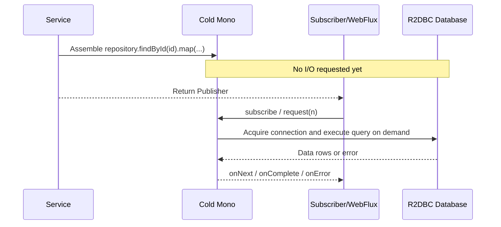

# Distinguishing Publisher Creation Time from Query Execution Time

## 1. The problem in reactive data integration flows

In **Spring Boot Integration**, applications commonly read from a database, call HTTP clients, persist results, and publish events to a broker. With Spring Data R2DBC or Reactive MongoDB, these operations typically return a Project Reactor **`Mono<T>`** or **`Flux<T>`**. Unlike synchronous JDBC calls, receiving a `Mono` or `Flux` instance **does not prove that a query has been sent to the database**.

Compare the two styles:

```java
// JDBC: the query executes immediately and blocks the calling thread.
Order order = jdbcTemplate.queryForObject(sql, rowMapper, id);

// Spring Data R2DBC: the repository typically creates a cold Publisher.
Mono<Order> publisher = reactiveOrderRepository.findById(id);
```

On the second line, the Publisher describes **how** to retrieve the data. With a typical *cold* Publisher, the query only activates when a **subscriber** attaches, and emission proceeds according to downstream demand. Distinguishing these two moments prevents common bugs: creating a Publisher and forgetting to run it, writing data twice via duplicate subscriptions, retrying side-effecting operations, mismeasuring database latency, and misplacing transaction boundaries.

**Important caveat:** Not every Publisher is cold; *hot* sources can emit independently of individual subscribers. Furthermore, Java code that **constructs** a Publisher can still run work eagerly—such as argument validation, computing parameters, logging, or accidentally invoking blocking methods.

## 2. Three phases: assembly, subscription, and signal emission

| Phase | What actually happens | What you cannot infer yet |
| --- | --- | --- |
| **Assembly** | Java calls methods to construct the Publisher, chains `map`, `flatMap`, `filter`, `doOnNext`, and evaluates input arguments. | Not enough evidence to conclude SQL executed. |
| **Subscription** | A subscriber attaches via `subscribe`, receives a `Subscription`, and signals demand with `request(n)`. | Does not guarantee SQL finishes immediately upon subscribe. |
| **Signals** | Data flows through `onNext`; finishes with `onComplete` or fails with `onError`. | Does not automatically prove external side effects committed atomically with the DB. |



This diagram illustrates the typical path when Spring Data returns a cold Publisher. Connection acquisition, statement preparation, SQL dispatch, and row fetching happen at specific moments governed by the R2DBC driver, connection pool, backpressure, and transactions. Saying "the query runs on subscribe" means **subscription triggers the processing chain leading to the query**, not a precise stopwatch timestamp for when the database receives SQL.

### 2.1. `subscribe()` does not automatically spawn a new thread

`subscribe()` attaches a subscriber; it does not create a thread by default. `Mono.just(1)` can emit synchronously on the subscribing thread, whereas R2DBC or reactive HTTP typically completes asynchronously via I/O callbacks. Operators like `subscribeOn`/`publishOn` control execution scheduling and signal emission threads, yet they do not replace subscription and cannot convert a blocking JDBC driver into a non-blocking one.

### 2.2. Who subscribes in Spring Boot?

- In **Spring WebFlux**, a controller returns `Mono` or `Flux`; the runtime subscribes to write the HTTP response.
- **StepVerifier** in tests subscribes to the Publisher and asserts emitted signals.
- `block()`/`blockOptional()` also create a subscription and wait synchronously for the result. They trigger queries, but must not be called on WebFlux event-loop threads.
- Other integration boundaries may subscribe, such as a reactive flow orchestrator or dedicated adapter.

In standard services, **return the Publisher to the caller** instead of calling `subscribe()` yourself and discarding the result. Self-subscribing inside a service causes fire-and-forget bugs: HTTP returns success while DB writes or event publishes are still running, and errors never propagate back to the main pipeline.

## 3. Demonstrating laziness clearly with `Mono.defer`

`Mono.defer` accepts a Publisher factory function and invokes it only upon subscription:

```java
import java.util.concurrent.atomic.AtomicInteger;
import reactor.core.publisher.Mono;

AtomicInteger executions = new AtomicInteger();

Mono<String> query = Mono.defer(() -> {
    int count = executions.incrementAndGet();
    System.out.println("Running work attempt " + count);
    return Mono.just("order-42");
});

System.out.println(executions.get()); // 0: Publisher assembled only

query.block();  // Subscription 1: counter becomes 1
query.block();  // Subscription 2: counter becomes 2

System.out.println(executions.get()); // 2
```

Although this snippet does not touch a database, it accurately models the lazy callback inside `defer`. Assigning `query` leaves `executions` at zero; each subscription re-runs the work. Likewise, for typical cold Spring Data R2DBC queries, **two subscriptions can run the query twice**.

However, **calling the Java method that builds the Publisher** and **performing the I/O the Publisher describes** remain distinct. A repository method may validate inputs or log upon invocation, while actual SQL goes over the wire only after subscription and demand. Never claim "zero code runs before subscribe".

## 4. R2DBC repositories: building queries and receiving results

Suppose an integration system stores orders in PostgreSQL's `orders` table using Spring Data R2DBC:

```java
import org.springframework.data.annotation.Id;
import org.springframework.data.relational.core.mapping.Table;
import org.springframework.data.repository.reactive.ReactiveCrudRepository;

@Table("orders")
record OrderEntity(@Id Long id, String status) {}

interface OrderRepository
        extends ReactiveCrudRepository<OrderEntity, Long> {
}
```

A service calls the repository and attaches observation hooks:

```java
import org.slf4j.Logger;
import org.slf4j.LoggerFactory;
import org.springframework.stereotype.Service;
import reactor.core.publisher.Mono;

@Service
public class OrderQueryService {
    private static final Logger log =
            LoggerFactory.getLogger(OrderQueryService.class);

    private final OrderRepository repository;

    public OrderQueryService(OrderRepository repository) {
        this.repository = repository;
    }

    public Mono<OrderEntity> getById(long id) {
        log.info("Assembly query for order {}", id);
        return repository.findById(id)
                .doOnSubscribe(s ->
                        log.info("Subscribed to order query {}", id))
                .doOnNext(order ->
                        log.info("Received order {}", order.id()))
                .doOnError(error ->
                        log.warn("Order query {} failed", id, error));
    }
}
```

Calling `getById(42L)` writes the **assembly** log immediately. With a cold R2DBC source, the **subscribed** log and result/error signals fire only when subscribed. Even then, `doOnSubscribe` **does not pinpoint the exact instant SQL hits the DB**; connection pool acquisition may still be pending. Use driver, pool, or database metrics/tracing to measure actual SQL execution time.

### 4.1. Query example with `DatabaseClient`

With Spring R2DBC's `DatabaseClient`, chaining `sql(...).bind(...).map(...).one()` assembles a query Publisher:

```java
import org.springframework.r2dbc.core.DatabaseClient;
import reactor.core.publisher.Mono;

record OrderRow(Long id, String status) {}

class OrderSqlGateway {
    private final DatabaseClient databaseClient;

    OrderSqlGateway(DatabaseClient databaseClient) {
        this.databaseClient = databaseClient;
    }

    Mono<OrderRow> findById(long id) {
        return databaseClient.sql(
                    "SELECT id, status FROM orders WHERE id = :id")
                .bind("id", id)
                .map((row, meta) -> new OrderRow(
                        row.get("id", Long.class),
                        row.get("status", String.class)))
                .one();
    }
}
```

Calling `findById` creates the query specification and result publisher; acquiring a connection, sending SQL, and reading rows occur when consumed. `one()` emits at most one record or completes empty; row mapping runs only when rows arrive from the database.

### 4.2. WebFlux controller keeping the pipeline asynchronous

```java
import org.springframework.http.ResponseEntity;
import org.springframework.web.bind.annotation.GetMapping;
import org.springframework.web.bind.annotation.PathVariable;
import org.springframework.web.bind.annotation.RequestMapping;
import org.springframework.web.bind.annotation.RestController;
import reactor.core.publisher.Mono;

@RestController
@RequestMapping("/orders")
class OrderController {
    private final OrderQueryService service;

    OrderController(OrderQueryService service) {
        this.service = service;
    }

    @GetMapping("/{id}")
    Mono<ResponseEntity<OrderEntity>> get(@PathVariable long id) {
        return service.getById(id)
                .map(ResponseEntity::ok)
                .defaultIfEmpty(ResponseEntity.notFound().build());
    }
}
```

The controller returns a Publisher expressing two outcomes: `200` if found, `404` if empty, without blocking any thread waiting for the query. WebFlux manages subscription over the HTTP request lifecycle; database errors propagate via `onError` to the configured error handlers.

## 5. Calling a repository directly vs. `Mono.defer`

Both expressions below **usually defer SQL** when the repository returns a cold Publisher:

```java
Mono<OrderEntity> direct = repository.findById(id);

Mono<OrderEntity> deferred =
        Mono.defer(() -> repository.findById(id));
```

Yet **when the Java method is invoked** differs:

| Style | When `findById` is called | When cold I/O typically starts |
| --- | --- | --- |
| `repository.findById(id)` | Immediately at assembly | When the returned Publisher is subscribed and requested |
| `Mono.defer(() -> repository.findById(id))` | On every subscription | When each newly created Publisher is subscribed and requested |
| `Mono.just(repository.findById(id))` | Immediately at assembly | Produces **`Mono<Mono<OrderEntity>>`**; subscribing to the outer Mono does not execute the inner Mono |

For a pure reactive repository, calling it directly is usually lazy enough. `defer` becomes essential when **constructing the Publisher itself** must be delayed—for instance, picking a query path at subscribe time, reading parameters from subscriber context, or ensuring a fallback is built only if needed.

### 5.1. Argument values captured at assembly time

```java
long selectedId = 42L;
Mono<OrderEntity> query = repository.findById(selectedId);

selectedId = 43L;
// Query was already assembled with argument 42.
```

Never rely on shared mutable variables to vary queries across requests: that introduces race conditions and tenant data leaks. When parameters vary per subscription, pass them explicitly down the pipeline or read **Reactor Context** via `Mono.deferContextual`.

### 5.2. `Mono.just` can accidentally run blocking I/O eagerly

```java
// WRONG: the JDBC method runs IMMEDIATELY to supply the argument to Mono.just.
Mono<OrderDto> eager = Mono.just(blockingDao.loadOrder(42L));

// Defers the Java call until subscription.
Mono<OrderDto> lazy = Mono.fromCallable(
        () -> blockingDao.loadOrder(42L));
```

`Mono.just(value)` wraps an already-computed value. `Mono.fromCallable` delays execution until subscription, though it **does not make a blocking operation non-blocking**. If you must integrate a synchronous JDBC/SDK library inside a WebFlux app, isolate the blocking call onto a dedicated scheduler:

```java
import reactor.core.scheduler.Schedulers;

Mono<OrderDto> bridge = Mono.fromCallable(
        () -> blockingDao.loadOrder(42L))
        .subscribeOn(Schedulers.boundedElastic());
```

`boundedElastic` runs blocking I/O on a capped thread pool, still consuming threads and connections. Whenever a true reactive driver exists for a query, prefer Spring Data R2DBC or matching reactive APIs to preserve non-blocking execution.

## 6. Multiple subscriptions can trigger multiple queries

A cold Publisher is **not** a loaded result object automatically shared across consumers:

```java
Mono<OrderEntity> source = repository.findById(42L);

Mono<OrderEntity> forBilling = source
        .doOnNext(order -> log.info("Billing sees {}", order.id()));

Mono<OrderEntity> forAudit = source
        .doOnNext(order -> log.info("Audit sees {}", order.id()));

// If forBilling and forAudit are subscribed separately,
// a typical cold source executes twice.
```

Two reads may observe **two different versions of the row** if the order changed between subscriptions. For **write** Publishers, two subscriptions can write twice. In system integration, this ties directly into deduplication, transactions, and idempotency.

### 6.1. `retry` triggers resubscription

```java
Mono<OrderEntity> retried = repository.findById(42L)
        .retry(2); // Initial attempt + up to two retry subscriptions.
```

`retry(2)` merely illustrates resubscription mechanics; **never blindly retry every exception in production**. Separate transient failures from permanent business/SQL errors, apply backoff, and enforce retry caps. For writes, HTTP POSTs, or message publishes, retries can duplicate side effects without idempotency keys or reconciliation.

### 6.2. `cache` reuses results while introducing stale-data risks

```java
Mono<OrderEntity> cached = repository.findById(42L).cache();

// First subscription runs the query.
// Later subscriptions replay the cached signal.
```

`Mono.cache()` stores the terminal signal—value, empty completion, or error—subject to overloads and TTL rules. On long-lived Publishers, unbounded caching causes stale reads, sticky cached errors, memory growth, and cross-user/tenant leakage if scoped improperly. When business caching is needed, design explicit keys, TTLs, invalidation, and access controls.

### 6.3. Cold, hot, and shared Publishers

**Cold** sources represent work tied to each subscription; **hot** sources emit independently, and late subscribers can miss prior items. Operators like `share` or `publish().refCount(...)` let multiple subscribers share one upstream subscription. Therefore, never claim "every subscription always runs new SQL" without checking whether the Publisher caches or multicasts.

## 7. Composing read/write steps: creating Publishers does not mean completion

Suppose a workflow must update an order and then insert an audit record. The snippet below **merely creates two Publishers**:

```java
Mono<OrderEntity> saveOrder = orders.save(order);
Mono<AuditEvent> saveAudit = audits.save(auditEvent);
// Without subscribing or composing them into an outer pipeline,
// neither operation can be assumed to have run.
```

To execute sequentially and propagate errors:

```java
public Mono<Void> saveOrderThenAudit(
        OrderEntity order, AuditEvent auditEvent) {
    return orders.save(order)
            .then(Mono.defer(() -> audits.save(auditEvent)))
            .then();
}
```

Assuming `orders` and `audits` are injected reactive repositories and `AuditEvent` is a domain entity, `then(...)` waits for the first Publisher to complete before subscribing to the next. `Mono.defer` also delays constructing the audit Publisher until needed. If saving the order fails, the audit step never executes. Still, **sequential execution does not equal an atomic transaction across two separate databases or systems**.

This is a classic bug:

```java
public Mono<Void> unsafe(OrderEntity order) {
    orders.save(order); // Publisher is discarded.
    return Mono.empty(); // Caller sees empty completion.
}
```

Similarly, calling `orders.save(order).subscribe()` and returning `Mono.empty()` detaches the work from the caller; errors, cancellation, tracing, and transactions can no longer be coordinated cleanly.

### 7.1. `map` vs. `flatMap`

```java
Mono<String> status = orders.findById(42L)
        .map(OrderEntity::status);

Mono<AuditEvent> audit = orders.findById(42L)
        .flatMap(order ->
                audits.save(new AuditEvent(null, order.id(), "READ")));
```

`map` performs a **synchronous `T` -> `R` transformation**. If a `map` lambda returns `Mono<R>`, you get `Mono<Mono<R>>`, and the inner stream never gets subscribed. `flatMap` flattens the inner Publisher into the main pipeline. For multi-item `Flux` streams, `flatMap` can run inner publishers concurrently and reorder emissions; use `concatMap` when ordering matters, and cap concurrency to protect databases, APIs, and brokers.

## 8. Reactive transactions start on subscription

With an appropriate **ReactiveTransactionManager** such as `R2dbcTransactionManager`, reactive transactions bind to the signal stream's **Reactor Context**; constructing a transactional Publisher does not open a transaction on that Java line.

```java
import org.springframework.stereotype.Service;
import org.springframework.transaction.reactive.TransactionalOperator;
import reactor.core.publisher.Mono;

@Service
public class OrderWriteService {
    private final OrderRepository orders;
    private final TransactionalOperator tx;

    public OrderWriteService(OrderRepository orders,
                             TransactionalOperator tx) {
        this.orders = orders;
        this.tx = tx;
    }

    public Mono<OrderEntity> save(OrderEntity changed) {
        return orders.save(changed)
                .as(tx::transactional);
    }
}
```

`save` returns a Publisher representing a transactional write. Only upon subscription does the transaction operator open/bind the transaction and subscribe to the source, committing or rolling back upon termination per policy. Subscribing to the same Publisher twice can execute **two writes in two separate transactions**.

With `@Transactional` on a method returning `Mono`/`Flux`, Spring uses reactive transaction management when a matching manager is available, tying the transaction to subscription. Invocations must go through the Spring proxy; internal `this.someTransactionalMethod()` calls can bypass the proxy.

Limits to remember:

1. Reactive transactions do not automatically wrap `JdbcTemplate` or blocking JPA if those use another transaction manager.
2. A database transaction never makes an HTTP call, Redis write, or Kafka/RabbitMQ publish atomic with the DB.
3. Placing `retryWhen` inside vs. outside the transaction changes retry scope and transaction count.
4. When an external side effect succeeded before a DB rollback, you need idempotency, transactional outbox, or sagas depending on consistency needs.

## 9. Errors and timeouts: do they happen at assembly or as signals?

The validation check below throws a Java exception **immediately when the method is called**, before any Publisher exists to subscribe to:

```java
public Mono<OrderEntity> load(long id) {
    if (id <= 0) {
        throw new IllegalArgumentException("id must be positive");
    }
    return repository.findById(id)
            .onErrorMap(error ->
                    new IllegalStateException("Failed to load order " + id, error));
}
```

To emit parameter validation failures as an **`onError` signal upon subscription**, write:

```java
public Mono<OrderEntity> loadReactive(long id) {
    return Mono.defer(() -> {
        if (id <= 0) {
            return Mono.error(
                    new IllegalArgumentException("id must be positive"));
        }
        return repository.findById(id);
    });
}
```

With the second style, `onErrorResume` or reactive HTTP error handlers catch the failure inside the pipeline, and observation operators see the error on subscription.

### 9.1. Timeouts do not prove the database did not commit

```java
import java.time.Duration;

Mono<OrderEntity> query = repository.findById(42L)
        .timeout(Duration.ofSeconds(2));
```

`timeout` emits an error and cancels the upstream source if signals exceed the configured window. Whether cancellation halts an active database statement depends on the driver, database, and connection state. For writes, an application timeout **never proves the server transaction did not commit**; use idempotency and status checks before retrying.

`doFinally` observes completion, error, or cancellation; `doOnError` observes errors without recovering. When `onErrorResume` provides a fallback, separate transient outages from missing data so infrastructure failures are not disguised as "not found".

### 9.2. Deferring fallback Publisher assembly

```java
Mono<OrderEntity> resolved = primaryRepository.findById(42L)
        .switchIfEmpty(Mono.defer(() ->
                backupRepository.findById(42L)));
```

`switchIfEmpty` subscribes to the fallback only if the primary source completes empty. Adding `Mono.defer` also defers **the Java call creating the backup Publisher**. Even if `backupRepository` is cold (meaning early assembly would not run SQL), `defer` avoids any assembly-time side effects or overhead unless the fallback is actually needed.

## 10. Flux, backpressure, and concurrent requests

With `Flux<OrderEntity>`, downstream signals demand via `request(n)`. Backpressure coordinates demand across Reactive Streams-compliant Publishers, yet **never assume the driver/database fetches literally `n` rows over the network per request**; buffering and fetch batching depend on the driver.

```java
Flux<OrderEntity> stream = repository.findAll()
        .doOnSubscribe(s -> log.info("Start stream"))
        .doOnRequest(n -> log.debug("Requested {} rows", n))
        .doOnNext(order -> log.debug("Received {}", order.id()));
```

For an uncached cold source, each subscription to `findAll()` starts a fresh scan. If an HTTP client disconnects, WebFlux can cancel the subscription, though how far the DB query already progressed depends on the driver and database. When fanning out records to external APIs via `flatMap`, bound concurrency, timeouts, retries, and idempotency to protect downstream resources.

## 11. Tests proving lazy execution

A database-free test using `AtomicInteger` and `StepVerifier`:

```java
import static org.junit.jupiter.api.Assertions.assertEquals;
import java.util.concurrent.atomic.AtomicInteger;
import org.junit.jupiter.api.Test;
import reactor.core.publisher.Mono;
import reactor.test.StepVerifier;

class LazyPublisherTest {
    @Test
    void runsWorkOnEachSubscription() {
        AtomicInteger executions = new AtomicInteger();

        Mono<String> query = Mono.defer(() -> {
            executions.incrementAndGet();
            return Mono.just("ok");
        });

        assertEquals(0, executions.get()); // Assembly

        StepVerifier.create(query)
                .expectNext("ok")
                .verifyComplete();
        assertEquals(1, executions.get());

        StepVerifier.create(query)
                .expectNext("ok")
                .verifyComplete();
        assertEquals(2, executions.get());
    }
}
```

`StepVerifier` comes from `reactor-test` (normally test scope). This test proves the supplier runs on subscription, not when an R2DBC driver executes SQL. To verify real queries:

1. Spin up an isolated test PostgreSQL instance (e.g., Testcontainers) with deterministic seed data.
2. Construct the repository `Mono`; verify via SQL/driver instrumentation that no read query executed before subscription.
3. Subscribe with `StepVerifier`, assert data/errors/completion, and inspect SQL logs/metrics.
4. Subscribe a second time uncached to observe a second query; compare with `.cache()`.
5. Test retries, timeouts, and transactions for writes, verifying deduplication on resubscription.

Never infer SQL execution timing using `Thread.sleep` guesses: driver, pool, or database hooks/metrics provide real evidence of I/O.

## 12. Common mistakes

| Mistake or misconception | Consequence | Fix |
| --- | --- | --- |
| "Assigning a `Mono` variable means SQL ran." | Skewed latency metrics, dropped work, or broken transactions. | Separate assembly, subscription, and query execution. |
| `Mono.just(blockingDao.find(...))` | Blocking I/O runs eagerly at assembly time. | Use R2DBC, or `fromCallable` with an appropriate bridge scheduler. |
| Calling `repository.save(entity)` and ignoring the Publisher. | Cold work likely never executes. | Return the Publisher or chain with `flatMap`/`then`. |
| Calling `subscribe()` inside a service and returning `Mono.empty()`. | Callers lose outcome tracking and transaction control. | Let the lifecycle boundary own subscription. |
| Returning `Mono` inside a `map` lambda. | Produces `Mono<Mono<T>>` with an unsubscribed inner flow. | Use `flatMap` or `concatMap`. |
| Thinking `subscribe()` always creates a new thread. | Fails to spot blocking on event-loop threads. | Distinguish subscription from scheduling. |
| Subscribing twice expecting only one query. | Duplicate I/O and duplicate side effects. | Control lifecycle, sharing, or scoped caching deliberately. |
| Retrying all write errors indiscriminately. | Duplicate orders or duplicate events. | Use conditional retries, backoff, and idempotency. |
| Assuming `timeout` means DB rolled back. | Retries duplicate writes when the first attempt actually committed. | Inspect state and reconcile after timeouts. |
| Caching Publishers containing per-user data. | Serves stale or cross-tenant leaked data. | Cache explicitly by key, TTL, and authorization scope. |
| Using `doOnSubscribe` as the SQL-sent timestamp. | Inaccurate query metrics. | Measure at the driver, pool, or database level. |
| Using reactive `@Transactional` with blocking JDBC calls. | Transaction fails to manage JDBC resources properly. | Use matching managers/drivers or separate imperative flows. |

## 13. Checklist for Spring Boot Integration flows

Before shipping an R2DBC read/write flow integrated with HTTP clients, caches, or brokers:

1. **Cold or hot source?** Are `cache`, `share`, multicast, or unexpected extra subscribers involved?
2. **Who subscribes?** WebFlux, an adapter, tests, or `block()`? Are any constructed Publishers discarded?
3. **What runs at assembly time?** Are input checks, fallback creation, blocking calls, and parameter evaluations placed deliberately?
4. **Are operations chained properly?** Do `flatMap`/`then`/`concatMap` enforce ordering and error propagation?
5. **Is there blocking I/O on the event loop?** Are you using true R2DBC or safely isolating legacy blocking code?
6. **Can resubscription repeat side effects?** Are retries, timeouts, dual subscribers, and caches paired with idempotency?
7. **Are transaction boundaries accurate?** Do DB commits, HTTP calls, and message publishes use outbox or reconciliation where needed?
8. **Are metrics at the right layer?** Separate assembly logs, subscriber logs, pool wait times, SQL execution, and terminal signals.
9. **Did tests verify laziness properly?** Do tests prove execution timing and actual read/write counts?

**Key takeaway:** Constructing a reactive **Publisher** typically only assembles a job description. For **cold** Spring Data reactive queries, **subscription and demand** trigger the execution chain that performs I/O. Recognizing this boundary is essential for building accurate transactions, retries, idempotency, error handling, and observability in Spring Boot integration flows.
