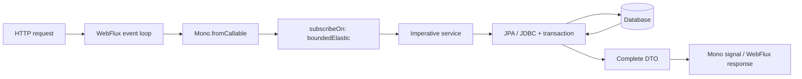
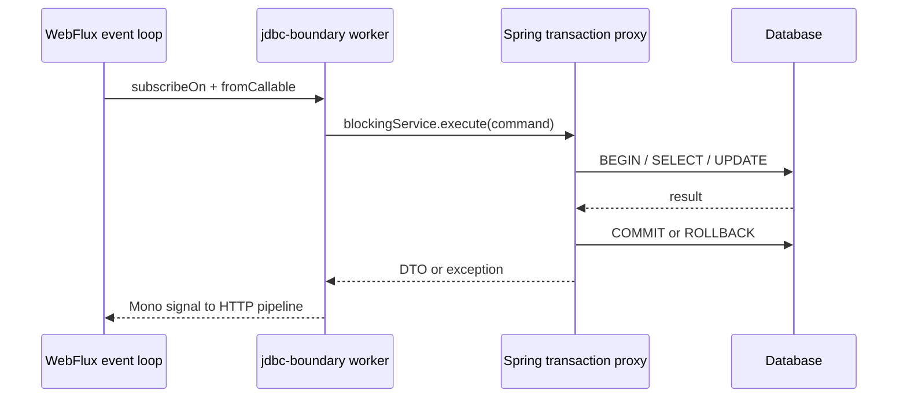
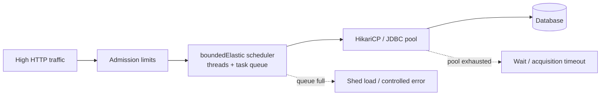

# Integrating JDBC or JPA in a Reactive Application at Controlled Boundaries

> **Chapter:** Reactive Data  
> **Module scope:** `SPRING_BOOT_INTEGRATION` — organizing system integration in Spring Boot across HTTP clients, databases, caches, message brokers, and Spring Integration adapters, focusing on configuration, data contracts, transactions, error/duplicate handling, testing, and observability.

Applications built on Spring WebFlux and Reactor do not have to replace every database access layer with R2DBC on day one. Many systems still rely on domain models, libraries, or transactions running on JDBC/JPA. You can keep using those components inside an application returning `Mono`/`Flux` **if you isolate blocking work at a clear boundary**, enforce resource limits, and keep transactions within the synchronous execution block.

Crucially: **returning a `Mono` API does not make JDBC or JPA non-blocking**. An SQL call over JDBC still pins a thread waiting for the database to respond. To protect the event loop, offload that work to a scheduler meant for blocking I/O, cap concurrent executions, and keep the boundary between both models explicit.

## 1. Learning objectives

After this lesson, you will be able to:

1. Explain why calling JDBC/JPA directly on a WebFlux event loop degrades concurrency.
2. Use `Mono.fromCallable(...)` and `subscribeOn(...)` to offload blocking calls onto `Schedulers.boundedElastic()` or a dedicated scheduler.
3. Keep `@Transactional` and the JPA session inside **one imperative block running on the same worker thread**, returning a fully materialized DTO.
4. Set coordinated limits across the scheduler, connection pool, pipeline concurrency, and actual driver/database timeouts.
5. Test errors, rollbacks, resource contention, timeouts, and event-loop non-blocking guarantees.
6. Judge when a JDBC/JPA bridge makes sense versus adopting R2DBC or splitting out a separate service.

## 2. Where do blocking and non-blocking differ?

In a reactive HTTP server like WebFlux on Reactor Netty, a small pool of event-loop threads handles I/O events across many sockets. When an event-loop thread enters `repository.findById(...)`, a JDBC call typically **waits synchronously** for the database response, stalling all other connections assigned to that thread.

Wrapping the result in `Mono` after the query finishes does not reclaim the blocked time:

```java
// WRONG: the JDBC/JPA query already blocked before Mono was created.
Mono<OrderDto> find(Long id) {
    OrderDto dto = blockingOrderReader.find(id);
    return Mono.just(dto);
}
```

Similarly, `Mono.defer(() -> Mono.just(blockingOrderReader.find(id)))` delays invocation until subscription, yet **still blocks whichever thread executes the subscription** without a scheduler boundary. This is about *where* execution runs, not merely *when* it runs.

Desired flow:



The segment from `boundedElastic` to the database remains blocking; the win is **freeing the event loop** to serve other requests. This does not make the whole app non-blocking end-to-end. The thread emitting the `Mono` result may be the worker thread, while socket writes remain managed by the runtime's I/O loop.

| Component | Characteristic | How to use in a reactive app |
|---|---|---|
| JDBC / Spring JDBC / `JdbcTemplate` | Blocking query and result retrieval API | Wrap inside a callable scheduled on a blocking-safe scheduler. |
| Spring Data JPA / Hibernate | Synchronous ORM; persistence context bound to transaction/thread | Keep all entity access and DTO mapping inside a transactional imperative service. |
| R2DBC | Reactive database driver and API when supported by driver | Use publishers and `ReactiveTransactionManager`; avoid forcing into JDBC patterns. |
| Reactor `Mono` / `Flux` | Models asynchronous result streams and signals | Does not automatically offload blocking calls to workers. |
| `Schedulers.boundedElastic()` | Bounded scheduler built for potentially blocking tasks | Isolates JDBC/JPA work; monitor load and never treat queues as infinite. |

## 3. When should you keep JDBC/JPA?

A bounded blocking bridge makes sense when:

- The system already has mature JPA repositories, transactions, and domain logic while gradually migrating the HTTP layer to WebFlux.
- A required library only supports JDBC, or you need rare admin queries or a few predictable database operations.
- The database/driver ecosystem lacks suitable R2DBC support, or rewriting the ORM costs far more than expected gains.

Re-evaluate if most requests trigger multiple blocking queries, high traffic keeps the scheduler or connection pool saturated, or DB calls intertwine continuously with reactive steps. In those cases, keeping an MVC/JPA service, reshaping service boundaries, or migrating hot data paths to R2DBC may be cleaner. Base your choice on throughput, latency, transactions, library support, and operability—never assume R2DBC is faster in every workload.

## 4. Designing a clean imperative boundary

Example: `GET /orders/{id}` returns `Mono<OrderDto>`, backed by PostgreSQL via Spring Data JPA. Typical dependencies include `spring-boot-starter-webflux`, `spring-boot-starter-data-jpa`, and the matching JDBC driver, along with `spring.datasource.*`, JPA mappings, and schema setup for your application.

### 4.1. Keep transactions inside the synchronous service

This is the **imperative** core. Querying, reading entity fields, and constructing the DTO all happen while the transaction is open:

```java
import java.math.BigDecimal;
import org.springframework.data.jpa.repository.JpaRepository;
import org.springframework.http.HttpStatus;
import org.springframework.stereotype.Service;
import org.springframework.transaction.annotation.Transactional;
import org.springframework.web.bind.annotation.ResponseStatus;

record OrderDto(Long id, String status, BigDecimal total) {}

// Assumes OrderEntity is mapped with @Entity to the orders table.
interface OrderRepository extends JpaRepository<OrderEntity, Long> {}

@ResponseStatus(HttpStatus.NOT_FOUND)
class OrderNotFoundException extends RuntimeException {
    OrderNotFoundException(Long id) {
        super("Order not found: " + id);
    }
}

@Service
class BlockingOrderReader {
    private final OrderRepository orders;

    BlockingOrderReader(OrderRepository orders) {
        this.orders = orders;
    }

    @Transactional(readOnly = true)
    public OrderDto find(Long id) {
        OrderEntity order = orders.findById(id)
            .orElseThrow(() -> new OrderNotFoundException(id));

        // Access fields and materialize the DTO inside the transaction.
        return new OrderDto(order.getId(), order.getStatus(), order.getTotal());
    }
}
```

`OrderEntity` and its getters belong to your JPA domain model matching the real schema. Place `@Transactional` on a public method of a Spring bean called via its Spring proxy. **Never** change this method's return type to `Mono<OrderDto>` just to look reactive: `JpaTransactionManager` requires the transaction to span *when JDBC executes*, not merely when the publisher is assembled.

Above all, never return `OrderEntity`, `Stream<OrderEntity>`, or lazy-loading proxies outside the service. Once the transaction and persistence context close, reading `LAZY` associations throws `LazyInitializationException` or triggers unexpected queries on another thread. If the DTO needs related data, fetch it intentionally via projections, fetch joins, or dedicated queries while still inside the transaction.

### 4.2. Isolating queries onto a dedicated scheduler

Apps can use shared `Schedulers.boundedElastic()` for modest blocking work. For critical JDBC/JPA workloads, a dedicated scheduler lets you cap and monitor that traffic independently:

```java
import org.springframework.context.annotation.Bean;
import org.springframework.context.annotation.Configuration;
import reactor.core.scheduler.Scheduler;
import reactor.core.scheduler.Schedulers;

@Configuration(proxyBeanMethods = false)
class JdbcBoundaryConfig {
    @Bean(destroyMethod = "dispose")
    Scheduler jdbcScheduler() {
        // Caps backing threads and queued tasks per backing thread.
        return Schedulers.newBoundedElastic(12, 100, "jdbc-boundary");
    }
}
```

`12` and `100` are **illustrative parameters**, not universal optimal values. `newBoundedElastic(threadCap, queuedTaskCap, name)` caps backing threads and queued tasks *per backing thread*. Size them against your connection pool, SQL latency, traffic mix, and other blocking tasks; spawning too many threads worsens database contention. When scheduler capacity fills up, scheduling rejects new tasks; return controlled errors, shed load, or rate-limit requests early.

### 4.3. Bridging from the reactive endpoint

Nothing queries the database at assembly time. Upon subscription, the callable executes on the designated scheduler:

```java
import org.springframework.beans.factory.annotation.Qualifier;
import org.springframework.web.bind.annotation.GetMapping;
import org.springframework.web.bind.annotation.PathVariable;
import org.springframework.web.bind.annotation.RestController;
import reactor.core.publisher.Mono;
import reactor.core.scheduler.Scheduler;

@RestController
class OrderController {
    private final BlockingOrderReader reader;
    private final Scheduler jdbcScheduler;

    OrderController(BlockingOrderReader reader,
                    @Qualifier("jdbcScheduler") Scheduler jdbcScheduler) {
        this.reader = reader;
        this.jdbcScheduler = jdbcScheduler;
    }

    @GetMapping("/orders/{id}")
    Mono<OrderDto> get(@PathVariable Long id) {
        return Mono.fromCallable(() -> reader.find(id))
                   .subscribeOn(jdbcScheduler);
    }
}
```

`Mono.fromCallable(...)` captures the synchronous return value or exception inside the publisher; `subscribeOn(...)` shifts subscription and callable execution onto the worker pool. This keeps the JPA service synchronous and wraps the transaction around one cohesive call. Pure CPU mappers or downstream reactive operators can switch schedulers later only if truly needed, but **avoid gratuitous `publishOn` hops**: every thread switch carries overhead.

Note: if a callable returns `null`, `Mono.fromCallable` completes empty. For lookup APIs, handle missing records with a domain exception as shown above, or an explicit `switchIfEmpty`, rather than confusing callers with empty `200 OK` responses.

## 5. Keeping transactions within the right boundary

With JPA/JDBC and `PlatformTransactionManager` (`JpaTransactionManager` or `DataSourceTransactionManager`), Spring normally tracks transactions via **the current thread**. Splitting business work across multiple reactive operators or threads breaks local transaction propagation because it does not ride on Reactor Context.



This diagram shows the *logical* handoff back to the response pipeline; Reactor signals do not strictly have to return to the original event-loop thread.

### 5.1. Writing domain data and outbox in one transaction

When a reactive endpoint receives an order creation request, it can invoke a synchronous JPA service to store both the order and an outbox row in **one transaction**:

```java
@Service
class BlockingOrderWriter {
    private final OrderRepository orders;
    private final OutboxRepository outbox;

    BlockingOrderWriter(OrderRepository orders, OutboxRepository outbox) {
        this.orders = orders;
        this.outbox = outbox;
    }

    @Transactional
    public OrderReceipt create(CreateOrder command) {
        OrderEntity order = orders.save(OrderEntity.from(command));
        outbox.save(OutboxEvent.orderCreated(order.getId(), command.requestId()));
        return new OrderReceipt(order.getId());
    }
}

// Inside WebFlux handler/controller:
Mono<OrderReceipt> result = Mono.fromCallable(() -> writer.create(command))
                                .subscribeOn(jdbcScheduler);
```

`CreateOrder`, `OrderReceipt`, `OutboxRepository`, and factory methods here are **illustrative domain types** aligned with your schema. `@Transactional` wraps only the two DB operations sharing the same transaction manager; a separate publisher relays outbox events post-commit. Never make HTTP calls or direct broker publishes inside the transaction assuming JPA rollback can undo external side effects.

To prevent duplicates when clients retry writes, use a stable `requestId`/idempotency key with a database unique constraint, handle collisions, and return the already-persisted result. `@Transactional` alone **does not** provide idempotency. Because outbox relays and consumers can retry too, keep event IDs and deduplication intact at messaging boundaries.

### 5.2. Incorrect transaction patterns

```java
// WRONG: @Transactional on a Mono-returning method while JDBC runs later.
@Transactional
public Mono<OrderDto> findLater(Long id) {
    return Mono.fromCallable(() -> repository.findById(id)
        .map(this::toDto)
        .orElseThrow());
}

// WRONG: loading a JPA entity in a transaction and letting the reactive pipeline
// access lazy associations later on another thread.
Mono<OrderEntity> entity = Mono.fromCallable(() -> reader.loadEntity(id))
                               .subscribeOn(jdbcScheduler);
```

In the first case, the thread-bound transaction closes as soon as the method returns the publisher, **before any subscriber runs the callable**. In the second, the JPA entity and lazy proxies escape the resource owner's boundary. Replace both with a cohesive imperative method returning a complete DTO, and wrap **the call to that method** inside `Mono.fromCallable(...)`.

If using `TransactionTemplate` instead of `@Transactional`, invoke `transactionTemplate.execute(...)` *inside* the callable so every JDBC step runs inside the callback. Avoid self-invocation (`this.methodAnnotatedTransactional()`), which bypasses the Spring proxy and skips transaction advice.

## 6. Controlling resources: schedulers, pools, concurrency

Offloading solves **running blocking calls on appropriate threads**. Under load, stability also requires capping queued tasks and database connections.



| Limit | Meaning | Signals to watch |
|---|---|---|
| Scheduler thread cap | Blocking tasks allowed to hold backing threads concurrently in this scheduler | Threads continuously busy, queue waits, rising latency. |
| Scheduler task queue | Tasks waiting to be scheduled before rejection | Queued task count, scheduling rejection errors. |
| JDBC connection pool | Active DB connections and acquisition wait time | Active/idle/pending connections, connection acquisition timeouts. |
| DB capacity | Query volume, locks, CPU, and I/O the DB can sustain | Slow queries, deadlocks, long transactions. |
| Pipeline concurrency | Blocking calls launched concurrently from a single `Flux` | In-flight requests, pending tasks, tail latency (p95/p99). |

Never inflate the thread cap blindly when latency rises: if the pool has 10 connections while the scheduler runs 100 queries concurrently, 90 threads simply sit idle waiting for connections, swelling queues and memory. Across multiple endpoints and instances, total DB pressure exceeds any single scheduler's cap. Benchmark under realistic load, budget cluster resources, and shed load when thresholds saturate.

Example capping concurrency when iterating a list of IDs within **one subscription**:

```java
Flux<OrderDto> orders = Flux.fromIterable(orderIds)
    .flatMap(id -> Mono.fromCallable(() -> reader.find(id))
                       .subscribeOn(jdbcScheduler),
             8); // At most 8 concurrent inner tasks tracked by flatMap.
```

`flatMap(..., 8)` does not cap total incoming traffic across users; combine it with scheduler caps, admission/rate limits, and connection pool bounds. If input order must be preserved, consider `flatMapSequential` or `concatMap`, accepting the throughput tradeoff.

Critical rule: never use `Schedulers.parallel()` for JDBC/JPA work. It is sized for CPU-bound tasks, not blocking I/O. Never call `block()`, `blockFirst()`, or `blockLast()` on event loops to "quickly unwrap" results—they break reactivity and trigger runtime exceptions.

## 7. Timeouts, subscription cancellation, and error handling

A WebFlux API can attach a reactive timeout to bound how long **the reactive caller waits**:

```java
Mono<OrderDto> response = Mono.fromCallable(() -> reader.find(id))
    .subscribeOn(jdbcScheduler)
    .timeout(Duration.ofSeconds(3));
```

`Mono.timeout(...)` stops the caller from hanging indefinitely, yet **does not guarantee the running SQL/JDBC call stops immediately**. When a timeout fires or a client disconnects, driver/DB/JPA cancellation or thread interruption may lag or be ignored. Workers and connections can remain busy after the HTTP request failed. Enforce layered timeouts:

- **Pool connection acquisition timeout**: bounds waiting to borrow a connection.
- **JDBC driver connect/read/network timeout**: bounds socket hangs per driver capabilities.
- **Query/statement timeout** in JPA/JDBC or the DB: aborts runaway queries; verify actual effectiveness on your driver and DB.
- **Transaction timeout** if configured: does not replace driver statement timeouts in all cases.
- **Reactive request deadline**: caps client wait time and ends HTTP responses cleanly.

Align these layers—putting a timeout only at the outer reactive layer allows hundreds of orphaned JDBC queries to pile up underneath. For writes, if HTTP times out, **never assume the DB rolled back**: commit may have completed right as the response dropped. Retrying clients require idempotency keys and a status endpoint or reconciliation job.

| Error | Handling strategy |
|---|---|
| Record not found | Map to 404 or explicit domain outcome; do not retry. |
| Unique constraint violation | Determine whether it is a duplicate idempotency key; never turn every conflict into a retry. |
| Query timeout or DB unavailable | Shed load, alert, and apply bounded backoff retries only if safe for the operation/context. |
| Scheduler/pool saturation | Fail fast / shed load per service policy, monitor queues/pools; never queue infinitely. |
| Deadlock/serialization failure | Consider retrying **the whole transaction** if safe; never retry mid-transaction. |
| Client cancels after write | Check committed state via stable ID and reconciliation. |

When adding Reactor `retryWhen`, every retry resubscribes, re-running the callable and opening a fresh transaction. Enable retries only with strict error classification, idempotency, and an overall time budget—never amplify database outages via layered retries and deep queues. The same principles apply downstream across caches, HTTP clients, and brokers, where each network hop can fail independently.

## 8. Context, security, and observability

Reactor Context differs from `ThreadLocal`. JDBC transactions, logging MDC, and imperative security contexts do not automatically follow work onto scheduler worker threads. Never assume thread reuse preserves the current request's `ThreadLocal`.

- Pass required business context (tenant ID, request ID, actor ID) explicitly as arguments to the imperative service after authentication/authorization at the right layer, rather than relying on static fields or ad-hoc `ThreadLocal`s.
- For reactive Spring Security and logging/tracing, configure stack-supported context propagation and test across scheduler boundaries. Never assume MDC/`SecurityContext` transfers automatically.
- Never log passwords, access tokens, sensitive PII, or full payloads. Correlate via trace IDs and permissible business IDs.
- Never open an `EntityManager` or transaction on the event loop and hand it to a worker; let Spring start, use, and close the transaction **inside** the imperative call.

Operational signals to monitor in a `WebFlux -> boundedElastic -> JPA -> database` flow:

| Signal | Operational question |
|---|---|
| API p50/p95/p99 latency, in-flight request count | Is latency driven by request volume or the database? |
| Scheduler active/queued tasks and rejections (if instrumented) | How much JDBC work is backing up in queues? |
| HikariCP active/idle/pending counts, acquire timeouts | Is the pool exhausted, and for how long? |
| DB slow queries, locks, transaction durations | Which queries are pinning connections? |
| Retry counts, categorized errors, request timeouts | Are transient glitches spiraling into retry storms? |
| Trace ID and order ID across HTTP, service, DB, outbox/broker | Can you pinpoint where a specific order stalled or failed? |

Spring Boot Actuator and Micrometer help expose these metrics when wired properly. Specific scheduler metrics depend on your Reactor/Micrometer setup and versions—enable instrumentation and confirm meters emit before wiring alerts. Always track database-wide limits across all sharing instances.

## 9. Testing the JDBC/JPA boundary in WebFlux

Testing only that an endpoint returns expected JSON is not enough. The boundary must protect the event loop, preserve transactions, and degrade predictably under faults and load:

| Test category | Minimum scenarios | What to assert |
|---|---|---|
| Mapping & contracts | Order exists / ID missing | Complete DTO, clean 404, no lazy proxies leaking out of the service. |
| Transactions | Order write succeeds, outbox write fails | Both DB operations roll back together when sharing a transaction. |
| Scheduler offloading | Deliberately slow query | JDBC work executes on the designated worker pool without blocking event-loop threads. |
| Load limits | Concurrent requests, small pool | Bounded concurrency/queues; controlled errors or load shedding. |
| Timeouts/cancellation | DB slower than request deadline | HTTP ends on time; inspect lingering DB work and resource release. |
| Idempotency | Re-sending write command after lost response | Duplicate logical orders/outbox rows are prevented for matching keys. |
| Observability | Failing queries or rising pending connections | Metrics, logs, and traces suffice for root-cause triage. |

Use a real database in integration tests—such as PostgreSQL via Testcontainers—to verify transactions, constraints, locking, and driver timeouts. Use `WebTestClient` for HTTP contracts, `StepVerifier` for publishers, and fake repositories for fast domain unit tests. Mock/fake repository tests **never prove** real JDBC blocking, transaction, or locking behavior.

One effective integration test introduces a controlled slow real query, fires concurrent requests, and inspects thread names in logs/traces to verify offloading. If using BlockHound, check JDK/Reactor version compatibility and configuration; it helps catch accidental blocking calls on non-blocking threads, though it never substitutes for database integration and load testing.

## 10. Common implementation mistakes

| Anti-pattern | Consequence | Fix |
|---|---|---|
| `Mono.just(repository.findById(id))` | Blocking runs eagerly when constructing `Mono`. | Wrap in `Mono.fromCallable`, then `subscribeOn` an appropriate scheduler. |
| `Mono.fromCallable(...).publishOn(boundedElastic())` | `publishOn` after the source does not move where the callable runs. | Use `subscribeOn` for the source callable. |
| Calling `.block()` in a WebFlux controller | Stalls request-handling threads, causes errors, kills throughput. | Return `Mono`/`Flux` so the framework subscribes. |
| Putting `@Transactional` on a `Mono`-returning JPA method | Imperative transaction may close before the publisher runs. | Place `@Transactional` on the synchronous method called inside the callable. |
| Returning JPA entities into the reactive pipeline | Lazy loading fails after context close or runs on the wrong thread. | Materialize complete DTOs inside the transactional service. |
| Using `Schedulers.parallel()` or unbounded pools for JDBC | Starves CPU threads or blows up DB connections/queues. | Use a bounded elastic pool plus admission control. |
| Relying solely on `Mono.timeout` | HTTP aborts yet SQL keeps pinning workers and connections. | Coordinate driver, query, pool, transaction, and request timeouts. |
| Retrying all errors, including writes | Amplifies load and duplicates side effects. | Classify errors; apply bounded retries with idempotency. |

## 11. Capstone exercise

Extend a Spring Boot app running WebFlux and Spring Data JPA against a real database:

1. Build `GET /orders/{id}` returning `Mono<OrderDto>`, executing JPA inside a synchronous `@Transactional(readOnly = true)` method offloaded at the controller/adapter.
2. Build `POST /orders` calling an imperative service that writes order + outbox transactionally with a stable request ID prepared for retries.
3. Configure a dedicated scheduler with capped backing threads and a capped JDBC pool. Apply moderate load to observe the saturation point.
4. Inject slow queries or brief DB pauses, testing both reactive timeouts and driver/DB statement deadlines. Verify whether threads and connections release cleanly.
5. Simulate a write timeout after commit; resend with the same idempotency key and confirm no duplicate logical order is created.
6. Write integration tests for rollbacks, unique constraints, and basic metrics; record p95/p99 latency, pending pool counts, and failure counts.

**Acceptance criteria:** JDBC/JPA calls stay strictly inside the designated boundary; transactions wrap the synchronous DB block cleanly; DTOs leak no lazy entities; load limits and deadlines exist at both HTTP and DB layers; retries never duplicate side effects; tests and metrics validate behavior under load and failures.

## 12. Self-check questions

**1. Is `Mono.fromCallable(() -> repository.findAll())` already safe in WebFlux?**  
Not by itself. It only defers execution; you still need `subscribeOn` an appropriate scheduler if subscribed on non-blocking threads, plus result/query bounds.

**2. Why shouldn't you annotate a `Mono`-returning method with `@Transactional` and run JPA inside `map`?**  
Imperative transaction managers bind to the invocation thread and time, whereas `map` executes upon subscription—potentially later and on a different thread. Wrap **the complete transactional synchronous service call** inside an offloaded callable.

**3. If a client disconnects after 2 seconds, is the database `INSERT` guaranteed cancelled?**  
No. Reactive cancellation does not guarantee aborting an in-flight blocking statement or undoing an already-committed transaction. Enforce driver/database timeouts plus status lookup/idempotency for writes.

**4. What happens if the scheduler allows 50 threads while the connection pool only has 10 connections?**  
Up to 40 workers simply block waiting on connections, inflating latency and queues. Size limits together and verify under realistic workload tests.

**5. When should you pick R2DBC?**  
When operations and data models benefit from end-to-end reactive I/O, drivers/ecosystem support your needs, and the team can operate `ReactiveTransactionManager`, reactive pipelines, and JPA differences. When most business logic is already built on JPA without acute resource bottlenecks, a bounded bridge is often a pragmatic transition step.

The essence of integrating JDBC/JPA inside a reactive app is **making explicit where blocking code runs, where transactions start and finish, and what caps resources at every layer**. A well-tested, observable boundary lets you reuse existing Spring Boot persistence logic while preserving WebFlux responsiveness and building reliable integration flows.
