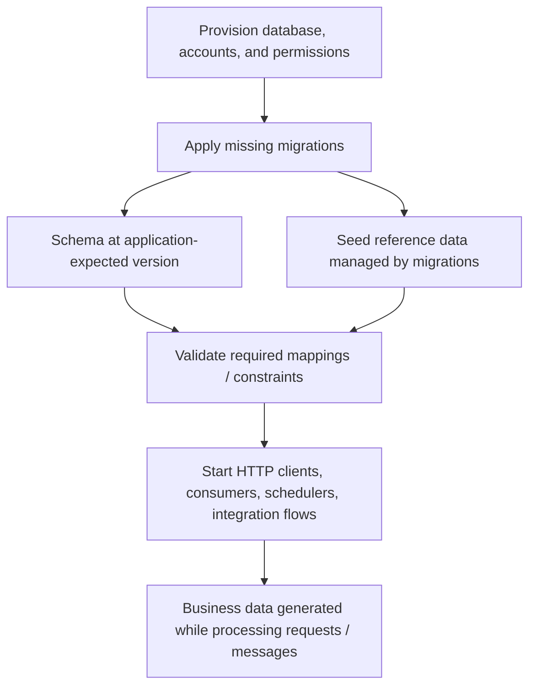

# Distinguishing Schema Creation, Data Seeding, and Database Migration

In a **Spring Boot Integration** application, the database typically holds multiple types of information: partner configurations, event processing state, deduplication records, business data, or tables used for a message store/outbox. When deploying an application, three operations that are easily lumped together are **schema creation**, **initial data loading (seeding)**, and **database version migration**. They are related but answer three different questions:

- **Schema creation:** What structure must exist for the application to store and read data?
- **Data loading:** What initial records must exist for the application to operate?
- **Migration:** How do we transition a running database from an old version to a new version in a controlled manner?

Clearly distinguishing these three tasks helps an integration service start up predictably, deploy repeatably, avoid data loss, and reduce errors when multiple application versions operate concurrently.

## 1. Three Concepts and Responsibility Boundaries

| Operation | Primary Target | Example | When Performed | What Must Be Guaranteed |
| --- | --- | --- | --- | --- |
| **Schema creation** | Tables, columns, keys, indexes, constraints, sequences | Creating `inbound_event`, unique key on `(partner_code, external_event_id)` | When standing up an empty database or creating a new structure | Structure is compatible with the application |
| **Initial data loading** (data initialization/seed) | Baseline data rows | Inserting an event type catalog or default configuration | When an environment requires an initial dataset | No duplicates created, no arbitrary overwriting of operational data |
| **Migration** (schema/data migration) | History of structural changes **and sometimes data changes** | Adding columns, backfilling old data, creating new indexes | On every release with changes that must be applied to an existing DB | Proper ordering, traceability, safety with existing data |

**Terminology note:** Schema creation and seeding can be *executed via migrations*. For example, the first migration creates the tables, and the second inserts a fixed catalog. Nevertheless, the **purpose** of the three operations remains distinct. Do not confuse the execution tool with the type of change.

An example close to an integration flow: when receiving a webhook from a partner, the application writes the event to the `inbound_event` table and uses a unique constraint to prevent reprocessing the same event ID. **Creating the table and unique constraint** belongs to schema structure; **adding the catalog of supported event types** belongs to seeding; when it is necessary to **populate source system information for already stored events**, that is a migration on a database that already contains data.

## 2. Data Lifecycle in a Spring Boot Service



Here there are two forms of "initialization" that must not be confused:

1. **Initializing a new environment:** May require creating all tables, indexes, and standard catalogs from an empty database.
2. **Starting an application process:** Often happens multiple times a day or when scaling additional replicas. It does not mean dropping tables, recreating tables, or reinserting all records.

If a consumer reads messages right as the application starts up, before the idempotency state table exists, the flow will fail. Therefore, mandatory structures must be ready **before** the application receives traffic or consumes messages. In a system with multiple replicas, schema updates must be even more carefully controlled per deployment version.

## 3. Schema Creation: Defining the Data Structure

The schema of an integration application may include an inbound event table, a processing state table, an outbox table, a partner configuration table, foreign keys, and indexes to support queries. The example below uses **PostgreSQL**; the `JSONB`, `TIMESTAMPTZ`, and identity syntax must be adjusted if using another database.

```sql
CREATE TABLE integration_event_type (
    code         VARCHAR(40) PRIMARY KEY,
    description  VARCHAR(160) NOT NULL
);

CREATE TABLE inbound_event (
    id                 BIGINT GENERATED BY DEFAULT AS IDENTITY PRIMARY KEY,
    partner_code       VARCHAR(80) NOT NULL,
    external_event_id  VARCHAR(128) NOT NULL,
    event_type_code    VARCHAR(40) NOT NULL
                       REFERENCES integration_event_type(code),
    payload            JSONB NOT NULL,
    processing_status  VARCHAR(24) NOT NULL DEFAULT 'RECEIVED',
    received_at        TIMESTAMPTZ NOT NULL DEFAULT CURRENT_TIMESTAMP,

    CONSTRAINT uq_inbound_event_partner_external
        UNIQUE (partner_code, external_event_id)
);

CREATE INDEX ix_inbound_event_status_received
    ON inbound_event (processing_status, received_at);
```

In this structure:

- `PRIMARY KEY` identifies the internal record.
- `FOREIGN KEY` prevents an event from referencing an invalid type.
- `UNIQUE (partner_code, external_event_id)` is a layer of protection against resent webhooks. The application must still handle unique key conflicts properly; the constraint alone does not replace the entire idempotency logic.
- The index supports finding unprocessed events; the final choice of indexes must be based on actual queries and data volume.

### Hibernate can create schemas, but when should it be used?

JPA/Hibernate relies on `@Entity` classes to compare or generate part of the database structure, depending on the value of `spring.jpa.hibernate.ddl-auto`:

| Value | Main Behavior | Recommendation |
| --- | --- | --- |
| `none` | Does not ask Hibernate to manage DDL | When the schema is managed by another tool |
| `validate` | Checks structure related to entity mappings; does not create or alter | Suitable when production uses Flyway/Liquibase |
| `update` | Attempts to adjust schema according to entities | Avoid for managing production changes because it is hard to control and trace |
| `create` | Recreates Hibernate-managed structures on startup; may delete existing data | Only consider in isolated test environments |
| `create-drop` | Creates schema at runtime and cleans up when `EntityManagerFactory` closes | Useful for short-lived tests, do not use with data that must be kept |

`validate` does **not** guarantee that all indexes, triggers, tables outside entity mappings, or integration contracts are correct. An application using a Spring Integration JDBC Message Store may require adapter-specific tables; these tables must also be created and governed according to the adapter's documentation/compatible DDL, rather than assuming Hibernate will create them.

The default for `ddl-auto` can vary depending on the database type and whether a migration tool is present. In a real project, you should **declare it explicitly** to avoid behavior changes when switching profiles or adding dependencies.

## 4. Initial Data Loading: Distinguishing Seed Data and Operational Data

Seed data is the dataset **needed before business processing begins**. In an integration service, reasonable examples include event type catalogs, standard statuses, default capability lists, or stable technical configurations. Conversely, access tokens, order data, received messages, consumption checkpoints, retry states, and partner details that have been modified operationally **should not be re-seeded on every startup**.

Example of loading two reference event types into the created table:

```sql
INSERT INTO integration_event_type (code, description)
VALUES
    ('PAYMENT_CONFIRMED', 'Partner confirmed payment'),
    ('SHIPMENT_UPDATED',  'Partner updated shipment')
ON CONFLICT (code) DO NOTHING;
```

The statement uses a stable business key (`code`) and avoids inserting duplicate rows if executed again. However, `ON CONFLICT DO NOTHING` **does not automatically update** the description if the record already has an old value. When a catalog needs to change per product requirements, describe the change with a new migration or a configuration mechanism with clear ownership.

It is necessary to distinguish three further cases:

- **Reference data:** Status codes, standard event types; can be stored via versioned migrations, controlled alongside source code.
- **Bootstrap configuration:** Initial configuration that is required, yet may change operationally later; requires a policy to preserve manual modifications.
- **Test/demo fixtures:** Fake partners, fake tokens, sample data; should live in test/development profiles and never be automatically loaded into production.

### Spring Boot SQL initialization

Spring Boot supports running SQL scripts such as `schema.sql` and `data.sql` via `spring.sql.init.*`. This mechanism is convenient for small demos, experiments, or simple environments, but **does not have a versioned migration history** like Flyway/Liquibase.

Example for a demo that manages structure via SQL scripts:

```yaml
spring:
  sql:
    init:
      mode: always
  jpa:
    hibernate:
      ddl-auto: none
```

With the configuration above, if `schema.sql`/`data.sql` exist in the default locations, the scripts are considered at startup. Because `mode: always` applies even when the database is not embedded, scripts must be designed to run repeatedly and safely, or the environment must be intentionally recreated. In production, do not enable this setting just to reload seed data.

Normally, Spring Boot runs SQL initialization scripts **before** initializing JPA. If a demo intentionally wants Hibernate to create tables before running `data.sql`, `spring.jpa.defer-datasource-initialization=true` can be used along with an appropriate DDL configuration. This is a path for experiments, **not** a reason to mix multiple schema creation mechanisms in production.

## 5. Migration: Managing Changes Across Versions

Suppose the first version of the application has already stored millions of webhook events. A new release needs to add a `source_system` field to distinguish HTTP, broker, or batch ingestion paths. If you drop and recreate the table, all processing history will be lost; if you only edit the entity and hope `ddl-auto=update` finishes the job, you have no control over backfill, table locking, or deployment order.

Migrations solve this with **ordered, history-tracked changes**. Flyway and Liquibase are two popular choices in the Spring Boot ecosystem. A project should choose **one authoritative source** for schema changes over the same group of data objects.

### Flyway example from an empty database to a new schema

A common directory structure:

```text
src/main/resources/
└── db/
    └── migration/
        ├── V1__create_integration_tables.sql
        ├── V2__seed_event_types.sql
        ├── V3__add_source_system.sql
        └── V4__backfill_and_require_source_system.sql
```

- `V1__create_integration_tables.sql` contains the DDL from section 3.
- `V2__seed_event_types.sql` contains the reference data insert statements from section 4.
- `V3__add_source_system.sql` expands the schema:

```sql
ALTER TABLE inbound_event
    ADD COLUMN source_system VARCHAR(50);
```

- `V4__backfill_and_require_source_system.sql` completes the constraint after existing data has valid values:

```sql
UPDATE inbound_event
SET source_system = 'partner-webhook'
WHERE source_system IS NULL;

ALTER TABLE inbound_event
    ALTER COLUMN source_system SET NOT NULL;
```

The V4 example is only appropriate when you know for sure that all historical data came from webhooks or that backfill rule has been verified. **Do not** use an arbitrary default value if actual data came from multiple sources. For large tables, a full-table `UPDATE` and `SET NOT NULL` can cause significant load or locking; backfill in batches, monitor progress, and deploy expansion before tightening constraints at the appropriate phase.

When run for the first time on an empty database, Flyway applies scripts `V1` → `V4` in order. On a database with existing history, it executes only unapplied migrations. Flyway stores status and checksums in a schema history table (usually `flyway_schema_history`), thereby knowing which versions have run.

Do not edit the contents of a versioned migration **that has already been applied** just because you want to change a column or fix seed data. Such changes can cause checksum validation to fail and make development environments diverge from staging/production. Create a new migration to change the current state.

### Configuring Spring Boot with Flyway

Include Flyway and the appropriate JDBC driver in the application's dependencies (with certain Flyway/database version combinations, a separate database support module is required). Typical configuration:

```yaml
spring:
  datasource:
    url: ${DB_URL}
    username: ${DB_USER}
    password: ${DB_PASSWORD}
  flyway:
    enabled: true
    locations: classpath:db/migration
  jpa:
    hibernate:
      ddl-auto: validate
  sql:
    init:
      mode: never
```

In this configuration, **Flyway creates and upgrades the schema**, Hibernate **validates entity mappings**, and default SQL initialization via `schema.sql`/`data.sql` is disabled to prevent two mechanisms from managing the schema simultaneously. Secrets come from environment variables or a secrets management system; do not put real passwords into YAML or migrations.

In the standard startup flow configured by Spring Boot, migrations are applied before JPA components that depend on the schema become ready. With multiple `DataSource`s or custom initialization configurations, you must verify the **exact target datasource/schema** and startup order rather than assuming all beans use the same database.

### What if you choose Liquibase?

Liquibase also lets you declare a sequence of `changeSet`s with IDs, authors, preconditions, and execution history, for example via XML/YAML/JSON/SQL. Spring Boot can configure it using `spring.liquibase.change-log`. There is no need to install both Flyway and Liquibase to do the same job; choose based on team standards, existing tooling, and deployment processes.

## 6. How Does Data Migration Differ from Seeding?

**Seeding** creates baseline records that *do not yet exist*. **Data migration** transforms records *that already exist* so that they are valid under the new version.

Examples:

| Scenario | Type of Work | Approach |
| --- | --- | --- |
| Empty database needs `PAYMENT_CONFIRMED` catalog | Seed | Insert reference record with a stable code |
| Rename code `DELIVERED_OK` to `SHIPMENT_DELIVERED` for stored records | Data migration | Use a conversion script, check references and compatibility |
| Add `source_system` column | Schema migration | `ALTER TABLE` and adjust code |
| Populate `source_system` for historical events | Data migration/backfill | Choose the right rule based on real data, run in batches if needed |
| Receive new webhooks while running in production | Operational data | Handled by integration flows, not part of seed/migration |

Migrations often contain both **DDL** and **DML**, but migrations should not be used to record individual business messages or synchronize operational data from partner systems. Live data must go through ingestion/integration flows with appropriate retries, monitoring, and deduplication controls.

### Expand → backfill → contract

When a system needs to be updated while old application versions are still running concurrently, a common approach is:

1. **Expand:** Add the new column as nullable or add new structures compatible with the old application.
2. **Transition:** Deploy code that can read old data while writing data in the new structure; if needed, perform controlled dual-write and reconciliation.
3. **Backfill:** Convert historical data in batches, monitoring counts, error records, and throughput.
4. **Contract:** Only after all instances have moved to the new code and the data satisfies the conditions, add `NOT NULL`, drop the old column, or stop the old write path.

Do not confuse **migration file order** with **application rollout order**. If V3, a backfill job, and V4 must occur in separate deployment stages, the release pipeline must represent that clearly. A V4 script running immediately after V3 may not give the backfill job time to finish. For databases that do not support transactions for all DDL operations, prepare a plan for handling partially executed migrations as well.

## 7. Choosing a Mechanism by Environment

| Environment / Goal | Preferred Management Approach | What to Avoid |
| --- | --- | --- |
| Short learning examples, disposable DB | `schema.sql`/`data.sql` or Hibernate `create-drop` | Keeping important data in an environment that auto-drops schemas |
| Unit tests not needing a real DB | Mocks or fake data stores suited to test scope | Inferring that mocked tests have validated real SQL |
| Integration tests for real JDBC flows | Run Flyway/Liquibase on an engine close to production, e.g. PostgreSQL Testcontainers | Testing only on H2 and assuming PostgreSQL has identical data types, transactions, and syntax |
| Staging / production | Versioned migrations + `ddl-auto=validate` or `none` depending on mapping | `create`, `create-drop`, `update` as the primary schema release mechanism |
| Partner data, tokens, checkpoints, or retries | Secure configuration, admin APIs, integration flows, controlled jobs | Re-seeding on restart causing state loss or overwriting operational decisions |

In a project where multiple services share a database, clearly define which service owns which tables. Two services independently running migrations that alter the same table easily cause race conditions and make data contracts hard to synchronize. A single migration stream or an orchestration process with clear ownership is required.

## 8. Common Risks and How to Handle Them

### 8.1. The same table is created multiple times

**Symptom:** Errors such as `relation already exists`, `table already exists`, or startup failure when SQL scripts and migrations both create tables.

**Possible cause:** Flyway is enabled while `schema.sql` still runs, or Hibernate is set to `create`/`update` on the same schema.

**Resolution:** Designate one tool to own DDL, disable other mechanisms per environment, and reconcile migration history with the actual structure. Avoid sprinkling `IF NOT EXISTS` indiscriminately to mask schema drift.

### 8.2. Seed data is inserted repeatedly or overwrites operational data

**Symptom:** Duplicate key errors on restart, partner configuration changes reverting to defaults, or demo records appearing in production.

**Resolution:** Use business keys, clearly define whether seed data should only be inserted when missing or allowed to update, separate demo fixtures from production migrations, and establish ownership for data that can be edited after initialization.

### 8.3. Modifying an old migration causes validation failure

**Symptom:** Flyway reports a checksum mismatch or validation failed in an environment where migrations already ran.

**Resolution:** Check history, restore the released migration's contents, and create a new versioned file for the desired change. Commands like `repair` should only be used when the actual state is fully understood and an incident recovery procedure is in place; do not use it to blindly mask errors.

### 8.4. New deployment runs before old records are compatible

**Symptom:** Adding a required column causes `NOT NULL` errors, old code writes without the column, consumers read unconverted states, or queries degrade due to a full-table backfill.

**Resolution:** Apply expand/backfill/contract, maintain backward compatibility during concurrent execution windows, and plan indexes and backfills according to data size. Measure lock duration and impact on integration flow throughput.

### 8.5. Multiple replicas or multiple connections to the database

When dozens of instances start simultaneously, each instance may attempt to check migrations. Flyway has history/synchronization mechanisms depending on the database and version, yet operational strategy must still account for locks, wait times, and restart policies. In systems requiring strict control, migrations can be run as a separate deployment step before scaling the application. With multiple `DataSource`s, verify the actual database Flyway connects to, the schema name, and DDL execution privileges.

## 9. Testing and Observing Initialization

A valuable integration test should use an **empty database**, run the application's actual migration chain, and verify both structure and initial data. Example with Spring Boot and JDBC:

```java
@SpringBootTest
class DatabaseInitializationIT {

    @Autowired
    JdbcTemplate jdbc;

    @Test
    void eventTypeSeedIsAvailableAfterMigrations() {
        Integer count = jdbc.queryForObject(
            """
            SELECT COUNT(*)
            FROM integration_event_type
            WHERE code IN ('PAYMENT_CONFIRMED', 'SHIPMENT_UPDATED')
            """,
            Integer.class
        );

        assertEquals(2, count);
    }
}
```

The test snippet uses JUnit 5 (`@Test`, `assertEquals`), Spring Boot Test, `JdbcTemplate`, and a configured test datasource. In a real project, use a database container matching production, configure migrations to run automatically in tests, and include tests for unique constraints and the ability to read legacy data after a version upgrade.

Before releasing, verify:

1. **From an empty database:** all migrations run successfully, required seed records exist, the application starts up, and it can process a sample webhook.
2. **From an older database version:** upgrading with the new migration preserves existing data; queries and adapters remain compatible.
3. **Repeatability:** restarting or scaling replicas does not insert duplicate data or recreate tables.
4. **Failure path:** failed migrations are detected before consumers begin processing; sufficient diagnostics exist to remediate and restart safely.
5. **Observability:** logs include migration name/version, duration, and outcome; alerts exist for startup failures, schema drift, and backfill backlogs.

Also observe business behavior: if a schema change slows down consumers or increases database write errors, seeing a migration result of `SUCCESS` is not enough. For webhooks and brokers, monitor processing latency, retry/dead-letter message counts, and duplication rates after deployment.

## 10. Production Design Checklist

- **Source of control:** designate exclusively Flyway or Liquibase to manage each schema; choose `ddl-auto=validate` where appropriate, and disable unintended SQL init scripts.
- **Data contracts:** every table/column/constraint change must consider HTTP endpoints, consumers, message stores, batch jobs, and running old application versions.
- **Data safety:** have tested backup/restore; evaluate table size, DDL locks, backfill duration, transactions, and rollback/roll-forward feasibility on the real database.
- **Owned seeding:** separate reference data from business data, use stable codes, and define explicit rules when records already exist.
- **Permissions and security:** the migration account has appropriate DDL permissions; the runtime account follows the principle of least privilege. Never put secrets in seed scripts.
- **Automated checks:** run migrations on test databases and representative schema/data copies; validate migration history before deployment.
- **Post-release monitoring:** verify schema version, application health, integration flow throughput, retry backlogs, and consistency of migrated data.

## 11. Self-Assessment Scenario

Suppose a Spring Boot service receives shipping events from an HTTP webhook, writes them to `inbound_event`, and forwards them via a message broker. Three months later, the team requires adding `source_system`, while also adding `RETURN_REQUESTED` to the event type catalog.

Classify the tasks:

1. **Adding the `source_system` column:** schema migration, preferably added as nullable so old versions can continue operating.
2. **Populating the source for historical events:** data migration/backfill, using only rules that real data can substantiate.
3. **Adding `RETURN_REQUESTED` to the catalog:** updating reference data via a new migration version, without modifying the already-executed seed migration file.
4. **Writing newly received events:** runtime responsibility of the integration flow, with deduplication controlled via `(partner_code, external_event_id)`.
5. **Enforcing `source_system` not null:** contract step after backfill completes and all relevant producers/consumers are ready.

Thus, **schema creation** answers what the initial structure is, **seeding** answers what initial reference data must exist, and **migration** records how to move from the current database state to the new state without disruption or data loss. In a Spring Boot Integration system, all three activities must be designed alongside startup order, contract compatibility, deduplication, and observability of the entire integration flow.
