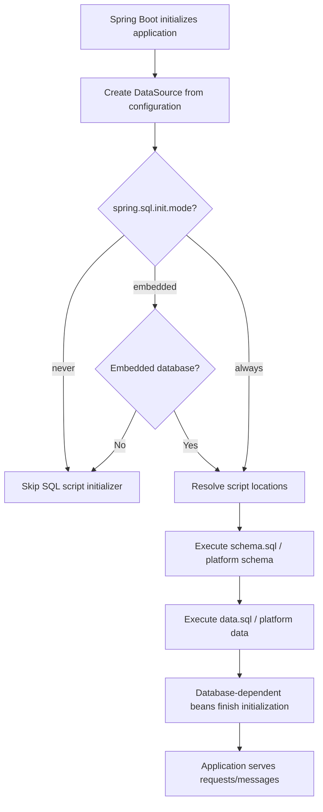
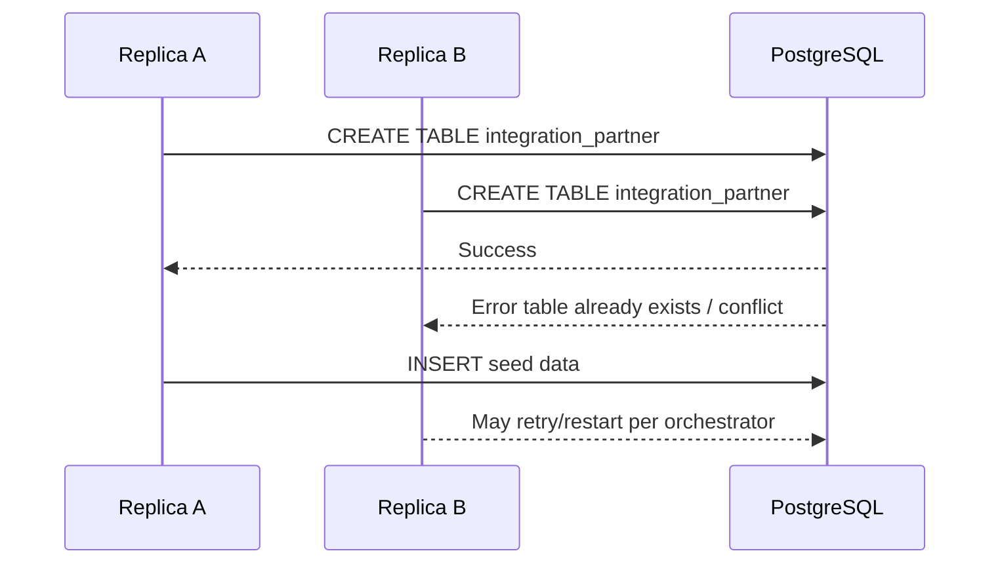
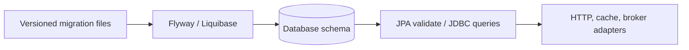
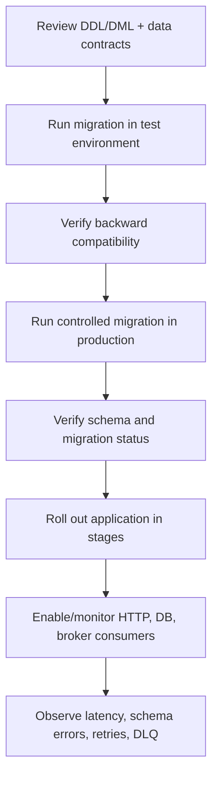

# `schema.sql`, `data.sql`, and `spring.sql.init.*` Configuration

## 1. The Problem: Connecting to the Database Without Required Data

In an integration system built with Spring Boot, a processing flow may require a partner code mapping table, an event deduplication table, an outbox table, or reference data before accepting HTTP requests and broker messages. A successful JDBC configuration only proves that the application **can connect** to the database; it does not prove that the schema and initial data already exist.

For example, an ordering service calls a catalog API to look up products, saves the order in PostgreSQL, and then publishes `OrderCreated` to a broker. When the service starts on an empty database, queries like:

```sql
SELECT partner_code, base_url
FROM integration_partner
WHERE enabled = TRUE;
```

will fail if the `integration_partner` table has not been created yet. Even when the table exists, the system may malfunction if required partner configuration records are missing.

Spring Boot provides **script-based SQL initialization** to run SQL files on application startup:

- `schema.sql` typically contains **DDL**: `CREATE TABLE`, `CREATE INDEX`, and `ALTER TABLE` where appropriate.
- `data.sql` typically contains **DML**: `INSERT` statements for initial records or sample data.
- The `spring.sql.init.*` property group controls when scripts run, where scripts are read from, how errors are handled, and what encoding/separator to use.

This mechanism is suitable for sample applications, tests, and certain simple initialization scenarios. It is **not a default replacement for a versioned migration workflow** on a database that already contains production data.

In the **SPRING_BOOT_INTEGRATION** module, database initialization should be viewed as part of the integration lifecycle: schema governance, data contracts, deployment ordering, transactional consistency, event deduplication, and startup error observability.

### Learning Objectives

After this lesson, you will be able to:

1. Explain when Spring Boot runs `schema.sql` and `data.sql`, and how embedded database detection works.
2. Create a complete `schema.sql`/`data.sql` example with Spring JDBC and H2.
3. Use key `spring.sql.init.*` properties and platform-specific scripts.
4. Distinguish the ordering of script initialization from Hibernate/JPA schema generation.
5. Evaluate when to move to Flyway/Liquibase and why you should not run multiple schema management mechanisms simultaneously.
6. Write startup tests, troubleshoot SQL errors, anticipate multi-instance startup issues, and deploy safely.

> **Version note:** Examples are based on Spring Boot 3.x, Java 17+, and Spring JDBC. Since Spring Boot 2.5, configuration properties have been standardized around `spring.sql.init.*`; older Boot projects may use different property names. Always check the documentation for the exact Boot version you deploy when upgrading.

## 2. Spring Boot's Automatic SQL Initialization Mechanism

At a high level, Spring Boot detects a suitable `DataSource` and provides a script initializer when auto-configuration conditions are met. Under standard configuration, scripts are read from the classpath:

```text
src/main/resources/
  ├── application.yml
  ├── schema.sql
  └── data.sql
```

Startup flow:



In the diagram, the schema-before-data order is a key characteristic, while the relative initialization order with JPA/Hibernate can be changed with a dedicated property covered in section 7.

### 2.1. Default `mode=embedded`

If `spring.sql.init.mode` is not specified, Spring Boot normally executes scripts automatically only for **embedded databases** such as H2, HSQLDB, or Derby. With an external PostgreSQL/MySQL database, simply having `schema.sql` on the classpath **does not mean** it will run automatically.

| `spring.sql.init.mode` | Effect | Common Use Case |
| --- | --- | --- |
| `embedded` | Only initializes when the database is detected as embedded; this is the default | Learning examples, H2 tests |
| `always` | Runs the initializer against the configured database when scripts exist | Demos on PostgreSQL, controlled environments |
| `never` | Disables Boot's SQL script initialization | Production using Flyway/Liquibase or platform-managed schemas |

**Warning:** `mode=always` means script execution can occur **every time an application instance starts**. It is not a one-time `CREATE DATABASE` command run only during initial system installation.

### 2.2. Script Sources and Optionality

The default locations correspond to patterns like:

```text
optional:classpath*:schema.sql
optional:classpath*:data.sql
```

The `optional:` prefix allows missing files without treating it as a configuration error; `classpath*:` can locate multiple matching resources across the classpath. Therefore:

- Not having `schema.sql` or `data.sql` **does not necessarily** cause the application to fail.
- If the file is present but contains invalid SQL, the initializer can still fail.
- When configuring custom names/locations, understand the difference between "no script present" and "script has errors."
- If multiple modules/JARs place identically named resources on the classpath, inspect which files are actually discovered. For production applications, declare explicit paths.

In integration applications, keep **database source and environment configuration** separate from **table construction logic** to avoid unintended schema changes when scaling services.

## 3. Complete Example: Creating Tables and Sample Data with H2

Build a small Spring Boot application that stores a list of partner services and system codes in an embedded database. This is reference data that an HTTP adapter can use when selecting endpoints.

### 3.1. Maven Dependencies

```xml
<!-- pom.xml: dependencies section -->
<dependencies>
    <dependency>
        <groupId>org.springframework.boot</groupId>
        <artifactId>spring-boot-starter-jdbc</artifactId>
    </dependency>
    <dependency>
        <groupId>com.h2database</groupId>
        <artifactId>h2</artifactId>
        <scope>runtime</scope>
    </dependency>
    <dependency>
        <groupId>org.springframework.boot</groupId>
        <artifactId>spring-boot-starter-test</artifactId>
        <scope>test</scope>
    </dependency>
</dependencies>
```

The example assumes the POM uses the Spring Boot parent or corresponding BOM. Therefore, Boot-managed dependencies do not need explicit versions. `spring-boot-starter-jdbc` provides Spring JDBC and an appropriate connection pool; H2 is an embedded database for demonstration, **not a default substitute for production PostgreSQL**.

### 3.2. Create `src/main/resources/schema.sql`

```sql
CREATE TABLE integration_partner (
    partner_code VARCHAR(40) PRIMARY KEY,
    display_name VARCHAR(120) NOT NULL,
    base_url VARCHAR(255) NOT NULL,
    enabled BOOLEAN NOT NULL
);

CREATE TABLE inbound_event_receipt (
    event_id VARCHAR(80) PRIMARY KEY,
    source_system VARCHAR(40) NOT NULL,
    received_at TIMESTAMP NOT NULL
);

CREATE INDEX idx_inbound_receipt_source
    ON inbound_event_receipt (source_system);
```

Explanation:

- `integration_partner`: maps service codes to partner URLs so adapters know where to send HTTP calls.
- `inbound_event_receipt`: example schema storing identifiers of received messages. The `event_id` primary key helps prevent duplicate processing, but **saving the receipt and performing the business side effect must share an appropriate transaction boundary** to truly guarantee correctness.
- Statements end with `;`, the standard default separator for SQL scripts.
- On a fresh H2 database, table creation succeeds; on a database with pre-existing tables, re-running these `CREATE TABLE` statements may fail.

### 3.3. Create `src/main/resources/data.sql`

```sql
INSERT INTO integration_partner
    (partner_code, display_name, base_url, enabled)
VALUES
    ('CATALOG', 'Catalog Service', 'https://catalog.example.test', TRUE);

INSERT INTO integration_partner
    (partner_code, display_name, base_url, enabled)
VALUES
    ('SHIPPING', 'Shipping Service', 'https://shipping.example.test', FALSE);
```

The two `.example.test` addresses are mock endpoints only. Never put real credentials, tokens, API keys, account numbers, or customer data in `data.sql`. Environment-specific configuration values such as production URLs are better suited for a configuration/secret manager; here they only illustrate initial data.

**Execution order:** `schema.sql` creates the tables first, and `data.sql` inserts rows afterward. If `data.sql` references a table or column that does not exist yet, the initializer fails unless ignore-errors mode is enabled.

### 3.4. Configure `application.yml`

```yaml
spring:
  datasource:
    url: "jdbc:h2:mem:integrationdb;DB_CLOSE_DELAY=-1"
    driver-class-name: org.h2.Driver
    username: sa
    password: ""

  sql:
    init:
      mode: always
      encoding: UTF-8
      schema-locations: classpath:schema.sql
      data-locations: classpath:data.sql
      continue-on-error: false
```

`DB_CLOSE_DELAY=-1` keeps the in-memory H2 database alive until the JVM shuts down, rather than closing it when the last connection is released. This detail is H2-specific; do not copy it into a PostgreSQL JDBC URL.

With H2, you can **omit `mode: always`** to use the default `embedded`. The example retains `always` so readers can see where to configure this option, not to recommend enabling it unconditionally across all environments.

### 3.5. Reading Data with `JdbcTemplate`

```java
// src/main/java/example/integration/PartnerDirectory.java
package example.integration;

import org.springframework.jdbc.core.JdbcTemplate;
import org.springframework.stereotype.Repository;

import java.util.List;

@Repository
public class PartnerDirectory {

    private final JdbcTemplate jdbcTemplate;

    public PartnerDirectory(JdbcTemplate jdbcTemplate) {
        this.jdbcTemplate = jdbcTemplate;
    }

    public List<PartnerEndpoint> findEnabledPartners() {
        return jdbcTemplate.query(
                """
                SELECT partner_code, base_url
                FROM integration_partner
                WHERE enabled = TRUE
                ORDER BY partner_code
                """,
                (rs, rowNum) -> new PartnerEndpoint(
                        rs.getString("partner_code"),
                        rs.getString("base_url")));
    }
}

record PartnerEndpoint(String partnerCode, String baseUrl) {
}
```

Once the application starts successfully, calling `findEnabledPartners()` returns the `CATALOG` record because `SHIPPING` has `enabled = FALSE`. Spring Boot executes the scripts via the datasource initialization mechanism; the business adapter only needs to use `JdbcTemplate` without executing DDL on every call.

In production, **dynamic URLs retrieved from a database** must have strict data source controls, edit permissions, and an allowlist of permitted destinations to avoid SSRF risks. The sample data in this lesson is not sufficient to design security for an arbitrary URL-calling system.

## 4. Key `spring.sql.init.*` Properties

| Property | Notable Values or Default | When to Use |
| --- | --- | --- |
| `spring.sql.init.mode` | `embedded` default; `always`; `never` | Controls enabling/disabling initialization by database type/environment |
| `spring.sql.init.schema-locations` | Defaults to finding `schema.sql` on classpath via optional pattern | Points to custom DDL scripts |
| `spring.sql.init.data-locations` | Defaults to finding `data.sql` via optional pattern | Points to initialization data scripts |
| `spring.sql.init.platform` | Platform value like `postgresql`, `h2` depending on config | Supports platform-suffixed scripts |
| `spring.sql.init.encoding` | Can be set to `UTF-8` | Avoids character corruption when scripts contain non-ASCII/Vietnamese text |
| `spring.sql.init.separator` | Commonly `;` | Statement delimiter; use caution with procedural SQL |
| `spring.sql.init.continue-on-error` | `false` default | Decides whether to continue or halt when a script fails |
| `spring.sql.init.username`, `password` | Environment-dependent, when supported by the initializer | When separate credentials are needed for scripts; never expose secrets in source |

Actual property usage also depends on the Boot version, `DataSource` or `ConnectionFactory` type, and the selected initializer configuration. Check the Spring Boot configuration metadata for your **exact version** if upgrading the system.

### 4.1. `mode` is not a one-time migration switch

If the application runs against PostgreSQL with:

```yaml
spring:
  sql:
    init:
      mode: always
```

then every time the service starts, the initializer may attempt to execute the present scripts. If `schema.sql` contains `CREATE TABLE integration_partner (...)`, the second startup against the same database will usually fail with "relation already exists."

Therefore:

- **Tests / fresh H2 databases:** easy to use `schema.sql`/`data.sql`.
- **Demos or controlled provisioning tasks:** `always` may be used if scripts are designed accordingly and the startup lifecycle is well understood.
- **Production with long-lived schemas:** prefer versioned migrations and a separate deployment workflow; set `mode: never` if not using the script initializer.

### 4.2. `schema-locations` and `data-locations`

When you want explicit paths:

```yaml
spring:
  sql:
    init:
      schema-locations:
        - classpath:db/init/base-schema.sql
        - classpath:db/init/extra-indexes.sql
      data-locations:
        - classpath:db/init/reference-data.sql
```

The order of declared resources matters because tables must exist before indexes are created or data is inserted. Avoid designing one file to depend on implicit state from another library on the classpath. When using locations **without the `optional:` prefix**, a missing resource can cause a startup failure, helping detect missing files in packaging.

**Do not turn resource initializers into a per-request rerun mechanism.** These scripts belong to the application startup lifecycle; modifying business data after startup must go through repositories/services, migrations, or dedicated jobs.

### 4.3. Database platform-specific scripts

Different SQL engines can differ in identity columns, UUIDs, JSON types, expressions, indexes, or upsert syntax. Spring Boot can select script names based on `spring.sql.init.platform`:

```text
src/main/resources/
  schema.sql
  data.sql
  schema-h2.sql
  data-h2.sql
  schema-postgresql.sql
  data-postgresql.sql
```

Example test profile:

```yaml
spring:
  sql:
    init:
      platform: h2
```

Or a PostgreSQL environment intentionally using SQL init:

```yaml
spring:
  sql:
    init:
      mode: always
      platform: postgresql
```

When using platform-suffixed scripts, pay attention to how **generic scripts and platform-specific scripts** are combined according to your Boot version's rules; avoid creating the same table twice in `schema.sql` and `schema-postgresql.sql`. For workflows requiring strict ordering, specifying explicit `schema-locations` and `data-locations` is usually clearer.

**Do not assume H2 simulates PostgreSQL completely.** DDL, constraints, transactions, data types, and SQL syntax can differ even in compatibility mode. Critical migrations must be tested against the production database engine and version.

### 4.4. `continue-on-error` and `separator`

```yaml
spring:
  sql:
    init:
      continue-on-error: false
      separator: ";"
      encoding: UTF-8
```

Setting `continue-on-error: false` lets the application fail fast on invalid SQL, missing tables, duplicate data, or insufficient permissions. Setting `true` can allow startup to proceed with a **partially created** schema/dataset, causing failures later during requests or consumer execution. Do not use `true` as a workaround for "table already exists."

If SQL contains procedural blocks or `;` inside bodies, a simple delimiter may cause misparsing depending on the parser/driver. For stored procedures, functions, triggers, or migrations with complex syntax, use a migration tool that supports appropriate delimiters instead of forcing all DDL into `schema.sql`.

## 5. Execution Order and Common Pitfalls

With a single database and standard SQL initializer:

```text
Create DataSource / ConnectionFactory
          |
          v
       schema.sql
          |
          v
        data.sql
          |
          v
 Initialize database-dependent beans
          |
          v
      Application ready
```

The **schema before data** order is the basis for newly created tables to receive seed records. However, do not infer that Spring Boot automatically validates the business logic of those rows: if a foreign key is missing or business data is wrong, the script can still execute.

### 5.1. Script-based table and data initialization is not a single distributed transaction

If a script executes several DDL/DML statements and the last statement fails, the database may be left with **partial** changes. Rollback capability depends on the engine, DDL transaction semantics, autocommit, and how the script is executed. Do not treat `schema.sql` + `data.sql` as an atomic migration that can be rolled back simply by restarting.

This is especially important when tables are part of an integration flow:

- An inbox deduplication table missing its unique constraint can allow a message to be processed multiple times.
- An outbox table created without an index or status column can stall the publisher.
- Missing partner mapping records can route data to the wrong service if fallback code is unsafe.

### 5.2. Multiple instances starting concurrently

Suppose three replicas of a service start simultaneously with `mode=always` against the **same PostgreSQL database**. All three may attempt to execute `CREATE TABLE`/`INSERT`:



Even `CREATE TABLE IF NOT EXISTS` does not make every seed script safe under parallel execution: two `INSERT` statements can still collide on a unique key, and the schema might not be at the expected version. **Production should use a migration process with locking/coordination and migration history**, and only then scale the number of application instances.

## 6. Relationship Between `schema.sql`, `data.sql`, and Hibernate/JPA

This is the most frequent source of errors when an application includes `spring-boot-starter-data-jpa`.

### 6.1. Different schema creation mechanisms

| Mechanism | Who Creates the Schema? | Primary Property | Characteristics |
| --- | --- | --- | --- |
| Script initialization | SQL written by you | `spring.sql.init.*` | Fine-grained control over DDL/DML statements; works well with JDBC |
| Hibernate schema generation | Hibernate based on entity mappings | `spring.jpa.hibernate.ddl-auto` | Creates/updates/validates schema from entities; not a versioned migration |
| Versioned migration | Flyway or Liquibase | Flyway/Liquibase configuration | Maintains change history, enforces ordering, and detects migration errors |

Common Hibernate values:

- `none`: Hibernate neither creates nor alters the schema.
- `validate`: checks whether the existing schema matches entity mappings as supported by Hibernate; does not create tables.
- `create`/`create-drop`: recreates the schema from entities (with `create-drop`, also drops it when closing the SessionFactory per lifecycle); **can lose data**.
- `update`: attempts to adjust the schema based on entities, but does not replace explicit migrations and can be unpredictable.

Spring Boot has heuristics to infer a default `ddl-auto` based on database type and presence of a schema management tool. Do not rely on this implicit default for production; specify the value explicitly per environment.

### 6.2. Approach A — scripts manage the schema, Hibernate only validates

When explicitly writing `schema.sql` matching JPA entities, configure:

```yaml
spring:
  sql:
    init:
      mode: always
  jpa:
    hibernate:
      ddl-auto: validate
```

In this model, the script must create all tables, columns, and constraints that Hibernate expects; `validate` will not fix errors automatically. This configuration is only suitable when you understand schema compatibility on the specific database. For production PostgreSQL, replace `schema.sql` with versioned migrations and keep `ddl-auto: validate` or `none` according to project policy.

### 6.3. Approach B — Hibernate creates the schema, `data.sql` loads data

If you want JPA/Hibernate to create tables in a test environment and then run `data.sql`, you must defer datasource script initialization until **after** Hibernate creates the schema:

```yaml
spring:
  datasource:
    url: jdbc:h2:mem:jpa_example
  jpa:
    hibernate:
      ddl-auto: create-drop
    defer-datasource-initialization: true
  sql:
    init:
      mode: always
```

Then:

```text
DataSource
   → Hibernate creates schema from @Entity
   → data.sql INSERTs data compatible with Hibernate's schema
   → application starts
```

**Do not have `schema.sql` also `CREATE TABLE` for the same tables Hibernate just created** when using this model. A simple test setup is to provide only `data.sql` and let Hibernate build the schema in an empty H2 database.

`spring.jpa.defer-datasource-initialization=true` only changes the ordering between SQL script initialization and JPA initialization; it does not turn scripts into versioned migrations and does not guarantee schema compatibility with production.

### 6.4. What to avoid

```yaml
spring:
  sql:
    init:
      mode: always
  jpa:
    hibernate:
      ddl-auto: update
```

This snippet is not automatically a syntax error, but if both scripts and Hibernate are allowed to alter tables, it becomes difficult to know which side owns the schema, which order wins, and why errors appear only in one environment. Establish **one primary mechanism that owns DDL**, while other mechanisms only read or validate when appropriate.

## 7. When to Choose Flyway or Liquibase?

Suppose the application is already in production with the `integration_partner` table. Two months later, you need to:

1. Add `connect_timeout_ms` with an appropriate default value.
2. Backfill data for active partners.
3. Add a new unique constraint.
4. Upgrade instances without breaking older running versions.

A new `schema.sql` cannot answer: "Which changes have already been applied to this database and what version is it on?" When multiple environments/instances live over time, use a migration tool:

| Aspect | `schema.sql`/`data.sql` | Flyway/Liquibase |
| --- | --- | --- |
| Primary purpose | Simple startup initialization | Managing schema/data changes over time |
| Version history | No dedicated migration ledger | Tool-managed metadata history table |
| Run only new changes | Does not manage versions automatically | Compares history and executes only pending migrations |
| Multi-instance startup coordination | No dedicated migration lock/version ledger | Database-appropriate coordination/locking and history |
| Rollback | Depends on scripts and manual intervention | Tool-supported strategies exist, though not every change can auto-rollback |
| Long-lived production schema | Prone to rerun issues and drift | Better suited when properly governed |

**Do not combine** SQL script initialization with Flyway/Liquibase to jointly create or modify a production schema. A minimal specialized data initializer might be used in rare architectures, but ordering and ownership must be proven explicitly; by default, choose **one primary tool**.

### Flyway example (illustrating transition)

```text
src/main/resources/
  db/migration/
    V1__create_integration_partner.sql
    V2__add_partner_timeout.sql
    V3__seed_default_partner_codes.sql
```

```sql
-- V2__add_partner_timeout.sql, PostgreSQL example
ALTER TABLE integration_partner
ADD COLUMN connect_timeout_ms INTEGER NOT NULL DEFAULT 2000;
```

Each migration represents a **delta from the previous state to the next state**, unlike a `CREATE TABLE` script meant for an empty database. When using Flyway, manage dependencies according to the Spring Boot version and matching database plugin/driver; apply migrations to staging first and verify upgrade paths on realistic data.

A common configuration once Flyway is chosen:

```yaml
spring:
  sql:
    init:
      mode: never
  jpa:
    hibernate:
      ddl-auto: validate
```

Responsibility diagram:



Schema versioning is also part of the **contract between service versions**. During rolling updates, the new schema must often remain temporarily compatible with both old and new instances.

## 8. Seed Data, Reference Data, and Idempotency

Not every `INSERT` has the same meaning:

| Data Category | Example | Usually Reasonable Management |
| --- | --- | --- |
| Demo/test data | Two mock partners with `.example.test` URLs | `data.sql` under a test/demo profile |
| Stable reference data | Status catalogs or mandatory business codes | Versioned migration or explicit provisioning process |
| Sensitive environment config | API keys, passwords, production endpoints | Secret manager/config management, never seeded from source |
| Live business data | Orders, events, transaction states | Written through services/repositories with proper transactions and contracts |
| Inbox/outbox event data | Message IDs, processing timestamps, publish status | Written during message/transaction processing, not startup seed data |

### 8.1. Why does `data.sql` easily fail on the second run?

Example:

```sql
INSERT INTO integration_partner
    (partner_code, display_name, base_url, enabled)
VALUES
    ('CATALOG', 'Catalog Service', 'https://catalog.example.test', TRUE);
```

If `partner_code = 'CATALOG'` already exists, the database returns a duplicate primary key error. The solution is not setting `continue-on-error=true`; that hides other errors too. Choose among:

- Run the script only on a **fresh database** and do not re-run it on persistent data environments.
- Move seed data into a versioned migration so it runs only when reaching that specific version.
- For provisioning tasks that must be repeatable, use **database-specific** upsert syntax and a controlled overwrite policy.

PostgreSQL example, engine-specific syntax:

```sql
INSERT INTO integration_partner
    (partner_code, display_name, base_url, enabled)
VALUES
    ('CATALOG', 'Catalog Service', 'https://catalog.example.test', TRUE)
ON CONFLICT (partner_code) DO NOTHING;
```

This statement avoids creating duplicate rows, yet **does not update old data**, and does not resolve races between multiple DDL/seed steps on its own. If URL values vary by environment or operators have modified a record, an overwriting upsert can cause an incident. You must define **who owns the data** and the change policy before choosing `DO NOTHING` or `DO UPDATE`.

### 8.2. Connection to duplicate message handling

The `inbound_event_receipt` table in the example has a primary key on `event_id`. This is the foundation of the **inbox pattern**, yet creating the schema alone does not prevent bugs:

```text
Consumer receives event E
  → writes receipt E successfully
  → updating the order fails
  → message is redelivered
  → sees receipt E already exists, skips
  → order is never updated
```

With a transactional database, place the receipt insert and business update in the **same appropriate transaction**, or design explicit processing states and recovery. Do not use SQL startup initializers to record in-flight event status.

Similarly, an outbox table must have an appropriate schema, and outbox rows are inserted inside the business transaction. Flyway/scripts are responsible for **creating the structure**, while the service is responsible for **executing business operations**.

## 9. Environment-Specific Configuration: Local, Test, Production

A clear organization is to enable SQL initialization in local/test and disable it in production where formal migrations are used.

```yaml
# application.yml: safe default for long-lived databases
spring:
  sql:
    init:
      mode: never
```

```yaml
# application-local.yml: experimental H2 environment
spring:
  datasource:
    url: "jdbc:h2:mem:local_integration;DB_CLOSE_DELAY=-1"
    username: sa
    password: ""
  sql:
    init:
      mode: always
      schema-locations: classpath:schema.sql
      data-locations: classpath:data.sql
```

```yaml
# application-prod.yml: production managed by Flyway/Liquibase
spring:
  sql:
    init:
      mode: never
  jpa:
    hibernate:
      ddl-auto: validate
```

If the production application uses only Spring JDBC, `spring.jpa.*` is unnecessary and the JPA block can be omitted. The local example assumes H2-compatible `schema.sql`/`data.sql` resources are packaged with the application.

Important notes:

1. **Check the actual active profile** at runtime to avoid deploying to production with `local` or `mode: always` accidentally enabled.
2. Never put production credentials in `application-prod.yml`; use a secret manager, environment variables, or an equivalent secure mechanism.
3. Some organizations manage schemas via a migration job separate from the application. In that case, service readiness must depend on migration completion rather than competing for DDL privileges.
4. If there are multiple datasources, do not assume Boot initializes **all** datasources with the same scripts. Identify the target datasource/initializer and each database's initialization responsibility.

## 10. Testing `schema.sql` and `data.sql`

### 10.1. Fast integration test with H2

When using the `schema.sql`/`data.sql` and `JdbcTemplate` sample from section 3, you can write:

```java
package example.integration;

import org.junit.jupiter.api.Test;
import org.springframework.beans.factory.annotation.Autowired;
import org.springframework.boot.test.context.SpringBootTest;
import org.springframework.jdbc.core.JdbcTemplate;
import org.springframework.test.context.ActiveProfiles;

import static org.assertj.core.api.Assertions.assertThat;

@SpringBootTest
@ActiveProfiles("local")
class SqlInitializationTest {

    @Autowired
    JdbcTemplate jdbcTemplate;

    @Test
    void loadsPartnerReferenceData() {
        Integer total = jdbcTemplate.queryForObject(
                """
                SELECT COUNT(*)
                FROM integration_partner
                WHERE partner_code = ?
                  AND enabled = TRUE
                """,
                Integer.class,
                "CATALOG");

        assertThat(total).isEqualTo(1);
    }
}
```

This test verifies at least three things:

- Spring Boot creates the proper H2 datasource according to the profile.
- `schema.sql` executed to create the tables.
- `data.sql` inserted the reference records the adapter needs to read.

`@SpringBootTest` requires the project to have a `@SpringBootApplication` class/appropriate Boot configuration. If tests share a developer `local` profile, consider creating a standalone `test` profile to avoid depending on developer-local settings.

### 10.2. When is H2 not enough?

If production uses PostgreSQL/MySQL/Oracle, H2 does not adequately verify:

- Vendor-specific DDL/constraints and syntax.
- Separation of privileges between migration user and runtime user.
- Locks, transaction isolation, collations, and timestamp/timezone handling.
- Behavior of `ON CONFLICT`, JSON, UUIDs, functions, or partitions.
- Timeouts, TLS, connection pooling, and startup races when multiple instances start concurrently.

There should be integration tests running against the **database engine and version matching production**, for example using Testcontainers or a managed CI instance. For migrations, test both **fresh creation** and **upgrading from a previous schema/version**, not just an empty database.

### 10.3. Testing failures and repeatability

Valuable scenarios:

| Scenario | Observed Outcome Needed |
| --- | --- |
| Empty database, valid scripts | Application context initializes successfully; tables and seed data exist |
| Script missing at required location | Startup fails clearly instead of silently skipping |
| SQL syntax error | Startup fails when `continue-on-error=false` |
| Rerun on a database with existing tables/data | Clearly reveals non-idempotency; choose migration or seed strategy |
| Hibernate creates schema, `data.sql` runs first | Table not found error; verify `defer-datasource-initialization` |
| Deploy new migration with old instances | Schema remains compatible throughout rolling update window |
| Reference data update | Clear update/do-not-overwrite policy with business tests |

For startup failures, tests should assert helpful error messages/causes; **do not write tests that catch any generic exception and treat it as a pass**, as doing so can mask unexpected connection or credential errors.

## 11. Troubleshooting SQL Initialization Failures

| Symptom | Common Cause | Investigation Step |
| --- | --- | --- |
| PostgreSQL connects, but no tables exist | Default `mode=embedded`, SQL scripts did not run | Check `spring.sql.init.mode`, active profiles, and initializer logs |
| H2 reports `Table ... not found` on read | `schema.sql` not discovered, wrong datasource, or JPA created different tables | Inspect script locations, datasource URL, and JPA ordering |
| Second run fails with `table already exists` | `schema.sql` is not repeat-safe on persistent DB | Switch to migrations and disable init in production |
| `data.sql` fails with `duplicate key` | Seed record already exists or two seed sources exist | Identify authoritative data source; design controlled migration/upsert |
| Error at statement containing `;` inside a function | Script parser splits procedural SQL improperly | Use a migration tool or configure an appropriate separator |
| Vietnamese text encoding corruption | SQL file encoding and `spring.sql.init.encoding` mismatch | Standardize UTF-8 from editor through database/connection |
| Startup succeeds, but data is missing | `continue-on-error=true`, optional script missing, wrong profile | Set `continue-on-error=false`, non-optional locations, and post-condition checks |
| App A succeeds, App B fails on startup | Replicas racing on DDL/seed or schema drift | Decouple migrations from replica startup and manage history |
| JPA reports schema validation failure | SQL schema differs from entities or migration unapplied | Compare entity mappings, migration versions, and actual DB |
| Runtime user lacks `CREATE TABLE` permission | Least-privilege DML account used while initializer tries DDL | Run migrations with a separate account; app holds runtime privileges only |

To observe script execution, you can increase logging in development environments:

```yaml
logging:
  level:
    org.springframework.jdbc.datasource.init: DEBUG
```

When investigating, record **datasource name, script location, failing statement, and root exception**. Avoid dumping full SQL containing sensitive data into production logs; scripts should never contain real credentials in the first place.

### Incident analysis workflow

1. Check the **active profile** and final effective value of `spring.sql.init.mode`.
2. Confirm the actual connected URL/database/schema—do not confuse in-memory H2 with PostgreSQL or mix up schema namespaces.
3. Verify the SQL resources are actually included in the deployed **artifact/JAR**.
4. Read the first root cause in the initializer: missing file, DDL error, data error, permissions, or connectivity.
5. If JPA is present, determine which mechanism owns DDL, the `ddl-auto` value, and the defer flag.
6. If deploying multiple instances, check whether scripts run repeatedly/concurrently; adopt migrations and proper version state management.

## 12. SQL Initializer and Other Initialization Mechanisms

Not every table created at startup comes from `schema.sql`. Spring Boot and libraries can have their own initialization mechanisms:

| Component | Possible Mechanism | How It Differs from `spring.sql.init.*` |
| --- | --- | --- |
| Spring JDBC | `schema.sql` and `data.sql` | General-purpose application SQL script initialization |
| Spring Data JPA | Hibernate `ddl-auto` | Based on `@Entity` mappings; ordering with scripts requires configuration |
| Flyway | `db/migration/V...__*.sql` | Versioned migrations with history tracking |
| Liquibase | XML/YAML/JSON/SQL changelogs | Tracked and controlled changesets |
| Spring Batch JDBC | Metadata scripts/tables for `JobRepository`, Batch-specific config | Not synonymous with business schema |
| Spring Session JDBC | HTTP session storage tables, separate initialization config | Not synonymous with business schema |

In a Spring Boot Integration module, one application may contain **business tables**, **Batch metadata tables**, and **Spring Session tables**. Distinguish which tool creates each group of tables to avoid "table exists without permissions/version" incidents or accidental re-creation.

### The R2DBC case

Spring Boot also supports script-based initialization for `R2dbc ConnectionFactory` under appropriate configurations. However, **JDBC and R2DBC do not share transaction managers, drivers, or connection management**. The `JdbcTemplate`/H2 JDBC example in section 3 applies to JDBC; do not swap the dependency to R2DBC and assume the Java code stays unchanged.

If an application configures both JDBC and R2DBC, or multiple connection factories/datasources, check which initializer beans are created under the auto-configuration conditions of your Boot version; when necessary, define explicit initializers for the intended data sources.

## 13. Relation to Developing and Operating Integration Flows

Consistency between schema and message flows matters more than merely starting without errors. A change to an outbox table or receipt table affects adapters, brokers, and consumers alike.

### 13.1. Safe deployment sequence



An **expand → migrate → contract** strategy:

- **Expand:** add compatible columns/tables/indexes so both old and new application versions can run.
- **Migrate:** convert/backfill data, switch new app to new reads/writes, and measure lagging or missing data.
- **Contract:** drop old columns/formats only once all old applications have stopped using them and related contracts are updated.

This sequence is especially critical when multiple services access a database simultaneously or when events from old versions are still sitting in a broker.

### 13.2. Startup, readiness, and message consumers

If the schema is not ready:

- HTTP endpoints may return 500 on their first query.
- Kafka/RabbitMQ consumers may read messages and fail when writing to inbox/outbox, causing retries or growing lag.
- Cache warmers may load incomplete seed data.

Therefore, before a service receives traffic, have a dependency/schema verification strategy suited to your operational architecture. Seeing a TCP connection to the DB succeed does not guarantee the expected schema version. Avoid re-executing DDL inside health checks because health checks can be invoked repeatedly and concurrently.

### 13.3. Necessary observability

| Signal | Purpose |
| --- | --- |
| Datasource / script init errors | Distinguish credential/network errors from DDL/DML errors |
| Applied migration version | Confirm whether the schema satisfies the application version |
| Startup and migration duration | Detect slow startups caused by locks, backfills, or large indexes |
| SQL errors by category | Detect table/column not found, deadlocks, timeouts, permission denials |
| Consumer lag, retries, DLQ | Detect cascading impact on integration flows |
| Expected seed/reference record counts | Verify business initialization preconditions |

Logs should include enough script location or migration version info for diagnosis, without logging secrets or sensitive message payloads.

## 14. Real-World Scenario: Deploying a New Application to PostgreSQL with Existing Data

**Context:** An application already has the `integration_partner` table serving multiple replicas. The new version adds a `connect_timeout_ms` field. The development team edits `schema.sql` and enables `spring.sql.init.mode=always` to "auto-apply DDL on startup."

**What can happen?**

1. The first replica re-runs `CREATE TABLE integration_partner` and fails because the table already exists.
2. If `continue-on-error=true` is enabled, the error may be ignored with no guarantee that the new column exists.
3. A replica starting before the column is created can fail queries; consumers may trigger mass message retries.
4. If multiple DDL changes and backfills exist, instances may execute them concurrently or read transitional data states.

**How to handle it:**

- Create a versioned migration, e.g. `V2__add_partner_timeout.sql`, and test the upgrade against a realistic schema.
- Execute migrations through a coordinated process using an account with sufficient DDL privileges and completion verification.
- Keep SQL initialization in the production application at `mode: never`; if Hibernate is used, set it to `validate` or `none` only.
- Design the migration to remain compatible with older application instances during rollout.
- After deployment, inspect error rates, SQL latency, retries, and consumer lag; have a recovery plan if schema/data needs remediation.

**Takeaway from the scenario:** `schema.sql` and `data.sql` are very useful for fresh databases and quick testing, but managing **changes over time** requires a migration mechanism and a proper rollout plan.

## 15. Practical Checklist

1. **Identify the environment:** is the database an embedded H2/HSQL/Derby instance or a long-lived storage system?
2. **Choose the schema owner:** `schema.sql`, Hibernate, Flyway/Liquibase, or an explicit migration job.
3. **Configure mode:** understand `embedded` / `always` / `never`; avoid `always` on persistent production DBs when scripts are not repeat-safe.
4. **Control locations:** ensure SQL files are in the right classpath path and packaged; use non-optional locations when fail-fast is needed.
5. **Write clear DDL/DML:** tables, constraints, indexes, and reference records matching contracts; never include real secrets.
6. **Watch ordering:** schema before data; if Hibernate creates the schema, configure `defer-datasource-initialization` appropriately.
7. **Fail fast:** keep `continue-on-error=false` unless there is a carefully evaluated reason.
8. **Test thoroughly:** have fast H2 tests plus tests on the production database/driver/version for migrations and vendor-specific SQL.
9. **Deploy safely:** prevent multiple instances from creating schemas independently; manage migration versions, rollbacks, and live data.
10. **Observe:** detect init failures, DDL/DML errors, schema versions, and impacts on HTTP/cache/broker flows.

### Self-Check Questions

**1.** Why might a PostgreSQL-backed application start up without executing `schema.sql`, even though the file is packaged inside the JAR?

**2.** What is the difference between `spring.sql.init.mode=always` and an unapplied Flyway migration?

**3.** An application uses Hibernate `ddl-auto=create-drop` and wants to load `data.sql` after tables are created. What configuration is required and why?

**4.** Two instances start simultaneously against a persistent PostgreSQL database with `schema.sql` containing `CREATE TABLE`. What risks still arise even if the SQL uses `IF NOT EXISTS`?

**5.** Should you set `continue-on-error=true` to ignore duplicate primary key errors from `data.sql`? Describe a controlled approach.

**6.** Is having a primary key `event_id` on an inbox table enough to guarantee a message never causes duplicate business side effects?

**7.** Why do tests passing on H2 still need complementary PostgreSQL tests when migrations use PostgreSQL-specific data types and features?

## Conclusion

`schema.sql` and `data.sql` provide a convenient mechanism for Spring Boot to create structures and load initial data, especially in learning, local development, and integration tests. The `spring.sql.init.*` group governs **whether scripts run**, **which scripts run**, **which platform applies**, and **how errors are handled**; when Hibernate/JPA is present, initialization order must also be designed properly. For production databases holding long-lived data, managing schemas via Flyway/Liquibase or a controlled migration workflow is usually safer because it provides version history and multi-instance coordination. In systems integrating HTTP, databases, caches, and brokers, having the right schema at startup and compatible data contracts across deployments is essential for stable adapter operation.
