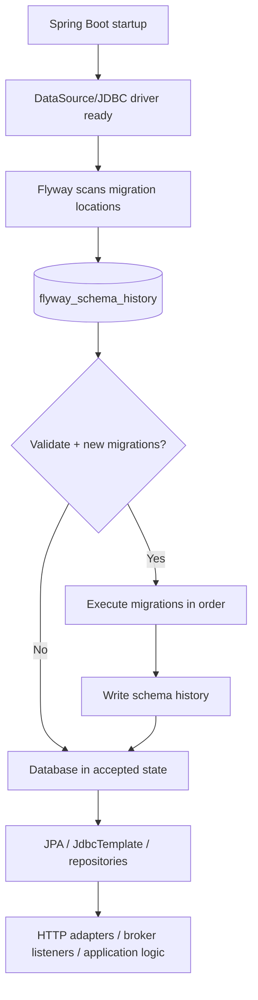
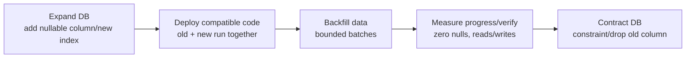
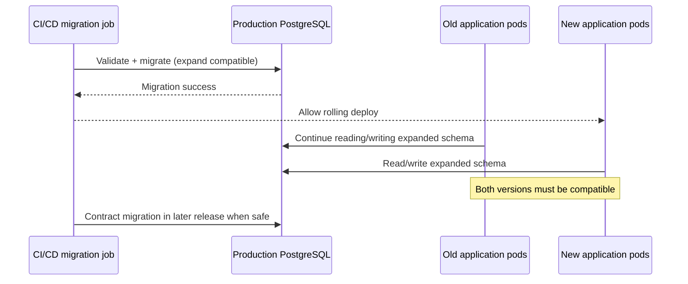
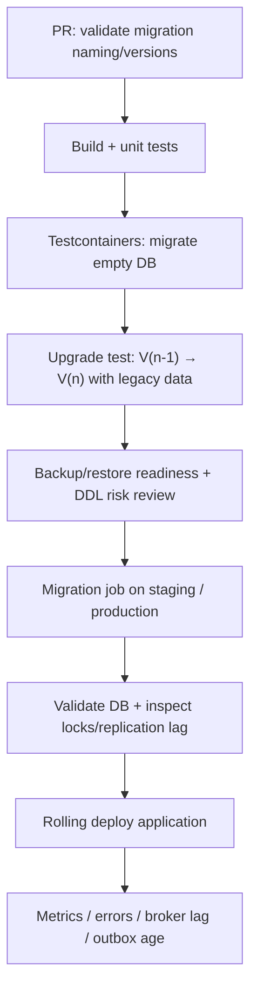

# Flyway Integration and Versioned Migration Management

## 1. Why Does Database Integration Need Controlled Migrations?

In the **SPRING_BOOT_INTEGRATION** module, an application may receive HTTP requests, write orders to PostgreSQL, read a Redis cache, and publish Kafka events via a transactional outbox. Whenever source code, data formats, or event contracts change, the database structure may also need to change. If the application already expects an `external_reference` column while the production database does not have it yet, queries will fail immediately; conversely, if a DBA drops a column while an old replica is still using it, a rolling deployment can be disrupted.

Changes like the following all require management:

- Creating `orders`, `integration_outbox`, and `processed_event` tables.
- Adding `schema_version`, `correlation_id`, or a nullable column before rolling out a new feature.
- Creating indexes so outbox queries or consumer inbox lookups do not bottleneck the database.
- Adding unique constraints on `event_id` to prevent duplicate processing.
- Converting legacy data before changing types, setting `NOT NULL`, or dropping a column.
- Maintaining views/reference data shared across multiple adapters.

**Flyway** is a tool for schema version management using migration scripts. Instead of "each environment running ad-hoc SQL when needed," each change is saved as a file named by convention, stored in source control, and tracked by Flyway using a **schema history table**. Spring Boot integrates Flyway during application initialization, updating the database before dependent components begin using the schema.

### Learning Objectives

After this lesson, you will be able to:

1. Install Flyway in Spring Boot and place SQL migrations in `classpath:db/migration`.
2. Distinguish **versioned migrations** (`V...`) from **repeatable migrations** (`R...`), their ordering, and their immutability.
3. Understand `flyway_schema_history`, checksums, validate, repair, baseline, clean, and error states.
4. Combine Flyway with Spring JDBC/JPA without letting Hibernate `ddl-auto` or `schema.sql` compete for schema creation.
5. Design migrations compatible with **rolling deployments**, backfills, indexes, and large datasets.
6. Coordinate migrations across CI/CD, multiple replicas, multiple datasources or schemas, with least-privilege accounts.
7. Write integration tests and incident-recovery procedures for failed migrations.

> **Example scope:** Java 17+, Spring Boot 3.x (especially examples compatible with Spring Boot 3.5), PostgreSQL, and Flyway version-managed via the Spring Boot BOM. Newer Flyway versions split database support into separate modules, such as `flyway-database-postgresql`; verify the exact version when applying to MySQL/Oracle/SQL Server. Illustrative commands and data should not be run verbatim in production without evaluating locks, downtime, and data permissions.

## 2. How Flyway Works in the Spring Boot Lifecycle

Flyway records **applied migration history** in a database table. When the application starts with appropriate Flyway auto-configuration:

1. Spring Boot prepares the `DataSource` and Flyway configuration.
2. Flyway locates migrations on the classpath and reads schema history.
3. Flyway validates history/versions/checksums according to configuration.
4. Flyway executes new pending migrations and records the results in history.
5. Components recognized by Spring Boot as dependent on database initialization then continue initializing in the proper order.



The diagram above illustrates **logical order**, not a guarantee that every user-created bean automatically detects the dependency. A custom bean connecting to the DB in its constructor or a self-started background thread may need explicit dependency configuration against database initialization.

### 2.1. Migrations do not replace application transactions

Flyway manages schema and data changes by migration. It does **not**:

- Turn `@Transactional` on a service into a distributed transaction between the DB and Kafka/HTTP.
- Automatically guarantee no duplicate event processing.
- Automatically synchronize JSON/API contracts between producers and consumers.
- Automatically decide when it is safe to drop a column in a multi-replica system.
- Automatically back up or roll back DDL changes on every database engine.

Good migrations must go hand in hand with **application compatibility**, transaction boundaries, idempotency, testing, and deployment processes.

## 3. Flyway and PostgreSQL Dependencies in Spring Boot

With Maven using the Spring Boot parent/BOM:

```xml
<!-- pom.xml: dependencies section -->
<dependency>
    <groupId>org.springframework.boot</groupId>
    <artifactId>spring-boot-starter-jdbc</artifactId>
</dependency>
<dependency>
    <groupId>org.postgresql</groupId>
    <artifactId>postgresql</artifactId>
    <scope>runtime</scope>
</dependency>
<dependency>
    <groupId>org.flywaydb</groupId>
    <artifactId>flyway-core</artifactId>
</dependency>
<dependency>
    <groupId>org.flywaydb</groupId>
    <artifactId>flyway-database-postgresql</artifactId>
</dependency>
```

If using Gradle:

```groovy
dependencies {
    implementation 'org.springframework.boot:spring-boot-starter-jdbc'
    runtimeOnly 'org.postgresql:postgresql'
    implementation 'org.flywaydb:flyway-core'
    runtimeOnly 'org.flywaydb:flyway-database-postgresql'
}
```

In recent Flyway lines, PostgreSQL support resides in an additional module; omitting it can cause errors like `Unsupported Database` or failure to recognize the database even though the JDBC driver works. Use the **Flyway version managed by the Spring Boot BOM**, and avoid mixing a newer `flyway-core` with an older database module.

If the application uses JPA, replace or add the corresponding starter:

```xml
<dependency>
    <groupId>org.springframework.boot</groupId>
    <artifactId>spring-boot-starter-data-jpa</artifactId>
</dependency>
```

When JPA is used, `DataSource` and Flyway remain two separate concerns: JPA manages entities/queries while Flyway manages **versioned schema changes**.

### 3.1. Configuring `application.yml`

```yaml
spring:
  datasource:
    url: jdbc:postgresql://localhost:5432/orders
    username: ${DB_USERNAME}
    password: ${DB_PASSWORD}
    hikari:
      maximum-pool-size: 10
      connection-timeout: 2s

  flyway:
    enabled: true
    locations: classpath:db/migration
    validate-on-migrate: true
    clean-disabled: true

  jpa:
    hibernate:
      ddl-auto: validate

  sql:
    init:
      mode: never
```

Meaning:

- `spring.flyway.locations` specifies where SQL migrations live; Spring Boot's common default is `classpath:db/migration`.
- `validate-on-migrate` validates history and migrations before applying them per Flyway version semantics.
- `clean-disabled` blocks dangerous `clean` operations through Flyway.
- `ddl-auto: validate` tells Hibernate to **match entities against the schema**, without creating or dropping tables.
- `spring.sql.init.mode: never` disables Spring Boot's `schema.sql`/`data.sql` SQL initializer path so two mechanisms do not modify the schema together.

**Only enable `ddl-auto: validate` when the project actually uses JPA.** With plain Spring JDBC, omit the `spring.jpa` block. For local/test databases without accounts, use an isolated test environment; never commit credentials to Git.

### 3.2. Infrastructure and security configuration

Different environments can supply `DB_USERNAME`/`DB_PASSWORD` via a secret manager or environment variables. Do not put passwords directly in migration SQL, publicly committed `application.yml`, logs, or documentation.

Production PostgreSQL connections typically require driver-level TLS, such as `sslmode=verify-full` and managed root CAs. **Flyway does not make the JDBC driver enable hostname verification** just because the application has a separate Spring SSL bundle.

## 4. Migration Directory Structure

Typical convention:

```text
src/main/resources/
└── db/
    └── migration/
        ├── V1__create_orders_and_outbox.sql
        ├── V2__add_external_reference.sql
        ├── V3__create_outbox_indexes.sql
        └── R__orders_reporting_view.sql
```

Filenames typically have these parts:

```text
V<version>__<description>.sql
R__<description>.sql
```

Where:

- `V`: **versioned migration**; version usually increments by numeric parts, e.g., `1`, `2`, `2_1`.
- `__`: **two underscores** separating version and description.
- `description`: human-readable description, typically lowercase with underscores.
- `.sql`: SQL migration script in the target database dialect.
- `R__`: **repeatable migration**, unversioned; runs when needed, specifically whenever its content/checksum changes.

Right/wrong examples:

| Filename | Assessment | Explanation |
| --- | --- | --- |
| `V1__create_orders.sql` | Valid | Version 1, double underscore |
| `V2_1__add_index.sql` | Valid | A version with minor component per Flyway convention |
| `R__rebuild_reporting_view.sql` | Valid | Repeatable, suited for recreatable views |
| `V3_add_index.sql` | Violates default convention | Missing `__` |
| `create_orders.sql` | Not a standard migration under default prefix | Flyway may not pick it up under naming pattern |
| `R2__view.sql` | Not a valid default repeatable prefix | Repeatables do not carry a version |

Flyway allows customizing prefixes/suffixes/separators, but in new projects prefer the default naming so both tools and readers understand immediately.

### 4.1. Applied files must be immutable

Once `V1__create_orders_and_outbox.sql` has run in staging or production, **do not edit its contents to "perfect V1."** Flyway stores the script's checksum and will detect that the current file no longer matches what was applied.

If the schema needs fixes, create a **new** migration such as `V4__add_order_reference_constraint.sql`. Migration history should represent the actual path of changes so every environment follows the same route, rather than relying on the final state of the database on the author's machine.

### 4.2. Versions do not have to match application release numbers

Migration versions need **consistent ordering** without duplicates. You can use sequential numbers (`V1`, `V2`, `V3`) or an agreed timestamp convention that avoids collisions across parallel branches.

When two teams both create `V7`, the merge conflict must be resolved **before release**. Do not default to enabling `out-of-order` merely to avoid coordinating versions; evaluate which environments have applied which scripts and the compatibility path.

## 5. V1 Example: Creating Orders and Transactional Outbox Tables

Let's design the first migration for `order-service`. The example uses PostgreSQL:

```sql
-- src/main/resources/db/migration/V1__create_orders_and_outbox.sql

CREATE TABLE orders (
    order_id VARCHAR(80) PRIMARY KEY,
    order_status VARCHAR(32) NOT NULL,
    currency CHAR(3) NOT NULL,
    total_amount NUMERIC(20, 2) NOT NULL,
    created_at TIMESTAMPTZ NOT NULL,
    version BIGINT NOT NULL DEFAULT 0,
    CONSTRAINT chk_orders_total_nonnegative
        CHECK (total_amount >= 0)
);

CREATE TABLE integration_outbox (
    event_id VARCHAR(80) PRIMARY KEY,
    aggregate_id VARCHAR(80) NOT NULL,
    event_type VARCHAR(120) NOT NULL,
    schema_version INTEGER NOT NULL,
    payload_json JSONB NOT NULL,
    created_at TIMESTAMPTZ NOT NULL,
    published_at TIMESTAMPTZ NULL,
    attempt_count INTEGER NOT NULL DEFAULT 0,
    CONSTRAINT chk_outbox_attempt_nonnegative
        CHECK (attempt_count >= 0)
);
```

Why these columns?

| Column | Role in Integration |
| --- | --- |
| `order_id` | Opaque business ID; never use a Kafka offset as the order ID |
| `order_status` | Business status per dedicated contract |
| `currency`, `total_amount` | Currency and monetary amount as `NUMERIC`, avoiding `double` |
| `created_at` | Creation timestamp; application uses offset/UTC semantics |
| `version` | Can support optimistic locking if repository/entity uses it |
| `event_id` | Event identifier for proper deduplication/idempotency |
| `schema_version` | Contract version of the event payload, not the Flyway DB version |
| `payload_json` | Event body to publish; requires data and retention policies |
| `published_at` | Marks when the publisher confirmed delivery per policy |
| `attempt_count` | Observes retries and prevents infinite retry loops |

**Two different kinds of versions:** `V1` in the filename is the **database migration** version; `schema_version` in the outbox is the **event data** version. Do not conflate the two: the database can upgrade its schema while the wire contract stays V1, or vice versa.

### 5.1. Do not add `IF NOT EXISTS` to every DDL by default

Example:

```sql
-- Avoid by default if the goal is to detect schema drift:
CREATE TABLE IF NOT EXISTS orders (...);
```

This can mask an environment where an `orders` table **with a different structure** already exists. In versioned migrations, scripts should **fail with a clear signal** if preconditions are wrong, or write intentional preconditions/checks. `IF NOT EXISTS` is only appropriate after analyzing prior state and verifying equivalent schema structure.

### 5.2. Unique constraints are part of durable contracts

An inbox table may require:

```sql
CREATE TABLE processed_integration_event (
    consumer_name VARCHAR(100) NOT NULL,
    event_id VARCHAR(80) NOT NULL,
    processed_at TIMESTAMPTZ NOT NULL,
    PRIMARY KEY (consumer_name, event_id)
);
```

Making the primary key `(consumer_name, event_id)` defines the idempotency scope: the same event can be processed independently by different consumers, yet must not produce side effects twice within the **same consumer workflow**.

To prevent races, business logic must record the receipt and business state **within the same appropriate transaction**. Flyway creates the constraint; it does not automatically add idempotency logic to `@KafkaListener`.

## 6. V2: Adding a Column in a Backward-Compatible Way

Suppose the application wants to store a partner reference code:

```sql
-- V2__add_external_reference.sql
ALTER TABLE orders
    ADD COLUMN external_reference VARCHAR(128);
```

The new column allows `NULL` initially because older records do not have `external_reference`. This is the **expand** step:

- Old application instances do not know about the new column and can keep operating.
- New application instances can begin reading/writing the column once deployed properly.
- Backfilling historical data happens as planned, without forcing startup migrations to scan millions of rows.
- `NOT NULL` constraints or dropping old columns are only deployed after verifying all code and data are compatible.

This is crucial for Kubernetes rolling deployments: briefly, **old pods and new pods will access the same database simultaneously**.

### 6.1. Expand → migrate → contract model



**Never drop an old column in the same release as the new code** if replicas, consumers, or integration batch jobs still use that column. Similarly, avoid directly renaming columns while multiple service versions run; add a new column, perform controlled dual-writes, switch reads, and then drop.

### 6.2. Large data backfills should not run at startup by default

Example simple backfill on a **small, controlled** table:

```sql
UPDATE orders
SET external_reference = order_id
WHERE external_reference IS NULL;
```

On a table with tens of millions of rows, this SQL statement can:

- Hold locks for a long time or generate massive I/O/WAL.
- Spike replication lag.
- Slow down queries and consumer processing.
- Exceed startup/deployment timeouts.
- Make rolling back data impact difficult when run as a single full-table update.

For large datasets, design a **dedicated backfill job**: scan by stable key, update in small batches, track checkpoints/progress, rate-limit QPS, make updates idempotent, and monitor replication lag. Add `NOT NULL`/constraints only after backfill is complete and verified.

## 7. V3: Outbox Indexes and Production Lock Limits

A publisher typically queries unsent events:

```sql
SELECT event_id, aggregate_id, event_type, payload_json
FROM integration_outbox
WHERE published_at IS NULL
ORDER BY created_at, event_id
LIMIT 100;
```

For small or medium tables, a migration can add the index:

```sql
-- V3__create_outbox_indexes.sql
CREATE INDEX idx_outbox_pending
    ON integration_outbox (created_at, event_id)
    WHERE published_at IS NULL;
```

A proper index cuts scan cost, but building an index on a large table can affect write load and locking. For production PostgreSQL, consider `CREATE INDEX CONCURRENTLY` when write blocking must be minimized:

```sql
-- PostgreSQL syntax illustration, MUST NOT run inside a transaction block:
CREATE INDEX CONCURRENTLY idx_outbox_pending
    ON integration_outbox (created_at, event_id)
    WHERE published_at IS NULL;
```

**Especially important:** PostgreSQL's `CREATE INDEX CONCURRENTLY` **cannot run inside a transaction block**. Flyway normally executes SQL migrations inside a transaction on databases supporting DDL transactions. When using concurrent indexing, you must:

1. Create a **separate migration** for the non-transactional operation.
2. Configure script execution as non-transactional per your Flyway version's capabilities (e.g., configuring the script with `executeInTransaction=false`).
3. Never mix transactional and non-transactional statements without checking the `mixed` policy.
4. Prepare a recovery plan in case concurrent index creation fails and leaves an **invalid index**; check index validity before retrying.
5. Test with a PostgreSQL version, traffic profile, and migration strategy matching production.

`CREATE INDEX CONCURRENTLY` is not "lock-free" or "zero-cost"; it still consumes CPU and I/O and can take significant time. Do not put it on the startup path without considering readiness, deployment timeouts, and rollback.

### 7.1. Per-script configuration (when supported by the Flyway version)

Example placing a configuration file alongside the script:

```text
db/migration/
  V4__create_large_index_concurrently.sql
  V4__create_large_index_concurrently.sql.conf
```

Contents of the `.sql.conf` file:

```properties
executeInTransaction=false
```

And the content of `V4__create_large_index_concurrently.sql` is an appropriate `CREATE INDEX CONCURRENTLY ...` statement. This section describes a **Flyway script-level configuration option**, not a requirement to add extra files outside the Markdown lesson you are studying. Verify feature support and execution policy in your exact Flyway version; other databases/statements behave differently from PostgreSQL.

## 8. Repeatable Migrations: Suited for Views and Redefinable Objects

Repeatable migrations use the `R__` prefix and have no version:

```sql
-- R__orders_reporting_view.sql
CREATE OR REPLACE VIEW reporting_orders AS
SELECT
    order_id,
    order_status,
    currency,
    total_amount,
    created_at
FROM orders;
```

Semantics:

- Flyway stores the checksum of a repeatable script.
- Whenever the script's content changes, Flyway can re-run it on the next migrate.
- Repeatable migrations typically run after pending versioned migrations according to Flyway's ordering rules.
- Because they can re-run, their contents should be **idempotent or safely redefinable**.

**Do not use `R__` for one-off data changes.** For instance, inserting a transaction fee with side effects and having it re-run whenever a comment changes can create duplicate data if proper constraints/upserts are absent. **One-time, ordered** schema/data changes belong in versioned migrations.

### 8.1. When versioned, when repeatable?

| Need | Choice | Why |
| --- | --- | --- |
| Create new tables and columns | `V__` | An ordered historical change |
| Add constraints/indexes | `V__` | Need to know initial application and DDL consequences |
| One-time legacy data conversion | `V__` or controlled backfill job | Should not re-run automatically whenever checksum changes |
| Redefine a view | `R__` | Can be fully recreated from current definition |
| Replaceable stored procedure/function | `R__` when dialect allows | Easy to maintain by latest content |
| Mutable reference data seeding | Possibly `R__` if upsert/replace is **truly safe** | Requires clear authority and deletion/edit handling |

Avoid using continually changing placeholder values inside repeatable scripts unless you intentionally want the checksum to change and force re-execution. In Flyway, changing placeholders can affect repeatable migration checksums.

## 9. Schema History, Versions, and Checksums

Flyway manages a history table, typically named `flyway_schema_history` by default. On PostgreSQL, you can inspect it:

```sql
SELECT
    installed_rank,
    version,
    description,
    type,
    script,
    checksum,
    installed_on,
    success
FROM flyway_schema_history
ORDER BY installed_rank;
```

Illustrative sample rows:

| installed_rank | version | description | script | success |
| ---: | --- | --- | --- | --- |
| 1 | 1 | create orders and outbox | `V1__create_orders_and_outbox.sql` | true |
| 2 | 2 | add external reference | `V2__add_external_reference.sql` | true |
| 3 | 3 | create outbox indexes | `V3__create_outbox_indexes.sql` | true |
| 4 | *null* | orders reporting view | `R__orders_reporting_view.sql` | true |

A repeatable migration's `version` is not a concrete version number; Flyway records repeatables per its history mechanism. The history table/schema name can be reconfigured, and visibility depends on database user privileges.

### 9.1. What are checksums for?

Flyway computes a **checksum from script content**. If a versioned script has already run in production and a developer edits its content in Git, validation can report a mismatch.

```text
Production history:
  V2__add_external_reference.sql → checksum X

New artifact:
  V2__add_external_reference.sql → checksum Y

If X != Y:
  investigate source/version/drift, do not blindly overwrite history.
```

A new script with a higher version can fix a schema bug. **Editing an old V2 file and running `repair` to match the new checksum** can conceal differences between environments that already ran the old V2 and fresh environments that haven't.

### 9.2. `Pending`, `Success`, `Failed`, and `Out of Order` states

Flyway tracks a variety of migration states depending on script type and history metadata. Common states operators encounter:

- Migration exists on classpath but not yet applied: **pending**.
- Migration applied successfully: **success**.
- Migration halted mid-way on a database without full DDL rollback: may produce **failed** history or a half-applied schema.
- New migration has a version **lower** than the highest applied version: may be flagged as out-of-order/ignored/missing depending on configuration.
- Migration in history no longer has a corresponding file: distinguish broken artifact packaging, accidental deletion, or intentional baseline/retention.

When environments report different states, do not look only at the number `V3`—inspect the **actual files in the artifact, history, checksums, and live schema**.

## 10. Key Operations: migrate, validate, info, repair, baseline, clean

| Flyway Operation | Purpose | Warning |
| --- | --- | --- |
| `migrate` | Applies pending migrations by version and policy | Executes DDL/data changes; must control deployment |
| `validate` | Checks whether applied migration history matches current files | Not a full schema diff; does not prove tables weren't manually altered |
| `info` | Displays status of known migrations | Good for pre-rollout inspection |
| `repair` | Adjusts schema history metadata in supported situations | **Does not fix actual schema**, can hide drift if misused |
| `baseline` | Marks a starting point for managing an existing schema | Does not recreate tables prior to baseline |
| `clean` | Drops database objects in Flyway-managed schemas | **Destroys data**, forbidden in production |

In Spring Boot, startup with Flyway auto-config typically invokes migration per configuration. Commands like `info`, `validate`, `repair`, and `baseline` can be run via Flyway CLI, Maven/Gradle plugins, or an admin tool **if configured with the right database, credentials, and version**.

Do not mechanically suggest running `mvn flyway:migrate` when the project does not declare the Flyway Maven Plugin or lacks plugin URL/credentials. **Having `flyway-core` as a Spring Boot app dependency does not mean the Maven CLI plugin is configured.**

### 10.1. `repair` is not a rollback

Suppose a DDL migration fails due to running out of disk space, leaving an added column behind while history shows failed. `repair` only alters **history metadata**; it does not revert added columns or changed data. Before using it:

1. Back up or ensure an appropriate snapshot/restore point exists.
2. Inspect the actual schema state, locks/transactions, and cause of failure.
3. Choose an **approved** SQL fix/rollback/forward-fix for the schema.
4. Confirm exactly which metadata `repair` will modify.
5. Re-run `validate` and test on an environment copy.

Never run `repair` to "turn the pipeline green" without understanding why checksums differ.

### 10.2. `clean-disabled` is an essential guardrail

Production must never allow dropping the entire schema through Flyway. Configuration:

```yaml
spring:
  flyway:
    clean-disabled: true
```

Combine this with database roles following **least privilege**. An account with `DROP SCHEMA` across the whole database can still destroy data if credentials are abused; disabling one Flyway API does not replace RBAC.

## 11. Existing Databases: Baseline Instead of Forcing V1 on Existing Schemas

When adopting Flyway in a legacy system, the production schema may already have 50 tables **without `flyway_schema_history`**.

If you immediately run `V1__create_orders.sql`, Flyway may refuse to migrate because the schema is non-empty without history, or DDL will fail because tables already exist. Plan an **adoption/baseline**:

1. Inventory the live production schema, past manual migrations, and application versions.
2. Capture a baseline schema/data reference and verify across relevant environments.
3. Choose an explicit baseline version, e.g., `1` matching the current snapshot.
4. Mark baseline history using a procedure tested on staging.
5. Apply only versions **after the baseline** to evolve the schema.
6. Verify that brand-new empty environments still have a valid bootstrap path.

### 11.1. `baseline-on-migrate` is a sensitive option

```yaml
spring:
  flyway:
    baseline-on-migrate: true
    baseline-version: 1
```

In appropriate situations, `baseline-on-migrate` lets Flyway automatically baseline when migrating a **non-empty schema with no history**. This is a **monitored option**, not a default setting for every service.

Major risk: if a URL accidentally points to another populated database/schema, automatic baselining bypasses the safety check that usually catches **wrong-environment connections**. Production should prefer deliberate baselining after verifying the exact endpoint/schema and data state.

### 11.2. Baseline migration files differ from the baseline command

Recent Flyway versions include **baseline migrations** (files starting with `B...` under supported conditions) to shorten bootstrapping new environments with lots of historical migrations. This is **different** from the `baseline` command that records a marker in an existing schema's history.

Do not convert `V1` into `B1` and delete old migrations without understanding baseline migration selection rules, Flyway versions, and replayability across environments. In this lesson, main examples use only **V__ and R__** to avoid unnecessary reliance on advanced features.

## 12. Flyway and Hibernate/JPA: One Owner of DDL

A Spring Data JPA application might configure:

```yaml
spring:
  jpa:
    hibernate:
      ddl-auto: update
```

However, if **Flyway is the primary schema management tool**, letting Hibernate auto-`update` production schemas removes control: each runtime can apply schema mutations outside Git migration history, making rollbacks hard and creating cross-environment differences.

Recommended when using Flyway:

```yaml
spring:
  flyway:
    enabled: true
    locations: classpath:db/migration
  jpa:
    hibernate:
      ddl-auto: validate
  sql:
    init:
      mode: never
```

Or `ddl-auto: none` if your architecture/testing strategy guarantees mapping/schema compatibility by another means.

### 12.1. Hibernate `validate` is not Flyway `validate`

| Check | Which Question Does It Answer? |
| --- | --- |
| Flyway `validate` | Does migration history match current scripts/metadata? |
| Hibernate `ddl-auto: validate` | Are Hibernate entity mappings compatible with the schema it sees? |
| Contract tests | Do HTTP/Kafka payloads preserve wire schemas/semantics? |
| Integration tests | Do DB + broker + HTTP flows work properly against a genuinely migrated schema? |

Hibernate validate does not catch every business logic error or every schema change unrelated to entities; Flyway validate does not detect columns altered manually outside history. Multiple verification layers are needed.

### 12.2. Avoid two SQL initialization systems

Spring Boot has its own mechanism for `schema.sql` and `data.sql`. Used alongside Flyway, both can compete over table creation order or data insertion. In a multi-environment integration system:

- Use Flyway to manage schemas and versioned reference data seeds.
- Use test fixtures for test data; do not put mock data into production migrations.
- Never use `hibernate.hbm2ddl.auto=create-drop` in production.
- If combining tools is unavoidable, explicitly define order and per-schema ownership rather than relying on auto-detection.

## 13. Application Initialization: Order of DataSource, Flyway, JPA, and Custom Beans

Spring Boot automatically identifies beans that depend on database initialization. Normally, Flyway runs before the schema-dependent `EntityManagerFactory` is initialized.

However, a custom bean may query the database too early at startup, for example:

```java
// Anti-pattern: querying DB directly in constructor
@Component
class BadCacheWarmup {
    BadCacheWarmup(JdbcTemplate jdbc) {
        jdbc.queryForList("SELECT * FROM orders");
    }
}
```

If that bean is created before migrations finish, it can fail with `relation "orders" does not exist`. Beans depending on initialized data can be annotated:

```java
package example.integration.init;

import org.springframework.boot.sql.init.dependson.DependsOnDatabaseInitialization;
import org.springframework.boot.ApplicationRunner;
import org.springframework.context.annotation.Bean;
import org.springframework.context.annotation.Configuration;
import org.springframework.jdbc.core.JdbcTemplate;

@Configuration(proxyBeanMethods = false)
public class ReferenceDataWarmupConfiguration {

    @Bean
    @DependsOnDatabaseInitialization
    ApplicationRunner referenceDataWarmup(JdbcTemplate jdbc) {
        return args -> {
            Integer count = jdbc.queryForObject(
                    "SELECT COUNT(*) FROM orders", Integer.class);
            System.out.println("Existing orders: " + count);
        };
    }
}
```

Here, `ApplicationRunner` runs after the application context initializes; the annotation declares an explicit bean dependency and helps with custom startup beans. In real applications, do not use `System.out.println` to inspect production data; use controlled metrics/logging and avoid stalling startup with full scans.

### 13.1. Broker listeners and scheduled jobs

A `@KafkaListener` can begin consuming events as soon as its container activates. If migrations take long or the database isn't ready, handlers can fail, retry endlessly, or increase consumer lag.

Best practices:

- Only start listeners/adapters once the database schema is ready.
- Do not spawn threads in constructors bypassing the Spring Boot lifecycle.
- Tie readiness to meaningful conditions without turning transient DB errors into a liveness restart storm.
- For heavy migrations, **separate migrations into a dedicated deployment stage** rather than starting listeners concurrently with heavy DDL.

## 14. Migrations and Multiple Replicas: Why Startup Isn't Always Best

By default, when multiple Spring Boot instances start simultaneously with Flyway enabled, each instance tries to run migrations. Flyway uses schema history/locking per database capabilities to avoid concurrent application of the same migration normally. However:

- Replicas may **wait on locks**, prolonging startup.
- For large migrations, new instances stay unready for a long time.
- DB/proxies face connection and DDL lock pressure.
- If a migration fails, multiple replicas fail startup/retry simultaneously, causing a rollout outage.
- Flyway locking cannot fix a migration **incompatible with older code** still running.



### 14.1. Two operational strategies

| Strategy | Pros | Cons |
| --- | --- | --- |
| **Flyway runs at app startup** | Easy setup, convenient for local/dev/test | DDL affects readiness, locks, startup failures across replicas |
| **Standalone migration job in pipeline** | Controls executor, DDL privileges, logs, and pre-rollout gates | Must prevent app from accidentally running `migrate` and have pipeline rollback procedures |

In multi-replica production, a dedicated migration job usually offers better control:

1. Build and verify the artifact containing migrations.
2. Take a backup/restore point proportionate to risk.
3. Run `migrate` once using a restricted DDL account.
4. Validate schema results and metrics.
5. Perform rolling deployment of the new app using a restricted runtime account.
6. Execute contract cleanup in a subsequent release when conditions are met.

If the pipeline manages migrations separately, you can set `spring.flyway.enabled=false` on the **runtime application**, while the migration job uses standalone Flyway or a dedicated profile. This must be verified across profiles/secrets/CI; never let a new app deploy onto an old DB if the migration job has not succeeded.

## 15. Runtime vs. Migration Account Roles

In production systems, the application account needs `SELECT/INSERT/UPDATE/DELETE` per least privilege, whereas migrations may need `CREATE/ALTER/DROP`. Granting the runtime full DDL permissions increases blast radius if credentials leak or the application is exploited.

Spring Boot supports configuring a separate Flyway connection via properties:

```yaml
spring:
  datasource:
    url: jdbc:postgresql://db.internal.example:5432/orders
    username: ${DB_RUNTIME_USER}
    password: ${DB_RUNTIME_PASSWORD}

  flyway:
    url: jdbc:postgresql://db.internal.example:5432/orders
    user: ${DB_MIGRATION_USER}
    password: ${DB_MIGRATION_PASSWORD}
    locations: classpath:db/migration
```

In this example, `spring.flyway.url/user/password` directs Flyway to use dedicated connection settings for migrations. Depending on Spring Boot/bean configuration and version, separate credentials or a dedicated DataSource can be used for migrations.

**Security boundary:** if Flyway runs **in the same process as the application**, the runtime process still has access to the DDL credentials; using two users only separates privileges between **business connections** and migration connections, rather than providing complete isolation. To minimize runtime privileges, run migrations in a separate job and **do not pass DDL secrets to traffic-serving applications**.

### 15.1. Dedicated Flyway DataSource via annotation

Spring Boot supports `@FlywayDataSource` to designate a DataSource for Flyway when an application has multiple beans. Example structure:

```text
PrimaryDataSource (runtime user, pool serving APIs)
MigrationDataSource @FlywayDataSource (DDL user, Flyway only)
```

When configuring manually, handle `@Primary`/`@Qualifier`, binding, and lifecycles properly. Do not give the migration DataSource a large request-serving connection pool if it only runs migrations once.

## 16. Multiple DataSources and Schemas: Avoiding Migrating the Wrong Target

An integration application may use:

```text
ordersDataSource       → orders database/schema
reportingDataSource    → reporting database/schema
auditDataSource        → audit database/schema
```

Having a single `spring.flyway.locations` does not make Flyway automatically run scripts on all three data sources. With multiple DataSources:

1. Identify **which tool/migration job manages each schema**.
2. Explicitly choose the `DataSource` for Flyway or create separate `Flyway` instances intentionally.
3. Separate migrations by schema/contract so Orders `V1` does not collide with Audit `V1` in the same history.
4. Define database users, search paths/default schemas, and history table placement.
5. Test each migration against the exact target database and deployment account.

Example PostgreSQL schema setup:

```yaml
spring:
  flyway:
    default-schema: orders_app
    schemas: orders_app
    table: flyway_schema_history
    locations: classpath:db/migration/orders
```

This example only works when schemas and permissions match the Flyway/PostgreSQL configuration. Verify whether Flyway is allowed to create schemas, PostgreSQL `search_path`, and consistency between unqualified table names in SQL and `default-schema`.

**Do not set `schemas: orders_app, reporting, audit` assuming every migration will be replicated identically across all three schemas.** `schemas` refers to the set of schemas Flyway manages and where history resides, not a loop copying every script to every schema.

### 16.1. Risks with multiple schemas/tenants

Schema-based multitenancy means each tenant has its own migration history or a centralized strategy. Avoid having every app instance iterate over thousands of tenant schemas on startup: too many DB operations, locking, and poor observability.

You need a migration orchestrator/tenant registry, bounded concurrency, checkpoints, and clear reporting of which tenant is on which version. Schema version drift across tenants must be monitored intentionally.

## 17. Transactional DDL and Failure Recovery

Not every database handles DDL inside transactions the same way.

| Database | Key Considerations |
| --- | --- |
| PostgreSQL | Many DDL commands can roll back inside a transaction; some commands like `CREATE INDEX CONCURRENTLY` cannot run in a transaction |
| MySQL | Many DDL operations have implicit commits/specific atomic DDL semantics; not equivalent to rolling back an entire migration via a Spring transaction |
| Oracle | DDL typically performs implicit commits; requires dedicated recovery planning |
| SQL Server | DDL transaction support depends on statement, version, and configuration |

With PostgreSQL, a normal `V__` SQL migration can run transactionally, rolling back the whole group of statements on error within DB limits. However, if a script contains non-transactional statements, or the DB does not support transactional DDL adequately, **half the schema may already be altered** when Flyway reports an error.

### 17.1. Failed migration recovery workflow

1. **Halt the rollout** and prevent multiple application versions from operating against an indeterminate schema.
2. Gather the root exception, script/version, SQLSTATE, database host/schema, and failure timestamp.
3. Inspect `flyway_schema_history` for history state; do not rely solely on application logs.
4. Inspect the physical schema: see which tables/columns/indexes/constraints actually exist.
5. Evaluate database snapshots/backups and DDL rollback feasibility per dialect.
6. Choose an **approved forward-fix migration or restore**, and update metadata history if required.
7. Run `validate`/integration tests on the recovered schema before resuming rollout.

**Never edit a `V__` script that already ran in other environments just to match a broken database**, as that creates diverging histories that are hard to manage.

### 17.2. `out-of-order` is not a universal fix for version errors

If production is already at V5, and a feature branch merges V4 which production hasn't applied, Flyway may reject V4 as lower than the current version. Enabling:

```yaml
spring:
  flyway:
    out-of-order: true
```

allows lower-version pending migrations to run after higher versions in certain cases. However, **the actual execution order has changed**, so V4 might assume a schema without V5 changes and fail or corrupt data.

Use this only after analyzing dependencies, testing the execution sequence on a production copy, and establishing a clear policy. It is usually safer to **renumber unreleased migrations** to preserve global order prior to release.

## 18. Data Migrations: Do Not Turn Startup into an Unbounded Batch Job

Schema migrations and data migrations share the goal of bringing the database to the right state, but differ in operational risk.

| Change Type | Example | Primary Risk |
| --- | --- | --- |
| Small metadata/schema | Adding nullable column to a small table | Brief lock, code compatibility |
| Constraint | Adding unique/foreign key, `NOT NULL` | Historical data violations, lock/scan |
| Index | Indexing a multi-million-row table | I/O, WAL, lock, build duration |
| Data backfill | Populating values for millions of rows | Long transactions, replication lag, pool exhaustion |
| Type conversion | `VARCHAR` → `NUMERIC` | Unparseable legacy data, table rewrite |
| Event/outbox contract | Creating new `schema_version`, migrating JSON payloads | Consumer compatibility and idempotency |

### 18.1. Safer backfill pattern

Suppose you want to split/migrate a field:

```text
Release A: add nullable order_status_v2 column
Release B: new code writes both old and new columns per policy
Backfill: batch rows missing order_status_v2, with checkpoints
Release C: code reads new column, controlled fallback if null
Release D: verify all rows + consumers use new column
Release E: drop old column, enforce constraint in later migration
```

For backfills:

- Choose a stable key and keyset/range pagination, avoiding large offset scans.
- Limit batch size and throughput; monitor transaction duration.
- Design **idempotent updates** so work can resume cleanly.
- Emit metrics for remaining unmigrated rows, rate, errors, lock waits, and replication lag.
- Do not mix data backfills with HTTP/Kafka contract switches without a rollout strategy.

### 18.2. Should migration SQL call HTTP APIs?

Generally **no**. Having a Flyway SQL migration call an API indirectly or running a Java callback dependent on an external partner can:

- Hang startup when the partner is slow.
- Cause side effects that cannot roll back with the DB transaction.
- Repeat side effects on retries or repairs.
- Make schema migrations non-reproducible from an empty environment.

If partner data synchronization is needed, build a **dedicated integration job/workflow** with checkpoints, idempotency, timeouts, retry budgets, and auditing—do not embed it in startup migrations.

## 19. Common Spring Boot Flyway Properties

| Property | Purpose | Note |
| --- | --- | --- |
| `spring.flyway.enabled` | Enables/disables Boot's Flyway auto-configuration when dependencies/conditions apply | Disabling at runtime requires another migration stage to run reliably |
| `spring.flyway.locations` | Where migrations are read, usually `classpath:db/migration` | Test artifact packaging and classpath |
| `spring.flyway.validate-on-migrate` | Checks consistency before migrating | Does not auto-detect all schema drift |
| `spring.flyway.clean-disabled` | Disables `clean` | Even with this guardrail, still restrict DDL permissions |
| `spring.flyway.baseline-on-migrate` | Conditionally auto-baselines an existing unmanaged non-empty schema | Sensitive in production; avoid pointing at wrong DB |
| `spring.flyway.baseline-version` | Baseline version marker | Must match actual schema snapshot |
| `spring.flyway.out-of-order` | Allows running lower pending versions after higher ones when appropriate | Can alter dependency order; must be tested |
| `spring.flyway.schemas` | Schemas managed by Flyway per dialect capability | Does not mean cloning scripts into every schema |
| `spring.flyway.default-schema` | Default schema for Flyway/metadata per version | Reconcile with PostgreSQL search path |
| `spring.flyway.table` | Schema history table name | Avoid changing carelessly after runs |
| `spring.flyway.url/user/password` | Dedicated DB credentials for migrations | Protect DDL credentials |
| `spring.flyway.connect-retries` | Connection retry count per Flyway capability | Does not fix wrong credentials/CA/hostname |
| `spring.flyway.placeholders.*` | Values substituted in SQL when needed | Never vary arbitrarily in applied versioned scripts |

Exact properties may vary by Spring Boot/Flyway version; verify against the application properties metadata of your **exact version**. Setting `clean-disabled` to false in production is a major security risk, not a shortcut to fix failed migrations.

### 19.1. Placeholder risks

Example:

```yaml
spring:
  flyway:
    placeholders:
      application_schema: orders_app
```

Flyway can substitute placeholders in SQL:

```sql
-- Illustrative Flyway-managed placeholder syntax:
CREATE TABLE ${application_schema}.example_reference (
    code VARCHAR(80) PRIMARY KEY
);
```

Important note: injecting schema names via placeholders does not automatically escape identifiers safely across all dialects. Never populate placeholders from user input; validate/whitelist schema names before deployment. Changing placeholders across environments or over time can alter checksums/schema behavior; govern them strictly.

## 20. Testing Migrations Against a Real Database

Mocked JPA repository tests do not prove migrations run on PostgreSQL. To test properly:

1. Provision an empty database using Testcontainers or a controlled test instance.
2. Start the Spring Boot context with Flyway enabled and the same migrations packaged for production.
3. Verify schema history and essential tables/columns/constraints/indexes.
4. Execute real `JdbcTemplate`/JPA queries with SQL mappings.
5. Verify consumer/outbox flows work when upgrading from an older schema version.
6. Test migrations with legacy data or anonymized snapshots to catch incompatible data.

### 20.1. Test dependencies

```xml
<dependency>
    <groupId>org.springframework.boot</groupId>
    <artifactId>spring-boot-starter-test</artifactId>
    <scope>test</scope>
</dependency>
<dependency>
    <groupId>org.springframework.boot</groupId>
    <artifactId>spring-boot-testcontainers</artifactId>
    <scope>test</scope>
</dependency>
<dependency>
    <groupId>org.testcontainers</groupId>
    <artifactId>junit-jupiter</artifactId>
    <scope>test</scope>
</dependency>
<dependency>
    <groupId>org.testcontainers</groupId>
    <artifactId>postgresql</artifactId>
    <scope>test</scope>
</dependency>
```

### 20.2. Basic integration test with Testcontainers

```java
package example.integration.migration;

import org.junit.jupiter.api.Test;
import org.springframework.beans.factory.annotation.Autowired;
import org.springframework.boot.test.context.SpringBootTest;
import org.springframework.boot.testcontainers.service.connection.ServiceConnection;
import org.springframework.jdbc.core.JdbcTemplate;
import org.testcontainers.containers.PostgreSQLContainer;
import org.testcontainers.junit.jupiter.Container;
import org.testcontainers.junit.jupiter.Testcontainers;

import static org.assertj.core.api.Assertions.assertThat;

@Testcontainers
@SpringBootTest
class FlywayStartupIT {

    @Container
    @ServiceConnection
    static PostgreSQLContainer<?> postgres =
            new PostgreSQLContainer<>("postgres:16-alpine");

    @Autowired
    JdbcTemplate jdbc;

    @Test
    void migrationCreatesOutboxAndHistory() {
        Integer tableCount = jdbc.queryForObject(
                """
                SELECT COUNT(*)
                FROM information_schema.tables
                WHERE table_schema = 'public'
                  AND table_name IN ('orders', 'integration_outbox')
                """,
                Integer.class);

        assertThat(tableCount).isEqualTo(2);

        Integer successfulMigrations = jdbc.queryForObject(
                "SELECT COUNT(*) FROM flyway_schema_history WHERE success",
                Integer.class);
        assertThat(successfulMigrations).isGreaterThanOrEqualTo(1);
    }
}
```

This is a test skeleton for a project with a `@SpringBootApplication` and a test profile using the `public` schema, with all SQL migrations defined. Testcontainers requires Docker/a compatible container runtime; `@ServiceConnection` is a Spring Boot Testcontainers feature introduced in Boot 3.1.

This test verifies **startup + schema outcome**. Do not simply count tables and conclude migrations are safe for production: also test legacy data, replay, locks, constraints, and upgrade paths.

### 20.3. Testing upgrades from an existing schema

A dedicated test suite should:

```text
Initialize DB with migrations up to V1
   → insert V1 production-like data
   → apply V2, V3 from the new application version
   → assert legacy data remains intact
   → assert old code (during rolling) still reads/writes
   → assert new code sees appropriate columns/indexes
```

Create fixtures at specific versions using controlled Flyway API/CLI/test setup; never modify already-published history files. This scenario is more critical than "install from scratch" tests when production holds years of data.

### 20.4. Testing checksums and deployment artifacts

Verify:

- `V__` / `R__` files are packaged inside the JAR/image.
- No two migrations share the same version/description causing conflicts.
- No file changed checksum unexpectedly after merges/cherry-picks.
- Migrations run against the same PostgreSQL version/permissions as production.
- Both Flyway validate and Hibernate validate (if using JPA) pass.

## 21. CI/CD: Making Migrations a Release Gate

Example pipeline:



### 21.1. Rules for reviewing migrations like code

Every migration should be code-reviewed against these questions:

- Does it target the **right schema/database**?
- Is it compatible with older code during rolling deployment?
- Does it cause long locks, full table rewrites, or large data scans?
- Does it require concurrent/non-transactional indexing?
- Does it handle timestamps/timezones/currency per contract?
- Could it lose data or change permissions/constraints relied upon by other adapters?
- If it fails mid-way, what is the resulting DB/history state?
- Are upgrade tests with legacy data, backup/restore, and rollback plans in place?

Migrations are **part of the application artifact**, requiring PR review, version control, signature/artifact traceability, and auditability just like code changes.

### 21.2. Multi-environment deployment

| Environment | Suggested Policy |
| --- | --- |
| Local | Flyway can run on startup, creating a clean test DB |
| CI | Create fresh DB, apply all migrations, test upgrade path |
| Staging | Migration stage matching production, with representative data and similar privileges |
| Production | Controlled job, minimal privileges, backups, and phased rollout |

Avoid using `ddl-auto=create` locally while CI/prod use Flyway: migration bugs can be masked because entities auto-create structures that the SQL scripts forgot.

## 22. Observability and Operational Runbook

Migrations are critical changes requiring monitoring. Signals:

| Signal | Interpretation |
| --- | --- |
| Applied migration version | Which schema version the environment is currently on |
| Execution time per script | Whether DDL/backfill/index builds exceed time budgets |
| Flyway validation failures | Checksum mismatches, missing migrations, or corrupted history |
| DB lock waits / active sessions | Migrations holding locks blocking live requests |
| DB CPU/IO/WAL/replication lag | Resource impact from DDL/backfills |
| Application startup/readiness | Whether deployment is blocked by migrations |
| HTTP 5xx, JDBC exceptions, Kafka consumer lag | Impact of schema changes on integration flows |
| Outbox pending age / DLT count | Whether events are stuck or misprocessed after migration |

### 22.1. Runbook when deployment is blocked by Flyway

**Symptom:** a new `order-service` release fails startup, logging `FlywayValidateException` or `FlywayMigrateException`.

1. **Freeze rollout:** stop changing application versions while the schema is unverified.
2. **Verify actual endpoint/schema:** pointing to the wrong database URL/profile is a dangerous root cause.
3. **Inspect files and history:** versions, checksums, states, packaged scripts.
4. **Check physical schema:** how far changes got, whether invalid indexes or partial migrations exist.
5. **Check locks/traffic:** whether DDL is waiting on long transactions or holding locks.
6. **Evaluate recovery method:** transactional rollback, forward migration, or approved DB restore.
7. **Do not use `repair` indiscriminately:** only when you know the exact metadata to update.
8. **Re-run tests/validate** with the releasable artifact before continuing.

### 22.2. Data changes and security

Migration SQL may access personal or order data. Therefore:

- Never put real production data samples in the repository for testing.
- Restrict SQL logging when sensitive data is involved; never print raw credentials.
- Grant temporary DDL privileges / isolate workloads per policy.
- Maintain backups/restores and verified recovery meeting RPO/RTO.
- Track who approved changes, which artifact carried the scripts, and which versions were applied.

## 23. Real-World Scenario: Adding Outbox State Without Breaking Rolling Deployment

**Assumed context:**

- Service V1 writes to `integration_outbox`, using only `published_at` to distinguish sent vs. unsent.
- Service V2 wants to add `processing_state` (`PENDING`, `SENDING`, `SENT`, `FAILED`) and a worker with explicit retries.
- Production runs multiple replicas, some still running V1 code during rollout.
- The outbox table already holds millions of rows.

### 23.1. Dangerous approach

```sql
-- Warning: avoid running directly on a large table with active old writers
ALTER TABLE integration_outbox
    ADD COLUMN processing_state VARCHAR(32) NOT NULL;
```

If older rows lack values, the migration may fail or force an expensive default/backfill. Moreover, V1 code does not populate `processing_state`; if the new column is required without a compatible default, outbox inserts from old pods will fail.

### 23.2. Safer expansion

Example V5 migration (continuing the V1–V4 migrations illustrated earlier):

```sql
-- V5__add_outbox_processing_state.sql
ALTER TABLE integration_outbox
    ADD COLUMN processing_state VARCHAR(32);
```

Once the column exists:

1. Deploy V2 code capable of interpreting nulls via a **business fallback** compatible with `published_at`.
2. While old pods remain, do not require old inserts to populate the new column.
3. Run checkpointed backfill batches by ID/time, converting historical rows to the corresponding states.
4. Maintain an appropriate dual-read/dual-write period until no old pods remain.
5. Only after measuring zero `NULL processing_state` rows and verifying all writers, create a subsequent migration to add constraints/defaults or retire the old column.

If adding a DB default to assist old writers, inspect its semantic effect: what default state will future rows created by V1 receive, and is it consistent with `published_at`? Never default to `PENDING` if doing so could cause already-published events to be re-sent uncontrollably.

### 23.3. Backfill and idempotency

The outbox publisher can restart while backfill is in progress. If new code re-sends an event already accepted by the broker before the DB recorded `published_at`, consumers must maintain **idempotency** by `event_id`. Flyway does not make publishing between PostgreSQL and Kafka exactly-once.

Do not implement a migration that calls Kafka directly to "resync events" when it could be executed or recovered in multiple places. Use an outbox publisher with retries, observability, and deduplication.

### 23.4. Rollout plan

```text
Release 1: Flyway V5 adds nullable column
          → deploy V2 app supporting old/new schema semantics
          → monitor outbox lag and event duplicate rate

Backfill:  run checkpointed batch job
          → verify processing_state of historical rows

Release 2: Flyway V6 adds appropriate constraint/default
          → deploy code using new state exclusively
          → stop reading old column after compatibility window
```

This is a practical example of **schema evolution combined with message integration**. Success is not merely Flyway reporting `migrate success`, but consumers/outbox operating seamlessly across schema versions without losing or mis-duplicating data.

## 24. Pre-Production Flyway Migration Checklist

1. **Single DDL source of truth:** Flyway manages the schema; do not mix casually with Hibernate `update` or `schema.sql`.
2. **Naming:** `V...__...` and `R__...` files follow conventions, versions are unique, scripts are packaged in the artifact.
3. **Immutability:** never modify applied versioned migrations; new changes use new versions.
4. **Checksums:** validate history, inspect drift, and justify any `repair`.
5. **Database module:** PostgreSQL driver + `flyway-core` + matching Flyway module, all at compatible versions.
6. **DataSource:** correct JDBC URL, schema, search path, user, and migration account.
7. **Security:** credentials from secrets, DDL permissions separated from runtime where possible, `clean-disabled`.
8. **Compatibility:** expand migrations run safely while old/new apps coexist.
9. **Locks & performance:** review table size, DDL locks, index strategy, and transaction settings.
10. **Backfill:** for large data, use checkpointed batch jobs instead of long startup migrations.
11. **Multi-instance:** choose a migration job or bounded startup strategy with clear ownership.
12. **Multi-datasource:** specify exact schema/history owners to avoid migrating the wrong target.
13. **Testing:** empty DB, upgrade with legacy data, rollback/restore, old/new code.
14. **Observability:** Flyway history/version, migration duration, readiness, locks, error rate, outbox/consumer lag.
15. **Recovery:** tested backup/restore and procedures for non-rollbackable DDL.
16. **Business correctness:** verify schema versions and idempotency/transactions while HTTP/broker flows continue running.

### Self-Check Questions

**1.** `V2__add_external_reference.sql` has already run in production. Why should you not edit this file to add a constraint, even if staging hasn't run V2 yet?

**2.** What are the differences between `V__`, `R__`, `baseline`, and `repair`?

**3.** Why can't `validate-on-migrate` replace integration tests against real PostgreSQL?

**4.** Why does `CREATE INDEX CONCURRENTLY` require special migration configuration on PostgreSQL?

**5.** A service has 10 replicas starting together; why is having every instance run a multi-million-row data backfill at startup a risky operational design?

**6.** If Spring Boot uses Flyway, why should `spring.jpa.hibernate.ddl-auto=update` not be enabled in production?

**7.** When adding a `NOT NULL` column to a large table with active old writers, how would you execute expand → backfill → contract?

**8.** An applied migration had its checksum modified. When might `repair` be considered, and what does it **not** fix?

**9.** Is `schema_version` inside an outbox event related to Flyway version `V4`?

**10.** If the migration job and application runtime share the same DB user with DDL privileges, what are the security and operational risks?

## References

- [Spring Boot 3.5 — Database Initialization](https://docs.spring.io/spring-boot/3.5/how-to/data-initialization.html): Flyway/Liquibase, JPA, and SQL init integration.
- [Spring Boot 3.5 — SQL Databases](https://docs.spring.io/spring-boot/3.5/reference/data/sql.html): `DataSource`, JDBC, JPA, and database configuration.
- [Spring Boot 3.5 — Common Application Properties](https://docs.spring.io/spring-boot/3.5/appendix/application-properties/index.html): `spring.flyway.*` and initialization properties.
- [Flyway Documentation — Migrations](https://documentation.red-gate.com/fd/migrations-184127470.html): versioned/repeatable migrations and rules.
- [Flyway Documentation — Validate](https://documentation.red-gate.com/fd/validate-277578898.html): history/checksum validation.
- [Flyway Documentation — Repair](https://documentation.red-gate.com/fd/repair-277578892.html): history metadata modifications and limits.
- [PostgreSQL — CREATE INDEX](https://www.postgresql.org/docs/current/sql-createindex.html): `CONCURRENTLY`, transactions, and index-building notes.
- [Testcontainers for Java](https://java.testcontainers.org/modules/databases/postgres/): real databases for integration tests.

## Conclusion

Flyway enables **versioning and controlling database changes** as part of Spring Boot integration. A solid setup uses `V__` for ordered, immutable changes, `R__` for recreatable definitions, checks schema history/checksums, distinguishes validate/repair/baseline/clean, and keeps **a single tool owning DDL** rather than letting Hibernate or `schema.sql` alter schemas implicitly. In production, migrations must stay compatible with old/new apps during rolling deployments, bound locks and backfills, protect DDL credentials, test upgrades on real PostgreSQL, and maintain recovery runbooks. By tying these principles to **transactional outbox, inbox, idempotency, and data contracts**, database migrations become part of a reliable integration system rather than just a list of SQL statements executed before application startup.
