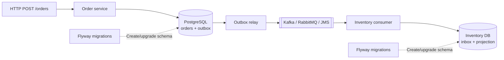
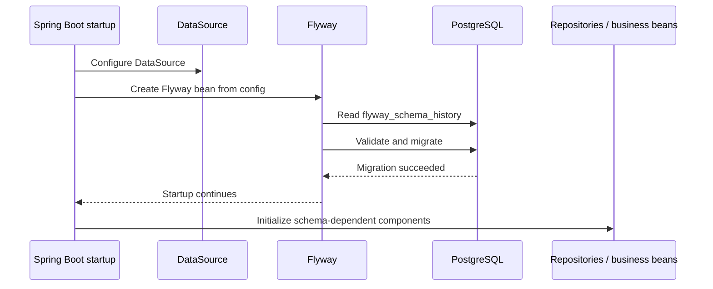
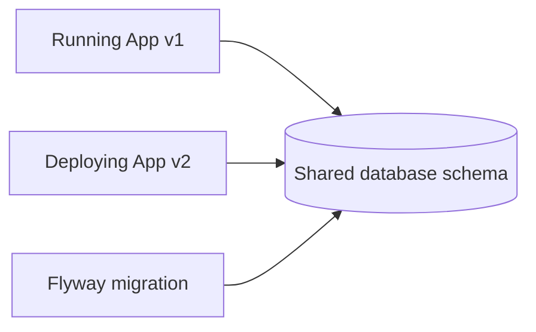
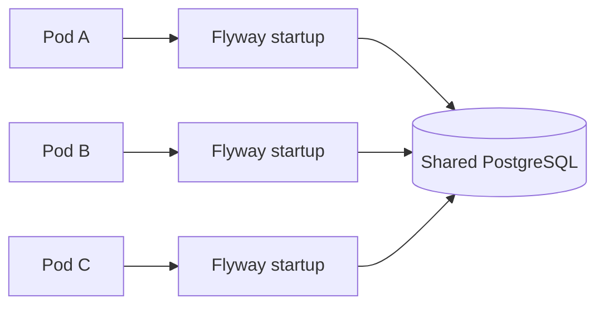

# Flyway Database-Specific Modules and Required Dependencies

A Spring Boot application using PostgreSQL can connect to the database and run `JdbcTemplate` normally, yet fail immediately at startup during Flyway initialization with messages such as **`Unsupported Database`** or **`No database found to handle...`**. The root cause may not lie in the JDBC URL, password, or migration SQL. In recent Flyway generations, support for multiple database engines was **split out of `flyway-core` into database-specific modules**; the application must have the matching module on its **runtime classpath** alongside the corresponding JDBC driver.

Another scenario: a team adds the Flyway dependency to a Gradle subproject dedicated to storing migration scripts, yet the final Spring Boot service fails to pull that dependency into its runtime. As a result, local runs appear fine, while the production image lacks the module or resolves a different version. Or tests run against H2 so all migrations pass, while production PostgreSQL rejects H2 SQL syntax.

This lesson belongs to the **Initialization and Migration** chapter of the **SPRING_BOOT_INTEGRATION** module. In this module, Spring Boot integrates systems via HTTP clients, SQL, caches, message brokers, and Spring Integration adapters. Therefore, Flyway is not merely a "create tables" utility: the schema must be deployed in alignment with **data contracts, transactions, outbox/inbox, deduplication, error handling, testing, and observability** across the integration system.

> **Version scope:** Primary examples use Java 17+, Spring Boot 3.x, PostgreSQL, and Flyway generation **10 and above**, where database support modules are split separately. Spring Boot 3.x is not a single version: older Boot releases may manage Flyway 9.x, while newer Boot releases may manage Flyway 10.x/11.x. Spring Boot 4.x and subsequent Flyway releases may change artifacts, packages, APIs, and support scope. **Always inspect the dependency tree, documentation, and support matrix of the exact chosen version** rather than forcing example coordinates onto every project.

## 1. Learning Objectives

After this lesson, you will be able to:

1. Distinguish **Flyway core**, **Flyway database module**, **JDBC driver**, **Spring Boot auto-configuration**, and **Flyway Gradle/Maven plugin/CLI**.
2. Explain why a database reachable over JDBC can still be reported by Flyway as unsupported.
3. Declare appropriate dependencies for PostgreSQL, MySQL/MariaDB, Oracle, or SQL Server according to the Flyway version in use.
4. Use Spring Boot dependency management/BOM to avoid conflicts between `flyway-core` and database modules.
5. Identify the application's actual **runtime classpath**, rather than only looking at dependencies in another module.
6. Configure Flyway locations, schemas, history tables, baselines, and connection paths via Spring Boot properties.
7. Design ordered migrations compatible with rolling deployments without breaking active producers/consumers.
8. Distinguish startup migrations, pipeline migrations, database locking, and transactional DDL across database engines.
9. Test migrations using Testcontainers with the same database engine as production.
10. Diagnose unsupported database, missing driver, checksum mismatch, schema privilege, failed migration, and startup race errors.

## 2. What Does Flyway Do in an Integration Application?

**Flyway** manages controlled database schema evolution using versioned migrations and an execution history. Rather than each developer running SQL manually, the team tracks migrations in source control and deploys them via a repeatable workflow.

Example of an order-creation system:



Flyway is responsible for:

- Creating tables, indexes, constraints, sequences, and database objects per migrations.
- Checking which migrations have already been applied.
- Executing missing migrations in the proper order.
- Detecting checksum differences in already-executed versioned migrations.
- Providing a schema version trail for deployment and troubleshooting.

Flyway does **not** automatically:

- Guarantee correctness of JSON/Avro events or HTTP responses.
- Turn SQL transactions and broker sends into a distributed transaction.
- Verify whether all applications using the schema remain compatible.
- Resolve deadlocks, idempotency, duplicate messages, or invalid business-rule data.
- Guarantee every DDL statement can roll back on every database engine.
- Compute safe rollout ordering across multiple services on its own.

Migrations create and evolve the **storage contract**; end-to-end consistency must still be designed in the application and integration adapters.

## 3. Five Pieces Commonly Confused

| Component | Role | Example |
| --- | --- | --- |
| **Flyway core** | Migration engine, history, versioning, scanning, orchestration | `org.flywaydb:flyway-core` |
| **Flyway database module** | Recognition and support logic for a specific database family in modular Flyway versions | `org.flywaydb:flyway-database-postgresql` |
| **JDBC driver** | Connection protocol / SQL transport to the database | `org.postgresql:postgresql` |
| **Spring Boot Flyway auto-configuration** | Detects Flyway on classpath, creates/configures beans, invokes migrate in lifecycle | Part of Spring Boot auto-configuration |
| **Flyway CLI / Maven / Gradle plugin** | Runs migrations from pipelines or build tasks outside application bootstrap if chosen | Flyway CLI or matching build plugin |

**Important:** The three pieces `flyway-core` + database module + JDBC driver serve **distinct functions**. They do not substitute for one another.

### 3.1. What is Flyway core?

`flyway-core` provides foundational capabilities such as:

- Scanning migration scripts in configured locations.
- Managing metadata/history and version ordering.
- Executing migrations through the configured connection source.
- Validating migration status, checksums, and naming.
- Providing the Flyway Java API and related integrations.

In Flyway 10+, many database engines require separately packaged support modules. **Core alone may not be enough** for core to recognize the database you are using.

### 3.2. What is a database-specific module?

A module like `flyway-database-postgresql` supplies PostgreSQL support to Flyway in releases using this modular architecture. A database module can contain:

- Vendor/version detection logic supported by the engine.
- SQL grammar configuration and database capability definitions.
- Dialect-specific migration, locking/history, or statement logic.
- Database type/provider integration discovered by Flyway via the runtime classpath.

Do not call internal module classes directly in business code. Typically you only need to **place the dependency on the runtime classpath** so Flyway loads the provider through its service-loading mechanism.

### 3.3. What is a JDBC driver?

`org.postgresql:postgresql` enables Java to connect to PostgreSQL over JDBC. The driver handles:

- `jdbc:postgresql://...` URLs.
- TCP/TLS and driver-level authentication.
- JDBC `Connection`, `Statement`, and `ResultSet`.
- JDBC type and wire-protocol mappings.

The driver does **not** provide a versioned migration engine. Conversely, the Flyway PostgreSQL module does **not** replace the pgJDBC driver.

### 3.4. What does Spring Boot auto-configuration do?

When `Flyway` is on the classpath, an appropriate datasource exists, and conditions match, Spring Boot can create a `Flyway` bean and run migrations at startup, generally before schema-dependent components like JPA are used.

However, Spring Boot **does not automatically download missing Flyway modules from the Internet** just because `spring.datasource.url` points to PostgreSQL. The build must declare the appropriate module.

### 3.5. CLI/plugins do not necessarily live inside the app

A pipeline may execute:

```text
Flyway CLI / Gradle task -> Database schema update
                                        |
                                        v
                              Spring Boot runtime
```

That is the **out-of-app migration** model. Having the Flyway Gradle plugin in the build does not automatically put `Flyway` and its database module onto the Spring Boot `runtimeClasspath`. Both runtimes must be evaluated separately.

## 4. Why Does the Flyway Version Matter?

### 4.1. Generational changes

In older generations, many database capabilities were bundled inside `flyway-core`. In Flyway 10+, support for numerous databases moved into **separate modules**, with artifact naming and support matrices varying by engine/version.

Consequences:

- A guide written for Flyway 8/9 might only add `flyway-core` and work.
- Applying that same guide to Flyway 10+ can miss the database module.
- An older Spring Boot version managing Flyway 9 can be **incompatible** if a user forces only `flyway-core` up to 11 without checking Boot integration and modules.
- The dependency tree might pull core v11 alongside database module v10 due to an explicit override, producing hard-to-diagnose runtime errors.

**Do not apply a single dependency table across every Flyway generation.** Before editing the build, determine:

1. Exact Spring Boot version.
2. Flyway version managed by the Boot BOM.
3. Database engine and major version.
4. Database support artifact for that exact Flyway version.
5. JDBC driver compatible with your JVM/database version.
6. License/edition if using Flyway or database features outside the chosen edition's community scope.

### 4.2. A core compatibility rule

```text
Spring Boot version
      |
      v
Managed Flyway version
      |
      +--> flyway-core : same version
      |
      +--> Flyway database module : same version
      |
      +--> JDBC driver : compatible with JVM / database / Boot BOM
```

**The JDBC driver does not have to share Flyway's version number.** What must align are the **Flyway artifacts** with each other; drivers use their own versioning scheme.

### 4.3. When should you override the Flyway version?

Consider overriding only when:

- The Boot BOM manages a Flyway version too old to support a newly deployed database.
- An evaluated bug or security fix requires it.
- The project needs a database module/feature only present in a newer Flyway release.
- Compatibility between Spring Boot auto-configuration and Flyway APIs has been verified.

Accompany any override with:

- Dependency tree and `runtimeClasspath` verification.
- Migration integration tests on the real database.
- Tests against metadata/history created by the older version.
- A rollback plan: **rolling back the Flyway library does not roll back the schema or history table**.
- Documented release notes, support matrix, licensing, and sign-off.

Never bump individual dependencies ad hoc in a multi-module build and hope Gradle/Maven picks a compatible set.

## 5. Modules by Database Engine: Choosing the Right Artifact

The module names below are **common examples in the Flyway 10+ line**. Exact artifact names, supported versions, and license terms must be checked against the Flyway documentation for your specific version.

| Database | Common Flyway Module | Common JDBC Driver | Notes |
| --- | --- | --- | --- |
| **PostgreSQL** | `org.flywaydb:flyway-database-postgresql` | `org.postgresql:postgresql` | Primary example in this lesson |
| **MySQL** | `org.flywaydb:flyway-mysql` | `com.mysql:mysql-connector-j` | Check MySQL version and Flyway support |
| **MariaDB** | `org.flywaydb:flyway-mysql` in releases sharing the module | `org.mariadb.jdbc:mariadb-java-client` | Do not assume MySQL and MariaDB drivers are identical from the module name |
| **Oracle Database** | `org.flywaydb:flyway-database-oracle` | `com.oracle.database.jdbc:ojdbc11` or suitable driver | Check JVM, Oracle version, edition/license |
| **Microsoft SQL Server** | `org.flywaydb:flyway-sqlserver` in releases using this artifact | `com.microsoft.sqlserver:mssql-jdbc` | Confirm artifact/support for the project's Flyway version |
| **H2** | Depends on Flyway version; may be in core or separate support | `com.h2database:h2` | Do not treat H2 as proof of PostgreSQL/MySQL migration compatibility |

**Key takeaway:** Not every database module follows the `flyway-database-<vendor>` pattern. For example, common artifacts are named `flyway-mysql` or `flyway-sqlserver`. Therefore, do not string-concatenate dependency names from JDBC URLs; use the exact module documented for your Flyway version.

### 5.1. PostgreSQL

If the application connects to:

```text
jdbc:postgresql://orders-db:5432/orders
```

you need both the **pgJDBC driver** and, for corresponding Flyway 10+ releases, the **PostgreSQL Flyway database module**. Do not treat two artifacts as interchangeable merely because both mention "PostgreSQL."

### 5.2. MySQL and MariaDB

Although MySQL and MariaDB share roots, their versions, SQL dialects, transaction/DDL behaviors, and JDBC drivers differ. Even in Flyway versions sharing `flyway-mysql` for both engines, you must still:

- Use the JDBC driver matching the actual engine.
- Confirm the database version is in the support matrix.
- Avoid assuming one vendor-specific SQL migration set works on both just because the module name is shared.
- Inspect `ALTER TABLE`, locking, implicit commits, and data types separately.

### 5.3. Oracle

Oracle uses different drivers depending on Java version and environment. For instance, `ojdbc11` fits newer JVM environments; do not assume every driver release fits every JDK/Oracle combination. Many Oracle DDL statements cause implicit commits: recovery plans must account for not being able to roll back like PostgreSQL.

### 5.4. SQL Server

SQL Server has its own JDBC URL, schema namespaces, and T-SQL syntax. Migrations may require batch separators and transaction semantics aligned with Flyway support. Never copy PostgreSQL's `CREATE INDEX CONCURRENTLY` syntax into SQL Server.

### 5.5. Managed / cloud databases

Cloud offerings like AWS RDS PostgreSQL or Azure Database for PostgreSQL typically expose the **PostgreSQL protocol**, so you generally select the PostgreSQL JDBC driver/module, while still verifying:

- Actual database engine and major/minor version.
- IAM/managed authentication/TLS/cloud proxies.
- Available extensions, DDL privileges, quotas, and policies.
- Whether your Flyway version recognizes the vendor/version string.
- Features restricted by the cloud provider.

Do not guess Flyway artifacts solely from a cloud service's marketing name.

## 6. Spring Boot 3.x + PostgreSQL: Gradle Groovy DSL

### 6.1. Minimal dependencies for JDBC migrations

Assuming the project already has the standard Spring Boot plugin/BOM configured:

```groovy
dependencies {
    implementation 'org.springframework.boot:spring-boot-starter-jdbc'

    // Flyway engine.
    implementation 'org.flywaydb:flyway-core'

    // Required on Flyway versions with a separate PostgreSQL module.
    runtimeOnly 'org.flywaydb:flyway-database-postgresql'

    // JDBC driver that actually connects to PostgreSQL.
    runtimeOnly 'org.postgresql:postgresql'

    testImplementation 'org.springframework.boot:spring-boot-starter-test'
}
```

**Why can `runtimeOnly` be appropriate for the module and driver?** Business code does not directly call internal APIs of the Flyway PostgreSQL module or pgJDBC driver. They must be present when the app starts/runs, so they belong in the runtime dependency graph. `implementation` is also valid for the module if the project needs compile-time references, though usually unnecessary.

**Note:** If the service never calls `Flyway` Java APIs directly, `flyway-core` can also be placed in runtime scope where appropriate. Using `implementation` in the example makes it explicit that the engine is part of the application. **Always inspect the final `runtimeClasspath`**, rather than guessing from Gradle configuration names.

### 6.2. Do not hardcode versions when the BOM manages them

When Spring Boot dependency management controls Flyway versions:

```groovy
implementation 'org.flywaydb:flyway-core'
runtimeOnly 'org.flywaydb:flyway-database-postgresql'
```

is typically the clean way to keep them on the Boot-provided version alignment. Verify that the BOM actually manages both artifacts at the supported version. If an older Spring Boot release does not manage a newer database module, adopt an upgrade strategy or appropriate constraint/BOM; omitting versions does not automatically solve everything.

### 6.3. Do not place the module only in `testImplementation`

Incorrect for production:

```groovy
dependencies {
    implementation 'org.flywaydb:flyway-core'
    testImplementation 'org.flywaydb:flyway-database-postgresql'
    runtimeOnly 'org.postgresql:postgresql'
}
```

Tests pass because the test runtime contains the PostgreSQL module. Production runtime will lack it.

Correct when migrations run at production startup:

```groovy
runtimeOnly 'org.flywaydb:flyway-database-postgresql'
```

**If a separate pipeline executes migrations and the service runtime intentionally disables Flyway**, dependency placement may differ. That should be an explicit deployment decision, not an accidental side effect of test dependencies.

## 7. Spring Boot 3.x + PostgreSQL: Gradle Kotlin DSL

Example for a project using `build.gradle.kts`:

```kotlin
dependencies {
    implementation("org.springframework.boot:spring-boot-starter-jdbc")

    implementation("org.flywaydb:flyway-core")
    runtimeOnly("org.flywaydb:flyway-database-postgresql")
    runtimeOnly("org.postgresql:postgresql")

    testImplementation("org.springframework.boot:spring-boot-starter-test")
    testImplementation("org.springframework.boot:spring-boot-testcontainers")
    testImplementation("org.testcontainers:junit-jupiter")
    testImplementation("org.testcontainers:postgresql")
}
```

In a Gradle multi-project build, dependencies must be declared in the **exact project producing the executable service** or propagated transitively with the right scope. Having `runtimeOnly` in `:database-migrations` does not automatically deliver that module to `:orders-service` if project dependencies do not expose it into the runtime graph.

One way to verify is inspecting the service's resolved runtime dependency graph in the build tool (this lesson describes the process and **does not execute a build**):

```bash
./gradlew :orders-service:dependencies --configuration runtimeClasspath
```

On Windows, use `gradlew.bat` in the corresponding shell. This command is just an example for a project named `orders-service`; substitute the real Gradle project path.

## 8. Maven: Flyway Core, Module, and Driver

With `spring-boot-starter-parent` or an equivalent BOM managing versions:

```xml
<dependencies>
    <dependency>
        <groupId>org.springframework.boot</groupId>
        <artifactId>spring-boot-starter-jdbc</artifactId>
    </dependency>

    <dependency>
        <groupId>org.flywaydb</groupId>
        <artifactId>flyway-core</artifactId>
    </dependency>

    <dependency>
        <groupId>org.flywaydb</groupId>
        <artifactId>flyway-database-postgresql</artifactId>
        <scope>runtime</scope>
    </dependency>

    <dependency>
        <groupId>org.postgresql</groupId>
        <artifactId>postgresql</artifactId>
        <scope>runtime</scope>
    </dependency>
</dependencies>
```

If not using a parent/BOM for version management, declare compatible versions intentionally. Never set `<version>` on core while omitting it on the module, or pull the module from an unrelated dependency graph.

To inspect resolved Maven dependencies:

```bash
./mvnw dependency:tree -Dincludes=org.flywaydb,org.postgresql
```

Inspect **effective runtime dependencies and final packaging**; a library declared `provided` or excluded downstream may be missing from the executable artifact.

## 9. Added the Right Module, Yet Flyway Still Doesn't Start?

A valid dependency does not guarantee auto-configuration runs. Key conditions:

- `flyway-core` is on the runtime classpath.
- Spring Boot Flyway auto-configuration is not excluded.
- `spring.flyway.enabled` is not disabled.
- A usable `DataSource`/connection details exist for Flyway, or Flyway has its own datasource configuration.
- Both driver and database module are present and compatible with the DB version.
- Sufficient permissions exist to read/write metadata history and migration targets.
- Resource locations, script names, and migration contents are valid.

Example:

```yaml
spring:
  datasource:
    url: ${ORDERS_JDBC_URL}
    username: ${ORDERS_DB_USERNAME}
    password: ${ORDERS_DB_PASSWORD}

  flyway:
    enabled: true
    locations:
      - classpath:db/migration
```

Spring Boot normally uses the application datasource when no Flyway-specific connection settings exist. However, with multiple datasources, custom Flyway beans, or custom connection details, datasource selection depends on actual configuration/annotations/conditions.

### 9.1. When migrations execute

In the app-managed migration model:



Spring Boot coordinates database initialization for known components. However, **there is no guarantee every custom bean/scheduled job automatically waits for Flyway** if code spawns threads or runs SQL outside standard lifecycle hooks. For custom startup jobs, design explicit dependency/ordering.

### 9.2. Should Flyway be included in a service with no JDBC runtime?

If a worker uses only Kafka + external HTTP and never accesses SQL, adding Flyway starter/core can make startup unnecessarily dependent on a database. Only include Flyway in runtimes that require migrations, or use a dedicated pipeline/migration job. **A service that does not need SQL must not accidentally become SQL-dependent from extra dependencies.**

## 10. Creating the First Migration Scripts

### 10.1. Default locations and naming

A typical project layout:

```text
src/main/resources/
└── db/
    └── migration/
        ├── V1__create_orders.sql
        ├── V2__create_outbox.sql
        └── V3__add_order_source.sql
```

Flyway scans migrations in configured locations (typically `classpath:db/migration` in Spring Boot) and derives versions from filenames.

- `V1__create_orders.sql`: versioned migration 1.
- `V2__create_outbox.sql`: versioned migration 2.
- `R__refresh_reporting_view.sql`: repeatable migration, re-run when checksum changes per Flyway rules.

Between version and description there are **two underscores**. Filenames and migration rules are standardized—never alter them haphazardly once executed in production.

### 10.2. V1 creates the order table

**`V1__create_orders.sql`**

```sql
CREATE TABLE orders (
    order_id UUID PRIMARY KEY,
    tenant_id VARCHAR(64) NOT NULL,
    order_state VARCHAR(32) NOT NULL,
    amount_minor BIGINT NOT NULL CHECK (amount_minor >= 0),
    currency CHAR(3) NOT NULL,
    version BIGINT NOT NULL DEFAULT 1,
    created_at TIMESTAMPTZ NOT NULL DEFAULT now()
);

CREATE INDEX idx_orders_tenant_created
    ON orders (tenant_id, created_at);
```

This migration uses PostgreSQL syntax such as `UUID`, `TIMESTAMPTZ`, and `now()`. It is **not** a portable SQL migration for H2, Oracle, or SQL Server.

### 10.3. V2 creates the outbox

**`V2__create_outbox.sql`**

```sql
CREATE TABLE integration_outbox (
    event_id UUID PRIMARY KEY,
    tenant_id VARCHAR(64) NOT NULL,
    aggregate_type VARCHAR(64) NOT NULL,
    aggregate_id VARCHAR(128) NOT NULL,
    event_type VARCHAR(128) NOT NULL,
    schema_version INTEGER NOT NULL,
    payload_json JSONB NOT NULL,
    status VARCHAR(24) NOT NULL DEFAULT 'READY',
    attempt_count INTEGER NOT NULL DEFAULT 0,
    created_at TIMESTAMPTZ NOT NULL DEFAULT now(),
    published_at TIMESTAMPTZ
);

CREATE INDEX idx_outbox_ready
    ON integration_outbox (created_at, event_id)
    WHERE status = 'READY';
```

Flyway creates the table here, yet does not automatically design:

- Atomicity between `orders` and `integration_outbox` inside Spring `@Transactional`.
- Outbox relay polling/CDC and broker acknowledgments.
- Idempotent consumer/inbox logic.
- Schema contracts for `payload_json`.
- State machines, retries, DLQ, and reconciliation.

**Flyway migrations only build the SQL infrastructure for the workflow**; they do not replace the application protocol.

### 10.4. V3 adds a backward-compatible field

**`V3__add_order_source.sql`**

```sql
ALTER TABLE orders
ADD COLUMN order_source VARCHAR(32);
```

This is an **expand migration**: the nullable column lets older service versions continue inserting without knowing `order_source`, while the new version can write values. Only after backfilling and confirming no old writers remain should you consider another migration to add constraints or drop legacy fields.

Do not set `NOT NULL` without a default while old application versions are still creating orders without populating the new field.

## 11. Flyway History and Checksums

### 11.1. flyway_schema_history

Flyway normally records history in **`flyway_schema_history`** within the configured schema according to Flyway rules. This table reflects:

- Version and description.
- Executed migration script.
- Checksum.
- Execution order and timestamp.
- Success/failure status, depending on database and transaction behavior.

A startup cycle:

```text
Database has no history:
  -> Flyway creates history table (per permissions and configuration)
  -> executes V1, V2, V3 in order
  -> records migration status

Subsequent startup:
  -> reads history
  -> validates applied migrations
  -> runs only missing migrations
```

Do not manually edit the history table via SQL to "bump" versions unless following a governed recovery/repair procedure with full understanding of its effects. History metadata is part of Flyway's guarantee that migrations are properly tracked.

### 11.2. What do checksums mean?

Flyway stores a checksum of the content of every executed versioned migration. If `V1__create_orders.sql` is edited after V1 has already run, validation can report a checksum mismatch.

**Sound principle: never modify already-released versioned migrations.** Create a new migration, e.g., `V4__add_order_currency_constraint.sql`, instead of rewriting history.

Exceptions such as fixing comments/formatting or accidental edits require an audit/review process and `repair` where appropriate—never use `repair` as a default error-suppression button.

### 11.3. Repeatable migrations

`R__refresh_reporting_view.sql` can be used for views/functions recreated whenever their contents change:

```sql
CREATE OR REPLACE VIEW order_summary AS
SELECT tenant_id,
       count(*) AS order_count,
       sum(amount_minor) AS amount_minor_total
FROM orders
GROUP BY tenant_id;
```

Repeatable migrations re-run based on checksum changes; thus scripts should be written to re-run safely in the target SQL dialect, such as `CREATE OR REPLACE VIEW` where supported.

Do not use repeatable migrations in place of all versioned schema changes: changing a field actively used by application v1 still needs compatibility planning and proper versioned migrations.

## 12. Flyway Locations Across Multiple Database Engines

### 12.1. Vendor-specific directories

A project supporting PostgreSQL and MySQL may need separate migrations:

```text
src/main/resources/
└── db/
    └── migration/
        ├── postgresql/
        │   ├── V1__create_orders.sql
        │   └── V2__create_outbox.sql
        └── mysql/
            ├── V1__create_orders.sql
            └── V2__create_outbox.sql
```

In Spring Boot, the `{vendor}` placeholder is supported in Flyway locations in corresponding Boot versions:

```yaml
spring:
  flyway:
    locations:
      - classpath:db/migration/{vendor}
```

Spring Boot determines the vendor from the active database using its internal detection and resolves the location. Verify the **exact vendor value** for your Boot/database driver/version; never assume aliases like `postgres`, `postgresql`, or `mariadb` map identically.

### 12.2. Never keep V1 of two vendors in the same scanned location

If a single location scan picks up both:

```text
db/migration/postgresql/V1__...
db/migration/mysql/V1__...
```

and both are resolved, Flyway can hit duplicate migration versions or execute the wrong dialect. Restrict locations by vendor or isolate them into distinct build modules.

### 12.3. Are common scripts always portable?

You can configure:

```yaml
spring:
  flyway:
    locations:
      - classpath:db/migration/common
      - classpath:db/migration/{vendor}
```

provided **every migration version across the union of locations is unique** per Flyway rules and the common scripts are genuinely supported by every target database. Even seemingly simple SQL like `BOOLEAN`, `TIMESTAMP WITH TIME ZONE`, or upserts differs semantically across PostgreSQL, Oracle, SQL Server, and MySQL.

## 13. Key Spring Boot Flyway Properties

Configuration example:

```yaml
spring:
  flyway:
    enabled: true
    locations:
      - classpath:db/migration
    validate-on-migrate: true
    baseline-on-migrate: false
    clean-disabled: true
    table: flyway_schema_history
```

| Property | Meaning | Warning |
| --- | --- | --- |
| `spring.flyway.enabled` | Enables/disables Boot's Flyway integration | Disabling does not mean the database schema is valid |
| `spring.flyway.locations` | List of migration resource locations | Wrong path causes Flyway to miss scripts |
| `spring.flyway.validate-on-migrate` | Validates migration state on migrate | Never disable just to bypass checksum errors at startup |
| `spring.flyway.baseline-on-migrate` | Conditionally allows baselining an unmanaged non-empty schema | Can mask pointing to the wrong database/schema |
| `spring.flyway.baseline-version` | Baseline history version | Must match actual schema state |
| `spring.flyway.schemas` | Schemas managed by Flyway | Distinct from `search_path`/explicit SQL targets |
| `spring.flyway.default-schema` | Default schema per Flyway | Must match database namespace and user |
| `spring.flyway.table` | Schema history table name | Do not rename carelessly after runs |
| `spring.flyway.clean-disabled` | Prevents destructive clean per policy | Keep protected in production |
| `spring.flyway.url/user/password` | Dedicated connection for Flyway if needed | Separate cleanly from app datasource |

Property names and capabilities can vary across Boot/Flyway versions. In Boot 3.x, check `/actuator/configprops`/environment in secured environments alongside `ConditionEvaluationReport`.

### 13.1. Avoid `baseline-on-migrate` without thorough assessment

Example:

```yaml
spring:
  flyway:
    baseline-on-migrate: true
```

This looks convenient when onboarding an existing database with tables. However, if an application **accidentally points to a different populated production schema**, Flyway may wrongly baseline it and skip migrations assumed to already exist.

Legacy database onboarding process should:

1. Back up and inventory the current schema.
2. Pick a baseline version matching the true schema state.
3. Verify data, constraints, and migrations applied prior to Flyway.
4. Dry-run on a database copy.
5. Baseline via an approved procedure.
6. Disable automatic baselining once no longer needed.

### 13.2. Never use `clean` to fix failed migrations

`flyway clean` can drop managed objects per policy, which is **data-destructive**. Keep `clean-disabled: true` in any environment where schema deletion is prohibited, especially staging with production-like data and production itself.

Never write a startup hook saying "if migrate fails, clean and retry." On a database holding orders/outbox/inbox data, doing so destroys both business records and message deduplication state.

## 14. Separating the Migration DataSource from the Application DataSource

### 14.1. Why are two privilege levels needed?

In production, an order-processing service typically needs:

- `SELECT`/`INSERT`/`UPDATE` on specific tables.
- Sequence permissions per business requirements.
- No `DROP TABLE` or `ALTER TABLE` during request handling.

Conversely, Flyway migrations may need DDL grants:

- `CREATE/ALTER/DROP` objects in the managed schema.
- Write access to the history table.
- Index or extension creation privileges where permitted.

**Do not let the application runtime use a broader DDL account than necessary** just for convenience in configuring Flyway.

### 14.2. A separated configuration

```yaml
spring:
  datasource:
    url: ${ORDERS_JDBC_URL}
    username: ${ORDERS_APP_DB_USER}
    password: ${ORDERS_APP_DB_PASSWORD}

  flyway:
    url: ${ORDERS_JDBC_URL}
    user: ${ORDERS_MIGRATION_DB_USER}
    password: ${ORDERS_MIGRATION_DB_PASSWORD}
    locations:
      - classpath:db/migration
```

In this configuration, migrations can use a dedicated connection configuration as supported by Spring Boot. **Do not assume setting only one of `spring.flyway.url/user/password` behaves identically across all versions**; configure completely and test the effective connection.

Specifically:

- Keep TLS/hostname verification properly enforced on both connections.
- Avoid logging secrets/passwords in Flyway diagnostics.
- Verify the Flyway user has sufficient permissions to create metadata history in the target schema.
- Verify the app user retains proper CRUD privileges after migrations.
- In multi-schema setups, check `search_path`/default schema/schema history placement.

### 14.3. Timing of DDL privilege exposure

If the service runs Flyway itself at startup, deployment must supply migration credentials during the startup window. This increases the blast radius compared to a **dedicated migration job** using DDL privileges while the service runs solely with a restricted DML account.

No single model fits every organization. What matters is **clear ownership and access controls**, avoiding superuser accounts for every service.

## 15. Multiple DataSources and Flyway

### 15.1. An application using two databases

Suppose:

```text
ordersDataSource    -> PostgreSQL orders DB
reportingDataSource -> PostgreSQL analytics DB
```

Spring Boot auto-configuration does not automatically know you want to run **two independent migration sets** merely because two `DataSource` beans exist. Without explicit design, it may:

- Pick a primary/single candidate datasource.
- Find no unambiguous candidate and skip creating a Flyway bean.
- Run migrations on the **wrong database** if `spring.flyway.url` is mispointed.
- Use a single history table/locations unsuitable for both domains.

### 15.2. @FlywayDataSource

In certain Spring Boot 3.x setups, `@FlywayDataSource` designates the datasource for migrations:

```java
@Bean("ordersMigrationDataSource")
@FlywayDataSource
DataSource ordersMigrationDataSource() {
    return buildMigrationDataSource();
}
```

This is a **structural pattern** where `buildMigrationDataSource()` is implemented by the app from properties/secrets; the snippet requires importing `org.springframework.boot.autoconfigure.flyway.FlywayDataSource` matching your Boot version.

It directs Boot to pick a connection source for **one auto-configured Flyway pipeline** under Boot conditions; it is **not** an annotation that auto-generates N Flyway runners for N datasources.

### 15.3. Two genuinely separate migration sets

When managing two databases, you can choose:

1. **Two separate deployment/migration jobs**: each job has its own URL, Flyway config, scripts, and history.
2. **Two explicitly configured Flyway beans in the application**, with independent lifecycles and migration ordering.
3. **An independent migration service** managing each database's schema with proper privilege isolation, keeping DDL out of app runtime.

With the second approach, verify Spring Boot auto-configuration back-off and startup ordering so one migration group doesn't run twice accidentally. Defining a custom `Flyway` bean can suppress Boot's default Flyway branch, so never assume you get both custom and auto-configured Flyway instances automatically.

### 15.4. Avoid mixing transaction boundaries

If a service writes to both orders DB and reporting DB, Flyway only ensures **each schema is migrated**; it does not provide distributed transactions across two datasources. For cross-database synchronization, use outbox, CDC, idempotent consumption, reconciliation, or a transaction coordinator if truly supported and operated properly.

## 16. Multi-Tenant: Multiple Schemas, Multiple Databases

Three common models:

| Tenant Storage Model | Impact on Flyway |
| --- | --- |
| Shared database/shared schema, `tenant_id` column | Typically one migration stream/schema; requires tenant-aware constraints |
| Shared database/separate schemas | May require migrating each schema or configuring `schemas` appropriately |
| Separate database per tenant | Each DB has its own history/version and lifecycle |

**Never assume a single Spring Boot startup should migrate all tenant databases.** At large tenant counts, running DDL across all of them concurrently can:

- Cause heavy lock contention and database load.
- Prolong startup and widen failure blast radius.
- Leave tenants on different schema versions after partial failures.
- Complicate rollouts/rollbacks when service and tenant schemas fall out of sync.

Build a job orchestrator with bounded concurrency, per-tenant status, controlled retries, and migration history auditing. With schema-per-tenant, do not confuse `spring.flyway.schemas` with each tenant maintaining independent history and sequences; check where the history table is placed and how your Flyway version handles schemas.

## 17. Migrations and the Expand–Migrate–Contract Strategy

### 17.1. Why is backward compatibility needed?

A service may undergo a rolling deploy: v1 and v2 instances run simultaneously. If a migration renames `orders.order_state` to `status` and drops the old column immediately, v1 instances will fail with SQL errors even though the Flyway migration succeeded.



The schema must remain compatible with **all application versions actually coexisting**, not just the latest code.

### 17.2. Expand: add new columns as non-required first

```sql
ALTER TABLE orders
ADD COLUMN state_code VARCHAR(32);
```

At this stage:

- App v1 continues using `order_state`.
- App v2 can read both `state_code` and `order_state`.
- App v2 can dual-write during the transition window.
- Historical data is backfilled in controlled batches.

### 17.3. Migrate: backfill and consistency checks

Example:

```sql
UPDATE orders
SET state_code = order_state
WHERE state_code IS NULL;
```

On very large tables, running a single full-table `UPDATE` can cause locks, heavy WAL/undo, replication lag, and transaction timeouts. Production should backfill in conditional batches with observability.

Check:

- Count of rows still having `state_code IS NULL`.
- Mismatch rate between old and new columns.
- Whether any v1 writer is still inserting rows missing the new column.
- Whether consumers/ETL/reporting still depend on the old column.
- Whether the v1 rollback binary still works.

### 17.4. Contract: drop old column in a subsequent release

Only when no old writers/readers depend on it, execute a separate migration:

```sql
ALTER TABLE orders
DROP COLUMN order_state;
```

By nature, "contract" is an **intentional breaking change**, so require proof that the compatibility window has closed. Never run it in the same deployment as expand while mixed-version traffic exists.

### 17.5. Event/HTTP compatibility matters too

If a new schema changes the semantics of `amountMinor` or `status`, stored outbox events may still carry old payload versions. Flyway altering SQL columns does not automatically upgrade Kafka event schemas or HTTP DTOs. Preserve:

- Event `schemaVersion` and reader backward compatibility.
- Idempotency keys and ordering versions.
- Retries/replays of outbox/DLQ containing older payloads.
- Consumer projections/caches and partner APIs.

**Database schema migration is part of protocol evolution**, not an isolated step independent of everything else.

## 18. Transactional DDL Differs Across Databases

### 18.1. PostgreSQL

Many PostgreSQL DDL statements can run inside transactions. If a migration fails mid-transaction, changes executed in that transaction can roll back.

However, **not all PostgreSQL DDL can run inside a transaction block**. For example:

```sql
CREATE INDEX CONCURRENTLY idx_orders_state
ON orders (order_state);
```

`CREATE INDEX CONCURRENTLY` has special restrictions: it cannot run inside a standard transaction block. With Flyway, configure the script/migration appropriately for non-transactional execution per your Flyway version's documentation.

A common pattern is a companion configuration file next to the migration:

```text
V4__create_order_state_index.sql
V4__create_order_state_index.sql.conf
```

Config file content (per supported Flyway syntax):

```properties
executeInTransaction=false
```

**Do not copy mechanically:** config filenames, `executeInTransaction`, and how Flyway groups migrations depend on version. Test accurately on PostgreSQL, especially when mixing transactional and non-transactional migrations.

### 18.2. MySQL/MariaDB

Many DDL operations in MySQL/MariaDB cause **implicit commits** and do not roll back all schema changes the way PostgreSQL users expect. A migration failing halfway can leave newly created objects behind.

Consequences:

- Know what state Flyway history reflects after failure.
- Manual schema repair per runbook may be required before validate/repair/retry.
- Do not assume `@Transactional` or Flyway transaction settings can undo every `ALTER TABLE`.
- Test heavy migrations on the exact target engine/version.

### 18.3. Oracle

Oracle DDL generally has different commit semantics than PostgreSQL, with many DDL statements auto-committing. Migration failures may require manual remediation or a forward-fix migration.

### 18.4. SQL Server

SQL Server supports transactions for many DDL statements, yet exceptions and special cases exist. Never rely on a single blanket claim that all migrations roll back: inspect statement type, isolation, locking, and Flyway/provider support.

### 18.5. General takeaway

**Migration atomicity is a property of the database engine, the DDL statement, and how Flyway executes it**—not merely calling `Flyway.migrate()` from Java. In production, always have a backup/rollback or forward-fix plan and dry-run migrations on a copy of real data.

## 19. Migrations When Multiple Replicas Start Concurrently

### 19.1. Startup migration model

When deploying three replicas simultaneously:



Flyway uses locking/coordination around migration history per database to reduce concurrent migrations. Yet that **does not solve every deployment problem**:

- Replicas start slowly while waiting on the migration lock.
- Heavy schema migrations lock the database, slowing down v1 traffic.
- App v1 still runs while the schema has already changed.
- Multiple services sharing a history table/locations cause conflicts.
- Infrastructure readiness/liveness probes may restart pods during slow migrations.

### 19.2. Dedicated migration job model

An alternative:


Benefits:

- A single executor runs migrations in the release workflow.
- The app runtime can use a lower-privilege DML account.
- Easier auditing of duration, results, and migration approvals.
- Reduces multiple replicas contending on startup locks.

However, you must still coordinate **expand first, deploy compatible code, contract later**. A successful job alone does not prove the schema is compatible with every live traffic-serving instance.

### 19.3. Schema ownership

A database shared across services needs clear rules:

- One service/module is the **owner** of the schema/migration stream.
- Other services access it via API/event contracts or managed views.
- Two independent projects must never both place `V12` with different contents into the same Flyway history stream.
- Never alter the history table across teams without coordination.

This is an architectural and ownership issue, not something solved by raising Flyway timeouts.

## 20. Data Initialization: Flyway vs. data.sql and Hibernate ddl-auto

### 20.1. Do not mix multiple schema generation mechanisms inadvertently

Spring Boot can host mechanisms such as:

- `schema.sql`/`data.sql` initialization.
- Hibernate `ddl-auto`.
- Flyway.
- Liquibase.
- External tooling.

If multiple mechanisms create/alter tables together, you risk:

- Table already exists errors.
- Migration history diverging from actual schema.
- Scripts running before/after JPA in unexpected order.
- Schemas working in dev because Hibernate altered them while prod lacks matching migrations.

**Recommendation:** With production SQL schemas managed by Flyway, keep Flyway as the **single source of truth** for DDL; avoid letting Hibernate create or modify production schemas.

### 20.2. Hibernate ddl-auto validate

```yaml
spring:
  jpa:
    hibernate:
      ddl-auto: validate
```

`validate` checks entity mappings against the migrated schema, without replacing Flyway. Depending on Hibernate dialect and mappings, validation does not catch every issue with indexes, constraints, triggers, permissions, or performance.

In Spring Boot 3.x, Flyway is ordinarily ordered to migrate before Hibernate/JPA uses the schema under standard auto-configuration. With custom initialization flows or explicit beans, test startup ordering explicitly.

### 20.3. Can data.sql be shared alongside Flyway?

Seed data can be used for test/local needs, but production must distinguish:

- **Reference data** tied to controlled versioned migrations.
- **Test fixtures** existing only in tests.
- **Business data** created by application flows; never overwritten by seed scripts.
- **Sensitive default accounts/passwords**, which must never be hardcoded.

A seed script that "runs on every startup" can duplicate records or break idempotency unless properly designed and environment-scoped.

## 21. Testcontainers: Verifying the Right Module and Real Database

### 21.1. Why is H2 insufficient?

An in-memory H2 test can pass even though:

- The PostgreSQL module is missing from production `runtimeClasspath`.
- SQL scripts use `TIMESTAMPTZ`/`JSONB` or specialized indexes unsupported on H2.
- PostgreSQL DDL transaction behavior differs.
- Case-sensitive identifiers, collations, timezones, and locks differ.
- Migration/app user privileges are misconfigured.

**Testing against the same database engine is essential** when schema migrations are part of application startup.

### 21.2. Gradle test dependencies

```groovy
dependencies {
    implementation 'org.springframework.boot:spring-boot-starter-jdbc'
    implementation 'org.flywaydb:flyway-core'
    runtimeOnly 'org.flywaydb:flyway-database-postgresql'
    runtimeOnly 'org.postgresql:postgresql'

    testImplementation 'org.springframework.boot:spring-boot-starter-test'
    testImplementation 'org.springframework.boot:spring-boot-testcontainers'
    testImplementation 'org.testcontainers:junit-jupiter'
    testImplementation 'org.testcontainers:postgresql'
}
```

### 21.3. Testing startup migrations with @ServiceConnection

```java
package com.example.integration.migration;

import static org.junit.jupiter.api.Assertions.*;

import org.junit.jupiter.api.Test;
import org.springframework.beans.factory.annotation.Autowired;
import org.springframework.boot.test.context.SpringBootTest;
import org.springframework.boot.testcontainers.service.connection.ServiceConnection;
import org.springframework.jdbc.core.JdbcTemplate;

import org.testcontainers.containers.PostgreSQLContainer;
import org.testcontainers.junit.jupiter.Container;
import org.testcontainers.junit.jupiter.Testcontainers;

@SpringBootTest
@Testcontainers
class FlywayPostgresIT {

    @Container
    @ServiceConnection
    static PostgreSQLContainer<?> postgres =
            new PostgreSQLContainer<>("postgres:16-alpine");

    @Autowired
    JdbcTemplate jdbc;

    @Test
    void migrationCreatedOrdersAndOutboxTables() {
        String orders = jdbc.queryForObject(
            "SELECT to_regclass('public.orders')::text",
            String.class);
        String outbox = jdbc.queryForObject(
            "SELECT to_regclass('public.integration_outbox')::text",
            String.class);

        assertNotNull(orders);
        assertNotNull(outbox);
    }

    @Test
    void flywayHistoryContainsAppliedMigration() {
        Integer count = jdbc.queryForObject("""
                SELECT count(*)
                FROM public.flyway_schema_history
                WHERE success = true
                  AND version = '1'
                """, Integer.class);

        assertNotNull(count);
        assertTrue(count >= 1);
    }
}
```

**Example assumptions:** The project places `V1__create_orders.sql` and `V2__create_outbox.sql` in `src/main/resources/db/migration`, history lives in the `public` schema, and no custom Flyway connection URL overrides it. If schemas or history table names are customized, tests must query the real names.

`@ServiceConnection` is supported in Spring Boot 3.1+ for compatible Testcontainers integrations, supplying connection details to auto-configuration. It **does not fix a hardcoded Flyway URL** or a custom datasource bypassing Spring connection details.

### 21.4. Essential negative tests

| Case | Expected Result |
| --- | --- |
| Missing PostgreSQL Flyway module when required by Flyway version | Startup migration fails with clear reason |
| Missing JDBC driver | Cannot open connection |
| Wrong `spring.flyway.locations` | Expected migrations not found; table assertion fails |
| `V2` script syntax error | Startup fails; app does not silently run with incomplete schema |
| `V1` edited after being applied | Validation/checksum mismatch |
| App user lacks DDL while migration user has it | Migration passes; app holds DML only |
| Migration user lacks history table permissions | Startup fails with permission/schema error |
| Schema has tables but empty history | Baseline/migration policy explicitly verified |
| Rerun when history is up to date | Versioned migrations do not re-execute |
| New schema deployed while v1 app runs | Compatibility test proves v1 app continues working |
| SQL Server/MySQL variant | Tested on matching engine/dialect and corresponding module |

Never run negative tests by altering production credentials or triggering `clean` on real databases.

## 22. Diagnosing Missing Flyway Module Errors

### 22.1. Unsupported Database / No database found to handle

Example messages:

```text
org.flywaydb.core.api.FlywayException:
Unsupported Database: PostgreSQL <version>
```

Or:

```text
No database found to handle jdbc:postgresql://...
```

Possible causes:

- Corresponding Flyway database module is missing from `runtimeClasspath`.
- `flyway-core` and database module versions/generations do not match.
- Database major/minor version is newer than the running Flyway version supports.
- JDBC metadata/vendor detection is altered by a proxy/driver wrapper.
- Classloader or packaging stripped module/service provider metadata.
- Flyway CLI/plugin uses a different version than Flyway in Spring Boot.

**Do not conclude every `Unsupported Database` is a missing dependency.** If the module is present yet the database release is newer than the support matrix, upgrade Flyway systematically rather than re-adding the module.

### 22.2. No suitable driver / ClassNotFoundException

```text
No suitable driver found for jdbc:postgresql://...
ClassNotFoundException: org.postgresql.Driver
```

Checklist:

- Is `org.postgresql:postgresql` in the runtime artifact?
- Was the driver excluded or scoped `test`/`provided`?
- Does the JDBC URL use the proper `jdbc:postgresql:` protocol?
- Are there multiple driver versions or classloader conflicts?
- In container images, were dependencies packaged properly?

If the app uses SQL Server/MySQL/Oracle drivers, adjust driver class and URL accordingly.

### 22.3. Migration checksum mismatch

```text
Validate failed: Migrations have failed validation
Detected resolved migration not applied to database
Checksum mismatch for migration version ...
```

This is a **migration history issue**, not a missing database module if Flyway successfully read history. Check for modified migration files, renamed versions, profiles scanning multiple locations, or mismatched deployment artifacts.

Do not set `validate-on-migrate=false` to bypass the error. If `repair` is genuinely required, investigate the cause, back up, review, and maintain an audit trail.

### 22.4. Schema history table not found

Causes:

- Flyway could not create history due to missing permissions.
- `spring.flyway.schemas`/`default-schema` differs from expectations.
- App points to the wrong database.
- Two instances use different locations/history tables.
- Non-empty database has not been baselined per policy.

If migration scripts were executed manually without updating history, you cannot simply re-run them without triggering duplicate DDL errors.

### 22.5. Migration succeeded, yet app reports relation does not exist

Possible reasons:

- Flyway ran against a **different datasource** than business JDBC.
- Flyway's history/schema differs from the app's `search_path`.
- Table names use quoted case-sensitive identifiers.
- App startup acquired connections before migrations finished due to custom lifecycle code.
- Multiple schemas/tenants exist, yet only one schema was migrated.
- Queries reference the wrong table/schema name.

Do not inspect only `Successfully applied migrations` in logs and conclude all repositories are querying the right database.

## 23. Inspecting Dependency Graphs and Packaging

### 23.1. Gradle runtimeClasspath

```bash
./gradlew :orders-service:dependencies --configuration runtimeClasspath
```

Expect to see:

```text
org.flywaydb:flyway-core:<managed-version>
org.flywaydb:flyway-database-postgresql:<same-managed-version>
org.postgresql:postgresql:<driver-version>
```

Placeholders in the example only mark version alignment, **not literal output from a running build**.

### 23.2. Gradle dependencyInsight

```bash
./gradlew :orders-service:dependencyInsight \
  --dependency flyway-core --configuration runtimeClasspath

./gradlew :orders-service:dependencyInsight \
  --dependency flyway-database-postgresql --configuration runtimeClasspath
```

Inspect which version won conflict resolution, who requested it, and which constraints/BOMs applied. Both the Spring Boot BOM and another management dependency might influence Flyway versions.

### 23.3. Maven dependency tree

```bash
./mvnw dependency:tree -Dincludes=org.flywaydb
```

Where needed, inspect effective POM/BOM via Maven tooling. A dependency declared in parent `dependencyManagement` without being included in the executable module's `dependencies` **is not necessarily present at runtime**.

### 23.4. Fat JAR and container image

When packaging as a Spring Boot executable JAR:

- Verify the final classpath contains Flyway core, database module, and driver.
- Do not strip modules during Docker layering/minimization.
- For native image/AOT builds, verify metadata/resources/reflection and official support for the Flyway/Boot/database combination.
- Never deploy a JAR copied from a developer machine with different dependencies than the CI artifact.
- If using an **external migration job**, verify the job's runtime; the app itself may intentionally omit Flyway dependencies.

**Environment errors are not always application code errors.** A complete Gradle test runtime does not guarantee the production image shares the same dependency graph.

## 24. Flyway Gradle/Maven Plugins and CLI: Two Separate Runtimes

### 24.1. Build plugins do not equal application dependencies

A project may declare:

```groovy
plugins {
    id 'org.flywaydb.flyway' version '...'
}
```

This registers Gradle build tasks/plugins. It does not prove the Spring Boot runtime contains `org.flywaydb:flyway-database-postgresql` or pgJDBC.

Especially when tasks run inside the **Gradle/plugin classloader**, visibility of database modules and drivers depends on how the plugin handles dependencies and configuration. Consult the specific Flyway Gradle plugin version's documentation for `buildscript`/plugin runtime/project dependencies.

### 24.2. Flyway CLI

The Flyway CLI has its own packaging/drivers/modules. If the pipeline uses CLI while the service uses Flyway via Spring Boot, manage across both:

- Flyway CLI version.
- Flyway library version inside the app.
- Database modules/plugins present in each runtime.
- Locations and placeholders.
- URLs/credentials/TLS.
- History table/schema.
- Validate/migrate outcomes.

Do not assume "CLI migrate passed" proves Boot's auto-configured Flyway runs the same version or scans the same scripts.

### 24.3. Pick one migration executor

If the pipeline already migrates the schema before rollout and the service also runs Flyway at startup, Flyway normally uses history/locking to skip re-running versioned scripts. Yet configurations on both sides can drift:

- Different locations.
- Different history tables.
- Different Flyway versions.
- Different migration naming/placeholders.
- Different URLs and schemas.

It is far cleaner to **establish clear ownership**: pipeline owns migration while the app sets `spring.flyway.enabled=false` if it shouldn't migrate; or the app owns migration while the pipeline only validates/checks artifacts. Each model requires matching integration tests.

## 25. Liquibase and Flyway: Never Manage One Schema Unconsciously with Both

Flyway and Liquibase both solve schema migrations, yet maintain separate metadata/history and changelogs. If both exist on the classpath, Spring Boot may auto-configure both depending on version conditions.

If both migrate the same schema without strict ownership boundaries:

- Application startup ordering becomes convoluted.
- Neither tool tracks changes applied by the other.
- Both may touch the same tables/indexes and cause duplicate DDL failures.
- Recovery/auditing becomes hard to trace.

If both genuinely must coexist:

1. Partition schemas/objects and owners explicitly.
2. Define execution order and deployment policies.
3. Test the history state of both tools.
4. Never let both tools create the same database object.
5. Plan eventual consolidation or strict ownership separation if risk is high.

If using Flyway exclusively, remove unused Liquibase dependencies/configurations to eliminate startup surprises.

## 26. Testing Migrations as an Integration Contract

### 26.1. Do not test only the current schema

A strong schema pipeline tests:

- **Fresh install:** empty database → migrate all scripts to the latest version.
- **Upgrade:** database at version N-1 → migrate to N while preserving legacy data.
- **Repeat startup:** re-migrating with full history does not re-execute versioned migrations.
- **Application rollback:** v1 code keeps working during the expand window.
- **Mixed versions:** v1/v2 instances accessing the DB concurrently.
- **Seed/reference data:** no duplicate business records created.
- **Error handling:** failed migrations prevent the app from falsely reporting "ready."
- **Outbox/inbox:** constraints and indexes genuinely enforce idempotency.

### 26.2. Testing outbox atomicity

If a service creates both an order and an outbox entry:

```java
@Transactional
public void createOrder(...) {
    orderRepository.insert(...);
    outboxRepository.insert(...);
}
```

Migrations must create the proper unique constraints. Tests should deliberately force `INSERT outbox` to fail and verify `orders` rolls back too. This tests the **contract between Flyway schema and Spring transactions**, which "table exists" alone cannot prove.

### 26.3. Testing upgrades with anonymized realistic data

A migration like `VARCHAR -> BIGINT` may pass on an empty database yet fail on production data containing `"N/A"`. Include:

- Pre-migration data quality audits.
- Fixtures with nulls, duplicates, overflows, Unicode, timezones, and business edge cases.
- Backfill dry runs measuring row counts and execution time.
- Queries checking row counts, constraints, and consistency.
- Manual repair plans when legacy data violates new contracts.

Never copy raw production PII into CI without authorization and proper anonymization.

## 27. Migration Failures and Recovery Procedures

### 27.1. Databases with rollbackable transactions

When a transactional PostgreSQL migration fails, work inside that transaction usually rolls back via database semantics. When fixing, edit or add unreleased migrations via the release workflow and re-run in test environments.

If a migration already ran in **some environments**, do not silently edit it and deploy as if every environment were identical. Inspect history across each environment.

### 27.2. Databases without DDL rollback

On MySQL/Oracle or non-transactional PostgreSQL statements, a script may apply partial schema changes:

```text
V5:
  CREATE TABLE A        -> success
  ALTER TABLE B         -> success
  CREATE INDEX C        -> failure

Database now has A and alterations on B.
```

Do not simply rerun `V5` assuming it will succeed. A recovery procedure should:

1. Halt rollout; stop new apps from touching the half-applied schema.
2. Back up/snapshot metadata and error diagnostics.
3. Inventory **actual objects** compared to migration steps.
4. Choose forward-fix, manual revert, or snapshot restore based on impact.
5. Reconcile Flyway history and `failed` status.
6. Use Flyway `repair` only after handling real DB state with approval.
7. Re-run validate/migrate on a replica copy before production.
8. Document consequences for outbox/inbox, APIs/schemas, and unprocessed messages.

**Flyway `repair` primarily manipulates metadata/history per version capabilities**; it does not undo partial DDL or restore lost data.

### 27.3. Do not overuse `IF NOT EXISTS`

Using `CREATE TABLE IF NOT EXISTS` in every migration can allow a **structurally wrong** schema to pass simply because a table already exists with different columns/constraints.

Flyway already tracks history to know which migrations to run. `IF NOT EXISTS` has specific valid uses, yet should not be used to avoid diagnosing database state.

## 28. Migration Security and Secrets

### 28.1. Least privilege by role

| Role | Appropriate Permissions |
| --- | --- |
| App service runtime | Required DML/sequences only; restrict DDL |
| Flyway migration job | DDL on managed schemas and history table |
| Read-only reporting | SELECT/views per policy only |
| CI test environment | Create/drop privileges on isolated test DBs |
| DBA/operations | Backup/restore privileges per governance |

Never run Flyway as database superuser without approved justification.

### 28.2. TLS and server verification

`spring.flyway.url` is a separate connection path when configured. Apply the same security controls as `spring.datasource.url`:

- Verified TLS/certificate/hostname.
- Network allowlists/segmentation.
- Secrets from secure stores, never committed.
- Credential rotation and session/pool lifecycle hygiene.
- Restrict databases/schemas permitted for migration.

Never fix migration errors by pointing to an unprotected database or disabling TLS verification.

### 28.3. Preventing accidental runs against production schemas

Before running destructive migrations or large backfills, verify:

- Environment name and database hostname.
- Database name, schema, and history table.
- Pending migration versions.
- Service account privileges.
- Latest backup/snapshot and restore viability.
- Release window and application impact notices.
- Dual-approval workflow if required by your organization.

Valid SQL can still target the **completely wrong environment**.

## 29. Observability: More Than Just "Migrate Succeeded" Logs

Signals to measure or record:

| Signal | Question |
| --- | --- |
| Current migration version | Which schema is the environment currently on? |
| Pending migrations | Does the release have unapplied scripts? |
| Migration duration | Are DDL/locks/backfills abnormally slow? |
| Migration failure count/category | Syntax, permissions, locking, checksum, or database module? |
| Startup-to-readiness time | Are migrations delaying rollout? |
| DB lock waits and long transactions | Is v1 traffic being impacted? |
| Schema backfill progress | How many rows still need data upgrading? |
| Outbox/inbox error rates | Did the new schema break side effects/retries? |
| App version × schema version | Are incompatible versions running concurrently? |
| Replication/WAL lag | Are migrations pressuring the database or CDC? |

Do not assume Spring Boot Actuator exports all of these metrics out of the box. Combine Flyway job logs, pipeline metadata, PostgreSQL metrics, tracing, and custom dashboards. Never put connection passwords or raw personal data in migration logs.

### 29.1. A useful migration log event

```text
operation=database-migrate
service=orders-service
environment=staging
databaseAlias=orders-primary
schema=public
flywayVersion=managed-by-boot
migrationVersion=V3
migrationDescription=add_order_source
status=SUCCESS
durationMs=128
releaseId=deploy-20261121
```

Use **aliases** or normalized names in logs, avoiding logging credentials embedded in JDBC URLs. On migration failure, log a redacted root cause, version/script, and trace/deploy ID for investigation.

### 29.2. Readiness

If the application requires a new schema version to process orders and Flyway fails to migrate, it must not report readiness pass and keep accepting requests that produce corrupt data. Fail startup or block readiness appropriately.

Conversely, with a separate migration job, the application must verify **schema readiness** before rollout rather than merely trusting that `spring.flyway.enabled=false` was set properly.

## 30. Symptom-Based Troubleshooting

| Symptom | Possible Causes | First Action |
| --- | --- | --- |
| `Unsupported Database: PostgreSQL ...` | Missing module, Flyway version doesn't support DB version, classloader | Inspect dependency graph and support matrix |
| `No database found to handle jdbc:...` | Provider/module not loaded or unexpected driver/URL | Verify Flyway modules on runtime classpath |
| `No suitable driver` | Missing/incompatible JDBC driver | Check driver dependency/scope/URL |
| Flyway doesn't run despite scripts | `spring.flyway.enabled=false`, missing core/auto-config, wrong profile | Check condition report and effective properties |
| Flyway runs but finds no migrations | Wrong locations, resources not packaged | Check runtime resources |
| `Validate failed / checksum mismatch` | Applied migration edited, branch history divergence | Compare deployed files vs. history |
| `Non-empty schema without schema history` | Database has tables without baseline | Audit schema; baseline cleanly |
| Permission denied | Migration user lacks DDL/history grants | Check schema owner and permissions |
| App reports table missing after migration | Wrong DB/schema/search_path/multiple datasources | Compare JDBC URLs and target schemas |
| Two replicas stall at startup | Migration lock / long DDL | Inspect DB locks and rollout policy |
| Local passes, production fails | Tested on H2, module only in `testRuntime`, artifact packaging | Testcontainers with matching engine and `runtimeClasspath` |
| Migration marked failed after partial DDL | Non-transactional DDL database | Inspect actual schema; approved forward-fix/repair |
| Adding column breaks old app | Breaking migration without expand–contract | Split phases, rollback/compatibility strategy |
| Flyway CLI passes, Boot fails | Different versions/modules/classpaths/locations | Inventory both runtimes |
| App DataSource differs from Flyway DataSource | Dedicated Flyway URL/credentials/schema configured | Test exact beans and endpoints |

### 30.1. Quick investigation workflow

1. Identify **Spring Boot version, Flyway version, DB engine/version**.
2. Read the first root cause, not just the top-level `BeanCreationException`.
3. Classify the failure: **driver**, **Flyway module**, **Flyway migration**, **database privilege**, or **application schema usage**.
4. Verify `runtimeClasspath` or packaged artifact holds the right core/module/driver.
5. Verify URLs, effective properties, Flyway locations, and schema/history table.
6. Inspect history/migration checksums and physical DB objects.
7. For DDL errors, check whether the DB supports transactional DDL and which steps already executed.
8. Reproduce against a test DB snapshot—never experiment destructively directly on production.
9. Update runbook/backfill/rollback/repair plans.
10. After recovery, verify integration workflows: outbox relay, consumer inbox, APIs, caches/projections, and broker backlogs.

## 31. Checklist Before Adding Flyway to a Project

- [ ] Exact Boot/Flyway versions known, not guessed from artifact names.
- [ ] Database engine/version confirmed in Flyway support matrix.
- [ ] `flyway-core` included via proper dependency management.
- [ ] **Database-specific Flyway module** included where required by version/engine.
- [ ] JDBC driver matches engine and Java runtime.
- [ ] Flyway core and database modules aligned on compatible versions.
- [ ] Required dependencies live on the **`runtimeClasspath` of the executable service or migration job**.
- [ ] Spring Boot auto-configuration and `spring.flyway.enabled` verified.
- [ ] `spring.flyway.locations` points to packaged scripts.
- [ ] Clear migration naming/version/checksum policies defined.
- [ ] Clear schema history location, baseline, and clean policies defined.
- [ ] App DML and migration DDL roles separated where appropriate.
- [ ] Flyway TLS/secrets/connection URLs verified.
- [ ] Hibernate `ddl-auto=update` not competing with production Flyway.
- [ ] Expand–migrate–contract used for rolling deployments.
- [ ] Tested via Testcontainers on matching database engine/version.
- [ ] Tested fresh install, upgrade, repeated startup, and migration failure.
- [ ] Rollback/forward-fix plan ready when DDL is non-transactional.
- [ ] Monitoring in place for migration duration, errors, locks, and schema version.
- [ ] Verified schema changes do not break outbox/inbox, APIs, or broker contracts.
- [ ] Clear database schema owner assigned when multiple services share access.

## 32. Self-Check Questions

1. Why can having only `org.flywaydb:flyway-core` be insufficient to migrate PostgreSQL on Flyway 10+?
2. How does the role of `flyway-database-postgresql` differ from `org.postgresql:postgresql`?
3. Does `spring-boot-starter-jdbc` automatically provide the PostgreSQL Flyway module?
4. How can Flyway 9.x and 10.x differ in how database support is packaged?
5. Why must Flyway artifacts be version-aligned with each other while not needing to share version numbers with the JDBC driver?
6. How does `runtimeOnly` for the database module differ from `testImplementation`?
7. Why does having the Gradle Flyway plugin not prove the Spring Boot executable JAR contains the required Flyway module?
8. If CLI migrate passes while app startup fails, which runtimes should you inspect?
9. Is `Unsupported Database` always caused solely by a missing module?
10. How do you distinguish `No suitable driver` from `Unsupported Database`?
11. What information does `flyway_schema_history` hold, and should it be edited directly?
12. Why should you not edit `V1__...sql` after it has been released?
13. Why are repeatable migrations better suited for views/functions than compatibility-breaking schema changes?
14. Why must database vendor-specific locations avoid placing two scripts with the same version under one location set?
15. What risk does `baseline-on-migrate=true` carry if pointed at the wrong schema?
16. What does `clean-disabled=true` protect the system against?
17. Why does the migration user need different privileges than the app runtime user?
18. If there are two DataSources, does a single `@FlywayDataSource` create two migration streams automatically?
19. When should you use a separate migration job instead of running on startup across all replicas?
20. Why can a migration adding `NOT NULL` immediately break app v1 during a rolling deployment?
21. Can PostgreSQL DDL always roll back completely in all cases?
22. What remnants can MySQL/Oracle DDL leave behind when a migration fails?
23. Why are H2 tests insufficient to prove PostgreSQL migrations are correct?
24. Does `@ServiceConnection` automatically override a hardcoded production Flyway URL?
25. If Flyway creates the tables yet `JdbcTemplate` still reports "relation does not exist," what should you check?
26. How do outbox/inbox unique constraints relate to event-processing consistency?
27. When the schema contract changes, does Flyway automatically upgrade JSON events sitting in DLQ/outbox?
28. Which metrics indicate a migration is holding locks and slowing down older services?
29. Can `repair` automatically roll back unfinished DDL?
30. Prior to rollout, what must be proven regarding dependencies, schema, and application compatibility?

### Hands-On Exercise

Build a Spring Boot service using PostgreSQL as the primary datastore for orders and outbox:

1. Choose a Spring Boot 3.x version managing Flyway 10+, or configure a clearly compatible Flyway set.
2. Declare `flyway-core`, `flyway-database-postgresql`, and `org.postgresql:postgresql` in the service's proper runtime scope.
3. Inspect the resolved dependency graph and verify **core/module share the same version** while the driver uses a compatible version.
4. Create `V1__create_orders.sql`, `V2__create_outbox.sql`, and `V3__add_order_source.sql` in `db/migration`.
5. Configure `spring.flyway.locations`, `validate-on-migrate`, `clean-disabled`, and datasource settings from environment variables.
6. Launch PostgreSQL via Testcontainers using `@ServiceConnection` and verify the history table records V1/V2/V3.
7. Start the application a second time against the migrated database and confirm versioned scripts do not re-run.
8. Temporarily remove the database module from an isolated test `runtimeClasspath` and observe the support error in your Flyway version.
9. Intentionally alter V1's checksum in a test environment, verify Flyway blocks startup, and remediate properly rather than disabling validation.
10. Build an `orders + outbox` transaction, deliberately fail the outbox INSERT, and verify the entire transaction rolls back.
11. Design a schema change via expand–migrate–contract, running app v1 and v2 concurrently to verify compatibility.
12. Run a backfill against data containing nulls/duplicates/overflows to observe real-world failure modes.
13. Simulate a migration failing after a non-transactional DDL operation (on an appropriate engine) and write a recovery procedure.
14. If using a separate migration job, disable app-startup Flyway per policy and verify the schema-ready gate.
15. Collect migration version/duration logs, DB lock metrics, startup readiness, outbox backlog, and duplicate inbox counts.

**Completion criteria:** The project carries the **Flyway engine + database module + JDBC driver** in the right runtime, migration history is managed consistently, scripts run on real PostgreSQL, upgrades do not break rolling deployments, and migration failures have detection/recovery paths that preserve business data.

## 33. Takeaways

- **`flyway-core` is the engine; the database module provides vendor support; the JDBC driver is the connection layer.** All three dependencies have distinct roles.
- In **Flyway 10+**, many databases like PostgreSQL require a dedicated module such as `flyway-database-postgresql`. Always check artifacts/versions against the support matrix.
- **Spring Boot auto-configuration does not download missing dependencies automatically**; the resolved runtime classpath determines whether the app has the right module to migrate.
- **Versions of Flyway core and Flyway database modules must match compatibly**, usually aligned by the Spring Boot BOM.
- **Build plugins/CLI and the Spring Boot app may have different classpaths**; inspect the exact environment executing migrations.
- **Flyway history/checksums protect ordering**, so never edit applied versioned migrations or disable validation to mask errors.
- **Migrations must be compatible with app v1/v2 and historical data**; use expand–migrate–contract before dropping/renaming columns.
- **Transactional DDL depends on the database engine and statement**; do not assume every failed migration rolls back automatically.
- **Testcontainers with the production engine, dependency graph checks, and startup/readiness tests** catch missing modules, dialect bugs, and permission errors early.
- In **SPRING_BOOT_INTEGRATION**, Flyway schemas underpin HTTP, SQL, cache, outbox, broker, and Spring Integration flows; a correct schema does not replace idempotency, retries, acknowledgments, and observability.

### References

1. [Spring Boot — Database Initialization](https://docs.spring.io/spring-boot/reference/how-to/data-initialization.html)
2. [Spring Boot — SQL Databases](https://docs.spring.io/spring-boot/reference/data/sql.html)
3. [Flyway — Documentation](https://documentation.red-gate.com/fd/)
4. [Flyway — PostgreSQL Database Support](https://documentation.red-gate.com/fd/postgresql-database-277579324.html)
5. [Flyway — MySQL Database Support](https://documentation.red-gate.com/fd/mysql-277579322.html)
6. [Flyway — Oracle Database Support](https://documentation.red-gate.com/fd/oracle-277579325.html)
7. [Flyway — SQL Server Database Support](https://documentation.red-gate.com/fd/sql-server-277579326.html)
8. [Flyway — Migrations](https://documentation.red-gate.com/fd/migrations-271585107.html)
9. [Flyway — Baseline](https://documentation.red-gate.com/fd/baseline-277578493.html)
10. [PostgreSQL — Transactional DDL and SQL Commands](https://www.postgresql.org/docs/current/sql-commands.html)
11. [Spring Boot — Testcontainers](https://docs.spring.io/spring-boot/reference/testing/testcontainers.html)
12. [Spring Framework — Declarative Transaction Management](https://docs.spring.io/spring-framework/reference/data-access/transaction/declarative.html)

**Conclusion:** When Flyway reports an unsupported database, do not rush to change the JDBC URL or migration SQL. Identify the **exact Flyway version Spring Boot is using**, verify the **matching Flyway database module** and **JDBC driver** on the runtime classpath of the exact service/job, and then investigate permissions, history, and SQL dialect. Once packaging is right, migration quality still depends on schema compatibility, transactional DDL, rollout strategy, real-database testing, and observability. That is how you turn schema initialization from a fragile startup step into a predictable and safely recoverable integration workflow.
