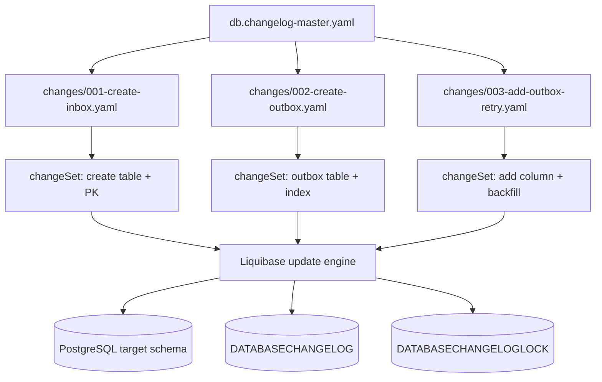
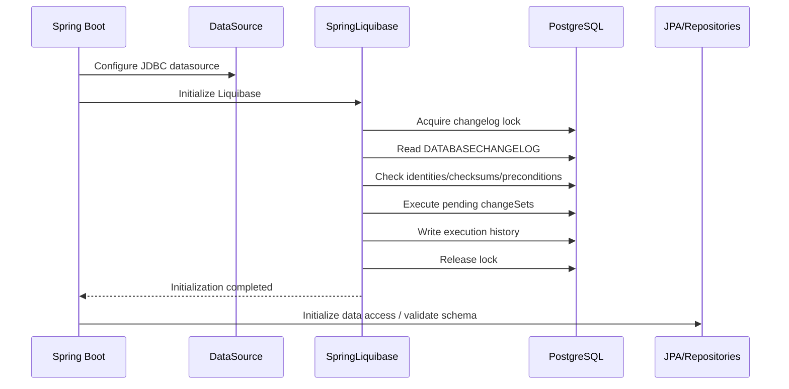
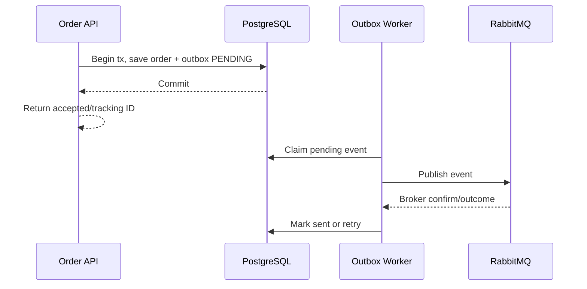
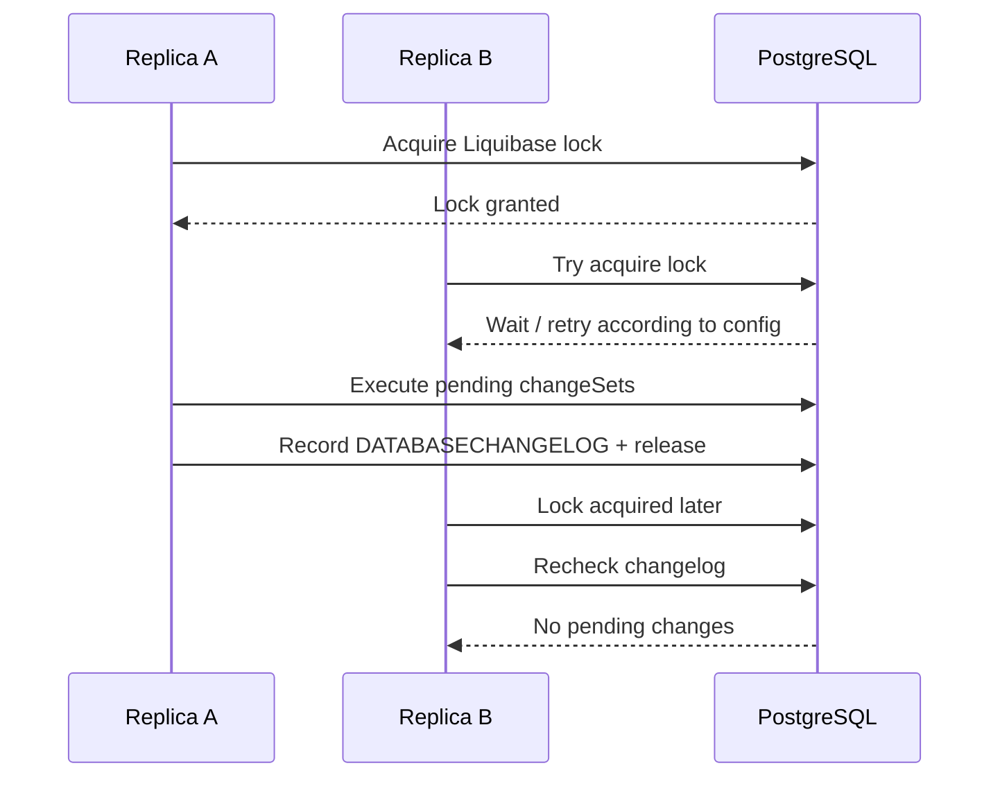
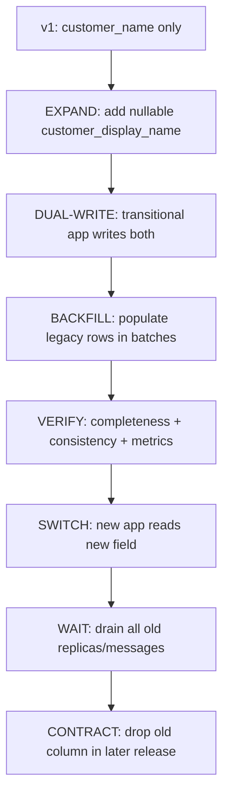
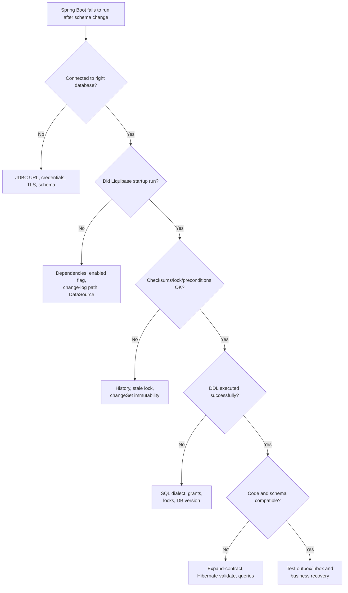

# Liquibase Integration and Changelog Management

## 1. Why Does Spring Boot Integration Need History-Tracked Migrations?

A **SPRING_BOOT_INTEGRATION** system typically connects HTTP clients, databases, caches, message brokers, and Spring Integration adapters. Data is not merely for CRUD: the application also stores an **inbox** for deduplication, an **outbox** for reliable event publishing, sync states, correlation IDs, retry outcomes, and audit records. These tables must persist and uphold their constraints across deployments.

Suppose initially an order service receives events as follows:

```text
HTTP POST /orders
      |
      v
OrderService
      |
      v
PostgreSQL: orders + integration_outbox
      |
      v
OutboxWorker --> RabbitMQ --> ShippingConsumer
      |
      v
processed_event (inbox on consumer)
```

A new release wants to add `next_attempt_at` so the worker can schedule retries. If you only modify the Java entity or run `ALTER TABLE` manually in a single environment, you can hit:

- Staging has the new column while production does not: `column does not exist`.
- Two replicas try to create the same index concurrently on startup.
- New Java code runs against the old schema and fails before processing messages.
- H2 tests auto-create the schema, passing even though the PostgreSQL migration is missing.
- A deployment rolls back to old code, yet schema changes already broke compatibility.
- An accidental change drops the outbox table, losing unpublished events.

**Liquibase** is a database schema/structure change management tool built around **changelogs**, **changeSets**, execution history, and locking. It answers: which changes ran, who defined them, in what order, on which database, and with what checksum.

### Learning Objectives

After this lesson, you will be able to:

1. Add Liquibase to a Spring Boot project using JDBC/JPA.
2. Organize `db.changelog-master.yaml`, `include` directives, and standalone change files.
3. Write `changeSet`s for creating tables, primary keys, unique constraints, indexes, and adding columns.
4. Understand `DATABASECHANGELOG`, `DATABASECHANGELOGLOCK`, changeSet identity, checksums, and handling executed changelogs.
5. Use contexts/labels/preconditions properly without leaking test seed data into production.
6. Distinguish Liquibase from Hibernate `ddl-auto` and Spring `schema.sql`.
7. Plan zero-downtime migrations using **expand → backfill → contract**.
8. Test migrations with PostgreSQL Testcontainers, upgrades from old schemas, concurrency, and failure paths.
9. Organize DDL permissions, deployment jobs, rollbacks, baselines, and monitoring.
10. Connect migrations to idempotency, transactions, message retries, and data recovery.

> Examples primarily use **Java 17+, Spring Boot 3.x, Liquibase 4.x/compatible branch, and PostgreSQL 15+**. This ecosystem evolves across releases; use the Spring Boot BOM and documentation for your exact project version. SQL such as `TIMESTAMP WITH TIME ZONE`, `jsonb`, or `CREATE INDEX CONCURRENTLY` is PostgreSQL-specific and will not automatically run on H2/MySQL.

## 2. Distinguishing Schema Initialization and Migration

| Mechanism | Goal | Execution History? | When Suitable? |
| --- | --- | --- | --- |
| Spring Boot `schema.sql`/`data.sql` | Execute SQL scripts per configuration conditions | Not a versioned change history system | Simple demos/tests, controlled bootstrap |
| Hibernate `ddl-auto=create/update` | Generate or update schema from ORM mappings | No full business changelog | Prototypes/intentional testing |
| Hibernate `ddl-auto=validate` | Check ORM mappings against existing schema | No | Verifying ORM after migrations |
| **Liquibase** | DDL and sometimes data migrations via changeSets | Yes, via changelog table | Environments with upgrade history, production |
| Flyway | Versioned/repeatable script migrations | Yes | An alternative to Liquibase |
| IaC/DBA scripts | Database provisioning, roles, storage, backups | Depends on process | Admin tasks separate from application |

**Do not let multiple mechanisms "own" the same table.** For example, Liquibase creating `orders` while Hibernate `create-drop` deletes it on context shutdown is a severe conflict.

A common architecture:

- Liquibase owns structural changes and versioned data transformations.
- JPA/Hibernate only runs `validate` when entity mappings exist.
- Spring SQL initialization scripts are disabled for the production schema.
- Database servers, users, storage, backups, and HA are provisioned by infrastructure/DBA; Liquibase does not create a PostgreSQL cluster on its own.

## 3. Liquibase Model: changelog, changeSet, and change



Key terms:

- **Changelog**: YAML, XML, JSON, or formatted SQL document listing changes and included changelogs.
- **changeSet**: Liquibase's unit of tracked execution; identified by `id`, `author`, and file/logical path.
- **change**: an operation like `createTable`, `addColumn`, `addUniqueConstraint`, `createIndex`, or `sql`.
- **Precondition**: a check evaluated before execution, with a failure policy when unmet.
- **Context/label**: metadata and filters to select which changesets run during an execution.
- **Rollback**: intended steps to invert a changeSet where feasible; does not automatically guarantee recovery of deleted data.
- **Checksum**: digest of changeSet contents so Liquibase detects unintended edits.
- **Changelog lock**: mechanism preventing two Liquibase processes from updating the same database concurrently.

Liquibase differs from an ORM: it does not infer whether every entity change is safe, does not know when a business column is safe to drop, and does not guarantee backward compatibility across app versions.

## 4. Lifecycle During Spring Boot Startup

When `liquibase-core` is on the classpath and auto-configuration conditions hold, Spring Boot creates `SpringLiquibase` to execute pending changeSets.



In standard auto-configurations, Spring Boot orders database initialization before schema-dependent components like JPA. However, **custom startup beans, multiple datasources, custom Liquibase instances, or manual SQL** can complicate ordering; never assume every custom bean automatically waits for migrations.

**Do not equate successful Liquibase startup with full business readiness.** The DB must also grant business read/write privileges, brokers must connect when required, outbox/workers must be able to resume, and the schema must match the running code version.

## 5. Maven Dependencies: Spring JDBC/JPA, Liquibase, and Driver

Example JDBC application using PostgreSQL:

```xml
<dependencies>
    <dependency>
        <groupId>org.springframework.boot</groupId>
        <artifactId>spring-boot-starter-jdbc</artifactId>
    </dependency>

    <dependency>
        <groupId>org.liquibase</groupId>
        <artifactId>liquibase-core</artifactId>
    </dependency>

    <dependency>
        <groupId>org.postgresql</groupId>
        <artifactId>postgresql</artifactId>
        <scope>runtime</scope>
    </dependency>
</dependencies>
```

Gradle:

```groovy
dependencies {
    implementation 'org.springframework.boot:spring-boot-starter-jdbc'
    implementation 'org.liquibase:liquibase-core'
    runtimeOnly 'org.postgresql:postgresql'
}
```

If using `spring-boot-starter-data-jpa`, it already provides common JDBC/Hikari infrastructure, yet you still need Liquibase and the right JDBC driver. Do not include H2 in production just because H2 was used in unit tests.

**Version management:** let the Spring Boot BOM manage supported dependency versions; if overriding Liquibase/JDBC driver versions, check release notes and compatibility. Avoid uncontrolled mixing of major versions between Liquibase core and extensions.

When targeting a database not directly supported by `liquibase-core` in a given version combination, a suitable Liquibase extension/driver may be required. Do not assume one dependency covers every DBMS.

## 6. Configuring Liquibase in Spring Boot via application.yml

Example suited for production PostgreSQL:

```yaml
spring:
  datasource:
    url: ${DB_JDBC_URL}
    username: ${DB_USERNAME}
    password: ${DB_PASSWORD}

  liquibase:
    enabled: true
    change-log: classpath:/db/changelog/db.changelog-master.yaml
    drop-first: false

  sql:
    init:
      mode: never

  jpa:
    hibernate:
      ddl-auto: validate
```

Explanation:

- `spring.datasource.*`: JDBC connection used by the app when no Liquibase-specific DataSource exists.
- `spring.liquibase.enabled`: whether to run Liquibase when auto-configuration applies; never disable just to skip changelog errors.
- `spring.liquibase.change-log`: resource path to the master changelog. Spring Boot has a convention default, yet explicit declaration aids code review.
- `spring.liquibase.drop-first=false`: prevents dropping schema/database objects before migration. **Never enable `drop-first` on data you need to keep**.
- `spring.sql.init.mode=never`: avoids `schema.sql`/`data.sql` sharing structural ownership.
- `spring.jpa.hibernate.ddl-auto=validate`: applies only when JPA/Hibernate is present, catching ORM mapping drift.
- If the app uses JDBC only, `spring.jpa.*` does not activate JPA and has no effect on the JDBC schema.
- JDBC URL, username, and password are supplied by secrets/deployment config; never commit passwords to Git.

Never configure a fallback JDBC URL like `jdbc:h2:mem:demo` in production. Missing `DB_JDBC_URL` must be a **deployment configuration failure**, never silently creating an empty in-memory database.

## 7. Single DataSource or Separate DataSource for Liquibase?

### Model A: Same DataSource

In standard setups, Liquibase shares the application's database connection. Simple when the app has one datasource and startup migration is acceptable.

Drawback: the app's database user may need DDL permissions (`CREATE/ALTER/DROP`), which exceed daily DML needs.

### Model B: Separate migration credentials/connection

Spring Boot supports `spring.liquibase.*` properties for supplying dedicated connection settings to Liquibase, e.g.:

```yaml
spring:
  datasource:
    url: ${APP_DB_JDBC_URL}
    username: ${APP_DB_USERNAME}
    password: ${APP_DB_PASSWORD}

  liquibase:
    change-log: classpath:/db/changelog/db.changelog-master.yaml
    url: ${MIGRATION_DB_JDBC_URL}
    user: ${MIGRATION_DB_USERNAME}
    password: ${MIGRATION_DB_PASSWORD}
```

These are two sets of **credentials with different responsibilities**, not necessarily two different databases. Typically they must point to the **exact same logical database/schema** being released. Misconfiguring Liquibase to migrate database A while the app queries database B can behave inconsistently across environments.

When using multiple DataSources or configuring a dedicated datasource via `@LiquibaseDataSource`, verify bean wiring, transaction managers, connection pools, and target schemas. Never rely on single-datasource auto-configuration rules when the app uses three databases.

### When to separate the migration job from the app?

In production with multiple replicas, it is often better when:

- A dedicated deployment job/CI stage holds DDL credentials and runs migrations.
- Production app instances hold only necessary DML permissions.
- App startup uses `spring.liquibase.enabled=false` **only when** an independent migration workflow is designed, tested, and guarded by schema version verification.
- Deployment shifts traffic or scales replicas only after migrations succeed and compatibility holds.

Disabling Liquibase inside the app **does not guarantee** the migration job ran. The pipeline must verify `DATABASECHANGELOG`/schema and block release if invalid.

## 8. Organizing Changelog Directories for Easy Review and Reproducibility

Reference structure:

```text
src/main/resources/
  db/
    changelog/
      db.changelog-master.yaml
      changes/
        001-create-processed-event.yaml
        002-create-integration-outbox.yaml
        003-add-outbox-retry-metadata.yaml
        004-create-outbox-worker-index.yaml
```

Organization rules:

1. Master file contains an intentional, ordered list of `include` entries.
2. Each change file holds one or a few changeSets with a clear business goal.
3. Keep `id` and `author` stable; never reuse identities to rewrite history.
4. Numeric file prefixes help readers see order, yet **execution order is governed by changelog/includes and changeSet ordering**.
5. Any released/executed migration should be treated as **immutable**.
6. Never store raw production credentials, sensitive data, or secret env values in migration resources.
7. Prefer structuring by bounded context/module as changes grow, rather than dumping all DDL into one giant file.
8. Avoid changing paths of executed files unless you understand `logicalFilePath` and identity implications.

XML, JSON, or formatted SQL can be used instead of YAML. **Pick one consistent convention**, especially for string escaping, script paths, schema names, and code reviews.

## 9. Master Changelog and Ordered Includes

Example `src/main/resources/db/changelog/db.changelog-master.yaml`:

```yaml
databaseChangeLog:
  - include:
      file: changes/001-create-processed-event.yaml
      relativeToChangelogFile: true

  - include:
      file: changes/002-create-integration-outbox.yaml
      relativeToChangelogFile: true

  - include:
      file: changes/003-add-outbox-retry-metadata.yaml
      relativeToChangelogFile: true

  - include:
      file: changes/004-create-outbox-worker-index.yaml
      relativeToChangelogFile: true
```

Key points:

- `databaseChangeLog` is the root collection in Liquibase YAML.
- `include` loads a child changelog at the exact position declared.
- `relativeToChangelogFile: true` resolves `file` relative to the including changelog.
- Ensure everything under `src/main/resources` is packaged into the JAR/container; test build artifacts to confirm resources are readable.
- Resource path and resolution determine changeSet identity in `DATABASECHANGELOG`. Do not move folders just to "tidy up" once changesets have run.
- `includeAll` scans directories, but ordering and included contents must be carefully tested; for production-critical changesets, explicit `include` is easier to review.

**There is no single "current" numeric version solely from filename 004.** The source of truth for history is the records Liquibase executed on the target database.

## 10. First changeSet: Creating the Deduplication Inbox Table

Example `changes/001-create-processed-event.yaml`:

```yaml
databaseChangeLog:
  - changeSet:
      id: "001-create-processed-event"
      author: "integration-team"
      changes:
        - createTable:
            tableName: processed_event
            columns:
              - column:
                  name: source_system
                  type: varchar(80)
                  constraints:
                    nullable: false

              - column:
                  name: event_id
                  type: varchar(120)
                  constraints:
                    nullable: false

              - column:
                  name: processed_at
                  type: TIMESTAMP WITH TIME ZONE
                  defaultValueComputed: CURRENT_TIMESTAMP
                  constraints:
                    nullable: false

        - addPrimaryKey:
            tableName: processed_event
            columnNames: source_system,event_id
            constraintName: pk_processed_event
```

Why is `PRIMARY KEY (source_system, event_id)` important?

- Brokers may redeliver a message if a consumer dies before ack.
- The same `eventId` can exist across **two** distinct integration sources; key scope must be explicit.
- Database unique constraints prevent races when two consumers process concurrently.
- Checking `exists()` then `insert()` is **not atomic** without a database constraint.
- `processed_at` supports auditing/retention, yet does not verify whether business side effects finished.

The example uses PostgreSQL's `TIMESTAMP WITH TIME ZONE`. For MySQL/H2, check portability and actual data types rather than copying SQL types blindly.

**Important:** An inbox is only one component of idempotency. If the consumer marks "processed" in a different transaction from updating business state, crashing between the two steps can still lose or duplicate side effects.

## 11. changeSet Creating a Durable Outbox Table

Example `changes/002-create-integration-outbox.yaml`:

```yaml
databaseChangeLog:
  - changeSet:
      id: "002-create-integration-outbox"
      author: "integration-team"
      changes:
        - createTable:
            tableName: integration_outbox
            columns:
              - column:
                  name: event_id
                  type: varchar(120)
                  constraints:
                    primaryKey: true
                    primaryKeyName: pk_integration_outbox
                    nullable: false

              - column:
                  name: destination
                  type: varchar(120)
                  constraints:
                    nullable: false

              - column:
                  name: event_type
                  type: varchar(80)
                  constraints:
                    nullable: false

              - column:
                  name: schema_version
                  type: int
                  constraints:
                    nullable: false

              - column:
                  name: payload_json
                  type: text
                  constraints:
                    nullable: false

              - column:
                  name: status
                  type: varchar(24)
                  defaultValue: PENDING
                  constraints:
                    nullable: false

              - column:
                  name: created_at
                  type: TIMESTAMP WITH TIME ZONE
                  defaultValueComputed: CURRENT_TIMESTAMP
                  constraints:
                    nullable: false
```

An outbox table stores **committed intent** within the same PostgreSQL transaction as the order. A worker later publishes to RabbitMQ/Kafka.



**Liquibase creating a valid schema does not automatically make the worker safe.** You must design claiming/leasing, status transitions, idempotency, indexes, and retries:

- When the broker is unavailable, outbox rows remain `PENDING`.
- When publishing succeeds yet confirmation is lost, the worker may re-send; consumers must be idempotent.
- If the app crashes after HTTP 202, the outbox entry must survive on durable DB storage.
- `payload_json` requires schema/size/PII contracts; never dump multi-GB files into this column.
- `status` needs an allowed value set and controlled state transitions; an appropriate DBMS check constraint can be added in a separate migration.

## 12. Next Change: Adding Retry Metadata via Expand

The new app version needs `attempt_count` and `next_attempt_at`. Example `changes/003-add-outbox-retry-metadata.yaml`:

```yaml
databaseChangeLog:
  - changeSet:
      id: "003-add-outbox-retry-metadata"
      author: "integration-team"
      changes:
        - addColumn:
            tableName: integration_outbox
            columns:
              - column:
                  name: attempt_count
                  type: int
                  defaultValueNumeric: 0
                  constraints:
                    nullable: false

              - column:
                  name: next_attempt_at
                  type: TIMESTAMP WITH TIME ZONE

      rollback:
        - dropColumn:
            tableName: integration_outbox
            columnName: next_attempt_at

        - dropColumn:
            tableName: integration_outbox
            columnName: attempt_count
```

Explanation:

1. Only **adds** columns; old code can still insert outbox events because `attempt_count` has a default.
2. `next_attempt_at` starts nullable so existing rows need no immediate value.
3. The sample rollback drops the new columns and **loses retry metadata**. It only illustrates syntax, not a recommendation to auto-rollback production.
4. On massive tables, adding defaults/not-null/backfills can trigger locks/rewrites or I/O spikes depending on PostgreSQL version; benchmark on a production-like copy.
5. Never edit executed changeSet `002` to "add the column inside `createTable`." That mutates history/checksums; create changeSet `003` as shown.

**Additive migrations still require version compatibility.** If legacy workers use `SELECT *` and map columns by ordinal position, adding columns can break code; avoid relying on SQL result column order in integration code.

## 13. Splitting Indexes into Separate changeSets and Lock Considerations

Example `changes/004-create-outbox-worker-index.yaml`:

```yaml
databaseChangeLog:
  - changeSet:
      id: "004-create-outbox-worker-index"
      author: "integration-team"
      changes:
        - createIndex:
            tableName: integration_outbox
            indexName: idx_integration_outbox_due
            columns:
              - column:
                  name: status
              - column:
                  name: next_attempt_at
              - column:
                  name: created_at
```

Indexes help queries fetching `PENDING` or due-for-retry events. However:

- An index does not automatically speed up polling queries if filters/ordering/data volume mismatch. Inspect PostgreSQL `EXPLAIN (ANALYZE, BUFFERS)` in an isolated environment.
- `CREATE INDEX` carries varying lock/IO impact depending on DBMS and volume.
- PostgreSQL `CREATE INDEX CONCURRENTLY` reduces write blocking in many cases, yet cannot execute inside a standard transaction block.
- When using raw SQL `CREATE INDEX CONCURRENTLY` in Liquibase, isolate it in a dedicated changeSet with `runInTransaction: false` **after** checking PostgreSQL-specific semantics, partial failures, and invalid index cleanup.
- Do not set `runInTransaction: false` on every change just to "go faster"; failed statements can leave a half-applied schema.

PostgreSQL-specific alternative replacing generic `createIndex` when deployment must avoid blocking locks:

```yaml
databaseChangeLog:
  - changeSet:
      id: "004-pg-create-worker-index-concurrently"
      author: "integration-team"
      runInTransaction: false
      preConditions:
        - onFail: HALT
        - dbms:
            type: postgresql
      changes:
        - sql:
            sql: |
              CREATE INDEX CONCURRENTLY
              idx_integration_outbox_due
              ON integration_outbox
              (status, next_attempt_at, created_at)
```

**This is an alternative—do not run both 004 changeSets together.** If the index was already created by the generic example, the concurrent SQL above fails with a duplicate name error. Production should choose **one** strategy, keep consistent IDs/paths, and test migrating from older schemas.

## 14. changeSet Identity Is More Than Just `id`

Liquibase ordinarily identifies a changeSet by the tuple:

```text
(id, author, filename/logicalFilePath)
```

Example:

```text
id = 002-create-integration-outbox
author = integration-team
filename = db/changelog/changes/002-create-integration-outbox.yaml
```

Consequences:

- Two changeSets with the same `id` in different files or authors are two distinct identities; do not treat `id` alone as a repository-wide unique key.
- Renaming/moving an applied file can make Liquibase treat the changeSet as **new and unexecuted**, causing it to attempt re-creating tables/indexes.
- Changing the `author` of an already-executed migration produces the same issue.
- `logicalFilePath` stabilizes logical identity when reorganizing changelogs, yet must be planned consistently and tested against populated history databases.
- Renaming files with numeric prefixes just to make ordering look prettier is a high-risk change in a released repository.

**Key observation:** checksum is not identity. Checksum verifies the content of an already-identified changeSet; identity determines whether this changeSet has previously run.

## 15. What Does DATABASECHANGELOG Store?

Liquibase creates/maintains a changelog table (usually named `DATABASECHANGELOG` by default) in the target database containing fields such as:

| Column/Concept | Role |
| --- | --- |
| `ID` | changeSet ID |
| `AUTHOR` | Declared author/owner |
| `FILENAME` | Logical/physical file path used for identity |
| `DATEEXECUTED` | Execution timestamp |
| `ORDEREXECUTED` | Execution order |
| `EXECTYPE` | Execution outcome type, e.g., `EXECUTED`/`MARK_RAN`/`RERAN` |
| `MD5SUM` | Checksum stored by Liquibase per its format/version |
| `DESCRIPTION`, `COMMENTS` | Metadata for diagnostics |
| `CONTEXTS`, `LABELS` | Filtering/execution metadata |
| `DEPLOYMENT_ID` | Deployment batch identifier (when present) |

**Never edit this table manually to "fix migration errors."** It is the tool's audit ledger; wrong edits can make subsequent changelogs re-run or silently skip.

To check whether a changeSet executed in production, inspect via Liquibase commands or controlled read-only queries with appropriate privileges; do not rely solely on Git commits or JAR names.

Exact column details vary across Liquibase versions; avoid writing custom tooling tightly coupled to internal columns without tests.

## 16. DATABASECHANGELOGLOCK Prevents Races When Multiple Apps Start

The `DATABASECHANGELOGLOCK` table coordinates Liquibase updates against the same target database. When two app replicas run Liquibase concurrently:



This prevents **two Liquibase instances from mutating the schema simultaneously** by design. However, it does **not** guarantee:

- Code v2 is compatible with code v1 while both versions run.
- All requests drained before `DROP COLUMN`.
- Long migrations won't trip orchestrator startup/readiness timeouts.
- Business transactions and database migrations are atomic with HTTP/brokers.
- Schema migrations run without locking against user queries or DBA commands.

If a migration crashes or the DB session drops, the lock record may need investigation. Only invoke lock-release tools (e.g., Liquibase `releaseLocks`) **after confirming no Liquibase instance is actively running**; never clear locks blindly to "rerun immediately." If another process is genuinely altering the schema, unlocking causes a severe race.

## 17. Checksums: Why Never Edit Released changeSets?

Liquibase records a checksum of every executed changeSet's content. Suppose an already-applied migration is altered:

```yaml
# Already released and run in production:
- changeSet:
    id: "001-create-processed-event"
    author: "integration-team"
    changes:
      - createTable:
          tableName: processed_event
          # ...
```

Later a developer changes a column type, `columnName`, or table definition under the same identity. On the next run, Liquibase raises a **checksum validation error**.

This is a valuable safety check, not "Liquibase breaking." Standard practice:

1. **Once a changeSet has run in any persistent environment:** treat it as immutable.
2. Create a **new changeSet** to adjust the schema, e.g., `005-alter-event-id-length`.
3. To inspect differences between environments, compare actual migration history/schemas.
4. Consider `validCheckSum`, `clearCheckSums`, or history edits only with approval, full understanding of DB state, and clear intent; never treat them as daily pipeline bypass switches.
5. `runOnChange` can fit **safely recreatable** objects like views/procedures under controlled workflows; never use it for destructive DDL or arbitrary business table edits.
6. `runAlways` re-runs a changeSet on every update; avoid using it for non-idempotent seeds/UPDATEs or long-running tasks.

**A changeSet may be edited directly only if it has never executed in any supported deployment database** and the team confirms this. Even personal test DBs must be intentionally reset after modifying a changeSet that already ran there.

## 18. Execution Order: Includes, Preconditions, and Checksums Do Not Replace Transaction Safety

A changelog can list multiple changeSets in file order. Liquibase evaluates changelog records, filters, and preconditions, running applicable pending changes.

However:

- **Include order** governs dependencies: tables must precede indexes.
- **Changelog history** does not verify business schema invariants like foreign references or outbox worker correctness.
- **Preconditions** inspect state at evaluation time; concurrent app/DBA activity can still alter conditions.
- **changeSet transactions** are atomic only when the database/DDL type supports them and `runInTransaction` fits; MySQL/MariaDB DDL and PostgreSQL `CREATE INDEX CONCURRENTLY` behave differently.
- **Liquibase locks** guard concurrent changelog updates, not general app queries.
- **Failures across multiple changeSets** can leave earlier changeSets committed while later changes remain unapplied.

Therefore pipelines must test **fresh install**, **upgrade from prior versions**, **halfway failure**, and **restart/resume**—not just running the master changelog once against an empty DB.

## 19. Contexts and Labels: Filtering Migrations by Purpose

Liquibase provides **contexts** and **labels** to filter which changeSets execute. Simply put:

- **Context** typically describes environment or execution phase, e.g., `dev`, `test`, `seed`.
- **Label** typically describes feature groups, releases, tenants, or change types, e.g., `billing`, `ops`.
- Runtime filters are passed via Liquibase/CLI/Spring Boot config, **not inferred merely from filenames**.
- These are **schema-change filtering metadata**, not authorization controls or code feature flags.

Example changeSet with test context:

```yaml
databaseChangeLog:
  - changeSet:
      id: "test-seed-statuses"
      author: "integration-team"
      contextFilter: "@test"
      changes:
        - insert:
            tableName: lookup_status
            columns:
              - column:
                  name: code
                  value: TEST_ONLY
```

Example Spring Boot test profile:

```yaml
spring:
  liquibase:
    contexts: test
```

**Crucial note on semantics:** in several Liquibase setups, when **no context filter is specified at runtime**, changeSets with ordinary `contextFilter` expressions may still be eligible to run. The `@` prefix in context expressions requires the context to be explicitly active in supported versions. For risky or test-only changeSets, verify behavior with tests on your **exact Liquibase version** and consider separating dev/test root changelogs rather than relying solely on a context string.

For labels, apply `labels` on changeSets with matching runtime label filters (property names and syntax depend on version). Never attach a `prod` label thinking it magically shields production from unsuitable changeSets.

**Operational recommendation:** foundational schemas needed across all environments should execute consistently; mock data, test credentials, and destructive seeds must stay completely outside standard production paths.

## 20. Preconditions: Checking State Before Applying Changes

Preconditions let Liquibase verify assumptions before running migrations, such as target DBMS, table existence, or absence of a column.

PostgreSQL-only example:

```yaml
databaseChangeLog:
  - changeSet:
      id: "005-add-partner-reference"
      author: "integration-team"
      preConditions:
        - onFail: HALT
        - dbms:
            type: postgresql
        - tableExists:
            tableName: integration_outbox
      changes:
        - addColumn:
            tableName: integration_outbox
            columns:
              - column:
                  name: partner_reference
                  type: varchar(120)
```

**Notes:**

- `onFail: HALT` halts migration when unmet instead of silently assuming success.
- `onFail: MARK_RAN` records the changeSet as executed without running it; use only when those semantics are **explicitly intended**, never to mask schema drift.
- `onFail: CONTINUE` or `WARN` may suit optional changes, provided you understand whether startup proceeds with a contract-incomplete schema.
- `tableExists` performs database metadata queries; across thousands of changeSets, expensive preconditions can slow startup.
- Preconditions are **guards**, not substitutes for changeSet history, code review, backup/restore, or business data validation.

An anti-pattern is putting `preConditions: tableExists` with `MARK_RAN` on every migration to force pipelines "green" over broken databases. When production drifts, detect it clearly and remediate deliberately rather than fabricating history.

## 21. Changelog Parameters and Avoiding Untrusted Input

Liquibase supports parameters for reusing values like schema names. Spring Boot can supply parameters via `spring.liquibase.parameters.*`:

```yaml
spring:
  liquibase:
    parameters:
      appSchema: integration
```

And in the changelog (illustrative):

```yaml
databaseChangeLog:
  - changeSet:
      id: "006-create-reference-table"
      author: "integration-team"
      changes:
        - createTable:
            schemaName: ${appSchema}
            tableName: integration_reference
            columns:
              - column:
                  name: reference_id
                  type: varchar(120)
                  constraints:
                    primaryKey: true
                    nullable: false
```

Limitations:

- The `integration` schema must already be provisioned, with appropriate permissions for the app/Liquibase users.
- Placeholders building SQL identifiers must never originate from arbitrary HTTP callers or JMS messages; doing so risks SQL injection or configuration drift.
- A migration executed in one schema may behave differently in identity/history when switched to another schema.
- Default schema, Liquibase changelog table schema, and data target schema **can all differ**; configure carefully.
- Changing schema parameters across deploys of the same database creates hard-to-diagnose drift; treat it as a controlled deployment topology change.

With managed databases, never log secret parameters or store them in source. Understand which values appear in generated SQL and migration history.

## 22. XML, JSON, YAML, and Formatted SQL: Which Format to Choose?

Liquibase supports multiple changelog formats. They are not automatically equivalent across every extension, identifier quoting rule, or complex SQL procedure.

| Format | Strengths | Watchouts |
| --- | --- | --- |
| YAML | Easy to read/review, clear change types | Indentation, boolean/number quoting, anchors |
| XML | Schema/namespaces, tooling, clear change types | Verbose, entity/parser/security policies |
| JSON | Suits code-generated pipelines | Can become long and hard to review manually |
| Formatted SQL | Close to native SQL, good for DB-specific features | Easy DBMS lock-in, parser/directives must be exact |
| `sqlFile` inside YAML/XML | Isolates complex DDL cleanly | File paths, delimiters, encoding, transaction behavior |

Example Liquibase formatted SQL (illustrating a **separate** file `changes/007-add-outbox-error-code.sql`):

```sql
--liquibase formatted sql

--changeset integration-team:007-add-outbox-error-code
ALTER TABLE integration_outbox
    ADD COLUMN last_error_code VARCHAR(64);

--rollback ALTER TABLE integration_outbox
--rollback     DROP COLUMN last_error_code;
```

Only include that SQL file **if** you choose the formatted SQL approach; never keep both YAML and formatted SQL for the same change and execute both.

For stored procedures or SQL containing embedded semicolons, verify `splitStatements`, `endDelimiter`, and `runInTransaction` per DBMS/CLI/Liquibase version; never copy delimiter settings blindly between PostgreSQL and Oracle.

## 23. `sqlFile`: Separating Complex DDL from YAML Structure

For long or complex SQL, `sqlFile` avoids multiline `sql:` blocks inside YAML changelogs.

Suppose `changes/sql/008-create-report-view.sql`:

```sql
CREATE VIEW pending_integration_events AS
SELECT event_id, destination, event_type, created_at
FROM integration_outbox
WHERE status = 'PENDING';
```

Changelog `changes/008-create-report-view.yaml`:

```yaml
databaseChangeLog:
  - changeSet:
      id: "008-create-report-view"
      author: "integration-team"
      changes:
        - sqlFile:
            path: sql/008-create-report-view.sql
            relativeToChangelogFile: true
            encoding: UTF-8
      rollback:
        - sql:
            sql: DROP VIEW pending_integration_events
```

**Verify** database SQL dialect compatibility, view creation privileges, dependency order, and that rollback does not break referencing objects. Views can use `CREATE OR REPLACE` in a new migration, though changing signatures or dependent views still requires expand–contract and testing.

If the team manages views with `runOnChange`, ensure the SQL is idempotent and tested against older database states; do not turn all migrations into repeatable changes indiscriminately.

## 24. Rollback Is a Data Plan, Not Merely Reverse Statements

Liquibase can generate or run rollbacks for many change types, yet **not** every change has a safe inverse.

| Change | Technical Rollback | Business Risk |
| --- | --- | --- |
| Add nullable column | `DROP COLUMN` | Loses new data written to that column |
| Create index | `DROP INDEX` | Old queries may slow down or fail if hints depend on it |
| Create empty table | `DROP TABLE` | Safer only if guaranteed empty |
| Drop table/column | Cannot restore data with `CREATE` alone | Requires backup/restore or forward-fix |
| Change data type | Reverse cast may fail | Truncation/overflow/precision loss |
| Backfill/update millions of rows | Original values not automatically preserved | Must retain old copies or build compensating process |
| Rename column | Can rename back | Running new/old app versions hold dependencies |

**Production strategy is usually roll-forward** (deploying a corrective migration) paired with backward-compatible app rollback, rather than blindly running `DROP` over live data.

Before any potentially data-destructive migration:

1. Verify recent backups, restore drills, and recovery targets (RTO/RPO).
2. Identify which app versions still rely on the old schema.
3. Run dry-run/SQL generation and review locks/permissions.
4. Set execution timeouts and stop conditions.
5. Run only rollbacks already tested against production-like data.
6. Where rollback is unsafe, document **forward-fix** and compatibility windows.

A "green rollback" on in-memory H2 proves nothing about rolling back PostgreSQL holding hundreds of millions of rows.

## 25. Expand → Backfill → Contract: Zero-Downtime Schema Changes

Suppose app v1 uses `customer_name`, while v2 needs `customer_display_name`.

**Do not do immediately:**

```sql
ALTER TABLE orders
    DROP COLUMN customer_name;
```

During rolling deployments, v1 replicas may still read the old column.

Instead:



Change schedule:

| Phase | Schema | Allowed Code |
| --- | --- | --- |
| Pre-expand | `customer_name` only | v1 |
| Expand | Both columns, new one nullable | v1 and transitional v2 |
| Dual-write/backfill | Both columns consistently populated | v1 and v2 per rollout strategy |
| Switch | Read/write new column, keep old column | v2, no remaining v1 dependency |
| Contract | Drop old column once confirmed unused | New app only |

For integration messages, also account for **queued outbox events, DLQ/replays, older running consumers, and batch jobs**. V1 pods may all be gone while v1 payloads remain pending. Database migration versions and **event schema versions** are related yet independent counters.

## 26. Large Data Backfills: Don't Pack Everything into One Giant Transaction

Example copying old column data into the new column:

```sql
UPDATE orders
SET customer_display_name = customer_name
WHERE customer_display_name IS NULL;
```

This works on small tables, yet in large production systems it can:

- Hold locks long and spike WAL/disk I/O.
- Block writers and raise replica lag.
- Cause Liquibase startup timeouts.
- Trigger a massive expensive transaction rollback on failure.
- Race with the application writing both columns.

A safer alternative:

1. Liquibase **adds the schema** and supporting indexes/constraints in a fast migration.
2. A **backfill job** runs in batches, claims/locks bounded rows, commits per batch, and saves checkpoints.
3. Transitional code dual-writes so new records are never missed.
4. Backfill is **idempotent**: re-running a batch never corrupts data.
5. Monitor progress, remaining nulls, query latency, locks/WAL/replica lag.
6. After validating data and the new app, a later migration adds `NOT NULL`/unique constraints or drops the old column.
7. For active outbox tables, backfills must never replay side effects or change `eventId` breaking idempotency.

Never use `runAlways: true` to run huge backfills on every app startup.

## 27. Locks, Execution Duration, and Indexes on Large Tables

A schema change operates on a live database serving business traffic, not just a YAML file.

Before running heavy migrations on PostgreSQL:

- Check row counts, table/index sizes, write throughput, and replica lag.
- Identify DDL lock modes and impacted query workloads.
- Set `lock_timeout` and `statement_timeout` on migration sessions per org policy; distinguish DB timeouts from orchestrator timeouts.
- Estimate WAL/disk space/CPU and index build duration.
- If building indexes concurrently, verify PostgreSQL constraints and partial-failure cleanup.
- Ensure ability to halt/recover before shifting traffic.
- Avoid simultaneously deploying incompatible app SQL versions.
- Alert if `DATABASECHANGELOGLOCK` is held too long or app requests block.

**Liquibase's changelog lock is not the DDL statement's table/row lock.** A migration can validly hold the Liquibase lock while stalling business writes due to a DDL table lock. Monitor both separately.

## 28. Interaction with Spring Data JPA and Hibernate

Typical JPA setup:

```yaml
spring:
  liquibase:
    enabled: true
    change-log: classpath:/db/changelog/db.changelog-master.yaml

  jpa:
    hibernate:
      ddl-auto: validate
    open-in-view: false

  sql:
    init:
      mode: never
```

Here:

- Liquibase creates/evolves the schema per history.
- Hibernate `validate` partially checks ORM mappings against the live database.
- Hibernate does not auto-update/create production schemas.
- `open-in-view=false` governs HTTP request persistence context lifecycles, **not Liquibase**; it simply reflects keeping clear transaction boundaries in integration apps.

ORM entities do not describe everything requiring migration:

- PostgreSQL partial/expression indexes.
- Partitioning, database triggers/functions.
- Business unique/check constraints.
- Inbox/outbox tables without JPA entities when using `JdbcTemplate`/jOOQ.
- Database grants, RLS policies, materialized views.
- Data backfills and cross-version data conversions.

**`ddl-auto=validate` does not verify all indexes/constraints/data invariants.** Dedicated migration tests and database-level assertions remain essential.

## 29. Interaction with Spring SQL Initialization, Flyway, and R2DBC

### `schema.sql` and `data.sql`

`spring.sql.init.mode` governs Spring Boot's script-based initialization per matching conditions. It does **not directly replace** `spring.liquibase.enabled`. Once Liquibase owns the schema, do not let `schema.sql` create the same tables.

A configuration like this makes little sense if both try to create `processed_event`:

```yaml
spring:
  sql:
    init:
      mode: always
  liquibase:
    enabled: true
```

Outcomes depend on init script order: duplicate tables, startup crashes, or schema drift.

### Flyway

Liquibase and Flyway are both schema migration managers. Dependencies for both might temporarily coexist during a tool transition, yet **neither** should manage the same schema alongside the other without an explicit plan/ownership boundary. Separate history tables do not coordinate DDL ordering between two tools.

### R2DBC

If an app uses R2DBC `ConnectionFactory` for reactive PostgreSQL access, remember **Liquibase typically runs over a JDBC connection**, not directly over the R2DBC driver. You may need a JDBC driver and explicit `spring.liquibase.url/user/password` or a dedicated DataSource.

Do not assume adding `spring-boot-starter-data-r2dbc` lets Liquibase migrate the database without JDBC infrastructure. Check Spring Boot auto-configuration conditions and test startup on the real stack.

## 30. Migrations for Multiple Schemas, Tenants, or DataSources

An integration service might have:

- Dedicated PostgreSQL database for orders/inbox/outbox.
- Legacy read-only SQL Server for data synchronization.
- Dedicated PostgreSQL schema for auditing.
- Multi-tenant: one schema per tenant.

Here, "one master changelog for one default DataSource" is insufficient. Determine:

1. Which changelog and `SpringLiquibase` owns each logical database?
2. Which **schema** holds changelog history/locks versus target business tables?
3. Which beans carry `@Primary` or `@LiquibaseDataSource`?
4. Which credentials hold DDL privileges versus DML only?
5. Are tenant schemas provisioned before migration?
6. How are migrations serialized/batched/parallelized without exhausting DB connections or locks?
7. If tenant A succeeds and tenant B fails, how must readiness and tenant routing behave?
8. Can running app versions handle tenants sitting on different schema versions?

**Never assume a single `@Transactional` provides atomic migrations across multiple databases.** A Liquibase update on DB A cannot roll back commits made on DB B.

With schema-per-tenant at thousands of tenants, running thousands of migrations inside every app startup can violate startup SLAs. A dedicated tenant migration orchestrator with auditing and progress tracking is usually necessary.

## 31. Baselining Existing Databases: Don't Re-Run `createTable`

A legacy system already has `orders` and `processed_event` tables, but has never used Liquibase. Adding `001-create-processed-event` and starting up causes Liquibase to attempt table creation and fail.

A controlled baselining workflow:

1. **Inventory** live database schemas/tables/indexes/constraints across dev/staging/prod.
2. Author a baseline changelog capturing existing state (snapshot/diff/`generateChangeLog` can serve as a starting point).
3. Manually review SQL types, defaults, constraints, grants, and object ownership; generated changelogs are not infallible truth.
4. Compare **real environments** to the baseline, resolving drift rather than assuming uniformity.
5. Where databases already match the schema, use approved **changelog synchronization / mark-as-ran** tooling to populate history without re-running DDL.
6. For fresh databases, preserve a working **fresh install** path building the schema from the changelog.
7. Apply new changesets after the baseline and test upgrades from legacy data snapshots.
8. Document backups/restores, target schemas, and who signed off on the baseline.

Commands like `changelogSync` **mark changesets as executed without running DDL**. Misusing them on an empty database turns history "green" while tables remain absent. Never use them to silence startup errors without verifying database state.

## 32. Essential Liquibase CLI Commands (and When Not to Run Them Carelessly)

Liquibase CLI/Gradle/Maven plugins provide review and operations tasks. Command names and flags vary across major versions; names below reflect **common concepts/commands**—check `--help` for your installed version.

| Task | Purpose | Warning |
| --- | --- | --- |
| `validate` | Checks changelog syntax/metadata and certain config errors | Does not prove DDL will run fast or safely |
| `status` | Lists pending changeSets | Valid only for current target DB + filters |
| `updateSQL`/`update-sql` | Previews SQL planned for execution | Review against target DBMS |
| `update` | Runs pending changeSets | Modifies real schema |
| `history` | Views migration history | DB is source of truth |
| `rollbackSQL`/`rollback-sql` | Previews proposed rollback SQL | Does not guarantee data recovery |
| `tag` | Marks a checkpoint for certain rollback workflows | Not automatically tied to Git/deploy tags |
| `clearCheckSums` | Clears/resets checksum history for recomputation | Can mask unauthorized changelog edits |
| `changelogSync` | Marks changesets applied without executing | Only for baselines proven to match schema |
| `releaseLocks` | Frees Liquibase lock in exceptional cases | Never run while a migration is actually executing |

**Production workflow:** use read-only connections when merely inspecting if supported, and least-privilege migration accounts when executing. Never run `dropAll`, `drop-first`, or `rollback` in production just to "test things out."

Reviewing **generated SQL** is important, yet does not replace integration testing against real PostgreSQL, because SQL can be syntactically valid while imposing unacceptable lock or I/O impact.

## 33. Testing Fresh Databases with PostgreSQL Testcontainers

Integration tests must use the **same DBMS family** as production, especially when changelogs leverage PostgreSQL-specific SQL, indexing, constraints, or transactions.

Common test dependencies (versions managed by compatible BOM):

```xml
<dependencies>
    <dependency>
        <groupId>org.springframework.boot</groupId>
        <artifactId>spring-boot-starter-test</artifactId>
        <scope>test</scope>
    </dependency>
    <dependency>
        <groupId>org.springframework.boot</groupId>
        <artifactId>spring-boot-testcontainers</artifactId>
        <scope>test</scope>
    </dependency>
    <dependency>
        <groupId>org.testcontainers</groupId>
        <artifactId>junit-jupiter</artifactId>
        <scope>test</scope>
    </dependency>
    <dependency>
        <groupId>org.testcontainers</groupId>
        <artifactId>postgresql</artifactId>
        <scope>test</scope>
    </dependency>
</dependencies>
```

Spring Boot 3.1+ example using `@ServiceConnection`:

```java
import static org.assertj.core.api.Assertions.assertThat;

import org.junit.jupiter.api.Test;
import org.springframework.beans.factory.annotation.Autowired;
import org.springframework.boot.test.context.SpringBootTest;
import org.springframework.boot.testcontainers.service.connection.ServiceConnection;
import org.springframework.jdbc.core.JdbcTemplate;
import org.testcontainers.containers.PostgreSQLContainer;
import org.testcontainers.junit.jupiter.Container;
import org.testcontainers.junit.jupiter.Testcontainers;

@SpringBootTest
@Testcontainers
class LiquibaseFreshInstallIT {

    @Container
    @ServiceConnection
    static PostgreSQLContainer<?> postgres =
        new PostgreSQLContainer<>("postgres:16-alpine")
            .withDatabaseName("integration_test")
            .withUsername("integration_test")
            .withPassword("test_password_only");

    @Autowired
    JdbcTemplate jdbc;

    @Test
    void createsInboxOutboxAndHistory() {
        Integer inbox = jdbc.queryForObject(
            """
            SELECT COUNT(*)
            FROM information_schema.tables
            WHERE table_schema = current_schema()
              AND table_name = 'processed_event'
            """, Integer.class
        );

        Integer outbox = jdbc.queryForObject(
            """
            SELECT COUNT(*)
            FROM information_schema.tables
            WHERE table_schema = current_schema()
              AND table_name = 'integration_outbox'
            """, Integer.class
        );

        Integer history = jdbc.queryForObject(
            """
            SELECT COUNT(*)
            FROM databasechangelog
            WHERE id = ?
              AND author = ?
            """,
            Integer.class,
            "001-create-processed-event",
            "integration-team"
        );

        assertThat(inbox).isEqualTo(1);
        assertThat(outbox).isEqualTo(1);
        assertThat(history).isEqualTo(1);
    }
}
```

**Execution prerequisites:**

- Project includes `liquibase-core`, JDBC driver, DataSource, and the master changelog at the configured path.
- Changelogs from sections 9–13 are packaged on the test classpath.
- `@ServiceConnection` wires JDBC connection details for auto-configured DataSources; it does not automatically rewrite custom DataSources.
- If the application context requires RabbitMQ/Kafka/HTTP partners on startup, mock or configure test dependencies explicitly; do not accidentally turn a migration test into a fragile end-to-end test.
- Confirm Testcontainers actually runs PostgreSQL rather than a test slice swapping in H2.
- This is a **fresh install test**; it does not prove upgrades from older production schemas will succeed.

In newer Testcontainers versions, artifact coordinates/APIs may evolve; pick dependencies compatible with your Spring Boot BOM.

## 34. Testing Upgrades from Populated Schemas

Critical migrations must be tested against a **database already at the prior version** with realistic data and business invariants.

A scenario:

1. Start an empty PostgreSQL container.
2. Apply **only release N changelogs** to build the old schema (using test-specific changelogs or managed versioned fixtures).
3. Insert realistic rows: `PENDING`/`SENT` outbox rows, matching `eventId` across distinct sources, old timestamps, and corner cases.
4. Apply release N+1 changelogs (Liquibase update).
5. Assert new columns exist, old data survived, and defaults are valid.
6. Run N+1 repository queries/worker code verifying claim/retry/unique constraints.
7. Re-run Liquibase against the **same database** verifying pending count is 0 and no duplicate tables/indexes are created.
8. Inspect checksums/history/locks and recovery if migration is interrupted.
9. For rolling deployments, execute **both N and N+1 query patterns** across the compatibility window.
10. If migrations involve backfills, simulate job restarts mid-run and assert final data accuracy/idempotency.

Never "test an upgrade" by spinning up a fresh PostgreSQL container at step 4 and comparing against another container. Keep the **same database instance and seeded data** throughout the entire flow.

## 35. Migration Tests Must Verify Constraints, Not Only Table Existence

A test checking only that `information_schema.tables` lists `processed_event` is insufficient. In Spring Boot Integration, data constraints govern reliability.

Matrix:

| Check | Why It Matters |
| --- | --- |
| Unique key `(source_system,event_id)` | Prevents redelivery/races across consumers |
| Nullability of `event_id` | Rejects messages lacking identity |
| Default `status=PENDING` | Ensures new events are picked up by worker polling |
| Index `status,next_attempt_at` | Preserves low latency under large backlogs |
| Foreign keys/ownership | Prevents dangling references to nonexistent records |
| Business CHECK constraints | Blocks invalid states/values where appropriate |
| Types/timestamps/precision | Prevents loss of timestamps, money, or IDs via casting |
| Additive column compatibility | Old app can still insert while new code deploys |
| Transaction rollback | A failed DML op never leaves half-committed records |
| Concurrent duplicate inserts | Two workers cannot both succeed on the same event ID |
| Permission grants | App DML role can read/write without holding unnecessary DDL |
| Index/constraint validation | Migration not only named objects right, they actually enforce rules |

Practical unique-constraint test example:

```java
import static org.assertj.core.api.Assertions.assertThatThrownBy;

import org.springframework.dao.DuplicateKeyException;

void duplicateEventIdIsRejected(JdbcTemplate jdbc) {
    jdbc.update(
        """
        INSERT INTO processed_event(source_system, event_id)
        VALUES (?, ?)
        """,
        "partner-erp", "evt-1001"
    );

    assertThatThrownBy(() -> jdbc.update(
        """
        INSERT INTO processed_event(source_system, event_id)
        VALUES (?, ?)
        """,
        "partner-erp", "evt-1001"
    )).isInstanceOf(DuplicateKeyException.class);
}
```

This method is an **illustrative test helper** to be placed inside a JUnit class with proper transaction/test data isolation. Depending on database type and Spring exception translation, `DataIntegrityViolationException` can be a broader assertion; pick based on your real PostgreSQL driver/stack.

The existence of index `idx_integration_outbox_due` does not guarantee the query planner picks it; if performance is critical, add performance tests over representative data.

## 36. Testing Mid-Run Failures, Checksum Mismatches, and Lock Recovery

Four test scenarios that belong in a release pipeline:

### A. A changeSet with invalid SQL

- Intentionally introduce a broken migration in an isolated test environment.
- Run update; assert startup/deployment does not report success.
- Verify earlier changeSets committed while the failing changeSet may or may not be logged depending on DBMS/transaction semantics.
- Fix via a **new migration or editing an unreleased changeSet** per ownership rules; never hack history.
- Re-run and verify consistent state.

### B. Editing an already-executed changeSet

- Apply the original changeSet.
- Alter content under the same `id/author/path` in a test fixture.
- Verify Liquibase detects a checksum mismatch under normal configuration.
- Never use `clearCheckSums` to force tests green.

### C. Two instances migrating concurrently

- Point two Liquibase instances at the same empty database or schema with pending migrations.
- Verify lock/serialization behavior and proper retry/timeout handling.
- Expect neither to race on creating tables/indexes simultaneously.
- Test startup probes when one migration holds the lock for an extended time.

### D. Connection drop or process crash

- Simulate connection drop/process kill mid-way through a controlled-duration migration.
- Inspect real DDL state, history, locks, and transactions.
- Define a stale-lock release procedure, never clearing locks without verifying the owner.
- Test restart/resume and DBMS-appropriate rollback/forward-fix.

These tests do not replace backup/restore drills. One successful transaction rollback does not prove data deleted by another changeSet can be recovered.

## 37. CI/CD Workflow: Who Has Permission to Run Migrations?

Sample pipeline:

```mermaid
flowchart LR
    PR["PR: changelog + code"] --> STATIC["Validate & review generated SQL"]
    STATIC --> FRESH["Testcontainers fresh DB"]
    FRESH --> UPGRADE["Upgrade test from N to N+1"]
    UPGRADE --> STAGE["Staging with prod-like data"]
    STAGE --> PRE["Backup / lock & downtime review"]
    PRE --> JOB["One authorized migration job"]
    JOB --> VERIFY["Verify schema/history/health"]
    VERIFY --> APP["Rolling app deployment"]
    APP --> OBS["Observe errors, backlog and performance"]
```



Some organizations allow Liquibase to run at each app replica startup; others use a standalone migration job. **No single model is always best**:

| Approach | Benefits | Primary Risks |
| --- | --- | --- |
| Run on app startup | Fewer manual steps, self-initializing environments | App requires DDL privileges, slower startup, replicas contend for lock |
| Standalone pre-deploy job | Clear privilege separation, approvals/gating | Must synchronize code/schema versions and handle job failures |
| Scheduled DBA run | High operational control | Requires release coordination, risk of schema drift |
| Dedicated automated pipeline | Repeatable and auditable | Strict control needed over secrets, concurrency, rollback policy |

Control checkpoints:

- One owner responsible for migrations per **logical database/schema**.
- Production DDL credentials kept out of regular application pods.
- Changelogs and application code versioned/tagged in the same release artifact.
- Block deployment if migrations fail; never "continue anyway."
- Notify teams sharing the database ahead of destructive changes.
- Never invoke `dropAll` to reset production between attempts.
- Configure connection/timeouts and lock failure policies so jobs cannot hang indefinitely.
- Post-migration, verify history/constraints, application health, outbox/backlogs, and business error rates.

## 38. Common Errors and Diagnostics

| Symptom | Likely Causes | Priority Action |
| --- | --- | --- |
| `Liquibase failed to start` | Changelog path, YAML syntax, credentials, DDL SQL | Read cause stacktrace; check resources/DB |
| `ChangeLogParseException` | YAML indentation, include path, format | Validate changelog; confirm classpath paths |
| `ValidationFailedException` / checksum mismatch | Executed changeSet modified | Compare Git history/DB changelog; create new changeSet |
| `relation already exists` | Baseline not marked, duplicate DDL | Reconcile history and schema; don't mask with careless `MARK_RAN` |
| `column does not exist` | New code running with missing migration | Verify target DB/schema and changeSet history |
| `permission denied for schema/table` | DDL role lacks grants or wrong schema | Inspect Liquibase credentials/GRANTs |
| `Waiting for changelog lock` | Another instance migrating or stale lock | Identify owner; never release blindly |
| Rollout timeout during migration | DDL table lock, long backfill, overloaded DB | Monitor queries/locks; extract job |
| H2 test green, PostgreSQL fails | SQL dialect, data types, constraint behavior | Use Testcontainers matching engine |
| Test misses Liquibase tables | `spring.liquibase.enabled=false`, test slices | Check context/properties/DB instance |
| App connects to schema A, Liquibase edits schema B | Wrong URL/default-schema/credentials | Verify connection details carefully |
| Hibernate drops/recreates tables | `ddl-auto=create/create-drop` | Switch deliberately to validate/none |
| `schema.sql` runs duplicate DDL | Two schema owners | Disable/restrict init scripts |
| Index creation timeout/lock | Large table, transactional DDL | DB-specific index strategy, staging benchmark |
| Changelog path renamed → re-runs | Identity includes file path | Plan `logicalFilePath` or restore old path |
| `runAlways` duplicates seed data | Repeated non-idempotent DML | Keep migrations immutable; separate seed policy |
| No events seen after deploy | Outbox schema/worker query mismatch | Verify columns/index/status and backlog |
| DB lock cleared yet app still fails | Migration done, incompatible code | Rolling compatibility, schema+business tests |
| Baseline sync finished yet tables missing | Wrong `mark-ran` | Reconcile actual schema; fix baseline process |

### Brief diagnostic flowchart



**Never fix at the wrong layer:** running `clearCheckSums` to bypass checksum mismatches masks drift; enabling `ddl-auto=update` to patch failed migrations breaks ownership; clearing `DATABASECHANGELOGLOCK` while another process is migrating creates races.

## 39. Twenty Anti-Patterns to Avoid

1. **Editing a released changeSet:** causes checksum mismatches or inconsistent history.
2. **Arbitrarily moving/renaming executed changelogs:** Liquibase identity includes file path.
3. **Using `runAlways` for non-idempotent seeds:** duplicates records on every deploy.
4. **Using `runOnChange` for data-destructive schemas:** accidentally re-executes risky changes.
5. **Using `MARK_RAN` on failed preconditions just to start the app:** makes history misreport schema state.
6. **Using `clearCheckSums` to "fix" every checksum error:** disables protection against out-of-process edits.
7. **Enabling `drop-first` in production:** risks wiping live data.
8. **Combining Liquibase with Hibernate `create-drop`:** two mechanisms fighting for table ownership.
9. **Letting `schema.sql` run `always` alongside Liquibase:** duplicate startup DDL or races.
10. **Giving every app replica long-lived DDL credentials:** widens blast radius and startup risk.
11. **Assuming Liquibase locks solve rolling deployment compatibility:** old code can still query old schemas.
12. **Dropping/renaming columns before old replicas/jobs retire:** breaks older apps.
13. **Backfilling millions of rows in a single startup transaction:** locks/WAL/timeouts.
14. **Assuming index creation is always online:** DBMS and table size dictate behavior.
15. **Setting `runInTransaction=false` on every changeSet:** increases partial-update risk.
16. **Relying on H2 tests for PostgreSQL-specific DDL:** fails to test real engine/locks.
17. **Testing only fresh installs, never upgrades on legacy data:** N→N+1 migrations can fail.
18. **Not verifying the actual target DB/schema:** Liquibase goes "green" on a different database than the app.
19. **Marking baseline as ran without inspecting schema:** fake green history with missing objects.
20. **Skipping backup/restore drills and forward-fix plans:** DDL rollbacks alone cannot rescue lost data.

Also, never treat Liquibase as a **distributed transaction coordinator** across PostgreSQL, RabbitMQ, and HTTP partners. Schema migrations and message consistency are related yet independent concerns.

## 40. Real-World Scenario: Rolling Out Outbox Retries Across 8 Replicas

A Spring Boot application has:

- 8 replicas handling order creation APIs and publishing to RabbitMQ via an outbox.
- PostgreSQL holding 20 million rows in `integration_outbox`.
- Release v1 uses `status` and `created_at`.
- Release v2 adds `attempt_count`, `next_attempt_at`, and an index to curb retry storms.
- The team wants a single big-bang upgrade using `ddl-auto=update` out of fear Liquibase startup will lock.
- One developer edits the old table-creation changeSet instead of creating a new migration.
- Production still has v1 workers claiming outbox rows.
- A batch backfill runs inside one giant transaction, spiking WAL and lock waits.

### Remediation design

**Step 1 — Establish the schema owner.** Liquibase manages the outbox table; Hibernate uses `validate` if ORM is present. Never let `ddl-auto=update` replace reviewed migrations.

**Step 2 — Keep old changeSets immutable.** Do not edit file 002. Create changeSet 003 to add columns; v1 code still inserts cleanly via defaults/nullable fields.

**Step 3 — Analyze index strategy.** With 20 million rows, benchmark index builds on production-like PostgreSQL, consider `CREATE INDEX CONCURRENTLY` in a dedicated changeSet, and account for transaction limitations.

**Step 4 — Never backfill all rows at startup.** Run a checkpointed batch backfill worker throttling DB pressure. Keep every step idempotent with progress metrics.

**Step 5 — Verify compatibility.** v1/v2 workers coexist during rollout; the new schema does not break old queries. Only after all v1 pods drain and legacy queues clear should you plan a contract phase.

**Step 6 — Choose how Liquibase runs.** Production uses a single migration job with a DDL account; app replicas use a DML account. The migration job finishes and verifies before traffic shifts, rather than having 8 replicas race for locks to run heavy DDL.

**Step 7 — Test on the same DBMS.** PostgreSQL Testcontainers tests fresh install, N→N+1 upgrades with `PENDING`/`SENT` rows, and concurrent event claims. H2 smoke tests do not validate index/transaction behavior.

**Step 8 — Monitor the outbox.** Track pending age, retry attempts, duplicate counts, DB lock waits, index usage, and broker publish outcomes. Do not mistake migration success for a healthy outbox workflow.

**Step 9 — Prepare recovery.** Have backup/restore and forward-fix plans; if migration 003 finishes yet app v2 hits a bug, rolling back the app stays safe because 003 is additive.

**Step 10 — Plan the contract step later.** Once data and clients exclusively use the new schema, add `NOT NULL`, tighten status constraints, or drop legacy columns in a **separate later release** after evaluation.

Desired outcome: a migration repeatable at the **deployment-process level** (re-running update never re-applies completed DDL), unpublished data is preserved, and old/new code operate safely during the rollout window.

## 41. Thought Exercises and Suggested Answers

### A. changeSet modified after execution

**Prompt:** A developer changes `event_id varchar(120)` to `varchar(160)` directly inside changeSet `001`, assuming "nobody needs the old table size anymore." Staging reports a checksum mismatch.

**Analysis:** Liquibase rightly detected a history mutation. Do not delete `DATABASECHANGELOG` or clear checksums just to bypass the error. Restore `001` as executed and create a new changeSet using PostgreSQL-appropriate `ALTER`/`modifyDataType`, then test the upgrade.

### B. Startup migration locked

**Prompt:** Replica B logs `Waiting for changelog lock` while Replica A is creating an index on a 20-million-row table. Should you call `releaseLocks`?

**Analysis:** Not while A is actively running. Monitor DB operations/locks and timeout policies, letting A complete or stopping it cleanly. Only use `releaseLocks` after confirming the lock is genuinely stale and approved by the migration owner.

### C. Liquibase reports success, yet the app says the table is missing

**Prompt:** Changelog history shows `001 EXECUTED`, yet `JdbcTemplate` fails with `relation processed_event does not exist`.

**Analysis:** Compare the database/schema/search_path Liquibase connected to against the app's connection; `spring.liquibase.url` may point to DB A while `spring.datasource.url` points to DB B. Also check `schemaName`, grants, identifier quoting, and baseline `mark-ran`. Do not temporarily let Hibernate create the table to mask the bug.

### D. Test context behaves unexpectedly

**Prompt:** A `changeSet` tagged `contextFilter: dev` sits in the production master changelog. The team assumes omitting `spring.liquibase.contexts` guarantees Liquibase skips it.

**Analysis:** That is a dangerous assumption about context semantics. Use explicit required contexts (if supported by your version), separate test changelogs, test deployment filters, and never put mock data or test credentials on production paths.

### E. Liquibase and message schema version

**Prompt:** The latest changelog file is 014, so should every event's `schemaVersion` become 14?

**Analysis:** No. Liquibase changeSet identity/version describes **database schema** changes; `schemaVersion` in JSON/JMS/Kafka is the payload contract. They require compatibility, not lockstep numbering.

## 42. Pre-Acceptance Migration Checklist

- [ ] Spring Boot module configures the right `DataSource`, JDBC driver, Liquibase dependencies, and `change-log` path.
- [ ] Single primary schema owner; `schema.sql`, Hibernate DDL, and Flyway do not conflict.
- [ ] Production DB separates DDL migration credentials where needed; app runtime holds least-privilege permissions.
- [ ] Root `db.changelog-master.yaml` includes changes in explicit order and all resources are packaged.
- [ ] Every changeSet has stable `id`, `author`, and path; released changeSets are never edited.
- [ ] No careless file path/author changes altering identity; `logicalFilePath` used intentionally if needed.
- [ ] `DATABASECHANGELOG` and `DATABASECHANGELOGLOCK` understood/monitored; never edited manually.
- [ ] Clear, restricted policy for checksums, `runOnChange`, `runAlways`, and `validCheckSum`.
- [ ] Contexts/labels/preconditions tested even when runtime filters are omitted; no test data leaks to production.
- [ ] Fresh-install test on PostgreSQL Testcontainers migrating from scratch.
- [ ] N→N+1 upgrade test on the **same database** with realistic data and constraints.
- [ ] Verified unique keys, nullability/defaults, indexes, business invariants, and idempotency.
- [ ] Rollback/forward-fix plan, backup/restore drill, and manual approval for destructive changes.
- [ ] Expand–backfill–contract plan for column renames/drops/narrowing during rolling deployments.
- [ ] Large backfills run in batches/idempotently/with checkpoints while monitoring locks/WAL/replica lag.
- [ ] Indexes/DDL on large tables reviewed for locking and transaction behavior per DBMS.
- [ ] `drop-first`/`create-drop` never run on data requiring preservation.
- [ ] Compatibility across v1/v2 applications and message/replay flows verified separately.
- [ ] Liquibase job/startup failures fail deployments loudly rather than masking with `MARK_RAN`/clear checksums.
- [ ] Metrics in place for migration duration, pending changes, lock waits, DB errors, and outbox backlogs.
- [ ] Secrets, DB names, generated SQL outputs, and migration logs never expose sensitive info.
- [ ] Compatible versions verified across Spring Boot, Liquibase, driver, PostgreSQL, and extension modules.
- [ ] Release/rollback procedures clearly document who owns the production schema and who is authorized to run DDL.

**Key takeaway:** Liquibase turns a schema into a **reviewable, testable change history**. A `changeSet` is not an arbitrary SQL file re-run at every startup; `DATABASECHANGELOG` manages identity/checksums and `DATABASECHANGELOGLOCK` prevents concurrent migration sessions. Yet Liquibase **does not automatically provide zero downtime, data rollback, cross-PostgreSQL–HTTP–broker transactions, or exactly-once processing**. For **SPRING_BOOT_INTEGRATION**, combining immutable changelogs, dedicated migration jobs/permissions, expand–contract, real-DBMS testing, unique constraints, outbox/inbox, and observability builds a trustworthy integration foundation.

## References

- [Spring Boot Reference – Database Initialization](https://docs.spring.io/spring-boot/reference/how-to/data-initialization.html): SQL scripts, JPA/Hibernate, Flyway, and Liquibase.
- [Spring Boot Reference – SQL Databases](https://docs.spring.io/spring-boot/reference/data/sql.html): DataSource, JDBC/JPA, and database startup.
- [Spring Boot Common Application Properties](https://docs.spring.io/spring-boot/appendix/application-properties/): `spring.liquibase.*`, `spring.sql.init.*`, and `spring.jpa.hibernate.ddl-auto`.
- [Liquibase Documentation – Get Started](https://docs.liquibase.com/start/home.html): changelogs, changeSets, and execution history.
- [Liquibase Documentation – Changelog Files](https://docs.liquibase.com/concepts/changelogs/home.html): YAML/XML/JSON/SQL changelog organization.
- [Liquibase Documentation – Changesets](https://docs.liquibase.com/concepts/changelogs/changeset.html): identity, checksums, `runOnChange`/`runAlways`, and rollback.
- [Liquibase Documentation – Contexts](https://docs.liquibase.com/concepts/changelogs/attributes/contexts.html): context filters and explicit contexts.
- [Liquibase Documentation – Precondition](https://docs.liquibase.com/concepts/changelogs/preconditions.html): checks and failure policies.
- [Liquibase Documentation – DATABASECHANGELOG](https://docs.liquibase.com/concepts/tracking-tables/databasechangelog-table.html): execution history.
- [Liquibase Documentation – DATABASECHANGELOGLOCK](https://docs.liquibase.com/concepts/tracking-tables/databasechangeloglock-table.html): locking semantics.
- [PostgreSQL Documentation](https://www.postgresql.org/docs/): ALTER TABLE, transaction isolation, indexing concurrently, locks, and WAL.
- [Testcontainers for Java – PostgreSQL](https://java.testcontainers.org/modules/databases/postgres/): database integration tests with real containers.
- [Spring Boot Reference – Testcontainers](https://docs.spring.io/spring-boot/reference/testing/testcontainers.html): `@ServiceConnection` and database connection details.

The references above may reflect newer Liquibase/Spring Boot versions than your project. Before pushing changesets to production, verify the **Liquibase version, Spring Boot BOM, JDBC driver, deployed PostgreSQL version, and actual SQL dialect/privileges**; always test both fresh creation and upgrade paths from populated older schemas.
