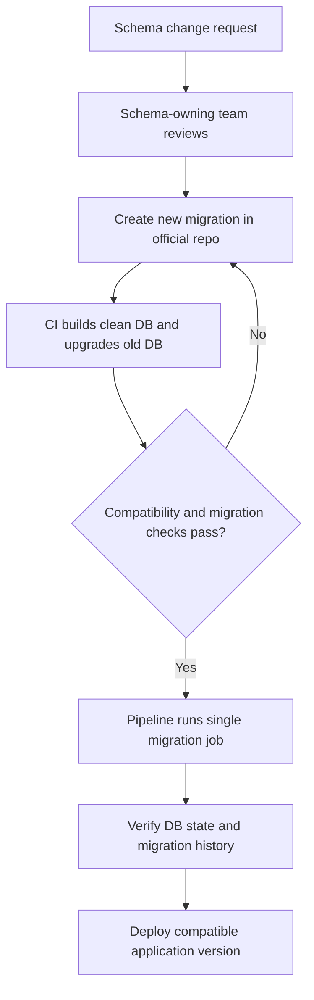

# Choosing a Single Migration Tool for the Same Schema

## 1. The Problem to Solve

In a Spring Boot application, database structures evolve over time: adding tables, adding columns, creating indexes, adding constraints, or transforming historical data. These changes must execute in a traceable order, repeat cleanly when standing up new environments, and remain compatible with deployed application versions.

A common architectural mistake is **allowing multiple mechanisms to modify DDL on the same schema**:

- Flyway executes versioned SQL migration files.
- Liquibase executes changesets in a changelog.
- Hibernate auto-creates or updates tables from entities when `ddl-auto=update`, `create`, or `create-drop` is enabled.
- Spring Boot runs `schema.sql` or other initialization scripts.
- A manual deployment script or another service alters tables outside formal migration history.

Each mechanism has its own way of determining "already run." Two tools may view a database as valid according to their own ledgers while having no visibility into what the other modified. For instance, if Flyway already created column `status`, Liquibase may still attempt to create it because Liquibase's changeset was never recorded. The result can be startup failures, out-of-order DDL execution, environment drift, or ambiguity over ownership during an incident.

**Principle:** for each schema managed by an application team, choose **one source of truth and one official migration execution mechanism**. Either Flyway or Liquibase can be a good fit; what must be avoided is running both over the same set of schema objects.

Here, "schema" means the namespace holding the data objects owned by the team (tables, views, constraints, indexes, sequences, etc.). One database server can host many independent databases or schemas. Ownership rules must be defined per actual object scope, not merely by server hostname.

## 2. Different Initialization Mechanisms in Spring Boot

| Mechanism | Primary Role | How to Use Once Formal Migrations Exist |
| --- | --- | --- |
| **Flyway** | Ordered, history- and checksum-tracked migrations, typically SQL-first | Use as the sole tool if the team chooses Flyway |
| **Liquibase** | Changeset and changelog management supporting XML/YAML/JSON/SQL | Use as the sole tool if the team chooses Liquibase |
| **Hibernate DDL** | Schema creation/updates from JPA models | Set `validate` or `none`; avoid `update`/`create` in managed environments |
| **Spring SQL initialization** | Executes `schema.sql` and `data.sql` per config | Disable general schema script init when migrations own the schema |
| **Manual SQL** | Direct database edits via console or ad-hoc scripts | Use only under controlled ops procedures; reflect changes in approved migration history |

### Why doesn't Hibernate `ddl-auto=update` replace migrations?

Hibernate can infer partial changes from entities and emit DDL, yet entity models do not express all operational changes: purposeful indexes, multi-step data transformations, safe column renames, view management, or backward/forward compatibility between releases. `update` also lacks an ordered migration history equivalent to Flyway/Liquibase.

In a Spring Boot integration system, there may also be tables used by JDBC, jOOQ, Spring Integration, or adapters that JPA does not own. Hence `ddl-auto=validate` should only act as an extra check for JPA entities; it **does not validate the entire schema** or replace migration testing.

### Why doesn't `spring.jpa.defer-datasource-initialization=true` solve conflicts?

This property adjusts when certain SQL initialization scripts run relative to JPA initialization. It does not unify Flyway, Liquibase, Hibernate, and `schema.sql` into one history-sharing coordinator. If the goal is a single migration source, disable DDL-writing mechanisms other than the chosen one.

## 3. Choosing Flyway or Liquibase

No tool is universally best for every organization. Pick **one tool suited to your actual workflow** and document that decision in the service's architecture records.

| Criterion | Flyway | Liquibase |
| --- | --- | --- |
| Primary authoring style | Versioned SQL migrations; Java migrations where needed | Changelogs holding changesets, commonly YAML/XML/JSON/SQL |
| How teams review changes | Very direct when comfortable reading, reviewing, and running DB-specific SQL | Convenient when teams prefer structured change descriptions, labels/contexts, and changeset flows |
| Execution history | Flyway schema history table with status and checksums | `DATABASECHANGELOG` and `DATABASECHANGELOGLOCK` tables |
| Database-specific DDL | Natural fit with native PostgreSQL, MySQL, etc. SQL | Also supports native SQL alongside abstract change types |
| Rollback | Do not assume every migration has automatic rollback | Provides rollback constructs for many change types, though reversibility depends on type, definition, and DB |
| Switching cost | Low if pipelines and systems already run Flyway steadily | Low if pipelines and systems already run Liquibase steadily |

Decision guide:

1. **System already runs one tool reliably:** default to keeping that tool for the same schema. Never add the other tool for one special migration; verify whether the existing tool already supports custom SQL.
2. **New application, team comfortable with SQL and DB-specific DDL:** Flyway is clear and easy to review with `V1__...sql`, `V2__...sql`.
3. **New application, team wants declarative changelogs, labels/contexts, or unified changeset workflows:** Liquibase is a reasonable choice.
4. **Multiple services modifying one schema:** first decide which service/team or pipeline owns the schema. Library choice comes second. Two services both using Flyway with separate uncoordinated migration sets and histories still collide.
5. **Multiple independent schemas on the same server:** ownership can be split per schema; clearly define search paths, DB grants, history tables, and migration pipelines. Standardizing on one tool across the platform usually simplifies operations.

A brief decision record might read:

> Schema `public` of database `orders` is owned by the Orders team. Flyway is the sole migration source. DDL changes are reviewed in `src/main/resources/db/migration` and run by the deployment pipeline. Runtime JPA uses `validate` only; `schema.sql` must not create tables. Other integration teams needing table changes must submit PRs to the Orders team's migration repository.

The key value of this record is defining **ownership scope, change location, and executor**; simply writing "we use Flyway" leaves critical gaps.

## 4. Example A — Choosing Flyway for a PostgreSQL Schema

Suppose a Spring Boot service manages `public.customer_profiles` to synchronize customer profiles with external systems. The team decides every structural change to this schema goes through Flyway.

### 4.1. Declare dependencies only for the chosen tool

Maven example with Spring Boot dependency management:

```xml
<dependency>
    <groupId>org.flywaydb</groupId>
    <artifactId>flyway-core</artifactId>
</dependency>

<!-- For Flyway lines requiring a separate PostgreSQL support module -->
<dependency>
    <groupId>org.flywaydb</groupId>
    <artifactId>flyway-database-postgresql</artifactId>
</dependency>
```

Add the PostgreSQL JDBC driver per project configuration. Do not add `liquibase-core` just to run another SQL snippet: Flyway already supports SQL migrations. Specific database support artifacts may vary by Flyway/Spring Boot version; verify dependencies managed by your project's BOM and driver.

### 4.2. Spring Boot configuration

```yaml
spring:
  datasource:
    url: ${DB_URL}
    username: ${DB_USERNAME}
    password: ${DB_PASSWORD}

  flyway:
    enabled: true
    locations: classpath:db/migration

  liquibase:
    enabled: false

  sql:
    init:
      mode: never

  jpa:
    hibernate:
      ddl-auto: validate
```

Explanation:

- `spring.flyway.enabled=true`: Flyway is permitted to run migrations from the declared location.
- `spring.liquibase.enabled=false`: ensures Liquibase does not auto-run if pulled in via configuration or another module.
- `spring.sql.init.mode=never`: disables Spring Boot's script initializer; `schema.sql`/`data.sql` no longer create schemas.
- `spring.jpa.hibernate.ddl-auto=validate`: if the service uses JPA, validates entity mappings after the schema is prepared. Omit `spring.jpa` if not using JPA.
- Environment variables provide credentials per system security practices; this simplified example does not yet split runtime and migration accounts.

For services without JPA or where Hibernate shouldn't validate mappings on startup, choose `ddl-auto=none`. Avoid `update`, `create`, and `create-drop` in migration-managed environments.

### 4.3. An ordered migration history

Resource structure:

```text
src/main/resources/
└── db/
    └── migration/
        ├── V1__create_customer_profiles.sql
        └── V2__add_display_name.sql
```

`V1__create_customer_profiles.sql`, PostgreSQL example:

```sql
CREATE TABLE public.customer_profiles (
    id BIGINT GENERATED BY DEFAULT AS IDENTITY PRIMARY KEY,
    external_id VARCHAR(100) NOT NULL UNIQUE,
    email VARCHAR(320),
    created_at TIMESTAMPTZ NOT NULL DEFAULT CURRENT_TIMESTAMP
);
```

`V2__add_display_name.sql`:

```sql
ALTER TABLE public.customer_profiles
    ADD COLUMN display_name VARCHAR(120);
```

When standing up a new database, Flyway executes V1 through V2. When upgrading a database that already applied V1, Flyway runs only V2. History and checksums of executed migrations live in the configured schema's Flyway history table.

**Never edit deployed V1 contents** to add a new column: doing so changes the checksum and makes older environments inconsistent. Create V2 (and subsequent versions). A populated schema also requires an application compatibility plan before and after adding the column.

## 5. Example B — Choosing Liquibase Means Letting Liquibase Own the Schema

Another team might choose Liquibase from the start. In that case, do not run Flyway in parallel on that schema.

Maven dependency:

```xml
<dependency>
    <groupId>org.liquibase</groupId>
    <artifactId>liquibase-core</artifactId>
</dependency>
```

Configuration:

```yaml
spring:
  datasource:
    url: ${DB_URL}
    username: ${DB_USERNAME}
    password: ${DB_PASSWORD}

  flyway:
    enabled: false

  liquibase:
    enabled: true
    change-log: classpath:db/changelog/db.changelog-master.yaml

  sql:
    init:
      mode: never

  jpa:
    hibernate:
      ddl-auto: validate
```

Example `src/main/resources/db/changelog/db.changelog-master.yaml`:

```yaml
databaseChangeLog:
  - changeSet:
      id: 001-create-customer-profiles
      author: integration-team
      changes:
        - createTable:
            schemaName: public
            tableName: customer_profiles
            columns:
              - column:
                  name: id
                  type: BIGINT
                  autoIncrement: true
                  constraints:
                    primaryKey: true
                    nullable: false
              - column:
                  name: external_id
                  type: VARCHAR(100)
                  constraints:
                    nullable: false
                    unique: true
```

Liquibase identifies changesets by their identifying tuple in the changelog, records history in `DATABASECHANGELOG`, and coordinates operations using `DATABASECHANGELOGLOCK`. Executed changesets must be treated as immutable history; for future schema updates, append the next changeset.

The Flyway and Liquibase examples are **two mutually exclusive alternatives**, not two steps to combine in the same app. Never apply Flyway V1 and then run a Liquibase changeset recreating `customer_profiles`.

## 6. Safe Development and Deployment Workflow

### 6.1. One schema change follows a single path



For multi-replica systems, establish a **coordinated single execution point**, such as a dedicated pipeline/CD job or a controlled execution step. Both Flyway and Liquibase have locking mechanisms within their own scope, yet those locks do not synchronize Flyway with Liquibase and do not replace a proper rollout plan.

Two common deployment patterns:

- **Migrations run on Spring Boot startup:** convenient for small systems with few replicas. All instances must share consistent configuration and use a single engine. On migration failure, startup must fail so the app does not run on an incompatible schema.
- **Migrations run via a pre-startup job:** ideal when DBA approval, separated DDL privileges, multiple replicas, or staged rollouts are required. Only after the job succeeds do app instances start or rolling-update; runtime profiles can disable startup migrations. The job must use the exact release artifact and target database.

When separating the migration job, runtime pods should use an account holding only required DML grants, while DDL privileges belong exclusively to the job. Setting `spring.flyway.enabled=false` or `spring.liquibase.enabled=false` at runtime is **safe only when a separate job genuinely runs migrations beforehand**.

### 6.2. Applying expand → migrate → contract

When multiple application versions run concurrently, DDL changes must preserve backward compatibility temporarily.

Example renaming `customer_name` to `display_name`:

1. **Expand:** add nullable `display_name` in a new migration without dropping `customer_name`.
2. **Migrate:** deploy code reading old data while writing according to the transition strategy; run controlled data backfill.
3. **Verify:** check record counts, error records, sync lag, and consumers still reading the old column.
4. **Contract:** create a migration dropping `customer_name` only once no instances or integrations depend on it.

On large tables, adding indexes, altering types, or backfilling can cause major locks/IO. Tailor migrations to PostgreSQL/MySQL/target DB characteristics, test on realistic data volumes, and set monitoring thresholds. Never assume DDL always rolls back inside a transaction: certain databases or DDL operations perform implicit commits.

### 6.3. Initial data also requires ownership boundaries

Distinguish three categories of data:

- **Reference data mandatory for operation:** place in formal migrations or versioned data-migration workflows with proper idempotency checks.
- **Demo/test data:** use test fixtures or test profiles; keep out of production history unless truly needed.
- **Business data evolving over time:** flows through APIs, workers, batch jobs, or standard business pipelines; never overwrite carelessly with `data.sql` on every startup.

Schema migrations and related data migrations can share the same tool, yet massive backfills should be engineered separately to pause, resume, and report progress safely.

## 7. Multi-Service or Multi-Schema Scenarios

Suppose a database server hosts two schemas:

| Scope | Owner | Permitted Migration Source |
| --- | --- | --- |
| `orders` | Orders service/team | Single migration set managed by Orders team |
| `analytics` | Reporting service/team | Separate migration set altering only `analytics` |
| Table `orders.outbox_events` | Orders team, read by Integration worker | Still belongs to Orders migrations; Integration worker does not run `ALTER TABLE` |
| Table `analytics.integration_checkpoint` | Reporting/Integration team per agreement | Managed by `analytics` owner's migrations |

Different tools may be selected for **genuinely independent schemas**, provided target schemas, metadata tables, search paths, and privileges are strictly configured to prevent accidental cross-writes. Standardizing on one tool across an organization typically reduces operational overhead, yet the non-negotiable rule is **never let two DDL sources modify the same schema**.

If two microservices write directly into the same schema, resolve ownership first: split schemas, or designate one shared migration repository/pipeline with unified review. Having both use Flyway does not prevent conflicts if each keeps independent histories and migration files.

## 8. If a System Already Ran Both Flyway and Liquibase

This situation requires a **deliberate inventory and controlled consolidation**. Simply deleting one dependency can leave history and actual schema state unmanaged.

### 8.1. Inventory before changing anything

Gather at least:

- Which tools are enabled in each environment and which apps/workers/jobs hold DDL privileges.
- What tables, columns, indexes, constraints, and views actually exist in the schema compared against expected definitions.
- Which migrations/changesets Flyway and Liquibase histories record, including any failures or version gaps.
- Whether `schema.sql`, `data.sql`, `import.sql`, Hibernate `ddl-auto`, or manual DDL scripts are active.
- Deployment windows, dependent services, and verified database recovery plans.

PostgreSQL queries to **check the presence** of common metadata tables:

```sql
SELECT table_schema, table_name
FROM information_schema.tables
WHERE table_schema = 'public'
  AND LOWER(table_name) IN (
      'flyway_schema_history',
      'databasechangelog',
      'databasechangeloglock'
  )
ORDER BY table_name;
```

Once the exact schema and table names are known, inspect respective histories:

```sql
-- When Flyway uses the default history table in schema public:
SELECT installed_rank, version, description, success
FROM public.flyway_schema_history
ORDER BY installed_rank DESC;

-- When Liquibase uses the default table names in schema public:
SELECT id, author, filename, dateexecuted, exectype
FROM public.databasechangelog
ORDER BY dateexecuted DESC;
```

Table names, schemas, and privileges may have been customized. Finding a metadata table **does not prove the tool is still active**: cross-check deployment configs and logs. Never create or drop history tables to make migrations "re-run."

### 8.2. Consolidating onto a single migration source

1. **Halt multi-source DDL changes:** freeze scope and pick a cutover window; back up and verify restore capability.
2. **Select the surviving tool:** favor the history set that best reconciles with the current schema and fits governance pipelines.
3. **Reconcile physical state:** determine which changes exist in the DB, remain pending, or applied partially; resolve drift before recording a baseline.
4. **Establish a verified handoff baseline:** if using Flyway baseline or Liquibase `changelogSync`, invoke only after verifying every object represented by that milestone truly exists with the right structure. These commands can **mark work executed without running DDL**.
5. **Disable the retired engine at all entry points:** applications, batch jobs, migration jobs, profiles, and pipelines; retain old history for auditability.
6. **Author future migrations only in the chosen tool:** test against both a copy of the legacy state and a fresh bootstrap database; deploy with verification and recovery readiness.

Never run `baselineOnMigrate`, `repair`, checksum deletion, or manual history edits merely to silence errors. Such actions hide drift; understand the cause first and document physical reconciliation.

## 9. Testing to Catch Dual DDL Sources and Drift

A reliable CI pipeline should verify at least these scenarios:

| Scenario | Test Objective |
| --- | --- |
| **Fresh database bootstrap** | All migrations of the chosen tool execute in order, producing the required schema |
| **Upgrade from prior version** | New migrations run over old data/models, not only succeeding from scratch |
| **Application startup** | JPA `validate` (if used) and JDBC/jOOQ adapters query cleanly |
| **Two app versions coexisting** | Expanded schema serves older consumers before contract |
| **Per-profile startup config** | Only one engine owns schema management; SQL initializers and Hibernate DDL do not alter structure |
| **Migration failure** | Pipeline halts rollout with clear errors; restore/recovery handles partially executed DDL |
| **Multiple replicas** | Single coordinated migration path; no other app/job issues untracked DDL |

Testcontainers running the production database engine catches DDL syntax, data type, and transaction differences. Testing with H2 against production PostgreSQL/MySQL misses engine-specific bugs. Never enable Hibernate `create-drop` in integration tests and treat it as proof that production migrations work.

Review check example: scan for Flyway/Liquibase dependencies, `spring.flyway.enabled`, `spring.liquibase.enabled`, `spring.sql.init.mode`, `spring.jpa.hibernate.ddl-auto`, and all pipeline migration jobs. Inspect environment profiles and environment variables as well, since they override default YAML.

## 10. Misconfiguration Symptoms and Remediation

| Symptom | Causes to Check | Resolution |
| --- | --- | --- |
| Startup reports "table already exists" | Two engines creating tables, or schema created manually | Reconcile history and physical schema; keep one official migration source |
| Flyway reports checksum mismatch | Executed migration edited or history mismatch | Restore immutability and inspect drift; add a new migration for new changes |
| Liquibase reports checksum/changeset error | Old changeset modified, path/ID changed, or mismatched state | Inspect changelog identity and DB before choosing remediation |
| Dev works, prod misses columns | Dev uses Hibernate `update` or `schema.sql` outside migrations | Disable secondary schema generators; test fresh/upgrade against real engine |
| Two pods see weird concurrent DDL | Multiple migration entry points or two active engines | Audit job/startup configs and enforce one executor |
| Migration job passes yet app fails | JPA/entities, default schema, account privileges, or app expects newer schema | Compare artifact versions, target schemas, grants, and rollout compatibility |

In particular, never resolve an error by enabling the other tool or turning on `ddl-auto=update`. That temporary workaround destroys traceability of the official change path and typically causes worse failures on the next upgrade.

## 11. Decision Checklist for Spring Boot Integration Teams

Before accepting a schema change, confirm:

- [ ] Schema scope and owning team are documented; integration apps know where to submit changes.
- [ ] Only Flyway **or** Liquibase is selected as the official migration source for this scope.
- [ ] Apps and jobs have no secondary DDL source (`schema.sql`, Hibernate `update/create`, untracked manual scripts).
- [ ] Migrations carry immutable identities and are reviewed alongside code requiring schema changes.
- [ ] CI tests both fresh database bootstrap and upgrades over populated databases.
- [ ] Rollout order fits active services, applying expand/contract where needed.
- [ ] Accounts, DDL grants, backups/restores, logs, and migration histories suffice for diagnostics.
- [ ] All environments share the same history source; profile and job overrides have been audited.

**Desired outcome:** whenever someone asks "when was this table or column created, by whom, and in which version?", the team can point to one consistent migration history and one controlled deployment path. That forms the foundation for Spring Boot to integrate HTTP, JDBC/jOOQ, JPA, caches, brokers, and other adapters without incidents caused by uncoordinated schema mutations.
