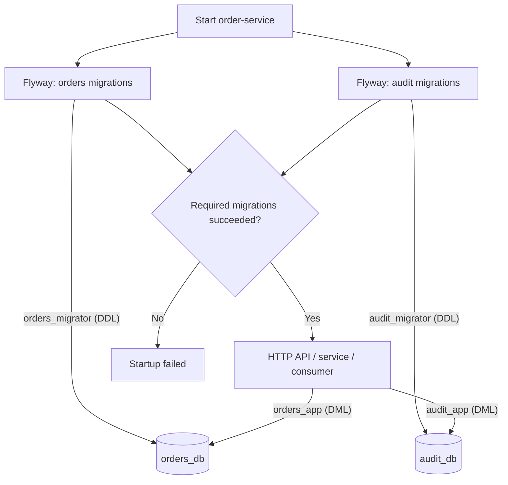

# Migrations with Multiple DataSources or Dedicated Accounts

A Spring Boot application may read from and write to multiple databases: an orders database, an audit database, a reporting store, or schemas owned by different teams. In those cases, placing a few `V1__*.sql` files in `db/migration` is not enough to guarantee migrations run in the right target, under the right account, and at the right time. Each data target needs explicit version history, privileges, initialization order, and deployment procedures.

This lesson focuses on organizing **schema migrations** in Spring Boot integration flows using JDBC/JPA and multiple `DataSource`s, using Flyway as the primary example and Liquibase as an equivalent option. The objective is to update data structures safely before HTTP APIs, consumers, scheduled jobs, or integration adapters begin using the new structure.

## 1. Defining Migration Boundaries Precisely

Three concepts are frequently confused:

| Concept | Example | Migration Consequence |
| --- | --- | --- |
| Multiple `DataSource`s | `ordersDataSource` points to `orders_db`, `auditDataSource` points to `audit_db` | Must configure migrations per target explicitly; do not infer from `@Primary`. |
| Multiple schemas in one database | Schemas `orders` and `audit` both live in `platform_db` | Must separate locations, default schemas, and migration history table placement. |
| Multiple accounts on the same database | `orders_app` runs business traffic, `orders_migrator` alters DDL | Must separate runtime and migration credentials; same database does not mean same privileges. |

A single application can hit all three scenarios simultaneously. For example, an order-processing service accesses two databases with two runtime accounts, while each database has its own migration account.

Design principles:

1. **Each schema boundary has one clear migration owner.** Two apps should not independently modify tables via separate migration sets without shared ownership and release rules.
2. **Versions are tracked on the exact target being migrated.** With Flyway, `flyway_schema_history` resides in the corresponding database/schema; identical table names across two separate databases do not conflict.
3. **The application initializes only after its required migrations finish.** If JPA validates schemas or a consumer runs before DDL, startup fails even if migrations eventually succeed.
4. **Runtime accounts prefer DML privileges; migration accounts hold only necessary DDL privileges.** Never use superuser accounts for routine migrations.
5. **There is no shared ACID transaction across two independent databases merely because both migrate during one startup.** If the second database fails after the first migrated, each target requires its own recovery handling.

## 2. Business and Architecture Example

Suppose `order-service` receives HTTP order requests, saves orders to `orders_db`, and writes audit events to `audit_db`. Both databases run PostgreSQL and may reside on separate hosts:



Here Flyway has two separate configurations. `orders_db` tracks order versions, while `audit_db` tracks audit log versions. Application startup must halt if a required migration fails; doing so does not automatically undo migrations already committed on the other database.

## 3. Organizing Migration Files by Target

With Flyway, choose non-overlapping resource paths:

```text
src/main/resources/
└── db/
    └── migration/
        ├── orders/
        │   ├── V1__create_orders.sql
        │   └── V2__add_order_external_ref.sql
        └── audit/
            ├── V1__create_audit_events.sql
            └── V2__add_audit_correlation_id.sql
```

In this layout, `orders`'s `V1` and `audit`'s `V1` are two **independent** version chains. Never force both databases to share version numbers; versions reflect schema evolution per target.

Example `db/migration/orders/V1__create_orders.sql`:

```sql
CREATE TABLE orders (
    id           BIGINT GENERATED BY DEFAULT AS IDENTITY PRIMARY KEY,
    customer_ref VARCHAR(80) NOT NULL,
    status       VARCHAR(24) NOT NULL,
    created_at   TIMESTAMPTZ NOT NULL DEFAULT CURRENT_TIMESTAMP
);
```

Example `db/migration/audit/V1__create_audit_events.sql`:

```sql
CREATE TABLE audit_events (
    id          BIGINT GENERATED BY DEFAULT AS IDENTITY PRIMARY KEY,
    order_id    BIGINT NOT NULL,
    event_type  VARCHAR(80) NOT NULL,
    occurred_at TIMESTAMPTZ NOT NULL DEFAULT CURRENT_TIMESTAMP
);
```

Do not declare a foreign key from `audit_events.order_id` to `orders.id` across two separate PostgreSQL databases. Cross-database consistency belongs to business flow design—such as events/outbox, deduplication, and compensation—and cannot be enforced by a standard foreign key.

## 4. Configuring Spring Boot with Two Runtime DataSources and Two Migration Accounts

The example below targets Spring Boot 3.x, Java 17+, and Flyway. Required Maven dependencies include the JDBC starter, PostgreSQL driver, and Flyway Core; newer Flyway versions may also require the PostgreSQL support module:

```xml
<dependencies>
    <dependency>
        <groupId>org.springframework.boot</groupId>
        <artifactId>spring-boot-starter-jdbc</artifactId>
    </dependency>
    <dependency>
        <groupId>org.postgresql</groupId>
        <artifactId>postgresql</artifactId>
        <scope>runtime</scope>
    </dependency>
    <dependency>
        <groupId>org.flywaydb</groupId>
        <artifactId>flyway-core</artifactId>
    </dependency>
    <dependency>
        <groupId>org.flywaydb</groupId>
        <artifactId>flyway-database-postgresql</artifactId>
    </dependency>
</dependencies>
```

Use the dependency management of your active Spring Boot version so Flyway modules align properly. If the project uses JPA, add the JPA starter and configure an `EntityManagerFactory`/transaction manager per database as needed.

### 4.1. Declaring connection settings

`application.yml`:

```yaml
spring:
  flyway:
    enabled: false # Prevent auto-configuration from picking a single DataSource

app:
  datasource:
    orders:
      url: jdbc:postgresql://localhost:5432/orders_db
      username: orders_app
      password: ${ORDERS_APP_PASSWORD}
      hikari:
        maximum-pool-size: 10
    audit:
      url: jdbc:postgresql://localhost:5432/audit_db
      username: audit_app
      password: ${AUDIT_APP_PASSWORD}
      hikari:
        maximum-pool-size: 5

  migration:
    orders:
      url: jdbc:postgresql://localhost:5432/orders_db
      username: orders_migrator
      password: ${ORDERS_MIGRATION_PASSWORD}
    audit:
      url: jdbc:postgresql://localhost:5432/audit_db
      username: audit_migrator
      password: ${AUDIT_MIGRATION_PASSWORD}
```

Environment variables here illustrate configuration sources; in deployed environments, pull passwords from a secrets manager with strict read permissions. Never commit real passwords to the repository or log connection strings containing credentials.

Key detail: `spring.flyway.enabled: false` only **disables Spring Boot's automatic Flyway creation/execution**. The manual Flyway beans defined below still run because the application invokes them through Spring lifecycle hooks. Leaving auto-configuration enabled alongside multiple Flyway/DataSource definitions risks unexpected startup behavior or ambiguous bean resolution.

### 4.2. Creating two runtime DataSources

Using `DataSourceProperties` ensures the `url` property binds cleanly to Hikari's `jdbcUrl`. Marking one `@Primary` satisfies default single-`DataSource` injection points; anything targeting `audit` must still use `@Qualifier`.

```java
import com.zaxxer.hikari.HikariDataSource;
import javax.sql.DataSource;
import org.springframework.beans.factory.annotation.Qualifier;
import org.springframework.boot.autoconfigure.jdbc.DataSourceProperties;
import org.springframework.boot.context.properties.ConfigurationProperties;
import org.springframework.context.annotation.Bean;
import org.springframework.context.annotation.Configuration;
import org.springframework.context.annotation.Primary;

@Configuration(proxyBeanMethods = false)
public class RuntimeDataSourceConfig {

    @Bean("ordersDataSourceProperties")
    @Primary
    @ConfigurationProperties("app.datasource.orders")
    DataSourceProperties ordersProperties() {
        return new DataSourceProperties();
    }

    @Bean("ordersDataSource")
    @Primary
    @ConfigurationProperties("app.datasource.orders.hikari")
    HikariDataSource ordersDataSource(
            @Qualifier("ordersDataSourceProperties") DataSourceProperties properties) {
        return properties.initializeDataSourceBuilder()
                .type(HikariDataSource.class)
                .build();
    }

    @Bean("auditDataSourceProperties")
    @ConfigurationProperties("app.datasource.audit")
    DataSourceProperties auditProperties() {
        return new DataSourceProperties();
    }

    @Bean("auditDataSource")
    @ConfigurationProperties("app.datasource.audit.hikari")
    HikariDataSource auditDataSource(
            @Qualifier("auditDataSourceProperties") DataSourceProperties properties) {
        return properties.initializeDataSourceBuilder()
                .type(HikariDataSource.class)
                .build();
    }
}
```

In JDBC services or repositories, inject `@Qualifier("ordersDataSource")` or `@Qualifier("auditDataSource")` explicitly; you can declare two named `JdbcTemplate` and two `PlatformTransactionManager` beans. `@Primary` only sets an injection default, not a migration target selector.

### 4.3. Binding independent migration accounts

Create `MigrationTargets.java`:

```java
import org.springframework.boot.context.properties.ConfigurationProperties;

@ConfigurationProperties(prefix = "app.migration")
public record MigrationTargets(Target orders, Target audit) {
    public record Target(String url, String username, String password) {
    }
}
```

The `app.migration.*` settings stay separate from `app.datasource.*`. Flyway opens connections with `*_migrator`, whereas Spring Data/JDBC accesses databases using `*_app`. Using a Java `record` and `@EnableConfigurationProperties` supports constructor binding in Spring Boot 3.x; ensure all three properties for each target are supplied at runtime.

### 4.4. Creating and running each Flyway instance once

Create `MigrationConfig.java`:

```java
import org.flywaydb.core.Flyway;
import org.springframework.beans.factory.annotation.Qualifier;
import org.springframework.boot.context.properties.EnableConfigurationProperties;
import org.springframework.context.annotation.Bean;
import org.springframework.context.annotation.Configuration;

@Configuration(proxyBeanMethods = false)
@EnableConfigurationProperties(MigrationTargets.class)
public class MigrationConfig {

    @Bean(name = "ordersFlyway", initMethod = "migrate")
    Flyway ordersFlyway(MigrationTargets targets) {
        MigrationTargets.Target db = targets.orders();

        return Flyway.configure()
                .dataSource(db.url(), db.username(), db.password())
                .locations("classpath:db/migration/orders")
                .table("flyway_schema_history")
                .validateMigrationNaming(true)
                .load();
    }

    @Bean(name = "auditFlyway", initMethod = "migrate")
    Flyway auditFlyway(MigrationTargets targets) {
        MigrationTargets.Target db = targets.audit();

        return Flyway.configure()
                .dataSource(db.url(), db.username(), db.password())
                .locations("classpath:db/migration/audit")
                .table("flyway_schema_history")
                .validateMigrationNaming(true)
                .load();
    }
}
```

Here `@Bean(initMethod = "migrate")` instructs Spring to call `Flyway.migrate()` when constructing each bean. Both singleton beans initialize during application context startup; if either `migrate()` call throws an exception, the application fails to start.

This is an **intentional startup strategy**: disabling Flyway auto-configuration and managing two beans explicitly. Do not simultaneously register a `FlywayMigrationInitializer` or invoke `migrate()` from an `ApplicationRunner` on these same beans, as that adds a second execution path and complicates initialization order.

In real projects, standardize bean names, locations, and target properties per team bounded context. With more databases, you can extract a shared Flyway builder helper while still maintaining explicit target lists, owners, and per-target failure policies.

## 5. Ensuring JPA, JDBC, and Consumers Operate Only After Migrations

Especially with JPA, `hibernate.hbm2ddl.auto=validate` (or `spring.jpa.hibernate.ddl-auto=validate` in auto-config) checks tables when `EntityManagerFactory` initializes. When Flyway is configured manually, Spring Boot does not automatically infer initialization dependencies between each `EntityManagerFactory` and its corresponding Flyway bean.

With two manually declared `EntityManagerFactory` beans, attach dependencies per database:

```java
@Bean("ordersEntityManagerFactory")
@DependsOn("ordersFlyway")
LocalContainerEntityManagerFactoryBean ordersEntityManagerFactory(
        EntityManagerFactoryBuilder builder,
        @Qualifier("ordersDataSource") DataSource dataSource) {
    return builder
            .dataSource(dataSource)
            .packages("com.example.orders.entity")
            .persistenceUnit("orders")
            .build();
}

@Bean("auditEntityManagerFactory")
@DependsOn("auditFlyway")
LocalContainerEntityManagerFactoryBean auditEntityManagerFactory(
        EntityManagerFactoryBuilder builder,
        @Qualifier("auditDataSource") DataSource dataSource) {
    return builder
            .dataSource(dataSource)
            .packages("com.example.audit.entity")
            .persistenceUnit("audit")
            .build();
}
```

These two illustrative methods belong in a complete JPA configuration alongside `JpaTransactionManager`, `@EnableJpaRepositories`, and corresponding entity/repository packages. With plain JDBC, apply the same rule to any bean querying during initialization. Standard request services, listeners, and scheduled tasks run after the context starts, yet custom startup paths must be verified individually.

Notes:

- Never let Hibernate auto-create/alter tables (`ddl-auto=update`) alongside Flyway or Liquibase. Migrations own structural changes; `validate` catches mismatches once execution order is right.
- With two transaction managers, name and reference them explicitly, e.g., `@Transactional("ordersTransactionManager")`. A single `@Transactional` does not automatically span two databases.
- If migrations run from a deployment job before launching the app (instead of inside the Spring context), enforce database readiness in the pipeline; remove `@DependsOn` references to Flyway beans that do not exist in that app profile.

## 6. Variant: Multiple Schemas Inside the Same Database

If `orders` and `audit` live inside `platform_db` under **two PostgreSQL schemas**, you can share the JDBC URL while setting distinct default schemas:

```java
Flyway ordersFlyway = Flyway.configure()
        .dataSource(url, ordersMigratorUser, ordersMigratorPassword)
        .schemas("orders")
        .defaultSchema("orders")
        .locations("classpath:db/migration/orders")
        .table("flyway_schema_history")
        .load();

Flyway auditFlyway = Flyway.configure()
        .dataSource(url, auditMigratorUser, auditMigratorPassword)
        .schemas("audit")
        .defaultSchema("audit")
        .locations("classpath:db/migration/audit")
        .table("flyway_schema_history")
        .load();
```

The expected layout creates `orders.flyway_schema_history` and `audit.flyway_schema_history`. Schemas must exist or be created by an account with sufficient privileges; if DBAs manage schemas, consider `createSchemas(false)` and verify grants prior to running migrations. When SQL uses unqualified table names, verify connection `search_path`/default schema; in sensitive systems, schema-qualifying names like `orders.orders` avoids ambiguity.

**Never** configure two migration sets to share `public.flyway_schema_history` while managing unrelated locations/versions. Flyway treats them as one history sequence, corrupting checksums, versions, and ownership. If two workflows share a single schema, consolidate them into one managed migration stream.

## 7. Separating Migration and Runtime Privileges

A typical PostgreSQL privilege split:

| Account | Role | Recommended Privileges |
| --- | --- | --- |
| `orders_app` | Query and update orders at runtime | `CONNECT`, schema `USAGE`, DML on required tables, appropriate sequence privileges; no create/alter/drop schema/table rights. |
| `orders_migrator` | Run orders `V*.sql` scripts | `CONNECT`, `USAGE`, and create/alter/drop privileges scoped to orders objects; privileges on Flyway history table. |
| `audit_app` | Read/write audit at runtime | Restricted DML privileges on audit. |
| `audit_migrator` | Manage audit DDL | Restricted DDL privileges on audit schema and corresponding history table. |

Exact permissions also depend on schema ownership and how PostgreSQL handles object ownership. For example, `GRANT CREATE ON SCHEMA ...` allows creating tables, yet to `ALTER` or `DROP` an existing table, the migration account must also own that object (or belong to an owning role). Default DML grants for **new** tables and sequences must also be configured by a DBA when the runtime app is not the owner.

In live databases, provision and test permissions before swapping credentials:

1. DBA creates roles/schemas, granting DDL to migrators and DML to apps per scope.
2. Run migrations as the migrator, verifying history tables and created objects carry the right owner.
3. Run `SELECT`/`INSERT`/`UPDATE` tests as the app account and verify unintended DDL is rejected.
4. Manage credentials independently, scoping secrets per migration job and app workload so rotation requires no code changes.

Never embed admin passwords or use superuser accounts for every migration just to silence `permission denied`. Permission errors usually indicate ownership, grants, or target schema configuration needs fixing.

## 8. Using Liquibase Instead of Flyway

Liquibase follows the exact same principle: **one changelog + one migration connection + one tracking/lock table set per schema boundary**. To configure multiple targets manually, disable Liquibase auto-configuration (`spring.liquibase.enabled: false`), then declare separate `SpringLiquibase` beans with corresponding migration DataSources.

```java
import org.springframework.jdbc.datasource.DriverManagerDataSource;
import liquibase.integration.spring.SpringLiquibase;

@Bean("ordersLiquibase")
SpringLiquibase ordersLiquibase(MigrationTargets targets) {
    MigrationTargets.Target db = targets.orders();
    var migrationDataSource =
            new DriverManagerDataSource(db.url(), db.username(), db.password());

    var liquibase = new SpringLiquibase();
    liquibase.setDataSource(migrationDataSource);
    liquibase.setChangeLog("classpath:db/changelog/orders/master.yaml");
    liquibase.setShouldRun(true);
    return liquibase;
}

@Bean("auditLiquibase")
SpringLiquibase auditLiquibase(MigrationTargets targets) {
    MigrationTargets.Target db = targets.audit();
    var migrationDataSource =
            new DriverManagerDataSource(db.url(), db.username(), db.password());

    var liquibase = new SpringLiquibase();
    liquibase.setDataSource(migrationDataSource);
    liquibase.setChangeLog("classpath:db/changelog/audit/master.yaml");
    liquibase.setShouldRun(true);
    return liquibase;
}
```

`SpringLiquibase` executes the changelog during bean initialization. If each database has its own `EntityManagerFactory`, annotate with `@DependsOn("ordersLiquibase")` or `@DependsOn("auditLiquibase")` accordingly. By default Liquibase uses `DATABASECHANGELOG` and `DATABASECHANGELOGLOCK`; across different schemas in the same database, configure `defaultSchema` and tracking/lock table placement to match boundaries.

This example uses `DriverManagerDataSource` for a simple, unpooled migration connection. In real systems, fetch dedicated migration `DataSource` credentials from a secrets manager and configure pooling/lifecycles as needed. Pick **one** tool as the source of structural changes per schema; never let Flyway and Liquibase alter the same objects under two independent histories.

## 9. Running Migrations at Startup vs. from a Release Job

| Execution Mode | Best Suited For | What Must Be Controlled |
| --- | --- | --- |
| During Spring context creation, as in the Flyway example above | Local, test, few-replica environments, or simple startup flows | Every replica may attempt migration; tool locking must work, and DDL privileges exist in runtime environment. |
| Pipeline/CD migration job before app deployment | Multi-replica production, DDL approval gates, separated secrets | Job must succeed before rollout; runtime workload must not run DDL; non-backward-compatible changes must be phased. |
| Orchestrated per-tenant migration | Multi-tenant database-per-tenant or multi-schema | Track per-tenant versions, bound concurrent jobs, detect failed tenants, and support safe retries. |

In multi-replica environments, Flyway and Liquibase use history locking to prevent running the same version concurrently on the same target. However, giving every replica migration privileges still increases credential exposure, startup time, and failure handling complexity. Dedicated release jobs typically suit production environments with strict change control.

When switching from startup migrations to a release job, move the Flyway bean/runner setup to the job process and adjust app initialization dependencies. Simply disabling a property while leaving `@DependsOn` pointing to a removed bean will crash context startup. Pipelines must confirm every target completed migration before deploying an app version that depends on the new schema.

### Safe deployment across two databases

Avoid a single release requiring breaking changes on both databases at once. Use **expand–migrate–contract**:

1. **Expand:** add columns/tables/indexes so older app versions keep working; when adding `NOT NULL`, plan backfill and defaults before enforcing constraints.
2. **Migrate:** deploy app versions reading/writing the new structure and migrate data in batches if needed.
3. **Contract:** drop old columns/tables/paths only after all replicas, consumers, background tasks, and integrations stop depending on them.

If `orders_db` migration succeeds while `audit_db` fails, halt rollout, keep compatible app versions running, fix the root cause, and re-run migration on the failed target. Never assume automatic cross-database rollback exists. Flyway/Liquibase `repair`, `baseline`, or history edits must be evaluated separately; never use them to hide divergence between actual schema and history.

With PostgreSQL, many DDL commands can run inside transactions, yet certain statements (such as `CREATE INDEX CONCURRENTLY`) require non-transactional handling. Transactional migration behavior depends on tool, statement type, and database engine. Verify this during deployment testing, especially when a single migration file contains multiple statements.

## 10. Verification in Test Environments

To confirm **right target, right privileges, and right ordering**, go beyond checking that the app returns HTTP 200.

### 10.1. Inspecting history on each database

Connect separately to `orders_db` and `audit_db`, and run:

```sql
SELECT installed_rank, version, description, success
FROM flyway_schema_history
ORDER BY installed_rank;
```

Expected: `orders_db` contains only migrations from `db/migration/orders`; `audit_db` contains only migrations from `db/migration/audit`. Identical history table names are valid because each resides in its own database. Verify `orders` and `audit_events` live in their proper databases, even though both carry `V1`.

### 10.2. Valuable test scenarios

| Test | Expected Outcome |
| --- | --- |
| Brand-new databases | Each migration set initializes its tables and history; app starts. |
| Second app startup | Applied versions do not re-run; schemas remain unchanged. |
| Wrong `audit_migrator` password | App/job fails loudly; audit migration is not marked succeeded. |
| Editing an applied migration | Validation detects checksum mismatch; release halts for investigation. |
| `orders_app` attempts DDL in test | Rejected when privilege separation is configured properly. |
| JPA uses new schema right at startup | `EntityManagerFactory` validates only after the matching database's Flyway completes. |
| Two instances start concurrently | Same version is not applied twice; verify locking and real timeouts. |

Use Testcontainers to spin up two independent PostgreSQL databases, run the app with the same bean configuration, and query both history tables. When simulating failures, inspect the state of **both** databases to validate recovery; never assume rolling back the second database reverts the first.

### 10.3. Troubleshooting common errors

| Symptom | Causes to Inspect | Resolution |
| --- | --- | --- |
| Migrations run on main DB yet skip secondary DB | Relying on `@Primary` or configuring `spring.flyway.*` for only one target | Declare dedicated Flyway/Liquibase beans per `DataSource` or migration target. |
| `NoUniqueBeanDefinitionException` for `DataSource` | Multiple beans of same type; injection site lacks target specifier | Use `@Qualifier`, plus intentional `@Primary` for defaults. |
| `permission denied for schema` or `must be owner of table` | Migrator lacks privileges or owner mismatch | Check schema ownership, role inheritance, and grants; avoid superuser defaults. |
| Flyway reports unsupported database | Missing database-specific module or incompatible Flyway version | Check version alignment and `flyway-database-postgresql` dependency. |
| JPA reports missing table/column | JPA validated before migration | Configure `@DependsOn` or ensure release job completes before starting app. |
| `Validate failed: checksum mismatch` | Applied migration edited or drift between files and history | Investigate and restore released file; create a new migration for subsequent changes. |
| `relation already exists` on legacy DB without history | Schema existed prior to adopting migration tool | Plan dedicated baseline after schema reconciliation; never enable `baselineOnMigrate` blindly. |
| Two apps write to shared history with colliding versions | Overlapping schema ownership or locations/versions | Assign one owner and one version stream per scope; separate schemas/histories if truly independent. |
| One database upgraded, the other failed | Two migrations do not share a distributed transaction | Halt release, preserve compatibility, fix failed target and re-run; compensate if needed. |

## 11. Adoption Checklist for Spring Boot Integration Projects

Before rolling multi-datasource migrations into production, verify:

- [ ] Clear inventory of databases/schemas and owners; each target has properly scoped locations/changelogs.
- [ ] Each target maintains independent history/lock tables verified on real databases.
- [ ] Runtime `DataSource`s injected by name/`@Qualifier`; `@Primary` used only when a true default exists.
- [ ] App accounts hold no excess DDL rights; migration accounts hold scoped ownership and DDL permissions.
- [ ] Explicit decision on startup vs. job-based migrations; no unintended dual execution paths.
- [ ] JPA schema validation, consumers, and scheduled tasks start only after required migrations finish.
- [ ] SQL tested on fresh DBs, populated DBs, restarts, and failure scenarios.
- [ ] Schemas stay compatible with rolling deployments, event consumers, and older running apps.
- [ ] Monitoring tracks versions, runtimes, failed targets, and recovery procedures for partial cross-DB migrations.

**Hands-on exercise:** create two PostgreSQL databases (`orders_db`, `audit_db`) and four corresponding roles as shown; deploy two `V1` scripts using two Flyway beans, then add `V2` for audit only. Observe independent histories, confirm `orders_db` stays at `V1`, then deliberately supply an invalid `audit_migrator` credential to confirm startup halts without recording `V2` in audit. Finally restore the valid secret and confirm `V2` applies exactly once.

When every schema has an explicit owner, dedicated accounts, version history, and clear initialization order, migrations become a controllable part of Spring Boot integration flows—even when HTTP APIs, JPA, brokers, and background jobs depend on multiple data sources simultaneously.
