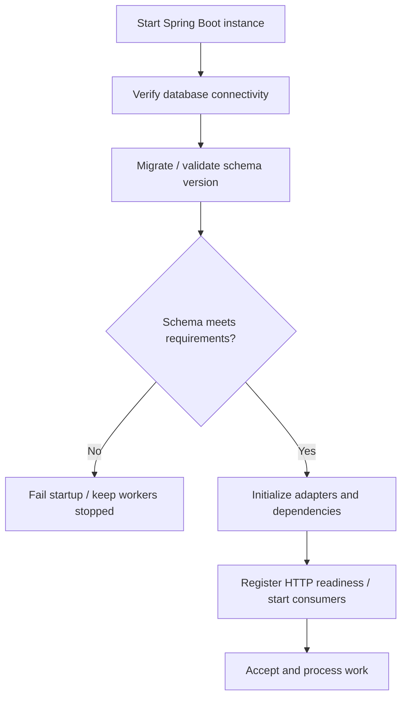
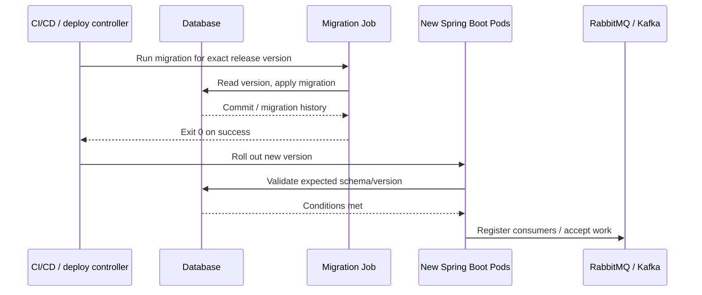
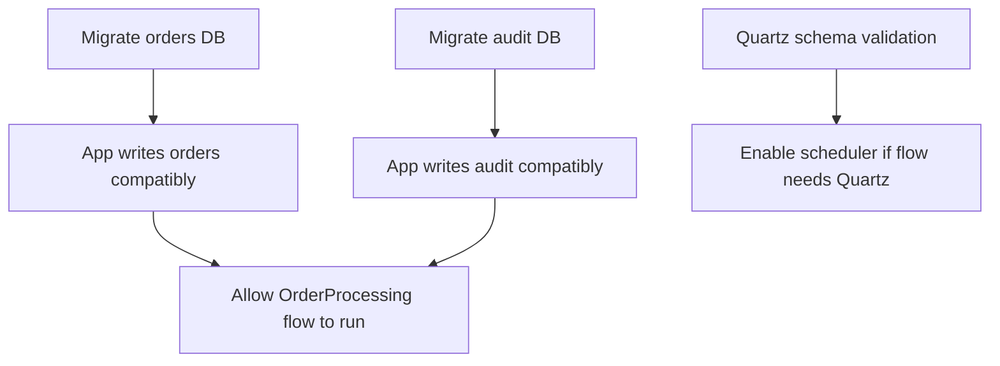

# Completing Migrations Before the Application Begins Accepting Work

## 1. The Problem: A New Application Starts Before the Schema Is Ready

In the **Spring Boot Integration** module, an instance may handle HTTP requests, read/write databases via JDBC/JPA/R2DBC, consume RabbitMQ or Kafka, run Quartz jobs, and push data to other HTTP APIs, caches, or brokers. These flows rely on a shared **data contract** with the database: table names, columns, data types, constraints, indexes, and configuration or reference records.

Suppose a new version of an order synchronization service adds an `external_reference` column. If a RabbitMQ consumer starts processing `OrderCreated` before the migration creates that column, `INSERT`/`UPDATE` statements will fail. This error can cause messages to be redelivered repeatedly, build up backlogs, or end up in a DLQ. If HTTP endpoints already accept traffic, callers may receive `500` responses while the pod appears to be running.

**Requirement:** every work-intake path **that depends on the new schema** must be activated only after required migrations finish and the application verifies the database is at the right version. Intake paths include HTTP, consumers, scheduled tasks, Spring Integration inbound adapters, and background jobs; you cannot rely solely on "the JVM is up."



This diagram is a **design target**. Not every Spring listener automatically waits for `ApplicationReadyEvent` or HTTP readiness. Startup controls and gates must be chosen per integration mechanism.

## 2. Four Milestones to Distinguish During Startup

| Milestone | What Is Happening | Ready to Accept Work Yet? |
| --- | --- | --- |
| **Database reachable** | Network and credentials suffice to connect to the database. | No; the schema might not be ready yet. |
| **Schema migrated/validated** | Applicable migrations ran; required version and invariants are verified. | Only data prerequisites met; does not prove other dependencies are ready. |
| **Spring context refreshed** | Beans are constructed, context refresh finishes, `SmartLifecycle` beans may already have started. | Listeners/schedulers may already be pulling work if not gated separately. |
| **Application ready** | After `ApplicationRunner`/`CommandLineRunner`, Spring Boot emits `ApplicationReadyEvent` and flips readiness to accept traffic on a successful startup. | HTTP can be routed if probes/orchestrators are configured properly; consumers are not automatically gated by HTTP probes. |

For example, Spring Boot with Flyway auto-configuration typically executes migrations **during bean creation/initialization before application startup completes**. However, do not assume every custom piece of code or every listener waits for the right barrier: adapters can implement `SmartLifecycle` and start during context refresh, whereas `ApplicationRunner` runs afterward.

### 2.1. Readiness, liveness, and startup probes differ

- **Readiness probe**: tells Kubernetes or a load balancer whether this instance should receive **requests from the traffic path it manages**. An unready pod is usually removed from Service endpoints, yet can still open outbound broker connections and consume messages.
- **Liveness probe**: checks whether the process should be restarted. Do not equate transient migration/dependency errors with a "dead" process; restart loops can worsen an incident.
- **Startup probe**: gives the application extra startup time before other probes are evaluated per config. It does not perform migrations for the application.

If a system runs workers that only consume Kafka/RabbitMQ and serve no HTTP traffic, **HTTP readiness is not a sufficient barrier**. Defer listener registration or worker startup until valid schema proof exists.

## 3. What Migrations Guarantee—and Cannot Guarantee

Migrations are typically a versioned sequence of changes managed by **Flyway** or **Liquibase**:

- **DDL:** creating tables, adding columns, indexes, constraints, schemas, views.
- **Data migration:** converting old data into new formats, populating defaults, or creating reference data where needed.
- **Version tracking:** storing migration/changeset history and detecting unintended modifications.
- **Concurrency control:** tools provide coordination or locking depending on DBMS/tool to prevent uncontrolled concurrent application of the same migration.

Migrations do not solve message broker idempotency, distributed transactions, external API contracts, or multi-version deployment ordering on their own. During a rolling update, an **upgraded schema** can still be incompatible with **older instances not yet terminated**. Thus, "migrate before accepting work" must pair with **expand–migrate–switch–contract** when zero/low downtime is required.

### 3.1. Two common organizational models

| Model | Execution | Best Fit | What Must Be Controlled |
| --- | --- | --- | --- |
| **Migration at application startup** | Flyway/Liquibase invoked by Spring Boot alongside the application context. | Single simple service/DB, well-managed startup. | Prevent custom listeners from running early; multiple pods starting concurrently; startup can take longer. |
| **Migration as a separate deployment step** | A Kubernetes Job, CI/CD stage, or ops task runs migrations before app rollout. | Multiple replicas, long migrations, or strict change control. | Must verify job succeeded **and** app validates schema/version at startup; rollout must fail closed. |

Avoid mixing both models carelessly, such as CI running migrations while every pod still executes incompatible `DROP/CREATE` scripts or SQL initializers.

## 4. Configuring Flyway in Spring Boot

Flyway applies migration files in version order, typically placed under `classpath:db/migration` and named `V1__create_orders.sql`, `V2__add_external_reference.sql`. For a single-JDBC-database model, illustrative config:

```yaml
spring:
  datasource:
    url: ${ORDERS_JDBC_URL}
    username: ${ORDERS_DB_USER}
    password: ${ORDERS_DB_PASSWORD}
  flyway:
    enabled: true
    locations: classpath:db/migration
    validate-on-migrate: true
    clean-disabled: true
  sql:
    init:
      mode: never
  jpa:
    hibernate:
      ddl-auto: validate
```

The example above **applies to JDBC/JPA applications with Flyway and a compatible JDBC driver**:

1. `spring.flyway.enabled` enables Boot-managed Flyway when dependencies/auto-configuration are present.
2. `locations` points to the migration set. Directories must exist at the expected path inside the packaged artifact.
3. `validate-on-migrate` verifies migration history consistency before running, per Flyway's validation capabilities.
4. `clean-disabled` prevents `clean` from wiping the schema via Flyway under corresponding configurations.
5. `spring.sql.init.mode: never` avoids unintentionally running `schema.sql/data.sql` simultaneously.
6. `ddl-auto: validate` applies only when using **JPA/Hibernate**; it checks mappings within Hibernate's validation scope and does not replace migrations.

An application using only **Spring Data R2DBC** does not run Flyway over the R2DBC `ConnectionFactory`: Flyway executes migrations over JDBC. Configure a separate JDBC path for migrations or execute them via a dedicated job with the right driver and database privileges.

### 4.1. Migration SQL should be small and focused

Example expanding a PostgreSQL schema cleanly as an initial step:

```sql
-- V3__add_external_reference.sql
ALTER TABLE orders
    ADD COLUMN external_reference VARCHAR(100);

CREATE INDEX idx_orders_external_reference
    ON orders (external_reference);
```

In practice, building indexes on large tables can hold locks or pressure I/O. On PostgreSQL, `CREATE INDEX CONCURRENTLY` has specific transaction restrictions; use a matching migration and Flyway configuration when adopting it. Account for DDL duration and rollback capability per DBMS.

**Warning:** changing schemas in a multi-pod environment usually requires keeping backward compatibility with older versions. Adding a nullable column is normally safer than immediately dropping or renaming an existing column, though actual safety still depends on queries, triggers, views, and constraints.

### 4.2. Startup failures must block the service from accepting work

| Failure | Example | Action |
| --- | --- | --- |
| Cannot connect to DB | Wrong credentials, DNS error, network timeout | Fail startup or keep barrier closed; investigate root cause instead of starting consumers. |
| Migration lacks privileges | `permission denied for schema` | Grant proper migration permissions by role; separate runtime vs. ops accounts where needed. |
| Migration history mismatch | Checksum of an old version file edited | Investigate change and fix via approved workflow; never run `repair` blindly to hide errors. |
| Incompatible DDL | Missing table/index or constraint conflict | Halt rollout, back up, and choose appropriate forward-fix or recovery migration. |
| Wrong schema version | New code expects unapplied column | Block traffic/consumption; emit clear error signals. |

Simply letting `DataSource` connect is not enough. Even "query `SELECT 1` succeeds" does not prove business tables, columns, and constraints are at the required version.

## 5. Configuring Liquibase: Different Mechanism, Same Goal

Liquibase manages changesets via changelogs and typically uses `DATABASECHANGELOG` and `DATABASECHANGELOGLOCK` to track and coordinate migrations.

```yaml
spring:
  liquibase:
    enabled: true
    change-log: classpath:db/changelog/db.changelog-master.yaml
```

Self-contained changelog example:

```yaml
databaseChangeLog:
  - changeSet:
      id: 003-add-external-reference
      author: integration-team
      changes:
        - addColumn:
            tableName: orders
            columns:
              - column:
                  name: external_reference
                  type: varchar(100)
```

This changelog is a **structural example**; real projects may use `include`/`includeAll`, preconditions, and DBMS-specific rollback rules. Do not let both Flyway and Liquibase manage the same set of tables/schemas unless strict ownership boundaries exist; when using only one tool, keep configuration of the other consistent.

### 5.1. If migrations need data outside the DB

Never assume a changelog can safely call HTTP APIs or publish messages inside the same transaction as DDL. A migration should focus on database state; if synchronization from external systems is required, extract a **checkpointed, idempotent backfill job**, scheduled after required schemas exist and before enabling features that rely on the new data.

## 6. Why `ApplicationReadyEvent` Alone Isn't Enough to Protect Consumers

An application might execute custom migrations inside an `ApplicationRunner`:

```java
@Component
class ManualMigrationRunner implements ApplicationRunner {
    @Override
    public void run(ApplicationArguments args) {
        migrationService.verifyAndMigrate();
    }
}
```

However, `ApplicationRunner` executes **after context refresh**. Many listener containers and inbound adapters implement `SmartLifecycle` and can auto-start during refresh. If those listeners have `autoStartup=true`, they may consume messages **before the runner finishes**.

Therefore, choose one of two approaches:

- **Prefer running migrations in an initialization step with a clear barrier**, such as Flyway/Liquibase coordinated by Boot with database initialization, or an external job awaited before creating pods.
- **For listeners requiring manual gating**, configure them not to auto-start, and start them only after schema validation and application readiness conditions are satisfied.

Never attach `@EventListener(ApplicationReadyEvent.class)` solely to log "migration done" while listeners already auto-started earlier.

### 6.1. Example keeping a RabbitMQ listener inactive until ready

```java
import org.springframework.amqp.rabbit.annotation.RabbitListener;
import org.springframework.stereotype.Component;

@Component
class OrderMessageHandler {
    @RabbitListener(
        id = "orders-inbound",
        queues = "orders.inbound",
        autoStartup = "false")
    public void handle(OrderCreatedEvent event) {
        // Business handler: verify schema/contract prior to deployment,
        // execute idempotently, and handle errors per listener policy.
    }
}
```

If code needs to start the listener explicitly once ready, it can use the registry:

```java
import org.springframework.amqp.rabbit.listener.MessageListenerContainer;
import org.springframework.amqp.rabbit.listener.RabbitListenerEndpointRegistry;
import org.springframework.boot.context.event.ApplicationReadyEvent;
import org.springframework.context.event.EventListener;
import org.springframework.stereotype.Component;

@Component
class StartInboundAfterReady {
    private final RabbitListenerEndpointRegistry registry;

    StartInboundAfterReady(RabbitListenerEndpointRegistry registry) {
        this.registry = registry;
    }

    @EventListener(ApplicationReadyEvent.class)
    public void startInbound() {
        MessageListenerContainer listener =
                registry.getListenerContainer("orders-inbound");
        if (listener == null) {
            throw new IllegalStateException("Missing orders-inbound listener");
        }
        listener.start();
    }
}
```

With this setup, the listener is registered with **auto-start disabled**, then started after synchronous startup steps finish and `ApplicationReadyEvent` fires. Note that this is only a **simple barrier**: if the app must validate migrations on another database or API/broker readiness, verify those conditions **before calling `listener.start()`**. Startup failures must be surfaced loudly rather than silently letting the instance accept work.

`OrderCreatedEvent` is an illustrative DTO assuming proper converters and acknowledgment configuration exist. If converters or queues are misconfigured, listeners may fail for reasons unrelated to migrations; distinguish those when monitoring.

### 6.2. Kafka, Quartz, Spring Integration, and scheduled tasks

| Work Intake Path | Mechanism to Watch | Appropriate Control |
| --- | --- | --- |
| `@KafkaListener` | Listener container can auto-start and join consumer group | Set `autoStartup = "false"` or equivalent container config; start via `KafkaListenerEndpointRegistry` after barrier. |
| `@RabbitListener` | Starts consumer, receives deliveries, holds unacked messages | Disable auto-start; use registry/container and proper readiness. |
| Quartz scheduler | Scheduler can begin firing triggers at startup | Set `spring.quartz.auto-startup: false` where needed; call `Scheduler.start()` after migration/validation. |
| Spring Integration inbound endpoint | Many adapters are `SmartLifecycle` and can auto-start | Set `autoStartup=false`, retain endpoint ID, and start after barrier via lifecycle/Control Bus. |
| `@Scheduled` | Scheduled by Spring's infrastructure; ignores HTTP readiness | Do not rely on readiness probes; defer schedulers until schema is ready or enforce explicit execution gates. |
| HTTP endpoint | Server may open sockets while context initializes | Combine readiness routing with intake checks if topology allows direct calls bypassing probes. |

In particular, once a consumer connects to a broker, even an unready pod can receive messages. **Disabling auto-start is a listener lifecycle decision, not a readiness probe property.**

## 7. Separate Deployment Model: Pre-Rollout Migration Job

With multiple replicas, it is usually best to have **one migration step with an independent identity** before deploying app versions requiring the new schema.



**Orchestration condition:** if the migration job fails, the rollout must **halt**. Even if the job exits cleanly, an app unable to read the target schema must still fail startup or keep inbound paths inactive. Relying solely on a pipeline step name without verifying exit code and schema version is insufficient.

### 7.1. Why doesn't an init container guarantee running only once?

A Kubernetes `initContainer` runs **once per pod**. If three new pods launch, all three init containers can attempt migrations simultaneously. Flyway/Liquibase have tool-level locking/coordination, yet you should not abuse them as a substitute for deployment design. To ensure a single coordinated migration prior to rollout, use **one Kubernetes Job or a dedicated CI/CD stage**, wait for it to succeed, and only then update workloads.

The job needs bounded privileges, timeouts, retry limits, and log monitoring. Whether DDL is repeatable depends on tool and database; never blindly auto-retry migration failures without checking whether transactional DDL rolled back or executed halfway.

### 7.2. Which contract/version should work-accepting containers validate?

Do not merely query `MAX(installed_version)` from the history table and compare it to an app version string when multiple services or datasources have separate migrations. Determine:

- Which **database/schema** the migration targets, and which **application or team** owns it?
- What is the minimum/maximum schema version supported by this app version?
- Do all mandatory tables/columns/indexes/constraints exist in the expected state?
- Which backfills must finish before enabling features, and which run in the background while reading compatibly?

An app can use `Flyway.validate()` or a deployment-verified version/compatibility check. Avoid turning a startup check into an uncontrolled DDL mutation when the instance's job is strictly **verification**.

## 8. Avoiding Stopping All Flows During Rolling Updates: Expand–Contract

Suppose the database has `legacy_ref`, while new code wants `external_reference`. If a deployment runs:

```sql
ALTER TABLE orders DROP COLUMN legacy_ref;
```

before all old pods stop reading/writing `legacy_ref`, old pods fail immediately. "Migrations run before the new app" does not make a migration **safe for old apps** running concurrently during rollout.

A more compatible change workflow:

| Phase | Database | Running Code | Gate to Next Phase |
| --- | --- | --- | --- |
| **Expand** | Add nullable `external_reference`; retain `legacy_ref` | Older version still uses old column | Migration finished; old app still operates normally |
| **Compatible rollout** | Both columns exist | New code reads new column if present with fallback to old; writes both or syncs appropriately | New pods handle data cleanly without losing updates |
| **Backfill** | Populate missing `external_reference` in batches | Both versions may coexist within design window | Checkpoints, data coverage, error budget met |
| **Switch** | New data complete | New code uses new column as primary source | No pods/jobs still depend on old column |
| **Contract** | Drop `legacy_ref` and legacy compatibility logic in later migration | Only schema-compatible code remains | Verified, backed up, with rollback plan |

**Dual-write** is not always mandatory: other patterns work, provided you pick a mechanism preserving consistency while two versions coexist. Backfills need keyset pagination/checkpoints and idempotency; on large tables, never cram an entire backfill into a long startup transaction that locks tables and causes downtime.

### 8.1. Evolving event contracts alongside databases

In integration systems, database schemas and message schemas often change at slightly different times. New consumers may encounter older events still sitting in queues, while old consumers may receive events emitted by new producers. Therefore:

- Use compatible event contracts/versioning; keep new fields optional or clearly defaulted initially where contracts allow.
- Enable producers to emit new payloads only once necessary consumers understand that format, or apply explicit versioning.
- Never assume a successful DB migration automatically makes old/new messages compatible.
- Account for messages replayed from DLQs days after migration finishes; keep compatible deserialization and mapping paths across the message retention window.

## 9. Multiple Databases, Tenants, and Different Infrastructure

A Spring Boot Integration service might use `ordersDataSource`, `auditDataSource`, and a separate database for Quartz. Running Flyway on one datasource does not mean **all three schemas are valid**. Define migration ordering per business dependency.



If only the audit flow depends on a given migration, you can isolate **only the audit flow** instead of halting the entire system. However, if processing an order requires both orders and audit, enable the flow only once both DBs pass validation. Likewise, Redis serialization versions, Kafka topics/ACLs, and HTTP API contracts may require preparation outside SQL migrations.

### 9.1. Migrations across multiple tenants

With per-tenant databases, "migrated=true" must be evaluated **per tenant**. One tenant succeeding does not mean another tenant reached the target version. Use staged tenant rollouts, cap concurrent migrations, and route traffic only for tenants meeting prerequisites. Maintain version/changelog/lock state per database and report failed tenants clearly.

If business rules allow serving healthy tenants while one tenant fails, readiness and routing must use a **per-tenant** model rather than a coarse global flag. Never route requests to a tenant whose schema has not reached the required version.

## 10. Fail-Closed Design, Retries, and Layer-Appropriate Rollbacks

### 10.1. Failed migration: never convert into a business error

If the schema is not ready, a RabbitMQ listener must not consume messages and fail as if the "order is invalid." That is an infrastructure/deployment error. Pausing listeners or blocking initialization avoids hot NACK/requeue storms and prevents flooding the DLQ due to a systemic schema issue.

If a message arrives as a pod loses readiness or shuts down, ACK/NACK rules and transactions must stay safe enough for redelivery. Under at-least-once delivery, deduplicate by `eventId` or business key; finishing migrations and replaying messages does not magically create exactly-once processing.

### 10.2. Rolling back code is not rolling back the schema

Many DBMSs do not support trivial safe DDL undo, especially once new code writes data in the new shape. Practical rollback planning should prioritize:

1. Use **backward-compatible expand migrations** so the previous code version still works during rollback.
2. If migrations modified data, verify whether the old code can still read the new structure.
3. For contract/destructive steps, prepare backups/restores, maintenance windows, or controlled forward-fix migrations; never `DROP`/`repair` history blindly to force old code to run.
4. Reconcile queues, outbox, idempotency tables, and Quartz schedules after rollback to avoid unintended duplicate side effects.

### 10.3. Retrying migrations requires knowing DB state

If a connection drops mid-migration, DDL may have committed on the server while the client timed out. Blindly re-running can hit `column already exists` or leave history unsynchronized. Inspect the **real schema and history table** before recovery; Flyway `repair`/Liquibase `changelogSync` should only be run with full understanding and proper approval.

## 11. Testing the Right Boundaries Before Accepting Work

Do not test only that the app starts against a brand-new empty DB. Simulate **a DB at an older version, multiple running instances, and live traffic/messages**.

### 11.1. Minimum test suite scenarios

| Scenario | Expected Outcome |
| --- | --- |
| DB at old version, migration succeeds | Migration runs once per governance mechanism; new app processes cleanly |
| Bad migration SQL or checksum mismatch | Startup/rollout halts; inbound stays inactive |
| Invalid DB credentials during migration | No consumption; never mislogged as a business data error |
| New pod killed mid-rollout | Old/new pods stay schema-compatible; messages recover with no duplicate side effects |
| Multiple pods starting together | No schema reset; migrations coordinate and lock cleanly |
| Old app running after expand migration | Old app still reads/writes within deployment window |
| Millions of rows requiring backfill | Checkpointed, resource-bounded, does not block startup needlessly |
| Backfill incomplete | Only features requiring complete data stay gated, or code applies valid fallbacks |
| DLQ replays old message post-deploy | Consumer reads/maps old payload per contract |
| Readiness fails while listener still auto-starts | Test catches the bug and enforces separate lifecycle gating |

### 11.2. Testing against premature message consumption

An integration test can use PostgreSQL and RabbitMQ/Kafka via Testcontainers:

1. Prepare the database at schema `V2` while the new app expects `V3`; enqueue an `OrderCreated` message.
2. Run migration `V3` with a controlled hook/simulated processing duration.
3. Verify **no handler executes V3-dependent SQL before the migration completes**.
4. Once migration finishes, start the listener; verify the message is processed and ACKed/committed per policy.
5. Simulate migration failure; verify the listener stays stopped and the message remains recoverable.
6. Run two replicas to verify locking, failover, and schema compatibility while an older pod remains active.

Assert ordering using explicit hooks, metrics, logs, or conditional DB queries; avoid relying on `Thread.sleep` to guess migration timing. This tests **execution ordering and side effects**, unlike unit tests that only parse SQL.

## 12. Monitoring and Runbooks When Migrations Block Startup

A minimal dashboard should track:

| Signal | What It Answers |
| --- | --- |
| Migration duration, success/failure, target version | How long did DDL take, and did the right release version apply cleanly? |
| Schema version/validation state per database | Has every DB/tenant satisfied the contract the app expects? |
| Startup/readiness duration | Are pods waiting too long on migrations or hitting restart loops? |
| Listener/consumer started count | Did any consumer start before the barrier? |
| Queue lag, unacked/redeliveries, DLQ | Is backlog, retry volume, or imbalance building while workers wait? |
| HTTP error rates and latency | Was traffic routed early or hitting schema mismatches? |
| DB lock/connection waits | Are migrations locking tables or exhausting pools? |
| Business success/idempotency conflicts | Once flows resume, is queued backlog processed cleanly without duplicate side effects? |

Runbook when rollout halts at migration:

1. **Keep barriers closed:** stop or hold new listeners/schedulers; never skip schema validation just to make pods Ready.
2. **Determine scope:** which DB/schema/tenant failed, whether old code still serves traffic, and where traffic/backlog sits.
3. **Collect evidence:** migration logs, version tables, active DDL statements, locks, connection errors, and deployment state; never print secrets.
4. **Choose recovery:** fix infrastructure, safely complete migrations, apply a forward-fix migration, or roll back compatible code; any DB restore must account for side effects from already-completed transactions.
5. **Reopen gradually:** canary one subset of instances or one inbound path, monitoring error rates, latency, redeliveries, and business data before full load.
6. **Postmortem:** document root cause, downtime/unavailable window, actual schema versions, replay counts, and preventive actions.

### 12.1. Common design mistakes

| Mistake | Why It's Dangerous | Fix |
| --- | --- | --- |
| Running migrations in `ApplicationRunner` while listeners auto-start | Listeners can consume before the runner runs | Migrate before context refresh or disable listener auto-start |
| Assuming HTTP readiness stops all consumers | Brokers operate independently of HTTP routing | Dedicated gates for Kafka/RabbitMQ/Quartz/adapters |
| Running `schema.sql` with Flyway without explicit design | Conflicting DDL or unpredictable ordering | Single source of truth for schema and migration order |
| Letting Hibernate `ddl-auto=update` modify prod schemas | Hard to review or roll back changes | Versioned migrations; Hibernate `validate` when appropriate |
| Every pod running DDL on startup | Lock contention, higher latency, race risks | Single coordinated migration job or strict concurrency bounds |
| Renaming/dropping columns right before rolling deploy | Old pods still query old schema | Multi-release expand–contract |
| Large backfill inside startup transaction | Holds locks, hits startup timeouts, hard to recover | Checkpointed, rate-limited batch backfill |
| Testing only on empty DBs | Misses legacy data/constraint/index conflicts | Test migrations against prior-version snapshots/schemas |
| Catching migration errors and continuing startup | Flows accept work against incomplete schema | Fail closed and monitor root cause |
| Partial DDL followed by resetting history table | Loses audit trail and leaves broken state | Inspect real DB and execute controlled recovery |

## 13. Pre-Production Checklist

1. Have all **work-intake paths** been inventoried: HTTP, Kafka/RabbitMQ consumers, Quartz, `@Scheduled`, Spring Integration inbound adapters, and batch jobs?
2. Which schema/contract and database/tenant does each flow require? Is there a dependency matrix and minimum schema version?
3. Where do migrations run: Boot startup, Kubernetes Job, or CI/CD? Who owns coordination and outcome verification?
4. Is Flyway/Liquibase the single source of truth for the schema? Are SQL initializers/Hibernate DDL free of conflicts?
5. If migrations fail, are all inbound paths guaranteed **not to start**?
6. Does readiness control only HTTP routing, or are separate gates enforced for consumers and schedulers?
7. With multiple parallel instances, are locking and rollout ordering sound? Do init containers accidentally run per pod?
8. Is backward compatibility with old code preserved during rolling updates? Are DROP/rename/NOT NULL steps deferred to contract?
9. Do large data backfills have checkpoints, idempotency, throttling, and failure resume?
10. When messages replay or services roll back, are event contracts, transactions, outbox, and deduplication preserved?
11. Are there tests starting from older database versions, testing migration failure, and proving consumers wait behind the barrier?
12. Do dashboards, alerts, backups, and runbooks suffice to pinpoint blocking migrations and reopen safely?

**Key takeaway:** "Migrate before the application starts accepting work" is an **operational barrier** between data preparation and opening intake paths. With Spring Boot, Flyway/Liquibase or a migration job prepares the schema, yet HTTP readiness alone does not stop broker consumers and schedulers. Manage lifecycles per inbound adapter, verify exact schema versions, maintain rolling compatibility, and preserve idempotency when queued work resumes.
