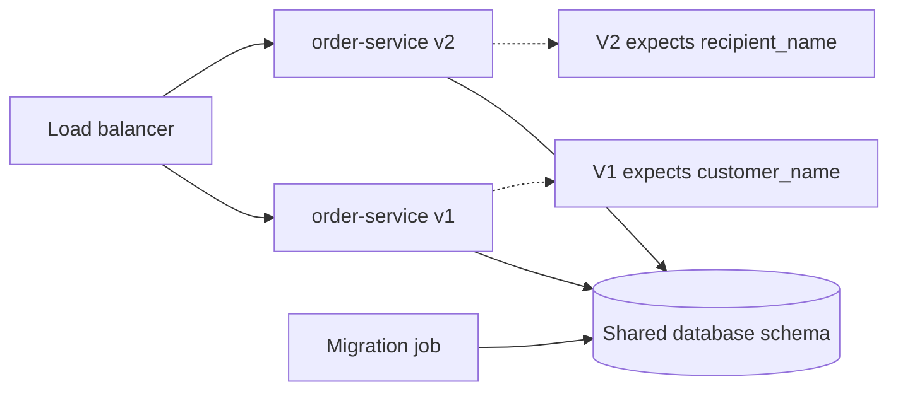
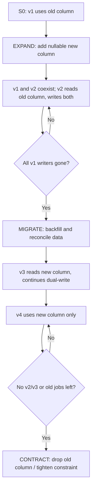

# Schema Compatibility When Multiple Application Versions Run Concurrently

> **Chapter:** Initialization and Migration  
> **Module scope:** `SPRING_BOOT_INTEGRATION` — building Spring Boot integrations across HTTP clients, databases, caches, message brokers, and Spring Integration adapters, focusing on configuration, data contracts, transactions, error and duplicate handling, testing, and observability.

When deploying a Spring Boot application via rolling update, blue/green, or canary, **older and newer versions can read from and write to the same database simultaneously for a period of time**. Yet the database schema is a shared resource: merely renaming a column before every older instance shuts down can break those instances even while the new release runs fine.

Therefore, a safe migration is not just a SQL file executing successfully. It is **a coordinated sequence of schema, data, and application changes** ensuring every version combination coexisting during the deployment window shares a compatible read/write contract. The standard approach is **expand → migrate → contract**: expand the schema first, transition data and app behavior to the new shape while keeping old support, and drop old structures only once proof exists that no dependents remain.

## 1. Learning Objectives

After this lesson, you will be able to:

1. Distinguish **schema migration**, **data migration**, **application deployment**, and **data contract evolution**.
2. Build a compatibility matrix between application versions and schemas during rolling/blue-green/canary deployments.
3. Apply expand–migrate–contract for adding columns, renaming columns, changing data types, and tightening constraints.
4. Choose read/write strategies while old apps still run, preventing data loss or reading stale unsynchronized values.
5. Design batched, repeatable, observable backfills while minimizing lock risk and database load.
6. Sequence Flyway/Liquibase, Spring Boot/JPA, and deployment tools safely; define phase transition gates.
7. Distinguish application rollback from schema rollback and understand constraints once data exists in the new format.
8. Test multiple coexisting versions, including asynchronous integrations, events/outbox, and background jobs.

## 2. Why Are Schema Changes Dangerous During Rolling Deployments?

Suppose `order-service v1` uses the table:

```sql
CREATE TABLE orders (
    id BIGINT PRIMARY KEY,
    customer_name VARCHAR(200) NOT NULL,
    status VARCHAR(30) NOT NULL
);
```

V1 code reads `customer_name`:

```sql
SELECT id, customer_name, status
FROM orders
WHERE id = :id;
```

The team wants to rename `customer_name` to `recipient_name` and deploy v2. If the migration directly executes:

```sql
-- DANGEROUS while v1 instances are still running.
ALTER TABLE orders RENAME COLUMN customer_name TO recipient_name;
```

then v1 can fail immediately on its next query or write. This is a **breaking change to the database contract** even though the migration ran without error and v2 code compiled cleanly.



In practice, other actors can also run mismatched versions: scheduled jobs, JMS/Kafka consumers, outbox publishers, batch workers, reporting queries, CDC readers, or another service granted direct access. A v1 instance no longer receiving HTTP requests may still be draining queued messages. Thus "the load balancer shifted 100% of traffic to v2" is **not enough** to drop old structures.

### 2.1. Types of changes and risk levels

| Change | How It Can Break Older Versions | Execution Guidance |
|---|---|---|
| Add nullable column unused by old code | Generally compatible with old code, though depends on SQL `INSERT` and ORM | Expand first; test old SQL queries. |
| Add `NOT NULL` column without default | Old `INSERT`s omitting the new column fail | Add nullable/safe default, backfill, then tighten constraint. |
| Rename or drop column | Old code can no longer find the column | Add new column, transition across releases, drop later. |
| Change data type | Parse errors, truncation, precision loss, JPA mapping or index breaks | Use new column or intermediate type; convert and validate data first. |
| Shrink column length | Old app writes may exceed new limit | Audit data and all writers; enforce limits in app first. |
| Add unique/FK/check constraint | Legacy data may violate it; old writers may keep inserting violations | Clean data, update write logic, measure violations, then enforce. |
| Change field/enum meaning | SQL runs, yet business logic misinterprets states | Version values and maintain semantic compatibility windows. |
| Drop table, index, or change PK | Old queries, writers, reports, or joins fail/lock long | Measure dependencies, migrate data/traffic first; assess locks separately. |

Never declare "adding a column is always safe" without inspecting legacy code. SQL like `INSERT INTO orders VALUES (...)` omitting column lists can break when a column is added; old apps using `SELECT *` with positional mapping can break too. Verify real SQL contracts.

## 3. Compatibility Must Be Evaluated Across *Readers*, *Writers*, and *Schema*

Three questions cannot be merged into one:

- **Reader:** can this version accurately read data written by other writers?
- **Writer:** does this version write data other active readers can interpret?
- **Schema:** do existing SQL statements, ORM mappings, and constraints accept both versions?

Example matrix for a rollout with an overlap window:

| Running App | Old Schema S0 | Expanded Schema S1 | Contracted Schema S2 |
|---|---|---|---|
| v1 knows `customer_name` only | Valid | **Must stay compatible** during rolling update | Invalid once old column is dropped. |
| v2 reads old column, writes both old and new | Invalid before new column exists | Valid | Invalid once old column is dropped. |
| v3 reads new column, still writes both | Invalid | Valid **after backfill and sync guaranteed** | Invalid if still writing dropped old column. |
| v4 reads/writes new column only | Invalid | Valid | Valid. |

No single matrix fits every project: each "Valid" cell must be proven by real tests and business contracts. The matrix illustrates a clear plan where **schema S1 spans multiple releases**, while S2 arrives only when no running binary still needs the old column.

**Backward compatibility** of a migration means the new schema still serves old code within the required retention window. **Forward compatibility** of code means code is prepared to operate against the next stage's schema/data model. For rolling deployments, verify both directions—not solely that new code works after the migration.

## 4. Expand → Migrate → Contract: The Safe Change Sequence



### 4.1. Expand: only add capabilities

Initially, keep `customer_name` and add `recipient_name`:

```sql
-- PostgreSQL example; execute before deploying binaries referencing the new column.
ALTER TABLE orders
ADD COLUMN recipient_name VARCHAR(200);
```

**Why make it nullable?** Existing records have no `recipient_name`; v1 knows nothing about it and won't populate it. Forcing `NOT NULL` immediately breaks v1 writes or historical migrations.

Adding a column can acquire metadata/database locks briefly. Speed and lock modes depend on DBMS, engine version, table size, and exact command; verify on a production-equivalent system. Avoid bundling `ADD COLUMN` with updating tens of millions of rows inside one long transaction without benchmarking load.

After expand, both v1 and v2 binaries must run cleanly on S1. **Never deploy v2 before the expand migration succeeds.**

### 4.2. Migrate code: write new data without abandoning old data

Version v2 continues **reading the old value as the source of truth**, while updating both columns on recipient name changes:

```java
import org.springframework.jdbc.core.JdbcTemplate;
import org.springframework.stereotype.Service;
import org.springframework.transaction.annotation.Transactional;

@Service
class RecipientNameService {
    private final JdbcTemplate jdbc;

    RecipientNameService(JdbcTemplate jdbc) {
        this.jdbc = jdbc;
    }

    @Transactional
    public void renameRecipient(long orderId, String newName) {
        int updated = jdbc.update(
            """
            UPDATE orders
               SET customer_name = ?, recipient_name = ?
             WHERE id = ?
            """,
            newName, newName, orderId);

        if (updated != 1) {
            throw new IllegalArgumentException("Order does not exist");
        }
    }
}
```

Here both columns update inside **one database transaction**, so if the write fails there is never a "half-updated single column" state. In production workflows, add validation, optimistic locking, or concurrency controls if multiple writers can modify the same order.

**Coexistence trap for v1/v2:** v1 writes only `customer_name`; v2 writes both. If v2 immediately starts **preferring `recipient_name` on reads**, a later update from v1 changes the old column while leaving the new column holding an outdated value. Then v2 reads **stale data** even though both columns are non-null.

Hence while v1 runs, v2 must continue reading **the old column as the source of truth**. Never treat `COALESCE(recipient_name, customer_name)` as a universal sync solution: `COALESCE` only catches `NULL`, not a **populated yet stale new value**.

If business rules strictly require new instances to read the new column while v1 still writes the old column, you need a DB-level sync mechanism across all writers (e.g., carefully tested triggers), a compatibility layer, or temporary single-direction write routing. Bidirectional triggers risk recursion, locking, conflicts, or unintended cascades—design and test separately rather than applying mechanically.

### 4.3. Migrate data: wait for old writers to drain, then backfill

Once all v1 writers have stopped and only v2 remains writing both columns atomically, backfill historical records:

```sql
-- PostgreSQL: run over a small id range per iteration.
UPDATE orders
   SET recipient_name = customer_name
 WHERE id >= :from_id
   AND id < :to_id
   AND recipient_name IS DISTINCT FROM customer_name;
```

`IS DISTINCT FROM` is PostgreSQL syntax comparing `NULL` cleanly; other DBMSs have equivalents. Batching by ID range is one strategy; for sparse IDs, hot rows, or partitioned tables, tailor batch slicing to your data layout.

After each batch, record the checkpoint, updated row count, and latency. Re-running is safe for the **final outcome** because subsequent passes only fix differing rows, provided every active writer maintains dual-write faithfully. If a stray old writer reappears, that safety guarantee breaks; halt cutover and remediate.

Reconciliation:

```sql
-- Run aggregate scans on large tables only after evaluating scan cost.
SELECT COUNT(*) AS mismatched_rows
FROM orders
WHERE recipient_name IS DISTINCT FROM customer_name;
```

Target `mismatched_rows = 0` after confirming zero old writers remain, no out-of-band path modifies data, and in-flight transactions have completed.

**Never backfill all rows in one giant transaction** on large tables. It holds locks, spikes WAL/redo/replication lag, saturates I/O, and raises p99 latency. Size batches empirically, support pause/resume, rate-limit, bound pool usage, and monitor replicas/CDC.

### 4.4. Cutover reader: switch to the new column

After reconciliation confirms only dual-write writers remain, deploy v3:

- v3 **reads `recipient_name`**;
- v3 **still writes both `recipient_name` and `customer_name`**;
- any v2 instances still in the rolling window continue reading the old column safely because every live writer maintains both.

Do not drop dual-writing in v3 immediately. If v4 starts writing only the new column while v2 still reads the old column, v2 sees stale data. Advance to v4 only once **no readers depend on the old column**, including consumers/jobs that could restart on old images.

### 4.5. Contract: drop only after zero dependencies remain

When all apps and jobs run versions reading/writing only the new column, new constraints are verified, and rollback targets no longer need the old column, perform contract:

```sql
-- Final example; execute in a separate release.
ALTER TABLE orders
ALTER COLUMN recipient_name SET NOT NULL;

ALTER TABLE orders
DROP COLUMN customer_name;
```

Before `SET NOT NULL`, ensure historical data is backfilled, no writer produces nulls, and check validation/lock cost for your DBMS. Multi-step validated constraints or online schema change tools can help where supported. `DROP COLUMN` is a **compatibility-breaking change** and on some databases still carries lock risks or breaks views, triggers, reports, or external queries.

After dropping, rolling back to v1/v2/v3 in our matrix is no longer safe. Recovery plans must be decided **before** executing contract.

## 5. Handling Common Schema Changes

### 5.1. Adding a new column

Standard sequence:

1. Add column nullable or with a safe default for all living writers.
2. Update new readers to tolerate `NULL`/default values on historical records.
3. Update new writers to populate full values while keeping old code compatible.
4. Backfill data in batches if required.
5. Ensure no writer can produce invalid values before adding `NOT NULL`/`CHECK`.

Specifically, `DEFAULT` helps legacy `INSERT` statements **that omit the column** produce valid rows. It does not rescue a writer **explicitly inserting `NULL`**. Semantically, a default is only valid when it accurately represents a valid business state.

### 5.2. Adding a unique constraint

Suppose adding a partner business key `external_order_id` for partner orders:

```sql
ALTER TABLE orders
ADD COLUMN external_order_id VARCHAR(80);
```

Do not add `UNIQUE NOT NULL` immediately while historical rows lack values. Instead:

- Define the partner key contract (`tenantId` + `externalOrderId` vs. global ID), normalization, and length.
- Ship new code writing the key and enforcing idempotency on retried HTTP requests/messages.
- Backfill and remediate missing/duplicate legacy rows; stop old writers creating keyless records.
- Build the unique index/constraint using low-lock techniques suited to your DBMS, measure load, and verify all records comply.
- Finally add `NOT NULL` if required by business rules, once all writers are compatible.

On PostgreSQL, `CREATE UNIQUE INDEX CONCURRENTLY` avoids blocking writes compared to regular index creation, yet **cannot run inside a transaction block**. Separate the Flyway migration or configure execution appropriately for your Flyway/DB version. Test tooling and cleanup of failed concurrent builds; never assume "concurrently" means zero locks or zero cost.

### 5.3. Changing data types or splitting one column into several

Suppose splitting `full_address` into `street`, `city`, and `postal_code`. Add the new columns, update parsers/writers, and design backfills to flag **unparseable records**. Never force arbitrary legacy values into fake valid records if that corrupts business meaning.

While old code continues updating `full_address`, reading only the new columns hits the same stale-data trap as renaming. Define which column is the source of truth at each stage, keep writers synchronized, or switch readers only after old writers retire and data reconciles.

If a conversion is lossy (e.g., reducing numeric precision, changing currency units, or dropping a field), **schema rollback cannot reconstruct old data**. Maintain copies/snapshots, reversible conversion paths, or business rollback procedures beforehand.

### 5.4. Changing enums or value semantics

Even if `status VARCHAR` remains unchanged structurally, v3 writing `PARTIALLY_RESERVED` that v1 does not recognize is still a **semantic breaking change**. You may need:

- Safe fallback handling in v1 for unknown states before v3 starts emitting the new value.
- Capability flags delaying writing the new state until no v1 remains.
- Payload/event versioning when data crosses brokers/HTTP.

Schema migrations alone cannot resolve business-rule evolution.

## 6. Flyway and Liquibase in Spring Boot

### 6.1. One schema migration mechanism with clear ownership

In Spring Boot, Flyway/Liquibase manage ordered migrations and track applied versions. Flyway example:

```text
db/migration/
  V20261121_01__add_recipient_name.sql
  V20261121_02__add_auxiliary_index.sql
  ...
```

Illustrating `V20261121_01__add_recipient_name.sql`:

```sql
ALTER TABLE orders
ADD COLUMN recipient_name VARCHAR(200);
```

Spring Boot config example:

```yaml
spring:
  flyway:
    enabled: true
  jpa:
    hibernate:
      ddl-auto: validate
```

`ddl-auto: validate` directs Hibernate to verify mappings against the schema on startup. It **does not execute schema migrations** and does not ensure multi-version app compatibility. Avoid letting Hibernate alter production schemas via `create`/`create-drop`; managed migration environments require one clear DDL owner. Omit JPA config if the app does not use JPA.

**Note on migration execution rights:** Spring Boot can run Flyway at startup when enabled with the right dependencies. Flyway handles history/locking coordination, yet letting **every app instance hold DDL privileges and run migrations on startup** still complicates rollout ordering. In multi-instance production, a clean pattern is:

1. Run a **dedicated migration job** with DDL privileges per deployment workflow.
2. Wait for the job to succeed and the schema to reach the minimum required version.
3. Roll out the compatible app version; app instances use DML-only DB credentials and never mutate schemas.

If running migrations at startup, verify deployment order, migration bundling, and concurrent multi-version startups. Flyway locks alone do not replace an application compatibility matrix.

### 6.2. Distinguishing schema migrations from long backfills

| Task | Where It Belongs | Why |
|---|---|---|
| Fast, measured simple column/constraint addition | Flyway/Liquibase migration | Explicit ordering and versioning. |
| DB index requiring non-transactional mode | Separate migration with matching config | DB may forbid certain DDL inside transactions. |
| Backfilling millions of records | Dedicated batch job with checkpoints/metrics | Can pause, resume, and throttle load. |
| Activating readers on the new column | App release or controlled feature flag | Enable only when data and writers are ready. |
| Dropping old schema | Contract migration in a later release | Allows time to confirm zero dependencies and rollback readiness. |

Liquibase also manages changesets, preconditions, and execution states. Choose **one mechanism with clear ownership per schema**, avoiding independent apps/services issuing conflicting DDL.

### 6.3. DDL and transactions depend on the DBMS

Do not assume every SQL migration is atomic like a business transaction:

- PostgreSQL supports transactions for many DDL statements, though commands like `CREATE INDEX CONCURRENTLY` have special restrictions.
- MySQL and several other DBMSs perform implicit commits or provide engine-, version-, and statement-dependent online DDL.
- DDL can block on or hold locks for long durations even if instant on small test DBs.
- Replicas/CDC and transaction logs can experience heavy load during schema changes or backfills.

For every production migration, know the exact DBMS/version, locking behavior, runtime, rollback behavior, and replica impact—never copy SQL blindly across environments.

## 7. Deploying Multiple Versions: Ordering and Control Gates

A safe rollout schedule specifies what is allowed to run at each step.

| Stage | Schema | Permitted Binaries/Workers | Gate to Proceed |
|---|---|---|---|
| A — Current | S0: old column only | v1 | Baseline, metrics, and migration plan ready. |
| B — Expand | S1: nullable new column added | v1 | Migration succeeded; v1 continues running cleanly. |
| C — Dual-write | S1 | v1 + v2, then v2 only | All v1 writers (including jobs/consumers) stopped; v2 reads old, dual-writes. |
| D — Backfill | S1 | v2 | Reconciliation shows zero mismatches; bad records handled; proof zero v1 writers remain. |
| E — New-read | S1 | v2 + v3, then v3 only | v3 reads new and still dual-writes; all old v2 readers drained. |
| F — New-only | S1 | v3 + v4, then v4 only | No readers rely on old column; v4 reads/writes new only. |
| G — Contract | S2: old column dropped | v4+ | Zero legacy code/jobs remain; rollback target updated; drop approved. |

**Rolling deployment:** traffic routing may shift before long-running requests and consumers finish. Account for instance draining, scheduled tasks, connection pools, retry queues, and pods auto-restarting from older images.

**Blue/green:** two environments sharing one database remain bound by the same compatibility rules. Flipping traffic does not turn one database into two independent schemas; failing back to blue after contract will crash.

**Canary:** a small group of v3 reading the new column while v2 dual-writes is safe only once backfill is complete and zero v1 single-writers remain. Canary is never an excuse to bypass data prerequisites.

Feature flags can help decouple binary deployment from read/write switching, provided flags roll out consistently with recovery controls. If flipping a flag changes the authoritative data source, know precisely which writers/readers have received the config.

### 7.1. Gate on evidence rather than elapsed time

Before each major step, verify:

- **All old writers drained:** instances, consumers, scheduled jobs, batch workers, admin tools, and auto-rollback targets.
- **All old readers drained:** reporting queries, APIs, data exports, CDC connectors, and background workers.
- **Data reconciled:** missing/bad record counts, outliers, replica lag—not just "backfill job exited 0."
- **No new errors in window:** SQL errors, constraint violations, mismatches, p95/p99 latency, and failed message counts.
- **Viable rollback target:** rollback binary can still read/write the live schema and newly created data.

When any gate fails, **halt progression**; roll back the app safely if viable, or keep the expanded schema and remediate.

## 8. Application Rollback Differs from Database Rollback

Suppose S1 is expanded and v2 is running. If v2 has a bug, rolling back to v1 works because v1 still uses the old column and S1 preserves it. That is the strength of backward-compatible expansion.

However, once v4 stops writing the old column, rolling back to v2/v1 exposes **stale data**; once the old column is dropped, rolling back code crashes immediately. Never assume an inverted `ALTER TABLE ... ADD COLUMN` restores historical values and downstream side effects.

| Stage | App Code Rollback Feasibility | What Must Be Prepared |
|---|---|---|
| Post-expand, writer unchanged | Usually safe to return to v1 | Keep old column and compatible defaults/constraints. |
| v1 and v2 coexisting | Return to v1 viable if v2 maintained old column | Test v2-created rows with v1; disable incompatible features. |
| v3 reading new, dual-writing | Return to v2 usually viable | Ensure both columns stay consistent. |
| v4 writing new only | Rolling back to v2/v1 risks reading stale old data | Requires resync, read-only mode, or roll-forward instead. |
| Post-contract old column dropped | Old binaries cannot roll back directly | Target S2-compatible binaries only; DB restore per policy acknowledging data loss. |

**Forward-only migrations** are usually more controllable than automated "down migrations" once business data exists in the new shape. When backups/restores are needed, account for the data-loss window and external system divergence; restoring a DB can make already-emitted outbox events contradict live state.

Before breaking changes, take verified snapshots and maintain recovery runbooks. Snapshots do not replace managing writers/readers properly across the rolling window.

## 9. Schema Compatibility Extends Across Integration Systems

In `SPRING_BOOT_INTEGRATION`, schemas serve more than controllers and repositories. They sit at the intersection of HTTP, caches, brokers, outbox, and adapters.

### 9.1. Transactions and outbox

Suppose a service writes an order and outbox row inside one transaction:

```sql
BEGIN;
UPDATE orders SET status = :new_status WHERE id = :order_id;
INSERT INTO outbox_events (event_id, event_type, payload)
VALUES (:event_id, 'OrderUpdated', :payload);
COMMIT;
```

Migrations may rename DB columns while external consumers still read the **old event payload schema**. Never rename `customerName` to `recipientName` inside messages assuming every consumer upgrades simultaneously. You may need to:

- Emit both new and old fields during a transition window; new consumers prefer the right contract field.
- Use `schemaVersion`/event versioning for breaking changes with explicit converters.
- Retain legacy parsers long enough for queued messages, DLQs, and multi-day replays.
- Avoid emitting spurious business events from backfill updates, or tag migration events explicitly to suppress unwanted side effects.

DB transactions and broker publishing are separate boundaries. Outbox preserves publish intent alongside DB commits, yet publishers/consumers must still be idempotent because messages can be redelivered. Schema migrations do not alter that requirement.

### 9.2. Caches, search indexes, and derived data

Redis/caches may hold DTOs serialized under the older structure. New code reading old cache entries must handle missing fields, version mismatches, or trigger invalidation. Changing DB schema does not automatically refresh caches or search indexes.

If new records write only in the new format while cache/search workers haven't upgraded, displayed data can be wrong even though the DB migration succeeded. Pair with invalidation/rebuild plans, TTLs, and drift metrics.

### 9.3. CDC, replicas, and external consumers

Change Data Capture (CDC) and reporting pipelines often bind directly to column names, types, and change order. Adding or dropping columns can affect schema registries or connector mappings. Clarify ownership and compatibility contracts for every downstream consumer, and track replication lag during backfills.

A weekly report job won't reveal breakage during a ten-minute canary. Gate criteria must cover infrequent batch consumers, not solely online traffic.

### 9.4. HTTP APIs and DB schemas must evolve independently

Never expose JPA entities directly as HTTP DTOs or event payloads if doing so turns a DB column rename into an API breaking change. Maintain explicit mappers between storage schemas and external contracts:

```text
DB (customer_name / recipient_name)
    ↓ controlled mapper
HTTP response (recipientName) — separate API/version contract
    ↓
Event payload (customerName, recipientName, schemaVersion) — separate lifecycle
```

Contracts often require different compatibility windows. Dropping a column safely at the database layer is not automatically safe for event replay.

## 10. Testing Version Matrices Against a Real Database

Unit tests only verify one version against mocked structures. To prove a rollout is safe, run **integration tests against a real DBMS or matching engine container**, using actual migration scripts and coexisting version pairs.

| Test | Setup | Expected Outcome |
|---|---|---|
| v1 on S1 post-expand | Run v1 SQL/JPA against schema with new column | Reads/writes identically, zero mapping/constraint errors. |
| v2 on S1 | Reads old column, writes both | Transaction updates both columns consistently. |
| v1 + v2 concurrent | v1 updates name after a v2 update | v2 reader reads old column as source of truth, never preferring stale new value. |
| Repeatable backfill | Run batch twice, interrupt mid-run, resume | No duplicated side effects, checkpoint works, final mismatch count reaches 0. |
| v2 + v3 concurrent | Both dual-write; v3 reads new | Zero data divergence upon transaction commit. |
| v3 + v4 concurrent | v3 dual-writes, v4 writes new | No old readers left; v3 and v4 both read new column. |
| Contract after v4 | Drop old column and test v4 | Zero SQL or jobs still reference old column. |
| Rollback at each gate | Revert to designated rollback binary | Old binary reads/writes data written by new binary without semantic loss. |
| Concurrent backfill and traffic | Large dataset with live inserts/updates during backfill | Locks/latency and replica lag stay within budget; final data accurate. |
| Event/backlog | Replay legacy event/outbox after upgrade | Consumers parse cleanly and deduplicate safely. |

### 10.1. Testing old and new records

Test datasets should include:

- Pre-migration rows containing only `customer_name`.
- Rows created by v1 while S1 is live.
- Rows created by v2 with both columns populated.
- Rows updated by v1 **after** v2 to verify the stale-read trap if switching reads too early.
- Records with Unicode characters, max-length boundary values, nulls, and invalid inputs.
- Concurrent updates from two requests/consumers to verify locking/version semantics.

With JPA, test real queries, mappings, projections, `@Column` definitions, and lazy loading. Enabling `hibernate.hbm2ddl.auto=validate` catches missing-column mapping bugs, yet a "validate pass" **does not prove dual-write or semantic correctness**.

### 10.2. Testing migration failures and retries

Migrations can fail due to lock timeouts, missing DDL permissions, duplicate keys, or DB disconnects. Understand how your tool records state, what remains if DDL is non-transactional, and how to recover **a partial run**. Never edit Flyway/Liquibase history tables manually without understanding tool state and official repair mechanisms.

Test backfill restarts right after committing a batch, before committing, and while the app writes concurrently. **Data-level idempotency** matters more than assuming "the job only runs once."

## 11. Observing Migrations in Production

Migrations can affect both performance and correctness. Useful signals:

| Signal | Purpose |
|---|---|
| Applied schema/migration version and run timestamp | Match live schema against rolling binaries. |
| Active instances/consumers per app version | Verify gates showing old readers/writers drained. |
| Backfill checkpoint, rows/sec, error count, mismatch count | Track progress and accuracy; enable pause/resume. |
| DB lock waits, transaction durations, deadlocks | Spot DDL or batches hogging resources. |
| Database CPU, I/O, WAL/redo, replication lag | Measure backfill/online DDL impact. |
| HTTP error rate, SQL exceptions, p95/p99 | Detect schema- or resource-induced app failures. |
| Consumer lag, DLQ, outbox backlog | Catch stalled workers or unparseable messages. |
| Fallback read rate, null rate, mismatch rate | Detect code still relying on legacy formats. |

Define alert thresholds and pause/backoff controls before starting. Never attach high-cardinality labels like `orderId` or customer names to metrics, nor log sensitive data during backfills. When troubleshooting individual records, use correlation/business IDs in access-controlled logs.

### 11.1. Per-phase operational runbook

An execution plan might read:

```text
Phase EXPAND
  Owner: database team / migration job
  Precondition: backup/checkpoint, lock check, v1 tests passing
  Action: add recipient_name nullable
  Verify: schema correct; v1 still reads/writes
  Abort: if DDL blocks on lock or errors

Phase DUAL-WRITE
  Owner: application team
  Precondition: EXPAND completed
  Action: roll out v2, read old, write both
  Verify: transactions, mismatch metrics, inspect v1/v2
  Gate: all v1 writers stopped

Phase BACKFILL
  Owner: migration team
  Action: update in batches, checkpoint and rate-limit
  Verify: mismatch = 0; zero single-old writers remain

Phase NEW-READ / NEW-ONLY
  Owner: application team
  Action: roll out v3 read-new/dual-write, then v4 new-only
  Verify: old readers/writers gone; rollback target clear

Phase CONTRACT
  Owner: database / release team
  Gate: all dependencies migrated; rollback risk approved
  Action: tighten constraint, drop old column in separate release
  Verify: v4 and jobs/consumers healthy, zero SQL errors
```

This is a structural runbook example, not an automated script. Real projects must attach release IDs, inventories of impacted jobs/consumers, verification timestamps, and deploy-freeze procedures if any gate fails.

## 12. Common Error-Prone Practices

**"Migration SQL succeeded, so the release is safe."** SQL success only proves the DB accepted the DDL at that moment; it ignores legacy code, active jobs, or whether readers/writers agree on data semantics.

**"Rename the column once and roll out simultaneously."** Rolling deployments never switch all instances instantaneously; running old code breaks as soon as the column disappears.

**"V2 dual-writes, so it can read the new column right away."** V1 can still overwrite the old column alone, making the new column stale. Read the old column until v1 writers drain and backfill/reconciliation complete, unless proven synchronization exists.

**"`COALESCE(new, old)` always handles synchronization."** No. When `new` is populated yet stale, `COALESCE` returns the stale value. Define the source of truth explicitly per phase.

**"Checking only web pods is enough."** JMS/Kafka consumers, batch schedulers, outbox publishers, reports, and jobs on older images can continue writing old schemas.

**"Adding `NOT NULL` without a default is purely an internal DB concern."** Old apps unaware of the column fail `INSERT`s. Update writers first or design a semantically valid default.

**"Backfills can run inside one massive startup transaction."** On large datasets, long transactions spike locks, log volume, and lag. Use small batches, checkpoints, resumability, and load monitoring.

**"Code rollback is always as simple as redeploying the previous image."** After new-only or contract, older images may read stale data or hit missing columns. Tie rollback plans to each phase.

**"Renamed the DB column, so rename the event JSON immediately too."** Queued backlogs, DLQ/replays, and older consumers have independent lifecycles. Version/evolve event contracts separately.

## 13. Comprehensive Practice Exercise

Build an `order-service` Spring Boot application using PostgreSQL, Spring Data JDBC/JPA or `JdbcTemplate`, Flyway, and a simple consumer/outbox:

1. Create schema S0 with `orders(id, customer_name, status)` and a v1 binary reading/writing `customer_name`. Write v1 tests on S0.
2. Create a Flyway migration adding nullable `recipient_name`, applying S1 before deploying v2. Verify v1 still reads/writes cleanly.
3. Implement v2 reading `customer_name` and dual-writing both columns in one DB transaction. Run v1/v2 concurrently and test v1 updating after v2.
4. Shut down **all v1 writers**, including consumers/jobs; add a backfill job updating in ID batches with checkpoints and rate limits.
5. Reconcile mismatched rows, inspect lag and errors; deploy v3 reading `recipient_name` while still dual-writing.
6. Once no v2 readers remain, deploy v4 using `recipient_name` exclusively. Keep S1 long enough to observe and verify the designated rollback path.
7. In a later release, contract by tightening constraints appropriately and dropping `customer_name`; confirm only v4+ connects.
8. Emit an `OrderUpdated` outbox event; ensure consumers can parse older messages throughout rollout, including DLQ replays.
9. Measure SQL errors, p95/p99, backfill rows/sec, mismatch counts, and consumer lag. Simulate a migration failure or mid-run backfill interruption and resume cleanly.

**Acceptance criteria:**

- v1 runs on expanded schema S1; v2/v3/v4 obey the defined version matrix.
- At no time do new readers read stale `recipient_name` values from unsynchronized old writers.
- Every backfill batch is safely repeatable; data is reconciled prior to cutover.
- Schema contract happens only after proving no binaries, jobs, or consumers need the old column.
- Rollback targets and recovery steps are defined per phase; post-migration data/events maintain clear contracts.
- Tests and metrics evidence transaction, SQL, broker/outbox, and performance behavior.

## 14. Self-Assessment Questions

**1. Why is renaming a column with `ALTER TABLE RENAME COLUMN` dangerous during a rolling update?**  
Because old apps can still read/write via the old column name and fail immediately after migration, even when new instances work properly.

**2. V2 writes both `customer_name` and `recipient_name`. Can v2 prefer reading `recipient_name` while v1 is still running?**  
Not safely by default: v1 writes only the old column, making the new column stale. V2 should read the old source until v1 writers are eliminated and backfill/reconciliation finish, unless proven additional synchronization exists.

**3. What are the minimum prerequisites before adding `NOT NULL` to a new column?**  
All existing rows satisfy the constraint; all living writers produce valid values (or a valid business default exists); the migration has been tested under realistic load/locking/DBMS behavior.

**4. If backfill finished yet a v1-era message sitting in a DLQ may still be replayed, should you contract immediately?**  
No. Check which consumer version handles the replay and whether any worker still writes the old schema. Contract only after all legacy execution paths are upgraded or isolated.

**5. Why doesn't a Flyway version prove multi-application schema compatibility?**  
Flyway tracks applied migrations; it has no visibility into all SQL queries, DTOs, readers/writers, and jobs running across binaries. Matrix testing and deployment gates are required.

**6. Once v4 has written only the new column for several days, is rolling back to v1 safe?**  
Not by default. The old column may be stale or dropped. You need data resynchronization, compatible rollback planning, or a roll-forward fix.

**7. Why must database migrations and broker event versions be managed separately?**  
Because events can sit in queues, DLQs, or be replayed long after DB schemas change; consumers must interpret payloads produced by different versions independently of DB column renames.

Schema compatibility when multiple Spring Boot versions coexist is **a problem of coordinating data contracts, deployment ordering, and the true live state of writers and readers**. Expand preserves compatibility, migrate transitions both data and behavior, and contract removes old structures only once proof confirms all dependents are ready. By governing gates, transactions, backfills, event contracts, rollbacks, and observability, an integration system can evolve its schema while serving active requests and asynchronous backlogs safely.
