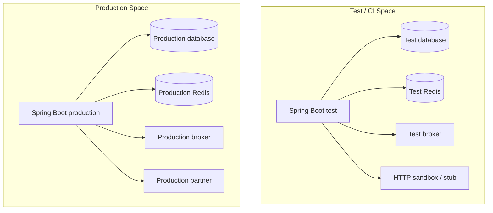

# Isolating Test Data from Production Data in Spring Boot

## 1. Why Must Test Data Be Isolated?

In a Spring Boot application integrating databases, caches, HTTP APIs, and message brokers, **test data** is not merely a few rows prefixed with `TEST_`. A test run can write to a database, publish Kafka events, send emails, update Redis, or invoke partner APIs. If even one of those connections points to production, running tests or bootstrapping environments can affect real users.

The goal of data isolation is to create verifiable boundaries across environments:

- **Development:** synthetic data for coding, safe to wipe and rebuild.
- **Test/CI:** deterministic data or data created per run; results never depend on leftovers from prior runs.
- **Staging/UAT:** configuration and flows close to production, yet resources, accounts, and data remain isolated; any data copied from production (if truly required) must undergo sanitization and approval.
- **Production:** real business data subject to integrity, security, backup, and change-control requirements.

**Core principle:** every write, delete, migration, event publication, and external call originating from a test environment may affect only test resources. Distinguishing rows by record names or an `is_test` flag inside the same database does not provide an adequate safety boundary.

### Scope requiring isolation

| Integration Component | Example Production Resource | Recommended Boundary for Test Environments |
|---|---|---|
| Relational database | PostgreSQL storing real orders | Separate instance/database, separate users and grants; CI prefers ephemeral containers |
| Redis/cache | Session keys, pricing cache | Separate instance or cluster; key prefixes are only an extra defense layer |
| Kafka/RabbitMQ/JMS | Live transaction topics/queues | Separate cluster/vhost or isolated resources, ACLs, consumer groups, and DLQs |
| HTTP/REST/gRPC | Payment, shipping, partner APIs | Sandbox or stub/mock server; dedicated sandbox credentials |
| Object storage | Invoice and document buckets | Dedicated bucket/namespace and access policies; lifecycle rules purging test artifacts |
| Email/SMS/webhooks | Real recipients and endpoints | Mail sink, fake gateway, sandbox endpoint; block outbound traffic outside allowlist |
| Schedulers/batch | Reconciliation or cleanup jobs | Disable unnecessary jobs; run tested jobs against isolated inputs and outputs |
| Logs, traces, reports | Personal data in payloads | Environment-separated telemetry; mask sensitive fields and restrict read access |

Isolating the database while still sharing a Kafka topic or production payment API means **the integration system is not isolated**. Output from one adapter can trigger real actions in another system.

## 2. Environment Isolation Model



The diagram depicts two resource groups with zero cross-connections. In real deployments, apply defense in depth because a single misconfiguration can bypass naming conventions:

1. **Identity and permissions:** service accounts/test credentials hold permissions solely on test resources; production accounts are never distributed to test pipelines.
2. **Network:** CI/dev environments lack network routes or firewall rules allowing access to sensitive production databases, brokers, and APIs.
3. **Configuration:** each profile specifies its own endpoints; missing mandatory config must fail startup rather than defaulting to production.
4. **Data lifecycle:** tests manage fixture creation, assertions, and cleanup; production enforces separate backup, migration, and audit policies.
5. **Observability and verification:** log active environment, non-sensitive target identifiers, migration runs, and external calls without leaking passwords or personal data.

Never rely on Spring profiles as the sole security boundary. `@ActiveProfiles("test")` activates test config in Spring Test, yet cannot restrict OS credentials, network access, or stop higher-precedence environment variables from overriding a JDBC URL.

## 3. Designing Safe Spring Boot Configuration

### 3.1. Shared base configuration

Suppose a system uses PostgreSQL, Flyway, and an HTTP client calling a partner. Shared settings might look like:

```yaml
# src/main/resources/application.yml
spring:
  sql:
    init:
      mode: never
  jpa:
    hibernate:
      ddl-auto: validate
  flyway:
    enabled: true
```

Meaning:

- `spring.sql.init.mode: never` prevents default SQL initialization from automatically running `schema.sql`/`data.sql`. It does **not** disable Flyway, Liquibase, `@Sql`, or custom loading code.
- `ddl-auto: validate` lets Hibernate check mappings against the current schema rather than creating or modifying tables implicitly. Omit if not using JPA/Hibernate.
- Flyway executes controlled migrations. When using Liquibase instead, choose one primary migration tool and configure accordingly.

Never put production JDBC URLs, passwords, or shared production endpoints in `application.yml`. Sensitive values should come from secret managers or secure deployment config providers.

### 3.2. Production profile

```yaml
# src/main/resources/application-prod.yml
spring:
  datasource:
    url: ${PROD_JDBC_URL}
    username: ${PROD_DB_USER}
    password: ${PROD_DB_PASSWORD}

app:
  partner:
    base-url: ${PROD_PARTNER_URL}
```

Variables carry no defaults so missing configuration halts startup immediately. Production users and secrets are distributed strictly to production workloads. Never activate the `prod` profile in CI jobs or developer laptops "just to test quickly."

### 3.3. Test profile using an ephemeral database

The example below illustrates a **Testcontainers JDBC URL** for integration tests:

```yaml
# src/test/resources/application-test.yml
spring:
  datasource:
    url: jdbc:tc:postgresql:16-alpine:///integration_test
    driver-class-name: org.testcontainers.jdbc.ContainerDatabaseDriver
    username: test
    password: test
  sql:
    init:
      mode: never
  jpa:
    hibernate:
      ddl-auto: validate
  flyway:
    enabled: true

app:
  partner:
    base-url: ${TEST_PARTNER_STUB_URL}
```

This requires the PostgreSQL JDBC driver and Testcontainers JDBC/PostgreSQL test dependencies, plus a working container runtime. The `jdbc:tc:` URL spins up an ephemeral test database; it never points to a production host. `TEST_PARTNER_STUB_URL` must point to a mock server or partner sandbox.

**Watch configuration precedence:** environment variables like `SPRING_DATASOURCE_URL`, CLI arguments, or higher-priority property sources can override `application-test.yml`. Control CI environment variables, restrict network egress, and verify permitted endpoints before running tests. `@DynamicPropertySource` can inject container URLs at higher precedence than standard config files.

### 3.4. Swapping connections via Testcontainers in integration tests

```java
@Testcontainers
@SpringBootTest
@ActiveProfiles("test")
class OrderRepositoryIntegrationTest {

    @Container
    static PostgreSQLContainer<?> postgres =
            new PostgreSQLContainer<>("postgres:16-alpine")
                    .withDatabaseName("integration_test")
                    .withUsername("test")
                    .withPassword("test");

    @DynamicPropertySource
    static void useTestDatabase(DynamicPropertyRegistry properties) {
        properties.add("spring.datasource.url", postgres::getJdbcUrl);
        properties.add("spring.datasource.username", postgres::getUsername);
        properties.add("spring.datasource.password", postgres::getPassword);
    }

    @Autowired
    JdbcTemplate jdbcTemplate;

    @Test
    void connectsToIsolatedDatabase() {
        Integer result = jdbcTemplate.queryForObject("SELECT 1", Integer.class);
        assertThat(result).isEqualTo(1);
    }
}
```

This example uses JUnit Jupiter, Spring Test, AssertJ, and Testcontainers; include matching imports/dependencies. In a real test, choose **one** of the two connection approaches above: either the `jdbc:tc:` URL or `@Container` + `@DynamicPropertySource`. The latter is handy when sharing one container across multiple test components. Do not spin up two containers simultaneously for the same datasource.

If using `@DataJpaTest`, check whether Spring Boot swaps the datasource for an embedded database; annotate `@AutoConfigureTestDatabase(replace = AutoConfigureTestDatabase.Replace.NONE)` to ensure the test runs against the PostgreSQL container.

## 4. Creating and Managing Test Fixtures

### 4.1. Distinguishing schema migrations from fixtures

**Schema migrations** alter structure or versioned baseline reference data. **Test fixtures** insert records supporting specific test cases. Never mix test fixture data (fake orders, fake accounts) into migrations applied across all environments.

Migration file `src/main/resources/db/migration/V1__create_orders.sql`:

```sql
CREATE TABLE orders (
    id BIGINT PRIMARY KEY,
    external_ref VARCHAR(64) NOT NULL UNIQUE,
    status VARCHAR(32) NOT NULL
);
```

Test-only fixture placed in `src/test/resources/fixtures/orders.sql`:

```sql
INSERT INTO orders (id, external_ref, status)
VALUES (9001, 'TEST-ORDER-9001', 'NEW');
```

Test using the fixture:

```java
@SpringBootTest
@ActiveProfiles("test")
@Transactional
@Sql("/fixtures/orders.sql")
class OrderQueryIntegrationTest {

    @Autowired
    JdbcTemplate jdbcTemplate;

    @Test
    void readsTestFixture() {
        Integer count = jdbcTemplate.queryForObject(
                "SELECT COUNT(*) FROM orders WHERE external_ref = ?",
                Integer.class,
                "TEST-ORDER-9001"
        );

        assertThat(count).isEqualTo(1);
    }
}
```

Here, `@Sql` loads the fixture before the test method; `@Transactional` normally rolls back changes within the test thread's transaction. However, **never assume every side effect rolls back**:

- With `@SpringBootTest(webEnvironment = RANDOM_PORT)`, HTTP requests run on separate server threads/transactions; the test transaction does not roll back server-side commits.
- Broker messages published, external HTTP calls, cache entries, and object storage writes sit outside the test's `@Transactional` boundary.
- Asynchronous background tasks may keep running after the test method exits, polluting subsequent tests.

In those situations, use ephemeral per-scope databases/containers, isolated keys/topics, explicit cleanup, or unique identifiers per test run. `@Sql` with `executionPhase = AFTER_TEST_METHOD` can clean up test data, accounting for foreign keys and cleanup transaction rules.

### 4.2. What makes good synthetic test data?

A useful fixture set should **mirror realistic business behavior** without containing real personal data or secrets. For an order-sync integration flow, include cases such as:

| Scenario | Sample Data | What to Verify |
|---|---|---|
| Happy path | Order `TEST-ORDER-9001`, status `NEW` | DB write, single message published, state transitions properly |
| Rejected | Invalid item SKU | Contract error recorded; no production order created |
| Duplicate | Same `external_ref` sent twice | Idempotency or unique constraint blocks duplicate processing |
| Transient failure | Stub returns HTTP `503` or broker disconnects | Bounded retries, backoff, and dead-letter handling where needed |
| Concurrency | Multiple workers claim the same business key | Locks/constraints and transactions preserve consistency |
| Migration | Empty DB upgraded to current version | Migrations run in order and schema matches application |

Prefer deterministic synthetic data with fixed seeds when reproducing bugs, unique IDs when tests run in parallel, and small dataset sizes so CI remains fast. For load/performance testing on large datasets, use dedicated generators in isolated environments.

### 4.3. When production-like data must be referenced

Never copy raw production backups onto personal laptops or CI pipelines. If production-like data is required for investigating a defect, follow a controlled sanitization process:

1. Document purpose, column/table scope, and retention limit; prefer purely synthetic data whenever sufficient.
2. Extract minimal subsets via authorized channels inside a secure environment.
3. Strip or replace identifying info and secrets while preserving foreign keys and relational invariants needed for testing. Simple hashing of emails/phone numbers does not automatically guarantee anonymization.
4. Replace endpoints, tokens, email addresses, phone numbers, and payment accounts with sandbox equivalents.
5. Audit sanitization results and access controls before importing into an isolated test zone.
6. Set expiration/deletion deadlines and log who extracted, sanitized, and used the dataset.

Personal data protection compliance depends on data classification and organizational regulations. The technical goal is preventing real customer data or re-identifiable values from entering test reports, logs, traces, and CI artifacts.

## 5. Isolating External Adapters Beyond the Database

### HTTP clients and partner APIs

With `RestClient`, `WebClient`, OpenFeign, or Spring Integration HTTP adapters, isolate base URLs and credentials per environment. In integration tests, use WireMock, MockWebServer, or dedicated sandboxes to test success responses, timeouts, contract errors, and retries. Never send writes/deletes to production APIs merely because they are "convenient."

If the service supports webhook callbacks, test callbacks must also route back to test endpoints. Verify the **return path**, since webhooks can mutate business state even when the outbound call used a sandbox.

### Message brokers and Spring Integration

`IntegrationFlow`, Kafka listeners, RabbitMQ listeners, and JMS listeners normally start when the application launches. Sharing brokers across tests and production is dangerous:

- Kafka: use dedicated clusters or topics, separate ACLs, and separate consumer groups; prevent test producers from writing to production topics. Changing only the consumer group name does not stop a producer from publishing to a live topic.
- RabbitMQ: prefer dedicated vhosts, exchanges, queues, bindings, and credentials; keep DLQs inside the test environment too.
- JMS and other adapters: enforce equivalent isolation for destinations, producer/consumer privileges, and retry policies.
- For flows irrelevant to a specific test, disable listener/adapter auto-start; for tested flows, use test brokers or ephemeral containers.

Messages can be redelivered after crashes or consumer restarts. Fixtures and tests must verify **idempotency**, transaction boundaries, retries, and dead-letter behavior—not merely "one message was sent."

### Caches, files, and background tasks

Test Redis needs an isolated instance/cluster and credentials. Switching only logical DB indexes (`0`, `1`, ...) or key prefixes is insufficient when sharing the same Redis server and admin rights. TTLs expire fixtures eventually, yet do not replace true isolation.

For S3-compatible storage, shared volumes, or FTP/SFTP adapters, provision test buckets/paths/credentials with auto-expiry and zero delete privileges on production buckets. For `@Scheduled`, Quartz, Spring Batch, and Spring Integration polling adapters, explicitly configure which jobs run in tests; disable unneeded jobs via config. When testing jobs, isolate metadata tables and job sources/sinks as well.

## 6. Controlling Database Initialization and Migrations

Data isolation ties directly into schema initialization and Flyway/Liquibase:

| Practice | Test/CI | Production |
|---|---|---|
| Schema initialization | Run real migrations on an empty, isolated DB | Reviewed migrations with backups and rollout plan |
| Loading fixtures | Via `@Sql`, test factories/seeders, or test setup | Never auto-load test fixtures |
| Hibernate DDL | Prefer `validate` to verify compatibility | `validate` or defined schema verification policy |
| Wiping/rebuilding data | Allowed inside clearly identified test zones | Never run test wipe/recreate commands |
| Retries and rollbacks | Test mid-run failures, leftover data, and repeatability | Migration recovery plans and phased deployment compatibility |

Never put `ddl-auto: create` or `create-drop` in shared base config where it could accidentally hit an important database. Never call `Flyway.clean()` or `DROP SCHEMA` from standard startup code. When automated tests wipe schemas, verify the target is strictly an ephemeral database and credentials carry permissions solely on that test DB.

When migrations add `NOT NULL` columns, modify unique constraints, or backfill data, test at least two scenarios: fresh initialization from an empty DB and upgrading from a prior schema version populated with synthetic data. Empty-DB tests miss failures caused by existing `NULL`s, duplicates, or malformed legacy records.

## 7. Preventing Tests from Accidentally Touching Production

Incidents often start from small slips: copying a production `.env` file, re-running a batch job with live credentials, reusing a shared DNS alias, or forgetting to change a webhook URL. Enforce layered guardrails rather than checking profile names alone.

### Pre-execution guardrails

- **Fail closed:** without valid test configuration, refuse to start; never use `production` as a default/fallback endpoint.
- **Privilege policy:** CI holds only test secrets, sandbox tokens, and create/delete permissions scoped to test resources.
- **Network egress:** test runners may reach only Testcontainers, mock servers, or approved sandboxes; deny production hosts/IPs.
- **Target verification:** validate DB host/name, broker cluster, topics, buckets, and partner URLs against an environment allowlist. Application-level guards must run before writes or migrations execute; post-connection checks cannot replace permissions and firewalls.
- **Deployment isolation:** separate configs, secrets, and service accounts by namespace/workload; block CI actors from activating `prod` profiles.

### Runtime guardrails during tests

Log at minimum the environment name, pipeline run ID, and **non-sensitive identifiers** of endpoints/containers; attach `environment=test` tags to metrics and traces. Track created/deleted record counts, messages sent/received, retries, and callbacks. Never log JDBC passwords, tokens, full order payloads, or personal data.

For tests with external interactions, assert the exact target destination and call counts. For instance, an order test can verify the mock HTTP server received exactly one `POST` with the expected idempotency key and the test broker has zero stray messages afterward.

### If a test accidentally connects to production

Immediately halt the job or listener, block further connections, and preserve logs/audit trails to determine blast radius. Revoke or rotate any misused credentials, inspect changes across databases, brokers, and partner systems, and evaluate recovery through the system's incident response procedure. Never run a second ad-hoc test script to clean up production data before assessing full consequences.

## 8. Practical End-to-End Workflow

Suppose a team builds a Spring Boot service accepting orders via REST API, persisting to PostgreSQL, publishing to Kafka, and calling a partner HTTP API. An integration test workflow could be:

1. **Stand up environment:** pipeline launches PostgreSQL/Kafka containers and an HTTP stub, issuing per-run test credentials.
2. **Wire connections:** use `@ActiveProfiles("test")`, `@DynamicPropertySource`, or `@ServiceConnection` (where supported by Spring Boot) to point at those containers.
3. **Initialize schema:** Flyway/Liquibase applies current migrations; tests verify schema and critical constraints.
4. **Load data:** insert synthetic fixtures covering happy paths, duplicates, timeouts, and mid-flow failures.
5. **Execute flows:** call the API via test client, await asynchronous completion with bounded timeouts, and verify DB, broker messages, and HTTP stub calls.
6. **Clean up and archive:** tear down containers and temporary data, confirm no stray jobs/consumers remain, and archive sanitized test artifacts.

**Verifiable acceptance criteria:**

| Criterion | How to Verify |
|---|---|
| Tests cannot write to production | CI credentials rejected by prod DB/broker/object storage; network policies block connections |
| Tests are repeatable | Two clean runs produce identical outcomes without depending on leftover data |
| Migrations work realistically | Tested on both empty DB and simulated prior-version DB verifying constraints/DDL |
| Zero external leakage | Stubs/sandboxes receive expected calls; unauthorized outbound traffic is blocked |
| Failure paths tested | Duplicates, retries, dead letters, timeouts, and transaction boundaries all have test cases |
| Traceability | Reports show environment, migration version, test run, and events without leaking secrets |

## 9. Common Design Mistakes

**"Having `@ActiveProfiles("test")` makes it safe."** Profiles only select config sources; env vars and CLI flags can override them. Enforce network, secret, and permission boundaries too.

**"Prefixing rows with `test_` in the production database is enough."** Tests can still contend on transactions, locks, migrations, indexes, or triggers. Always use separate resources.

**"`@Transactional` keeps every test clean."** Test rollbacks do not cover HTTP requests on separate threads or retract published messages/events. Use isolated data zones and proper cleanup.

**"We mocked HTTP, so we don't need to isolate brokers/caches."** Side effects from messaging, caches, and scheduled tasks can still hit live services. Inventory every adapter in both inbound and outbound directions.

**"A raw production copy gives the most realistic tests."** Raw copies expose personal data, live tokens, and production endpoints. Synthetic data is easier to reproduce reliably; sanitized production extracts fit only justified cases handled securely.

## 10. Key Takeaways

Isolating test data in Spring Boot is an **environment boundary design spanning the entire integration flow**—from schema initialization to databases, caches, message brokers, partner APIs, and asynchronous adapters. Spring profiles, Testcontainers, Flyway/Liquibase, fixtures, and `@Sql` make tests repeatable; least-privilege permissions, secret isolation, and network policies prevent misconfigurations from turning into production incidents. The desired outcome is that teams can repeatedly run tests and migrations against controlled data while proving test activity cannot alter production data or systems.
