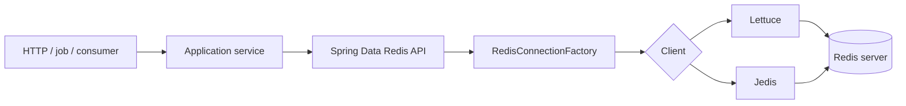

# spring-boot-starter-data-redis and Choosing a Redis Client

## 1. Where Does Redis Fit in Spring Boot Integration?

In the **SPRING_BOOT_INTEGRATION** module, a Spring Boot application does not only make HTTP calls or access relational databases; it also integrates caches, message brokers, and other adapters. Redis frequently participates in this flow to store fast-access data, time-bounded state, rate limits, or deduplication marker keys. Redis is a standalone running service; adding a Spring Boot dependency does not automatically start a Redis server.

When integrating Redis, distinguish three layers:

1. **Spring Data Redis** provides APIs and abstractions such as `RedisConnectionFactory`, `StringRedisTemplate`, `RedisTemplate`, repositories, and reactive APIs.
2. **The Redis client** (typically **Lettuce** or **Jedis**) handles network connections, the Redis protocol, resource management, and command execution.
3. **The Redis server** stores data in memory and applies TTL, eviction, persistence, or replication policies depending on infrastructure configuration.

`spring-boot-starter-data-redis` bundles the required dependencies and enables Spring Boot auto-configuration. In Spring Boot 3.x, the starter's default client is Lettuce. Jedis is an alternative when an application has compatibility or operational requirements that fit it better.



**Lesson objectives:** configure Redis connectivity using the starter; choose a client based on blocking/reactive processing style and operational requirements; use APIs at the right layer; and recognize issues around serializers, timeouts, pooling, TTL, transactions, and testing.

## 2. Initializing Integration with the Starter

With Maven, add the following dependency to a Spring Boot application whose versions are managed via the Spring Boot parent/BOM:

```xml
<dependency>
    <groupId>org.springframework.boot</groupId>
    <artifactId>spring-boot-starter-data-redis</artifactId>
</dependency>
```

With the default configuration, the application uses Lettuce. Example `application.yml` for a standalone Redis instance, suitable for **Spring Boot 3.x**:

```yaml
spring:
  data:
    redis:
      host: localhost
      port: 6379
      database: 0
      connect-timeout: 2s
      timeout: 2s
      client-type: lettuce
```

- `connect-timeout` limits connection establishment time; `timeout` limits operation wait time according to the client configuration.
- `database: 0` selects the logical database in standard standalone mode. Redis Cluster only supports database 0.
- Host, port, and credentials in real environments typically come from environment variables or a secret management system. Never commit real passwords to the repository.
- If Redis requires ACL/TLS, configure `username`, `password`, and SSL according to your Spring Boot version, infrastructure, and security policy.

Spring Boot automatically creates `RedisConnectionFactory` and default templates when dependency/configuration conditions are satisfied. Templates share the connection factory; the application generally **does not need to create connections per request**.

> **Version note:** the configuration example uses the `spring.data.redis.*` namespace from Spring Boot 3.x. If maintaining an older Boot version or upgrading to a new major version, cross-check configuration metadata and the Spring Data Redis/client versions managed by the BOM. Avoid mixing arbitrary versions of `lettuce-core`, `jedis`, and Spring Data Redis.

## 3. Which API Should You Use?

| Need | Commonly Used API | Notes |
| --- | --- | --- |
| Reading/writing keys and strings | `StringRedisTemplate` | Both keys and values are strings; easy to inspect with Redis CLI and share across services. |
| Reading/writing objects or data structures | `RedisTemplate<K,V>` | Must explicitly configure serializers for key/value/hash. |
| Caching service calls | Spring Cache (`@Cacheable`, `@CacheEvict`) | Key, TTL, and invalidation policies must still be designed. |
| Reactive pipeline | `ReactiveStringRedisTemplate`, `ReactiveRedisTemplate` | Requires a reactive connection factory, typically Lettuce. |
| Tasks needing specialized commands | `RedisConnection` or Redis scripts | Requires understanding atomicity and client/Redis server support. |

Example storing application-serialized JSON in Redis using `StringRedisTemplate`:

```java
import java.time.Duration;
import org.springframework.data.redis.core.StringRedisTemplate;
import org.springframework.stereotype.Service;

@Service
public class ProductCache {
    private final StringRedisTemplate redis;

    public ProductCache(StringRedisTemplate redis) {
        this.redis = redis;
    }

    public void putJson(String productId, String json) {
        redis.opsForValue().set(key(productId), json, Duration.ofMinutes(5));
    }

    public String getJson(String productId) {
        return redis.opsForValue().get(key(productId)); // null if key does not exist
    }

    public void evict(String productId) {
        redis.delete(key(productId));
    }

    private String key(String productId) {
        return "catalog:product:v1:" + productId;
    }
}
```

Here `json` is a valid JSON string produced by the application layer and read back under an agreed data contract. In a real application, you should have a fixed DTO/schema, validation for `productId`, and rules for handling deserialization errors. The `catalog:product:v1:` prefix separates the namespace and data structure version to support schema evolution.

**Why not store arbitrary objects using the default serializer?** Binary Java serialization can introduce coupling to Java classes, hinder cross-language interoperability, and create security risks when deserializing untrusted data. For multi-service integration flows, prefer String/JSON or a schema-backed format and configure serializers explicitly; control key, hash key, value, and hash value serializers. Avoid mixing multiple serializer types within the same namespace.

## 4. Choosing Lettuce or Jedis?

Both are Redis clients for Java. Client choice does not change Redis's core capabilities, but it affects the I/O model, reactive support, connection management, and behavior under high load.

| Criterion | Lettuce | Jedis |
| --- | --- | --- |
| Primary approach | Built on Netty, supporting synchronous, asynchronous, and reactive APIs | Synchronous/blocking API is the typical usage with Spring Data Redis |
| Default client in Boot 3.x starter | Yes | No |
| Spring Data Redis reactive | Supported via reactive connection factory | Not an option for Spring Data Redis reactive connection factory |
| Connection sharing | Many normal commands can safely share a Lettuce connection per client mechanics | Synchronous connections must be managed per thread, typically through a pool |
| Pooling | Depends on workload and command type; not needed by default for every task | Typically configured with a pool for many concurrent requests |
| When to consider | Most new applications, WebFlux, or async/reactive API needs | Existing applications stably running Jedis, or needing specific Jedis API/behavior |

**Pragmatic default:** start with Lettuce unless you have specific constraints. Switch to Jedis when there is a measurable reason or a concrete compatibility requirement. Performance cannot be concluded from the client name alone: actual latency also depends on Redis commands, payload size, network RTT, topology, connection count, retries, and server load.

### 4.1. Lettuce: Controlled Connection Sharing

Lettuce uses Netty and supports synchronous, async, and reactive operations. For normal Redis commands, Lettuce can use a shared connection instead of opening a new socket per thread. Therefore, do not enable a connection pool just out of habit. Pooling can be useful for blocking commands, operations requiring dedicated connections, or designs that explicitly need multiple parallel connections.

Example Lettuce pool configuration **when pooling has been determined necessary**:

```xml
<dependency>
    <groupId>org.apache.commons</groupId>
    <artifactId>commons-pool2</artifactId>
</dependency>
```

```yaml
spring:
  data:
    redis:
      client-type: lettuce
      lettuce:
        pool:
          max-active: 16
          max-idle: 8
          min-idle: 0
          max-wait: 1s
```

These numbers are starting examples, not optimal values for every system. Measure connection count, pool wait time, and p95/p99 latency before tuning. If the application blocks hundreds of threads while the pool only has 16 connections, requests may wait even when the Redis server is not overloaded.

### 4.2. Jedis: Synchronous Client and Pool

If using Jedis, declare the client dependency and specify the choice in configuration. Maven example to replace the default client:

```xml
<dependency>
    <groupId>org.springframework.boot</groupId>
    <artifactId>spring-boot-starter-data-redis</artifactId>
    <exclusions>
        <exclusion>
            <groupId>io.lettuce</groupId>
            <artifactId>lettuce-core</artifactId>
        </exclusion>
    </exclusions>
</dependency>

<dependency>
    <groupId>redis.clients</groupId>
    <artifactId>jedis</artifactId>
</dependency>

<dependency>
    <groupId>org.apache.commons</groupId>
    <artifactId>commons-pool2</artifactId>
</dependency>
```

```yaml
spring:
  data:
    redis:
      client-type: jedis
      jedis:
        pool:
          max-active: 16
          max-idle: 8
          min-idle: 0
          max-wait: 1s
```

For synchronous Jedis, an in-flight connection must not be shared arbitrarily across threads. Spring Data Redis and pool configuration manage borrowing and returning connections for standard operations; avoid instantiating `new Jedis(...)` manually inside controllers/services. If end-to-end reactive behavior is needed, choose Lettuce and reactive templates rather than wrapping blocking Jedis calls inside `Mono`.

### 4.3. Blocking vs. Reactive Depends on the Entire Flow

For example, a WebMVC API calling a database via JDBC and then reading Redis with `StringRedisTemplate` remains a valid blocking flow. In a WebFlux/reactive pipeline, use `ReactiveStringRedisTemplate` with Lettuce:

```java
import reactor.core.publisher.Mono;
import org.springframework.data.redis.core.ReactiveStringRedisTemplate;

public class ReactiveProductCache {
    private final ReactiveStringRedisTemplate redis;

    public ReactiveProductCache(ReactiveStringRedisTemplate redis) {
        this.redis = redis;
    }

    public Mono<String> findJson(String productId) {
        return redis.opsForValue().get("catalog:product:v1:" + productId);
    }
}
```

`Mono.empty()` indicates a missing key, whereas connection failures are emitted as error signals. Never call `block()` on the WebFlux event loop. Reactive Redis does not automatically turn JDBC or blocking HTTP access into non-blocking calls.

## 5. Designing Data Contracts and Key Lifecycles

Redis is fast, but it does not answer on the application's behalf what data is allowed to be retained, who owns it, and when it expires.

**Use structured keys.** For example `<service>:<entity>:<schema-version>:<id>`. Namespacing prevents collisions across multiple applications sharing Redis. Ensure identifier segments do not contain sensitive personal data or unvalidated values.

**Choose TTL based on business correctness.** `opsForValue().set(key, value, Duration.ofMinutes(5))` writes the value with a TTL in the same operation; this is better than a separate `SET` followed by `EXPIRE` because the process can crash between the two commands. A product cache may tolerate a few minutes of staleness; deduplication tokens or payment states require different rules and lifetimes.

**Choose a fixed serializer.** Standardize key type, encoding, value schema, and how old data is handled during version transitions. Never read JSON of an unknown version as a new DTO and assume compatibility.

**Control size and cardinality.** Do not place huge objects into a single key; do not create unbounded keys without TTL or cleanup policies. Avoid `KEYS *` on large systems; use `SCAN` to iterate keys when truly needed.

**Distinguish TTL from eviction.** TTL defines when a key expires; eviction is the mechanism Redis uses to remove keys when memory limits are reached according to `maxmemory-policy`. A cache can lose keys earlier than their TTL, so misses must be handled normally.

When using Spring Cache, the service layer can keep the cache abstraction:

```java
@Cacheable(cacheNames = "productById", key = "#productId")
public ProductDto findProduct(String productId) {
    return repository.load(productId);
}
```

To use this annotation, caching must be enabled (e.g., `@EnableCaching`) with an appropriate `CacheManager`. With a Boot-auto-configured Redis CacheManager, you can set a global TTL:

```yaml
spring:
  cache:
    type: redis
    redis:
      time-to-live: 10m
      cache-null-values: false
```

The **cache-aside** decisions still belong to the application: define when to evict/update after database writes, acceptable staleness, and concurrency handling when multiple requests hit a cache miss. Self-invocation of `@Cacheable` within the same object may bypass the Spring proxy, so do not assume the annotation runs on every call path.

## 6. Connections, Topology, and Security

### 6.1. Common Redis Models

| Model | What the Application Needs to Know | Points to Verify |
| --- | --- | --- |
| Standalone | Single Redis endpoint | Host/port, credentials, timeout, backup, and downtime tolerance |
| Sentinel | Monitors primary and coordinates discovery/failover | Primary name, Sentinel list, access permissions, failover behavior under live requests |
| Redis Cluster | Shards data across hash slots | Initial seed node list, redirects, multi-key commands within the same hash slot |
| Managed Redis | Endpoints and policies managed by provider | TLS/ACL, network access, how provider handles failover, cluster mode |

Spring Data Redis supports Sentinel/Cluster configuration through the connection factory; do not write custom code to switch endpoints on request errors. In Cluster mode, some multi-key operations or Lua scripts require keys to reside in the same hash slot (use hash tags only when genuinely needed), so key design must account for intended operations.

### 6.2. Do Not Turn Timeouts into Infinite Retries

Applications should configure finite timeouts for connections and operations, and bound retries at the appropriate layer. Continuous retrying during a network incident can amplify load and prolong response times. Classify usage carefully:

- **Redis used only as cache:** cache misses/timeouts may fall back to reading the database if the DB can absorb the load and fallback mechanisms are controlled.
- **Redis holding critical business state:** do not silently ignore Redis errors, as doing so can violate rate-limiting, locking, or deduplication rules.
- **Writes with side effects:** a timeout does not prove the command failed to execute on Redis. Before retrying, check whether the command is idempotent (e.g., `SET` with the same value differs from `INCR`).

Retry configuration in the client, topology failover, and application service must be consistent. Log sufficient context for tracing without exposing passwords, tokens, or sensitive payloads.

### 6.3. Credentials, TLS, and Multiple Environments

Use Redis ACLs with least privilege per application; supply username/password via a secret manager or environment variables. Enable TLS when infrastructure requires it, verifying certificates per deployment policy. Separate key namespaces and access permissions across dev/staging/prod environments; Redis logical database numbers are not security isolation.

## 7. Atomicity, Idempotency, and Cross-System Transactions

Redis supports atomic single operations such as SET with the NX condition and EX/PX expiration. In Spring Data Redis, an example of setting a first-processing marker:

```java
Boolean first = redis.opsForValue().setIfAbsent(
    "orders:request:v1:" + requestId,
    "processing",
    Duration.ofMinutes(10)
);
if (Boolean.TRUE.equals(first)) {
    // The first request acquired the marker.
}
```

A result of `false` means the key already existed; `null` can appear in certain pipeline/transaction contexts and must not be interpreted as success. **This marker is not a complete idempotency workflow:** if setting the marker succeeds and the database transaction then fails, subsequent requests may be blocked until the TTL expires. A production workflow needs processing/succeeded/failed states, crash/retry handling, appropriate lifetimes, and rules for what result to return on duplicate requests.

Redis features such as `MULTI/EXEC`, Lua scripts, or atomic commands only provide guarantees within Redis according to each mechanism's semantics. They **do not automatically create a distributed transaction** across Redis, PostgreSQL, HTTP APIs, and message brokers. For business flows that both write to a database and emit events, consider transactional outbox, idempotent consumers, and compensating mechanisms rather than treating Redis as a system-wide exactly-once guarantor.

## 8. Operational Observability and Troubleshooting

Combine metrics from the application, client, and Redis server:

- **Application:** request count, p95/p99 latency, cache hit/miss ratio, fallbacks, retries, timeouts, and deserialization errors.
- **Client:** connection count, pool active/idle/wait (if pooling is used), connection errors, slow commands; exact metric support depends on the client and enabled instrumentation.
- **Redis server:** memory, evictions, expired keys, connected clients, rejected connections, command latency, replication/failover, and network throughput.

Spring Boot Actuator can expose a Redis health indicator when the corresponding dependencies and configuration are present. Health checks indicate availability at probe time; they do not replace latency or cache miss rate metrics. Only expose operational endpoints/details under appropriate access controls.

| Symptom | Causes to Check | Initial Actions |
| --- | --- | --- |
| `Connection refused` | Redis not running, wrong endpoint/port, network policy | Verify endpoint, DNS, firewall, container network |
| `NOAUTH` / `WRONGPASS` | Missing or incorrect credentials/ACL | Check secret configuration, username, and permissions |
| `RedisCommandTimeoutException` | Slow network, high server load, heavy commands, blocked client | Measure latency, check slow log and payload sizes |
| Long wait to borrow connection | Pool too small, connections held too long, blocking commands | Inspect pool metrics and command types, then tune |
| Read value has format errors | Namespace key collision, differing serializer/schema | Check prefix, serializer, and data version |
| Sudden spike in cache misses | TTL/eviction, failover, many keys expiring simultaneously | Check memory/eviction and cache refresh strategy |
| Multi-key failure in Cluster | Keys not in the same hash slot | Redesign operations/keys or use appropriate hash tags |

A Redis error should not simply be logged as `500 Internal Server Error`. Logs should include operation, error type, correlation/trace ID, and duration; never log sensitive raw payloads. For caches, monitor whether fallbacks are overloading the database (cache stampede).

## 9. Integration Testing Against Real Redis

Service unit tests can mock templates to verify application branches, but they do not verify serializers, TTL, client configuration, network timeouts, or command syntax. You need at least one set of integration tests running against real Redis, for example using Testcontainers.

Add the test dependencies `org.testcontainers:testcontainers` and `org.testcontainers:junit-jupiter` aligned with your project's BOM/versions, then:

```java
import static org.assertj.core.api.Assertions.assertThat;

import org.junit.jupiter.api.Test;
import org.springframework.beans.factory.annotation.Autowired;
import org.springframework.boot.test.context.SpringBootTest;
import org.springframework.test.context.DynamicPropertyRegistry;
import org.springframework.test.context.DynamicPropertySource;
import org.testcontainers.containers.GenericContainer;
import org.testcontainers.junit.jupiter.Container;
import org.testcontainers.junit.jupiter.Testcontainers;
import org.testcontainers.utility.DockerImageName;
import org.springframework.data.redis.core.StringRedisTemplate;

@Testcontainers
@SpringBootTest
class RedisIntegrationTest {
    @Container
    static GenericContainer<?> redis = new GenericContainer<>(
        DockerImageName.parse("redis:7-alpine")
    ).withExposedPorts(6379);

    @DynamicPropertySource
    static void redisProperties(DynamicPropertyRegistry properties) {
        properties.add("spring.data.redis.host", redis::getHost);
        properties.add("spring.data.redis.port", () -> redis.getMappedPort(6379));
    }

    @Autowired
    StringRedisTemplate template;

    @Test
    void writesAndReadsString() {
        template.opsForValue().set("test:redis:ping", "pong");
        assertThat(template.opsForValue().get("test:redis:ping"))
            .isEqualTo("pong");
    }
}
```

This test requires a Docker/Container runtime and Spring Boot 3.x. In a real suite, isolate keys per test and also verify TTL, serialization, cache miss behavior, Redis unavailability handling, and reconnect/failover behavior if the system uses Sentinel/Cluster. When a specific client is required, run tests with the exact client and topology used in production.

## 10. Practical Client Selection Scenario

Suppose a catalog service has the flow: HTTP request → read Redis cache → on cache miss call database → store in cache with TTL → return JSON. Initially use `spring-boot-starter-data-redis` + Lettuce and `StringRedisTemplate` or Spring Cache. Design the key `catalog:product:v1:<id>` and a TTL matched to acceptable data staleness. When a product is updated, perform deliberate invalidation. Measure cache hit ratio, latency, and database load before changing pooling settings.

If the service moves to WebFlux and the entire data flow is reactive-compatible, use Lettuce with `ReactiveStringRedisTemplate`, ensuring downstream components do not block the event loop. If an organization already has operational libraries and tests tightly tied to Jedis in a blocking WebMVC application, configure Jedis and its pool properly, then benchmark against real workloads before deciding to switch.

**Production readiness checklist:**

1. Confirm whether Redis is used for caching or state affecting correctness; define the corresponding fallback.
2. Pin versions via the Spring Boot BOM; verify which client is actually auto-configured.
3. Choose synchronous or reactive APIs consistently with the request pipeline.
4. Standardize key namespaces, schemas, serializers, TTLs, and invalidation.
5. Configure connection/command timeouts, credentials/TLS, and the actual topology.
6. Monitor latency, errors, pool metrics (if applicable), memory, evictions, and cache hit ratio.
7. Test against real Redis, covering retry/timeout handling and duplicate data scenarios.

Choosing between Lettuce and Jedis is a decision at the **Redis communication layer**. Integration correctness still depends on data contracts, lifetime management, error boundaries, and the behavior of other systems in the same business flow.
