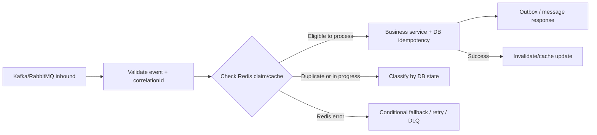

# Lettuce, Jedis, and Scope of Reactive Support

> **Chapter:** Redis  
> **Scope:** In the **SPRING_BOOT_INTEGRATION** module, Redis commonly serves as a cache, short-lived key-value store, state store, or coordination component for integration flows involving HTTP, databases, brokers, and Spring Integration. This lesson distinguishes the two popular Java Redis clients **Lettuce** and **Jedis**, identifies when Spring Boot/Spring Data Redis actually provides a **reactive** API, and explains how to choose safely based on transactions, errors, duplicates, testing, and observability.

## 1. Redis Client, Spring Data Redis, and Spring Boot Are Three Distinct Layers

A Java application does not "talk" directly to Redis simply because it has `@Service` or `@Cacheable` annotations. Typically, calls travel through three layers:

| Layer | Component | Responsibility |
| --- | --- | --- |
| **Client driver** | **Lettuce** or **Jedis** | Establishes connections, sends Redis commands, receives responses, handles protocol/network |
| **Spring Data Redis** | `RedisConnectionFactory`, `RedisTemplate`, `StringRedisTemplate`, `ReactiveRedisTemplate` | Provides abstractions for commands, serializers, callbacks, and data-processing APIs |
| **Spring Boot auto-configuration** | Redis auto-configuration, properties, and conditional beans | Reads configuration, detects present driver, builds connection factories/templates when conditions match |

`spring-boot-starter-data-redis` typically pulls in Spring Data Redis and **Lettuce** by default. Spring Boot supports basic configuration for both Lettuce and Jedis; switching drivers requires the right dependencies and configuration. The `spring-boot-starter-data-redis-reactive` starter also exists for naming consistency with other reactive starters, though it is not the only starter that allows using reactive Redis APIs: the standard Redis starter with Lettuce and the appropriate dependencies can support them as well.

### Relationship Diagram

```mermaid
flowchart TB
    A["Controller / Integration Flow / Service"] --> B{"Called API"}
    B -->|Imperative| C["RedisTemplate / StringRedisTemplate"]
    B -->|Reactive| D["ReactiveRedisTemplate / ReactiveStringRedisTemplate"]
    C --> E["RedisConnectionFactory"]
    D --> F["ReactiveRedisConnectionFactory"]
    E --> G{"Driver"}
    F --> H["LettuceConnectionFactory"]
    G --> I["LettuceConnectionFactory"]
    G --> J["JedisConnectionFactory"]
    H --> R[("Redis server / Sentinel / Cluster")]
    I --> R
    J --> R
```



Key takeaway from the diagram: `LettuceConnectionFactory` can provide both imperative and reactive connections; `JedisConnectionFactory` serves Spring Data Redis's imperative APIs. **There is no equivalent reactive branch for Jedis in current Spring Data Redis.**

## 2. Comparing Lettuce and Jedis

| Criterion | Lettuce | Jedis |
| --- | --- | --- |
| Library model | Built on Netty; supports synchronous, asynchronous, and reactive APIs at the client level | Focused on synchronous APIs in Spring Data Redis integration |
| Supports `RedisTemplate` | Yes | Yes |
| Supports `ReactiveRedisTemplate` via Spring Data Redis | **Yes** | **No** |
| Typical `RedisConnectionFactory` | `LettuceConnectionFactory` | `JedisConnectionFactory` |
| `ReactiveRedisConnectionFactory` | `LettuceConnectionFactory` | Not provided by Jedis |
| Connection sharing | Can share a thread-safe native connection across normal commands; certain operations require dedicated connections | Typically uses a connection/pool per call lifecycle; a standard Jedis connection must not be treated as thread-safe across arbitrary threads |
| Pooling | Supports pooling when needed and configured | Pooling is the standard choice for high-concurrency synchronous flows |
| Redis standalone, Sentinel, Cluster | Supports corresponding modes | Supports corresponding modes, though feature and configuration details may differ |
| When to choose | Need reactive APIs, want a flexible client and efficient shared connections | Imperative system standardized on Jedis, or requiring specific Jedis behavior/features |

**Lettuce does not make every piece of Java non-blocking.** If the application layer calls `StringRedisTemplate.opsForValue().get(...)`, that is still an *imperative* API returning the result directly and blocking the caller while waiting. Conversely, `ReactiveStringRedisTemplate.opsForValue().get(...)` returns `Mono<String>`, interacting only upon subscription and participating in a reactive flow.

**Jedis does not mean inferior in all circumstances.** A Spring MVC service executing short Redis commands with bounded connections can still use Jedis effectively. The decision should rest on blocking/reactive architecture, real workload, operational readiness, required features, and version support.

## 3. Reactive Is a Property of the API and Pipeline, Not Just the Dependency

In reactive programming with Spring, `Mono<T>` represents an asynchronous result of at most one element and `Flux<T>` represents a stream of multiple elements. Spring Data Redis reactive uses **Project Reactor** and **Lettuce** connections. Operations can be composed in a pipeline, propagating completion, error, and cancellation signals to the subscriber.

| Case | Is It Truly Reactive? | Why? |
| --- | --- | --- |
| Using Lettuce via `StringRedisTemplate` | **No**, at the called API | The get method returns a `String` immediately and synchronously |
| Using Lettuce via `ReactiveStringRedisTemplate` | **Yes**, at the Redis access layer | The API returns `Mono`/`Flux` and uses a reactive driver |
| Using Jedis via `StringRedisTemplate` | **No** | Spring Data Redis with Jedis is imperative |
| Using Jedis and wrapping `Mono.just(redisTemplate.opsForValue().get(k))` | **No** | The blocking command executes before `Mono` is even created |
| Using Jedis + `Mono.fromCallable(...).subscribeOn(Schedulers.boundedElastic())` | **Blocking isolation adapter**, not a reactive driver | May avoid blocking the event loop, but still ties up a thread and connection during I/O |
| WebFlux controller returning `Mono` while calling synchronous JPA/Jedis on the event loop | **Flow blocks at that call** | A reactive return type does not change the underlying I/O nature |

### Impact on Backpressure and Concurrency

Reactive does not mean the Redis server can automatically throttle every data source. Reactive Streams enables demand signaling along a publisher/subscriber chain; individual Redis commands still depend on network, Redis load, payload size, and timeout settings. If a consumer fires millions of operations using `flatMap` with unbounded concurrency, Redis can be overwhelmed even though the API uses `Mono`.

Set concurrency limits, timeouts, and buffer bounds at Redis or broker read/write boundaries. In real pipelines, never hold connections or subscriptions indefinitely without cancellation, retry, or monitoring policies.

## 4. Configuring Spring Boot with Default Lettuce

Maven example for a Spring Boot application managed by the Boot BOM or starter parent:

```xml
<dependency>
    <groupId>org.springframework.boot</groupId>
    <artifactId>spring-boot-starter-data-redis</artifactId>
</dependency>
```

Configuration example for the **Spring Boot 3.x** line:

```yaml
spring:
  data:
    redis:
      host: ${REDIS_HOST:localhost}
      port: ${REDIS_PORT:6379}
      password: ${REDIS_PASSWORD:}
      connect-timeout: 2s
      timeout: 3s
      client-type: lettuce
  cache:
    type: redis
management:
  health:
    redis:
      enabled: true
```

`spring.cache.type=redis` only applies when the application uses the Spring Cache abstraction and has the required cache infrastructure. It does **not** automatically enable `@Cacheable` on methods; caching typically must be explicitly enabled with `@EnableCaching`. If you only use `RedisTemplate` to read/write keys, the `spring.cache.*` section can be omitted.

In production, passwords and credentials must come from a secret manager or environment variables, not literals committed to the repository. If the server requires TLS, add SSL settings matching your Boot version and provisioned certificates; do not treat default `redis://` URIs as secure transport over public networks.

**Common auto-configured beans** when conditions are met:

- `RedisConnectionFactory` implemented by `LettuceConnectionFactory`.
- `RedisTemplate<Object,Object>` (bean named `redisTemplate`) and `StringRedisTemplate` for imperative calls.
- `ReactiveRedisTemplate` and `ReactiveStringRedisTemplate` beans when `ReactiveRedisConnectionFactory` and required classes are present.
- `RedisCacheManager` when the Spring Cache abstraction and Redis cache conditions are satisfied.

Exact beans created depend on classpath, version, properties, and application-defined beans. Spring Boot can **back off** when the application defines its own bean. When conditions are unclear, inspect the *Condition Evaluation Report* in debug mode or the Actuator `conditions` endpoint in a controlled environment.

### No Need to Switch to the "Reactive Starter" Just to Use Reactive APIs

Example:

```xml
<!-- A valid starter for both imperative and reactive APIs with Lettuce -->
<dependency>
    <groupId>org.springframework.boot</groupId>
    <artifactId>spring-boot-starter-data-redis</artifactId>
</dependency>
```

`spring-boot-starter-data-redis-reactive` is a convenient dependency option to express reactive intent. What actually matters is verifying that **Lettuce, Project Reactor, and the reactive connection factory are present**, not just checking the starter name.

## 5. Imperative Java Example with StringRedisTemplate

An order-processing integration flow might cache short-lived status to avoid calling a partner HTTP API too often. For Spring MVC or imperative workers, `StringRedisTemplate` is simple and appropriate:

```java
package com.example.integration.cache;

import java.time.Duration;
import java.util.Optional;
import org.springframework.data.redis.core.StringRedisTemplate;
import org.springframework.stereotype.Service;

@Service
public class OrderStatusCache {
    private static final Duration TTL = Duration.ofMinutes(5);
    private final StringRedisTemplate redis;

    public OrderStatusCache(StringRedisTemplate redis) {
        this.redis = redis;
    }

    public void put(String orderId, String status) {
        redis.opsForValue().set(key(orderId), status, TTL);
    }

    public Optional<String> find(String orderId) {
        return Optional.ofNullable(
                redis.opsForValue().get(key(orderId))
        );
    }

    public void evict(String orderId) {
        redis.delete(key(orderId));
    }

    private String key(String orderId) {
        return "integration:order-status:v1:" + orderId;
    }
}
```

**Behavior:** each method calls Redis synchronously. TTL prevents data from living forever in the cache, but does not guarantee freshness. The application still needs cache miss, invalidation, and fallback policies when Redis is temporarily unavailable.

The example uses `StringRedisTemplate` so keys and values are serialized as readable strings. With `RedisTemplate<K,V>`, you must **choose explicit serializers** for keys and values; never rely on default serialization when two application versions read shared data. Secrets or tokens require appropriate TTLs and security controls.

## 6. Reactive Java Example with ReactiveStringRedisTemplate

With Lettuce and a reactive stack, you can design a service whose callers receive a publisher:

```java
package com.example.integration.cache;

import java.time.Duration;
import org.springframework.data.redis.core.ReactiveStringRedisTemplate;
import org.springframework.stereotype.Service;
import reactor.core.publisher.Mono;

@Service
public class ReactiveOrderStatusCache {
    private static final Duration TTL = Duration.ofMinutes(5);
    private final ReactiveStringRedisTemplate redis;

    public ReactiveOrderStatusCache(
            ReactiveStringRedisTemplate redis) {
        this.redis = redis;
    }

    public Mono<Boolean> put(String orderId, String status) {
        return redis.opsForValue()
                .set(key(orderId), status, TTL);
    }

    public Mono<String> find(String orderId) {
        return redis.opsForValue().get(key(orderId));
    }

    public Mono<Boolean> evict(String orderId) {
        return redis.delete(key(orderId))
                .map(deleted -> deleted > 0);
    }

    private String key(String orderId) {
        return "integration:order-status:v1:" + orderId;
    }
}
```

Note that `find()` completes **without emitting a value** when the key does not exist; this is `Mono.empty()`, not a connection error. `put()` returns `Mono<Boolean>` representing the Redis operation result; **no Redis command executes simply because a `Mono` object is constructed**. The framework or caller must subscribe, typically by returning the publisher directly to WebFlux or composing it within an integration flow.

Example caller with a fallback on cache miss:

```java
public Mono<String> getStatus(String orderId) {
    return cache.find(orderId)
            .switchIfEmpty(partnerClient.fetchStatus(orderId))
            .timeout(Duration.ofSeconds(4));
}
```

This illustrates integration composition: `cache` is `ReactiveOrderStatusCache`, and `partnerClient.fetchStatus()` is assumed to return a non-blocking `Mono<String>`. If the fallback calls a synchronous HTTP client or blocking JPA directly, the Reactor chain still contains a blocking point that must be handled separately.

**Caution on cache fallback:** `switchIfEmpty` handles a missing key in Redis; Redis errors travel down the `onError` signal and are not automatically treated as cache misses. You may choose to degrade gracefully when Redis is down, but distinguish Redis errors from downstream errors and limit load so a cache outage does not overwhelm the partner.

### 6.1. When Reactive DTO Serialization Is Needed

`ReactiveRedisTemplate<K,V>` lets you configure a `RedisSerializationContext` with custom serializers. For JSON DTOs, choose serializers tied to a schema/version and ensure backward readability across upgrades. Do not treat `ReactiveRedisTemplate` as an automatic solution for schema evolution. When multiple services share keys, agree on prefixes/versions, TTLs, and value formats; otherwise a Java class change can break deserialization on older services.

## 7. Switching to Jedis When an Imperative App Needs It

In a Maven Spring Boot project, you can exclude the default Lettuce dependency and add Jedis:

```xml
<dependency>
    <groupId>org.springframework.boot</groupId>
    <artifactId>spring-boot-starter-data-redis</artifactId>
    <exclusions>
        <exclusion>
            <groupId>io.lettuce</groupId>
            <artifactId>lettuce-core</artifactId>
        </exclusion>
    </exclusions>
</dependency>

<dependency>
    <groupId>redis.clients</groupId>
    <artifactId>jedis</artifactId>
</dependency>
```

Select the matching driver in Spring Boot 3.x configuration:

```yaml
spring:
  data:
    redis:
      host: ${REDIS_HOST:localhost}
      port: ${REDIS_PORT:6379}
      connect-timeout: 2s
      timeout: 3s
      client-type: jedis
```

Spring Boot can create `JedisConnectionFactory` and imperative templates when conditions are met. The `StringRedisTemplate` code from the previous section remains virtually unchanged because it programs against the Spring Data Redis abstraction.

**Key limitation:** Jedis at the Spring Data Redis layer **does not implement a reactive driver**, so this configuration does not provide a `ReactiveRedisConnectionFactory` or `ReactiveStringRedisTemplate` backed by Jedis. An application injecting reactive templates will fail at startup unless another reactive connection factory exists.

Do not keep both Lettuce and Jedis on the classpath assuming Boot will "automatically pick the right one" for each service's intent. If you truly need both, define explicit beans, clarify which flows each serves, and manage pools, timeouts, and bean injection with appropriate qualifiers.

## 8. Connection Sharing, Pooling, and Timeouts

### 8.1. Does Lettuce Always Need a Connection Pool?

No. Lettuce can share a thread-safe native connection for regular commands using asynchronous I/O; therefore, it does not inherently need one Redis connection per concurrent request. Certain operations such as blocking commands, transactions, or Pub/Sub have specific connection/lifecycle requirements. Depending on workload, a pool or controlled dedicated connections may be needed.

With Jedis, proper pool configuration is crucial in high-concurrency imperative applications. However, pooling cannot compensate for an overloaded Redis server, network latency, or heavy Redis commands.

If pooling is needed in Boot 3.x, add the appropriate pooling library (usually `commons-pool2`) and configure according to driver/version:

```yaml
spring:
  data:
    redis:
      client-type: jedis
      jedis:
        pool:
          max-active: 16
          max-idle: 8
          min-idle: 1
          max-wait: 1s
```

For Lettuce, equivalent pool properties live under `spring.data.redis.lettuce.pool.*` if the workload requires them. Do not enable pooling out of habit: measure connection counts, throughput, P95/P99 latency, connection borrow wait times, and timeouts. Size pool parameters against Redis server limits and total application instances, not just a single instance's thread count.

### 8.2. Different Types of Timeouts

| Timeout / Limit | What It Protects | Notes |
| --- | --- | --- |
| **Connect timeout** | Time to establish a network connection | Distinct from Redis command execution time |
| **Command/read timeout** | Time waiting for Redis command execution/response | A timed-out command may already have been processed on the server |
| **Pool wait timeout** | Time waiting to borrow a connection from the pool | Prevents indefinite blocking when the pool is exhausted |
| **Reactive timeout** via `Mono.timeout(...)` | Application-level deadline on the publisher | Cancellation does not mean an already-sent command can be undone |
| **Business deadline** | End-to-end integration request time limit | Encompasses HTTP, cache, DB, broker; usually tighter than caller's deadline |

Do not treat `Mono.timeout` as a transaction rollback, and do not assume retrying after a timeout is safe for commands with side effects such as incrementing counters or creating claims.

## 9. Common Confusions Between Redis Cache and Spring Cache

Redis is both a datastore and a potential backend for the Spring Cache abstraction. These two programming models carry different responsibilities:

| Usage | Typical API | What You Manage Yourself |
| --- | --- | --- |
| Direct Redis calls | `StringRedisTemplate` / `ReactiveStringRedisTemplate` | Keys, TTL, serializers, missing keys, errors, refresh, atomicity |
| Spring Cache abstraction | `@Cacheable` / `@CachePut` / `@CacheEvict` + `CacheManager` | Cache name/key rules, TTL, consistency; cache provider choice |
| Redis for state coordination | `SET NX EX`, Lua scripts, counters, distributed locks | Atomicity, leases, renewal, contention, failover |
| Redis Pub/Sub or Streams | Redis messaging/stream APIs | Delivery guarantees, consumer groups, acks, retries, retention |

**Do not equate Spring Cache with the Redis reactive API.** Spring Framework has added cache support for methods returning reactive types in newer versions, but actual semantics depend on the `CacheManager` and the cache backend's async capabilities. Annotating a method with `@Cacheable` does not mean the system automatically uses `ReactiveRedisTemplate` or runs non-blocking end-to-end. When strict reactive execution is required, verify the actual implementation or use the reactive Redis API directly.

### 9.1. Cache-Aside and Consistency

In cache-aside, the service checks the cache first; on a miss, it calls the DB or partner HTTP API and writes the cache with a TTL. When source data changes, the cache can stay stale until invalidated or TTL expires. If two callers miss simultaneously, both may call downstream (*cache stampede*). Use TTL jitter, concurrency limits, or single-flight mechanisms where appropriate.

Do not rely solely on a cache for critical business rules where lost or stale cache data causes incorrect behavior. For instance, a missing Redis key does not prove an order has not already been created in the database.

## 10. Redis in Integration Flows: Idempotency, Transactions, and Errors

### 10.1. Deduplication Claims Are Atomic Operations

A workflow consuming events from a broker may want to prevent two workers from processing the same event simultaneously. Redis provides **`SET key value NX EX`** (setting only if the key does not exist while assigning a TTL in one operation), corresponding to:

```java
import java.time.Duration;
import org.springframework.data.redis.core.ReactiveStringRedisTemplate;
import reactor.core.publisher.Mono;

public Mono<Boolean> tryClaim(
        ReactiveStringRedisTemplate redis,
        String eventId,
        String token) {
    return redis.opsForValue().setIfAbsent(
            "integration:claim:v1:" + eventId,
            token,
            Duration.ofMinutes(2)
    );
}
```

`token` should be a unique random value for that claim attempt. If releasing the claim on failure, do not run a bare `DEL` because the lease may have expired and been acquired by another worker; instead use an **atomic compare-token-and-delete** operation, such as an appropriate Lua script. TTL must exceed expected operation duration or have safe renewal.

**Limitation:** a Redis claim only assists short-term coordination; it does not guarantee business "exactly-once" semantics. Redis can fail over, keys can expire while a task is still running, or state can be lost depending on persistence configuration. For payments, orders, and critical updates, **database unique constraints / inbox idempotency records** and business transactions must enforce correctness. Redis can serve to reduce load or concurrent duplicate runs under normal conditions.

### 10.2. Redis Transactions Differ from Database Transactions

Redis supports certain atomic primitives and commands like `MULTI/EXEC` or Lua; Spring Data Redis exposes corresponding APIs depending on driver capabilities and connection types. That **does not make Redis part of a JPA/JDBC transaction**.

`@Transactional` on a service using `JpaTransactionManager` does not roll back Redis writes if the DB transaction fails. Similarly, sending a broker message or calling an HTTP API before DB commit cannot be undone by a DB rollback.

A reliable "write DB then publish event" workflow can use the **transactional outbox**: store the business record and outbox record in the same DB transaction, have a publisher emit the event, and let consumers use idempotency keys to tolerate duplicate deliveries. Redis caches should only be updated or evicted according to a defined consistency strategy, such as post-commit or via compensating events.

### 10.3. How Should Redis Disconnection Be Handled?

Classify by usage purpose:

- **Auxiliary read cache:** may *fail open* and read from the authoritative source when Redis is down, but needs circuit breakers/load limits to avoid crashing the DB or partner HTTP service.
- **Cache writes:** may fail without aborting the business transaction if authoritative data is stored properly; define this explicitly in the contract.
- **Deduplication/lock/coordination:** when Redis is unavailable, do not treat it as "key absent"; specify *fail closed* or switch to a durable mechanism to avoid duplicate processing.
- **Redis Pub/Sub:** provides no durable storage for offline subscribers; if replay/ack is needed, consider Redis Streams or an appropriate broker and test delivery semantics.

Never infinitely retry authentication or misconfiguration errors. Network timeouts or transient errors may be retried with bounded retries and backoff **when the operation is idempotent** or when outcomes can be reconciled after a timeout.

## 11. Integrating with Spring Integration or Message Brokers

A flow might run from Kafka/RabbitMQ through a Redis adapter and then call a partner HTTP service or DB:



Key points to lock down:

1. **Message broker acknowledgment:** a successful Redis command does not mean the overall business work committed. Ack/retry/requeue configuration belongs on the inbound adapter and consumer container.
2. **Blocking boundary:** if a flow uses a reactive transport but calls `StringRedisTemplate`/Jedis directly on the event loop, offload to appropriate thread isolation or switch to Lettuce's reactive API. Choosing `Schedulers.boundedElastic()` is only bounded blocking isolation; it does not eliminate thread and connection overhead.
3. **Tracing:** attach message correlation IDs to logs/traces. Do not use unique business IDs as metric tags due to unbounded cardinality.
4. **Source-of-truth boundary:** Redis state can be evicted or expire, so the system must still know how to query authoritative outcomes from the DB or source-of-truth service.

## 12. Observing and Operating Redis Clients

| Signal | Diagnosis |
| --- | --- |
| **Connection count, connect failures, reconnects** | Are there network, TLS, credential, or instance-count issues? |
| **Command latency P50/P95/P99** | Is Redis slow due to load, heavy commands, large payloads, or network? |
| **Command timeout/error rate** | Is Redis overloaded or are request deadlines too tight? |
| **Pool active/idle/wait time** (if pooling) | Is the pool exhausted or oversized relative to the server? |
| **Cache hit/miss/eviction** | Is the cache reducing load or causing repeated downstream calls? |
| **Redis INFO, memory, evicted keys** | Is Redis under memory pressure and are eviction policies affecting correctness? |
| **Consumer lag, retry, DLQ** | Is a Redis outage stalling broker flows or pushing failures downstream? |

Spring Boot Actuator can expose health and metrics when appropriate dependencies and configuration are enabled. Do not assume the health endpoint is an exhaustive test of every key, cluster node, or contract, and do not publicly expose detailed infrastructure info. With Lettuce/Netty, measure both command latency and application-level saturation; with Jedis pools, monitor borrowed connections and wait times.

### Security and Serialization

Place Redis on a private network, use ACL/TLS authentication where appropriate, restrict permissions by key pattern/command, and never log passwords. When multiple services share Redis, use clear key namespaces like `integration:orders:v1:<businessKey>`; standardize TTL, serializer formats, and schema migration rules.

Do not use Java native serialization for shared data without controlling compatibility and untrusted deserialization risks. For JSON or binary DTOs, enforce field naming, versioning/schemas, and cross-version compatibility tests. Keys containing sensitive personal info should be minimized or hashed/transformed appropriately per security requirements.

## 13. Testing Lettuce, Jedis, and Reactive Behavior

A useful test suite verifies **behavior** and **auto-configuration conditions**, rather than merely checking that the application context contains a bean.

| Test Case | What to Verify |
| --- | --- |
| Booting with Lettuce | `LettuceConnectionFactory` and imperative templates exist; reactive factory/templates appear when reactive conditions are met |
| Booting with Jedis | `JedisConnectionFactory` and `StringRedisTemplate` exist; do not assume reactive templates exist |
| TTL | Key expires and subsequent reads return a cache miss rather than a business failure |
| Serializer | Data written by the previous version can be read back with proper key/value encoding |
| Concurrent claim | Two workers on the same key: `setIfAbsent` grants the claim to only one under normal contention |
| Redis outage | Distinguish optional cache fallback from mandatory dedup/coordination failure |
| Reactive cancellation/timeout | Publisher terminates cleanly without leaking resources; timeout is not mistaken for a Redis rollback |
| Pool exhaustion | Bounded timeout/wait, threads do not block indefinitely |
| Broker redelivery | Duplicate messages do not produce duplicate DB side effects |
| Failover/cluster | Reconnects and final contract states are not misinterpreted |

For reactive Java, `StepVerifier` helps assert `Mono`/`Flux` signals. For real Redis behavior, use Redis via Testcontainers or a dedicated integration test Redis instance. Mocking reactive templates checks service logic, but **does not prove** Redis commands, TTLs, serializers, and connections behave properly.

Conceptual Reactor test example:

```java
import reactor.test.StepVerifier;

StepVerifier.create(cache.put("order-1", "RECEIVED"))
        .expectNext(true)
        .verifyComplete();

StepVerifier.create(cache.find("order-1"))
        .expectNext("RECEIVED")
        .verifyComplete();
```

This snippet assumes `cache` is the reactive service from section 6, a test Redis instance is running, and `reactor-test` is declared in test scope. The lesson focuses on semantics: `put()` must have a subscriber, and `find()` must return the value while the TTL is active.

## 14. Common Pitfalls

1. **"Lettuce is always non-blocking."** False: Lettuce supports reactive, but `RedisTemplate` is an imperative API.
2. **"Using WebFlux makes Jedis automatically support reactive."** False: Spring Data Redis reactive supports Lettuce; Jedis does not provide a reactive connection factory at that layer.
3. **"Switching to the reactive Redis starter guarantees better performance."** Insufficient: you must measure workload, concurrency, command latency, serialization, and downstream behavior.
4. **"Increasing the connection pool always makes things faster."** False: too many connections increase server load and operational complexity; Lettuce often needs no pool.
5. **"A successful Redis SET means the JPA transaction also succeeded."** False: the two systems have separate transaction boundaries.
6. **"A Redis claim with TTL guarantees exactly-once."** False: keys can expire/vanish, workers can crash, or connections can drop after side effects occur.
7. **"Both cache misses and Redis errors should call the partner HTTP API."** False: falling back on Redis outages can cause load spikes, and dedup keys must not treat errors as misses.
8. **"`@Cacheable` automatically implies `ReactiveRedisTemplate`."** False: the cache abstraction and reactive Redis API are two different mechanisms.

## 15. Driver Selection Checklist

Before choosing Lettuce or Jedis, answer:

1. Is the Redis call path running on **Spring MVC/imperative workers** or **WebFlux/reactive message processing**?
2. Is a `Mono`/`Flux` API genuinely needed for Redis operations? If yes, **Lettuce** is the option supporting reactive via Spring Data Redis.
3. Which topology and features are needed (standalone, Sentinel, Cluster, TLS, pub/sub, streams, pipelining, transactions)? Do the chosen driver and version support them?
4. Have timeouts/connect timeouts/pools been defined and measured against realistic workloads?
5. Are key/value serialization, TTL, versioning, and invalidation aligned across services?
6. When Redis goes down, which parts can fall back and which must stop to protect correctness?
7. If Redis assists dedup/locking, which database or durable state store holds the final decision?
8. Are there integration tests with real Redis covering network errors/timeouts, concurrent claims, and broker redelivery?

### Self-Check Questions

1. How does `LettuceConnectionFactory` differ from `JedisConnectionFactory` regarding reactive support?
2. Why is an application using Lettuce that only injects `StringRedisTemplate` not yet non-blocking?
3. When `ReactiveStringRedisTemplate.opsForValue().get(k)` does not find a key, how does it represent the result?
4. When does adding `spring-boot-starter-data-redis-reactive` fail to change an application's reactive capability?
5. When is pooling beneficial for Lettuce vs. Jedis? Why can connection counts not be chosen solely from request counts?
6. Why does a timed-out Redis command not prove the command did not execute on the server?
7. Why must a Redis deduplication claim use an atomic operation and token, yet still require DB constraints?
8. If a Kafka message is redelivered after the DB has already committed, should the outcome be determined from the Redis cache or durable state?

**Takeaway:** **Lettuce** supports both imperative and reactive calls in Spring Data Redis; **Jedis** is integrated for imperative calls. The starter, connection factory, template API, and entire pipeline collectively determine whether execution is non-blocking. Redis accelerates and coordinates integration flows, but correctness still depends on TTL/schemas, transaction boundaries, durable idempotency, error policies, testing, and operational metrics.

### References

- [Spring Boot Reference — Redis](https://docs.spring.io/spring-boot/reference/data/nosql.html): starters, Lettuce/Jedis configuration, and auto-configuration.
- [Spring Data Redis Reference — Drivers](https://docs.spring.io/spring-data/data-redis/reference/redis/drivers.html): capability matrix of both connectors, including reactive APIs and connection pooling.
- [Spring Data Redis Reference](https://docs.spring.io/spring-data/redis/reference/): RedisTemplate, reactive operations, serialization, connection factories, and transactions.
