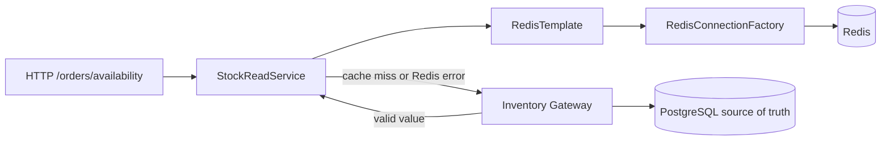
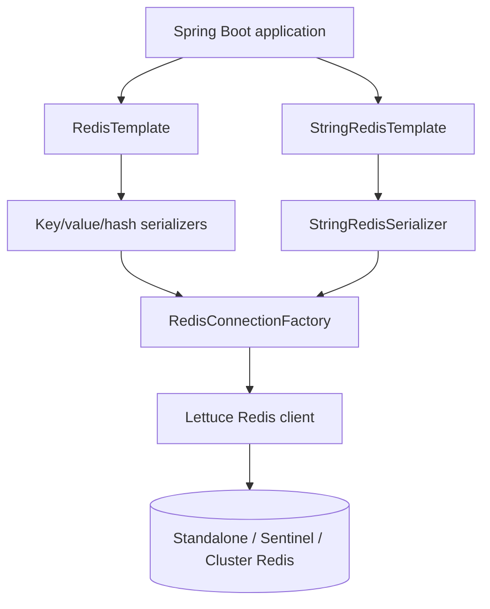
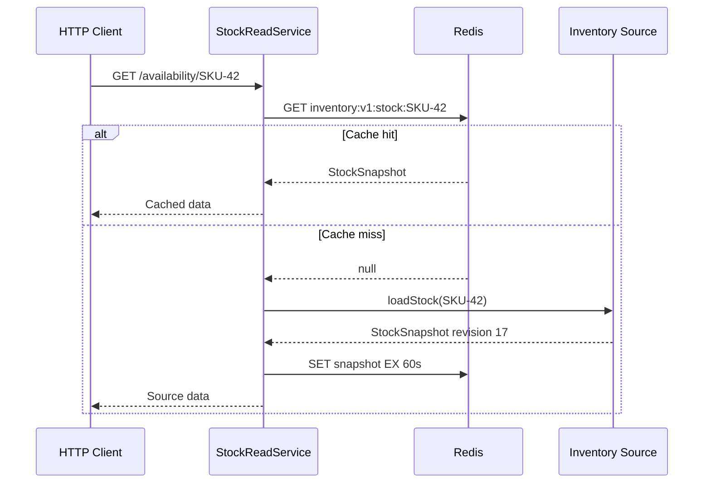

# RedisConnectionFactory, RedisTemplate, and StringRedisTemplate

## 1. Problem Statement and Objectives

In integration systems, a service often reads data from a database or calls an external HTTP system repeatedly. When a result is queried at high frequency but changes only periodically, **Redis** can offload the primary data source. Redis is also used for counters, temporary state, controlled distributed locks, or short-lived idempotency markers. However, Redis is only useful when the application clearly defines **storage format, data lifetimes, error handling, and the source of truth**.

Spring Data Redis has three foundational components to understand before using it:

- **`RedisConnectionFactory`:** provides connections to Redis according to the configured driver, authentication, TLS, and topology.
- **`RedisTemplate<K,V>`:** an API for Redis key/value operations with configurable serializers, used for strings, objects, hashes, lists, sets, sorted sets, and many other operations.
- **`StringRedisTemplate`:** a specialization for **String keys and values**, preconfigured with UTF-8 string serializers; convenient for counters, flags, reference tokens, simple state, and inspection via `redis-cli`.

This lesson belongs to the **Redis** chapter in the **SPRING_BOOT_INTEGRATION** module. The module organizes Spring Boot integrations across HTTP clients, databases, caches, message brokers, and Spring Integration adapters, focusing on **configuration, data contracts, transactions, errors, deduplication, testing, and observability** in real integration flows. Accordingly, this lesson goes beyond simple `get`/`set` calls to explain how to protect business data on cache misses, Redis disconnects, redelivered messages, or when the database commits before the cache is updated.

After completing this lesson, you will be able to:

1. Explain the path from `RedisTemplate` or `StringRedisTemplate` through `RedisConnectionFactory` to the Redis server.
2. Configure Spring Boot with standalone Redis and understand the differences when using Sentinel/Cluster and TLS.
3. Create a `RedisTemplate<String, StockSnapshot>` using a stable JSON format and understand why the default serializer can make data hard to read.
4. Use `StringRedisTemplate` with TTLs, counters, hashes, and conditional `setIfAbsent` operations.
5. Implement cache-aside for inventory data and distinguish Redis cache consistency from database transactions.
6. Test serializers/TTLs/connections against real Redis; observe pooling, latency, cache hits/misses, and integration errors.

> **Version assumptions:** Examples use Java 17+, Spring Boot 3.2+, and Spring Data Redis 3.x managed by the Spring Boot BOM, with **Lettuce** as the preferred driver in samples. APIs and property names may vary across Spring Boot, Spring Data Redis, and Redis server versions. Common Java `import` statements are omitted; add package-appropriate imports in your project.

### 1.1. Practical Scenario: Reading Inventory via Redis Cache

An **Order Service** needs to display estimated available stock per SKU. **Inventory Service** uses PostgreSQL as its authoritative data store. If every product view request hits the Inventory API, the network and database can become overloaded. We add a Redis cache with the key:

```text
inventory:v1:stock:SKU-42
```

and JSON value:

```json
{
  "sku": "SKU-42",
  "available": 8,
  "revision": 17
}
```

The application reads the cache first; if absent or if Redis encounters a transient error, it reads Inventory from the authoritative source. Valid results are cached with a **finite TTL**. When Inventory updates stock, an invalidation or version-aware update policy is needed to minimize stale data duration.



**Business boundary:** cached stock quantities are for **display/estimation only**, not proof of ability to reserve items. When placing an order, Inventory must check stock atomically in the database. If high-precision state is needed, read from the consistent source per contract or adopt an asynchronous confirmation flow.

## 2. How Do the Three Components Work Together?



| Component | Responsible For | Does Not Automatically Solve |
|---|---|---|
| `RedisConnectionFactory` | Configures and supplies Redis connections to Spring Data Redis; supports the chosen driver and topology | Does not decide how JSON DTOs are serialized |
| `RedisTemplate<K,V>` | Translates Spring calls to Redis commands, applies key/value/hash serializers, manages resources per template | Does not automatically guarantee cache consistency with PostgreSQL |
| `StringRedisTemplate` | Preconfigured string serializers for key/value/hash; convenient for text data | Does not serialize Java objects into JSON for you |
| `RedisSerializer<T>` | Defines byte representation when reading/writing Redis | Does not decide TTLs, retries, or distributed transactions |
| Redis server | Executes commands, stores data, enforces TTLs and persistence/replication policies | Does not execute SQL transactions or HTTP business confirmations |

### 2.1. Redis Stores Bytes; Serializers Are Data Contracts

Redis accepts keys and values as byte arrays. A Java object written via `RedisTemplate` goes through a serializer; reading it back requires a **compatible serializer**. If application A writes binary Java serialization while application B tries to read the same key with `StringRedisTemplate`, the data may be unreadable or misinterpreted.

```text
Java key   -- keySerializer --> Redis bytes
Java value -- valueSerializer --> Redis bytes
Redis bytes -- deserializer --> Java value
```

A cache contract must specify **key naming, value format, schema/version, TTL, and ownership**. Do not assume changing a Java class automatically migrates data already stored in Redis. Existing cached values can outlive a deployment; bump key versions or provide backward-compatible reading logic.

### 2.2. Why Doesn't a Template Replace a Connection Factory?

`RedisTemplate` uses `RedisConnectionFactory` to obtain connections when executing commands. Multiple templates can share one connection factory and pool, with each template using different serializers or data types. You do not need to create a new `LettuceConnectionFactory` per template.

`RedisTemplate` instances are typically configured once and **reused as singleton beans after initialization completes**. Never mutate a template's serializers across multiple threads at runtime; changing configuration mid-flight can cause inconsistent reads and writes. Connections and native resources have their own lifecycle managed by the factory/driver; avoid holding onto a `RedisConnection` and sharing it arbitrarily across requests.

## 3. Installing Dependencies and Configuring Spring Boot Connections

### 3.1. Maven and Gradle Dependencies

With the Spring Boot parent/BOM:

```xml
<dependencies>
    <dependency>
        <groupId>org.springframework.boot</groupId>
        <artifactId>spring-boot-starter-data-redis</artifactId>
    </dependency>
    <dependency>
        <groupId>org.apache.commons</groupId>
        <artifactId>commons-pool2</artifactId>
    </dependency>
    <dependency>
        <groupId>org.springframework.boot</groupId>
        <artifactId>spring-boot-starter-test</artifactId>
        <scope>test</scope>
    </dependency>
</dependencies>
```

Corresponding Gradle Kotlin DSL:

```kotlin
dependencies {
    implementation("org.springframework.boot:spring-boot-starter-data-redis")
    implementation("org.apache.commons:commons-pool2")
    testImplementation("org.springframework.boot:spring-boot-starter-test")
}
```

- The Redis starter normally supplies Spring Data Redis and **Lettuce** under standard Boot configuration.
- `commons-pool2` is needed when enabling **Lettuce pooling** as in the sample configuration; if not using a pool, consider omitting it rather than adding it out of habit.
- Redis drivers are **distinct from** JDBC/R2DBC drivers: do not use JDBC `DataSource` or R2DBC `ConnectionFactory` for Redis.
- Even though Lettuce supports async/reactive APIs, `RedisTemplate` and `StringRedisTemplate` in this section are **synchronous APIs (blocking for the caller)**. WebFlux flows require dedicated reactive APIs; see Section 9.

### 3.2. Configuring Standalone Redis for Local Environments

```yaml
# application.yml — illustrative defaults for local development
spring:
  data:
    redis:
      host: ${REDIS_HOST:localhost}
      port: ${REDIS_PORT:6379}
      username: ${REDIS_USERNAME:default}
      password: ${REDIS_PASSWORD:}
      database: 0
      client-type: lettuce
      connect-timeout: 2s
      timeout: 2s
      lettuce:
        pool:
          enabled: true
          max-active: 16
          max-idle: 8
          min-idle: 1
          max-wait: 500ms

integration:
  cache:
    stock:
      ttl: 60s
```

**Interpretation:**

| Property | Role |
|---|---|
| `spring.data.redis.host/port` | Redis endpoint in standalone mode |
| `username/password` | Redis ACL or server password; never commit real secrets |
| `database` | Logical DB index in standalone as supported by the server; not permission isolation |
| `connect-timeout` | Wait limit for establishing a connection |
| `timeout` | Command duration limit per Lettuce/Boot configuration |
| `lettuce.pool.max-active` | Limit on active pooled connections when pooling is enabled |
| `lettuce.pool.max-wait` | Maximum wait time for a pooled resource |
| `integration.cache.stock.ttl` | **Application-defined** property to set TTL; Redis does not interpret it automatically |

Pools are **per-instance** resources, not cluster-wide across all app replicas. With 8 replicas each allowed 16 connections, simple multiplication yields up to **128 connections** from that pool alone, before counting other apps or non-pooled connections. Lettuce can also reuse/multiplex connections according to driver behavior; do not assume every Redis request opens a separate socket.

**Unencrypted local config** (`localhost:6379`) is suitable only for isolated development. Production must enable TLS/ACL/secret management and restrict network access per deployment architecture; see Section 10.

### 3.3. Which Beans Does Spring Boot Auto-Configuration Create?

With the starter and valid Redis configuration, Spring Boot typically creates:

1. `RedisConnectionFactory`, defaulting to `LettuceConnectionFactory` with the Lettuce driver when no custom factory exists.
2. A generic `redisTemplate` bean (usually `RedisTemplate<Object,Object>`) if no competing bean with the required name exists.
3. A `stringRedisTemplate` bean for string operations, if no matching bean exists.

Exact details depend on Boot version, classpath, and `@ConditionalOn...` rules. Do not create a new connection factory merely to change serializers: define a **dedicated template bean** and inject the Boot-managed factory. When connecting to multiple Redis servers, configure separate connection factories/beans with explicit `@Qualifier` annotations; auto-configuration defaults are not enough to select among multiple servers.

## 4. RedisConnectionFactory and Connection Lifecycle

### 4.1. RedisConnectionFactory Is Spring Data Redis's Abstraction

`org.springframework.data.redis.connection.RedisConnectionFactory` creates `RedisConnection` instances for synchronous operations. With Lettuce, the common implementation is `LettuceConnectionFactory`. It knows Redis host/port, authentication, TLS, database/topology, and configured client options.

```java
// Inspect the actual factory type in a Spring Boot application
@Component
public class RedisConnectionInspector {
    private final RedisConnectionFactory connectionFactory;

    public RedisConnectionInspector(
            RedisConnectionFactory connectionFactory
    ) {
        this.connectionFactory = connectionFactory;
    }

    public String driverClassName() {
        return connectionFactory.getClass().getSimpleName();
    }
}
```

This snippet only reveals the injected factory type; it **does not check whether Redis can accept commands**. To test connectivity, use an appropriate health indicator or run a command on a test resource with timeouts and error handling.

### 4.2. When Do You Need to Create a Factory Manually?

Most applications only need `spring.data.redis.*`. A custom factory makes sense when using special topologies, independent SSL/client customization, multiple Redis servers, or dependency conditions where Boot auto-configuration does not fit your intent.

Example **alternative** to auto-configuration when customizing the Lettuce client:

```java
// Manual standalone factory example: use only intentionally.
@Configuration(proxyBeanMethods = false)
public class CustomRedisFactoryConfiguration {

    @Bean
    RedisConnectionFactory redisConnectionFactory(
            @Value("${app.redis.host}") String host,
            @Value("${app.redis.port}") int port
    ) {
        RedisStandaloneConfiguration server =
                new RedisStandaloneConfiguration(host, port);

        LettuceClientConfiguration client =
                LettuceClientConfiguration.builder()
                        .commandTimeout(Duration.ofSeconds(2))
                        .build();

        return new LettuceConnectionFactory(server, client);
    }
}
```

This snippet **omits ACL/password/TLS** and serves only to illustrate the factory API in test/local settings. When you define a manual `RedisConnectionFactory` bean, Boot may back off its default factory and `spring.data.redis.*` properties will not automatically apply to your custom bean. Therefore, **do not combine this snippet with the production YAML in Section 3 assuming a complete configuration**.

### 4.3. Should You Acquire RedisConnection Directly?

In Spring Data Redis, prefer `RedisTemplate` APIs over managing `RedisConnection` yourself. If low-level API access is strictly required, ensure resources are closed/released per the driver and transaction context contract:

```java
try (RedisConnection connection =
             redisConnectionFactory.getConnection()) {
    String pong = connection.ping();
    assertEquals("PONG", pong);
}
```

This is a **testing** example; calling `PING` on every HTTP request is not recommended. Connections may be managed and shared underneath per Lettuce's mechanics; holding onto a `RedisConnection` long-term or sharing it outside the client's threading policy can cause errors. `RedisTemplate` manages resource lifecycles for common operations.

### 4.4. Connection Topologies Are Not Equivalent

- **Standalone:** targets a single host/port/database.
- **Sentinel:** Sentinel discovers the master and coordinates failover; configure Sentinel node list and master name. The client must support reconnect/topology refresh, and real failover must be tested.
- **Redis Cluster:** partitions keys by hash slot; clients must discover topology and handle `MOVED`/`ASK` per driver; Cluster typically supports only **logical DB 0**, so do not use `database: 1` as in standalone.
- **Managed Redis:** TLS, DNS, user/secret rotation, proxies, and failover depend on the cloud provider.

Do not duplicate a standalone Redis URL into multiple nodes and assume you have Cluster/HA. When using multi-key operations or Lua scripts in Redis Cluster, participating keys may need to live in the **same hash slot**; use hash tags such as `stock:{SKU-42}:data` and `stock:{SKU-42}:lock` only when a workflow truly requires co-located multi-key commands.

## 5. RedisTemplate: Generic Types and Serializers

### 5.1. Java Generics Do Not Determine the Byte Format in Redis

`RedisTemplate<K,V>` is a Java-typed abstraction. Two templates `RedisTemplate<String,StockSnapshot>` and `RedisTemplate<String,String>` **do not automatically write compatible bytes** merely because both use `String` keys. The wire format depends on the configured serializers:

| Serializer | Data Format | Advantages | Points to Watch |
|---|---|---|---|
| `StringRedisSerializer` | UTF-8 text | Easy to read in CLI; fits string keys and values | Does not serialize Java DTOs automatically |
| `JdkSerializationRedisSerializer` | Binary Java serialization | Can store some `Serializable` objects | Coupled to class/`serialVersionUID`, poor cross-language support, deserialization security risks |
| `Jackson2JsonRedisSerializer<T>` | JSON for a specific type | Good fit for controlled DTO caches | Requires consistent schema/version, `ObjectMapper`/modules, and DTO types |
| `GenericJackson2JsonRedisSerializer` | JSON with configured type metadata | Useful for heterogeneous Java object caches | Polymorphic type metadata and deserialization require security review; never accept arbitrary types from untrusted data |
| `GenericToStringSerializer<T>` | Converts numbers/types via converters to strings | Convenient for scalar values | Needs explicit converters and consistent parsing |

The auto-configured `RedisTemplate<Object,Object>` may default to **JDK serialization** in many Spring Data Redis versions. That makes keys/values look like binary data in `redis-cli` and tightly couples data to Java classes. **Never rely on that default to build a multi-service cache contract without verifying the active serializer.**

An operationally clean practice: use text keys with a fixed namespace; use versioned JSON values or a contract-defined byte format; treat serializers as part of infrastructure and test them against legacy data during upgrades.

### 5.2. Creating a Typed RedisTemplate for StockSnapshot

Sample DTO avoiding `Instant` or specialized temporal types to keep JSON serialization straightforward:

```java
// StockSnapshot.java
public record StockSnapshot(
        String sku,
        long available,
        long revision
) {}
```

Configuring a bean using JSON for values and strings for keys and hash keys:

```java
// StockRedisConfiguration.java — abbreviated imports
@Configuration(proxyBeanMethods = false)
public class StockRedisConfiguration {

    @Bean("stockRedisTemplate")
    public RedisTemplate<String, StockSnapshot> stockRedisTemplate(
            RedisConnectionFactory connectionFactory
    ) {
        RedisTemplate<String, StockSnapshot> template =
                new RedisTemplate<>();
        template.setConnectionFactory(connectionFactory);

        StringRedisSerializer keySerializer =
                new StringRedisSerializer();
        Jackson2JsonRedisSerializer<StockSnapshot> valueSerializer =
                new Jackson2JsonRedisSerializer<>(
                        StockSnapshot.class);

        template.setKeySerializer(keySerializer);
        template.setValueSerializer(valueSerializer);
        template.setHashKeySerializer(keySerializer);
        template.setHashValueSerializer(valueSerializer);
        template.setEnableDefaultSerializer(false);

        return template;
    }
}
```

`Jackson2JsonRedisSerializer` resides in `org.springframework.data.redis.serializer`. The example binds it to `StockSnapshot` for both values and hash values. **Do not** use this template to write arbitrary strings into hash values if the serializer is meant only for `StockSnapshot`. If caching multiple DTO types, define separate named templates per contract or use a serializer with controlled and tested type mapping.

In Spring Data Redis 3.x, the class-based constructor above is a solid practical choice. If a DTO contains `Instant`, `LocalDateTime`, or specialized types, standardize the `ObjectMapper` and required Jackson modules, and test reading previous schema versions. Serializer constructors and overloads vary across versions, so avoid mixing Spring Data Redis 2.x and 3.x examples without checking compilation.

**Why `setEnableDefaultSerializer(false)`?** It prevents the template from silently falling back to JDK serialization if you forget to configure one of the serializers, keeping key/value formats explicit. When using additional commands, ensure the corresponding serializer is configured.

### 5.3. Using the Typed Template

```java
// Example in a synchronous service/adapter
@Component
public class StockCacheAdapter {
    private final RedisTemplate<String, StockSnapshot> redis;

    public StockCacheAdapter(
            @Qualifier("stockRedisTemplate")
            RedisTemplate<String, StockSnapshot> redis
    ) {
        this.redis = redis;
    }

    public StockSnapshot find(String sku) {
        return redis.opsForValue()
                .get("inventory:v1:stock:" + sku);
    }

    public void put(StockSnapshot snapshot) {
        redis.opsForValue().set(
                "inventory:v1:stock:" + snapshot.sku(),
                snapshot,
                Duration.ofSeconds(60));
    }

    public Boolean evict(String sku) {
        return redis.delete("inventory:v1:stock:" + sku);
    }
}
```

`ValueOperations.set(key, value, Duration)` writes the value with a TTL in the corresponding Redis operation; no separate `expire` command is needed here. `get` returns `null` when the key does not exist; application code must distinguish a **cache miss** from connection or deserialization errors. The `Boolean` result of `delete` reflects key deletion per the API; do not turn an already-absent key into a business error.

When building keys from `sku`, validate inputs and allowed characters to avoid overly long keys, collisions, or leaking sensitive data. In multi-tenant systems, namespaces must include the tenant or equivalent isolation **alongside authorization**, rather than trusting a prefix string supplied by the caller.

### 5.4. Inspecting the Written Data

With the template configured above, a key can be inspected via `redis-cli`:

```text
GET inventory:v1:stock:SKU-42
{"sku":"SKU-42","available":8,"revision":17}

TTL inventory:v1:stock:SKU-42
54
```

This is **illustrative output**; the actual TTL decreases over time. `TTL` in seconds returns `-2` if the key does not exist and `-1` if the key exists with no expiration. Do not treat the sample TTL number as a fixed constant to assert in tests.

Do not open CLI tools against production accounts just to test serializers. Test against a dedicated Redis instance with test namespaces, and use audited operational tooling with proper permissions in production.

### 5.5. Changing a Serializer Changes the Data Contract

Suppose release A writes binary JDK values under `inventory:v1:stock:SKU-42`, and release B switches to JSON while keeping the same key. When release B reads old values with Jackson, decoding errors can occur until the old keys expire.

Migration strategies:

1. **Version the key**: switch to `inventory:v2:stock:{sku}`; old data expires naturally without decode mismatches.
2. **Read old / write new** if avoiding cold caches is mandatory; requires a time-bounded migration adapter and compatibility tests.
3. **Controlled invalidation** of keys owned solely by your service, followed by controlled warming from the source of truth; never run `FLUSHALL` on a shared Redis.
4. When multiple app versions run concurrently, never let both write incompatible formats into the same namespace.

## 6. StringRedisTemplate: When Should You Use It?

`StringRedisTemplate` is a `RedisTemplate<String,String>` with string serializers. Spring Boot typically auto-configures this bean when a `RedisConnectionFactory` exists. Inspecting data in `redis-cli` is much clearer because keys and values are UTF-8 text rather than Java serialization.

### 6.1. Storing Temporary State/Cursors

```java
// ReconciliationCursorStore.java
@Component
public class ReconciliationCursorStore {
    private final StringRedisTemplate redis;

    public ReconciliationCursorStore(StringRedisTemplate redis) {
        this.redis = redis;
    }

    public void remember(String tenant, String cursor) {
        String key = "integration:v1:cursor:" + tenant;
        redis.opsForValue().set(
                key, cursor, Duration.ofHours(6));
    }

    public String find(String tenant) {
        return redis.opsForValue().get(
                "integration:v1:cursor:" + tenant);
    }
}
```

`remember` caches a temporary cursor; it is **not** a safe substitute for offsets/progress that must survive Redis eviction or failover. If a cursor determines whether records are skipped during synchronization, store progress in a database or broker checkpoint with proper durability semantics, or implement replay/recovery from the source.

### 6.2. Working with Hashes

```java
String key = "integration:v1:job:job-42";

stringRedisTemplate.opsForHash()
        .put(key, "status", "PENDING");
stringRedisTemplate.opsForHash()
        .put(key, "attempts", "2");

Object status = stringRedisTemplate.opsForHash()
        .get(key, "status");

stringRedisTemplate.expire(key, Duration.ofMinutes(30));
```

Hashes group multiple fields under one Redis key. With `StringRedisTemplate`, the key, hash fields, and hash values are strings; `get` returns `Object` due to `HashOperations` generics and can be cast/converted to string once verified. **TTL applies to the entire hash key**, not individual fields. If per-field TTLs are needed, redesign the keys or verify Redis server features/versions that support field-level expiration.

### 6.3. `setIfAbsent` with TTL: A Conditional Operation

```java
String key = "integration:v1:work-in-progress:reserve-O-1001";
Boolean acquired = stringRedisTemplate.opsForValue()
        .setIfAbsent(
                key, "worker-7", Duration.ofMinutes(2));

if (Boolean.TRUE.equals(acquired)) {
    // Only this worker observed the key absent at Redis SET NX time.
    // Real work still requires idempotency and a lease-expiration policy.
}
```

`setIfAbsent(key, value, ttl)` maps to a single conditional write with expiration in Redis, avoiding the race of separate `SETNX` and `EXPIRE` commands. However, **it is not a complete distributed lock or exactly-once guarantee**: the lease can expire while the worker is still running, Redis can fail over or evict the key, and two workers can still execute the same business work sequentially. Implementing a proper lock requires a random token, atomic owner-verified release (e.g., via Lua script), TTL/renewal, and fencing tokens on protected resources where appropriate.

In an inventory reservation system, **a database unique constraint on `operationId` and the reservation transaction** remain the final guard against duplicate processing. A Redis marker can temporarily reduce duplicate requests, not replace database invariants.

### 6.4. Counters, TTL, and Atomicity Issues

```java
String key = "integration:v1:request-count:2026-11-21";
Long count = stringRedisTemplate.opsForValue()
        .increment(key);
if (count != null && count == 1L) {
    stringRedisTemplate.expire(key, Duration.ofDays(2));
}
```

`INCR` is atomic in Redis for a single key. However, **`INCR` and `EXPIRE` in this snippet are two separate commands**. If the process crashes after the first increment and before `expire`, the key may persist without a TTL. That might be acceptable for approximate telemetry counters; for **safety-critical rate limiting or quotas**, use an atomic Lua script/transaction or verified algorithm, accounting for clock drift and multi-replica quotas. A Redis counter also cannot distinguish one retried request from two distinct legitimate requests.

### 6.5. When Not to Use StringRedisTemplate?

- When values are complex DTOs and the team wants automatic type-safe serialization/deserialization, a typed `RedisTemplate` with explicit serializers is easier to maintain.
- When data requires specialized binary formats/performance under an explicit schema, use `RedisTemplate` with a byte serializer or a verified low-level adapter.
- When executing reactive requests on a Netty event loop, `StringRedisTemplate` is still a **blocking API**; use `ReactiveStringRedisTemplate`/`ReactiveRedisTemplate` or isolate blocking calls appropriately.

However, if you want JSON where versioning and validation are completely controlled by the application, `StringRedisTemplate` paired with a configured `ObjectMapper` can be very transparent: the app explicitly calls `writeValueAsString`/`readValue`, and Redis holds inspectable UTF-8 JSON.

## 7. Implementing Cache-Aside with RedisTemplate

### 7.1. Cache-Aside Principles

In **cache-aside**, the application manages cache reads and writes:

1. Look up the key in Redis.
2. On a **hit**: return cached data when the contract allows its staleness window.
3. On a **miss**: read from the source of truth (PostgreSQL or Inventory API).
4. Validate source data; write to Redis with a TTL and return the result.
5. When source data changes, invalidate or update the cache according to your defined consistency policy.



Operationally, a Redis failure differs from a cache miss. Both may fall back to reading the source, yet **they must be measured separately**: normal cache misses are not incidents; Redis timeouts or connection failures are infrastructure signals requiring alerts.

### 7.2. Source-of-Truth Adapter

```java
// StockOrigin.java
public interface StockOrigin {
    // May be backed by an HTTP client or DB query.
    // This example uses a synchronous API matching RedisTemplate.
    StockSnapshot load(String sku);
}
```

If the implementation uses reactive WebClient or R2DBC, do not call `.block()` on an event loop to force it into a synchronous interface. In WebFlux, use `ReactiveRedisTemplate` and `Mono<StockSnapshot>` end-to-end, or offload legacy blocking parts onto a bounded scheduler.

### 7.3. Cache Reading Service and Graceful Degradation

```java
// StockReadService.java — abbreviated imports
@Service
public class StockReadService {
    private static final Logger log =
            LoggerFactory.getLogger(StockReadService.class);

    private final RedisTemplate<String, StockSnapshot> redis;
    private final StockOrigin origin;
    private final Duration ttl;

    public StockReadService(
            @Qualifier("stockRedisTemplate")
            RedisTemplate<String, StockSnapshot> redis,
            StockOrigin origin,
            @Value("${integration.cache.stock.ttl:60s}") Duration ttl
    ) {
        if (ttl.isZero() || ttl.isNegative()) {
            throw new IllegalArgumentException(
                    "stock TTL must be greater than 0");
        }
        this.redis = redis;
        this.origin = origin;
        this.ttl = ttl;
    }

    public StockSnapshot getStock(String sku) {
        if (sku == null || !sku.matches("[A-Za-z0-9_-]{1,80}")) {
            throw new IllegalArgumentException("Invalid SKU");
        }
        String key = "inventory:v1:stock:" + sku;

        try {
            StockSnapshot cached = redis.opsForValue().get(key);
            if (cached != null) {
                return cached;
            }
        } catch (DataAccessException ex) {
            log.warn("Redis read failed; fallback to source: type={}",
                    ex.getClass().getSimpleName());
        }

        // The source of truth has its own timeout and error policy.
        StockSnapshot fresh = origin.load(sku);
        if (fresh == null || !sku.equals(fresh.sku())
                || fresh.available() < 0
                || fresh.revision() < 0) {
            throw new IllegalStateException(
                    "StockOrigin returned invalid data");
        }

        try {
            redis.opsForValue().set(key, fresh, ttl);
        } catch (DataAccessException ex) {
            // Business decision: cache failure must not fail
            // a read query that already obtained valid source data.
            log.warn("Redis write failed; return source: type={}",
                    ex.getClass().getSimpleName());
        }
        return fresh;
    }
}
```

Spring translates Redis exceptions into `DataAccessException` subtypes depending on the failure. The code above chooses **fail-open for display reads**: on Redis error it reads the source and logs/records metrics without failing the endpoint. For safety-critical flows like payments or reservation locks, failing open may be **wrong**: choose fail-closed or read the consistent source per contract.

**Do not catch all `RuntimeException`s:** programming bugs, contract violations from the source, or authorization failures must not be disguised as cache misses. Serialization exceptions can surface in the Redis adapter depending on conversion mechanics; log them by type, verify the schema, and avoid repeatedly writing invalid data to the same key.

### 7.4. TTL, Stale Data, and Cache Stampede

A 60-second TTL is an **upper bound on acceptable staleness under normal conditions**, not a scheduled refresh guarantee. Entries can be evicted early by memory policy, Redis failover, or admin actions; conversely, cached values can remain stale for the full TTL right after source data changes.

A **cache stampede** occurs when many concurrent requests miss on a hot key and hit the source simultaneously, eliminating cache protection right when it is needed most. Mitigations include:

- TTL **jitter**: spread expiration times (e.g., 50–70 seconds instead of all keys at 60 seconds).
- **Single-flight** per instance: coalesce concurrent misses for the same SKU into one origin load; do not assume this protects the entire cluster.
- **Short distributed leases** with tokens and wait limits when appropriate; if a lease is not acquired, fall back to reading source or returning bounded stale data per contract.
- **Stale-while-revalidate** using timestamp metadata if controlled staleness is allowed; never use stale data for stock decrement or payment decisions.
- Concurrency/rate limits on the Inventory source, short timeouts, and circuit breakers when downstream is overloaded.

**Negative caching** (temporarily storing `NOT_FOUND`) reduces load for nonexistent SKUs, but requires a distinct key/schema and shorter TTL if items can be created later. Never cache `null` or `available=0` to represent generic HTTP/DB errors: that conflates missing records with system outages.

### 7.5. Invalidating After Database Changes

When Inventory Service updates stock, do not delete the cache before the SQL transaction has definitively committed. In a single-instance flow, one approach is publishing a domain event and handling it **after commit**:

```java
// Illustrative internal event example
public record StockChanged(String sku, long revision) {}

@Component
public class StockCacheInvalidator {
    private final RedisTemplate<String, StockSnapshot> redis;

    public StockCacheInvalidator(
            @Qualifier("stockRedisTemplate")
            RedisTemplate<String, StockSnapshot> redis
    ) {
        this.redis = redis;
    }

    @TransactionalEventListener(
            phase = TransactionPhase.AFTER_COMMIT
    )
    public void onStockChanged(StockChanged event) {
        redis.delete("inventory:v1:stock:" + event.sku());
    }
}
```

This snippet assumes `StockChanged` is published inside an **active Spring transaction**, synchronous event listeners match the lifecycle, and the handler is not expected to provide durable delivery. If the process crashes **right after database commit but before Redis delete**, the invalidation is lost. Across multiple services/instances, write to a **transactional outbox** in the same DB transaction and let an event consumer perform invalidation; since events can be redelivered, handlers must be idempotent.

**Notable race condition:**

```text
T1: Reader encounters cache miss, loads revision=17 from source.
T2: Writer updates database to revision=18, commits, deletes Redis key.
T3: Reader (still holding revision=17) writes revision=17 into cache.
T4: Subsequent requests read stale cached data until TTL expires.
```

Delete-after-commit **does not eliminate every race**. For caches backing critical views, consider atomic version-aware writes (such as a Redis Lua script comparing stored or source revisions), ordered cache invalidation, short TTLs, or bypassing cache on strongly consistent paths. Doing separate `GET` then `SET` in application code to check revisions is **not atomic** under concurrent writers.

### 7.6. Key Versions, Tenants, and Size

An operationally clean key structure:

```text
inventory:v1:stock:{tenant}:{sku}
integration:v1:cursor:{jobName}
idempotency:v1:reservation:{operationId}
```

Keys must enforce length limits and escaping rules if tenants/SKUs can contain delimiters. Never embed tokens, passwords, or raw personal data in keys: key names appear in commands, metrics, and diagnostics. In Redis Cluster, `{...}` curly braces denote hash tags for **key slots**; if placeholders like `{tenant}`/`{sku}` appear in conventions, clarify which parts are substituted variables versus actual hash tags, and ensure two tenants can never collide.

Never run `KEYS inventory:*` on large production Redis instances for routine cache cleanup: it is an expensive operation that degrades latency. Prefer explicit keys, versioned namespaces, and paginated `SCAN` with operational safeguards; `SCAN` is not an atomic snapshot and can return duplicates or miss keys modified during iteration.

## 8. Operation Atomicity, Redis Transactions, and Consistency Limits

### 8.1. An Atomic Redis Command Does Not Make the Whole Flow Atomic

Redis executes basic commands atomically at the key/instance scope per command semantics. For example:

- `SET key value EX 60` sets both value and TTL in one command.
- `SET key value NX EX 60` sets only if absent and attaches TTL immediately.
- `INCR key` atomically increments a single key's counter.

However, a sequence `GET → HTTP call → SQL UPDATE → Redis SET` is **not** a single shared transaction. If the service crashes mid-flow, systems observe inconsistent state. Even when Spring manages a JDBC/JPA/R2DBC transaction, `RedisTemplate` is not automatically enlisted into a distributed transaction with it.

### 8.2. MULTI/EXEC and Pipelining Are Not the Same

| Mechanism | Purpose | Notes |
|---|---|---|
| Redis `MULTI/EXEC` | Queues commands and executes them sequentially as a Redis transaction | Not SQL rollback; a runtime error in one command does not roll back previously executed commands |
| `WATCH` | Watches keys for optimistic transactions | Aborts if a watched key changes; requires bounded retries in the app |
| Redis pipelining | Sends multiple commands to reduce network round-trips | Does not provide atomicity just by batching in a pipeline |
| Lua script / function | Executes server-side logic atomically per script semantics | Keep execution short, verify Cluster compatibility, avoid blocking the server |
| SQL transaction | Atomicity across tables managed by the database transaction manager | Does not commit Redis or HTTP calls simultaneously |

**Example:** incrementing a request counter and setting TTL as two separate commands leaves a crash window. When quotas depend on exact enforcement, use an atomic Lua script:

```lua
-- KEYS[1] = counter key; ARGV[1] = valid TTL in seconds.
local next = redis.call('INCR', KEYS[1])
if next == 1 then
  redis.call('EXPIRE', KEYS[1], tonumber(ARGV[1]))
end
return next
```

Spring Data Redis executes scripts via `RedisTemplate.execute(RedisScript, ...)`; with `StringRedisTemplate`, pass string keys/arguments and configure the appropriate result serializer/type. Redis Cluster requires keys accessed by a script to satisfy hash-slot constraints; long scripts or undeclared key accesses cause operational issues. Never use Lua scripts to replace PostgreSQL business transactions.

### 8.3. Can a Redis Marker Replace Database Idempotency?

A service consuming RabbitMQ/Kafka/JMS might receive `ReserveStockRequested` again after committing SQL but before broker acknowledgment. A TTL-bounded Redis marker for `operationId` can sometimes reduce duplicate work, but:

- TTL expiration, Redis eviction, or failover can drop the marker.
- Writing the marker before SQL commit risks treating a failed message as processed after SQL rollback.
- Writing the marker after SQL commit leaves a crash window where a redelivered message lacks the marker.
- The broker may redeliver duplicates after longer than the TTL.

Therefore, **a database unique constraint on operation ID and idempotent SQL transactions** remain the essential safeguard. Redis acts as an optimization or temporary state cache, not authoritative proof of "reserved exactly once" for high-reliability workflows.

## 9. Synchronous RedisTemplate vs. ReactiveRedisTemplate in WebFlux

### 9.1. Is RedisTemplate Reactive Just Because Lettuce Uses Netty?

**No.** Even though Lettuce is non-blocking at the client layer, `RedisTemplate.opsForValue().get(...)` and `StringRedisTemplate.opsForValue().set(...)` above are **synchronous APIs**. The caller waits for the command to finish. Calling them directly on a WebFlux Netty event-loop thread can stall other requests sharing that thread during Redis latency spikes.

Spring Data Redis provides:

- `ReactiveRedisConnectionFactory`: reactive Redis connection abstraction.
- `ReactiveRedisTemplate<K,V>`: reactive template using `Mono`/`Flux` and `RedisSerializationContext`.
- `ReactiveStringRedisTemplate`: reactive variant specialized for strings.

`LettuceConnectionFactory` in a supporting configuration can provide both synchronous and reactive connections, but **the two templates are not interchangeable usages of the same method**. Inject the right interface and never block Reactor event-loop threads.

### 9.2. ReactiveStringRedisTemplate Example

```java
// ReactiveCursorStore.java — abbreviated imports
@Component
public class ReactiveCursorStore {
    private final ReactiveStringRedisTemplate redis;

    public ReactiveCursorStore(ReactiveStringRedisTemplate redis) {
        this.redis = redis;
    }

    public Mono<Boolean> remember(String jobName, String cursor) {
        String key = "integration:v1:cursor:" + jobName;
        return redis.opsForValue()
                .set(key, cursor, Duration.ofHours(6));
    }

    public Mono<String> find(String jobName) {
        return redis.opsForValue()
                .get("integration:v1:cursor:" + jobName);
    }
}
```

When a key does not exist, `ReactiveStringRedisTemplate.opsForValue().get` completes with **`Mono.empty()`** instead of emitting `null`. Callers can chain `switchIfEmpty(...)` to read from the origin. By contrast, synchronous `StringRedisTemplate.get` returns `null` on miss.

`Mono<Boolean>` executes only upon subscription. A WebFlux controller returns the publisher for the framework to subscribe; an imperative job needs an adapter to manage lifecycle, completion, and errors. Never fire-and-forget `.subscribe()` and ignore results, and never call `.block()` inside a reactive request handler.

### 9.3. Conceptual Reactive Cache-Aside

```java
Mono<StockSnapshot> getStock(String sku) {
    String key = "inventory:v1:stock:" + sku;

    return reactiveStockCache.find(key)
            .switchIfEmpty(Mono.defer(() ->
                    reactiveStockOrigin.load(sku)
                            .flatMap(snapshot ->
                                    reactiveStockCache
                                            .put(key, snapshot,
                                                    Duration.ofSeconds(60))
                                            .thenReturn(snapshot))));
}
```

This is a **flow sketch** where `reactiveStockCache` and `reactiveStockOrigin` are interfaces returning reactive publishers. Production code needs input validation, Redis failure fallback, TTL/serializers, and ensuring a failed `put` does not discard the origin result per policy. Apply `onErrorResume` to the **specific cache branch** rather than catching every error across the chain and treating it as a cache miss.

**Do not use `Schedulers.boundedElastic()` as a default wrapper for all Redis calls.** It can serve as a temporary isolation boundary for limited legacy blocking APIs, but it does not make `RedisTemplate` reactive and still incurs thread/queue overhead. If WebFlux workloads call Redis frequently, `ReactiveRedisTemplate` is typically the right fit.

## 10. Redis Security, HA, and Resource Limits

### 10.1. TLS, Authentication, and ACLs

Redis should never be exposed directly on the Internet. In production, deploy on private networks with firewalls/network policies, TLS, Redis ACLs, and least-privilege application accounts.

Illustrative TLS configuration when the Redis endpoint has certificates and trust properly set up:

```yaml
# application-prod.yml — excerpt only
spring:
  data:
    redis:
      host: ${REDIS_HOST}
      port: ${REDIS_TLS_PORT:6380}
      username: ${REDIS_USERNAME}
      password: ${REDIS_PASSWORD}
      ssl:
        enabled: true
      connect-timeout: 2s
      timeout: 2s
```

Port `6380` is an **example**, not a mandatory TLS port for all Redis setups. Custom truststores/CAs, client certificates/mTLS, SSL bundles, or driver settings must be configured according to Spring Boot, the Redis client, and deployment infrastructure; setting `ssl.enabled=true` alone does not prove certificate chains and hostnames are verified as intended. Test with an invalid CA or mismatched hostname to ensure connections are rejected. Never disable TLS verification to work around transient network issues.

Redis ACLs should restrict commands and key patterns per service. For instance, a cache reader may only need `GET`/`MGET`, while the cache owner also gets `SET`/`DEL`/`EXPIRE` per policy. **Redis logical database indexes are not security boundaries**; if multiple tenants or apps share Redis, use ACLs, namespaces, and appropriate infrastructure isolation.

### 10.2. Topology and Failover

| Topology | Meaning | What to Verify |
|---|---|---|
| Standalone | Single Redis node | Losing the node impacts cache; authoritative source needs fallback |
| Sentinel | Monitors master and promotes a replica on failover | Client discovery, failover delay, retries, stale connection cleanup |
| Cluster | Shards data by hash slot | Topology refresh, MOVED/ASK, hash tags, multi-key constraints |
| Managed Redis | Cloud provider manages infrastructure | Endpoints/TLS/ACL, SLA guarantees, eviction policy, maintenance/failover |

**HA does not mean zero data loss:** replication and failover still have write-loss windows depending on Redis configuration and durability settings. Never use a transient Redis key as the sole record of committed payments or reservations. With cache-aside, PostgreSQL/Inventory is the source of truth and Redis is a rebuildable acceleration layer.

### 10.3. Memory, Eviction, and TTL

Redis stores data in memory according to its deployment model and loaded modules. Define explicitly:

- `maxmemory` and eviction policy matching workload (e.g., `allkeys-lru`, `volatile-ttl`, or version-appropriate policies), and their effect on keys with/without TTLs.
- Average value size and key count; large JSON DTOs multiplied across millions of SKUs consume substantial RAM.
- TTL matched to staleness tolerance, adding jitter when many keys could expire together.
- Hit/miss ratio, evicted/expired keys, memory fragmentation, and slow commands.
- Protection when the database/downstream is down, since losing cache can trigger a **thundering herd** against the origin.

`RedisTemplate` does not automatically apply a TTL to every key. Calling `set(key, value)` without an expiration leaves the key until explicitly deleted or evicted. Always use `set(key, value, Duration)`, `expire`, or an intentional lifecycle policy, and test TTL behavior.

### 10.4. Timeouts, Retries, and Circuit Breakers

When Redis slows down or disconnects, avoid unbounded retries per HTTP request. An endpoint reading thousands of cache keys can trigger a connection storm and take down the service if every call waits on long timeouts.

- Budget **connect timeout, command timeout, and pool acquire timeout**; never exceed inbound HTTP deadlines.
- For cache reads, **fall back** to the origin and trip a circuit breaker during outages; rate-limit fallback traffic to avoid overwhelming the database.
- For cache writes, consider logging/recording metrics and returning valid origin data when caching is strictly an optimization.
- For locks, rate limits, or idempotency markers, evaluate **fail-open vs. fail-closed** per business safety; never reuse display-cache fallback logic blindly.
- When retrying, retry only recoverable errors with backoff/jitter; avoid multiplying retries across Redis + HTTP + broker layers without a total budget.

## 11. Testing RedisConnectionFactory and Both Templates

### 11.1. Recommended Test Levels

| Test Type | What It Verifies | Limitations |
|---|---|---|
| Cache service unit tests | Hit/miss paths, TTL arguments, Redis error fallback, input validation | Does not verify serializers, TCP/TLS, or Redis server behavior |
| Serialization tests | DTO writes/reads back in exact format and version | May not test failover or pooling |
| Real-Redis integration tests | Factory connectivity, keys/values, hashes, TTL, `setIfAbsent`, data types | Local plaintext tests do not prove production HA/TLS |
| End-to-end integration tests | HTTP → service → Redis cache → DB/origin | Requires full test dependencies; avoid mocking away the gateway |
| Resilience tests | Redis timeouts/outages/eviction, fallback, stampede, failover | Requires network/cluster fault control; heavier resource footprint |

**Never use an embedded fake Redis and claim Sentinel/Cluster topology or Redis ACLs have been verified.** Protocol, persistence, transaction, and networking behavior can differ from real Redis.

### 11.2. Testcontainers with Real Redis Instead of Production Redis

To test operations and serializers, use Testcontainers `GenericContainer` with a pinned Redis image. Add to Maven test dependencies:

```xml
<dependency>
    <groupId>org.testcontainers</groupId>
    <artifactId>junit-jupiter</artifactId>
    <scope>test</scope>
</dependency>
```

Example slicing the context to just Redis auto-configuration and `StockRedisConfiguration`, avoiding unrelated HTTP clients, JPA, brokers, or background jobs:

```java
// RedisTemplatesIT.java — imports/static imports omitted
@Testcontainers
@SpringBootTest(
        classes = RedisTemplatesIT.RedisTestApplication.class,
        webEnvironment = SpringBootTest.WebEnvironment.NONE,
        properties = {
                "spring.data.redis.username=",
                "spring.data.redis.password="
        }
)
class RedisTemplatesIT {
    @Container
    static GenericContainer<?> redisServer =
            new GenericContainer<>(
                    DockerImageName.parse("redis:7.4-alpine"))
                    .withExposedPorts(6379);

    @DynamicPropertySource
    static void redisProperties(DynamicPropertyRegistry registry) {
        registry.add("spring.data.redis.host",
                redisServer::getHost);
        registry.add("spring.data.redis.port",
                () -> redisServer.getMappedPort(6379));
    }

    @SpringBootConfiguration
    @EnableAutoConfiguration
    @Import(StockRedisConfiguration.class)
    static class RedisTestApplication {}

    @Autowired
    @Qualifier("stockRedisTemplate")
    RedisTemplate<String, StockSnapshot> stockTemplate;

    @Autowired
    StringRedisTemplate strings;

    @Test
    void writesJsonAndReadsSameStockSnapshot() {
        String key = "it:v1:stock:" + UUID.randomUUID();
        StockSnapshot expected =
                new StockSnapshot("SKU-42", 8, 17);

        try {
            stockTemplate.opsForValue().set(
                    key, expected, Duration.ofSeconds(30));

            assertEquals(expected,
                    stockTemplate.opsForValue().get(key));
            assertEquals(Boolean.TRUE, strings.hasKey(key));

            Long ttl = stockTemplate.getExpire(
                    key, TimeUnit.SECONDS);
            assertNotNull(ttl);
            assertTrue(ttl >= 0 && ttl <= 30);
        } finally {
            stockTemplate.delete(key);
        }
    }

    @Test
    void stringTemplateUsesConditionalWriteWithTtl() {
        String key = "it:v1:claim:" + UUID.randomUUID();
        try {
            assertEquals(Boolean.TRUE,
                    strings.opsForValue().setIfAbsent(
                            key, "worker-A", Duration.ofSeconds(30)));
            assertEquals(Boolean.FALSE,
                    strings.opsForValue().setIfAbsent(
                            key, "worker-B", Duration.ofSeconds(30)));
            assertEquals("worker-A",
                    strings.opsForValue().get(key));
        } finally {
            strings.delete(key);
        }
    }
}
```

Key imports: `org.testcontainers.containers.GenericContainer`, `org.testcontainers.utility.DockerImageName`, `org.testcontainers.junit.jupiter.Container/Testcontainers`, `org.springframework.test.context.DynamicPropertySource/DynamicPropertyRegistry`, `org.springframework.boot.SpringBootConfiguration`, `org.springframework.boot.autoconfigure.EnableAutoConfiguration`, `org.springframework.context.annotation.Import`, `org.springframework.boot.test.context.SpringBootTest`, and `java.util.UUID`. Requires a container runtime (Docker or compatible), test dependencies, and network access for the image.

The first test proves **both templates talk to the same Redis server with compatible text keys**: the typed template stores the DTO, and `StringRedisTemplate.hasKey` confirms key existence. It does not prove `StringRedisTemplate` can deserialize the DTO into an object since it uses string value serialization. The second test verifies `setIfAbsent` with simultaneous TTL on the Redis server, **not** a complete distributed lock mechanism.

If tests fail due to connection or record serialization, inspect the Redis client, Jackson dependencies, serializers, and actual property bindings rather than testing against production. TLS/ACL/failover require dedicated integration tests enabling those configurations, as a plain local Redis container on `6379` does not validate them.

### 11.3. Testing Cache Misses and Redis Unavailability

In unit tests for `StockReadService`, mock `RedisTemplate`/`ValueOperations` and `StockOrigin` to verify:

1. **Hit:** Redis returns `StockSnapshot`; `StockOrigin.load` is not invoked.
2. **Miss:** Redis returns `null`; `StockOrigin.load` is called once and `set` writes with expected TTL.
3. **Redis read error:** Redis adapter throws `DataAccessException`; service reads origin and returns valid data; error metric increments.
4. **Redis write error:** origin returned valid data; cache write failure does not fail the read-only endpoint.
5. **Source error:** Inventory failures are not converted to `0` or fake cached objects; intentional fallback/stale policy applies.
6. **Invalid SKU:** rejected before constructing a Redis key or calling external services.

With real Redis, also test TTL expiration using bounded timeouts, concurrent requests hitting a single missing key, and origin load limits. Failover tests require a Redis Sentinel/Cluster fixture or network fault-injection tools; a single standalone container cannot prove primary switchover resilience.

### 11.4. Avoiding Flaky Tests

Never assert `TTL(key)==30` right after writing; elapsed time and Redis rounding can yield 29. Never share fixed keys across parallel tests, never run `FLUSHALL` on a shared Redis, and never depend on test execution order or a developer's local Redis server. For throughput tests, evaluate histograms across multiple runs in a stable environment rather than asserting an exact millisecond latency for a single request.

## 12. Observability, Diagnostics, and Operations

### 12.1. Signals to Monitor

| Observation Point | Key Metrics / Events | What to Infer |
|---|---|---|
| Application cache | Hit/miss ratio, stale reads if versioned, fallback count | Is the cache actually offloading the data source? |
| Redis driver | Connect timeouts, command timeouts, reconnects, pool acquire waits | Are connections or pools saturated? |
| Redis server | Used memory, evictions, expired keys, connected clients | Are memory policies and key counts sustainable? |
| Redis commands | p95/p99 latency, slowlog, command count, key cardinality | Are there oversized keys or slow commands? |
| Database/HTTP source | QPS and p95/p99 during Redis misses/outages | Does cache loss trigger upstream overload? |
| Business | Rate of displayed stock differing from successfully reserved stock | Is the cache being misused as the source of truth? |
| Integration | Outbox pending count, invalidation delay, duplicate events | Is cached data refreshed per contract? |

Redis provides tools such as `INFO`, `SLOWLOG`, and provider monitoring; Spring Boot Actuator can include a Redis health contributor when dependencies and config are enabled. Spring/Micrometer can capture client/server metrics depending on enabled instrumentation. **Do not assume** all metrics in the table appear automatically just by adding the Redis starter.

A passing health check alone **does not prove** serialization, TTLs, failover, per-key ACLs, or end-to-end DB integration are healthy. A healthy Redis cache where `StockReadService` always misses due to a key serializer mismatch is still an integration bug.

### 12.2. Do Not Explode Metric Cardinality

Never use `sku`, `tenantId`, `orderId`, `operationId`, raw Redis keys, or user-specific URIs as **metric labels**. Each SKU creates a new time series that can overload Prometheus/monitoring backends. Use bounded labels: `cache_name=stock`, `operation=get/set/delete`, `outcome=hit/miss/error`, `client=lettuce`, and coarse exception categories.

When investigating a specific key, access-controlled logs may include correlation IDs or masked/authorized keys per data policy. Never log Redis passwords, TLS keys, JWTs, PII payloads, or sensitive broker/HTTP data.

### 12.3. Structured Diagnostic Workflows

When caches suddenly miss en masse after a deployment:

1. Check whether key namespace/prefix, key version, or tenant routing changed.
2. Check that templates inject the right `@Qualifier` bean and share the same `RedisConnectionFactory`.
3. Inspect serializers for **both keys and values**; compare wire bytes/text safely in a test environment.
4. Check Redis DB index/topology and endpoint host/port (Redis uses ACLs/DBs, not RabbitMQ vhosts).
5. Check TTLs, eviction policies, memory usage, key cardinality, and connection errors.
6. Check source-of-truth latency, as apparent cache misses can coincide with upstream database/HTTP overload.

On `SerializationException`:

- Identify which release/serializer wrote the key.
- Compare JSON schemas, type mappings, and Jackson modules.
- Bump the key version or run controlled migration; never parse untrusted JDK objects by disabling type checks.

On timeouts:

- Distinguish **connect timeout**, **pool wait**, **command timeout**, and application event-loop blocking.
- Check Redis CPU/memory/slow commands, and verify the app is not running `KEYS`, long Lua scripts, or huge payloads.
- Check DNS/TLS, `maxclients`, Redis Cluster topology refresh, and network policies.
- Measure fallback traffic to avoid overloading Inventory/PostgreSQL during a Redis outage.

## 13. Quick Comparison and Deployment Checklist

### 13.1. Which Spring Data Redis Object Should You Choose?

| Scenario | Recommended Starting Point | Why |
|---|---|---|
| String keys/values, flags, counters, temporary cursors | `StringRedisTemplate` | Readable UTF-8, simple API |
| DTO caches with clear schemas in MVC/imperative flows | `RedisTemplate<K,V>` with explicit serializers | Type-safe, controlled JSON/versioning |
| Low-level operations not conveniently exposed by templates | `RedisConnectionFactory` + explicit resource management | Full command control, though higher lifecycle responsibility |
| WebFlux/R2DBC reactive pipelines | `ReactiveRedisTemplate` or `ReactiveStringRedisTemplate` | Does not block event loops via reactive API |
| Keys shared across multiple microservices | JSON/text contract + versioned keys + agreed serializers | Avoids Java serialization coupling |
| Stock reservation/payment requiring business exactly-once | Database transactions/unique constraints | TTL-bounded Redis markers are not durable proof |

### 13.2. Production Readiness Checklist

- [ ] `spring.data.redis.*` matches the topology; no accidental manual factory overriding Boot auto-config.
- [ ] Driver/Lettuce, pooling dependency, and connection limits sized across **all replicas**.
- [ ] Key namespace, version, tenant, and key length rules defined and validated.
- [ ] Key/value/hash serializers configured; round-trip and backward-compatibility tests passing.
- [ ] Every cache key has an explicit TTL/invalidation lifecycle; no accidental infinite keys.
- [ ] Redis misses separated from Redis outages in logs/metrics; bounded fallback/circuit breakers in place.
- [ ] Stale cache is never the sole condition for order placement or payment decisions.
- [ ] Redis/SQL/HTTP/broker have explicit transaction boundaries and idempotency, especially for duplicated or lost invalidation events.
- [ ] WebFlux uses reactive Redis APIs rather than calling blocking `RedisTemplate` on the event loop.
- [ ] TLS, least-privilege Redis ACLs, secret rotation, network policies, and quotas tested.
- [ ] Real-Redis tests verify serializers, TTLs, `setIfAbsent`, network errors, and cross-version rollouts.
- [ ] Dashboards track hit/miss, pools, timeouts, evictions, memory, and fallback load alerts on origin sources.

### 13.3. Common Errors

| Symptom | Common Cause | Resolution |
|---|---|---|
| `StringRedisTemplate.get` returns null even though typed template wrote it | Different key serializer, or reading wrong DB/topology/prefix | Set `StringRedisSerializer` for keys on typed template; verify endpoint/key |
| `SerializationException` on read | Legacy value used JDK serialization and new code uses JSON, or DTO changed | Version namespace and perform controlled migration |
| `ClassCastException` with default template | Inconsistent generics/types/serializers | Define dedicated typed templates; verify runtime types and wire format |
| Redis keys exist with no TTL | Used `set(key, value)` or crashed between separate `INCR` and `EXPIRE` | Set value with `Duration` atomically or use an atomic Lua script |
| Many requests hit Inventory simultaneously on miss | Cache stampede, synchronized TTL expiration | Jitter, single-flight, rate limiting, and bounded fallback |
| Cache returns stale data after SQL commit | Delayed invalidation or reader/writer race | Short TTLs, event/outbox invalidation, revision-aware updates |
| Redis failure takes down read endpoints | Cache optimization not isolated from source of truth | Fail-open for appropriate read-only flows, metrics, circuit breakers |
| WebFlux latency spikes when Redis slows | Blocking `RedisTemplate` called on Netty event loop | Switch to `ReactiveRedisTemplate` or isolate blocking I/O properly |
| Redis Cluster reports cross-slot | Multi-key command spans multiple hash slots | Design hash tags or single-key operations for Cluster |
| Auth or TLS errors | Wrong ACL, secret, CA/SAN, or wrong port | Verify environment config; never disable certificate validation |
| Pool timeouts when scaling replicas | Per-instance pool multiplies total connections beyond capacity | Size against total cluster capacity, bound concurrency, investigate slow commands |
| Message processed twice despite Redis flag | TTL expiration, eviction, crash window, non-atomic Redis/DB | Enforce DB unique constraints and idempotent transactions |

### 13.4. Hands-On Exercises

**Exercise A – Comparing Serializers:** Use a typed `RedisTemplate<String,StockSnapshot>` to write an SKU and `StringRedisTemplate` to verify `hasKey`. Read the raw JSON in test Redis, switch the value serializer to JDK in an isolated test, and explain why the same key can no longer be read by the JSON decoder.

**Exercise B – TTL and Fallback:** Set cache TTL to 5 seconds in a test, verify hits before expiry, origin reads after expiry, and then simulate a Redis connection failure. Assert that the read-only endpoint still returns valid origin data while the cache error metric increments.

**Exercise C – Two Instances and Data Race:** Simulate a reader loading revision 17, a writer committing revision 18 and invalidating cache, and the reader overwriting cache with 17. Propose a version-aware cache write or cache bypass rule for flows requiring strong correctness.

**Exercise D – Idempotency:** Resend the same `ReserveStockRequested(operationId)` after SQL commits. Demonstrate that the database unique constraint prevents reserving stock twice even after the Redis marker has expired.

### 13.5. Self-Check Questions

1. What is `RedisConnectionFactory` responsible for, and how does it differ from a JDBC `DataSource` or R2DBC `ConnectionFactory`?
2. Why can two `RedisTemplate<String, V>` instances write incompatible keys/values despite sharing the same key generic type?
3. How does `StringRedisTemplate` mainly differ from the default `RedisTemplate`?
4. Why should you version key namespaces when migrating from JDK serialization to JSON?
5. Why is `setIfAbsent(key, value, Duration)` safer than `setIfAbsent` followed by `expire`, and why is it still not a complete distributed lock?
6. How do Redis TTL and eviction affect cache-aside?
7. Why can stale cache repopulation still occur even when deleting the cache after a database commit?
8. Why should cache misses and Redis timeouts have separate metrics?
9. Is `RedisTemplate` blocking for the caller, and which API should WebFlux prefer?
10. What is the difference between Redis `MULTI/EXEC`, pipelining, and SQL transactions?
11. When does Redis Cluster require keys to share the same hash slot?
12. What does a standalone Redis container test verify, and what does it leave unverified regarding TLS/Sentinel/Cluster?
13. Can a Redis marker guarantee exactly-once processing when a broker redelivers a command? Why or why not?

**Takeaway:** `RedisConnectionFactory` manages **Redis connections**, `RedisTemplate<K,V>` executes **key/value commands using configured serializers**, and `StringRedisTemplate` specializes in readable, interoperable **string data**. When integrating Redis in Spring Boot, establish **key contract + serializer + TTL + topology + timeouts + access control**, treat Redis caches as rebuildable layers, design fallbacks and invalidation to match required consistency, test against real Redis, and enforce final business correctness with transactions and idempotency in your authoritative data store.
