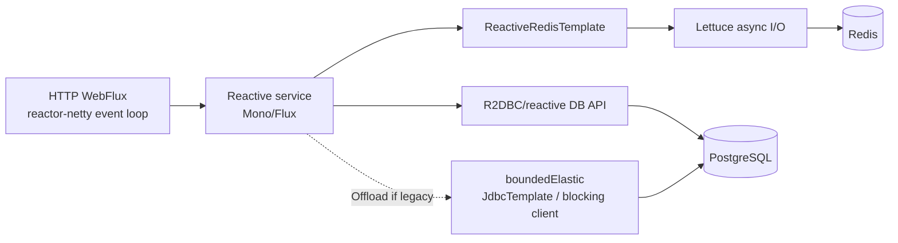
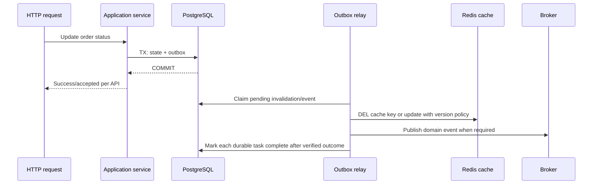

# ReactiveRedisTemplate and Non-Blocking Boundaries

> **Chapter:** Redis  
> **Module:** `SPRING_BOOT_INTEGRATION` — integrating systems in Spring Boot across HTTP clients, databases, caches, message brokers, and Spring Integration adapters. Emphasis is on configuration, data contracts, transactions, error classification, deduplication, testing, and observability.
>
> **API context:** Java 17+, Spring Boot 3.x, Spring Data Redis reactive, and Project Reactor. Examples use Redis via **Lettuce** and Spring WebFlux. Properties, serializer APIs, and Spring Cache interactions may vary across Spring Boot/Spring Data Redis versions; verify against your actual dependencies/BOM. This lesson focuses on reactive programming and I/O boundaries, not claiming Redis provides exactly-once semantics or shared transactions with databases.

## 1. Problem: WebFlux Uses Redis, Yet Requests Still Stall

An Order Service API serves order status lookups:

```text
GET /orders/{orderId}/summary
    → Redis cache
    → On cache miss: read PostgreSQL
    → Update cache TTL
    → Return data to HTTP client
```

The team adopted Spring WebFlux expecting to handle high concurrency with a modest thread count. Yet an implementation can accidentally block the event loop:

```java
// Anti-pattern inside a WebFlux handler:
OrderSummary summary = redisTemplate.opsForValue().get(key);
return Mono.just(summary);
```

Here `RedisTemplate` is a **synchronous** API. The `get` call waits on network I/O directly on the calling thread. Another common mistake:

```java
// Anti-pattern: switching to the reactive API, then blocking for the value:
OrderSummary summary = reactiveRedisTemplate.opsForValue()
    .get(key)
    .block();
```

`ReactiveRedisTemplate` returns `Mono`/`Flux`, yet `.block()` turns the call into a synchronous wait and may be rejected by Reactor if executed on a thread marked non-blocking. Requests slow down, latency spikes, and threads stall while the app believes it is "reactive."

This lesson's goal is to **understand precisely what "non-blocking" means**, integrate `ReactiveRedisTemplate` properly into pipelines, isolate steps that remain blocking, design timeouts and cache policies, and avoid mistaking a Redis cache for a source of truth or durable broker.

### Learning Objectives

After this lesson, you will be able to:

1. Distinguish `RedisTemplate`, `ReactiveRedisTemplate`, and `ReactiveStringRedisTemplate`.
2. Understand the roles of `ReactiveRedisConnectionFactory`, Lettuce, Reactor `Mono/Flux`, and subscription.
3. Build a non-blocking cache-aside API without `block()`, with explicit TTL and fallback rules.
4. Design serialization, key namespaces, type/version contracts, and cache invalidation.
5. Spot JDBC, file I/O, `Thread.sleep`, CPU-heavy deserialization, and blocking HTTP calls inside reactive flows.
6. Use `Schedulers.boundedElastic()` safely for legacy blocking I/O when reactive drivers are not yet available.
7. Bound concurrency, timeouts, payload sizes, and retries, and prevent cache stampedes.
8. Understand Redis atomicity limits, database transactions, inbox/outbox, and idempotency.
9. Test with Reactor `StepVerifier` and real Redis, verifying memory, latency, and Redis disconnect behavior.

## 2. Which Problems Does ReactiveRedisTemplate Solve?

Spring Data Redis provides two prominent API families:

| API | Return Types | Calling Style | Best Fit |
|---|---|---|---|
| `RedisTemplate<K,V>` | `V`, `Boolean`, `Long`, `List<V>`… | Synchronous; calling thread may wait on I/O | MVC, blocking batch/jobs, traditional thread-per-request code |
| `ReactiveRedisTemplate<K,V>` | `Mono<V>`, `Flux<V>`, `Mono<Boolean>`… | Non-blocking reactive pipeline with supporting driver | WebFlux, reactive event processing, publisher composition |
| `ReactiveStringRedisTemplate` | `Mono<String>`/`Flux<String>` and operation results | Specialized for String keys and values | String token/key caches, JSON strings, simple counters |

**Note:** A Spring MVC REST controller **can** still call `ReactiveRedisTemplate`, though if the controller unwraps results with `block()`, it does not achieve end-to-end non-blocking behavior. Conversely, a WebFlux application **can** invoke `RedisTemplate`, but doing so directly on the event loop blocks threads.

Spring Data Redis reactive relies on `ReactiveRedisConnectionFactory` and a reactive driver; with the standard Spring Boot starter, **Lettuce** is the driver supporting the reactive API. Never assume every Redis client or connection factory on the classpath supports reactive interfaces.

### 2.1. "Reactive" Does Not Mean Redis Server Executes Everything in Parallel

"Non-blocking" primarily describes the **client-side execution model**: instead of parking a thread waiting on a socket response, the driver and Reactor schedule response handling. Redis still has CPU/network limits, memory bounds, bandwidth caps, lock contention, heavy commands, and eviction/replication overhead.

If Redis is overloaded, 10,000 pending `Mono`s are still 10,000 live in-flight tasks. Not parking one thread per request **does not mean** you can ignore connection limits, timeouts, backpressure, or memory consumption.

### 2.2. Boundary Diagram



The Redis/Lettuce branch can be asynchronous while the **JDBC branch remains blocking**. Inspect the **entire pipeline**, not just one bean.

## 3. Reactor Mono, Flux, and When Redis Commands Execute

Most reactive Redis operations return:

- `Mono<T>`: emits **0 or 1** value, followed by completion or error.
- `Flux<T>`: emits 0 to many values, then completion or error.
- `Mono<Boolean>`: command outcome such as `SET`/`EXPIRE` per the API.
- `Mono<Long>`: deleted/counted item results where applicable.

Example:

```java
Mono<String> read = redis.opsForValue().get("order:summary:42");
```

Here `read` is a **Publisher**. When the application subscribes (directly or via WebFlux subscribing to write the HTTP response), the command begins execution. Driver command preparation may have internal details; the key application design rule is never to assume constructing a `Mono` means the value is already in memory or the command has executed.

### 3.1. Do Not Drop Outcomes with Manual subscribe()

```java
// Do not do this inside a request handler:
redis.opsForValue().set(key, value).subscribe();
return Mono.just("accepted");
```

This creates a subscription detached from the request lifecycle. The Redis command can fail after the response has already returned; cancellation, tracing, retries, and error handling are severed from the pipeline. For data requiring reliability, this is no substitute for a job or outbox.

Compose instead:

```java
return redis.opsForValue()
    .set(key, value, Duration.ofMinutes(3))
    .thenReturn("stored");
```

WebFlux manages subscription, errors, and cancellation on the returned publisher. **Never** call `subscribe()` inside a service just to "trigger" an operation and discard the handle.

### 3.2. Cold Publishers and Multiple Subscriptions

In many Redis pipelines, **each subscription can trigger a new execution**. For example:

```java
Mono<Boolean> operation = redis.opsForValue().set(key, value);
operation.subscribe();
operation.subscribe();
```

This can dispatch the command twice. Especially with `INCR`, `LPUSH`, or other side effects, consider how retries or resubscriptions repeat operations. Sharing a publisher via `cache()` or `share()` also has distinct lifecycle and memory semantics; never rely on them to "solve" business exactly-once behavior.

## 4. Setting Up a Spring Boot Project with Reactive Redis

Gradle Groovy DSL:

```gradle
dependencies {
    implementation("org.springframework.boot:spring-boot-starter-webflux")
    implementation("org.springframework.boot:spring-boot-starter-data-redis-reactive")
    implementation("org.springframework.boot:spring-boot-starter-actuator")

    testImplementation("org.springframework.boot:spring-boot-starter-test")
    testImplementation("io.projectreactor:reactor-test")
}
```

In Spring Boot 3.x, the standard reactive Redis starter uses Lettuce. Avoid manually adding conflicting client versions; let the Spring Boot BOM align Spring Data Redis, Lettuce, Reactor, and Netty.

```yaml
spring:
  data:
    redis:
      host: ${REDIS_HOST:localhost}
      port: ${REDIS_PORT:6379}
      timeout: 2s

management:
  endpoints:
    web:
      exposure:
        include: health,info,metrics
```

Environment placeholders above serve local/test use; production needs proper Redis endpoints, TLS, credentials, timeouts, and ACLs. Never default to `localhost` in production. `spring.data.redis.timeout` configures client/connection timeouts per version; do not treat it as an **end-to-end deadline for an entire HTTP request**.

### 4.1. Auto-Configured Templates vs. Custom Beans

Spring Boot auto-configures `ReactiveRedisConnectionFactory`, `ReactiveStringRedisTemplate`, and `ReactiveRedisTemplate` when dependencies, factory types, and bean conditions match. However:

- The default template uses a default serializer; never guess a DTO serializer without checking the actual bean.
- When multiple Redis connection factories exist, specify explicit qualifiers/templates.
- Defining a dedicated `ReactiveRedisTemplate<String, OrderSummary>` bean locks in the value serializer contract.
- Defining a custom connection factory can cause auto-configuration to back off or ignore earlier properties.

Do not treat the existence of a template bean as proof that the Redis server is reachable. Startup may create the bean cleanly, only for the first command to fail on connection.

## 5. ReactiveStringRedisTemplate: Simple Read/Write Example

`ReactiveStringRedisTemplate` is a convenient starting point when both keys and values are strings:

```java
import java.time.Duration;
import org.springframework.data.redis.core.ReactiveStringRedisTemplate;
import org.springframework.stereotype.Service;
import reactor.core.publisher.Mono;

@Service
public class ReactiveSessionTokenStore {
    private final ReactiveStringRedisTemplate redis;

    public ReactiveSessionTokenStore(ReactiveStringRedisTemplate redis) {
        this.redis = redis;
    }

    public Mono<Boolean> put(String tokenReference, String value) {
        String key = "session:v1:" + tokenReference;
        return redis.opsForValue().set(key, value, Duration.ofMinutes(15));
    }

    public Mono<String> find(String tokenReference) {
        return redis.opsForValue().get("session:v1:" + tokenReference);
    }

    public Mono<Boolean> remove(String tokenReference) {
        return redis.delete("session:v1:" + tokenReference)
            .map(count -> count > 0);
    }
}
```

This example only demonstrates the reactive API. If `tokenReference` comes from user input, validate format and length and ensure keys cannot allow cross-tenant access. Avoid storing raw access tokens or secrets in Redis/logs unnecessarily; if storing sessions or tokens, enforce dedicated security controls, TTLs, eviction handling, rotation, and access restrictions.

**Semantics note:** `GET` on a missing key completes **without emitting a value** (`Mono.empty()`), rather than throwing `KeyNotFoundException`. `SET` returns `Mono<Boolean>` reflecting the client's interpretation of the command; it is **not confirmation of a cross-database business transaction**.

### 5.1. SET with TTL vs. Separate EXPIRE

```java
// Single Redis command attaching TTL alongside SET:
redis.opsForValue().set(key, value, Duration.ofMinutes(5));
```

This is generally better than:

```java
// Two independent commands; crash/error between them can leave a key without TTL:
redis.opsForValue().set(key, value)
    .then(redis.expire(key, Duration.ofMinutes(5)));
```

For caches with a maximum lifetime rule, use **SET with expiration in a single command** so there is no window where data lacks a TTL if the process dies after SET.

### 5.2. Cache TTL Is Not a Business Expiration Guarantee

Redis expiration removes keys once expired; memory eviction policies can also drop keys before their TTL elapses. Never treat TTL as **proof** that a token was globally revoked everywhere or that an event no longer needs idempotency. A cache is an acceleration layer, not a transaction log.

## 6. ReactiveRedisTemplate<K,V> and Explicit Serializers

When values are DTOs, choose serialized JSON, CBOR, or bytes according to your contract. Illustrative type and bean setup:

```java
public record OrderSummary(
    String orderId,
    String tenantId,
    String status,
    long version
) {}
```

```java
import org.springframework.context.annotation.Bean;
import org.springframework.context.annotation.Configuration;
import org.springframework.data.redis.connection.ReactiveRedisConnectionFactory;
import org.springframework.data.redis.core.ReactiveRedisTemplate;
import org.springframework.data.redis.serializer.Jackson2JsonRedisSerializer;
import org.springframework.data.redis.serializer.RedisSerializationContext;
import org.springframework.data.redis.serializer.RedisSerializer;

@Configuration(proxyBeanMethods = false)
class OrderRedisConfiguration {

    @Bean
    ReactiveRedisTemplate<String, OrderSummary> orderSummaryRedis(
            ReactiveRedisConnectionFactory connectionFactory) {

        RedisSerializationContext<String, OrderSummary> context =
            RedisSerializationContext
                .<String, OrderSummary>newSerializationContext(
                    RedisSerializer.string())
                .value(new Jackson2JsonRedisSerializer<>(OrderSummary.class))
                .build();

        return new ReactiveRedisTemplate<>(connectionFactory, context);
    }
}
```

**Version note:** `Jackson2JsonRedisSerializer`, its constructors, and Jackson configuration have changed/deprecated across Spring Data Redis branches. Choose the JSON serializer/API supported by your active version and write round-trip tests; never copy snippets across major versions without compiling. A custom `ObjectMapper` aligned with your contract (Java Time, enums, field names) may be needed instead of a default serializer.

### 6.1. Why Must Serializers Be Governed?

Redis holds only bytes. If producers and consumers read the same key with incompatible serializers, `GET` can return corrupted values, raise deserialization errors, or fail to read older records during upgrades.

- Lock down key prefixes, value types, and schema versions.
- For JSON, manage Jackson modules, enum/time representations, and unknown-field policies.
- Avoid enabling polymorphic default typing for untrusted payloads.
- Never use Java native serialization (`JdkSerializationRedisSerializer`) to share data across services or untrusted contexts without rigorous security controls.
- Maintain migration/dual-read strategies when changing serializers or schemas.
- Test reading cache entries written by the previous application version.

### 6.2. Relationship Between Keys and Tenants

A key like `order:42` can collide across two tenants. Use an explicit namespace:

```text
order-summary:v2:<tenantId>:<orderId>
```

Normalize/escape inputs per rules to avoid ambiguous key concatenation; never let users request `KEYS *` or pick arbitrary Redis namespaces. Key prefixes aid organization, but **never replace ACLs** or service-level tenant authorization.

## 7. Non-Blocking Cache-Aside: Cache Hit, Cache Miss, and TTL

A common pattern:

1. Look up in Redis.
2. On hit, return the value.
3. On miss, read the authoritative source (PostgreSQL via **R2DBC** in a reactive application).
4. Write back to cache with a TTL.
5. Return the value to the HTTP caller.

Application-defined repository interface:

```java
import reactor.core.publisher.Mono;

public interface ReactiveOrderSummaryRepository {
    Mono<OrderSummary> findByTenantAndId(String tenantId, String orderId);
}
```

Cache-aside implementation:

```java
import java.time.Duration;
import org.springframework.beans.factory.annotation.Qualifier;
import org.springframework.data.redis.core.ReactiveRedisTemplate;
import org.springframework.stereotype.Service;
import reactor.core.publisher.Mono;

@Service
public class ReactiveOrderSummaryService {

    private static final Duration CACHE_TTL = Duration.ofMinutes(3);

    private final ReactiveRedisTemplate<String, OrderSummary> redis;
    private final ReactiveOrderSummaryRepository database;

    public ReactiveOrderSummaryService(
            @Qualifier("orderSummaryRedis")
            ReactiveRedisTemplate<String, OrderSummary> redis,
            ReactiveOrderSummaryRepository database) {
        this.redis = redis;
        this.database = database;
    }

    public Mono<OrderSummary> find(String tenantId, String orderId) {
        String key = "order-summary:v2:" + tenantId + ":" + orderId;

        return redis.opsForValue().get(key)
            .switchIfEmpty(Mono.defer(() ->
                database.findByTenantAndId(tenantId, orderId)
                    .flatMap(summary ->
                        redis.opsForValue()
                            .set(key, summary, CACHE_TTL)
                            .thenReturn(summary)
                    )
            ));
    }
}
```

What is right in this example:

- No `.block()` or manual `subscribe()`.
- `switchIfEmpty(Mono.defer(...))` triggers the DB query only on cache miss, avoiding eager computation/fetching on the fallback branch.
- `set(key, summary, ttl)` writes the cache entry with expiration.
- `database.findByTenantAndId` is a **genuinely reactive API**; returning `Mono<T>` alone would not prove non-blocking execution if JDBC were called inside.
- If the DB finds no row, `Mono.empty()` propagates out; the controller translates it to HTTP `404`.
- Redis/DB errors **propagate** through the pipeline; no cache-down fallback is shown in this basic snippet yet.

### 7.1. Should DB Data Still Return if Cache Write Fails?

In many systems, caching is optional. If Redis `SET` fails after a successful DB read, returning `500` may be undesirable because valid data was already fetched. You can design a **best-effort write** for identifiable Redis infrastructure errors:

```java
return database.findByTenantAndId(tenantId, orderId)
    .flatMap(summary ->
        redis.opsForValue()
            .set(key, summary, CACHE_TTL)
            .thenReturn(summary)
            .onErrorResume(
                org.springframework.data.redis.RedisConnectionFailureException.class,
                ex -> Mono.just(summary)
            )
    );
```

This catches **Redis connection errors** during the cache write; it does not swallow serializer failures, mismatched data types, or application bugs. If falling back on Redis timeouts too, apply a controlled timeout policy and keep cache errors distinct from DB errors.

### 7.2. Do Not Let Cache Write Fallbacks Stall HTTP Responses Indefinitely

Reading the DB and then writing the cache in the same reactive chain still **awaits the `SET` result** before returning the summary. You can put a short timeout on the cache write or design dedicated write-behind handling; never detach writes with an unmanaged `subscribe()` and pretend you have a durable background job.

## 8. WebFlux Controller Returning Mono Without Blocking

HTTP endpoint example:

```java
import org.springframework.http.HttpStatus;
import org.springframework.web.bind.annotation.GetMapping;
import org.springframework.web.bind.annotation.PathVariable;
import org.springframework.web.bind.annotation.RequestMapping;
import org.springframework.web.bind.annotation.RestController;
import org.springframework.web.server.ResponseStatusException;
import reactor.core.publisher.Mono;

@RestController
@RequestMapping("/tenants/{tenantId}/orders")
class OrderSummaryController {

    private final ReactiveOrderSummaryService service;

    OrderSummaryController(ReactiveOrderSummaryService service) {
        this.service = service;
    }

    @GetMapping("/{orderId}/summary")
    Mono<OrderSummary> summary(
            @PathVariable String tenantId,
            @PathVariable String orderId) {

        return service.find(tenantId, orderId)
            .switchIfEmpty(Mono.error(new ResponseStatusException(
                HttpStatus.NOT_FOUND, "Order not found")));
    }
}
```

WebFlux subscribes to the `Mono` and writes the response when data arrives. However, this controller **lacks authentication/authorization**: an unauthorized client cannot be blocked merely by key prefixing. In production, authenticate caller identity, verify tenant mapping, and validate IDs before building Redis keys or querying the DB.

Avoid echoing raw user input or PII inside `Mono.error(...)` responses; return stable error codes or `ProblemDetail` per your API contract.

## 9. Reactivity Does Not Propagate to JDBC or Synchronous HTTP

An easily overlooked anti-pattern:

```java
public Mono<OrderSummary> find(String orderId) {
    OrderSummary summary = jdbcTemplate.queryForObject(
        "SELECT ... WHERE order_id = ?",
        orderRowMapper,
        orderId
    );

    return Mono.just(summary);
}
```

`JdbcTemplate.queryForObject` executes **immediately before `Mono` is returned**, blocking the current thread. Wrapping it in `Mono.just` does not make it asynchronous.

Another anti-pattern:

```java
public Mono<OrderSummary> find(String orderId) {
    return Mono.defer(() ->
        Mono.just(jdbcTemplate.queryForObject(
            "SELECT ... WHERE order_id = ?",
            orderRowMapper,
            orderId
        ))
    );
}
```

`Mono.defer` defers execution until subscription, yet **still blocks the subscribing thread**. Laziness does not mean non-blocking.

### 9.1. Prefer Reactive Drivers When Appropriate

When building a WebFlux service genuinely needing end-to-end non-blocking PostgreSQL access, consider R2DBC and an API like `DatabaseClient` or reactive repositories. Check transaction semantics, SQL dialects, driver maturity, and feature support; R2DBC is not a one-to-one drop-in for every JDBC/jOOQ JDBC capability.

### 9.2. Do Not Rewrite Entire Systems to Reactive Unconditionally

A Spring MVC + JDBC + `RedisTemplate` application can fit bounded workloads and connection pools very well. Switching to reactive increases code and debugging complexity; the clearest wins appear under high I/O wait, high concurrency, and non-blocking dependencies throughout. Choose the execution model based on SLAs, throughput, resources, and operational experience—not library buzzwords.

## 10. Wrapping Legacy Blocking I/O with boundedElastic

When a PostgreSQL client cannot yet move to R2DBC, use `Mono.fromCallable` paired with `Schedulers.boundedElastic()` to offload blocking calls off the event loop:

```java
import org.springframework.jdbc.core.JdbcTemplate;
import org.springframework.stereotype.Repository;
import reactor.core.publisher.Mono;
import reactor.core.scheduler.Schedulers;

@Repository
class LegacyJdbcOrderReader {

    private final JdbcTemplate jdbc;

    LegacyJdbcOrderReader(JdbcTemplate jdbc) {
        this.jdbc = jdbc;
    }

    Mono<OrderSummary> find(String tenantId, String orderId) {
        return Mono.fromCallable(() ->
                jdbc.queryForObject(
                    """
                    SELECT order_id, tenant_id, status, version
                    FROM order_summary
                    WHERE tenant_id = ? AND order_id = ?
                    """,
                    (rs, rowNum) -> new OrderSummary(
                        rs.getString("order_id"),
                        rs.getString("tenant_id"),
                        rs.getString("status"),
                        rs.getLong("version")
                    ),
                    tenantId, orderId
                )
            )
            .subscribeOn(Schedulers.boundedElastic());
    }
}
```

**Meaning:**

- `Mono.fromCallable` defers invocation until subscription.
- `subscribeOn(Schedulers.boundedElastic())` runs blocking JDBC on the bounded scheduler reserved for blocking work.
- Never run long socket/SQL blocking waits on `Schedulers.parallel()`, which is sized for short CPU-bound tasks.
- `boundedElastic` does not create non-blocking I/O. It uses a **bounded pool of dedicated threads** waiting on I/O; when load exceeds capacity, tasks queue or delay.
- If JDBC finds no rows, `queryForObject` throws `EmptyResultDataAccessException`; translate that to "not found" in the adapter if returning `Mono.empty()`.

### 10.1. Separating "Not Found" from Real Errors

```java
return Mono.fromCallable(() ->
        jdbc.queryForObject(SQL, rowMapper, tenantId, orderId))
    .subscribeOn(Schedulers.boundedElastic())
    .onErrorResume(
        org.springframework.dao.EmptyResultDataAccessException.class,
        ex -> Mono.empty()
    );
```

`SQL` and `rowMapper` are fields defined in the actual repository. Never write `onErrorResume(Exception.class, ex -> Mono.empty())`, which silently masks DB timeouts, permission errors, or row-mapping bugs as "order not found."

### 10.2. `@Transactional` Boundaries Across Thread Switches

Spring's imperative transactions typically rely on **`ThreadLocal`**. `subscribeOn` and `publishOn` can switch threads; placing `@Transactional` on a method that returns a `Mono` whose SQL runs later **does not automatically propagate** the JDBC transaction context along the reactive chain.

For legacy JDBC:

- Put `@Transactional` on a **synchronous method performing SQL** invoked via Spring proxy inside the `boundedElastic` thread.
- Or use `TransactionTemplate` to execute the entire JDBC unit inside `fromCallable`, offloading the callable.
- Never keep a JDBC transaction open across long reactive Redis/HTTP network calls.
- With R2DBC, Spring's reactive transaction infrastructure uses the Reactor context and `ReactiveTransactionManager`, distinct from imperative `PlatformTransactionManager`.

## 11. Isolating Database Transaction Boundaries with TransactionTemplate

Example application service writing an outbox row via JDBC triggered from WebFlux:

```java
import org.springframework.stereotype.Service;
import org.springframework.transaction.support.TransactionTemplate;
import reactor.core.publisher.Mono;
import reactor.core.scheduler.Schedulers;

@Service
class LegacyOrderCommandAdapter {

    private final TransactionTemplate transactions;
    private final JdbcOrderCommandRepository repository;

    LegacyOrderCommandAdapter(
            TransactionTemplate transactions,
            JdbcOrderCommandRepository repository) {
        this.transactions = transactions;
        this.repository = repository;
    }

    Mono<Long> accept(OrderCommand command) {
        return Mono.fromCallable(() -> {
                Long id = transactions.execute(status -> {
                    long orderId = repository.insertOrder(command);
                    repository.insertOutbox(command.eventId(), orderId);
                    return orderId;
                });
                return java.util.Objects.requireNonNull(id);
            })
            .subscribeOn(Schedulers.boundedElastic());
    }
}
```

`JdbcOrderCommandRepository` and `OrderCommand` are application-defined types. All SQL inside the callback must share the **same datasource/transaction manager**. This pattern does not make JDBC non-blocking, but establishes clean transaction boundaries and avoids holding DB transactions open while Redis is unavailable.

### 11.1. No Atomic JDBC + Redis Transaction

A JDBC `@Transactional` or `TransactionTemplate` does not encompass Redis. If PostgreSQL commits and then Redis `SET` fails, the database holds new data while the cache may stay stale.

Common strategy:

1. **The database is the source of truth.**
2. Commit DB first.
3. Invalidate/update cache post-commit via tracked application code or an outbox event.
4. Let TTLs and version checks bound staleness windows.
5. Use reconciliation when cache misses/invalidations fail.

If the DB transaction rolls back, never emit a cache update as if the change committed.

## 12. Limits of Spring Cache `@Cacheable` with Reactive Redis

Spring Cache abstraction (`@Cacheable`/`CacheManager`) and Spring Data Redis reactive **are not the same API**.

- `RedisCacheManager`/`RedisCache` builds on Spring Cache's cache implementation, which does not automatically mean using `ReactiveRedisTemplate`/Lettuce reactive operations.
- Newer Spring Framework versions support methods returning `Mono`/`Flux` in the caching abstraction, yet you must verify **how the cache provider performs I/O** and async cache semantics.
- `@Cacheable` does not promise every Redis call runs non-blocking on the WebFlux event loop.
- `@Cacheable` does not replace key/version/TTL/tenant policies or stale-cache controls when the database updates.

When the explicit requirement is **non-blocking Redis I/O with fallbacks composed in Reactor**, using `ReactiveRedisTemplate` directly in an adapter keeps get/set/delete/timeout steps transparent. If a team already uses Spring Cache cleanly and throughput does not demand reactive execution, switching is not mandatory.

## 13. Cache Miss, Timeout, and Redis Unavailable

A cache can fail at multiple levels:

| Scenario | Reactive Signal | Policy |
|---|---|---|
| Key does not exist | `Mono.empty()` | Read DB/source of truth |
| Redis connection failed | `Mono.error(...)` | Fall back to DB if cache is non-critical; increment metrics |
| Redis timeout | `TimeoutException` in pipeline | Bypass cache and fall back within deadline |
| Wrong serializer / stale cache schema | Deserialization error | Do not silently treat as missing if contract broke |
| Redis memory eviction | Key disappears early | Read DB and refill |
| DB unavailable after cache miss | DB publisher error | Propagate/5xx per API; never fabricate data |
| Redis hit with stale value | Cache returns old object | Version/invalidation/TTL/consistency policy |

### 13.1. Creating an Explicit Best-Effort Cache Read Layer

```java
import java.time.Duration;
import java.util.concurrent.TimeoutException;
import org.springframework.data.redis.RedisConnectionFailureException;
import reactor.core.publisher.Mono;

Mono<OrderSummary> cacheRead(String key) {
    return redis.opsForValue().get(key)
        .timeout(Duration.ofMillis(250))
        .onErrorResume(RedisConnectionFailureException.class, ex -> {
            cacheFailureCounter.increment();
            return Mono.empty();
        })
        .onErrorResume(TimeoutException.class, ex -> {
            cacheTimeoutCounter.increment();
            return Mono.empty();
        });
}
```

`redis`, `cacheFailureCounter`, and `cacheTimeoutCounter` are injected/initialized dependencies in a real adapter. This snippet only illustrates how to **bound cache read latency** and fall back on two explicit error classes; do not copy it as a standalone class without its fields.

When `cacheRead` completes empty, the database branch runs via `switchIfEmpty(Mono.defer(...))`. **Do not** fall back on all exceptions by swallowing serializer errors, schema mismatches, or programming bugs; those errors generally need alerts or key quarantine.

### 13.2. Reactor Timeouts vs. Client Timeouts

`timeout(Duration)` enforces a deadline on the publisher at the Reactor layer. `spring.data.redis.timeout` and Lettuce command timeouts operate at the client layer. They complement rather than replace each other; a caller-side timeout **does not guarantee an already-sent Redis command was canceled on the server**.

In particular, if an `INCR` or Lua script times out and you unconditionally retry, the first command may already have executed. Design idempotency/result reconciliation for writes; a timeout does not prove a command did not run.

## 14. Retries: Only When Safe and Budgeted

`retryWhen(Retry.backoff(...))` can fit transient network errors on safe **read** commands. For writes with side effects, retries risk double execution when the first outcome is uncertain.

```java
import java.time.Duration;
import reactor.util.retry.Retry;

Mono<OrderSummary> readWithBoundedRetry(String key) {
    return redis.opsForValue().get(key)
        .retryWhen(
            Retry.backoff(2, Duration.ofMillis(80))
                .maxBackoff(Duration.ofMillis(300))
                .filter(error -> error instanceof
                    org.springframework.data.redis.RedisConnectionFailureException)
        )
        .timeout(Duration.ofMillis(800));
}
```

This illustrates bounded retries for **`GET`**; even for `GET`, total deadlines and Redis load must be considered. `maxBackoff` does not encompass all command, scheduling, and connection delays; an outer `timeout` acts as an additional safety cap.

### 14.1. Why Not Retry INCR Blindly?

```text
Client sends INCR counter
Redis executes successfully
Response is lost on the network
Client sees TimeoutException
Client retries INCR
Counter increments by 2 instead of 1
```

Redis provides atomicity for an individual command, not **exactly-once across network timeouts**. For side effects requiring exactness, use request IDs/idempotent logic in the database or Redis Lua/functions tracking processed IDs with appropriate TTL/lifecycle, and test with failure injection.

### 14.2. Avoid Multiplying Retries Across Layers

An HTTP client, service, Redis adapter, broker consumer, and outbox relay might each retry 3 times, exploding total attempts. Assign a clear **retry owner** per error category and enforce an overall time/attempt budget.

## 15. Concurrency and Backpressure with Flux

A reactive pipeline may use `flatMap` to issue many Redis calls concurrently. Left unbounded, in-flight commands and buffered heap objects can spike.

```java
import reactor.core.publisher.Flux;

Flux<OrderSummary> summaries =
    Flux.fromIterable(orderIds)
        .flatMap(
            orderId -> orderService.find(tenantId, orderId),
            32 // Bound concurrent inner publishers.
        );
```

`flatMap(..., 32)` bounds concurrency within that pipeline, but **does not create a global rate limit** across concurrent HTTP requests or pods. If a single request already buffers thousands of `orderIds` in memory, limiting concurrency to 32 does not solve oversized inputs; bound batch sizes at HTTP/controller validation.

### 15.1. flatMap vs. concatMap

- `flatMap` can emit results out of input order.
- `flatMapSequential` preserves output order matching inputs, at the cost of buffering.
- `concatMap` processes sequentially one at a time with minimal parallelism.

If order events for the same aggregate require ordering, do not use high-concurrency `flatMap` assuming order is preserved. For independent cache lookups without ordering constraints, `flatMap` is appropriate.

### 15.2. Backpressure Does Not Replace Ingress Limits

`Flux`/Reactive Streams supports demand/backpressure signaling, yet not every API, broker, or proxy propagates backpressure identically. The Redis server and network may continue processing commands already in flight even if downstream cancels. Bound queues, connections/pools, and request rates at ingress.

## 16. Avoid Unbounded collectList or Loading All Keys into RAM

`ReactiveRedisTemplate` offers `Flux`-returning operations for scanning or reading multiple items. An anti-pattern:

```java
return redis.scan()
    .collectList(); // Can accumulate huge numbers of keys on the heap.
```

This assumes `redis` is a template with a scan API, illustrating the hazard of `collectList` on unbounded datasets.

### 16.1. SCAN Instead of KEYS

When scanning keys in production, avoid `KEYS *` on large datasets because it can stall Redis processing. Redis `SCAN` iterates incrementally:

```java
import org.springframework.data.redis.core.ScanOptions;
import reactor.core.publisher.Flux;

Flux<String> keys = redis.scan(
    ScanOptions.scanOptions()
        .match("order-summary:v2:*")
        .count(100)
        .build()
);
```

**Limitations of SCAN:**

- `count(100)` is a hint, not a guarantee of returning 100 keys per step.
- Scans are not point-in-time snapshots; keys added or deleted mid-scan can affect results.
- Per Redis `SCAN` semantics, duplicate keys may appear; consumers must deduplicate if side effects require it.
- Scanning the whole keyspace repeatedly still consumes significant I/O and CPU.

Never use `SCAN` as an exactly-once task distribution mechanism. For durable job queues, use a DB/outbox table, Redis Streams with ACK policies, or a dedicated broker as needed.

### 16.2. Avoid Redis N+1 Queries with Bounded Batch APIs

If reading 500 keys, consider multi-get/batch APIs where supported instead of dispatching 500 unthrottled small commands. However, multi-get materializes a collection of matching size; bound key counts and total payload bytes. Benchmark against real workloads: an oversized `MGET` can also cause latency spikes.

## 17. Atomic Operations in Redis: SET NX, INCR, and Lua

Redis provides atomicity for **single commands** like `SET key value NX EX seconds` or `INCR` per Redis semantics. Spring Data Redis reactive exposes corresponding APIs.

### 17.1. SET If Absent with TTL

```java
import java.time.Duration;
import reactor.core.publisher.Mono;

Mono<Boolean> tryClaim(String jobId, String ownerToken) {
    String key = "job-claim:v1:" + jobId;
    return redis.opsForValue()
        .setIfAbsent(key, ownerToken, Duration.ofSeconds(30));
}
```

If `true`, the caller created the key when absent per command semantics. Still, **this is not a complete distributed lock**:

- The lease can expire before the worker finishes.
- Worker A's lease expires and Worker B acquires the key; Worker A can still perform side effects unless guarded by a fencing token or DB state check.
- Releasing with a bare `DEL` when Worker A finishes can delete the lock **now owned by Worker B**.
- Redis failover/replication can affect lock guarantees; evaluate consistency and durability for your Redis topology.

When unlocking by owner token, use **atomic compare-and-delete** via Lua/Redis Function (or a verified lock implementation), never separate `GET` and `DEL`.

### 17.2. INCR Is Atomic, Not a Business Transaction

```java
Mono<Long> next =
    redis.opsForValue().increment("metrics:orders:accepted");
```

This works as a technical counter, though retrying after a timeout can increment twice. Never treat counter values as exact proof of committed orders unless backed by reconciliation or unique business IDs.

### 17.3. Multiple Commands Are Not Automatically Atomic

```java
redis.opsForValue().increment(key)
    .then(redis.expire(key, Duration.ofMinutes(1)));
```

Two independent commands leave a crash/error window between them. For rate limiters needing atomic "increment + set initial TTL + return remaining quota," use a **Lua script/Redis Function** or a proven library.

Never assume "because each Redis command is atomic, chaining multiple commands with `flatMap`/`then` is also atomic."

## 18. Redis Transactions and PostgreSQL Transactions Do Not Merge

Redis offers primitives like `MULTI/EXEC`, `WATCH`, Lua scripts, and Redis Functions depending on version. However:

- `ReactiveRedisTemplate` uses reactive connections and corresponding APIs; transactions/pipelining must follow driver connection context rules, not merely Reactor `then`.
- JDBC `@Transactional` does not manage Redis operations.
- Reactive/R2DBC `@Transactional` likewise does not create a distributed PostgreSQL–Redis transaction.
- Redis replication/persistence differs from a transactional database's WAL and durability guarantees.

### 18.1. When Both DB Writes and Cache Invalidation Are Needed

A pragmatic flow:



This diagram illustrates the **concept**: if a relay updates both Redis and a broker, track **completion state separately per side effect**, because succeeding on cache invalidation does not imply broker publishing succeeded, and vice versa. In practice, you may split these into two outbox job types or two independent subscribers.

### 18.2. Never Cache "Event Processed" Before DB Commit

If you record `processed:eventId` in Redis first and the PostgreSQL transaction rolls back, a redelivery may see the cache key and skip a valid event. For exactly-once business effects, use **DB unique constraints and transactions** as the source of truth; Redis deduplication is an optional optimization only after analyzing failure modes.

## 19. Cache Consistency: TTL, Stale Values, and Write Races

Cache-aside is common, yet carries a known race:

```text
T1: Reader hits Redis cache miss
T2: Reader queries DB, receives version=5
T3: Writer updates DB to version=6 and DELs cache key
T4: Reader writes version=5 to Redis after invalidation
T5: Subsequent requests read stale data until TTL or next invalidation
```

Hence, `DB commit → DEL cache` does not eliminate all concurrent races. Choose consistency rules to fit the business:

1. **Short TTLs with eventual consistency** for non-critical views.
2. **Versioned keys/values** and comparison logic preventing lower versions from overwriting higher ones.
3. **Event-driven invalidation** with retries and reconciliation.
4. **Do not cache** decisions requiring strictly current state—such as payment authorization—without DB guards.
5. **Read-through/versioned caches** encapsulated behind a policy-enforcing adapter.

### 19.1. A Cache Miss Cannot Be Treated as Nonexistence

A Redis miss can stem from TTL expiration, eviction, or Redis outage. If the DB returns valid data, return it. Only return HTTP 404 when the **source of truth** lacks the record, never simply because a Redis key is absent.

### 19.2. Negative Caching

Caching "not found" results can shield the DB from repeated lookups of invalid IDs, provided you enforce:

- Short TTLs and a sentinel representation distinct from JSON `null`.
- Tenant-aware keys and explicit authorization checks.
- Avoiding hiding newly created records because a negative cache entry stays alive.
- Separating backend "not found" from backend errors; never cache DB errors as not-found.

## 20. Cache Stampede, Hot Keys, and Distributed Locks

When a hot key's TTL expires under thousands of concurrent requests, all of them can miss and hit PostgreSQL at once. This is a **cache stampede**.

Controls:

- TTL jitter so keys do not expire simultaneously.
- Request coalescing / single-flight **within an instance** for hot keys, using bounded maps and lifecycle cleanup.
- Redis locks/leases with owner tokens and proper fencing when multi-instance coordination is needed.
- Stale-while-revalidate if the contract permits bounded stale responses.
- Rate limiting/backpressure at the API and DB layers.
- Monitored warm-up/batch refreshes rather than unbounded polling of all keys.

Never put `Mono.cache()` into a global map without eviction: caching publishers on the JVM heap can leak memory indefinitely. If implementing single-flight, define entry lifetimes and cleanup on completion, error, and cancellation.

### 20.1. Hot Keys and Latency

A single "campaign status" key may be read millions of times. Even tiny `GET` responses can bottleneck Redis or network links. Consider short-lived local caches, read replicas where consistency allows, batching, edge response caching, and traffic caps. Multi-tier caching complicates invalidation, so define ownership clearly.

## 21. Redis Pub/Sub vs. Redis Streams vs. Cache

Redis supports multiple patterns, each with different delivery contracts:

| Redis Feature | Purpose | Guarantees to Understand |
|---|---|---|
| Strings/Hashes/Sets | Caches, counters, lookups | Subject to TTL/eviction and data policies |
| Pub/Sub | Pushes messages to **currently online** subscribers | No backlog/replay like a durable queue for offline consumers |
| Redis Streams | Appends log stream entries; consumer groups, ACK/pending | Requires operating pending entries, reclaim, retention, and idempotency |
| Lists/Blocking pop | Simple work queues | Requires building ACK/requeue/recovery to avoid losing tasks |
| Keyspace notifications | Observes key/expiration events | Do not rely on them as reliable business event logs |
| Lua/Functions | Bundles atomic server-side Redis operations | Does not create cross-system transactions with PostgreSQL |

`ReactiveRedisTemplate` exposes APIs for many operations, yet returning a `Flux` **does not turn an operation into a durable broker**.

### 21.1. Pub/Sub Is Not an Outbox

If a payment event is published only over Redis Pub/Sub while a subscriber is offline, the subscriber **misses** the event. For workflows requiring replay and ACKs, use properly configured Redis Streams or Kafka/RabbitMQ/Pulsar with inbox/outbox patterns.

### 21.2. Streams Have ACKs Yet Still Have Redelivery

Redis Streams consumer groups track pending entries. If a worker crashes before ACK, entries stay pending and must be reclaimed/recovered. Therefore, **at-least-once delivery and idempotency** remain crucial. Redis Streams do not automatically replace dedicated streaming systems for every workload; evaluate retention, cluster topology, and operations.

## 22. Reactive Context, ThreadLocal, and Observability

Reactive pipelines switch threads. Traditional `ThreadLocal`-backed state like MDC logging, security contexts, or imperative transaction contexts do not propagate across all operators automatically without context propagation mechanisms.

- Reactor uses `Context` for per-subscription metadata.
- Spring Security reactive provides Reactor-compatible security context propagation when configured.
- Micrometer tracing/context propagation depends on dependencies and instrumentation.
- Never read an HTTP thread's `ThreadLocal` to determine tenant inside a Redis callback where threads may have switched.

### 22.1. Correlation IDs and Tenants

A request may carry a `correlationId` for tracing, whereas **`tenantId` in Redis keys must come from an authenticated identity**, never an unverified HTTP query parameter. Cached Redis data may hold PII or internal state; never log full cached objects or credentials.

### 22.2. Do Not Put Event IDs in Metric Labels

Event IDs and order IDs have high cardinality; tagging Micrometer metrics per event can bloat time-series backends. Tag metrics by operation, status, cache hit/miss, exception class, and environment; put event IDs in structured logs and traces under retention and masking policies.

## 23. Securing Redis with Reactive Caches

Using a reactive template does not reduce security requirements:

1. Use TLS, authentication, and ACLs per deployment; never hard-code credentials.
2. Restrict network access and namespaces/key prefixes; never run routine services with admin accounts.
3. Decide **which data may be cached**; avoid caching passwords, raw access tokens, or sensitive payment details unless strictly justified.
4. Encrypt sensitive data per policy and secure backups/snapshots.
5. Enforce TTLs/retention and deletion workflows for personal data compliance.
6. Never allow free-form user input to construct Redis commands, `KEYS` patterns, or arbitrary keyspace accesses.
7. Avoid logging values on serializer failures and avoid exposing `/actuator/configprops` or unmasked Redis metrics publicly.
8. In multi-tenant apps, enforce authorization before reading/writing keys; key prefixes only organize storage.

If Redis is flushed or evicted, the system must recover cache entries from the authoritative source; if the "cache" holds the **only copy of business state**, re-evaluate Redis persistence/HA and stop calling it a cache.

## 24. Testing Reactive Redis APIs with StepVerifier

Reactor Test provides `StepVerifier` to assert publisher signals:

```java
import static org.assertj.core.api.Assertions.assertThat;
import java.time.Duration;
import org.junit.jupiter.api.Test;
import reactor.core.publisher.Mono;
import reactor.test.StepVerifier;

class ReactivePipelineTest {

    @Test
    void emitsOneValueThenCompletes() {
        Mono<String> result = Mono.just("DELIVERED")
            .map(String::toLowerCase);

        StepVerifier.create(result)
            .expectNext("delivered")
            .verifyComplete();
    }

    @Test
    void emptyPublisherIsNotAnError() {
        StepVerifier.create(Mono.<String>empty())
            .verifyComplete();
    }
}
```

This is a Reactor unit test **not connected to Redis**. It demonstrates observing `onNext`/`onComplete` and distinguishing empty from error. Do not assume serializers, TTLs, or connections work just from a `Mono.just` test.

### 24.1. Testing Services with Fake Reactive Ports

Abstracting database and cache access behind application ports makes cache hit/miss testing possible without starting Redis. Mocks/fakes can verify:

- Cache hits do not query the database.
- Cache misses query the DB once.
- Redis connection failures fall back when policy permits.
- Redis cache write timeouts do not stall responses forever.
- DB errors are not turned into 404s.
- No `block()` calls exist in the service.

Still, integration tests are required to prove Lettuce commands and serializers work against a real Redis server.

## 25. Integration Testing with Real Redis and Testcontainers

Example using Testcontainers `GenericContainer` (Docker must be available in the test environment):

```gradle
dependencies {
    testImplementation("org.testcontainers:junit-jupiter")
    testImplementation("org.testcontainers:testcontainers")
    testImplementation("io.projectreactor:reactor-test")
}
```

```java
import java.time.Duration;

import org.junit.jupiter.api.Test;
import org.springframework.beans.factory.annotation.Autowired;
import org.springframework.boot.test.context.SpringBootTest;
import org.springframework.test.context.DynamicPropertyRegistry;
import org.springframework.test.context.DynamicPropertySource;
import org.springframework.data.redis.core.ReactiveStringRedisTemplate;
import org.testcontainers.containers.GenericContainer;
import org.testcontainers.junit.jupiter.Container;
import org.testcontainers.junit.jupiter.Testcontainers;
import reactor.test.StepVerifier;

@Testcontainers
@SpringBootTest
class ReactiveRedisIntegrationTest {

    @Container
    static final GenericContainer<?> redisServer =
        new GenericContainer<>("redis:7.4-alpine")
            .withExposedPorts(6379);

    @DynamicPropertySource
    static void redisProps(DynamicPropertyRegistry registry) {
        registry.add("spring.data.redis.host", redisServer::getHost);
        registry.add("spring.data.redis.port",
            () -> redisServer.getMappedPort(6379));
    }

    @Autowired
    ReactiveStringRedisTemplate redis;

    @Test
    void writesReadsAndExpiresWithTtl() {
        String key = "test:reactive-redis:order-42";

        StepVerifier.create(
            redis.opsForValue().set(key, "READY", Duration.ofSeconds(30))
        )
            .expectNext(true)
            .verifyComplete();

        StepVerifier.create(redis.opsForValue().get(key))
            .expectNext("READY")
            .verifyComplete();

        StepVerifier.create(redis.getExpire(key))
            .assertNext(ttl -> org.assertj.core.api.Assertions
                .assertThat(ttl).isPositive())
            .verifyComplete();
    }
}
```

This is an **integration example** requiring compatible Spring Boot/Testcontainers/JUnit dependencies and Docker; it does not run in STEP 4. Using a fixed key only works with an isolated container; in parallel suites, generate unique keys and clean up afterward.

**Note:** `getExpire(key)` returns `Mono<Duration>`; when a key is missing or has no expiration, the result follows Spring Data Redis's specific mapping of Redis TTL semantics. Assert that the TTL is positive and does not exceed the expected duration rather than requiring exactly 30 seconds after network latency.

### 25.1. Testing Versioned Serialization

With `ReactiveRedisTemplate<String, OrderSummary>`, integration tests should:

1. Write a DTO containing `orderId`, `tenantId`, `status`, and `version`.
2. Read it back and assert every field, not just non-nullity.
3. Write using the previous serializer/schema and read with new code.
4. Test expired TTLs and prematurely deleted Redis entries.
5. Test corrupted or mismatched-type Redis payloads: errors must surface, never silently become cache misses.

## 26. Testing Performance and Failure Modes of "Non-Blocking"

Functional correctness alone is insufficient when the goal is non-blocking execution.

### 26.1. Recommended Experiments

| Experiment | What to Observe |
|---|---|
| Slow Redis responses while connected | Does the WebFlux event loop stall, and do cache timeouts fire? |
| Redis disconnected | Does DB fallback obey policy, and how does latency behave? |
| 1,000 concurrent requests missing the same key | How severe is the cache stampede and DB query spike? |
| `flatMap` concurrency at 8/32/128 | Throughput, pending commands, memory, and latency |
| Very large cached objects | Does CPU serialization/deserialization stall the event loop? |
| Redis out of memory / heavy eviction | Impact on cache hit ratio and DB load |
| JDBC DB inside pipeline | Are blocking threads properly offloaded to `boundedElastic`? |
| Redis GET/SET timeouts | Are read vs. write errors classified without blindly retrying side effects? |
| Shutdown mid-Redis write | Do responses/side effects handle uncertain outcomes safely? |
| Old-version cached values | Do parsers/migration/fallback report errors and metrics? |

### 26.2. Controlled Use of BlockHound and Profiling

BlockHound can help detect certain blocking calls on threads Reactor marks non-blocking during dev/test, though compatibility with your JDK, bytecode instrumentation, and Reactor version must be checked. It **does not catch all CPU stalls or all blocking paths** and must not be treated as sole proof that an application is non-blocking.

Combine thread dumps, JFR/async-profiler, Reactor metrics, Redis command latency, and HTTP p95/p99. Also inspect **JDBC pool pending waits** if bridging to blocking code.

### 26.3. Interpreting Metrics Properly

A non-blocking pipeline can sustain higher concurrency with fewer threads, yet if Redis itself is the bottleneck, p99 latency will still degrade. Address bottlenecks via caching policy, batching, data shape, payload size, backpressure, Redis topology, or reducing origin load—not just by increasing thread counts.

## 27. Troubleshooting: Symptoms and Diagnostics

| Symptom | Likely Cause | Resolution |
|---|---|---|
| `block()` throws `IllegalStateException` on Reactor thread | Blocking terminal operator called on event loop | Return the publisher directly; remove `block()` |
| High WebFlux latency despite reactive template | Blocking JDBC/RestClient, CPU-heavy JSON, slow Redis | Profile the whole pipeline; offload or switch drivers |
| Redis GET miss enters error handler | Confused `Mono.empty` with error | Use `switchIfEmpty` for misses |
| Cache always empty after SET | Wrong key prefix, serializer, DB index, or TTL | Round-trip test with the same template and Redis endpoint |
| Redis SET succeeds yet DB data is stale | Cache invalidation race | Versioning policy, TTLs, outbox/reconciliation |
| `Mono` does nothing | Publisher was never subscribed by caller | Compose/return publisher to WebFlux |
| Redis writes twice | Publisher subscribed or retried twice | Audit side-effect commands and subscription ownership |
| `onErrorResume` masks mapping errors | Fallback catches all exceptions | Catch only classified cache infrastructure errors |
| Event loop blocked inside `map` | Parsing huge JSON or calling blocking client | Isolate CPU-heavy work/legacy I/O; bound payloads |
| `boundedElastic` congested | Too many blocking JDBC/HTTP calls | Bound concurrency, size pools, shed load |
| Low cache hit rate after deploy | Changed key prefix/schema, eviction, or overly short TTL | Versioned key migration, memory/TTL metrics |
| OOM during scan | `collectList` over entire keyspace | Bounded streaming, scan pages/limits, never unbounded scan |
| Redis command timeout then wrong `INCR` | Command executed before response dropped; retry duplicated | Idempotency/reconciliation |
| Redis Pub/Sub loses events when pod is offline | Pub/Sub has no durable replay | Redis Streams/broker and outbox |
| DB transaction commits yet cache stays stale | Redis is outside the JDBC transaction | Post-commit invalidation, outbox, version checks |
| Tests pass with mocked Redis but prod fails serialization | Mocks do not simulate wire bytes or drivers | Integration tests against real Redis |

Never "fix" issues by setting infinite timeouts, unbounded concurrency, or swallowing all errors. Those changes turn visible failures into silent backlogs or hard-to-trace data loss.

## 28. Choosing RedisTemplate or ReactiveRedisTemplate?

| Question | Recommendation |
|---|---|
| Spring MVC + JDBC app with moderate load? | Synchronous `RedisTemplate` is usually clear and easy to operate. |
| WebFlux app where most I/O is already non-blocking? | `ReactiveRedisTemplate` / `ReactiveStringRedisTemplate` fits well. |
| A few legacy JDBC APIs cannot yet migrate? | Bridge via bounded `boundedElastic`, or stay on MVC if simpler. |
| Need multi-version JSON object caching? | Typed serializers, versioned key namespaces, round-trip/migration tests. |
| Need atomic counters / `SET NX`? | Redis commands are atomic; outcomes over the network can still be uncertain. |
| Need durable work queues with ACK/replay? | Do not use Pub/Sub; consider Redis Streams, Kafka/Rabbit/Pulsar, or DB outbox. |
| Need consistent DB and cache updates? | DB is source of truth; use invalidation/versioning/outbox and reconciliation. |
| Need reactive transactions with PostgreSQL? | R2DBC/`ReactiveTransactionManager` per driver support; never mix arbitrarily with JDBC transactions. |
| Need lower p99 during Redis outages? | Short cache-read timeouts, bounded fallbacks, and circuit breakers/load shedding. |
| No evidence WebFlux is currently limited by blocking? | Benchmark first; never migrate an entire stack solely for the "reactive" label. |

## 29. Checklist for Implementing Reactive Redis in Integration Systems

1. **Driver:** use Lettuce / reactive connection factory supporting `ReactiveRedisTemplate` aligned with your BOM version.
2. **Context:** use WebFlux/reactive pipelines where genuinely justified, with no `.block()` or orphaned `.subscribe()`.
3. **Serialization:** configure key/value serializers explicitly with round-trip and migration tests.
4. **Key design:** explicit namespace/version/tenant, reject arbitrary user keys, enforce authorization.
5. **TTL:** `SET` with TTL to avoid eternal entries; account for eviction and eventual consistency.
6. **Miss vs. error:** `Mono.empty` for cache misses; distinguish Redis, serializer, and DB errors.
7. **Fallback:** when cache is optional, fall back to DB within a deadline; never swallow all exceptions.
8. **Blocking boundaries:** replace blocking JDBC/RestClient/file calls with reactive APIs or offload to bounded `boundedElastic`.
9. **Transactions:** DB and Redis do not share a transaction; update caches post-commit by policy.
10. **Retries:** bounded retries on reads; handle uncertain outcomes and idempotency on writes/`INCR`.
11. **Concurrency:** bound `flatMap`, never accumulate entire keyspaces, budget total in-flight work per pod/cluster.
12. **Stampede:** use TTL jitter/single-flight/leases matching consistency requirements; avoid locks without fencing.
13. **Brokers:** caches and Pub/Sub are not durable queues; critical events need outbox/inbox and delivery contracts.
14. **Security:** TLS/ACL/secrets/PII/tenant isolation/retention; never log payloads.
15. **Observability:** cache hit/miss, timeouts, Redis latency, command failures, thread saturation, p95/p99, DB load.
16. **Testing:** `StepVerifier`, Redis Testcontainers, serializer round-trips, cache outages, concurrent misses, failure injection.
17. **Releases:** schema/key/serializer changes include backward compatibility, dual-read, rollout, and rollback plans.
18. **Runbooks:** clear procedures for Redis down, eviction storms, hot keys, stale caches, and cache flushes.

## 30. Self-Check Knowledge Quiz

**Q1:** Does `ReactiveRedisTemplate.opsForValue().get(key)` park a thread waiting on the network like `RedisTemplate`?  
**Answer:** With a reactive driver like Lettuce and a properly composed pipeline, I/O runs non-blocking; however, serialization, CPU-heavy callbacks, or other code can still occupy threads.

**Q2:** Why is `Mono.just(jdbcTemplate.queryForObject(...))` not non-blocking?  
**Answer:** JDBC runs **immediately before** `Mono` is created and blocks the calling thread. Use a reactive DB driver or `Mono.fromCallable(...).subscribeOn(Schedulers.boundedElastic())` for legacy code.

**Q3:** Does `Mono.defer` automatically move a blocking call onto another scheduler?  
**Answer:** No. It only defers execution until subscription; offloading requires an explicit scheduler.

**Q4:** How is `GET` on a nonexistent key represented?  
**Answer:** Typically `Mono.empty()`; handle misses with `switchIfEmpty` rather than treating them as Redis connection errors.

**Q5:** What advantage does `SET key value TTL` have over `SET` followed by `EXPIRE`?  
**Answer:** TTL is attached in the same command, eliminating the crash window between two separate commands.

**Q6:** Can a service call `.subscribe()` and return HTTP `202` to guarantee the cache was saved?  
**Answer:** No. That detaches the write from the request, error, and cancellation lifecycle and gives no durable confirmation. Compose the publisher or use a managed job/outbox.

**Q7:** Redis `INCR` is atomic, so is retrying it on timeout safe?  
**Answer:** Not necessarily. The first command may have executed with its response dropped; retrying can increment twice.

**Q8:** Does `flatMap(..., 32)` limit Redis commands to 32 across the entire cluster?  
**Answer:** No. That is local concurrency for that operator/pipeline; apply ingress, pod, or cluster-wide limits if global SLOs or rate limits require it.

**Q9:** Does `ReactiveRedisTemplate` combine JDBC `@Transactional` and Redis into a single shared transaction?  
**Answer:** No. Databases and Redis have separate transaction boundaries; the DB is the source of truth, and cache invalidation/consistency must be designed explicitly.

**Q10:** Does Redis Pub/Sub guarantee an offline consumer receives missed events when reconnecting?  
**Answer:** No. Pub/Sub delivers only to connected subscribers; critical events need durable storage/replay such as Streams or an appropriate broker.

**Q11:** Why can `collectList()` on Redis `SCAN` be dangerous?  
**Answer:** It can accumulate the entire keyspace on the JVM heap even though the API appears reactive step-by-step.

**Q12:** Does using `@Cacheable` in WebFlux automatically mean Redis I/O is non-blocking?  
**Answer:** Not by default. Inspect the cache provider, framework version, and actual implementation; `ReactiveRedisTemplate` provides an explicit non-blocking Redis API.

**Q13:** Should a missing Redis key immediately return HTTP 404?  
**Answer:** Not when Redis is only a cache. Check the authoritative data source before deciding not-found.

**Q14:** When two instances encounter a cache miss simultaneously and read the DB, how do you prevent a stampede?  
**Answer:** Use TTL jitter, coalescing/locks with properly designed leases and fencing, rate limiting, or stale-while-revalidate per consistency needs—not by simply increasing Redis concurrency.

### Version-Specific Reference Documentation

- [Spring Data Redis — Reference](https://docs.spring.io/spring-data/redis/reference/).
- [Spring Data Redis — Reactive Redis](https://docs.spring.io/spring-data/redis/reference/redis/reactive.html).
- [Spring Boot — Redis](https://docs.spring.io/spring-boot/reference/data/nosql.html#data.nosql.redis).
- [Project Reactor — Reference Guide](https://projectreactor.io/docs/core/release/reference/).
- [Redis — Commands and data types](https://redis.io/docs/latest/commands/).

Documentation and code in this lesson may require adjustments for your current release train, Redis server version, and client serializer. In particular, never infer from a single unit test or a `Mono` return type that the entire HTTP–database–cache–broker pipeline is non-blocking.

---

In the **Redis** chapter of `SPRING_BOOT_INTEGRATION`, remember: **`ReactiveRedisTemplate` enables publisher-based Redis communication with non-blocking I/O via an appropriate driver, but it does not make JDBC, synchronous HTTP, heavy serialization, business transactions, or the Redis server non-blocking**. Reliability and scalability depend on how you compose `Mono/Flux`, bound concurrency and timeouts, design TTLs/serializers/keys, fall back to the source of truth, apply idempotency/outbox patterns, and verify with testing, security, and observability.
